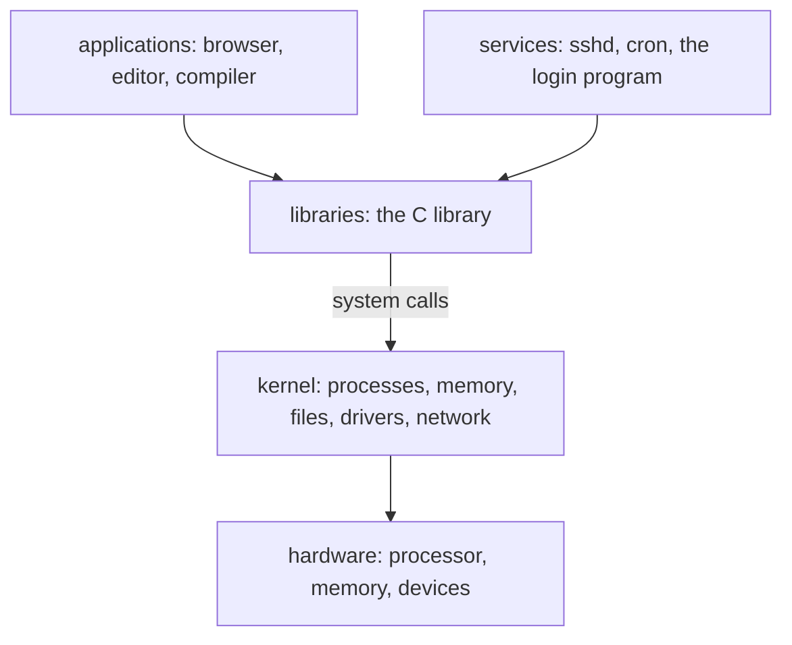
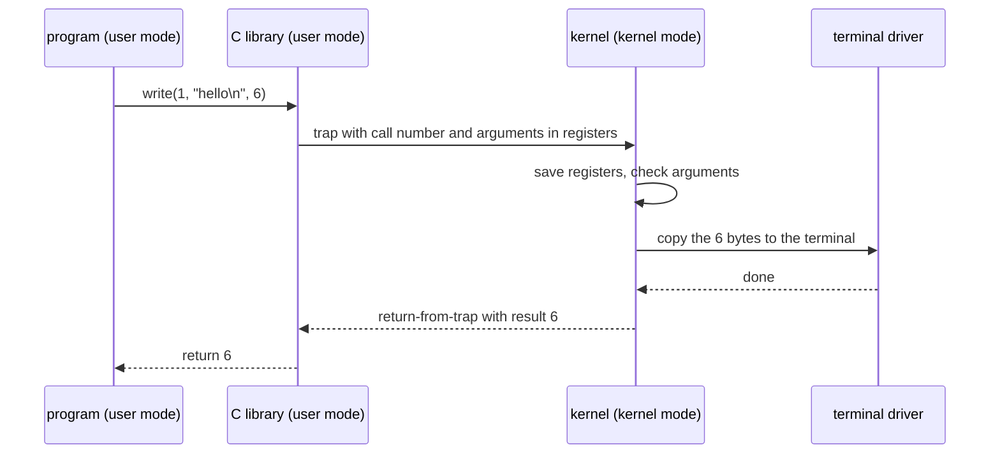
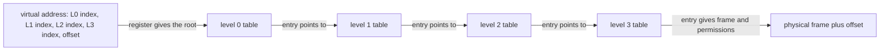
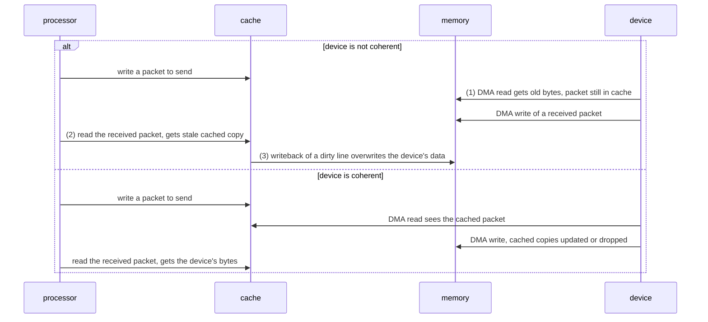

# Chapter 1. Operating Systems from the Ground Up

> **Status.** Background: the chapter describes operating systems in
> general and carries no mark. Each sentence about erXos in its
> "Where erXos uses this" paragraphs says in words which mark of the
> [key](README.md#built-and-designed) applies: **Built**, working in the
> tree today, or **Designed**, specified but not yet built.

**Background needed.** None. The chapter assumes only that the reader
can program, in any language.

Open a laptop and three programs run at once: a music player, a web
browser and a compiler. Each was written as if it had the machine to
itself. None of them knows the others exist, yet they share one
processor, one memory and one disk, and a bug that crashes the browser
does not stop the music.

No program can arrange this for itself. On bare hardware, any program
can write to any byte of memory and send any command to any device.
Something has to stand between the programs and the machine, decide
who runs and who gets what, and refuse what would do harm.

That something is the **operating system**: the software that shares a
computer among the programs on it, hides the hardware behind a few
simple ideas, and keeps the programs from harming each other. UNIX,
written at Bell Laboratories from 1969, is the operating system most
programmers have met, directly or through its descendants FreeBSD,
Linux and macOS. This chapter uses UNIX, and FreeBSD in particular, as
its running example, because the later chapters compare erXos with it.

The short answer to how an operating system works is this. Its core, the
**kernel**, runs with the processor's full power. Every other program
runs with less, and asks the kernel whenever it needs something it
cannot do alone. Four ideas carry most of the weight. The process shares
the processor. Virtual memory shares memory and guards each program's
part of it. Drivers and interrupts connect the kernel to the devices.
The file keeps data when the power goes off.

Sections 1.1 and 1.2 say what an operating system is for and how the
processor separates the kernel from everything else. Sections 1.3 to
1.6 take the four ideas in turn. Section 1.7 covers how programs talk
and share safely, 1.8 how a machine boots, and 1.9 what happens when a
part fails. Most sections end with a paragraph on where erXos uses the
idea. Machine detail comes from 64-bit Arm, called AArch64, the first
architecture erXos runs on.

## 1.1 What an operating system is for

A computer without an operating system runs one program, which must
know everything about the machine: which disk blocks hold its data, how
to drive the disk controller, where in memory it may put things. Early
computers worked this way.

An operating system does three jobs such a program cannot: it shares the
machine, hides the hardware behind simpler ideas, and protects programs
from each other.

### 1.1.1 Sharing

There are two ways to share a resource. The processor is shared in
time: one program runs for a few milliseconds, then another, so fast
that all seem to run at once. Memory is shared in space: each program
gets its own part. A disk is shared both ways: its space among files,
its time among the requests that read and write them.

Sharing needs a referee to decide which program runs next, how much
memory each may hold, and which disk request goes first. Each decision
is a **policy**: a desktop favors the program the person is looking at,
a server favors throughput. Operating systems keep policy apart from
**mechanism**, the code that carries a decision out, such as stopping
one program and starting another. A policy can then change without
touching the mechanism.

### 1.1.2 Hiding the hardware

A disk knows only blocks: fixed-size runs of bytes, each with a number.
A program wants to say "open `notes.txt`" and get bytes back. The
operating system builds the second view on the first, keeping a table
of which blocks hold which file.

The same pattern repeats for every part of the machine. The processor
becomes a set of processes, each a running program that seems to have a
processor of its own. Memory becomes a set of address spaces, each a
private range of addresses for one process. A disk becomes a tree of
named files. Each of these is an **abstraction**: a simpler idea that
stands for the hardware and hides its detail, so a program written
against it runs on whatever disk the machine has.

### 1.1.3 Protection

Protection needs help from the hardware. A buggy program can write a
wrong address; a hostile one can try to read another program's secrets.
The operating system must stop both while the program runs at full
speed, without inspecting each instruction. Section 1.2 shows the
processor's two modes, which make this possible, and section 1.4 how
virtual memory gives each program a private view of memory.

### 1.1.4 The parts of an operating system

An operating system is more than its kernel. Figure 1.1 shows the layers
of a typical UNIX system, from the hardware up.



*Figure 1.1. The layers of a UNIX system. Only the kernel touches the
hardware. Every program above it asks the kernel, usually through the C
library.*

The kernel is the one program that runs with the processor's full
power. It holds the machine's state: which processes exist, which
memory each owns, which files are open. In UNIX and FreeBSD it also
contains the file systems, the network protocols and the **drivers**,
the code that operates each device. A kernel that holds all of these in
one program is a **monolithic kernel**. Everything in it trusts
everything else: a bug in a webcam's driver can overwrite the file
system's data (section 1.9 follows that failure).

A **library** is code that programs link with and call like their own
functions. The most important is the **C library**, which gives
programs `printf`, `malloc` and `open`. Most of its functions run inside
the program; a few, such as `open`, ask the kernel to do the work.

**Services** are programs that run in the background with no person at
the keyboard; UNIX calls them daemons. `sshd` accepts remote logins and
`cron` runs commands on a schedule. To the kernel they are ordinary
programs; they belong to the operating system because the rest of the
system relies on them.

**erXos's kernel.** erXos runs on **Fiasco**, an existing microkernel of
the L4 family ([chapter
2](02-microkernels.md#25-the-l4-family-and-fiasco)). Programs do not
call Fiasco directly. They call erXos's own **kernel interface**, the
set of requests programs may make of the kernel, which a small library
called `liberx` carries out over Fiasco ([chapter
8](README.md#chapter-8-the-kernel-interface-and-fiasco)).

**Where erXos uses this.** erXos draws the line of figure 1.1 in a
different place. Only the kernel runs with the processor's full power,
as in UNIX, but it holds far less. The file systems, the network stack
and the drivers run outside it, as ordinary programs, most of them
written in Erlang. That is built
([design.md, Trust placement](../design.md#trust-placement)). A kernel
that keeps this little is a **microkernel**, the subject of [chapter
2](02-microkernels.md).

## 1.2 The processor's two modes, and the way across

A program's instructions run directly on the processor, at full speed,
with no interpreter checking each one. That makes programs fast, and it
is also the problem. What stops one instruction from switching off the
clock that lets the kernel take control back, or from rewriting the
table that says which memory the program may use?

The processor has two modes. In **kernel mode** it executes every
instruction it has. In **user mode** it refuses the **privileged
instructions**: those that change the memory map, reach devices, turn
interrupts off (section 1.2.1) or set the timer. The kernel runs in
kernel mode and every other program in user mode. A program that tries
a privileged instruction is stopped, and the processor hands control to
the kernel, which usually ends the program.

Two modes alone would leave a program no way to ask for anything, so the
processor offers controlled ways across, each landing at a place the
kernel chose in advance.

### 1.2.1 Three ways into the kernel

There are three ways in, each with its own name.

* A **system call** is a deliberate request. The program executes a
  special instruction, a **trap**, that switches the processor to kernel
  mode and jumps into the kernel. The program asks for something it
  cannot do itself: open a file, send a packet, start another program.
* An **exception** is caused by the instruction the program was running:
  it touched memory that is not mapped, or was not a valid instruction.
  The processor cannot finish it, so it enters the kernel. A **page
  fault**, raised when a program touches memory with no valid
  translation, is the most common kind; section 1.4.5 follows one.
* An **interrupt** comes from outside the program: a device needs
  attention because a packet arrived, a disk read finished or a key was
  pressed. The running program did nothing to cause it, and the kernel
  returns to it once the device is served.

The first two are synchronous: they happen at a particular instruction
of the program. An interrupt is asynchronous: it can arrive between any
two instructions.

All three use one mechanism. At boot, the kernel writes the address of
a table into a processor **register**, one of the few named storage
cells inside the processor. The table, called the vector table on Arm,
lists one entry point for each kind of event. When an event happens,
the processor saves an address to come back to, switches to kernel
mode, and jumps to the matching entry. For a system call the saved
address is the instruction after the trap. For a fault it is the
faulting instruction, so that it can run again once the kernel has
fixed the cause. The program never names the address it jumps to, or it
could jump past the kernel's checks, so setting the table's address is
a privileged instruction.

### 1.2.2 A system call from start to finish

A short C program, a sketch rather than code from erXos's tree, shows a
system call at work:

```c
#include <unistd.h>

int
main(void)
{
	write(1, "hello\n", 6);
	return (0);
}
```

`write` looks like an ordinary function, and part of it is: a small
function in the C library. Descriptor 1 is the program's standard
output, usually the terminal (section 1.6.3). Figure 1.2 follows the
call.



*Figure 1.2. A system call. The program enters kernel mode only at the
trap and leaves only at the return-from-trap. Everything between runs in
the kernel, on the program's behalf, after the kernel has checked the
request.*

The library's `write` puts a number that means "write" in one register
and the three arguments in others, then executes the trap. The
processor saves where the program was, switches to kernel mode and
jumps to the kernel's system-call entry. The kernel saves the rest of
the program's registers and reads the call number to find the code for
`write`.

Then the kernel checks everything. Is descriptor 1 open in this
process, and for writing? Do all six bytes at the address of
`"hello\n"` lie in memory this process may read? The program chose
every argument, so the kernel trusts none. A program that passed the
address of the kernel's own memory, and was believed, could make the
kernel print the kernel's secrets.

A pointer argument has one more trap: another thread of the program
(section 1.3.4) can change the bytes between the kernel's check and its
use, a bug called **time of check to time of use**. Kernels avoid it by
copying each argument into kernel memory once and using only the copy;
FreeBSD's kernel does this with `copyin` and `copyout`.

With the checks passed, the kernel hands the bytes to the terminal's
driver, puts the result, 6, where the library expects it, restores the
program's registers and executes the return-from-trap. The program
continues at the instruction after the trap, as if `write` had been a
function call.

The crossing is not free: saving and restoring registers takes time,
and the kernel's code and data push the program's out of the caches
(section 1.5.5). This is why `printf` collects characters in a buffer
before calling `write`. Early UNIX had about twenty system calls; a
modern UNIX has a few hundred.

### 1.2.3 The timer, and taking the processor back

A system call returns control to the kernel only if the program makes
one. A program stuck in `for (;;) ;` never does, and would hold the
processor forever.

The **timer interrupt** closes that gap. Before it starts any program,
the kernel sets a hardware timer to interrupt every few milliseconds,
and no program can turn the timer off. When the interrupt arrives, the
processor enters the kernel whatever the program was doing, and the
kernel can run another program instead. Taking the processor away from a
running program this way is **preemption**. With a timer, the kernel
always gets the processor back.

### 1.2.4 Protection without modes

A system can instead refuse to run machine code it did not check.
Programs are written in a language with no way to forge a pointer or
read past an array's end, and a trusted interpreter or compiler runs
them. All programs can then share one memory and one mode, and talk
without a trap.

This moves trust from the hardware to large programs, the interpreter
and the compiler: a bug in either opens every program to every other.
It also shuts out machine code written in C. Hardware modes guard
against any code, at the price of a trap per crossing, and operating
systems in wide use rely on them.

### 1.2.5 The modes on AArch64

AArch64 calls its modes **exception levels**, numbered from 0 to 3,
where a higher number has more power. Programs run at EL0, user mode.
The kernel runs at EL1, kernel mode. EL2 is for a hypervisor, software
that runs whole operating systems as guests, and EL3 belongs to the
firmware that starts the board. The system-call trap is the instruction
`svc`, the vector table's address goes in the register `VBAR_EL1`, and
the return-from-trap is `eret`.

**Where erXos uses this.** Fiasco, erXos's kernel, runs at EL1 and
every program at EL0; that is built. Every
language runtime, the program that runs another language's code, runs
at EL0, including the Erlang runtime that runs erXos's own system
services. erXos uses Erlang, a safe language, but still walls programs
apart with the hardware: the Erlang runtime does not check the code it
loads, and a checker would be one more large program to trust (section
1.2.4). A program calls the kernel through `liberx`. Each call
either runs as one of Fiasco's own system calls or becomes a request to
the **root service**, a thread of the first program, the system domain
(section 1.8), which alone creates kernel objects and maps memory; that
is built ([design-fiasco.md](../design-fiasco.md#transport)).

## 1.3 Processes, threads and scheduling

A machine with four processor **cores**, four complete processors on
one chip, often runs a hundred programs at once. Each core runs one
stream of instructions at a time. The operating system turns four
streams into a hundred with the process, and with the scheduler, the
part of the kernel that decides which process runs on which core and
for how long.

### 1.3.1 Programs and processes

A program is a file: instructions and initial data, sitting on a disk. A
**process** is a program running: the program's instructions plus
everything that changes as they run. Two people who run the same shell,
`/bin/sh`, run one program in two processes, and what one types does not
appear in the other.

The kernel keeps a record for each process. While the process is not
running, the record holds its registers (section 1.2.1). Among them are
the **program counter**, the address of the next instruction, and the
**stack pointer**, the top of the process's stack. The record also
names the process's address space (section 1.4), its open files
(section 1.6), the user it runs for, and its number, the **process id**
or pid.

UNIX creates a process in two steps. The `fork` system call copies the
calling process: the copy, called the child, has the same memory, the
same open files and the same program counter, and both continue from the
return of `fork`. The `exec` call then replaces the child's program with
another one, read from a file. Ritchie and Thompson's 1974 paper on UNIX
describes both, the second under the name `execute`. A shell runs a
command this way: it forks, the child execs the command, and the parent
waits for the child to exit. Splitting creation in two lets the child
change its own setup, such as which file its output goes to, before the
program starts.

### 1.3.2 Running, ready and blocked

At any moment a process is in one of three states. It is **running** on
a core; or **ready**, able to run but waiting for a core; or
**blocked**, waiting for something else, such as a disk read to finish
or a key to be pressed. A process that calls `read` on a terminal blocks
until the person types. The kernel moves it to ready when the input
arrives, and a ready process runs when the scheduler picks it.

Blocking is what makes sharing pay: while one process waits for the
disk, another uses the processor.

### 1.3.3 The context switch

Moving a core from one process to another is a **context switch**.
Process A is running when the timer interrupt arrives. The processor
enters the kernel, and the kernel saves A's registers into A's record.
The scheduler picks process B. The kernel tells the processor to use
B's address space, loads B's saved registers, and executes the
return-from-trap. The core then runs B from the instruction where B
last stopped, and B cannot tell that it was ever stopped.

A switch costs more than its instructions. B starts by missing in the
processor's caches (section 1.5.5), which are full of A's data, and the
cache of memory translations (section 1.4.3) may have to be cleared. A
scheduler that switches too often spends the machine on switching; one
that switches too rarely makes every program wait.

### 1.3.4 Threads

A process as described so far has one stream of instructions. A
**thread** is one such stream: a program counter, a stack and a set of
registers. A process can have several threads, all running in the same
address space and sharing all of its memory. On a machine with several
cores, the threads of one process can run at the same time on different
cores.

Sharing memory makes threads cheap to create and quick to communicate,
since one thread can read what another wrote with no help from the
kernel. It also makes them dangerous. Two threads that update the same
data at once can corrupt it, and section 1.7 explains how they
coordinate.

The threads described so far are **kernel threads**: the kernel knows
each one and schedules it. A program can also run **user-level
threads** of its own on top of a few kernel threads, switching between
them inside the program with no system call; the kernel sees only the
kernel threads. A switch costs about a function call. A user-level
thread can need only a few KiB of memory, so a program can afford far
more of them than of kernel threads.

Erlang's processes are user-level threads of this kind ([chapter
3](03-erlang.md#32-processes-and-messages)). **Despite the shared word,
an Erlang process is not an operating-system process**: the kernel
never sees one.

### 1.3.5 Scheduling

The **scheduler** picks which ready thread runs next on each core. It
keeps the ready threads in **run queues**. The chosen thread gets a
**time slice** of a few milliseconds, after which the timer interrupt
lets the kernel choose again.

The simplest policy is round robin: take turns, each for one slice. It
is fair, but it treats a text editor waiting for a keystroke like a
compiler that would run for an hour. Real schedulers add
**priorities**, numbers that say which thread runs first, and adjust
them as threads run. A thread that keeps using its whole slice is
probably a long computation, so it drops; one that blocks quickly is
probably interactive, so it rises, and a keystroke gets a quick
response. Policies must also prevent **starvation**, where a
low-priority thread never runs because higher ones are always ready. On
several cores, the scheduler keeps a run queue per core and tries to
keep each thread on the core whose caches still hold its data.

Two families of scheduling differ in how the kernel gets the processor
back. In **cooperative scheduling**, a thread runs until it gives up the
processor itself, by blocking or by calling a yield function. It is easy
to build, and early versions of the Macintosh operating system worked
this way, but one thread stuck in a loop freezes the whole machine. In
**preemptive scheduling**, the timer interrupt takes the processor back
whether the thread cooperates or not. Every general-purpose operating
system in wide use preempts. A program that runs user-level threads has
the same choice to make inside itself. Erlang's runtime preempts its
processes by counting the work each does, in units called reductions
([chapter 3](03-erlang.md#352-schedulers-and-reductions)).

### 1.3.6 How a process ends

A process ends in one of two ways. It calls `exit` with a small number,
its **exit status**, where 0 means success. Or the kernel ends it,
because of a fault (section 1.4.5) or a **signal**, a notice the kernel
delivers to a process on its own behalf or another process's. The
shell's `kill` command sends one. Either way, the kernel closes the
process's files, frees its memory and keeps only a small record with
the exit status.

The parent collects that record with the `wait` system call, which is
how a shell learns whether a command succeeded. Until the parent waits,
the dead process lingers as an entry in the process table, called a
zombie. If the parent dies first, UNIX hands its children to `init`, the
first process (section 1.8), which waits for them in turn; FreeBSD also
lets a process ask to receive its orphaned descendants instead. A UNIX
process can therefore outlive the process that started it: a background
job can keep running after its shell exits, unless the terminal's
hangup signal ends it.

**Where erXos uses this.** erXos schedules in two levels ([chapter
9](README.md#chapter-9-processes-runtimes-and-two-level-scheduling)).
Fiasco decides which kernel thread runs on each core, and inside each
domain the Erlang runtime picks which Erlang process runs on its
threads; that is built. Today every domain's threads run at one Fiasco
priority, and the system does not measure how much processor time each
domain uses. The design gives each domain a **priority band**, a range
of priorities its threads start in, and a set of cores they may run on,
so a spinning domain delays only domains in its band and below; that is
designed, not built
([design-fiasco.md](../design-fiasco.md#threads-bands-and-stops)).
erXos also gives UNIX's process two
parts. The Erlang process runs and fails. A **domain**, a set of Erlang
processes sharing one address space, is what the hardware walls off;
domains are built ([chapter
10](README.md#chapter-10-domains-a-wall-around-some-processes)).

## 1.4 Virtual memory

Two programs on the same machine can both keep a variable at address
`0x10000`, and each sees its own value there. Neither can name the
other's memory at all, let alone read it. This is the work of virtual
memory, the mechanism that gives every process its own view of memory
and lets the kernel decide, piece by piece, what each view contains.

### 1.4.1 Virtual and physical addresses

Without virtual memory, every program would use **physical
addresses**, the numbers that select bytes in the memory chips, and
could read and write every other program's memory and the kernel's.

With virtual memory, every address a program uses is a **virtual
address**. The processor translates each one into a physical address on
every load, store and instruction fetch, using a map the kernel wrote.
The set of virtual addresses a process can use, and what they map to, is
its **address space**. A process can reach only what its map contains,
and only the kernel can change the map.

The part of the processor that translates is the **memory management
unit**, or MMU. It translates in fixed-size units called **pages**: 4
KiB is the common size, and the one erXos uses on AArch64. Physical
memory is divided into **frames** of the same size. A translation maps a
virtual page to a physical frame, and the last 12 bits of an address,
the offset within its 4 KiB page, pass through unchanged.

An older design, **segmentation**, gave each process a few
variable-sized regions of physical memory. As processes came and went,
memory broke into free holes of awkward sizes, and a large segment
could find no hole big enough even when enough memory was free in
total. Pages remove that problem: any free frame fits any page. Paging
goes back to the Atlas computer of the early 1960s.

### 1.4.2 Page tables

The map lives in memory, in a structure called a **page table**. For
each virtual page the process may use, the page table holds an entry
with the frame's physical address and a few bits that say how the page
may be used. The kernel keeps one page table per address space.

On AArch64 each address space has two halves, the lower for the process
and the upper for the kernel, each with its own page-table register. On
a context switch the kernel writes the new process's page-table address
into the lower half's register, `TTBR0_EL1`, and leaves the kernel's
half alone.

A flat table would be far too large. As erXos configures AArch64, user
addresses are 48 bits wide. With 4 KiB pages that is 2^36 pages, and at
8 bytes per entry a flat table would take 512 GiB for each process. So
the table is a tree. On AArch64 it has four levels, each a 4 KiB page of
512 entries, and the address splits into five parts:

```
 47      39 38      30 29      21 20      12 11         0
+----------+----------+----------+----------+------------+
| L0 index | L1 index | L2 index | L3 index |   offset   |
|  9 bits  |  9 bits  |  9 bits  |  9 bits  |  12 bits   |
+----------+----------+----------+----------+------------+
```

Each index picks one of the 512 entries in its level's table. A part of
the address space the process does not use has no table below it, so a
small process needs only a few table pages. Figure 1.3 shows one
translation.



*Figure 1.3. A virtual address translated through a four-level page
table. Each 9-bit part of the address picks one entry in one table. Only
the last entry names the data's frame, and it carries the permission
bits the MMU checks.*

### 1.4.3 The TLB

Figure 1.3 has a cost: four extra memory reads to translate one
address. The MMU avoids most of them with a **translation lookaside
buffer**, or TLB, a small cache of recent translations. Programs touch
the same pages again and again, so most translations are found there.
On a miss, Arm and x86 processors walk the tables in hardware, with no
help from the kernel.

The TLB gives the kernel one more duty. When it changes or removes a
page-table entry, an old translation may still sit in the TLB, so it
must invalidate the stale entry, on every core that may hold it, before
it reuses the frame. Otherwise a process could keep reaching a frame
that by then belongs to someone else. Processors tag each entry with an
**address space identifier**, or ASID, so that the translations of
several processes can share the TLB and a context switch need not
clear it.

### 1.4.4 Protection bits

Each page-table entry carries bits that say what the process may do with
the page: read it, write it, execute instructions from it, and whether
user mode may touch it at all. The MMU checks them on every access. A
store to a read-only page, or an instruction fetch from a page not
marked executable, raises an exception, and the kernel decides what
happens next.

The kernel uses these bits to protect itself. Traditionally its code
and data are mapped in every address space, so that a system call need
not switch maps, and marked kernel-only, so that a program touching
them faults. Since the Meltdown attack, kernels on affected processors
unmap most of themselves while a program runs.

One rule about the bits matters for security: no page should be
**writable and executable at once**, a rule often written W^X. Without
it, a bug that lets an attacker write bytes into a program's memory,
such as a buffer overflow, would let the attacker run those bytes as
code. Programs that make code as they run, such as the just-in-time
compilers inside language runtimes, keep the rule in one of two ways.
They write the code through one mapping and execute it through
another, or make a page executable, and no longer writable, once the
code is complete.

### 1.4.5 A page fault, step by step

The kernel does not fill a process's page table in advance. A program
that is 50 MiB on disk may use only a few pages of it in a run. So the
kernel records what each range of the address space should hold, and
leaves the table empty until the first touch raises a page fault.

Follow one. A process calls a function in its program whose code is not
yet in memory.

1. The processor fetches the instruction at the function's virtual
   address. The MMU finds no valid entry, in the TLB or in the tables.
2. The MMU raises a page fault. The processor saves the faulting address
   and the instruction's address, and enters the kernel.
3. The kernel looks up the faulting address in its own record of the
   process's address space. The record says that this range holds the
   program's code, read-only and executable, from a certain offset of a
   certain file.
4. The kernel takes a free frame and reads that page of the file into
   it, blocking the process while the disk works and running another
   meanwhile.
5. The kernel writes a page-table entry that maps the virtual page to
   the frame, readable and executable.
6. The kernel returns from the exception to the faulting instruction
   itself, not the one after it. The instruction runs again, and this
   time the translation succeeds.

If the record in step 3 says the address is not part of the address
space at all, the access is a bug. A UNIX kernel sends the process a
signal (section 1.3.6) called SIGSEGV, which ends it unless the program
asked to handle it: the familiar "segmentation fault".

### 1.4.6 What faults make possible

Building the table on demand, fault by fault, gives the kernel several
abilities.

**Demand paging** is the case above: pages come into memory when first
touched, so a program starts before all of it is read.

**Paging out**, often called swapping, is the reverse. When memory runs
short, the kernel writes a page not used lately to disk, if it changed,
and removes its entry; the next touch faults it back in. A process can
then use more memory than the machine has, at the price of disk reads.

**Copy-on-write** makes `fork` cheap. Instead of copying the parent's
memory for the child, the kernel maps the same frames into both,
read-only in both. The first time either process writes to a page, the
write faults, and only then does the kernel copy that one page and give
the writer its own copy. A child that calls `exec` straight away copies
almost nothing.

A **memory-mapped file** puts a file's contents in the address space.
The `mmap` system call maps a range of virtual addresses to a range of a
file. Touching a page faults it in from the file, so reading memory
reads the file. With a shared mapping, stores go back to the file, and
two processes that map the same file see each other's changes.

### 1.4.7 Who pays for memory

Demand paging lets a kernel promise more memory than it has. A process
that asks for 1 GiB gets an address range at once, but frames only as
it touches pages, and many processes never touch all they asked for.
FreeBSD's and Linux's kernels, in their default settings, count on
this and hand out more than the machine holds, which is called
**overcommit**.

When the bet fails, it fails at the worst moment. A process touches a
page it was promised, and there is no free frame and nothing left to
page out. The process did nothing wrong, so the kernel cannot fail the
instruction. It must end some process to free memory, and may not pick
the one that used too much.

The question underneath is who pays for memory. In most UNIX kernels,
the memory the kernel uses on a process's behalf, for its page tables,
its open files and its buffers, comes from one shared pool. Per-process
limits exist, but they cover only part of what a process can make the
kernel spend; FreeBSD has none for page tables or kernel stacks. So one
process can still crowd out the rest.

**Where erXos uses this.** Each domain has a **budget**, an account for
the memory it uses ([chapter
12](README.md#chapter-12-memory-and-budgets)). Today a budget is only a
record: nothing is charged to it, so one domain can still crowd out the
rest, and the inspector reports another domain's budget as unsupported;
that is built. The design makes each budget a wall: a Fiasco
kernel-memory quota fixed when the domain is made, and a cap on its pages that the root
service checks, so a domain that runs out fails alone; that is designed,
not built ([design-fiasco.md](../design-fiasco.md#memory-and-budgets)).
Erlang's just-in-time compiler keeps W^X by writing code through one
mapping and running it through another; that is built. The system does
not stop a page from being writable through one mapping and executable
through another, so a domain can run code it wrote into its own memory
([chapter 11](README.md#chapter-11-authority-and-security)).

## 1.5 Devices, interrupts, DMA and caches

A network card that receives a packet writes it straight into memory,
at an address software gave it earlier, then interrupts the processor.
If the address was wrong, the card overwrites whatever lived there, and
nothing in the protection of section 1.4 stops it. Devices are where an
operating system meets hardware that follows its own rules.

### 1.5.1 Device registers

Software controls a device through its **device registers**, a small set
of storage locations on the device. Writing a command register starts an
operation, reading a status register says whether it finished, and data
registers carry bytes in and out. On Arm, and on most processors, the
registers appear at physical addresses, an arrangement called
**memory-mapped I/O**: a load or store to such an address goes to the
device instead of to memory.

Device registers are not memory. Reading a status register twice can
give two answers, and each write to a command register acts. So the
kernel marks their page-table entries with a memory type, a setting
that tells the processor not to cache, merge or reorder accesses to
them. Only the kernel, or code it trusts, may map them: a program that
could write a disk controller's registers could read any file on the
disk.

### 1.5.2 Polling and interrupts

After starting an operation, software needs to know when it finishes. It
can **poll**: read the status register in a loop until the device says
it is done. Polling is simple and reacts at once, but the processor does
nothing useful while it loops.

The alternative is the interrupt of section 1.2.1: the device raises
its interrupt line when it finishes. Between the devices and the cores
sits an **interrupt controller**; on Arm it is the Generic Interrupt
Controller, or GIC. It collects the interrupts of many devices,
delivers each to a core, and lets the kernel mask (hold back) and
acknowledge them. The kernel's handler does only the urgent part, such
as silencing the device; a second handler, run later with interrupts
on, does the rest, so that other interrupts are not held up.

A busy network card can raise interrupts faster than the kernel can
serve them, so the processor handles interrupts and nothing else, a
failure called **livelock**. Systems avoid it by switching to polling
under load, or by having the device **coalesce** several completions
into one interrupt.

### 1.5.3 Drivers

A driver (section 1.1.4) knows one kind of device: its registers, what
each bit means, the order of steps it needs and how it fails. It hides
all this behind an interface shared by every device of its kind: a
disk driver offers numbered blocks, a network driver packets. A file
system then works on any disk, and the network stack on any card.

In UNIX and FreeBSD, drivers run inside the kernel, in kernel mode. That
is fast, because a driver can touch registers and kernel data directly,
but it puts every driver's bugs in kernel mode too. A driver that
follows a bad pointer corrupts the kernel, and a driver that loops holds
a core with interrupts off. That boundary is the one [chapter
2](02-microkernels.md) questions.

### 1.5.4 Direct memory access

Copying data through a data register, one word at a time, keeps the
processor busy for the whole transfer. **Direct memory access**, or
DMA, removes the processor from the copy: the driver tells the device
where a buffer lies and how long it is, and the device reads or writes
that memory itself and raises an interrupt when it finishes.

A network card typically works from a **descriptor ring**: an array in
memory whose entries each describe one buffer, its address, its length
and whether the device or the driver owns it. The driver fills entries
and hands them to the card; the card fills the buffers with packets,
marks the entries done, and moves on round the ring.

DMA has a danger built in. The device writes wherever the address
tells it to, without consulting the processor's page tables. A driver
that gives a wrong address, or a device with buggy or hostile firmware,
can overwrite any byte of physical memory, the kernel's included. An
**IOMMU** is the fix: a translation unit between devices and memory
that works like the MMU of section 1.4, giving each device its own page
table. A machine without one must trust every DMA-capable device and
its driver with all of memory.

### 1.5.5 Caches, and devices that do not see them

Memory is slow compared with the processor, so the processor keeps
recently used data in **caches**, small fast memories close to the
cores. A cache holds memory in **cache lines**, aligned blocks of a few
dozen bytes: 64 on many processors, the Raspberry Pi 4's among them. A
store usually changes only the cached copy, which is written back to
memory later; until then the line is called dirty.

Between cores, hardware keeps caches in agreement. A device is
**cache-coherent** if the same hardware covers it, so its DMA sees and
updates what the cache holds. Many devices are not coherent: they read
and write memory past the caches, and three things can go wrong,
numbered as in figure 1.4:

1. The device reads stale memory: the processor's new data is still in
   a dirty line of the cache.
2. The processor reads a stale cache line: the device wrote new data to
   memory, but the cache still holds the old copy.
3. A later writeback of a dirty line overwrites what the device wrote.



*Figure 1.4. A device's DMA with and without cache coherence. The
numbered arrows are the three failures listed above. A coherent device
sees and updates what the cache holds.*

The driver of a device that is not coherent keeps the two views in
agreement by hand. Before the device reads a buffer, the driver
**cleans** its lines, writing dirty ones back to memory (failure 1).
Before reading a buffer the device wrote, it **invalidates** its lines,
so the next load fetches from memory (failure 2). And it places each
buffer so that no cache line holds bytes of two buffers with different
writers (failure 3). Each step also needs a barrier, an instruction
that keeps memory operations in order (section 1.7.3). Forget one and
the failure shows up rarely, under load, as a corrupted packet.

### 1.5.6 Finding the devices

Before a kernel can drive a device, it must learn that the device
exists, where its registers are and which interrupt line it uses. There
are two ways to find out.

Some buses can be asked. A **bus** is the wiring, and the protocol on
it, that joins devices to the processor. PCI Express, the bus that
joins a processor to graphics cards, network cards and disks, gives
each device a block of **configuration space**: standard registers that
name the device's vendor and model and let software assign it
addresses. The kernel walks the bus, reads each device's configuration
space, and picks a driver by what it finds. Whoever writes a device's
configuration space decides where its registers and memory appear, so
only trusted code may touch it.

Other devices cannot be asked. The serial port, the timer and the
Ethernet controller built into a small Arm board's chip sit at fixed
addresses, with no bus to walk. For those, the firmware hands the
kernel the device tree (section 1.8), a description of the board, and
the kernel takes the board's word for it.

**Where erXos uses this.** erXos's drivers do not run in its kernel. A
driver is an Erlang process. It reaches its device through a small C
part of the runtime, the only code that touches the device's
registers, and another Erlang process restarts it when it crashes; that
is built ([chapter 15](README.md#chapter-15-devices-and-drivers)). The
Raspberry Pi 4's Ethernet and SD controllers are not cache-coherent.
erXos derives every clean, invalidate and barrier from one event, a
buffer passing between processor and device, so no driver can forget
one; that is built ([design-device-dma.md](../design-device-dma.md)).
The Pi 4 has no IOMMU, so there erXos must trust each DMA-capable
driver with all of memory.

## 1.6 Files and block devices

Turn the machine off and every process and every byte in memory is
gone. What survives is on a disk, an SD card or a flash chip, and those
devices know nothing of names or owners: they store numbered blocks.
The file turns those blocks into data a person can find again next
week, and UNIX made it the center of the whole system.

### 1.6.1 Block devices

A **block device** stores data in fixed-size **blocks**, numbered from
zero, and offers two operations: read block *n*, and write block *n*. A
disk, an SD card and a USB stick all look like this to their drivers,
whatever the technology inside. Block sizes are small powers of two,
such as 512 bytes or 4 KiB.

### 1.6.2 Files and directories

A **file** is a named sequence of bytes that outlives the process that
wrote it. UNIX puts no structure on a file's contents. In Ritchie and
Thompson's words, "A file contains whatever information the user places
on it." To the kernel, a text file, a program and a database are all
bytes, and the program that reads them gives them meaning.

UNIX keeps a file's facts apart from its name. Each file has an
**inode**, a numbered record of the file's size, owner, permission bits
and the blocks where its bytes lie. A **directory** is a file whose
contents map names to inode numbers. Because a name only points at an
inode, one file can have several names, in several directories.

Directories form a tree whose top is the **root directory**, written
`/`. A **path** such as `/home/ana/notes.txt` names a file by the walk
from the root: look up `home` in `/`, then `ana` in that, then
`notes.txt`. A path that does not start with `/` starts at the process's
current directory instead.

### 1.6.3 File descriptors

A process does not use a path for every read. It calls `open` once; the
kernel walks the path, checks the permission bits against the process's
user, and returns a **file descriptor**, a small integer naming the
open file in this process. `read` and `write` then take the descriptor,
the kernel remembers the position between calls, and `close` releases
it. A process starts with three descriptors open: 0 for standard input,
1 for standard output and 2 for standard error.

UNIX's most influential choice was to make the same calls work on
things that are not files on a disk. Each device has a name in `/dev`,
and opening it gives a descriptor that reads and writes the device,
protected by the same permission bits as a file. A pipe (section 1.7.4)
and a network socket give descriptors too, and a program that reads
standard input does not know or care which of them it got.

### 1.6.4 File systems and mounting

A **file system** is the layout that stores files and directories on a
block device: where the inodes are, which blocks are free, where the
root directory starts. The kernel's file system code turns `read` on a
descriptor into reads of the right blocks.

Updates are where file systems get hard. Writing a file can change a
data block, the inode and the free-block map, and a power cut can come
between any two of those writes. A file system that ignores this can be
left with a block marked free that a file still uses. Two common guards
exist. A **journal** writes a note of the whole change ("block 812 now
belongs to inode 40") to a log area first; after a crash, the file
system replays the notes. A copy-on-write file system never overwrites
live data:
it writes the new blocks elsewhere, then switches to them with one final
write, so a crash leaves either the old version or the new one. [Chapter
16](README.md#chapter-16-storage-and-updates) returns to both.

The kernel keeps recently used blocks in a cache in memory, so reading
a file twice reads the disk once, and writes reach the disk later. A
program that must know its data is on the disk calls `fsync`.

One machine often has several file systems, on several devices. UNIX
joins them into one tree by **mounting**: the `mount` call attaches the
root of a file system at a directory of the tree. From then on, paths
through that directory continue into the mounted file system. In Ritchie
and Thompson's first UNIX, `mount` replaced an ordinary file with the
whole new subtree; later systems mount on directories. Every process on
a UNIX system sees the same tree, though FreeBSD's `chroot` and jails
can give a process a smaller one.

### 1.6.5 Permissions, and the power of a user

Every UNIX file records a user who owns it and a set of permission bits.
In the system of Ritchie and Thompson's paper, six bits gave read, write
and execute permission separately to the owner and to everyone else;
later UNIX added a third class, a group of users. When a process opens a
file, the kernel compares the process's user with the file's bits and
allows or refuses the open.

One user is above the bits. The **super-user**, called root, passes
every permission check. A program that needs a little of root's power
gets all of it. `passwd` must write the password file, so it is marked
set-user-ID, which makes it run as its file's owner, root. A bug in it
hands an attacker the whole machine.

Both points come from one choice: in UNIX, what a process may do
depends on who it runs as, so every program a user runs carries all of
that user's power. A text editor can delete every file its user owns.
This is **ambient authority**: power a process holds from its
surroundings, not because it was handed the right to one particular
thing. [Chapter 2](02-microkernels.md#23-capabilities) describes the
alternative, capabilities, where a program can use only what it was
explicitly given.

**Where erXos uses this.** erXos has no tree that every process shares.
Each domain has its own **namespace**, a private table from paths to the
file servers, programs that serve files, it was given. A path can
therefore never reach a server the domain was not given. Domains reach
file servers through one file protocol, taken from Plan 9 ([chapter
14](README.md#chapter-14-files-namespaces-and-service-trees)). The
service that keeps files on the SD card or disk runs in a domain of its
own. All of this is built ([design-files.md](../design-files.md#overview)).

## 1.7 Talking and sharing

Two threads add 1 to the same counter, each a thousand times, and the
counter might end at 1,517 on one run and 1,824 on the next. The program
has no bug in any single line. The trouble is that the threads ran at
the same time on the same data.

### 1.7.1 Races

The statement `count = count + 1` is three instructions: load `count`
into a register, add 1, store the register back. Suppose `count` is 5.
Thread A loads 5. Before A stores, thread B, on another core, also loads
5. A stores 6; B stores 6. Two increments happened and the counter rose
by one. When the result depends on how two threads' steps interleave,
the program has a **race condition**. Races are hard to find because
most interleavings are harmless: the program passes its tests a thousand
times and fails on the thousand and first.

The code that touches shared data, such as the three instructions above,
is a **critical section**, and the cure is to let only one thread run it
at a time.

### 1.7.2 Locks and atomic instructions

A **lock**, also called a mutex, is a variable that guards a critical
section. A thread acquires the lock before entering and releases it on
leaving; a thread that finds the lock taken waits. The lock cannot
itself be built from ordinary loads and stores, because testing whether
it is free and taking it are two steps, and another thread can slip
between them.

So processors provide **atomic instructions**, which read and change a
memory word in one indivisible step that no other core can interrupt.
Compare-and-swap is the common one: it stores a new value only if the
word still holds the expected old one, and reports whether it did. A
lock is a word that compare-and-swap changes from "free" to "taken".

A thread that finds a lock taken can spin, retrying in a loop, which
suits a holder that finishes soon. Or it can block, asking the kernel
to put it to sleep until the lock is released. The kernel puts it to
sleep only if the lock word still shows "taken" at that moment.
Otherwise the holder could release the lock, and look for sleepers to
wake, between the thread's check and its sleep, and the thread would
sleep forever.

Locks bring a failure of their own. Thread A holds lock 1 and waits for
lock 2; thread B holds lock 2 and waits for lock 1. Neither can move,
ever. This is **deadlock**, and the usual defense is a rule that every
thread takes locks in the same order.

### 1.7.3 Memory ordering

A further surprise waits under the locks. Thread A writes a result, then
sets a flag that says the result is ready. Thread B sees the flag set,
reads the result, and gets the old value. Processors, and compilers, may
reorder memory operations that look independent, for speed: here A's
two stores reached memory in the opposite order. On one core the
reordering is invisible; to another core it is not.

The rules for what reordering a processor allows are its **memory
model**. AArch64 allows more reordering than x86 does. A program that
needs order uses a **barrier**, an instruction that makes every memory
operation before it visible before any after it. A barrier between A's
two stores, and another between B's two loads, makes the example
correct. Atomic operations can carry the same ordering with them. A
correct lock includes the barriers it needs, which is one reason to use
locks instead of hand-made flags. The cache maintenance of section 1.5.5
needs barriers for the same reason: the device must not see the "buffer
ready" store before the data.

### 1.7.4 Talking without sharing

Processes do not share memory unless they arrange it, so they need other
ways to communicate. All of them are forms of **inter-process
communication**, or IPC.

* A **pipe** is a one-way channel between two processes. One writes
  bytes into it and the other reads them, and a reader blocks until
  there is something to read. The shell's `ls | sort` connects `ls`'s
  standard output to `sort`'s standard input with a pipe. Ritchie and
  Thompson introduced pipes as one more kind of open file.
* A **socket** is a two-way channel, between processes on one machine or
  on two machines across a network.
* A **message** is a whole unit of data sent to a named receiver,
  delivered as a unit instead of as a stream of bytes.
* **Shared memory** maps the same frames into two address spaces, so a
  store by one process is visible to the other at once.

The first three copy data from the sender, through the kernel, to the
receiver. The copy costs time, but a bug in one process cannot corrupt
the other's data. Shared memory avoids the copy and moves bulk data
fastest, but it brings back every problem of sections 1.7.1 to 1.7.3,
between processes that may not trust each other. Systems that move data
in bulk often combine the two: they share a ring buffer, like the
descriptor ring of section 1.5.4, and send a small signal to wake the
other side when there is something to read.

**Where erXos uses this.** Erlang processes share no memory and talk
only by messages, which removes races on shared data from most of the
system's code; that is built ([chapter 3](03-erlang.md)). Between
domains, erXos carries messages over a **lane**: a ring buffer in shared
memory that only the sender writes, plus a small signal that wakes the
receiver ([chapter
10](README.md#chapter-10-domains-a-wall-around-some-processes)). The
receiver checks every message through one function that refuses
malformed ones. Both are built
([design-domains.md](../design-domains.md#on-fiasco)).
Pipes between programs use the same idea, a ring in shared memory that
only the writer writes ([design-pipes.md](../design-pipes.md#overview)),
and they are **Built**: programs have pipes today ([README.md, Current
status](../../README.md#current-status)).

## 1.8 From power-on to the first program

When the power comes on, memory holds nothing: no kernel, no page
tables, no vector table. The processor starts at a fixed address.
Booting is the chain of programs, each more capable than the last, that
leads from that first instruction to a running system.

The first link is **firmware**, code stored in a chip on the board. It
sets up the memory controller, so that memory works at all, and finds
something to boot. A Raspberry Pi 4's firmware reads its files from the
SD card's first partition, including the kernel image, `kernel8.img`.

A **boot loader** often comes next: a program that knows enough about
disks and file systems to find the kernel, load it into memory, and pass
it some information. FreeBSD on a PC runs a chain of them, ending in
one called `loader`. Some firmware loads the kernel directly, and the
Raspberry Pi's does.

The kernel starts in kernel mode with the MMU off, so every address is
physical. It builds its first page tables, turns the MMU on, installs
its vector table, and sets up the interrupt controller and the timer.
Then it learns how much memory the machine has and which devices sit
where; on Arm boards the firmware tells it with a **device tree**, a
data structure that describes the board. The kernel then starts the
other cores and its drivers.

Last, the kernel creates the first process in user mode. On FreeBSD it
is `init`, which runs the startup scripts that check and mount the file
systems and start the services. Every other process descends from it.
From here on, the kernel runs only when a system call, an exception or
an interrupt brings it in.

**Where erXos uses this.** erXos boots from one file, which QEMU loads
directly or the Pi 4's firmware loads as `kernel8.img`. A first stage
inside it receives the device tree, then starts Fiasco and erXos's
first program; that is built
([design-platforms.md](../design-platforms.md#overview)). That program
is the **system domain**, which runs the trusted system services and
creates every other domain ([chapter
10](README.md#chapter-10-domains-a-wall-around-some-processes)). It
plays the part of `init` and more: like the root task of an L4 system
([chapter 2](02-microkernels.md#253-the-root-task)), it creates every
kernel object the others use. [Chapter
24](README.md#chapter-24-startup-configuration-and-shutdown) follows the
whole boot.

## 1.9 When a part fails

Every boundary in this chapter exists to decide one thing: when a part
fails, what else fails with it?

A process that touches memory it does not own faults, and the kernel
ends it with a signal (section 1.4.5). Other processes do not notice,
because their address spaces never contained its memory. A process
stuck in a loop cannot freeze the machine either, because the timer
takes the processor back (section 1.2.3). On UNIX these failures are
routine: a program dies, perhaps leaving a core file of its memory for
a debugger, and the rest runs on.

A failure in kernel mode is different, because nothing above the
kernel can clean up after it. A UNIX kernel that finds its own data
inconsistent stops the machine on purpose, a **kernel panic**, because
going on could corrupt the files on disk. In a monolithic kernel,
anything in kernel mode can cause one, every driver included (section
1.5.3): a bug in a webcam's driver can take down a database server
that never uses the webcam.

A device can do worse, because it is not bound by the processor's
protections at all. Without an IOMMU, a DMA write to a wrong address
corrupts memory silently, and the failure may show up much later, far
from its cause (section 1.5.4).

So where the line between kernel mode and user mode runs decides how
far a failure reaches. UNIX draws it around a large kernel: user
programs are isolated from each other, and everything inside the
kernel shares one fate. Chapter 2 describes the other choice, a small
kernel with the rest outside it. Chapter 3 describes Erlang's answer to
failure inside a program, where processes are expected to crash and
others restart them.

**Where erXos uses this.** A crashed Erlang process, a driver among
them, is restarted by the process that supervises it ([chapter
3](03-erlang.md#334-supervisors)). A domain that faults ends alone
while the others run on. Both are built. That nothing a domain or a
device does can crash the kernel rests on Fiasco's own code. A campaign
of random kernel calls from a test domain checks it for domains; that
is designed, not built
([design-fiasco.md](../design-fiasco.md#verification)). The
system domain is the exception: its failure resets the whole machine
([design.md, Trust placement](../design.md#trust-placement)).

## 1.10 Summary

An operating system shares one machine among many programs, hides the
hardware behind a few abstractions, and keeps programs from harming
each other. Only its kernel runs in kernel mode, and programs enter it
through a system call, an exception or an interrupt, each landing where
the kernel chose. A process is a running program with its own address
space, and the scheduler, helped by the timer interrupt, decides which
thread runs on each core. Virtual memory translates every address
through page tables the kernel writes and fills lazily, fault by fault.
Devices move data by DMA and can corrupt any memory unless an IOMMU
confines them. Files turn numbered blocks into named, lasting data.
Threads that share memory need locks, atomic instructions and barriers;
processes that share none talk through pipes, sockets and messages. In
UNIX a process holds all the power of its user. Where the line between
kernel mode and user mode runs decides how far a failure reaches, and
that line is the next chapter's question.

## 1.11 Where to read next

* Remzi H. Arpaci-Dusseau and Andrea C. Arpaci-Dusseau, *Operating
  Systems: Three Easy Pieces*, free at
  <https://pages.cs.wisc.edu/~remzi/OSTEP/>. The fuller treatment of
  every section of this chapter, written for newcomers, with exercises
  and simulators, and the source of its system-call counts and of
  paging's start on the Atlas. Its chapter "Complete Virtual Memory
  Systems" covers copy-on-write `fork` and the kernel's mapping since
  Meltdown.
* Dennis M. Ritchie and Ken Thompson, "The UNIX Time-Sharing System",
  *Communications of the ACM* 17(7), July 1974. The original description
  of the file system, special files, `mount` (section 3.4), `fork`,
  `execute` and pipes, still short and readable.
* Marshall Kirk McKusick, George V. Neville-Neil and Robert N. M.
  Watson, *The Design and Implementation of the FreeBSD Operating
  System*, 2nd edition, Addison-Wesley, 2014. How a production UNIX
  kernel builds every mechanism of this chapter. This book borrows its
  shape: each chapter says what a facility is, then how it is built,
  then why.
* The FreeBSD Handbook, chapter "The FreeBSD Booting Process",
  <https://docs.freebsd.org/en/books/handbook/boot/>. FreeBSD's boot
  chain from firmware through `loader` to `init`, and the device
  probing its kernel does as it boots.
* FreeBSD's manual pages copy(9) (`copyin` and `copyout`), procctl(2)
  (a process that receives its orphaned descendants), \_umtx\_op(2) (the
  sleep that checks the lock word) and tuning(7) (overcommit).
* [overview.md](../overview.md). erXos in a few pages.
* [design-fiasco.md](../design-fiasco.md). How erXos runs on Fiasco:
  who creates kernel objects, and how memory, threads and devices are
  handed to each domain.
