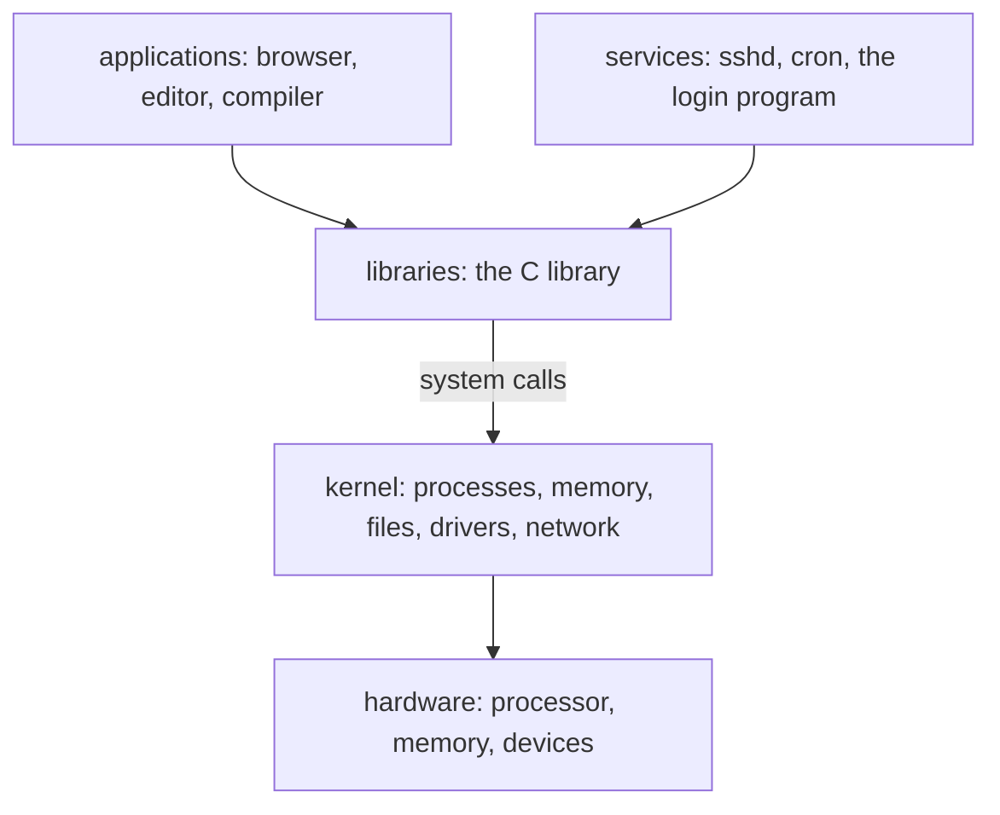
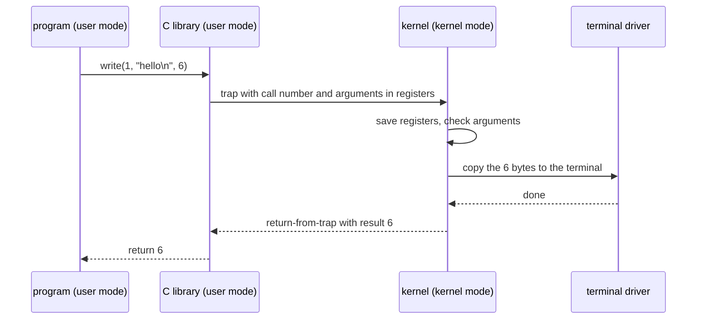
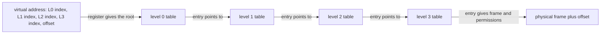
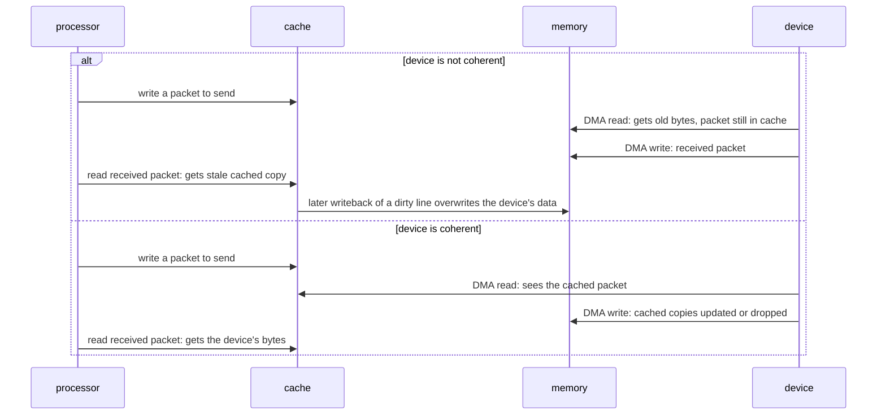

# Chapter 1. Operating Systems from the Ground Up

> **Status.** Background. This chapter describes operating systems in
> general, so it carries no mark. The last paragraph of each section
> points to the chapters that say what erXos does with the idea, and
> those chapters' status boxes say what of it runs.

**Background needed.** None. The chapter assumes only that the reader
can program, in any language.

Open a laptop and three programs run at once: a music player, a web
browser and a compiler. Each was written as if it had the machine to
itself. None of them knows the others exist, yet they share one
processor, one memory and one disk, and a bug that crashes the browser
does not stop the music.

No program arranges this for itself. A program that wanted to share the
processor politely would have to know which other programs exist and how
long each may run. A program that wanted to protect itself from a buggy
neighbor could not: on bare hardware, any program can write to any byte
of memory and send any command to any device. Something has to stand
between the programs and the machine, decide who runs and who gets what,
and refuse what would do harm.

That something is the **operating system**: the software that shares a
computer among the programs on it, hides the hardware behind a few
simple ideas, and keeps the programs from harming each other. UNIX,
written at Bell Laboratories from 1969, is the operating system most
programmers have met in some form, directly or through the systems built
in its image, FreeBSD, Linux and macOS among them. This chapter uses
UNIX, and FreeBSD in particular, as its running example, because the
later chapters compare erXos with it.

The short answer to how an operating system works is this. Its core, the
**kernel**, runs with the processor's full power. Every other program
runs with less, and asks the kernel whenever it needs something it
cannot do alone. Four ideas carry most of the weight. The process shares
the processor, virtual memory shares and guards memory, the file names
lasting data, and the interrupt lets the hardware get the kernel's
attention.

Sections 1.1 and 1.2 say what an operating system is for and how the
processor separates the kernel from everything else. Sections 1.3 to 1.6
take the four ideas in turn: processes and scheduling, virtual memory,
devices, and files. Section 1.7 covers how programs talk and share
safely, section 1.8 how a machine gets from power-on to its first
program, and section 1.9 what happens when a part fails. Each section
ends with a paragraph that names where erXos uses the idea. The examples
of machine detail come from 64-bit Arm, called AArch64, the first
architecture erXos runs on.

## 1.1 What an operating system is for

A computer without an operating system runs one program, and that
program must know everything about the machine. It must know which
numbered blocks of the disk hold its data, how to drive the disk
controller's registers, and where in memory it is allowed to put things.
Early computers worked this way, one program at a time.

An operating system does three jobs that such a program cannot do for
itself. It shares the machine, it hides the hardware behind simpler
ideas, and it protects programs from each other. Remzi and Andrea
Arpaci-Dusseau's free textbook *Operating Systems: Three Easy Pieces*
covers the same ground at greater length, for newcomers.

### 1.1.1 Sharing

There are two ways to share a resource. The operating system shares the
processor in time: one program runs for a few milliseconds, then
another, then a third, so fast that all three seem to run at once. It
shares memory in space: each program gets its own part of memory, and
all of them sit in it together. A disk is shared in both ways at once:
its space is divided among files, and its time among the requests that
read and write them.

Sharing needs a referee: something must decide which program runs next,
how much memory each may hold, and which disk request goes first. Each
decision is a policy, and different systems choose differently: a
desktop favors the program the person is looking at, a server favors
throughput. Operating systems keep policy apart from **mechanism**, the
code that carries a decision out, such as stopping one program and
starting another, so a policy can change without touching the mechanism.

### 1.1.2 Hiding the hardware

A disk knows only blocks: fixed-size runs of bytes, each with a number.
A program wants to say "open `notes.txt` and give me its contents", and
get bytes back. The operating system builds the second view on the
first. It keeps a table of which blocks hold which file, reads the
blocks, and hands the program the bytes in order.

The same pattern repeats for every part of the machine. The processor
becomes a set of processes, each a running program that seems to have a
processor of its own. Memory becomes a set of address spaces, each a
private range of addresses for one process. A disk becomes a tree of
named files. A network card becomes a connection to another machine.
Each of these is an **abstraction**: a simpler idea that stands for the
hardware and hides its detail, so a program written against it runs
whatever disk or network card the machine has.

### 1.1.3 Protection

Protection is the job that needs help from the hardware. A buggy program
can write a wrong address; a hostile one can try to read another
program's secrets or take over the machine. The operating system has to
stop both, and it has to do so while the program runs at full speed on
the processor, without inspecting each instruction. Section 1.2 shows
how the processor makes this possible with two modes, and section 1.4
how virtual memory gives each program a private view of memory.
Protection between the people who share a machine comes from users and
permissions, which section 1.6.5 describes.

### 1.1.4 The parts of an operating system

An operating system is more than its kernel. Figure 1.1 shows the layers
of a typical UNIX system, from the hardware up.



*Figure 1.1. The layers of a UNIX system. Only the kernel touches the
hardware. Every program above it asks the kernel, usually through the C
library.*

The kernel is the one program that runs with the processor's full power.
It holds the machine's state: which processes exist, which memory each
owns, which files are open. In UNIX and FreeBSD the kernel also contains
the file systems, the network protocols and the drivers, the code that
knows how to operate each device. A kernel that holds all of these in
one program, sharing one address space, is called a **monolithic
kernel**. Ritchie and Thompson's 1974 paper on UNIX shows the idea at
its start: a program writes to a device by writing to a file in `/dev`,
and the kernel activates the device. FreeBSD's kernel still probes for
devices and drives them itself as it boots, as the FreeBSD Handbook's
chapter on booting describes.

A **library** is code that programs link with and call like their own
functions. The most important is the **C library**, which gives programs
`printf`, `malloc` and `open`. Most of its functions run entirely inside
the program; a few, such as `open`, ask the kernel to do the work, as
section 1.2 shows.

**Services** are programs that run in the background with no person at
the keyboard. UNIX calls them daemons: `sshd` accepts remote logins,
`cron` runs commands on a schedule. To the kernel they are ordinary
programs, exactly like the applications at the top of figure 1.1. What
makes them part of the operating system is that the rest of the system
relies on them.

**Where erXos uses this.** erXos draws the line of figure 1.1 in a
different place. Only the kernel runs with the processor's full power,
as in UNIX, but erXos's kernel holds far less. The file systems, the
network stack and the drivers run outside it, as programs, most of them
written in Erlang ([design.md, Trust
placement](../design.md#trust-placement)). A kernel built this way is a
microkernel, the subject of [chapter
2](02-microkernels.md). [Chapter
5](README.md#chapter-5-design-overview-of-erxos) shows erXos's version
of figure 1.1 and names the seven concepts it is built from.

## 1.2 The processor's two modes, and the way across

A program's instructions run directly on the processor, at full speed,
with no interpreter checking each one. That is what makes programs fast,
and it is also the problem. If a program's instructions run directly,
what stops one of them from switching off the clock that lets the kernel
take control back? What stops it from rewriting the table that says
which memory it may use?

The processor stops them. It has two modes. In **kernel mode** it
executes every instruction it has. In **user mode** it refuses a set of
them, the **privileged instructions**: those that change the memory map,
reach devices, mask interrupts or set the timer. The kernel runs in
kernel mode and every other program in user mode. A program in user mode
that tries a privileged instruction does not get its way. The processor
stops it and hands control to the kernel, which decides what to do,
usually ending the program.

Two modes alone would leave a program with no way to ask for anything.
So the processor offers controlled ways across the boundary, and every
one of them lands at a place the kernel chose in advance.

### 1.2.1 Three ways into the kernel

The processor enters kernel mode for three reasons, and each has its own
name.

* A **system call** is a deliberate request. The program executes a
  special instruction, a **trap**, that switches the processor to kernel
  mode and jumps into the kernel. The program asks for something it
  cannot do itself: open a file, send a packet, start another program.
* An **exception** is caused by the instruction the program was running.
  The instruction tried to read memory that is not mapped, or was not a
  valid instruction at all. The processor cannot finish it, so it enters
  the kernel to deal with it. A **page fault**, an exception raised when
  a program touches memory with no valid translation, is the most common
  kind, and section 1.4 follows one step by step.
* An **interrupt** comes from outside the program. A device signals that
  it needs attention: a packet arrived, a disk read finished, a key was
  pressed. The program running at that moment did nothing to cause it,
  and the kernel returns to that program once the device is served.

The first two are synchronous: they happen at a particular instruction
of the program, and happen again if the program runs again on the same
input. An interrupt is asynchronous: it can arrive between any two
instructions.

All three use the same mechanism. At boot, while it is the only code
running, the kernel writes the address of a table into a processor
register. The table, called the vector table on Arm and the trap table
in some textbooks, lists one entry point for each kind of event. When an
event happens, the processor saves the address of the interrupted
instruction, switches to kernel mode, and jumps to the matching entry.
The program never names the address it jumps to; if it could, it could
jump past the kernel's permission checks. Setting the table's address is
therefore a privileged instruction.

### 1.2.2 A system call from start to finish

A short C program shows a system call at work. The program below is a
sketch, not code from erXos's tree:

```c
#include <unistd.h>

int
main(void)
{
	write(1, "hello\n", 6);
	return (0);
}
```

`write` looks like an ordinary function, and part of it is: it is a
small function in the C library. File descriptor 1 is the program's
standard output, usually the terminal, and file descriptors are
explained in section 1.6. Figure 1.2 follows the call.



*Figure 1.2. A system call. The program enters kernel mode only at the
trap and leaves only at the return-from-trap. Everything between runs in
the kernel, on the program's behalf, after the kernel has checked the
request.*

The library's `write` puts a number that means "write" in one register
and the three arguments in others, then executes the trap instruction.
The processor saves where the program was, switches to kernel mode and
jumps to the kernel's system-call entry. The kernel saves the rest of
the program's registers, so that it can use them, and reads the call
number to find the code for `write`.

Then the kernel checks everything. Is descriptor 1 open in this process,
and open for writing? Does the address of `"hello\n"` lie in memory this
process may read, and do all six bytes? The kernel must not trust a
single argument, because the program chose every one of them. A program
that passed the address of the kernel's own memory, and was believed,
could make the kernel read its secrets out to the terminal.

Pointer arguments carry a second trap. If the kernel checks the bytes at
an address and later reads them again to use them, another thread of the
same program (section 1.3) can change them in between. The check then
passes on one value and the kernel acts on another. This kind of bug has
a name, **time of check to time of use**, and kernels avoid it by
copying each argument into kernel memory once, then checking and using
only the copy. FreeBSD's kernel does this with functions called `copyin`
and `copyout`. <!-- check: FreeBSD copyin(9)/copyout(9); source not read
in this task -->

With the checks passed, the kernel hands the bytes to the terminal's
driver and puts the result, 6 bytes written, where the library expects
it. It restores the program's registers and executes the
return-from-trap instruction. The processor switches back to user mode
and the program continues at the instruction after the trap, as if
`write` had been a function call.

The crossing is not free. Saving and restoring registers takes time, and
the kernel's code and data push the program's out of the processor's
caches (section 1.5). This is why programs buffer their output and why
the C library's `printf` collects characters before calling `write`.
Early UNIX had about twenty system calls, according to Three Easy
Pieces; a modern UNIX has a few hundred.

### 1.2.3 The timer, and taking the processor back

A system call returns control to the kernel only if the program makes
one. A program stuck in a loop such as `for (;;) ;` never does, and with
nothing else in place it would hold the processor forever.

The **timer interrupt** closes that gap. Before it starts any program,
the kernel sets a hardware timer to interrupt every few milliseconds,
and no program can turn the timer off. When the interrupt arrives, the
processor enters the kernel whatever the program was doing, and the
kernel can run another program instead. Taking the processor away from a
running program this way is **preemption**. With a timer, the kernel
always gets the processor back; section 1.3 explains what it does with
it.

### 1.2.4 Protection without modes

A system can instead keep a program in its place by refusing to run
machine code it did not check. Programs are written in a language with
no way to forge a pointer or read past the end of an array. The system
runs them through an interpreter, or compiles them with a compiler it
trusts, so a program can do only what the language allows. All the
programs can then share one address space and one mode, and a call from
one to another costs a function call instead of a trap. Research systems
such as Microsoft's Singularity were built this way. <!-- check:
Singularity relies on type-safe languages and a verifier instead of
hardware protection between processes; source not read in this task -->

The approach moves trust from the hardware to large programs, the
interpreter, the compiler or the checker, and a bug in any of them opens
every program to every other. It also shuts out machine code written in
C. Hardware modes guard against any code, in any language, at the price
of a trap per crossing, and operating systems in wide use rely on them.

### 1.2.5 The modes on AArch64

Each architecture names its modes in its own way. AArch64 calls them
**exception levels**, numbered from 0 to 3, where a higher number has
more power. Programs run at EL0, user mode. The kernel runs at EL1,
kernel mode. EL2 is for a hypervisor, software that runs whole operating
systems as guests, and EL3 belongs to the firmware that starts the
board. On AArch64 the system-call trap is the instruction `svc`, the
vector table's address goes in the register `VBAR_EL1`, and the
return-from-trap is `eret`. <!-- check: VBAR_EL1 holds the EL1 vector
base; erXos design docs say "the EL1 vector table" without naming the
register -->

**Where erXos uses this.** erXos's kernel runs at EL1 and every thread
at EL0; the kernel leaves EL2 at boot and never runs at EL3, which
belongs to the board's firmware. A kernel call is `svc #0x4552`, with
the call number in register `x8` and the arguments in `x0` to `x5`
([design-arch-aarch64.md](../design-arch-aarch64.md#overview)). Every
runtime runs in user mode, including the Erlang runtime that hosts the
system's own trusted services, so a bug in those services cannot execute
a privileged instruction. erXos does not take the path of section 1.2.4.
Erlang is a safe language, but erXos protects domains from each other
with the hardware and runs no verifier, for reasons [design.md, Why no
verifier](../design.md#why-no-verifier) gives and [chapter
11](README.md#chapter-11-authority-and-security) explains. erXos's own
kernel removes the time-of-check-to-time-of-use problem by construction
(Phase 2). No kernel call takes a pointer: every argument is a register,
a field of a per-thread page, or a memory object, and the kernel reads
the last two through its own mapping. On Fiasco, which 0.2 runs on, this
holds only as far as Fiasco's own code gives it, downside FD24 of [the
downsides table](../design-fiasco.md#downsides-against-erxoss-kernel).
[Chapter
8](README.md#chapter-8-the-kernel-interface-and-its-two-kernels)
describes the kernel interface those calls make up.

## 1.3 Processes, threads and scheduling

A machine with four processor cores can run a hundred programs at once,
and on most machines it does. Each core runs one stream of instructions
at a time, so the operating system must turn four streams into a
hundred. It does this with the process, and with a part of the kernel,
the scheduler, that decides which process runs on which core and for how
long.

### 1.3.1 Programs and processes

A program is a file: instructions and initial data, sitting on a disk. A
**process** is a program running: the program's instructions plus
everything that changes as they run. Two people who run the same shell,
`/bin/sh`, run one program in two processes, and what one types does not
appear in the other.

The kernel keeps a record for each process. It holds the process's
**registers** while the process is not running. Registers are the few
named storage cells inside the processor. Among them are the **program
counter**, which holds the address of the next instruction, and the
**stack pointer**, which marks the top of the process's stack. The
record also names the process's address space (section 1.4), its open
files (section 1.6), the user it runs for, and a number that identifies
it, the **process id** or pid.

UNIX creates a process in two steps. The `fork` system call copies the
calling process: the copy, called the child, has the same memory, the
same open files and the same program counter, and both continue from the
return of `fork`. The `exec` call then replaces the child's program with
another one, read from a file. Ritchie and Thompson's paper describes
both calls. A shell runs a command this way: it forks, the child execs
the command, and the parent waits for the child to exit. Splitting
creation in two lets the child change its own setup, such as which file
its output goes to, before the program starts.

### 1.3.2 Running, ready and blocked

At any moment a process is in one of three states. It is **running** on
a core; or **ready**, able to run but waiting for a core; or
**blocked**, waiting for something else, such as a disk read to finish
or a key to be pressed. A process that calls `read` on a terminal blocks
until the person types. The kernel moves it to ready when the input
arrives, and a ready process runs when the scheduler picks it.

Blocking is what makes sharing pay. A disk read takes far longer than an
instruction, and while one process waits for the disk, another can use
the processor.

### 1.3.3 The context switch

Moving a core from one process to another is a **context switch**. Its
steps are fixed. Process A is running when the timer interrupt arrives.
The processor enters the kernel, and the kernel saves A's registers into
A's record. The scheduler picks process B. The kernel tells the
processor to use B's address space, loads B's saved registers, and
executes the return-from-trap. The core then runs B, at exactly the
instruction where B last stopped, and B cannot tell that it was ever
stopped.

A switch costs more than its instructions. The processor's caches
(section 1.5) are full of A's data, and B starts by missing in them; the
processor's cache of memory translations (section 1.4) may have to be
cleared. A scheduler that switches too often spends the machine on
switching; one that switches too rarely makes every program wait.

### 1.3.4 Threads

A process as described so far has one stream of instructions. A
**thread** is one such stream: a program counter, a stack and a set of
registers. A process can have several threads, all running in the same
address space and sharing all of its memory. A web server might run one
thread per connection. On a machine with several cores, the threads of
one process can run at the same time on different cores.

Sharing memory makes threads cheap to create and quick to communicate,
since one thread can read what another wrote with no help from the
kernel. It also makes them dangerous. Two threads that update the same
data at once can corrupt it, and section 1.7 explains how they
coordinate.

The threads described so far are **kernel threads**: the kernel knows
each one, saves its registers, and schedules it. A program can also run
its own, lighter tasks on top of a few kernel threads, switching between
them inside the program with no system call. The kernel sees only the
kernel threads; the program's own scheduler decides which task each
kernel thread runs. Switching between such tasks costs a function call,
not a kernel entry, and a task can need only a few KiB of memory, so a
program can have hundreds of thousands of them. Erlang's processes are
tasks of this kind, as [chapter 3](03-erlang.md)
explains; despite the shared word, they are not operating-system
processes.

### 1.3.5 Scheduling

The **scheduler** is the part of the kernel that picks which ready
thread runs next on each core. It keeps the ready threads in one or more
**run queues**, and gives the chosen thread a **time slice**, a few
milliseconds, after which the timer interrupt lets the kernel choose
again.

The simplest policy is round robin: take turns, in order, each for one
slice. Round robin is fair, but it treats a text editor waiting for a
keystroke like a compiler that would run for an hour. Real schedulers
add **priorities**, numbers that say which thread should run first. They
also adjust the priorities as threads run. A thread that keeps using its
whole slice is probably a long computation, so it drops. A thread that
blocks quickly is probably interactive, so it rises, and a keystroke
gets a quick response. Policies must also prevent **starvation**, where
a low-priority thread never runs because higher ones are always ready.
On a machine with several cores, the scheduler keeps a run queue per
core and tries to keep a thread on the core where it last ran, whose
caches still hold its data.

Two families of scheduling differ in how the kernel gets the processor
back. In **cooperative scheduling**, a thread runs until it gives up the
processor itself, by blocking or by calling a yield function. It is easy
to build, and early versions of the Macintosh operating system worked
this way, but one thread stuck in a loop freezes the whole machine. In
**preemptive scheduling**, the timer interrupt takes the processor back
whether the thread cooperates or not. Every general-purpose operating
system in wide use preempts. A program's own scheduler of lightweight
tasks, as in section 1.3.4, has the same choice to make inside the
program; Erlang's runtime preempts its processes by counting the work
each does. <!-- check: ERTS preempts by reduction count; chapter 3 to
confirm -->

### 1.3.6 How a process ends

A process ends in one of two ways. It calls `exit` with a small number,
its **exit status**, where 0 means success. Or the kernel ends it,
because of a fault (section 1.4.5) or because another process sent it a
signal asking it to stop. The shell's `kill` command sends such a
signal. Either way, the kernel closes the process's files, frees its
memory and keeps only a small record with the exit status.

The parent collects that record with the `wait` system call, which is
how a shell learns whether a command succeeded. Until the parent waits,
the dead process lingers as an entry in the process table, called a
zombie. If the parent dies first, UNIX hands its children to `init`, the
first process (section 1.8), which waits for them in turn. A UNIX
process can therefore outlive the process that started it, and a
background job keeps running after the shell that launched it exits.
<!-- check: orphans are re-parented to init on UNIX; source not read in
this task -->

**Where erXos uses this.** erXos schedules in two levels. The kernel
decides which thread runs on each core and charges the time to a
**group** (a kernel object that holds a share of CPU time; see [chapter
9](README.md#chapter-9-processes-runtimes-and-two-level-scheduling)).
Inside each group, a language runtime, the Erlang runtime first, decides
which of its lightweight processes runs on its threads. The kernel never
sees an Erlang process ([design-scheduler.md](../design-scheduler.md)).
erXos also splits UNIX's process in two. The Erlang process is the unit
that runs and fails, and a **domain** (a protected group of Erlang
processes sharing one address space; see [chapter
10](README.md#chapter-10-domains-a-wall-around-some-processes)) is the
unit the hardware protects.

## 1.4 Virtual memory

Two programs on the same machine can both keep a variable at address
`0x10000`, and each sees its own value there. Neither can name the
other's memory at all, let alone read it. This is the work of virtual
memory, the mechanism that gives every process its own view of memory
and lets the kernel decide, page by page, what each view contains.

### 1.4.1 Virtual and physical addresses

Without virtual memory, every program would use **physical addresses**,
the numbers that select bytes in the actual memory chips. Every program
could read and write every other program's memory, and the kernel's. Two
programs written to use the same addresses could not run at once, and a
program could not grow past whatever was loaded after it.

With virtual memory, every address a program uses is a **virtual
address**. The processor translates each one into a physical address on
every load, store and instruction fetch, using a map the kernel wrote.
The set of virtual addresses a process can use, and what they map to, is
its **address space**. A process can reach only what its map contains,
and the map can be changed only by the kernel.

The part of the processor that translates is the **memory management
unit**, or MMU. It translates in fixed-size units, called **pages**: 4
KiB is the common size, and the one erXos uses on AArch64. Physical
memory is divided into **frames** of the same size. A translation maps a
virtual page to a physical frame, and the last 12 bits of an address,
the offset within its 4 KiB page, pass through unchanged.

Fixed-size pages were not the only design. An older one,
**segmentation**, gives each process a few variable-sized regions, such
as one for code, one for data and one for the stack, each placed
somewhere in physical memory. Segments are simple to translate. But as
processes come and go, physical memory breaks up into free holes of
awkward sizes, and a large segment may find no hole big enough even when
the total free memory would hold it. Pages remove that problem: any free
frame fits any page. Three Easy Pieces traces paging back to the Atlas
computer of the early 1960s.

### 1.4.2 Page tables

The map lives in memory, in a structure called a **page table**. For
each virtual page the process may use, the page table holds an entry
with the frame's physical address and a few bits that say how the page
may be used. The kernel keeps one page table per address space. On a
context switch it writes the new process's page-table address into an
MMU register, on AArch64 `TTBR0_EL1`, which serves the user half of the
address space.

A flat table would be far too large. As erXos configures AArch64, user
addresses are 48 bits wide. With 4 KiB pages that is 2^36 pages, and at
8 bytes per entry a flat table would take 512 GiB for each process. So
the table is a tree. On AArch64 it has four levels, each a 4 KiB page of
512 entries. Each level consumes 9 bits of the address, and the four
levels together consume 36; the remaining 12 bits are the offset. A part
of the address space the process does not use has no table below it, so
a small process needs only a few table pages. Figure 1.3 shows one
translation.



*Figure 1.3. A virtual address translated through a four-level page
table. Each 9-bit part of the address picks one entry in one table. Only
the last entry names the data's frame, and it carries the permission
bits the MMU checks.*

### 1.4.3 The TLB

Figure 1.3 has a cost: four extra memory reads to translate one address.
The MMU avoids most of them with a **translation lookaside buffer**, or
TLB, a small cache of recent translations inside the processor. Programs
touch the same pages again and again, so most translations are found in
the TLB, and the walk through the tables happens only on a miss. On Arm
and on x86 processors, the MMU walks the tables itself on a miss, with
no help from the kernel. <!-- check: Arm MMUs walk page tables in
hardware; the OSTEP chapter read covers x86 -->

The TLB makes the kernel responsible for one more thing. When the kernel
changes or removes an entry in a page table, an old translation may
still sit in the TLB, and the processor would go on using it. So the
kernel must invalidate the stale entry, on every core that may hold it,
before it reuses the frame. Forgetting this lets a process keep reaching
a frame that by then belongs to someone else. To avoid clearing the
whole TLB on every context switch, processors tag each entry with an
**address space identifier**, or ASID, so translations of several
processes can sit in the TLB together.

### 1.4.4 Protection bits

Each page-table entry carries bits that say what the process may do with
the page: read it, write it, execute instructions from it, and whether
user mode may touch it at all. The MMU checks them on every access. A
store to a read-only page, or an instruction fetch from a page not
marked executable, raises an exception, and the kernel decides what
happens next.

The kernel uses these bits to protect itself. Its own code and data are
mapped in every address space, so that a system call does not need to
switch maps, but its pages are marked as kernel-only. A program in user
mode that touches them faults.

One rule about the bits matters for security: no page should be
**writable and executable at once**, a rule often written W^X. Without
it, a bug that lets an attacker write bytes into a program's memory,
such as a buffer overflow, would also let the attacker run those bytes
as code. With it, the attacker's bytes land in a page the processor
refuses to execute. Programs that make code as they run, such as the
just-in-time compilers inside language runtimes, need a way around it.
They write the code through one mapping and execute it through another,
or make a page executable, and no longer writable, once the code is
complete.

### 1.4.5 A page fault, step by step

The kernel does not fill a process's page table in advance. A program
that is 50 MiB on disk may use only a few pages of it in a given run. So
the kernel records what each range of the address space should hold, and
leaves the table empty until the process touches it. The process's first
touch raises a page fault, and the fault does the work.

Follow one. A process calls a function in its program whose code is not
yet in memory.

1. The processor fetches the instruction at the function's virtual
   address. The MMU finds no valid entry, in the TLB or in the tables.
2. The MMU raises a page fault. The processor saves the faulting address
   and the instruction's address, and enters the kernel.
3. The kernel looks up the faulting address in its own record of the
   process's address space. The record says that this range holds the
   program's code, read-only and executable, from a certain offset of a
   certain file.
4. The kernel takes a free frame and reads that page of the file into
   it, blocking the process while the disk works and running another
   meanwhile.
5. The kernel writes a page-table entry that maps the virtual page to
   the frame, readable and executable.
6. The kernel returns from the exception to the faulting instruction
   itself, not the one after it. The instruction runs again, and this
   time the translation succeeds.

If the record in step 3 says the address is not part of the address
space at all, the access is a bug. A UNIX kernel then sends the process
a **signal**, a notice the kernel delivers to a process, called SIGSEGV
for a bad memory access. Unless the program asked to handle it, the
signal ends the process. This is the familiar "segmentation fault".

### 1.4.6 What faults make possible

Building the table on demand, fault by fault, gives the kernel several
abilities at no cost to the program.

**Demand paging** is the case above: pages come into memory when first
touched, so a program starts before all of it is read.

**Paging out** is the reverse. When memory runs short, the kernel picks
a page that has not been used lately, writes it to disk if it changed,
and removes its entry. The next touch faults, and the kernel reads the
page back. A process can then use more memory than the machine has, at
the price of disk reads.

**Copy-on-write** makes `fork` cheap. Instead of copying the parent's
memory for the child, the kernel maps the same frames into both,
read-only in both. The first time either process writes to a page, the
write faults, and only then does the kernel copy that one page and give
the writer its own copy. A child that calls `exec` straight away copies
almost nothing. <!-- check: modern UNIX fork uses copy-on-write; OSTEP
chapters read here do not describe it -->

A **memory-mapped file** puts a file's contents in the address space.
The `mmap` system call maps a range of virtual addresses to a range of a
file. Touching a page faults it in from the file, so reading memory
reads the file. With a shared mapping, stores go back to the file, and
two processes that map the same file see each other's changes.

### 1.4.7 Who pays for memory

Demand paging lets a kernel promise more memory than it has. A process
that asks for 1 GiB gets an address range at once, but frames only as it
touches pages, and many processes never touch all they asked for. Many
kernels count on this and hand out more than the machine holds. <!--
check: overcommit is common in UNIX kernels; source not read in this
task -->

When the bet fails, it fails at the worst moment. A process touches a
page it was promised, the fault needs a frame, and there is none free
and nothing left to page out. The kernel cannot fail the instruction,
because the process did nothing wrong. Its only way out is to end some
process to free its memory, and the process it picks may not be the one
that used too much.

The question underneath is who pays for memory. In most UNIX kernels,
the memory the kernel uses on a process's behalf, for its page tables,
its open files and its buffers, comes from one shared pool. Per-process
limits exist, but they cover only part of what a process can make the
kernel spend, so one process can still crowd out the rest. <!-- check:
UNIX resource limits do not cover all kernel memory spent for a process;
source not read in this task --> A kernel that charged every page, its
own included, to some account that cannot overdraw would not have to
guess.

**Where erXos uses this.** erXos's kernel deals in **spaces**, **memory
objects** and **mappings**. A memory object holds pages, and a mapping
places part of one in a space with rights no greater than those of the
capability that made it ([chapter
12](README.md#chapter-12-memory-and-budgets)). In erXos's own kernel no
single mapping is ever writable and executable. Erlang's just-in-time
compiler writes its code through one view of a memory object that
another view executes ([design.md, Machine
code](../design.md#machine-code)). On Fiasco a page can still be
writable through one mapping and executable through another, downside
FD8 of [the downsides
table](../design-fiasco.md#downsides-against-erxoss-kernel). erXos's own
kernel gives copy-on-write children that share only pages no one can
write (Phase 2; Fiasco offers none, downside FD9). Every page, the
kernel's own included, is paid for by a **budget** (a kernel object that
pays for memory; see chapter 12). Budgets are the accounts of section
1.4.7, and no domain can take memory another was promised. [Chapter
11](README.md#chapter-11-authority-and-security) returns to W^X.

## 1.5 Devices, interrupts, DMA and caches

A network card that receives a packet does not wait for the processor to
copy it. It writes the packet straight into memory, at an address
software gave it earlier, and then interrupts the processor to say the
packet is there. If the address was wrong, the card overwrites whatever
lived there, and nothing in the processor's protection of section 1.4
stops it. Devices are where an operating system meets hardware that
follows its own rules.

### 1.5.1 Device registers

Software controls a device through its **device registers**, a small set
of storage locations on the device. Writing a command register starts an
operation, reading a status register says whether it finished, and data
registers carry bytes in and out. On Arm, and on most processors, the
registers appear at physical addresses, an arrangement called
**memory-mapped I/O**: a load or store to such an address goes to the
device instead of to memory.

Device registers are not memory. Reading a status register twice can
give two different answers, and writing a command register has an effect
each time. So the kernel maps them with a memory type that tells the
processor not to cache them, not to merge two writes into one, and not
to reorder accesses to them. Only the kernel, or code the kernel trusts,
may map them at all: a program that could write a disk controller's
registers could read any file on the disk.

### 1.5.2 Polling and interrupts

After starting an operation, software needs to know when it finishes. It
can **poll**: read the status register in a loop until the device says
it is done. Polling is simple and reacts at once, but the processor does
nothing useful while it loops.

The alternative is the interrupt of section 1.2: the device raises a
signal when it finishes, and the processor enters the kernel. Between
the devices and the cores sits an **interrupt controller**, which
collects the signals of many devices, decides which core to deliver each
to, and lets the kernel mask and acknowledge them. On Arm machines it is
the Generic Interrupt Controller, the GIC. The kernel's handler for an
interrupt does the least it can, such as noting that a packet arrived
and silencing the device. It leaves the rest of the work for later, so
that other interrupts are not held up.

Neither choice wins everywhere. A busy network card can raise interrupts
faster than the kernel can serve them, so the processor handles
interrupts and nothing else, a failure called **livelock**. Systems
avoid it by switching to polling under load, or by having the device
**coalesce** several completions into one interrupt. Three Easy Pieces
discusses both.

### 1.5.3 Drivers

A **driver** is the code that knows one kind of device: which registers
it has, what each bit means, what order of steps it needs, and how it
fails. The driver hides all this behind an interface shared by every
device of the same kind. A disk driver offers numbered blocks to read
and write; a network driver offers packets to send and receive. A file
system then works on any disk, and the network stack on any card.

In UNIX and FreeBSD, drivers run inside the kernel, in kernel mode. That
is fast, because a driver can touch registers and kernel data directly,
but it puts every driver's bugs in kernel mode too. A driver that
follows a bad pointer corrupts the kernel, and a driver that loops holds
a core with interrupts off. That boundary is the one [chapter
2](02-microkernels.md) questions.

### 1.5.4 Direct memory access

Copying data through a data register, one word at a time, keeps the
processor busy for the whole transfer. **Direct memory access**, or DMA,
removes the processor from the copy. The driver tells the device where
in memory a buffer lies and how long it is; the device then reads or
writes that memory itself, and raises an interrupt when it finishes.
Meanwhile the processor runs other work.

A network card typically works from a **descriptor ring**: an array in
memory whose entries each describe one buffer, its address, its length
and whether the device or the driver owns it. The driver fills entries
and hands them to the card; the card fills the buffers with packets,
marks the entries done, and moves on round the ring.

DMA has a danger built in. The device writes wherever the address tells
it to, and it does not consult the processor's page tables. A driver
that gives the device a wrong address, or a device whose firmware is
buggy or hostile, can overwrite any byte of physical memory, the
kernel's included. An **IOMMU** is the fix: a translation unit between
devices and memory that works like the MMU of section 1.4 but for
devices. The kernel gives each device its own page table, and the device
can reach only the frames that table maps. Not every machine has one. A
machine without one must trust every DMA-capable device and its driver
with all of memory.

### 1.5.5 Caches, and devices that do not see them

The processor does not read memory directly on every load. Memory is
slow compared with the processor, so the processor keeps recently used
data in **caches**, small fast memories close to the cores. A cache
holds memory in **cache lines**, aligned blocks of a few dozen bytes, 64
on many current processors. A store usually changes only the cached
copy; the line is written back to memory later, when the cache needs the
room. A line whose cached copy differs from memory is called dirty. <!--
check: 64-byte lines on many current processors; source not read in this
task -->

Between cores, hardware keeps caches in agreement: a store on one core
becomes visible to loads on the others. A device is **cache-coherent**
if the same hardware covers it, so its DMA reads see data still in the
cache and its writes update or discard stale cached copies. Many devices
are not coherent. They read and write memory directly, past the caches,
and three things can go wrong, as figure 1.4 shows.



*Figure 1.4. A device's DMA with and without cache coherence. A device
that is not coherent misses what the cache has not written back, and its
writes can be hidden or overwritten by the cache. A coherent device sees
and updates what the cache holds.*

The driver of a device that is not coherent must keep the two views in
agreement by hand. Before handing a buffer to the device to read, it
**cleans** the buffer's lines: writes any dirty ones back to memory.
Before reading a buffer the device wrote, it **invalidates** the
buffer's lines, so the next load fetches from memory. And it places each
buffer so that no cache line holds bytes of two buffers with different
writers. Otherwise a writeback of the whole line would carry the
processor's stale bytes over the device's fresh ones. Each of these
steps also needs a **barrier**, an instruction that makes the processor
finish earlier memory operations before later ones (section 1.7). Forget
one step and the failure shows up rarely, under load, as a corrupted
packet.

### 1.5.6 Finding the devices

Before a kernel can drive a device, it must learn that the device
exists, where its registers are and which interrupt line it uses. There
are two ways to find out.

Some buses can be asked. PCI Express, the bus that joins a processor to
graphics cards, network cards and disks, gives each device a block of
**configuration space**. These standard registers name the device's
vendor and model and let software assign it addresses. The kernel walks
the bus, reads each device's configuration space, and picks a driver by
the vendor and model it finds. USB works the same way one level further
out: the kernel asks each device what it is. Whoever writes a device's
configuration space decides where its registers and memory appear, so
only trusted code may touch it.

Other devices cannot be asked. The serial port, the timer and the
Ethernet controller built into the chip on a small Arm board sit at
fixed addresses, with nothing to enumerate. For those, the firmware
hands the kernel a description of the board at boot, the device tree of
section 1.8, and the kernel takes the board's word for what is there.

**Where erXos uses this.** erXos's drivers do not run in its kernel. A
driver is an Erlang process under a supervisor, which restarts it when
it crashes; it reaches its device through one small C module that owns
the device's registers ([chapter
15](README.md#chapter-15-devices-and-drivers)). The Raspberry Pi 4's
Ethernet and SD controllers are not cache-coherent. erXos derives every
clean, invalidate and barrier from one event, a buffer passing between
the processor and the device, so no driver can forget or misplace one
([design-device-dma.md](../design-device-dma.md)). erXos's platform
design describes no IOMMU on the Pi 4 ([design-platforms.md,
Overview](../design-platforms.md#overview)). Where no IOMMU confines a
DMA-capable device, every domain's isolation also depends on the domain
that drives it, downside FD12 of [the downsides
table](../design-fiasco.md#downsides-against-erxoss-kernel).

## 1.6 Files and block devices

Turn the machine off and every process, every page table and every byte
in memory is gone. What survives is on a disk, an SD card or a flash
chip, and those devices know nothing of names, folders or owners: they
store numbered blocks. The file is the abstraction that turns those
blocks into data a person can find again next week, and UNIX made it the
center of the whole system.

### 1.6.1 Block devices

A **block device** stores data in fixed-size **blocks**, numbered from
zero, and offers two operations: read block *n*, and write block *n*. A
disk, an SD card and a USB stick all look like this to their drivers,
whatever the technology inside. Block sizes are small powers of two,
such as 512 bytes or 4 KiB.

### 1.6.2 Files and directories

A **file** is a named sequence of bytes that outlives the process that
wrote it. UNIX puts no structure on a file's contents. In Ritchie and
Thompson's words, "A file contains whatever information the user places
on it." To the kernel, a text file, a program and a database are all
bytes, and the program that reads them gives them meaning.

UNIX keeps a file's facts apart from its name. Each file has an
**inode**, a record that holds the file's size, its owner, its
permission bits and the list of blocks where its bytes lie, and each
inode has a number. A **directory** is a file whose contents map names
to inode numbers. Because a name only points at an inode, one file can
have several names, in several directories.

Directories form a tree whose top is the **root directory**, written
`/`. A **path** such as `/home/ana/notes.txt` names a file by the walk
from the root: look up `home` in `/`, then `ana` in that, then
`notes.txt`. A path that does not start with `/` starts at the process's
current directory instead.

### 1.6.3 File descriptors

A process does not use a path for every read. It calls `open` once with
the path; the kernel walks it, checks the permission bits against the
process's user, and returns a **file descriptor**, a small integer that
names the open file in this process. The process then calls `read` and
`write` with the descriptor, and the kernel remembers the position in
the file between calls. `close` releases the descriptor. A process
starts with three already open: 0 for standard input, 1 for standard
output and 2 for standard error, which is why section 1.2's program
wrote to descriptor 1.

UNIX's most influential choice was to make the same calls work on things
that are not files on a disk. Each device has a name in `/dev`, and
opening it gives a descriptor that reads and writes the device. Ritchie
and Thompson list three gains: file and device input and output are as
alike as possible, a program that takes a file name accepts a device
name, and the same permission bits protect both. A pipe (section 1.7)
and a network socket give descriptors too. A program that reads standard
input does not know or care which of them it got.

### 1.6.4 File systems and mounting

A **file system** is the layout that stores files and directories on a
block device: where the inodes are, which blocks are free, where the
root directory starts. The kernel's file system code turns `read` on a
descriptor into reads of the right blocks.

Updates are where file systems get hard. Writing a file can change a
data block, the inode and the free-block map, and a power cut can come
between any two of those writes. A file system that ignores this can be
left with a block marked free that a file still uses. File systems guard
against it with an ordered update protocol. A journal records each
change before making it; copy-on-write never overwrites live data, and
switches to the new version with one final write.

The kernel also keeps recently used blocks in memory, in a cache, so
that reading the same file twice reads the disk once. Writes usually go
to that cache first and reach the disk later. A program that must know
its data is on the disk calls `fsync`.

One machine often has several file systems, on several devices. UNIX
joins them into one tree by **mounting**: the `mount` call attaches the
root of a file system at a directory of the tree. From then on, paths
through that directory continue into the mounted file system. Ritchie
and Thompson's paper describes `mount` doing exactly this. Every process
on a UNIX system sees the same tree, though FreeBSD's `chroot` and jails
can give a process a smaller one. <!-- check: chroot and jails give a
process a restricted view of the tree; source not read in this task -->

### 1.6.5 Permissions, and the power of a user

Every UNIX file records a user who owns it and a set of permission bits.
In the system of Ritchie and Thompson's paper, six bits gave read, write
and execute permission separately to the owner and to everyone else;
later UNIX added a third class, a group of users. When a process opens a
file, the kernel compares the process's user with the file's bits and
allows or refuses the open.

One user is above the bits. The **super-user**, called root, passes
every permission check, and much of the system's administration runs as
root. A program that needs a little of root's power gets all of it. The
`passwd` program must write the file of passwords, so UNIX marks it with
the set-user-ID bit, which makes it run as the file's owner, root. A bug
in such a program hands an attacker the whole machine.

Both points come from one choice: in UNIX, what a process may do depends
on who it runs as, so every program a user runs carries all of that
user's power. A text editor that the user started can delete every file
the user owns. This is called **ambient authority**: power that a
process holds from its surroundings, not because it was handed the right
to one particular thing. [Chapter
2](02-microkernels.md) describes the
alternative, capabilities, where a program can use only what it was
explicitly given.

**Where erXos uses this.** erXos has no tree that every process shares.
Each domain's namespace is a private table from paths to grants, and
each grant is rooted at a subtree of a file server. A path can therefore
never reach a server the domain does not hold ([chapter
14](README.md#chapter-14-files-namespaces-and-service-trees); the idea
comes from Plan 9, which chapter 14 introduces). Domains reach file
servers with one file protocol, 9P2000.L, and the storage service that
serves files from disk runs in a domain of its own
([design-files.md](../design-files.md#overview)). [Chapter
16](README.md#chapter-16-storage-and-updates) describes the file systems
underneath: a read-only system image, and the read-write file systems
beside it.

## 1.7 Talking and sharing

Two threads add 1 to the same counter, each a thousand times, and the
counter ends at 1,517. The program has no bug in any single line. The
trouble is that the threads ran at the same time on the same data. This
section covers how activities that share data keep it whole, and how
activities that do not share memory talk instead.

### 1.7.1 Races

The statement `count = count + 1` is three instructions: load `count`
into a register, add 1, store the register back. Suppose `count` is 5.
Thread A loads 5. Before A stores, thread B, on another core, also loads
5. A stores 6; B stores 6. Two increments happened and the counter rose
by one. When the result depends on how two activities' steps interleave,
the program has a **race condition**. Races are hard to find because
most interleavings are harmless: the program passes its tests a thousand
times and fails on the thousand and first.

The code that touches shared data, such as the three instructions above,
is a **critical section**, and the cure is to let only one thread run it
at a time.

### 1.7.2 Locks and atomic instructions

A **lock**, also called a mutex, is a variable that guards a critical
section. A thread acquires the lock before entering and releases it on
leaving; a thread that finds the lock taken waits. The lock cannot
itself be built from ordinary loads and stores, because testing whether
it is free and taking it are two steps, and another thread can slip
between them.

So processors provide **atomic instructions**, which read and change a
memory word in one indivisible step that no other core can interrupt.
Compare-and-swap is the common one: it stores a new value only if the
word still holds the expected old one, and reports whether it did. Arm
processors offer, among others, a pair of instructions in the
load-linked and store-conditional style, where the store fails if anyone
else wrote the word since the load. Three Easy Pieces builds locks from
each of these. <!-- check: AArch64 exclusive load/store as LL/SC; source
not read in this task -->

A thread that finds a lock taken can spin, retrying in a loop, which is
right when the holder is running on another core and finishes soon. Or
it can block, asking the kernel to put it to sleep until the lock is
released, which is right when the wait may be long. Kernels offer a
system call for the second case, which sleeps only if the lock word
still shows the lock taken; FreeBSD's is `_umtx_op`. <!-- check: FreeBSD
_umtx_op(2); source not read in this task -->

Locks bring a failure of their own. Thread A holds lock 1 and waits for
lock 2; thread B holds lock 2 and waits for lock 1. Neither can move,
ever. This is **deadlock**, and the usual defense is a rule that every
thread takes locks in the same order.

### 1.7.3 Memory ordering

A further surprise waits under the locks. Thread A writes a result, then
sets a flag that says the result is ready. Thread B sees the flag set,
reads the result, and gets the old value. Processors, and compilers, may
reorder memory operations that look independent, for speed. On one core
the reordering is invisible; to another core it is not.

The rules for what reordering a processor allows are its **memory
model**. AArch64 allows more reordering than x86 does. A program that
needs order uses a barrier (section 1.5.5), which makes earlier memory
operations visible before later ones, or atomic operations that carry
ordering with them. A correct lock includes the barriers it needs, which
is one reason to use locks instead of hand-made flags. <!-- check:
AArch64 is more weakly ordered than x86 (TSO); source not read in this
task -->

### 1.7.4 Talking without sharing

Processes do not share memory unless they arrange it, so they need other
ways to communicate. All of them are forms of **inter-process
communication**, or IPC.

* A **pipe** is a one-way channel between two processes. One writes
  bytes into it and the other reads them, and a reader blocks until
  there is something to read. The shell's `ls | sort` connects `ls`'s
  standard output to `sort`'s standard input with a pipe. Ritchie and
  Thompson's paper introduced pipes as one more kind of open file.
* A **socket** is a two-way channel, between processes on one machine or
  on two machines across a network.
* A **message** is a whole unit of data sent to a named receiver,
  delivered as a unit instead of as a stream of bytes.
* **Shared memory** maps the same frames into two address spaces, so a
  store by one process is visible to the other at once.

The first three copy data from the sender, through the kernel, to the
receiver. The copy costs time, but it keeps the two apart: a bug in one
cannot corrupt the other's data. Shared memory avoids the copy and moves
bulk data fastest. But it brings back every problem of sections 1.7.1 to
1.7.3, this time between processes that may not trust each other.
Systems that move data in bulk often combine the two. They share a ring
buffer, like the descriptor ring of section 1.5.4, and use a small
signal to wake the other side when there is something to read.

**Where erXos uses this.** Erlang processes share no memory and talk
only by sending messages, which removes races on shared data from most
of the system's code ([chapter 3](03-erlang.md)).
Between domains, messages travel over a **lane**, one direction of a
connection between two domains ([chapter
10](README.md#chapter-10-domains-a-wall-around-some-processes)). A lane
is a ring buffer the sender alone writes, a page the receiver alone
writes, and a doorbell that wakes the receiver. The receiver decodes
every message through one function that refuses malformed ones
([design.md, The model](../design.md#the-model)). The pipes between
native programs are rings in shared memory that the session makes and
hands out ([chapter
13](README.md#chapter-13-native-programs-pipes-and-posix-lite),
[design-pipes.md](../design-pipes.md#overview)).

## 1.8 From power-on to the first program

When the power comes on, memory holds nothing: no kernel, no page
tables, no vector table. The processor starts executing at a fixed
address, and something must be there. Booting is the chain of programs,
each a little more capable than the last, that leads from that first
instruction to a running system.

The first link is **firmware**, code stored in a chip on the board that
runs when the power comes on. It sets up the memory controller, so that
memory works at all, and finds something to boot. On a PC the firmware
is UEFI or the older BIOS. On a Raspberry Pi, the board's firmware reads
its files from the SD card's first partition, including the kernel
image, called `kernel8.img` on the Pi 4 ([design-platforms.md,
Overview](../design-platforms.md#overview)).

A **boot loader** often comes next: a program that knows enough about
disks and file systems to find the kernel, load it into memory, and pass
it some information. On a PC booting from an MBR disk, FreeBSD runs a
boot manager such as `boot0`, then the three stages of its bootstrap,
`boot1`, `boot2` and `loader`. The last reads `/boot/loader.conf` and
loads the kernel, as the FreeBSD Handbook describes. Some firmware loads
the kernel directly, and the Raspberry Pi's does.

The kernel starts in kernel mode, with the MMU off, so every address is
physical. It builds its first page tables and turns the MMU on, installs
its vector table, and sets up the interrupt controller and the timer.
Then it takes stock of the machine: how much memory it has and which
devices sit where. On Arm boards the firmware tells it the last two with
a **device tree**, a data structure that describes the board's memory
and devices, handed to the kernel at boot. The kernel then starts the
other cores and its drivers.

Last, the kernel creates the first process in user mode. On FreeBSD it
is `init`, which checks and mounts the file systems, starts the services
and offers a login, according to the Handbook. Every other process
descends from it. From here on, the kernel runs only when a system call,
an exception or an interrupt brings it in.

**Where erXos uses this.** On QEMU and on the Raspberry Pi, erXos boots
from one bootable file, loaded by QEMU's `-kernel` option or by the Pi's
firmware as `kernel8.img`. The kernel follows Linux's boot protocol for
AArch64, with the device tree's address in register `x0`
([design-arch-aarch64.md](../design-arch-aarch64.md#overview)). erXos's
first program is the **system domain**, the domain that runs the trusted
system services and creates every other domain ([chapter
10](README.md#chapter-10-domains-a-wall-around-some-processes)). It
plays the part that the root task plays in an L4 system ([chapter
2](02-microkernels.md); [design.md, Trust
placement](../design.md#trust-placement)). [Chapter
24](README.md#chapter-24-startup-configuration-and-shutdown) follows the
whole boot.

## 1.9 When a part fails

Every boundary in this chapter exists to decide one thing: when a part
fails, what else fails with it?

A process that touches memory it does not own faults, and the kernel
ends it with a signal (section 1.4.5). Other processes do not notice,
because their address spaces never contained the faulty process's
memory. A process stuck in a loop cannot freeze the machine either,
because the timer interrupt takes the processor back (section 1.2.3),
and a person can end it. On a UNIX system these failures are routine: a
program dies, perhaps leaving a core file that records its memory for a
debugger, and the rest runs on.

A failure in kernel mode is different. The kernel has no one above it to
clean up after it. When a UNIX kernel finds its own data inconsistent,
it stops the machine on purpose, a **kernel panic**, because going on
could corrupt the files on disk. In a monolithic kernel, everything in
kernel mode can cause one: the scheduler, the file systems, the network
stack and every driver (section 1.5.3). A bug in a webcam's driver can
take down a database server that never uses the webcam.

A device can do worse, because it is not bound by the processor's
protections at all. Without an IOMMU, a DMA write to a wrong address
corrupts memory silently, and the failure may show up much later, far
from its cause (section 1.5.4).

So where the line between kernel mode and user mode runs, and what lives
on each side, decides how far a failure reaches. UNIX draws it around a
large kernel: user programs are isolated from each other, and everything
inside the kernel shares one fate. Chapter 2 describes the other choice,
a small kernel with the rest outside it, and chapter 3 describes
Erlang's answer to failure inside a program, where processes are
expected to crash and others restart them.

**Where erXos uses this.** Inside a domain, a crashed Erlang process is
restarted by its supervisor, and a crashed driver is restarted the same
way. erXos's own kernel promises that a fault ends only the domain it
happens in, and that nothing a domain or a device does can panic the
kernel (Phase 2). On Fiasco, which 0.2 runs on, the rule for domains
rests on Fiasco's own code and on erXos's fuzz testing of its system
calls, downside FD24. The other two hold only as far as Fiasco's code
gives them, downside FD33, whose acceptance is an open decision ([the
downsides table](../design-fiasco.md#downsides-against-erxoss-kernel)).
The system domain is the exception to containment: its failure resets
the whole machine ([design.md, Trust
placement](../design.md#trust-placement)). [Chapter
10](README.md#chapter-10-domains-a-wall-around-some-processes) and
[chapter 15](README.md#chapter-15-devices-and-drivers) show the failure
paths.

## 1.10 Summary

An operating system shares one machine among many programs, hides the
hardware behind a few abstractions, and keeps programs from harming each
other. Only its kernel runs in kernel mode; other programs enter the
kernel through a system call, an exception or an interrupt, each landing
where the kernel chose. A process is a running program with its own
address space, and the scheduler, helped by the timer interrupt, decides
which thread runs on each core. Virtual memory translates every address
through page tables the kernel writes, so a process sees only what its
map holds. Page faults let the kernel fill that map lazily, page out,
share pages copy-on-write and map files. Devices move data by DMA and
can corrupt any memory unless an IOMMU confines them, and a device that
is not cache-coherent needs its driver to manage the caches by hand.
Files turn numbered blocks into named, lasting data, and UNIX gives
devices and pipes the same interface. Shared memory needs locks, atomic
instructions and barriers; processes that share none talk through pipes,
sockets and messages. In UNIX, a process holds all the power of the user
it runs as. Where the line between kernel and user mode runs decides how
far a failure reaches, and that line is the next chapter's question.

## 1.11 Where to read next

* Remzi H. Arpaci-Dusseau and Andrea C. Arpaci-Dusseau, *Operating
  Systems: Three Easy Pieces*, free at
  <https://pages.cs.wisc.edu/~remzi/OSTEP/>. The fuller treatment of
  every section of this chapter, written for newcomers, with exercises
  and simulators.
* Dennis M. Ritchie and Ken Thompson, "The UNIX Time-Sharing System",
  *Communications of the ACM* 17(7), July 1974. The original description
  of the file system, special files, `mount`, `fork`, `exec` and pipes,
  still short and readable.
* Marshall Kirk McKusick, George V. Neville-Neil and Robert N. M.
  Watson, *The Design and Implementation of the FreeBSD Operating
  System*, 2nd edition, Addison-Wesley, 2014. How a production UNIX
  kernel builds every mechanism of this chapter; this book follows its
  arc.
* The FreeBSD Handbook, chapter "The FreeBSD Booting Process",
  <https://docs.freebsd.org/en/books/handbook/boot/>. FreeBSD's boot
  stages from firmware to `init`.
* [overview.md](../overview.md). erXos in a few pages.
* [design-arch-aarch64.md](../design-arch-aarch64.md). How erXos's
  kernel uses AArch64's exception levels, page tables, timer and
  interrupt controller.
