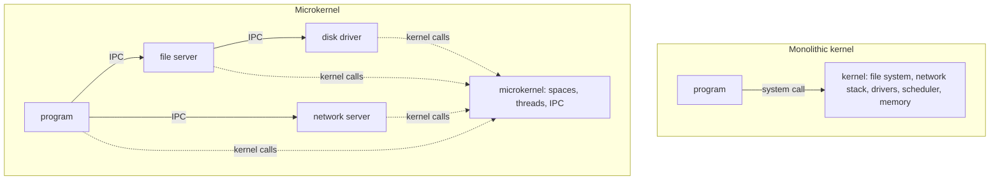
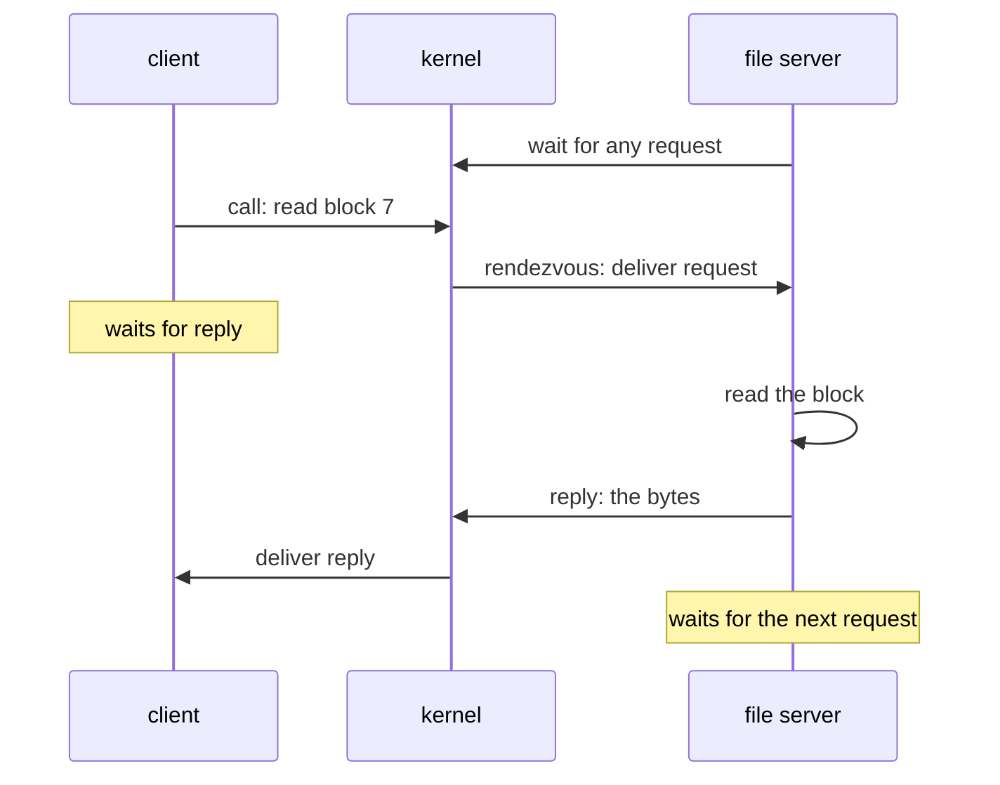
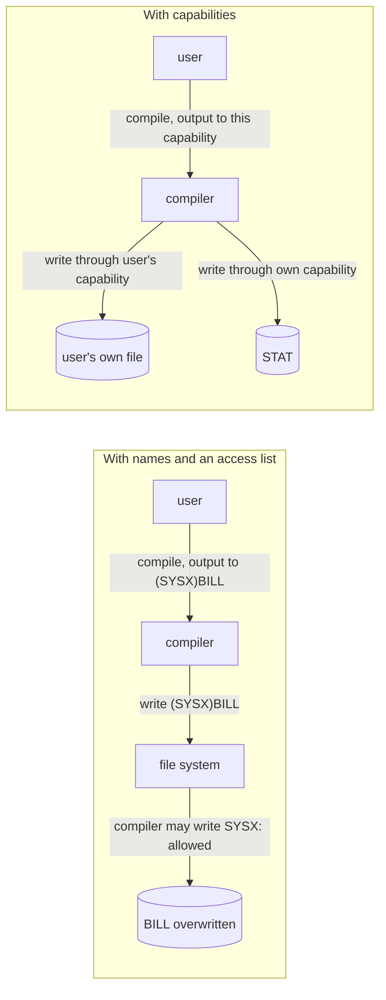

# Chapter 2. Microkernels and Capabilities

> **Status.** Background. This chapter describes microkernels and
> capabilities in general, and no mark applies to it. Its few
> sentences about erXos rest on two facts. erXos runs on the Fiasco
> microkernel (**Built**). erXos's own kernel is designed and needs
> Phase 2 of the [roadmap](../plan.md); only host-built cores of it
> exist, and none of them boots (**Built (host)**). What erXos takes
> from L4 and Fiasco is told in
> [chapter 8](08-the-kernel-interface-and-its-two-kernels.md).

**Background needed.** [Chapter 1](01-operating-systems-from-the-ground-up.md):
kernel mode and user mode, address spaces, system calls.

A network card driver in the FreeBSD kernel is a few thousand lines of
C written against one vendor's chip. If one of those lines writes past
the end of a buffer, it can overwrite any memory the kernel owns. The
process table, a file system's cache and the scheduler's code are all
within its reach. The driver runs in kernel mode, inside the kernel's
address space, with every privilege the machine has, and nothing
stands between its bug and the rest of the system.

UNIX puts almost everything an operating system does in one program,
the kernel. The FreeBSD kernel holds the file systems, the network
stack, the drivers for every device, and the code that schedules
processes and manages memory. A process asks for any of these through
a system call. The kernel decides whether to do it from the process's
user id and the permissions on the object. One address space, one
privilege level and one kind of identity serve the whole kernel.

A microkernel turns this around. The kernel keeps only what cannot run
anywhere else: address spaces, threads, a way for them to send each
other messages, and the tables that say who may reach what. File
systems, network stacks and drivers become ordinary programs in user
mode, each in its own address space. A program asks one of them for
service by sending it a message. Authority stops depending on who a
program is and depends on what it holds: a **capability**, a reference
to an object that the kernel honors and no program can forge.

Section 2.1 contrasts monolithic kernels with microkernels, and 2.2
shows how programs in separate address spaces talk. Section 2.3
defines capabilities and the problems they solve, and 2.4 explains
why a small kernel built on them makes some mistakes impossible to
write. Section 2.5 traces the L4 family, from which erXos's kernel
descends, to Fiasco. Two short sections close the chapter: what
fails, and what each design choice costs.

## 2.1 Monolithic kernels and microkernels

The first question every operating system answers is what runs in
kernel mode. A **monolithic kernel** runs all the operating system's
services there, in one address space. A **microkernel** runs as little
there as it can, and moves every other service into user-mode
programs. The difference decides what a bug can reach, and what a
request costs.

### 2.1.1 What a monolithic kernel holds

A UNIX kernel is one program, linked from many parts, that runs in
kernel mode. When a FreeBSD process calls `read` on a file, the call
enters the kernel and stays there. The kernel finds the open file and
asks the file system for the block. The file system asks the disk
driver to fetch it, the driver waits for the interrupt that says the
block arrived, and the kernel copies the bytes back to the process.
Every step is a function call inside one address space, and no step
crosses a protection boundary, because there is none inside the
kernel.

That is the strength of the design. Function calls are cheap, any part
of the kernel can read any other part's data, and decades of tuning
have gone into these paths.

It is also the weakness. Every line in the kernel is trusted with
everything. A bug in a rarely used file system can corrupt the whole
system, and so can one in a driver for a USB device the machine does
not have. An attacker who finds such a
bug owns the machine. The kernel of a modern UNIX is millions of lines
of C, and every one of them runs with full privilege.
<!-- check: "millions of lines" for a modern UNIX kernel (FreeBSD's sys/ tree); no source read in this task. -->

### 2.1.2 What a microkernel leaves out

A microkernel keeps in kernel mode only the mechanisms that user-mode
code cannot build for itself. Jochen Liedtke, who designed the L4
microkernel, stated the test in 1995. A concept, he wrote, "is
tolerated inside the µ-kernel only if moving it outside the kernel,
i.e. permitting competing implementations, would prevent the
implementation of the system's required functionality" (Liedtke, "On
micro-kernel construction", 1995, section 2). The test is about
function, not speed. A mechanism stays in the kernel because nothing
outside could provide it safely, not because it would be faster there.

Applied strictly, the test leaves three things in the kernel.

* **Address spaces.** Only kernel-mode code can write the page tables
  that the processor uses to translate addresses, so only the kernel
  can say which memory a program may touch.
* **Threads.** A thread is a running activity inside an address space:
  its registers, its stack and the space it runs in. Only the kernel may
  move a thread between spaces, or a program could run its code inside
  a space it should not reach.
* **Inter-process communication.** Programs in separate address spaces
  cannot read each other's memory, so they need the kernel to carry a
  message from one to the other. This is **IPC**, short for
  inter-process communication.

Everything else moves out. A file system becomes a **server**, a
user-mode program that answers requests from other programs, its
**clients**. So does the network stack, and so does each driver.
Liedtke's paper lists the gains. The kernel's small interface forces a
modular structure, servers use the kernel like any other program, and
a failing server is as isolated as any other failing program. Figure
2.1 shows the two structures side by side.



*Figure 2.1. A monolithic kernel and a microkernel with servers. On
the left, one program in kernel mode holds every service. On the
right, the kernel holds only spaces, threads and IPC, and each service
is a user-mode program reached by message.*

### 2.1.3 The price of crossing

Isolation costs time. In a monolithic kernel, the file system asks the
disk driver for a block with a function call. In a microkernel, the
file server sends the driver a message. The kernel saves the sender's
state, switches to the driver's address space and delivers the
message, and later does the same in reverse for the reply. A switch of
address space can also empty caches that a function call would have
kept warm. A `read` that was one trip into the kernel becomes several.

The early microkernels paid this price in full. By the early 1990s a
one-way message on a typical microkernel cost about 100 µs.
Elphinstone and Heiser, looking back in 2013, describe IPC cost as the
weak point of microkernels at the time. System builders moved services
back into the kernel to avoid it (Elphinstone and Heiser, "From L3 to
seL4", 2013, section 1). Section 2.2.2 shows how L4 cut the cost by
more than an order of magnitude, which made the design practical.

The trade, then, is plain. A monolithic kernel is faster per request.
A microkernel confines a failing driver or server to its own address
space, keeps small the code that runs with full privilege, and lets a
service be restarted without touching the kernel, at the price of a
crossing between address spaces for every request.

### 2.1.4 Mach, QNX, MINIX and L4

Four systems show the range of the design.

**Mach** was an operating systems research project at Carnegie Mellon
University, active from 1985 to 1994. Its kernel offered tasks
(address spaces), threads, and ports, kernel-held queues through which
tasks sent each other messages. Mach's ports buffered messages inside
the kernel (Elphinstone and Heiser 2013, section 3.2.3). Its IPC was
slow: Liedtke measured L4's IPC at 22 times faster than Mach's on the
same Intel 486 processor (Liedtke 1995, footnote 2). Mach is the
system most people mean when they say microkernels were slow.
<!-- check: Mach's kernel abstractions (tasks, threads, ports); the CMU project page read gives only the project's name and years. -->

**QNX** is a commercial real-time system built on a microkernel. Its
kernel provides threads, scheduling, timers, interrupt handling and
message passing. File systems, networking and device I/O run as
processes outside it. A program reaches a file system through messages
that the POSIX library sends on its behalf (QNX OS 8.0 System
Architecture guide, "The microkernel"). QNX shows that a
UNIX-like interface can sit on a microkernel.

**MINIX 3** is a teaching and research system whose drivers run as
user-mode processes, and which restarts a driver that fails.
<!-- check: MINIX 3's driver restart (its reincarnation server); minix3.org refused the connection on 2026-11-19. -->

**L4** is the family this chapter follows to its end. Liedtke built
the first L4 in assembly for the Intel 486 in the early 1990s. It
showed that microkernel IPC could be 10 to 20 times faster than that
of other microkernels of its day (Elphinstone and Heiser 2013, section
1). Section 2.5 traces its descendants, Fiasco among them.

## 2.2 Inter-process communication

In a microkernel, every service is reached through IPC. A program that
wants to read a file, send a packet or draw on the screen sends a
message to the server that does it and waits for the answer. How the
kernel carries that message decides how fast the whole system is, and
much of what it can promise.

### 2.2.1 Messages between address spaces

Two threads in separate address spaces exchange a message through the
kernel. The sender names a destination and gives the kernel the words
of the message. The kernel checks that the sender may reach that
destination, copies the words to the receiver, and wakes the receiver.
Liedtke's paper notes what this gives each side. The sender decides
what to send; the receiver decides whether to receive and how to read
what it got (Liedtke 1995, section 2.2). Neither can reach into the
other.

L4's IPC is **synchronous**: the message moves only when the sender is
ready to send and the receiver is ready to receive. If the receiver is
busy, the sender waits; if no message has arrived, the receiver waits.
The moment when both are ready and the kernel moves the message is a
**rendezvous**. At a rendezvous the message goes straight from sender
to receiver, so the kernel never holds it. No queue of messages fills
kernel memory, and no message waits in the kernel for a receiver that
never comes. Elphinstone and Heiser give this as the reason for the
choice: synchronous IPC spares the kernel the buffers that queued
messages need, and the cost of managing and copying them (section
3.2.1).

The usual pattern is a **call**. The client sends a request and waits
for the reply in one kernel call. The server, waiting for any request,
receives it, does the work and replies. A function call in a
monolithic kernel becomes a call between address spaces. Figure 2.2
shows one call from start to finish.



*Figure 2.2. A client calling a server by IPC. The kernel moves the
request only when the server is waiting for one. The client's call
returns only with the server's reply, and at no point does the kernel
hold a message on its own.*

### 2.2.2 How L4 made IPC fast

Liedtke argued that slow IPC came from how microkernels were built,
not from the idea. His paper traces the inefficiency of the
microkernels of his day to kernels overloaded with features and to
poor implementation (Liedtke 1995, abstract). The first L4 ran on a
50 MHz Intel 486 in 1993. It sent a one-way message in 250 processor
cycles, or 5 µs, against the 100 µs typical at the time (Elphinstone
and Heiser 2013, table 1).

The speed came from doing less. Three of L4's techniques show the
pattern.

* **No kernel buffering.** A synchronous message goes from sender to
  receiver at the rendezvous, so the kernel allocates no buffer and
  makes no second copy.
* **Short messages in registers.** The original L4 passed a short
  message in processor registers. The kernel switched from the
  sender's context to the receiver's without touching them, so a short
  message was not copied at all (Elphinstone and Heiser 2013, section
  3.2.2). Later L4 kernels, Fiasco among them, keep a small block of
  message words per thread in memory that the kernel and the thread
  both reach. It serves the same purpose and works the same way on
  every architecture.
* **Direct process switch.** When a client's call blocks it, the kernel
  switches straight to the server it waits for, without running the
  scheduler to choose the next thread (same paper, section 4.3).

Liedtke held that minimality helps speed, and L4's successors kept
both goals. Elphinstone and Heiser conclude that, twenty years on,
minimality and fast IPC still drive the design of every kernel in the
family (sections 1 and 3.1).

### 2.2.3 Shared memory beside messages

Messages carry requests and short replies well, and bulk data badly.
Copying a megabyte through the kernel for every disk read would cost
more than the read. Microkernel systems therefore pair IPC with
**shared memory**, a region of physical memory mapped into two address
spaces at once. A client and a server agree on a shared buffer once,
through IPC. Afterwards the server writes a disk block into the buffer
and sends a short message, "block 7 is in the buffer", and the client
reads the bytes in place.

L4 built this sharing into its model of address spaces. Liedtke's
paper gives a program three operations on its own pages.

* **Grant** gives a page to another address space; the granter loses
  it.
* **Map** puts a page into another address space; the mapper keeps it.
* **Flush** removes a page from every space that received it from the
  flusher, directly or indirectly.

Grant and map both need the receiver's consent, so they travel as IPC
(Liedtke 1995, section 2.1).

A second need is to signal without waiting. A server that waits for a
client's request cannot also wait for its device's interrupt, unless
the kernel delivers both the same way. The original L4 turned a
hardware interrupt into a message from a special thread id (Liedtke
1995, section 3). Later L4 kernels added **notifications**, signals
that do not block the sender and that the receiver collects when it is
ready (Elphinstone and Heiser 2013, section 3.2.1). Fiasco's form of
this is the IRQ object, which hardware interrupts and software alike
can trigger.

### 2.2.4 A server is a process that clients call

The file server of a microkernel system is an ordinary user-mode
program with its own address space and threads. Its main loop waits
for a request, decodes it, does the work, and replies. Nothing about
it is special to the kernel. Three consequences follow that a UNIX
programmer may not expect.

* **The interface is a protocol.** A UNIX system call is a function
  the kernel exports. A microkernel service is a set of messages a
  server understands: their layout, their order, their replies. Two
  file servers that speak the same protocol are interchangeable.
* **Servers stack.** A file server is the disk driver's client, and a
  network file system is the network server's.
* **A server's bug stays in the server.** A client trusts a server to
  answer correctly, but the server cannot reach the client's memory or
  the client's other servers.

## 2.3 Capabilities

Once services are separate programs, the kernel must decide who may
send a message to whom. A program that can message the disk driver can
read every block on the disk. A program that can message the network
server can send packets. Who may reach which server is the security
question of a microkernel system, and capabilities are the answer the
L4 family converged on.

### 2.3.1 Authority in UNIX

Authority is the power to cause an effect: to read a file, end a
process, send a packet. UNIX attaches authority to identity. Every
process carries a user id, and the kernel decides each request by
comparing that id with the permissions of the object named. A process
running as user 1001 can open `/home/ana/notes` if the file's
permissions let user 1001 read it. What the process is for, and how it
came to know the path, do not enter the decision.

This is **ambient authority**: authority that a process holds by being
who it is, available for every action without being named in it. The
path says what to open; the user id, which the process never mentions,
says whether it may. Any string the process builds can name a file. So
any code running in the process, a library, a plugin or an attacker's
injected payload, can use every right its user has.

UNIX does have one form of held authority. A file descriptor is a small
integer that names an open file, and a process can use the file
through it even after the file's permissions change. A process can
pass a descriptor to another over a UNIX-domain socket. FreeBSD's
Capsicum builds on this, as section 2.3.6 shows.

### 2.3.2 A capability is a reference with rights

Jack Dennis and Earl Van Horn described the alternative in 1966. Each
computation, they wrote, runs in a *sphere of protection* given by a
list of capabilities, a **C-list**. "Each capability in a C-list
locates by means of a pointer some computing object, and indicates the
actions that the computation may perform with respect to that object"
(Dennis and Van Horn, "Programming Semantics for Multiprogrammed
Computations", 1966). A program does not name an object by a global
name. It names an entry in its own C-list by its position, which they
called the entry's index number.

A capability is therefore two things in one. It *names* an object, and
it carries the *rights* to use it. A capability to a file might allow
read but not write; a capability to a server might allow calling it
but not reconfiguring it. A program that holds no capability to an
object cannot name the object at all, because it has no other way to
say which object it means.

Modern microkernels keep this design almost unchanged. Each address
space has a **capability table**, an array in kernel memory with one
slot per capability. Each slot holds a pointer to a kernel object and
a set of rights. A program refers to a capability by its slot number,
and every kernel call that acts on an object takes such a number.
Figure 2.3 shows a table.

```text
 address space A (user mode)       kernel memory
 +------------------------+        +------------------------------------------+
 | "call slot 2 with a    |        | capability table of A                    |
 |  read request"         | -----> |  slot 0  empty                           |
 +------------------------+        |  slot 1  thread T7      rights: control  |
                                   |  slot 2  gate of the    rights: call     |
                                   |          file server                     |
                                   |  slot 3  memory page P  rights: read     |
                                   +------------------------------------------+
```

*Figure 2.3. A capability as a slot in a table, with its rights. The
program names only the number 2. The kernel looks up slot 2 in A's own
table, finds the object and the rights, and refuses the call if the
slot is empty or lacks the right.*

### 2.3.3 Why a capability cannot be forged

A capability is **unforgeable**: no program can make one by itself.
The property follows from where the table lives. The capability table
is in kernel memory, which no user-mode program can write. A program
holds only slot numbers, and a slot number means something only in its
own table. Program A can write the number 2 into a message to program
B, but in B's table slot 2 is whatever B holds there, or nothing.
Guessing numbers gains nothing, because every number refers to the
guesser's own table.

A program gains a capability in three ways only. The kernel gives it
one when it creates an object for the program. Its creator places one
in its table when it starts. Or a program that holds one passes a copy
to it through the kernel, usually in an IPC message. In every case the
kernel does the writing, and some program that already held the
authority chose to give it. Authority moves only along paths that
someone with authority made.

Saltzer and Schroeder's survey of protection describes a capability in
these terms. It is an unforgeable ticket, and presenting it proves
that the holder may use the object (Saltzer and Schroeder, "The
Protection of Information in Computer Systems", 1975, glossary). The
survey also names the cost. Capabilities are cheap to check but hard
to review and to revoke, because the kernel must find every copy.
Section 2.3.5 returns to revocation.

### 2.3.4 The confused deputy

Norm Hardy told, in a 1988 paper, the story that shows why ambient
authority fails. It comes from Tymshare, a commercial time-sharing
company. The system's Fortran compiler lived in a system directory,
`SYSX`. A user ran it with the name of a source file and, optionally,
the name of a file to receive debugging output. The compiler also kept
statistics on its own use in a file in `SYSX`, so the administrators
gave it a license to write any file in `SYSX`. The billing file,
`(SYSX)BILL`, lived in `SYSX` too. A user named `(SYSX)BILL` as the
debugging output, and the compiler, using its license, overwrote the
billing records (Hardy, "The Confused Deputy", 1988).

Nothing in the compiler was wrong when it was written. It became wrong
when it acquired two sources of authority, the user's and its own, and
could not tell which one each file access should use. The compiler is
the **confused deputy**: a program acting for a client that uses its
own authority on a request it should have checked against the
client's. The operating system checked the compiler's license, as
designed. The license allowed the write, and the billing file was
gone.

Capabilities remove the confusion because they join the name and the
authority. The user passes the compiler a capability to the output
file, not a name, and the compiler holds its own capability to the
statistics file. Debugging output goes through the capability the
user gave, which can only name a file the user could write. The user
holds no capability to the billing file, so there is nothing to pass.
Hardy concluded that capabilities cannot be bolted on: "Our view is
that capabilities must be the foundation of the system." Figure 2.4
shows both versions.



*Figure 2.4. The confused deputy with an access list and with
capabilities. With names, the file system checks the compiler's
authority and lets the user's request reach the billing file. With
capabilities, the user can hand over only what the user holds.*

### 2.3.5 Delegation, shrinking rights and revocation

Capabilities make explicit three operations that UNIX handles by
convention.

**Delegation** is handing authority to another program. A program
delegates by passing a copy of a capability, through the kernel, to a
program it can already reach. The receiver can then use the object as
the sender could. Delegation is how a system is assembled: a shell
that starts a command hands it capabilities to its input and output,
and the command can reach nothing else.

**Rights only shrink.** A program that passes a capability can remove
rights from the copy, and can never add any. A program holds a
capability to a file with read and write rights. It hands a helper a
copy with only read. The helper can pass on that read right, or less,
but no call gives it write back. Authority narrows as it travels from
its source. A reader of the design can therefore bound what each
program can do by looking at what it was given.

**Revocation** is taking authority back, the hard problem Saltzer and
Schroeder named. Microkernels solve it by keeping every capability in
kernel tables. The kernel can find every slot that refers to an
object, so deleting the object invalidates every capability to it at
once, wherever it was copied. L4's flush does the same for memory. To
revoke one client's access without deleting the object, a server hands
that client a capability to an object of its own, such as a separate
IPC endpoint, and later deletes that.

Reused slots raise one more problem. Suppose slot 5 held a capability
to a deleted object, and the kernel then puts another capability in
slot 5. A program still holding the old number would reach the other
object by mistake. Some kernels guard against this with a
**generation**, a counter stored with each slot that goes up whenever
the slot is reused. A program's reference carries the generation it
was given, and the kernel refuses a reference whose generation no
longer matches. Zircon's handles carry a generation, with the slot
index and a random value per table
([research-kernel-bases.md, Zircon](../research-kernel-bases.md#zircon)).

### 2.3.6 Capability systems in practice

Capabilities are older than microkernels and have appeared in kernels
of many shapes. Table 2.1 lists the systems this book draws on most.

| System | Where | What it shows |
| --- | --- | --- |
| KeyKOS | Tymshare's GNOSIS, deployed from 1982 | a whole commercial system built on capabilities |
| EROS | University of Pennsylvania, 1990s; KeyKOS's design reimplemented | capability IPC as cheap as ordinary system calls; space banks that pay for every object |
| seL4 | NICTA and UNSW | a capability microkernel with a formal proof of its implementation |
| Zircon | Google's Fuchsia | handles with rights that duplication cannot add, and a generation in each handle |
| Capsicum | FreeBSD 9.0 onward | capabilities added to UNIX: file descriptors with rights, and a capability mode |

*Table 2.1. Capability systems. Each made capabilities practical in a
different setting.*

**KeyKOS and EROS.** GNOSIS, later renamed KeyKOS, was built at
Tymshare to support "secure time sharing and controlled collaboration
among mutually adversarial users", and was first deployed in 1982
(Shapiro, Smith and Farber, "EROS: a fast capability system", 1999,
section 1). EROS reimplemented its architecture in the 1990s and
measured it. Its basic operations, IPC among them, cost about what
similar operations cost on Linux (same paper, abstract), which
answered the belief that capability systems must be slow. Its space
banks, which pay for every object a program creates, are the model for
erXos's budgets ([chapter 12](12-memory-and-budgets.md)).

**seL4** is the L4 kernel built for proof. Its developers wrote it
from scratch with capability-based access control, and it was the
first operating system kernel whose implementation was formally
verified in full (Elphinstone and Heiser 2013, abstract). Section
2.4.2 explains why a small kernel can be proved and a large one cannot.

**Zircon**, the kernel of Google's Fuchsia, gives every process a
table of handles, each with rights, and duplicating a handle cannot
add a right
([research-kernel-bases.md, Zircon](../research-kernel-bases.md#zircon)).

**Capsicum** brings capabilities to FreeBSD without changing its
kernel's structure. A file descriptor can carry rights, narrowed with
`cap_rights_limit(2)`, so that a descriptor allows `read` but not
`fchmod`. A process that calls `cap_enter(2)` enters capability mode.
Global namespaces, such as the file system and process ids, are then
closed to it, and it can use only the descriptors it holds. Its
children inherit the mode, and none can leave it (FreeBSD
`capsicum(4)`). Capsicum shows the confused deputy's cure inside a
UNIX: a program that parses untrusted input opens what it needs, then
enters capability mode.

## 2.4 Security by construction

In a capability system, a security property can hold because of how
the system is built, not because every piece of code remembered to
check it. This section explains what that means, and why it depends on
a small kernel.

### 2.4.1 The trusted computing base

Every system has some code that must be correct for the system to be
secure. That code is its **trusted computing base**, or TCB: the parts
whose failure can break the system's security, as opposed to the parts
whose failure harms only themselves. In a monolithic UNIX the TCB
includes the entire kernel, every driver and every file system,
because each runs with full privilege. It also includes every program
that runs as root.

In a microkernel system the TCB shrinks to the kernel and the few
servers that every program depends on, such as the program that
creates the others. A disk driver is not in the TCB of a program that
never uses the disk, because the driver cannot reach that program's
memory or capabilities. A file server is in the TCB of the programs
that store files through it, and of no others. Trust becomes a
property of each relationship, not of the whole kernel.

### 2.4.2 Why a small TCB is checkable

Saltzer and Schroeder's first design principle is **economy of
mechanism**: keep the design as small and simple as possible. A
protection mechanism must be checked line by line, and only a small
one can be. Another of their principles is **complete mediation**:
"Every access to every object must be checked for authority." A
capability kernel meets it by construction. The only way to reach an
object is through a capability, and the only way to use a capability
is through the kernel's lookup.

The L4 family shows how small a kernel can be. The original L4 was
about 6,400 lines of assembly. seL4 is about 10,200 lines of C and
assembly, and Fiasco.OC, which carries more features, about 37,600
(Elphinstone and Heiser 2013, table 2). One person can read a kernel
of ten thousand lines whole and review it line by line. As seL4
showed, a machine can prove it correct. A kernel of millions of lines
allows none of these.

### 2.4.3 Mistakes that cannot be written

A system protected by checks must remember every check. Consider what
a UNIX kernel must get right so that a process cannot read a file it
should not:

* `open` checks the permissions of the file and of every directory on
  the path;
* `exec` checks execute permission, and changes the user id for a
  set-user-id program;
* every file system, local or network, implements those checks the
  same way;
* every driver that offers a device file honors the device's
  permissions;
* every privileged program that opens files for a user checks the
  user's rights before using its own, which is the confused deputy's
  lesson.

Each item is a place where a missed check is a hole. Each added file
system, driver or privileged program adds items. The argument that the
system is secure depends on the list being complete, which no reviewer
can confirm.

A capability kernel replaces the list with one mechanism. Every kernel
call that acts on an object takes a slot number. One function looks up
the slot in the caller's table and checks the rights, and no other
path to an object exists. A program with no capability to a file has
no number that names it. An added driver or file server adds no item
to the list, because it reaches objects through the same lookup as
everything else. The property "a program reaches only what it was
given" holds because no code can be written that breaks it.

This is what the book means by **by construction**: a property holds
because the wrong state cannot be expressed, not because every
participant remembered a rule.
[Chapter 6](06-correct-by-construction.md) makes it the method of the
whole design. erXos states several of its kernel's properties in this
form. Among them: a stale capability never names a new object, rights
only shrink, and no capability ever waits in a queue for a receiver
([design.md, Invariants](../design.md#invariants)).

## 2.5 The L4 family and Fiasco

L4 is a family of kernels that share Liedtke's principles and, in some
cases, his interface. erXos's kernel descends from one branch of it,
Fiasco, and erXos runs on Fiasco itself until its own kernel is ready.
This section traces the family and explains that choice.

### 2.5.1 From L3 to seL4

L4 grew out of L3, an earlier system Liedtke built in the 1980s: a
complete operating system with built-in persistence and drivers in
user mode. L3 was deployed commercially in a few thousand
installations, and, like every microkernel of its time, it paid about
100 µs for an IPC (Elphinstone and Heiser 2013, section 2). L4 began
as a radical redesign of it, written entirely in assembly for the 486
and then the Pentium. It reached others as the "V2" interface from
1995.

The family grew from there by reimplementation more than by shared
code (Elphinstone and Heiser 2013, section 2 and figure 1).

* **Fiasco**, written at the Technische Universität Dresden, was the
  first L4 kernel written almost entirely in a higher-level language,
  C++, and is the oldest L4 code base still maintained.
* **Hazelnut**, from Liedtke's group at Karlsruhe, was the first L4
  kernel ported to another architecture rather than rewritten for it.
* **L4Ka::Pistachio**, from the same group, carried the V4 interface,
  aimed at portability and multiprocessors.
* **OKL4**, which grew out of NICTA's port of Pistachio to embedded
  processors, was deployed commercially on mobile devices.
* **seL4**, from NICTA and UNSW, was written from scratch for formal
  verification.
* **NOVA**, from Dresden, was designed around virtualization.

Two changes ran through the whole family. The first was the move to
capabilities. The original L4 named the destination of an IPC by a
global thread id. It controlled who could create address spaces with a
fixed supply of task ids, handed out first come, first served. Global
ids exposed a server's internal threads to its clients, and leaked
information between programs that should have been separate.
Influenced by EROS, OKL4 adopted capabilities in its 2.1 release in
2008, and Fiasco followed, renamed Fiasco.OC (Elphinstone and Heiser
2013, sections 2 and 3.2.3).

The second change replaced the thread as the destination of an IPC
with an **endpoint**, a kernel object between clients and the server
threads that serve them. A client holds a capability to the endpoint
and never learns which thread answers. Unlike Mach's ports, these
endpoints buffer no messages.

### 2.5.2 Fiasco and L4Re

Fiasco lived through most of L4's history. It began as a clone of the
original interface and supported several L4 interfaces over the
years. It became a kernel with capability-based access control, and a
testbed for real-time scheduling (Elphinstone and Heiser 2013, section
2). Around
it, Dresden built **L4Re**, the L4 Runtime Environment: the user-mode
libraries and servers that a system on Fiasco needs, among them the
servers Sigma0, Moe and Ned. L4Re's developers took their first steps
toward it at TU Dresden in 1997, and Kernkonzept maintains it as an
open-source microkernel-based operating system and hypervisor
(l4re.org).

Fiasco's objects follow the pattern of section 2.3. Each address
space, which Fiasco calls a task, has a table of capabilities. IPC goes
through an IPC gate, an endpoint bound to one server thread, with a
label that tells the server which client called. Each thread has a
**UTCB**, a user thread control block: a small region of memory that
the thread and the kernel share, in which the words of a message
travel. A message is at most 63 words, a limit erXos's kernel keeps
([design-kernel.md, IPC gates](../design-kernel.md#ipc-gates)).
Interrupts arrive through IRQ objects. A factory object creates
objects, and the holder of a capability to a factory can create tasks,
threads and gates.

### 2.5.3 The root task

A capability system needs a first holder. When the machine starts,
some program must hold the authority over all memory, all devices and
the creation of objects. Every other program's capabilities come,
directly or not, from that holder. In the L4 family it is the **root
task**, the one program the kernel starts with every initial
capability, which then builds and starts the rest of the system.

Liedtke's paper describes the idea for memory. At start, one address
space, which he calls σ0, holds all physical memory, and every other
space is empty. Further spaces are built on top of it by mapping and
granting pages, recursively, so memory managers can stack (Liedtke
1995, section 2.1). L4Re keeps this structure, with Sigma0 as the
first pager and Moe as the root task that starts the rest.
<!-- check: the roles of Sigma0 (first pager over physical memory) and Moe (root task) in L4Re; l4re.org names both but the page read does not state their roles. -->

The root task is part of every program's trusted computing base. It
decides which program gets which capability, so a bug in it can give
any program anything. Keeping the root task small, or writing its
decisions down where they can be checked, protects the whole system.

In erXos, the root task is the **system domain**. Its Erlang services
decide who gets what, and its C library creates and ends every other
program's address space
([design.md, The model](../design.md#the-model)). On Fiasco, one
thread of the root task, the root service, is the only creator of
kernel objects and the only writer of any task's capability table and
page tables. Every later use of an object is the holder's own Fiasco
call, which Fiasco checks
([design-fiasco.md, The construction](../design-fiasco.md#the-construction)).
[Chapter 10](10-domains-a-wall-around-some-processes.md) tells how the
system domain builds domains.

### 2.5.4 Why erXos starts on Fiasco and later replaces it

erXos is designed around a kernel of its own: a capability microkernel
in C, built on Fiasco's design and reshaped for what erXos needs, such
as CPU time granted to whole runtimes and memory paid for by budgets
([design-kernel.md](../design-kernel.md)). That kernel needs Phase 2
of the roadmap. Only host-built cores of it exist, and none of them
boots ([README.md, Current status](../../README.md#current-status)).

Until then erXos runs on Fiasco, near stock, imported under `fiasco/`,
for two reasons. The first is that erXos aims to reach a working
system first, standing on proven components, and to replace them one
at a time where that pays ([plan.md](../plan.md)). The second is that
Fiasco is proven code: it has run real systems for decades, which a
new kernel must earn. erXos's kernel therefore replaces Fiasco only at
parity, when it runs every test and benchmark the system ran on Fiasco
([design-kernel.md, L4 lineage](../design-kernel.md#l4-lineage),
[plan.md, M7](../plan.md#m7-fiasco-leaves)). Fiasco's license is not
among the reasons: its kernel package is MIT-licensed, as
`fiasco/kernel/LICENSE.spdx` declares.

A seam makes the switch possible. Every program reaches the kernel
through `liberx`, erXos's C library for kernel calls, and nothing above
`liberx` calls Fiasco. A backend of `liberx` implements erXos's kernel
interface over Fiasco's own calls, in user mode
([design-fiasco.md](../design-fiasco.md)). When erXos's kernel is
ready, another backend replaces that one, and nothing above `liberx`
moves.

The cost is that some properties erXos's kernel promises do not hold
on Fiasco. On Fiasco, for example, a capability slot carries no
generation. That a stale capability never names a new object then
rests on the order in which slots are reused, not on a check at every
use; erXos's own kernel checks a generation. Each such difference is a
row of the downsides table, this one row FD1
([design-fiasco.md, Downsides against erXos's kernel](../design-fiasco.md#downsides-against-erxoss-kernel)),
and the first release publishes the table with it.
[Chapter 8](08-the-kernel-interface-and-its-two-kernels.md) describes
the interface and both kernels behind it.

## 2.6 What fails, and what a failure reaches

A microkernel does not stop servers from failing. It changes what a
failure reaches. A driver in a monolithic kernel that follows a bad
pointer stops the machine, or writes over memory it does not own and
leaves the system running on corrupted state. In a microkernel, the
same bug raises a fault in the driver's address space. The kernel
stops the driver's thread and tells whoever is responsible for it;
every other address space is untouched.

What happens next is up to the system, and three cases differ.

* **A server that clients can do without.** Its clients' calls fail
  with an error, and a program that supervises servers starts another.
  MINIX 3 restarts failed drivers this way.
  <!-- check: as in section 2.1.4, MINIX 3's driver restart. -->
* **A server that holds state.** A restarted file server must rebuild
  what the old one held in memory, such as open files and cached
  blocks, and its clients must open their files again. Isolation keeps
  the failure from spreading; it does not undo it.
* **The root task.** Nothing with less authority can replace the
  program that holds every initial capability, so its failure ends the
  system. In erXos a fault of the system domain resets the machine
  ([design.md, The model](../design.md#the-model)).

The kernel itself is the last case. Every program depends on it, so
its bugs are not confined. That is why the kernel is kept small enough
to check, and why seL4 went as far as proof.

## 2.7 Design choices

Microkernels and capabilities are not the only answers to the problems
this chapter opened with. Three alternatives come up most.

**A monolithic kernel, hardened.** A monolithic kernel can let programs
confine themselves, as Capsicum does, and keeps the speed of function
calls. It does not shrink the trusted computing base: every driver
still runs with full privilege, and the list of checks in section
2.4.3 still grows with each one.

**Protection by language.** A system can run every program in one
address space and rely on a type-safe language and a verifier to keep
programs apart. Microsoft's Singularity did this, with
software-isolated processes that share no pointers
([research-prior-art.md, Singularity](../research-prior-art.md#singularity)).
A crossing between programs is then as cheap as a function call. But
the language runtime and the verifier join the trusted computing base,
and a bug in either is a hole in every program. erXos keeps the
hardware boundary instead, and runs untrusted code only in an address
space of its own ([design.md, Why no verifier](../design.md#why-no-verifier)).

**Access lists instead of capabilities.** A microkernel could check
each IPC against a list of who may call whom, as UNIX checks files
against their permissions. Lists are easy to review and to revoke
from, which Saltzer and Schroeder count in their favor. But they bring
back ambient authority and the confused deputy: a server acting for a
client would use its own entry in the list, not the client's. The L4
family tried global ids and hierarchies first, and replaced both with
capabilities (section 2.5.1).

## Summary

A monolithic kernel runs every operating system service in kernel
mode, so every line of it can harm every program. A microkernel keeps
only address spaces, threads and IPC in the kernel, by Liedtke's test
that a concept stays only if nothing outside could provide it. File
systems, network stacks and drivers run as user-mode servers. Servers
and clients talk by synchronous IPC, a rendezvous at which the kernel
moves a message without buffering it, with shared memory for bulk
data. L4 showed that such IPC can cost a few microseconds, an order of
magnitude less than its predecessors paid. A capability is an
unforgeable reference to an object together with rights, and programs
hold only slot numbers into tables that the kernel alone writes.
Capabilities replace ambient authority, cure the confused deputy and
let rights only shrink as they are delegated; kernel-held tables make
revocation possible. A small kernel in which every access goes through
one lookup makes "a program reaches only what it was given" true by
construction, and is small enough to check or, for seL4, to prove.
Fiasco, the Dresden branch of the L4 family, is the kernel erXos runs
on, behind an interface of erXos's own, until erXos's kernel reaches
parity with it.

The next chapter turns from the kernel to the language erXos is built
around: Erlang, whose processes share nothing and talk only by
message.

## Where to read next

* Jochen Liedtke, "On µ-Kernel Construction", *15th ACM Symposium on
  Operating Systems Principles*, 1995: the minimality test, the
  address-space operations grant, map and flush, and the argument that
  slow microkernels were badly built, not slow by nature.
  <https://cgi.cse.unsw.edu.au/~cs9242/22/papers/Liedtke_95.pdf>
* Kevin Elphinstone and Gernot Heiser, "From L3 to seL4: What Have We
  Learnt in 20 Years of L4 Microkernels?", *SOSP*, 2013: the family's
  history, IPC costs from 1993 on, and which of L4's original ideas
  survived. <https://www.cs.yale.edu/flint/cs428/doc/L3toseL4.pdf>
* Jack B. Dennis and Earl C. Van Horn, "Programming Semantics for
  Multiprogrammed Computations", *Communications of the ACM* 9(3),
  1966: capabilities and C-lists, where the idea begins.
  <https://cs.ucf.edu/courses/cop6614/fall2005/dennis-vanhorn.pdf>
* Jerome H. Saltzer and Michael D. Schroeder, "The Protection of
  Information in Computer Systems", *Proceedings of the IEEE*, 1975:
  design principles such as economy of mechanism and complete
  mediation, and capabilities against access lists.
  <https://www.cs.virginia.edu/~evans/cs551/saltzer/>
* Norm Hardy, "The Confused Deputy (or why capabilities might have been
  invented)", *Operating Systems Review*, 1988: the compiler and the
  billing file.
  <https://css.csail.mit.edu/6.858/2015/readings/confused-deputy.html>
* Jonathan S. Shapiro, Jonathan M. Smith and David J. Farber, "EROS: a
  fast capability system", *SOSP*, 1999: KeyKOS's lineage, and a
  capability system measured against Linux.
  <https://sites.cs.ucsb.edu/~chris/teaching/cs290/doc/eros-sosp99.pdf>
* FreeBSD `capsicum(4)`: capabilities inside a UNIX.
  <https://man.freebsd.org/cgi/man.cgi?query=capsicum&sektion=4>
* [design-kernel.md](../design-kernel.md): erXos's kernel, its objects
  and capabilities, and its [L4 lineage](../design-kernel.md#l4-lineage)
  ledger of every departure from Fiasco.
* [design-fiasco.md](../design-fiasco.md): erXos on Fiasco, the root
  service, and the downsides table.
* [research-kernel-bases.md](../research-kernel-bases.md): seL4,
  Zircon and the other kernels erXos considered as a base.
