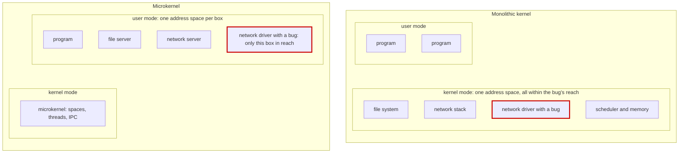
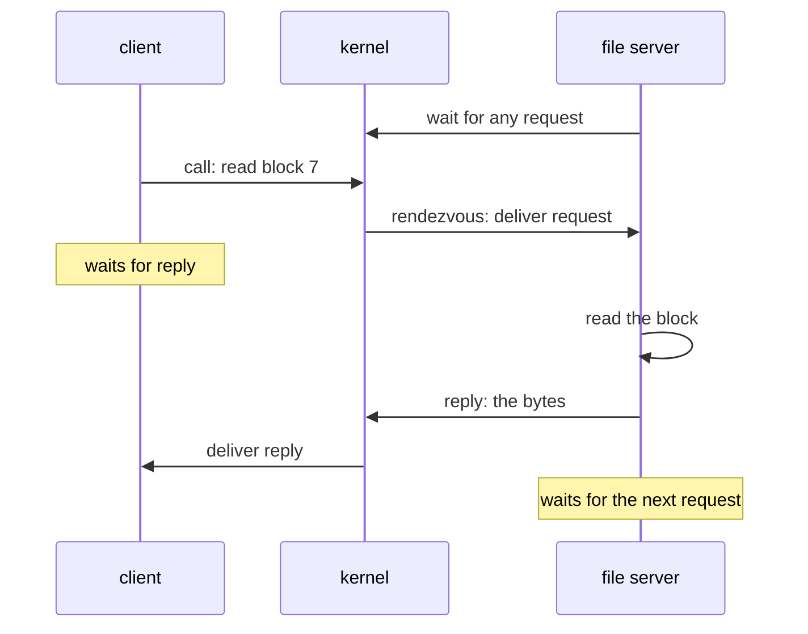
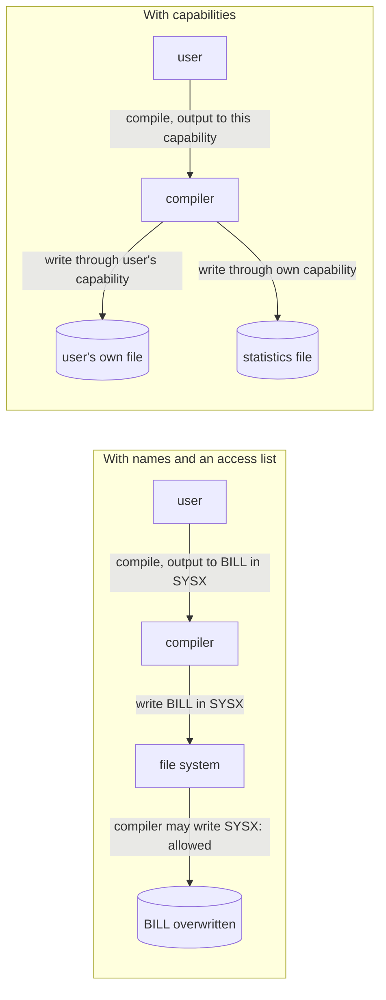

# Chapter 2. Microkernels and Capabilities

> **Status.** Background: the chapter describes microkernels and
> capabilities in general, so its sections carry no mark. What it says
> about erXos is **Built**: erXos runs on the Fiasco microkernel behind
> its own kernel interface, `liberx`, and its system domain, the root
> task, starts and ends the other domains. How erXos uses Fiasco is
> told in
> [chapter 8](README.md#chapter-8-the-kernel-interface-and-fiasco).

**Background needed.** [Chapter 1](01-operating-systems.md):
kernel mode and user mode, address spaces, system calls.

A network card driver in the FreeBSD kernel is C code written against
one vendor's chip. If one of its lines writes past the end of a buffer,
it can overwrite any memory the kernel owns: the process table, a file
system's cache, the scheduler's code. The driver runs in kernel mode,
inside the kernel's address space, with every privilege the machine
has, and nothing stands between its bug and the rest of the system.

UNIX puts almost everything an operating system does in one program,
the kernel: file systems, the network stack, the drivers for every
device, scheduling and memory management. A process asks for any of
these through a system call, and the kernel decides from the process's
user id and the permissions on the object.

A microkernel turns this around. The kernel keeps only what cannot run
anywhere else: address spaces, threads, a way for them to send each
other messages, and the tables that say who may reach what. File
systems, network stacks and drivers become ordinary programs in user
mode, each in its own address space, and a program asks one of them
for service by sending it a message. Authority stops depending on who
a program is and depends on what it holds: a **capability**, a
reference to an object that the kernel honors and no program can
forge.

The chapter builds from these two ideas to Fiasco, the kernel erXos
runs on, and traces one call through it.

## 2.1 Monolithic kernels and microkernels

A **monolithic kernel** runs all the operating system's
services in kernel mode, in one address space. A **microkernel** runs
as little there as it can, and moves every other service into user-mode
programs. The difference decides what a bug can reach, and what a
request costs.

### 2.1.1 What a monolithic kernel holds

A UNIX kernel is one program, linked from many parts, that runs in
kernel mode. When a FreeBSD process calls `read` on a file, the call
enters the kernel and stays there. The kernel finds the open file and
asks the file system for the block. The file system asks the disk
driver to fetch it, the driver waits for the interrupt that says the
block arrived, and the kernel copies the bytes back to the process.
Every step is a function call inside one address space, and no step
crosses a protection boundary, because there is none inside the
kernel.

That is the strength of the design: function calls are cheap, and
decades of tuning have gone into these paths. It is also the weakness. Every line in the
kernel is trusted with everything. A bug in a rarely used file system
can corrupt the whole system, and so can one in a driver for a USB
device the machine does not have. The kernel of a modern UNIX runs to
hundreds of thousands or millions of lines of C, and every one of them
runs with full privilege.

### 2.1.2 What a microkernel leaves out

A microkernel keeps in kernel mode only the mechanisms that user-mode
code cannot build for itself. Jochen Liedtke, who designed the L4
microkernel, stated the test in 1995. A mechanism belongs in the
kernel only if leaving it to user-mode programs, where competing
versions of it could exist, would make the system impossible to build.
In his words, a concept "is tolerated inside the µ-kernel only if
moving it outside the kernel ... would prevent the implementation of
the system's required functionality" (Liedtke 1995). The test is about
function, not speed.

Applied strictly, the test leaves three mechanisms in the kernel, plus
a way to give each thread and address space a name no other shares.

* **Address spaces.** Only kernel-mode code can write the page tables
  that the processor uses to translate addresses, so only the kernel
  can say which memory a program may touch.
* **Threads.** A thread is a running activity inside an address space.
  Its registers and stack decide which code runs and on what data.
  Only the kernel saves and restores them and chooses the space a
  thread runs in, so no program can start its code running inside
  another program's space.
* **Inter-process communication.** Programs in separate address spaces
  cannot read each other's memory, so they need the kernel to carry a
  message from one to the other. This is **IPC**, short for
  inter-process communication.

Everything else moves out. A file system becomes a **server**, a
user-mode program that answers requests from other programs, its
**clients**. So does the network stack, and so does each driver. The
kernel's clear interface forces a modular structure, Liedtke argued,
and a failing server is as isolated as any other failing program.
Figure 2.1 shows what a driver's bug can reach under each design.



*Figure 2.1. A monolithic kernel and a microkernel with servers. On the
left, a bug in the network driver can reach everything in the kernel's
address space. On the right, the same bug reaches only the driver's own
address space.*

### 2.1.3 The price of crossing

Isolation costs time. In a monolithic kernel, the file system asks the
disk driver for a block with a function call. In a microkernel, the
file server sends the driver a message. The kernel saves the sender's
state, switches address space and delivers the message, and later
does the same for the reply, emptying caches a function call would
have kept warm. A `read` that was one trip into the kernel becomes several.

The early microkernels paid this price in full. Elphinstone and Heiser,
looking back in 2013, describe IPC cost as the weak point of
microkernels at the time, and system builders moved services back into
the kernel to avoid it. Section 2.2.2 gives the numbers, and shows how
L4 cut the cost enough to make the design practical.

### 2.1.4 Mach, QNX, MINIX and L4

Four systems show the range of the design.

**Mach** was an operating systems research project at Carnegie Mellon
University, active from 1985 to 1994. Its kernel offered tasks
(address spaces), threads, and ports, kernel-held message queues that
a task reached through a port capability (Rashid et al. 1989). Mach's
ports buffered messages inside the kernel, and its IPC was slow.
Liedtke reported his own kernel's IPC as 22 times faster than Mach's,
both on a 486. That kernel was L3, an early form of L4 (Liedtke 1995,
citing his 1993 paper).

**QNX** is a commercial real-time system, one built to respond to
events within fixed time limits. Its microkernel provides threads,
scheduling, timers, interrupt handling and message passing. File
systems, networking and device I/O run as processes outside it, and
the POSIX library reaches them by message (QNX OS 8.0 System
Architecture guide). QNX shows that a UNIX-like interface can sit on a
microkernel.

**MINIX 3** is a teaching and research system whose drivers run as
user-mode processes. Its reincarnation server restarts a driver that
fails (Herder et al. 2007).

**L4** is the family this chapter follows to its end. Liedtke built
the first L4 in assembly for the Intel 486 in the early 1990s, and it
showed that microkernel IPC could be fast (section 2.2.2).

## 2.2 Inter-process communication

In a microkernel, every service is reached through IPC, so how the
kernel carries a message decides how fast the whole system is.

### 2.2.1 Messages between address spaces

Two threads in separate address spaces exchange a message through the
kernel. The sender names a destination. In modern microkernels the
destination is an **endpoint**, a kernel object that stands for a
server, and a sender can use it only if it holds a capability to it.
The kernel checks that the sender may reach that endpoint (section 2.3
explains how), copies the words of the message to the receiver, and
wakes the receiver. The sender decides what to send; the receiver
decides whether to receive and how to read what it got (Liedtke 1995).
Neither can reach into the other.

L4's IPC is **synchronous**: the message moves only when the sender is
ready to send and the receiver is ready to receive. If the receiver is
busy, the sender waits; if no message has arrived, the receiver waits.
The moment when both are ready and the kernel moves the message is a
**rendezvous**. The message goes straight from sender to receiver, so
the kernel needs no buffers for queued messages, and no queue fills
kernel memory (Elphinstone and Heiser 2013).

The usual pattern is a **call**. The client sends a request and waits
for the reply in one kernel call. The server, waiting for any request,
receives it, does the work and replies. A function call in a
monolithic kernel becomes a call between address spaces, as figure 2.2
shows.



*Figure 2.2. A client calling a server by IPC. The kernel moves the
request only when the server is waiting for one. The client's call
returns only with the server's reply, and at no point does the kernel
hold a message on its own.*

### 2.2.2 How L4 made IPC fast

Liedtke argued that slow IPC came from how microkernels were built,
not from the idea: from kernels overloaded with features, and from
poor implementation (Liedtke 1995). The numbers bore him out. The
first L4 ran on a 50 MHz Intel 486 in 1993, a processor that ran 50
million cycles a second. It sent a one-way message in 250 of those
cycles, 5 microseconds (µs, millionths of a second). The microkernels
of the time took about 100 µs: L4 was twenty times faster
(Elphinstone and Heiser 2013).

The speed came from doing less. Three of L4's techniques show the
pattern.

* **No kernel buffering.** A synchronous message goes from sender to
  receiver at the rendezvous, so the kernel allocates no buffer and
  makes no second copy.
* **Short messages in registers.** The original L4 passed a short
  message in processor registers. The kernel switched from the
  sender's context to the receiver's without touching them, so a short
  message was not copied at all. Later L4 kernels, Fiasco among them,
  give each thread a small block of memory for message words that the
  kernel and the thread both reach. It is the **UTCB** (user thread
  control block), and it works the same way on every processor.
* **Direct process switch.** When a client's call blocks it, the kernel
  switches straight to the server it waits for, without running the
  scheduler to choose the next thread.

### 2.2.3 Shared memory beside messages

Messages carry requests and short replies well, and bulk data badly.
Microkernel systems therefore pair IPC with **shared memory**, a region
of physical memory mapped into two address spaces at once. A client
and a server agree on a shared buffer once, through IPC. Afterwards the
server writes a disk block into the buffer and sends a short message,
"block 7 is in the buffer", and the client reads the bytes in place.

L4 built this sharing into its model of address spaces. Liedtke's
paper gives a program three operations on its own pages.

* **Grant** gives a page to another address space; the granter loses
  it.
* **Map** puts a page into another address space; the mapper keeps it.
* **Flush** removes a page from every space that received it from the
  flusher, directly or indirectly.

Suppose A maps a page to B, and B maps it on to C. If A flushes the
page, both B and C lose it, because C received it from A through B.
Grant and map need the receiver's agreement, since nothing should
appear in an address space that its program did not ask for, so both
travel as IPC messages (Liedtke 1995).

A server that waits for a client's request cannot also wait for its
device's interrupt, unless the kernel delivers both the same way. The
original L4 delivered a hardware interrupt as an IPC message, as if
from a thread that stood for the device. Later L4 kernels added
**notifications**, signals that do not block the sender and that the
receiver collects when it is ready (Elphinstone and Heiser 2013).

### 2.2.4 A server is a process that clients call

A microkernel's file server is an ordinary user-mode program. Its main
loop waits for a request, decodes it, does the work, and replies.
Two consequences may surprise a UNIX programmer.

* **The interface is a protocol.** A UNIX system call is a function
  the kernel exports. A microkernel service is a set of messages a
  server understands: their layout, their order, their replies. Two
  file servers that speak the same protocol are interchangeable.
* **Servers stack.** A program reading a file over the network calls
  the network file server. That server calls the network server to
  send packets, and the network server calls the network card's
  driver. Each is a client of the next.

## 2.3 Capabilities

A program that can message the disk driver can read every block on
the disk. Who may reach which server is the security question of a
microkernel system, and capabilities are the answer the L4 family
converged on.

### 2.3.1 Authority in UNIX

Authority is the power to cause an effect: to read a file, end a
process, send a packet. UNIX attaches authority to identity. Every
process carries a user id, and the kernel decides each request by
comparing that id with the permissions of the object named. A process
running as user 1001 can open `/home/ana/notes` if the file's
permissions let user 1001 read it, whatever the process is for.

This is **ambient authority**: authority that a process holds by being
who it is, available for every action without being named in it. The
path says what to open; the user id, which the process never mentions,
says whether it may. So any code running in the process, a library, a
plugin or an attacker's injected payload, can use every right its user
has.

UNIX does have one form of held authority. A file descriptor is a small
integer that names an open file. A process can use the file through
it even after the file's permissions change, or pass it to another
process over a UNIX-domain socket. FreeBSD's Capsicum builds on
this (section 2.3.6).

### 2.3.2 A capability is a reference with rights

Jack Dennis and Earl Van Horn described the alternative in 1966. Each
computation, they wrote, holds a list of capabilities, a **C-list**.
"Each capability in a C-list locates by means of a pointer some
computing object, and indicates the actions that the computation may
perform with respect to that object" (Dennis and Van Horn 1966). A
program names an object not by a global name but by the position of
an entry in its own C-list.

A capability is therefore two things in one. It *names* an object, and
it carries the *rights* to use it, such as read but not write. A
program that holds no capability to an
object cannot name the object at all.

Modern microkernels keep this design almost unchanged. In Fiasco and
in Zircon, each address space has a **capability table**, the C-list
under a modern name: an array in kernel memory that belongs to the
address space, with one slot per capability. (seL4 arranges its tables
as a tree, but the idea is the same.) Each slot holds a pointer to a
kernel object and a set of rights. A program refers to a capability by
its slot number, and every kernel call that acts on an object takes
such a number (figure 2.3).

```text
 address space A (user mode)       kernel memory
 +------------------------+        +------------------------------------------+
 | "call slot 2 with a    |        | capability table of A                    |
 |  read request"         | -----> |  slot 0  empty                           |
 +------------------------+        |  slot 1  thread T7      rights: control  |
                                   |  slot 2  endpoint of    rights: call     |
                                   |          the file server                 |
                                   |  slot 3  memory page P  rights: read     |
                                   +------------------------------------------+
```

*Figure 2.3. A capability as a slot in a table, with its rights. The
program names only the number 2. The kernel looks up slot 2 in A's own
table, finds the object and the rights, and refuses the call if the
slot is empty or lacks the right.*

### 2.3.3 Why a capability cannot be forged

A capability is **unforgeable**: no program can make one by itself.
The capability table is in kernel memory, which no user-mode program
can write. A program holds only slot numbers, and a slot number means
something only in its own table. Program A can write the number 2 into
a message to program B, but in B's table slot 2 is whatever B holds
there, or nothing. Guessing numbers gains nothing.

A program gains a capability in three ways only.

* **The kernel** places one in the program's table when it creates an
  object at the program's request.
* **The program's creator** places some in its table when it starts it.
* **Another program** that holds one passes a copy to it through the
  kernel, usually in an IPC message.

In every case the kernel does the writing, and some program that
already held the authority chose to give it. Saltzer and Schroeder's
survey of protection calls a capability an unforgeable ticket, which
proves that its holder may use the object (Saltzer and Schroeder
1975). They also name the cost: capabilities are cheap to check but
hard to review, and hard in general to revoke, because the kernel must
find every copy. Section 2.3.5 shows the case that is easy.

### 2.3.4 The confused deputy

Norm Hardy told, in a 1988 paper, the story that shows why ambient
authority fails. It comes from Tymshare, a time-sharing company that
sold computer time to many customers on shared machines. The system's
Fortran compiler lived in a system directory, `SYSX`. A user ran it
with the name of a source file and, optionally, the name of a file to
receive debugging output. The compiler kept statistics on its own use
in a file in `SYSX`. So the administrators gave it a license to write
any file in `SYSX`: a right of the compiler's own, separate from the
user's. A user named the billing file, `BILL` in directory `SYSX`, as
the debugging output, and the compiler, using its license, overwrote
the billing records (Hardy 1988).

Nothing in the compiler's code was wrong. It went wrong because it
held two sources of authority, the user's and its own, and
could not tell which one each file access should use. The compiler is
the **confused deputy**: a program acting for a client that uses its
own authority on a request it should have checked against the
client's. The operating system had checked the compiler's license, as
designed.

Capabilities remove the confusion because they join the name and the
authority. The user passes the compiler a capability to the output
file, not a name, and the compiler holds its own capability to the
statistics file. Debugging output goes through the capability the
user gave, which can only name a file the user could write. The user
holds no capability to the billing file, so there is nothing to pass.
Hardy concluded: "Our view is that capabilities must be the foundation
of the system." Figure 2.4 shows both versions.



*Figure 2.4. The confused deputy with an access list and with
capabilities. With names, the file system checks the compiler's
authority and lets the user's request reach the billing file. With
capabilities, the user can hand over only what the user holds.*

### 2.3.5 Delegation, shrinking rights and revocation

Capabilities make explicit three operations that UNIX handles by
convention.

**Delegation** is handing authority to another program, by passing a
copy of a capability through the kernel. Delegation is how a system is
assembled: a shell that starts a command hands it capabilities to its
input and output, and the command can reach nothing else.

**Rights only shrink.** A program that passes a capability can remove
rights from the copy, and can never add any. A program holding a file
with read and write rights hands a helper a copy with only read. The
helper can pass on that read right, or less, but no call gives it
write back. So a reader of the design can bound what each program can
do by looking at what it was given.

**Revocation** is taking authority back. Hunting down every copy of
one capability is hard, but one case is easy: deleting the object. A
microkernel reaches every object through its capability tables, so
deleting the object invalidates every capability to it at once,
wherever it was copied. L4's flush does the same for memory. To cut
off one client alone, a server gives each client its own endpoint. If
the server deletes Ana's endpoint, Ana's calls fail, and every other
client's endpoint works as before.

Reused slots raise one more problem. Suppose slot 5 held a capability
to a deleted object, and the kernel then puts another capability in
slot 5. A program still holding the old number would reach the other
object by mistake. Some kernels guard against this with a
**generation**, a counter stored with each slot that goes up whenever
the slot is reused. The number a program holds includes the generation
it was given, and the kernel refuses a number whose generation no
longer matches.

### 2.3.6 Capability systems in practice

Capabilities are older than microkernels. Four systems show what they
can do.

**KeyKOS and EROS.** GNOSIS, later renamed KeyKOS, was built at
Tymshare for users who did not trust each other, and was first
deployed in 1982 (Shapiro, Smith and Farber 1999). EROS, at the University of
Pennsylvania, reimplemented its architecture in the 1990s. Its basic
operations, IPC among them, cost about what similar operations cost on
Linux, which answered the belief that capability systems must be slow.
EROS pays for every object a program creates from a **space bank**, an
account of memory: deleting the bank frees every object paid from it.
Space banks are the model for erXos's budgets
([chapter 12](README.md#chapter-12-memory-and-budgets)).

**seL4**, from NICTA and UNSW, is the L4 kernel built for proof. It was
the first operating system kernel with a complete formal verification:
a machine-checked mathematical proof that its code does what its
specification says (Elphinstone and Heiser 2013).

**Zircon**, the kernel of Google's Fuchsia, gives every process a
table of handles, each with rights, and duplicating a handle cannot
add a right
([research-kernel-bases.md, Zircon](../research-kernel-bases.md#zircon)).

**Capsicum** brings capabilities to FreeBSD without changing its
kernel's structure. A file descriptor can carry rights, narrowed with
`cap_rights_limit(2)`, so that it allows `read` but not `fchmod`. A
process that calls `cap_enter(2)` enters capability mode. Global
namespaces, such as the file system and process ids, are closed to it
and its children for good, and it can use only the descriptors it
holds (FreeBSD `capsicum(4)`). A program that parses untrusted input
opens what it needs, then enters capability mode.

## 2.4 Security by construction

A UNIX kernel keeps a file private only if every one of many checks,
spread over the whole kernel, is present and right. A capability
kernel keeps it private with one. This section explains how, and why
it depends on a small kernel.

### 2.4.1 The trusted computing base

A system's **trusted computing base**, or TCB, is the code whose
failure can break the system's security, as opposed to code whose
failure harms only itself. In a monolithic UNIX the TCB
includes the entire kernel, with every driver and file system, and
every program that runs as root.

In a microkernel system the TCB shrinks to the kernel and the few
servers that every program depends on. A disk driver is not in the TCB
of a program that never uses the disk, because the driver cannot reach
that program's memory or capabilities.

### 2.4.2 Why a small TCB is checkable

Saltzer and Schroeder's first design principle is **economy of
mechanism**: keep the design as small and simple as possible, because
a protection mechanism must be checked line by line. Another is
**complete mediation**: "Every access to every object must be checked
for authority." A capability kernel meets it by construction: the only
way to reach an object is through a capability, and the only way to
use a capability is through the kernel's lookup.

The original L4 was
about 6,400 source lines of assembly for the 486. seL4 is about 10,200
lines of C and assembly for 32-bit Arm. Fiasco.OC, written in C++ and
carrying more features, is about 37,600 lines for x86 (Elphinstone and
Heiser 2013). One person can review a kernel of ten thousand lines
line by line, and seL4 showed that a machine can prove one correct. A
kernel of millions of lines allows neither.

### 2.4.3 Mistakes that cannot be written

A system protected by checks must remember every check. Here is part
of what a UNIX kernel must get right so that a process cannot read a
file it should not:

* `open` checks the permissions of the file and of every directory on
  the path;
* every file system, local or network, implements those checks the
  same way;
* every privileged program that opens files for a user checks the
  user's rights before using its own, which is the confused deputy's
  lesson.

Each item is a place where a missed check is a hole. The argument that the
system is secure depends on the list being complete, which no reviewer
can confirm.

A capability kernel replaces the list with one mechanism. Every kernel
call that acts on an object takes a slot number, and one function
looks up the slot in the caller's table and checks the rights. In a
kernel designed this way, seL4 for one, no other path to an object
exists. A program with no capability to a file has no number that
names it, and an added driver or file server adds no item to the list.
The property "a program reaches only what it was given" holds because
no code can be written that breaks it.

This is what the book means by **by construction**: a property holds
because the wrong state cannot be expressed, not because every
participant remembered a rule.
[Chapter 6](README.md#chapter-6-correct-by-construction) makes it the
method of the whole design. erXos has some of its capability
properties in this form. A program reaches an object only through a
handle, an entry of its own table that the root task checks on every request. Rights only
shrink: copying or passing a capability intersects its rights with a
mask, and no call adds a right
([design-fiasco.md, Rights](../design-fiasco.md#rights)). Section
2.5.4 shows one property that holds only as a likelihood.

## 2.5 The L4 family and Fiasco

A minimal kernel, fast synchronous IPC and capabilities came together
in one family of kernels, L4. erXos runs on one member of it, Fiasco.

### 2.5.1 From L3 to seL4

L4 grew out of L3, an earlier system Liedtke built in the 1980s with
drivers in user mode. L3 ran in a few thousand commercial
installations and, like every microkernel of its time, paid about
100 µs for an IPC (Elphinstone and Heiser 2013).
L4 began as a radical redesign of it, in assembly for the 486 and then
the Pentium, and reached others as the "V2" interface from 1995.

The family grew from there by reimplementation more than by shared
code: Hazelnut, L4Ka::Pistachio, OKL4 and NOVA among others. Two
members matter to this book. **Fiasco**, from the Technische
Universität Dresden, was the first L4 kernel written almost entirely
in a higher-level language, C++. **seL4** was written from scratch for
formal verification.

Two changes ran through the family. The first was the move to
capabilities. The original L4 named the destination of an IPC by a
global thread id, a number every program could see and use. It
limited who could create address spaces with a fixed supply of task
ids. Global ids let a client see which internal thread of a server
answered it. They also let two programs meant to be kept apart signal
each other, through ids both could observe. Influenced by EROS, OKL4
adopted capabilities in 2008, and Fiasco followed, renamed Fiasco.OC
(Elphinstone and Heiser 2013).

The second change, in seL4 and Fiasco.OC, replaced the thread as the
destination of an IPC with the endpoint of section 2.2.1. A client
holds a capability to the endpoint and never learns which thread
answers. Unlike Mach's ports, these endpoints buffer no messages.

### 2.5.2 Fiasco and L4Re

Fiasco is the oldest L4 code base still actively maintained
(Elphinstone and Heiser 2013). Around it, Dresden built **L4Re**, the
L4 Runtime Environment: the user-mode libraries and servers that a
system on Fiasco needs, maintained as open source by Kernkonzept
(l4re.org).

Fiasco has its own names for the ideas of this chapter. An address
space is a **task**, and an endpoint is an **IPC gate**, bound to one
server thread. Each gate carries a **label**, a number that the server
chose when it bound the gate. Here is a client's `read` from a file
server on Fiasco, from start to finish.

Before the call, the server makes a gate for this client, Ana, and
binds it to its receiving thread with the label 17, its own number for
Ana. A program that holds the gate, such as the server, places a
capability to it in Ana's table at slot 2, with the right to call, as
in figure 2.3.

1. Ana's program writes its request, "read from file 4", into the
   message words of its UTCB, and makes a call on slot 2.
2. Fiasco looks up slot 2 in Ana's own table, finds the gate, and
   checks the call right. An empty slot or a missing right ends the
   call here, with an error.
3. The gate leads to the server's thread. The rendezvous happens when
   that thread waits for a request.
4. Fiasco copies the message words from Ana's UTCB to the server
   thread's UTCB, and gives the server the gate's label, 17. Ana's
   thread stays blocked until the reply.
5. The server learns who called from the label, not from anything Ana
   wrote. It finds its record for client 17, checks that this client
   opened file 4, and reads the bytes.
6. The server replies. Fiasco delivers the reply to Ana's waiting
   thread, and her call returns with the bytes, or with a note of where
   in a shared buffer they lie (section 2.2.3).

A message holds at most 63 words, 8 bytes each on 64-bit Arm
(`fiasco/l4re-core/l4sys/include/ARCH-arm64/arch/utcb.h:43`). Larger
data travels through memory the two sides share.

Ana could not have lied about who she was: the label came from the
gate the server set up, which Ana reached only through her slot. If the server deletes Ana's gate, her slot 2
leads nowhere, and no other client notices.

### 2.5.3 The root task

A capability system needs a first holder. When the machine starts,
some program must hold the authority over all memory, all devices and
the creation of objects, and every other program's capabilities come,
directly or not, from it. In the L4 family it is the **root task**,
the one program the kernel starts with every initial capability, which
then builds and starts the rest of the system.

Liedtke's paper describes the idea for memory: at start one address
space, σ0, holds all physical memory, and the others are built from it
by mapping and granting pages (Liedtke 1995). In L4Re, Sigma0 is the root **pager**, the program
that supplies memory to an address space when it touches a page not
yet mapped; Sigma0 holds all user memory and device memory. Moe,
L4Re's root task, gets its memory from Sigma0 and starts the rest of
the system (l4re.org).

The root task is part of every program's trusted computing base: a
bug in it can give any program anything.

In erXos the root task is the **system domain**. A domain is erXos's
unit of isolation, a group of Erlang processes behind one wall
([chapter 10](README.md#chapter-10-domains-a-wall-around-some-processes)).
The system domain's Erlang services decide who gets what, and its C
library builds and ends every other domain
([design.md, The model](../design.md#the-model)). It is the only
program that creates kernel objects: no other program holds a
capability to a task, a thread or a factory, its own included, so no
other program can change any address space's mappings
([design-fiasco.md, Who holds what](../design-fiasco.md#who-holds-what)).
This is **Built**: the system domain starts the domains its manifest
names, and others on request.

### 2.5.4 Why erXos uses Fiasco, and `liberx` above it

erXos runs on Fiasco
([chapter 1](01-operating-systems.md#114-the-parts-of-an-operating-system))
because it is a proven L4 kernel with the capabilities of this
chapter, quotas on kernel memory, and support for an IOMMU, the unit
that limits which memory a device may reach
([design.md, Decisions](../design.md#decisions)).

Programs do not call Fiasco directly. Every program reaches the kernel
through `liberx`, erXos's C library for kernel calls, the only code
that issues them
([design-runtime.md, liberx](../design-runtime.md#liberx)). Its calls,
rights and status codes are erXos's own, defined in one file,
`abi/erx_abi.txt`, and `liberx` implements them over Fiasco's calls.
Fiasco's own names and data structures never reach Erlang code or
users, and a call Fiasco cannot carry out fails with a plain error,
`ERX_ENOTSUP`.

Some properties of a capability kernel hold on erXos only as far as
Fiasco gives them. One is the reused slot of section 2.3.5. On Fiasco
a handle is an entry of a table the root task keeps for each program,
and its number carries the entry's generation, as section 2.3.5
describes. So every request that names a closed handle fails with an
error, as it would on erXos's own kernel. The exception is a doorbell
or an interrupt line, which a program rings or acknowledges itself
through a Fiasco slot that the handle's number picks, with no request
to the root task. Fiasco checks no generation there. erXos reuses a
freed entry as late as it can, oldest first, so a program that rings a
doorbell through a closed handle rarely meets a new one. This is not a
guarantee: if it does meet one, it rings that one
([design-fiasco.md, Handles](../design-fiasco.md#handles)).
A handle whose object was deleted is a different case, and is safe:
its entry stays reserved, and every later use fails with an error.
[Chapter 8](README.md#chapter-8-the-kernel-interface-and-fiasco)
describes the interface and how it sits on Fiasco.

## 2.6 What fails, and what a failure reaches

A microkernel does not stop servers from failing; it changes what a
failure reaches. A driver in a monolithic kernel that follows a bad
pointer stops the machine, or writes over memory it does not own and
leaves the system running on corrupted state. In a microkernel, the
same bug raises a fault in the driver's address space. The kernel
stops the driver's thread and sends a fault message to the program set
up to handle that thread's faults. Every other address space is
untouched.

What happens next depends on what failed.

* **A server that clients can do without.** Its clients' calls fail
  with an error, and a program that supervises servers starts another,
  as MINIX 3's reincarnation server does for drivers (Herder et al.
  2007).
* **A server that holds state.** A restarted file server has lost its
  open files, and its clients must open them again. Isolation keeps the
  failure from spreading; it does not undo it.
* **The root task.** Nothing with less authority can replace the
  program that holds every initial capability, so its failure ends the
  system. In erXos a fault of the system domain ends the machine
  through one end path. The one exception is a fault of the thread
  that answers other programs' kernel requests: nothing catches it, and
  every program waiting on it stays stuck until a watchdog or a test's
  deadline ends the run
  ([design-fiasco.md, Faults, and the fault of the root task](../design-fiasco.md#faults-and-the-fault-of-the-root-task)).

The kernel itself is the last case. Every program depends on it, so
its bugs are not confined. That is why the kernel is kept small enough
to check, and why seL4 went as far as proof.

## 2.7 Design choices

Three alternatives to microkernels and capabilities come up most.

**A monolithic kernel, hardened.** A monolithic kernel can let programs
confine themselves, as Capsicum does, and keeps the speed of function
calls. It does not shrink the trusted computing base: every driver
still runs with full privilege, and the list of checks in section
2.4.3 still grows with each one.

**Protection by language.** A system can run every program in one
address space and keep them apart with a type-safe language, one whose
programs cannot forge pointers or read memory they were not given. A
verifier checks each program's code before it runs. Microsoft's
Singularity did this
([research-prior-art.md, Singularity](../research-prior-art.md#singularity)).
A crossing between programs is then as cheap as a function call, but
a bug in the language runtime or the verifier is a hole in every
program. erXos keeps the
hardware boundary instead, and runs untrusted code only in an address
space of its own ([design.md, Why no verifier](../design.md#why-no-verifier)).

**Access lists instead of capabilities.** A microkernel could check
each IPC against a list of who may call whom, as UNIX checks files
against their permissions. Lists are easy to review and to revoke
from, which Saltzer and Schroeder count in their favor. But they bring
back ambient authority and the confused deputy: a server acting for a
client would use its own entry in the list, not the client's. The L4
family tried global ids first, and replaced them with capabilities
(section 2.5.1).

## Summary

* A monolithic kernel runs every service in kernel mode, so every line
  of it can harm every program.
* A microkernel keeps only address spaces, threads and IPC, by
  Liedtke's test; file systems, network stacks and drivers run as
  user-mode servers.
* Clients and servers talk by synchronous IPC, with shared memory for
  bulk data. L4 made a message twenty times cheaper than its
  predecessors did.
* A capability is an unforgeable reference with rights. Capabilities
  replace ambient authority, cure the confused deputy, and let rights
  only shrink as they are delegated.
* A small kernel where every access goes through one lookup makes "a
  program reaches only what it was given" true by construction.
* erXos runs on Fiasco, a proven L4 kernel with capabilities, behind
  its own kernel interface, `liberx`. Its system domain is the root
  task.

The next chapter turns from the kernel to the language erXos is built
around: Erlang, whose processes share nothing and talk only by
message.

## Where to read next

* Jochen Liedtke, "On µ-Kernel Construction", *15th ACM SOSP*, December
  1995: the minimality test and unique identifiers (section 2); IPC,
  interrupts as messages, grant, map and flush (section 2.2); the
  comparison with Mach (footnote 2, citing his 1993 paper on L3).
  <https://cgi.cse.unsw.edu.au/~cs9242/22/papers/Liedtke_95.pdf>
* Kevin Elphinstone and Gernot Heiser, "From L3 to seL4: What Have We
  Learnt in 20 Years of L4 Microkernels?", *SOSP*, 2013: the family's
  history (section 2), IPC costs (table 1), kernel sizes (table 2),
  synchronous IPC and endpoints (section 3.2), task ids (3.4.1).
  <https://www.cs.yale.edu/flint/cs428/doc/L3toseL4.pdf>
* Richard Rashid et al., "Mach: A System Software Kernel", 1989: tasks,
  threads and ports (section 2.1).
  <https://docencia.ac.upc.edu/FIB/DSO/papers/rashid89mach.pdf>
* Jorrit Herder et al., "Roadmap to a Failure-Resilient Operating
  System", *;login:* 32(1), February 2007: MINIX 3's reincarnation
  server. <https://files.usenix.org/s3fs-public/cdn/618-herder.pdf>
* Jack B. Dennis and Earl C. Van Horn, "Programming Semantics for
  Multiprogrammed Computations", *Communications of the ACM* 9(3),
  1966: capabilities and C-lists.
  <https://cs.ucf.edu/courses/cop6614/fall2005/dennis-vanhorn.pdf>
* Jerome H. Saltzer and Michael D. Schroeder, "The Protection of
  Information in Computer Systems", *Proceedings of the IEEE*, 1975:
  design principles, capabilities against access lists, and the
  glossary's "unforgeable ticket".
  <https://www.cs.virginia.edu/~evans/cs551/saltzer/>
* Norm Hardy, "The Confused Deputy (or why capabilities might have been
  invented)", *ACM SIGOPS Operating Systems Review* 22(4), October
  1988. <https://css.csail.mit.edu/6.858/2015/readings/confused-deputy.html>
* Jonathan S. Shapiro, Jonathan M. Smith and David J. Farber, "EROS: a
  fast capability system", *SOSP*, 1999: KeyKOS's lineage (section 1),
  and a capability system measured against Linux.
  <https://sites.cs.ucsb.edu/~chris/teaching/cs290/doc/eros-sosp99.pdf>
* FreeBSD `capsicum(4)`: capabilities inside a UNIX.
  <https://man.freebsd.org/cgi/man.cgi?query=capsicum&sektion=4>
* The L4Re servers pages, <https://l4re.org>: Sigma0, Moe and Ned.
* For contributors: [design-fiasco.md](../design-fiasco.md), erXos on
  Fiasco;
  [research-kernel-bases.md](../research-kernel-bases.md).
