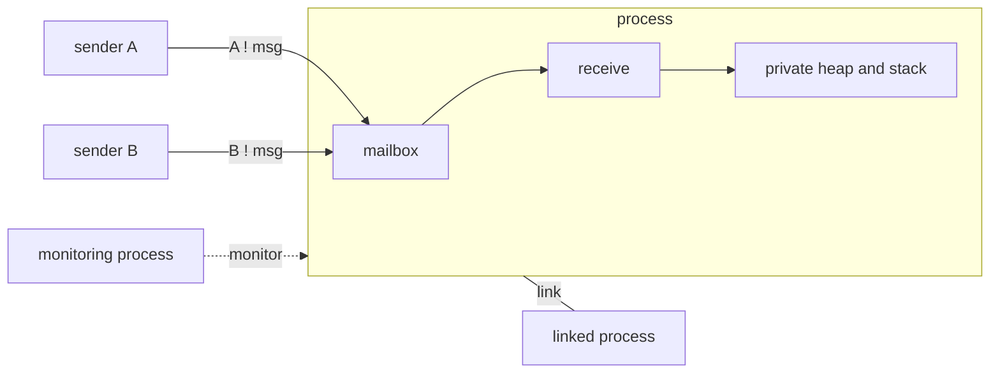
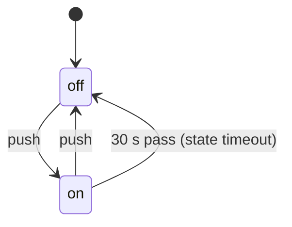
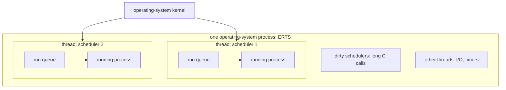

# Chapter 3. Erlang and OTP

> **Status.** Background: no mark. Sections 3.1 to 3.8 describe stock
> Erlang/OTP 29.1.2, whose source erXos carries, modified, in `otp/`.
> Section 3.9 says what erXos does with each idea and marks each claim
> there. ERTS in user mode in every domain, domains messaging each other
> as Erlang nodes, drivers as supervised Erlang processes, and hot code
> loading from the development host are **Built**. The system domain's
> refusal of code that is not installed is **Designed**.

**Background needed.** [Chapter
1](01-operating-systems.md) (processes,
threads, scheduling, address spaces). No Erlang. A reader fluent in
Erlang and OTP can skip to [section 3.5](#35-the-beam-and-erts), the
runtime system, which is the part erXos takes apart, and then read
[section 3.9](#39-how-erxos-uses-these-ideas).

A telephone exchange cannot be switched off to fix a bug. It carries
thousands of calls at once, it runs for years, and its software, like
all software, has errors in it. Ericsson's Computer Science Laboratory
set out to find a way to program such systems. The language that came
out of that work, begun in 1986, is Erlang. Its designers did not try to
write software without errors. They tried to build systems that keep
working while some of their parts fail.

A UNIX programmer knows two ways to run several things at once. Separate
processes are isolated: each has its own address space, and a crash in
one leaves the others running. But processes are costly to create, and
they talk through pipes, sockets or shared memory that the programmer
manages. Threads are cheap and share one address space, so they talk by
reading and writing the same memory under locks. A wild write in one
thread corrupts them all, and a crash ends the whole program. Errors
come back as return codes that every caller must check. A program that
meets a case nobody planned for limps on, or dies with nobody to notice.

Erlang takes a third way. A process is part of the language, cheap
enough to create one per call, per connection or per device. It shares
no memory with any other process: processes talk only by sending each
other messages, which are copied. A process that meets an error it
cannot handle stops. Another process, told of the stop by the runtime,
decides what to do, usually by starting it again from a known state.
OTP, the libraries that come with Erlang, packages these patterns, so a
programmer writes the part specific to the problem and reuses the rest.

Section 3.1 covers the language; 3.2 its processes and messages; 3.3 how
failure is detected and repaired; 3.4 OTP's behaviours, the reusable
process patterns. Section 3.5 opens up the virtual machine and runtime
system, 3.6 covers code loading and distribution, and 3.7 the tools for
looking at a running system. Section 3.8 says where the model's
protection stops, and 3.9 how erXos uses each idea.

## 3.1 The language in a sitting

Erlang is a small language: a reader who knows any programming language
can learn to read it in an afternoon. This section shows its values, its
pattern matching, its functions and modules, and the notation the rest
of the book uses. Its examples are sessions with the Erlang **shell**,
an interactive prompt that reads an expression, evaluates it and prints
the result. The prompt is a number and `>`, and every expression ends
with a full stop.

### 3.1.1 Terms

Every value in Erlang is a **term**. There are only a few kinds, and the
shell prints each the way a program writes it.

* **Numbers.** Integers of any size (`42`, `16#ff` in hexadecimal) and
  floating-point numbers (`3.14`).
* **Atoms.** Named constants, written as lowercase words: `ok`, `error`,
  `eth0`, `undefined`. An atom stands for itself, as a symbol does in
  Lisp or an enum member in C, but needs no declaration. An atom with
  other characters is quoted: `'EXIT'`.
* **Tuples.** A fixed number of terms in braces: `{point, 1, 2}`. By
  convention the first element is an atom that says what the tuple is,
  so a tuple reads like a tagged record.
* **Lists.** Any number of terms in brackets: `[1, 2, 3]`. A list is a
  head and a tail, written `[Head | Tail]`, so `[1, 2, 3]` is `[1 | [2,
  3]]`. A string in double quotes, `"eth0"`, is a list of character
  codes.
* **Binaries.** A sequence of bytes, written `<<1, 2, 3>>` or
  `<<"abc">>`. Network packets, file contents and device data are
  binaries.
* **Maps.** Keys and values: `#{name => "eth0", mtu => 1500}`.
* **Process identifiers, references and funs.** A **pid** names a
  process; a **reference** is a value unique in the running system; a
  **fun** is a function used as a value. Section 3.2 uses all three.

Erlang is dynamically typed: a variable can hold a term of any kind, and
the kind is checked when an operation needs it. Adding an atom to a
number fails when the program runs, not when it compiles.

### 3.1.2 Variables bind once

A variable starts with a capital letter, and it is given a value once.
After `X = 5`, `X` is 5 for the rest of the function. A second `X = 6`
does not change `X`; it fails, because `=` is not assignment.

```text
1> X = 5.
5
2> X = 6.
** exception error: no match of right hand side value 6
```

The `=` operator is a **match**. It compares the pattern on its left
with the value on its right. Unbound variables in the pattern take their
values from the matching parts of the value; bound variables must equal
what they meet; anything else is an error. The same operator therefore
takes a value apart:

```text
3> {point, A, B} = {point, 1, 2}.
{point,1,2}
4> A + B.
3
```

The pattern `{point, A, B}` matches only a three-element tuple whose
first element is the atom `point`. It binds `A` to 1 and `B` to 2.
Against `{circle, 5}` the same match fails.

Since no variable changes after it is bound, no value changes either.
Data in Erlang is **immutable**. Adding an element to a list or a key to
a map makes a new value, and the old one stays as it was for anyone
still holding it. The runtime shares the unchanged parts between the
two, so this costs less than a copy.

```text
5> M = #{name => "eth0", mtu => 1500}.
#{name => "eth0",mtu => 1500}
6> M#{mtu := 9000}.
#{name => "eth0",mtu => 9000}
7> M.
#{name => "eth0",mtu => 1500}
```

The expression `M#{mtu := 9000}` returns a new map with `mtu` changed;
`M` itself is untouched. Immutability keeps the rest of the system
simple. A value handed to another function, or sent to another process,
cannot change underneath its holder, so reading it never needs a lock.

### 3.1.3 Functions, clauses and modules

A function is a list of **clauses**, each a pattern and a body. A call
runs the first clause whose pattern matches its arguments. This sketch,
a module written for this chapter, computes the area of three kinds of
shape:

```erlang
-module(shapes).
-export([area/1]).

area({square, Side}) -> Side * Side;
area({rect, W, H}) -> W * H;
area({circle, R}) -> math:pi() * R * R.
```

The first line names the **module**, the unit of code that is compiled
and loaded as one file. The second exports `area/1`. A function is named
by its name and its **arity**, the number of its arguments, so `area/1`
and `area/2` would be two functions. Other modules call it as
`shapes:area(...)`. Semicolons separate the clauses, and a full stop
ends the last.

A clause can add a **guard**, a test on the bound variables written
after `when`: `area({square, Side}) when Side >= 0 -> ...`. A guard may
call only a fixed set of tests without side effects, so trying a clause
never changes anything.

Patterns also work on bits. A binary pattern says how many bits each
field takes, which turns the parsing of a packet or a register into one
match. This function, from `erlang/apps/erx_bt/src/erx_bt_store.erl`,
checks the six random bytes from which the Bluetooth service makes its
address:

```erlang
static_address(<<_:2, Random:46>>) when Random =:= 0; Random =:= 1 bsl 46 - 1 ->
    retry;
static_address(<<_:2, Random:46>>) ->
    {ok, <<2#11:2, Random:46>>}.
```

The pattern `<<_:2, Random:46>>` splits 48 bits into the top two,
ignored, and the other 46. The first clause refuses the two values the
Bluetooth standard forbids, all zeros and all ones. The second returns
the bytes with the top two bits set to `11`. The result is a tagged
tuple, `{ok, Address}`, or the atom `retry`, which is the usual way an
Erlang function says which case happened.

### 3.1.4 Recursion in place of loops

Erlang has no `for` or `while`. A function that walks a list calls
itself on the tail:

```erlang
len([]) -> 0;
len([_Head | Tail]) -> 1 + len(Tail).
```

The first clause handles the empty list; the second takes a list apart
into its head and tail and counts the tail. A variable that starts with
`_` is one the clause does not use. When the recursive call is the last
thing a function does, it is a **tail call**, and the runtime turns it
into a jump that uses no stack. A loop that runs forever, such as a
server waiting for requests, is a function that calls itself last. This
sum keeps its running total in an argument, so its recursive call is a
tail call:

```erlang
sum(List) -> sum(List, 0).

sum([], Acc) -> Acc;
sum([X | Rest], Acc) -> sum(Rest, Acc + X).
```

The library module `lists` provides the common walks, such as
`lists:map/2` and `lists:foldl/3`. A **list comprehension** builds one
list from another: `[2 * X || X <- [1, 2, 3]]` is `[2, 4, 6]`.

### 3.1.5 When nothing matches

A call that matches no clause is an error:

```text
1> shapes:area({triangle, 3, 4}).
** exception error: no function clause matching shapes:area({triangle,3,4}) (shapes.erl:4)
```

The runtime raises an **exception**, which stops the function. Unless
some caller catches it with `try ... catch`, it ends the process. The
error names the function, the arguments and the line. Joe Armstrong's
thesis on Erlang (2003, section 4.4) makes a point of this. A defensive
programmer might add a last clause, `area(_) -> ...`, but nothing
sensible exists for that clause to return: the specification said
nothing about triangles. The honest response to a case the programmer
cannot handle is to stop, with a precise report. The repair belongs to
code that does know what to do, and section 3.3 shows where that code
lives.

C practice differs. A C function that cannot handle an input returns an
error code, every caller checks it, and checks for cases that never
happen fill much of the program. In Erlang the programmer writes the
cases the specification gives, and the missing case is an error by
construction.

### 3.1.6 The notation used in this book

The book quotes Erlang from the tree, and that code uses a few more
pieces of notation.

* **Specs and types.** `-spec area(shape()) -> float().` declares a
  function's argument and result types, and `-type shape() :: {square,
  number()} | {circle, number()}.` names a type. The compiler does not
  enforce them; Dialyzer, OTP's static analyzer, checks that the code
  agrees with them. erXos requires a spec on every exported function
  ([style.md, Erlang](../style.md#erlang)).
* **Records.** `-record(state, {name, mtu = 1500}).` declares a named
  tuple with fields. `#state{name = eth0}` makes one, and `S#state.mtu`
  reads a field. A record is a compile-time convenience over a tuple
  whose first element is the record's name.
* **Documentation.** `-moduledoc` and `-doc` attach documentation to a
  module and a function.
* **Macros.** `?MODULE` is the current module's name.

## 3.2 Processes and messages

An Erlang program that serves ten thousand network connections typically
runs ten thousand processes, one per connection. A process in Erlang is
not an operating-system process. The runtime creates it, schedules it
and frees it, and it costs memory in hundreds of words, not in
megabytes.

### 3.2.1 Spawn, send and receive

Three primitives make up Erlang's concurrency.

* `spawn(Fun)` creates a new process that runs the function `Fun` and
  returns its pid. The new process runs at the same time as its creator.
* `Pid ! Message` sends a message, any term, to the process `Pid`. The
  send never waits: the message goes into the receiver's queue and the
  sender goes on.
* `receive` takes a message from the calling process's own queue. It
  lists patterns, like a function's clauses, and waits until a message
  matches one of them.

Each process has one queue of incoming messages, its **mailbox**. A
message waits there until the process receives it. This sketch is a
process that holds a running total:

```erlang
start() -> spawn(fun() -> loop(0) end).

add(Counter, N) -> Counter ! {add, N}, ok.

get(Counter) ->
    Ref = make_ref(),
    Counter ! {get, self(), Ref},
    receive
        {Ref, Value} -> Value
    after 1000 ->
        timeout
    end.

loop(Total) ->
    receive
        {add, N} -> loop(Total + N);
        {get, From, Ref} -> From ! {Ref, Total}, loop(Total)
    end.
```

The process's state is the argument of `loop/1`. Each message produces
the next state, and the process calls `loop/1` again with it, a tail
call. Nothing outside the process can read or change `Total`. The only
way in is a message, and the only code that handles messages is the
`receive` in `loop/1`.

`get/1` shows how a question gets its answer. The asker sends its own
pid, from `self()`, so the counter knows where to reply. It also sends a
fresh reference from `make_ref()`, so it can tell this reply from any
other message. The `after 1000` clause gives up if no reply comes within
1000 ms. A synchronous call in Erlang is always built this way, from two
one-way messages and a wait.

```text
1> C = counter:start().
<0.111.0>
2> counter:add(C, 10).
ok
3> counter:add(C, 32).
ok
4> counter:get(C).
42
```

The shell prints the pid as `<0.111.0>`. The numbers identify the
process within the running system; the first, 0, says it is local.

### 3.2.2 Selective receive and message order

A `receive` does not have to take the oldest message. It scans the
mailbox from the oldest message on and takes the first that matches any
of its patterns. Messages that match no pattern stay in the mailbox, in
order, for a later `receive`. This is **selective receive**. It lets
`get/1` wait for the one reply that carries its reference while other
messages wait their turn. Its cost: a process whose mailbox fills with
messages it never matches scans them all on every receive, and its
memory grows.

Erlang promises one thing about order. If process A sends two messages
to process B, they arrive in the order they were sent. Nothing is
promised about messages from different senders: if A and C both send to
B, either may arrive first. The OTP reference manual states this rule
for every signal between two processes, and it is the only ordering
guarantee the language gives.

### 3.2.3 Names

A pid is a value. A process learns another's pid by creating it, by
receiving it in a message, or by looking it up. A service that many
processes use is given a **registered name**, an atom, with
`register(Name, Pid)`. Any process on the same node can then send to the
name, `counter ! {add, 1}`, without knowing the pid. A name is removed
when its process ends, so it never refers to a dead process; a restarted
process registers the name again.

### 3.2.4 Why nothing is shared

Erlang processes share no memory. A message is copied from the sender's
memory to the receiver's, so after the send the two hold separate
copies. Large binaries, over 64 bytes, are the one exception: they live
outside any process and are shared by reference count, which is safe
because a binary never changes.

Copying costs time, and Erlang pays it for three reasons. First, a
process that fails cannot leave a shared structure half-written for
others to trip over; its memory dies with it. Second, each process has
its own heap, so the runtime can collect one process's garbage without
stopping any other (section 3.5). Third, a message to a process on
another machine must be copied anyway. A local send already behaves as a
copy, so a program written for one machine works across several
unchanged (section 3.6).

Armstrong's thesis lists the properties a system needs to tolerate
errors, and puts isolation first. In its words, processes are the units
of error encapsulation: "errors occurring in a process will not affect
other processes in the system." Sharing nothing is what makes that true
inside one program.

### 3.2.5 How much a process costs

A process is a small structure plus one block of memory that holds its
heap and stack together. The OTP efficiency guide gives the size of a
newly spawned process as 327 words, a heap of 233 words included. That
is about 2.6 KiB on a 64-bit machine, and the heap grows as the process
needs it. The runtime allows 1,048,576 processes at once by default, a
limit set at startup. Creating an Erlang process takes no system call. A
thread in a UNIX process, by comparison, reserves a stack of its own,
typically hundreds of kilobytes or more of address space. <!-- check:
typical default thread stack size on FreeBSD and macOS, not read from a
source in this task -->

Figure 3.1 gathers what belongs to one process: its pid, its mailbox,
its private heap, and the links and monitors of section 3.3.



*Figure 3.1. One Erlang process. Messages from any number of senders
queue in its one mailbox, and only its own `receive` takes them out. A
link ties its fate to another process in both directions; a monitor lets
another process watch it in one direction.*

## 3.3 Let it crash

When an Erlang process meets an error it cannot handle, it stops, and no
code in it tries to recover. Another process, which the runtime tells of
the stop, does the repair. Armstrong's thesis calls this rule "let it
crash" (section 4.4). The rest of Erlang's design for failure follows
from it. Links and exit signals carry the news of a stop, monitors let a
process watch another, and supervisors restart what stopped.

### 3.3.1 Why stop instead of recover

A process that has met an unexpected case is in a state its programmer
did not foresee. Code written to recover would have to guess what went
wrong, and code that guesses is the code most likely to be wrong itself.
Stopping throws the bad state away. A fresh process started from a known
initial state has none of it.

Restarting would be pointless if every error came straight back.
Armstrong cites Jim Gray's 1985 study of failures in Tandem's
fault-tolerant systems. Gray conjectured that most production software
faults are transient: reinitialize the program's state, retry the
operation, and it usually succeeds the second time. A timing
coincidence, a message in an unusual order, a resource briefly missing:
restarts cure faults like these. The thesis also reports a limit, which
Ulf Wiger found on Ericsson's AXD301 switch. Restarting a failed process
with the same arguments often worked, but when it did not, restarting
the level above rarely helped. A fault that comes back every time is a
bug to fix, and restarting it only shows the bug faster.

### 3.3.2 Links and exit signals

A **link** joins two processes so that each learns when the other stops.
`link(Pid)` creates one. `spawn_link(Fun)` creates a process already
linked to its creator, in one step, so the new process cannot die
unnoticed in between. A link is bidirectional, and two processes have at
most one link between them.

When a process ends, the runtime sends an **exit signal** to every
process linked to it. The signal carries the ending process's pid and
its **exit reason**, a term. The reason is the atom `normal` when the
process finished its work. Otherwise it describes the error, such as
`{function_clause, ...}` for a call that matched no clause.

What a linked process does with an exit signal depends on the reason and
on one flag.

* A signal with reason `normal` is ignored. A process that finished its
  work takes nobody down with it.
* Any other reason ends the receiving process too, with the same reason,
  and its own links carry the signal further. A group of linked
  processes thus lives and dies together.
* A process that has set the flag `trap_exit`, with
  `process_flag(trap_exit, true)`, is not ended. The runtime turns the
  signal into an ordinary message, `{'EXIT', Pid, Reason}`, in the
  process's mailbox.

The exception is the reason `kill`, sent on purpose with `exit(Pid,
kill)`. It ends the process even if it traps exits, so a process that
has stopped responding can always be ended. Its linked processes then
see the reason `killed`.

The shell shows a trapped exit. Its own process traps exits and links to
a new process that ends with the reason `disk_gone`. The signal then
waits as a message, which `flush()` prints and removes:

```text
1> process_flag(trap_exit, true).
false
2> P = spawn_link(fun() -> exit(disk_gone) end).
<0.93.0>
3> flush().
Shell got {'EXIT',<0.93.0>,disk_gone}
ok
```

A process that traps exits survives the news of another's failure, so it
is the only kind that can act on it. That is the hook supervisors use.

### 3.3.3 Monitors

A **monitor** is a one-way link. `monitor(process, Pid)` asks the
runtime to tell the caller when `Pid` ends, and returns a reference that
names this monitor. When the watched process ends, the watcher gets a
message, `{'DOWN', Ref, process, Pid, Reason}`, and is never itself
ended. If the watched process does not exist, the message comes at once,
with the reason `noproc`.

```text
4> {Q, Ref} = spawn_monitor(fun() -> exit(oops) end).
{<0.96.0>,#Ref<0.499594362.2351693825.11336>}
5> flush().
Shell got {'DOWN',#Ref<0.499594362.2351693825.11336>,process,<0.96.0>,oops}
ok
```

Monitors suit a client watching a server. The client wants to know if
the server dies while it waits for an answer, but the server should not
die because one client did. A process can hold many monitors on one
target, each with its own reference, and remove one with
`demonitor(Ref)`. Links suit processes that belong together; monitors
suit processes that merely depend on each other.

### 3.3.4 Supervisors

A **supervisor** is a process whose only job is to start other
processes, its **children**, and to restart them when they stop. It
traps exits and links to each child, so the runtime tells it of every
child's end. It runs no application logic, which keeps it simple enough
to trust.

Each child is described by a **child specification**, which names the
function that starts the child and its **restart type**:

* `permanent`: the child is always restarted.
* `transient`: the child is restarted only if it ended abnormally, with
  a reason other than `normal`, `shutdown` or `{shutdown, Term}`.
* `temporary`: the child is never restarted.

The supervisor's **restart strategy** says which children are restarted
when one fails:

* `one_for_one`: only the failed child. Use it when the children are
  independent.
* `one_for_all`: every child, after stopping the survivors. Use it when
  no child can work without the others.
* `rest_for_one`: the failed child and every child started after it. Use
  it when later children depend on earlier ones, as a connection handler
  depends on the listener that created it.
* `simple_one_for_one`: a variant of `one_for_one` for many children of
  one kind, all started on demand from one specification.

A supervisor also limits how often it restarts. Its **restart
intensity** allows `intensity` restarts within `period` seconds; the
defaults are 1 and 5. If more restarts happen within the period, the
supervisor stops all its children and then itself. Its own supervisor
sees that as a failure. The limit turns a fault that comes straight back
from an endless loop of restarts into a failure one level up.

This supervisor, from `erlang/apps/erx_ui/src/erx_ui_sup.erl`, starts
erXos's widget servers, one per open user interface:

```erlang
start_link() ->
    supervisor:start_link({local, ?MODULE}, ?MODULE, []).

start_server(Spec) ->
    supervisor:start_child(?MODULE, [Spec]).

init([]) ->
    Server = #{id => erx_ui_server, start => {erx_ui_server, start_link, []},
               restart => temporary, shutdown => 5000, type => worker,
               modules => [erx_ui_server]},
    {ok, {#{strategy => simple_one_for_one}, [Server]}}.
```

Notice two things. The whole supervisor is data: `init/1` returns the
strategy and a map that describes the one kind of child, and OTP's
`supervisor` module does the rest. And each widget server is
`temporary`, because a user interface that ended is over. The program
that opened it learns of the end through a monitor, and opens another if
it wants one. The `shutdown => 5000` field gives a child 5000 ms to
finish when the supervisor stops it; after that the child is killed.

### 3.3.5 Supervision trees

A supervisor can supervise other supervisors, so an application's
processes form a tree. **Workers**, the processes that do the work, are
the leaves; supervisors are the inner nodes. Each supervisor's strategy
describes how the processes beneath it depend on each other, and each
level's restart limit decides when a failure goes upward.

Figure 3.2 shows one restart in such a tree. A worker under a
`one_for_one` supervisor fails. The supervisor gets the exit signal and
starts a replacement from the same child specification, and no other
process notices.

```mermaid
sequenceDiagram
    participant T as top supervisor
    participant S as driver supervisor
    participant W as driver worker
    participant W2 as new driver worker
    W->>W: meets an unexpected case
    W-->>S: exit signal, reason {badmatch, ...}
    S->>S: one_for_one; within restart limit
    S->>W2: start from the child specification
    W2-->>S: started, registers its name
    Note over T: sees nothing
```

*Figure 3.2. One restart. The supervisor replaces only the failed
worker, and the top supervisor sees nothing. Had the limit been
exceeded, the driver supervisor would itself have stopped, and the top
supervisor would have applied its own strategy one level up.*

The tree also orders starting and stopping. A supervisor starts its
children in the order of their specifications and stops them in reverse,
so a child can rely on the siblings started before it. Reading the
supervisors tells a reader which parts of a system depend on which.

The Erlang shell is built this way too. The process that evaluates
expressions typed at the prompt is replaced when an expression fails, as
a pid printed before and after a failed call shows:

```text
1> self().
<0.84.0>
2> shapes:area(hexagon).
** exception error: no function clause matching shapes:area(hexagon) (shapes.erl:4)
3> self().
<0.89.0>
```

Variables bound before the error survive, because the shell keeps them
outside the evaluating process. The process itself is new.

### 3.3.6 What let it crash does not fix

Restarting repairs only faults that a fresh start clears. A
deterministic bug, such as the missing triangle clause of section 3.1,
fails again on the same input. The restart limit then moves the failure
upward until something handles it or the application stops. A restart
also loses the state the process held. State that must survive a crash
belongs somewhere that does not crash with it: in another process, in a
table owned by a longer-lived process, or on disk. Deciding which
process holds which state, so that a crash loses only what can be
rebuilt, is most of the work of designing an Erlang system.

## 3.4 OTP behaviours

The counter of section 3.2 and the supervisor of section 3.3 share a
skeleton. Each waits in a loop for messages, keeps its state in the
loop's argument, answers some messages and acts on others. OTP, the
**Open Telecom Platform**, the libraries that ship with Erlang, writes
that skeleton once. A **behaviour** is OTP's name for such a pattern.
OTP supplies the generic part as a **behaviour module**. The programmer
writes a **callback module**, which exports the functions the behaviour
calls at each step. OTP's standard behaviours are `gen_server`,
`gen_statem`, `gen_event` and `supervisor`. A module names the one it
implements with an attribute, `-behaviour(gen_server).`, and the
compiler then warns about a missing callback.

### 3.4.1 gen_server

A `gen_server` is a server process that holds state and answers
requests. Its callback module provides:

* `init(Args)`: returns the initial state.
* `handle_call(Request, From, State)`: answers a synchronous request,
  which a client sent with `gen_server:call(Server, Request)` and waits
  on; returns `{reply, Reply, NewState}`.
* `handle_cast(Request, State)`: handles an asynchronous request, sent
  with `gen_server:cast(Server, Request)`; returns `{noreply,
  NewState}`.
* `handle_info(Message, State)`: handles any other message, such as an
  `'EXIT'` or `'DOWN'` message or a timer's.
* `terminate(Reason, State)`: cleans up when the server stops.

Every callback returns the next state, as `loop/1` did, and the
behaviour keeps it. This server, from
`erlang/apps/erx_bt/src/erx_bt_store.erl`, holds the Bluetooth service's
address, which `static_address/1` of section 3.1 makes:

```erlang
-module(erx_bt_store).
-behaviour(gen_server).

-export([start_link/0, address/0]).
-export([init/1, handle_call/3, handle_cast/2]).

start_link() ->
    gen_server:start_link({local, ?MODULE}, ?MODULE, [], []).

address() ->
    gen_server:call(?MODULE, address).

init([]) ->
    {ok, make_address()}.

handle_call(address, _From, Address) ->
    {reply, Address, Address}.

handle_cast(_Message, Address) ->
    {noreply, Address}.
%% ... make_address/0 and static_address/1 as in section 3.1
```

The module has two halves. `start_link/0` and `address/0` are its
interface: they run in the caller's process and send messages. `init/1`,
`handle_call/3` and `handle_cast/2` run in the server's process, one
message at a time. The state is the address itself. `handle_call/3` has
one clause, for the one request the server knows. Any other request
matches no clause, so the server crashes, and its supervisor,
`erx_bt_sup`, restarts it.

The behaviour does everything the counter's `get/1` did by hand, and
more. `gen_server:call/2` makes the reference and monitors the server
for the length of the call, so a dead server fails the call at once
instead of hanging it. The call gives up after a default timeout of 5000
ms. The behaviour also links the server to the supervisor that starts
it. It answers the system messages that tools use to inspect and suspend
a process (section 3.7). And it gives every server the same shape, so a
reader who knows one knows them all.

### 3.4.2 gen_statem

Some processes are state machines: what they do with a message depends
on which of a few states they are in. A network link is down,
negotiating or up; a lock is locked or open. `gen_statem` is the
behaviour for these. For each state and event, its callback module
returns the next state and a list of **actions**: replies to send,
timers to set, events to postpone.

Figure 3.3 shows a small machine, a light with a button, which turns
itself off after 30 seconds.



*Figure 3.3. A two-state machine. The timeout belongs to the state `on`:
entering `on` sets it, and leaving `on` by a push cancels it.*

This sketch implements it in the callback mode `state_functions`, in
which each state is a function of the callback module:

```erlang
-module(light).
-behaviour(gen_statem).
-export([start_link/0, push/0]).
-export([callback_mode/0, init/1, off/3, on/3]).

start_link() -> gen_statem:start_link({local, ?MODULE}, ?MODULE, [], []).

push() -> gen_statem:cast(?MODULE, push).

callback_mode() -> state_functions.

init([]) -> {ok, off, #{}}.

off(cast, push, Data) ->
    {next_state, on, Data, [{state_timeout, 30000, auto_off}]}.

on(cast, push, Data) -> {next_state, off, Data};
on(state_timeout, auto_off, Data) -> {next_state, off, Data}.
```

Each state function takes the event's type, the event and the machine's
data. It returns `{next_state, State, Data}`, with an optional list of
actions. The action `{state_timeout, 30000, auto_off}` asks the
behaviour to deliver the event `auto_off` after 30000 ms unless the
state changes first. The programmer writes no timer and no cancellation:
leaving the state cancels the timeout. The other callback mode,
`handle_event_function`, puts all states in one function,
`handle_event/4`. It suits a machine whose state is a compound term
instead of one of a few names.

A state machine written by hand as a `gen_server` keeps its state in a
field and checks it in every clause. Its timers and their cancellation
are the programmer's job. `gen_statem` makes the state the first thing
each clause matches, so the table of states and events is the code.

### 3.4.3 supervisor, application and release

The `supervisor` behaviour is the one section 3.3 used. Its callback
module has one function, `init/1`, which returns the restart strategy
and the child specifications.

Above processes, OTP groups code into **applications**. An application
is a set of modules with a name, a version, a list of the applications
it needs, and usually a supervision tree that it starts. A small file,
`name.app`, describes it, and a callback module of the `application`
behaviour starts its top supervisor. `kernel` and `stdlib`, the
libraries every Erlang system needs, are applications. So is each of
erXos's services, from `erx_net` to `erx_ui`, the directories under
`erlang/apps/`.

A **release** is a set of applications at fixed versions, with the
runtime system that runs them: a complete system that boots. A **boot
script**, generated from the release's description, lists the
applications to load and start, in order.

Behaviours cost a little speed against hand-written loops. In exchange,
every long-lived process in a system starts, stops, reports its errors
and answers inspection the same way. erXos's style guide therefore makes
every long-lived process an OTP behaviour under a supervisor. A bare
`spawn` is kept for short-lived work whose failure the caller observes
([style.md, Erlang](../style.md#erlang)).

## 3.5 The BEAM and ERTS

On a UNIX machine, a running Erlang system is one operating-system
process. Inside it, the runtime does for Erlang processes what a kernel
does for UNIX processes. It schedules them on the processors, gives each
its memory and collects its garbage, delivers their messages, and keeps
a table of them. This section opens that process up, because it is the
part of Erlang that erXos takes apart.

Two names are used for it. The **BEAM** is Erlang's virtual machine: the
instruction set the compiler targets and the engine that runs it.
**ERTS**, the Erlang Run-Time System, is the whole program around it. It
holds the BEAM, the schedulers, the memory allocators and garbage
collector, the code loader, ports and drivers, and distribution. OTP
29.1.2 ships ERTS 17.1.1.

### 3.5.1 From source to running code

The compiler, `erlc`, turns a module's source file, `shapes.erl`, into a
file of BEAM bytecode, `shapes.beam`. The **loader** in ERTS reads that
file when the module is first needed and prepares it to run, in one of
two ways.

* The **interpreter** runs the BEAM instructions directly, fetching and
  dispatching each in turn.
* **BeamAsm**, the JIT compiler, translates each instruction into native
  machine code when the module is loaded. The OTP documentation
  describes it as load-time conversion of BEAM instructions into native
  code, on x86-64 and AArch64, emitted with the asmjit library. It
  removes the cost of dispatching each instruction and keeps the
  interpreter's register model, so the rest of ERTS works the same with
  either.

A **JIT** (just-in-time compiler) is a compiler that runs inside the
program it serves and produces machine code while that program runs. The
memory that holds BeamAsm's output is first written by the JIT and then
executed by the processor. That matters to any operating system that
forbids memory to be writable and executable at once, as erXos does
(section 3.9).

### 3.5.2 Schedulers and reductions

ERTS runs one **scheduler** thread per processor core by default, and
each scheduler has a **run queue** of Erlang processes ready to run.
<!-- check: default scheduler count equals the number of logical
processors detected (the erl +S default), read only indirectly in
erlang_system_info.md --> A scheduler takes a process from its queue,
runs it for a while, puts it back and takes the next. When one queue
runs empty and another is long, schedulers steal work from each other.
Figure 3.4 shows the arrangement.



*Figure 3.4. The BEAM inside one operating-system process. The kernel
schedules a few threads; each scheduler thread runs thousands of Erlang
processes in turn, switching between them without entering the kernel.*

The scheduler measures a process's turn in **reductions**, a count of
work done, roughly one per function call. In ERTS 17.1.1 a turn is 4000
reductions. The running code checks the count at safe points: on entry
to a function, at a return, at a call into C, and at a receive. When the
count runs out, the process goes back to its run queue. Every loop in
Erlang is a recursive call, and every call is such a check, so no Erlang
code can keep a scheduler forever. To the Erlang programmer the
scheduling is preemptive: a process stuck in an endless loop delays the
others one turn at a time.

The guarantee stops at the edge of Erlang code. C code called from
Erlang runs until it returns, and its scheduler runs nothing else
meanwhile. ERTS therefore keeps two extra pools of **dirty schedulers**,
threads for C calls known to take long. One pool is for computation and
one for blocking I/O, so such calls do not stall the ordinary
schedulers.

Switching between two Erlang processes is the scheduler's own work, in
user mode, with no kernel call. That is one reason an Erlang system can
run so many processes.

### 3.5.3 Memory and garbage collection

Each process has its own heap and stack, in one block of memory, and the
garbage collector works on one process at a time. The ERTS documentation
calls it a per-process generational, semi-space, copying collector. When
a process's heap fills, the collector copies the terms the process can
still reach into a fresh area and frees the old area whole. Terms that
survive a collection move to an **old heap**, collected less often,
because data that has lived a while tends to live on. The collector
takes no locks against other processes, since no other process can point
into this heap.

A collection costs time in proportion to one process's live data, and it
stops only that process. A system of many small processes thus never
pauses all at once for garbage collection, as a runtime with one large
shared heap must.

Large binaries are kept outside the process heaps and counted by
reference, as section 3.2 said. Two other stores are shared. An **ETS
table** (Erlang Term Storage) is a table of tuples owned by one process.
Other processes can read it and, if allowed, write it, and it is deleted
when its owner ends. It is the usual home for state that many processes
read. **persistent_term** holds terms that are read often and changed
rarely. <!-- check: ETS ownership and deletion on owner exit, and
persistent_term's purpose, from general OTP knowledge;
research-erts-internals.md covers both but was read only for its
headings -->

### 3.5.4 BIFs, NIFs and ports

Erlang code reaches the world outside the BEAM in three ways.

* A **BIF** (built-in function) is a function written in C inside ERTS,
  such as `spawn/1`, `length/1` or `term_to_binary/1`. To the caller it
  looks like any Erlang function.
* A **NIF** (native implemented function) is a C function in a shared
  library that a module loads; it then stands in for an Erlang function
  of that module. NIFs are how Erlang calls C libraries and does
  per-byte work, such as checksums, at C's speed.
* A **port** connects an Erlang process to something outside: an
  external program, or a driver written in C and linked into ERTS. To
  Erlang a port looks like a process. It has an identifier, it is sent
  messages and sends them back, and it can be linked.

A BIF or NIF runs inside the ERTS process, with full access to its
memory. A bug in a NIF is not contained the way an Erlang process's
failure is. A stray pointer can corrupt any process's heap, and a crash
ends the whole runtime. <!-- check: the erl_nif documentation's warning
that a NIF crash brings down the emulator was not read in this task -->
Speed is bought with the isolation that sections 3.2 and 3.3 rely on.

### 3.5.5 The atom table

Every atom in a running system lives in one table, shared by all
processes. An atom term is an index into it, so comparing two atoms
costs as little as comparing two integers. The table only grows: atoms
are never freed. By default it holds 1,048,576 atoms, and when it is
full the runtime ends. A program that turns text from outside into
atoms, say with `list_to_atom/1` on a field of a network packet, lets
anyone who can send it text end the whole system. Careful Erlang code
makes atoms only from text it trusts. For the rest it uses
`binary_to_existing_atom/2`, which refuses a name not already in the
table.

## 3.6 Code loading and distribution

An Erlang system can replace a module's code while it runs. It can also
span several machines with the same message passing it uses inside one.
Both come from the telephone exchange's needs: it could neither stop for
an upgrade nor live on one computer.

### 3.6.1 Two versions of a module

ERTS can hold two versions of a module at once, called **current** and
**old**. Loading a new version makes the previous current version old
and the new one current. Processes running code of the old version keep
running it; both versions are valid at once.

How a call is written decides which version it reaches. A **fully
qualified call**, `Module:Function(Args)`, always goes to the current
version. A local call, `Function(Args)` within the same module, stays in
the version the caller is running. A server loop that should move to new
code calls itself fully qualified, as in this sketch:

```erlang
loop(State) ->
    receive
        Msg -> ?MODULE:loop(handle(Msg, State))
    end.
```

After each message the process makes a fully qualified call, so after a
new version loads, it enters the new `loop/1` at the next message. If a
third version is loaded while a process still runs the oldest, ERTS
**purges** the oldest: it removes that code and ends the processes still
running it.

The `gen_server` and `gen_statem` behaviours call their callback modules
fully qualified, so their processes pick up new callback code at the
next message. OTP's release handling builds on this to upgrade a whole
running release. Each server's state is converted from the old version's
form to the new one's by its `code_change` callback. <!-- check:
release_handler, appup and relup files, and the code_change callback's
role in upgrades, from general OTP knowledge; not read in this task -->

### 3.6.2 Nodes

A running ERTS that takes part in distribution is a **node**. Each node
has a name, an atom of the form `name@host`, given on the command line
with `-sname` (short host names) or `-name` (full host names). A process
on one node sends to a process on another with the same `!`, using its
pid, because the pid records which node the process lives on. Links and
monitors work across nodes too. If the connection to a linked process's
node is lost, the link delivers an exit signal with the reason
`noconnection`. Registered names are local to their node, so a send to a
name on another node names both: `{counter, 'b@host'} ! {add, 1}`.

The nodes of a distributed system are loosely connected. A node connects
to another the first time it needs to, for example on its first send. By
default connections are transitive: a node that connects to B also
connects to the nodes B is connected to. On each host a small daemon,
**epmd** (the Erlang Port Mapper Daemon), maps node names to the TCP
ports their nodes listen on.

When two nodes connect, each must present the same **cookie**, a secret
atom. The OTP documentation is explicit that this is not cryptographic
security. The cookie only checks that two nodes are meant to talk, and
the traffic is in clear text unless TLS is configured. An attacker who
can connect to a node gets complete access to it and to the cluster.
Within a cluster, any node can spawn processes on any other and run any
code there.

### 3.6.3 How a message crosses between nodes

A message to a process on another node cannot be copied from heap to
heap. The sending node encodes it in the **external term format**, the
byte encoding of terms that `term_to_binary/1` also produces. It sends
the bytes over the connection, a TCP socket by default, with a small
header. The header says what the bytes are (a message, a link, a monitor
or an exit signal) and between which processes. The receiving node
decodes the term onto the receiver's heap and puts it in the mailbox.
Links, monitors and exit signals cross the same way, as control
messages.

The distribution layer keeps the language's guarantees across the wire.
Messages from one process to another stay in order, a link still carries
an exit signal, and a monitor still delivers its `'DOWN'`. The sending
code does not change. [Chapter
10](README.md#chapter-10-domains-a-wall-around-some-processes) reuses
this machinery between erXos's domains, with shared memory in place of
the TCP socket and checks at the receiving side in place of the cookie.

## 3.7 Looking at a running system

An Erlang programmer debugs a live system more often than a dead one.
The runtime knows every process, its mailbox, its links and the function
it is running, and it answers questions about them while the system
keeps working.

The first tool is the shell itself. It can run on the node it inspects,
or connect to a running node from outside: `erl -remsh Node` starts a
shell whose expressions run on `Node`. From the shell, `i()` lists every
process with its initial function, its memory and its reductions.
`erlang:process_info(Pid)` reports one process's mailbox length, heap
size, links, monitors and current function. `sys:get_state(Pid)` asks an
OTP behaviour for its state, through the system messages every behaviour
answers. And `c(Module)` recompiles and reloads a module from the
prompt, with the two-version loading of section 3.6.

The second tool is tracing. ERTS can report events of chosen processes
as they happen: each message sent or received, each call to chosen
functions with its arguments and result, each spawn, link and exit. The
`dbg` module, in the `runtime_tools` application, gives tracing an
interface for the shell. Tracing needs no recompilation and no restart;
it is switched on for a running process and off again. Stock OTP also
has `observer`, a graphical view of a node's processes, applications and
supervision trees. <!-- check: observer's contents from general OTP
knowledge; observer is not in the tree's otp/lib and was not read -->

These tools see one node. They know nothing of what lies beneath it:
threads, the memory the node takes from the kernel, devices, other
programs on the machine. [Chapter
21](README.md#chapter-21-the-live-machine) shows how erXos extends this
view to the whole machine. There the processes of every domain, and the
kernel objects beneath them, are listed and traced the same way.

## 3.8 Where the model stops

Erlang's isolation between processes is a property of the language, kept
by the runtime, and it holds only as far as the runtime and the code it
runs keep it. Armstrong's thesis says so itself (section 2.3). Processes
protect each other only to a first approximation, because they share one
processor and one memory, and one that takes too much of either harms
the rest. On a stock system every process of a node lives in one
operating-system process, and some things are shared by all of them.

* **Native code.** A NIF, a linked-in driver or ERTS itself is C with
  access to the whole node's memory. One bug there can corrupt every
  process or end them all (section 3.5.4).
* **Memory.** Every process allocates from the same operating-system
  process. A process whose heap or mailbox grows without bound takes
  memory from all the others. When the node runs out, the whole node
  fails. ERTS offers an optional limit on a process's heap size, but
  nothing makes a program set it. <!-- check: the max_heap_size process
  flag, from general OTP knowledge; not read in this task -->
* **The atom table.** One table, never freed; filling it ends the node
  (section 3.5.5).
* **Shared stores.** ETS tables, persistent terms and large binaries are
  shared by design. A process with access to a public ETS table can
  change it for every other process.
* **Distribution.** A node that connects with the right cookie can do
  anything on the node it reaches (section 3.6.2).
* **CPU time.** Reductions divide the schedulers evenly among processes,
  not among the users or applications the processes belong to. An
  application with a thousand busy processes gets a thousand turns for
  each turn of an application with one.

None of this is a flaw for the systems Erlang was built for, in which
one organization writes and trusts all the code on a node. It becomes
one when a node runs code from several sources, some untrusted, as an
operating system's programs and services are. The usual answer on UNIX
is a node per party, each in an operating-system process of its own,
connected by distribution. That brings back the cost and coarseness of
operating-system processes, and the all-or-nothing trust of the cookie.

## 3.9 How erXos uses these ideas

erXos rests on a premise: Erlang's process model is a good model for a
whole operating system, if something below the runtime supplies the
walls section 3.8 found missing. Its architecture document,
[design.md](../design.md), opens with that premise: "In erXos, Erlang's
process is the operating system's process." For each idea of this
chapter, this section names what erXos does with it and where the book
returns to it.

### 3.9.1 Every Erlang process is an operating-system process

On erXos, the process a user lists, inspects, signals and supervises is
an Erlang process: a pid, a mailbox, links and monitors ([design.md, The
model](../design.md#the-model)). No second, heavier kind of process lies
underneath for the user to learn. Erlang processes are grouped into
**domains**, each a group of processes that share one address space and
one runtime ([chapter
10](README.md#chapter-10-domains-a-wall-around-some-processes)). Each
domain runs its own ERTS in user mode, as an Erlang node with a name of
its own.

The domain is the wall section 3.8 asked for. It has its own address
space, so a NIF's stray pointer stays inside it. It has its own memory
budget, its own CPU allocation, and its own atom table, code and ETS
tables. A domain that crashes ends alone. The processes that linked to
or monitored its processes get the exit signals and `'DOWN'` messages
Erlang already defines ([design-runtime.md, Crash
handling](../design-runtime.md#crash-handling)). **Built**: ERTS runs in
user mode as the system domain on Fiasco, and other domains each run
their own ERTS in an address space of their own (README.md, "Current
status").

Two-level scheduling follows from section 3.5.2. ERTS keeps its own
scheduler and reductions, and switches between Erlang processes without
entering the kernel. The kernel schedules ERTS's scheduler threads and
divides CPU time between domains ([design-runtime.md,
Scheduling](../design-runtime.md#scheduling)). [Chapter
9](README.md#chapter-9-processes-runtimes-and-two-level-scheduling)
treats this in full.

### 3.9.2 Distribution across a domain's wall

Every domain is an Erlang node, so processes in different domains talk
with Erlang's own distribution. Its promises are unchanged: the same
`!`, the same links and monitors, the same order. What changes lies
underneath ([design-runtime.md, Connections in
ERTS](../design-runtime.md#connections-in-erts)). A connection is shared
memory that the system domain sets up between two domains, not a TCP
socket. There is no cookie and no epmd: the connection itself says which
domain is at its other end. Each arriving frame is decoded by the
receiving domain's **funnel**, the one function that decodes messages
from another domain. The funnel refuses any malformed message and
creates no atoms, so the atom-table attack of section 3.5.5 does not
cross the wall ([style.md, Erlang](../style.md#erlang)). A domain
reaches only the processes another domain has exported to it, so knowing
a pid grants nothing. **Built**: domains message each other as Erlang
nodes do (README.md, "Current status"). Chapter 10 explains connections,
the funnel and exports.

### 3.9.3 Supervisors all the way down

A driver in erXos is an Erlang process under a supervisor, over a thin
native shim that touches the device ([design.md, Drivers and
DMA](../design.md#drivers-and-dma)). A driver that sees its device
behave in a way it does not expect crashes. Its supervisor starts it
again from a known state, as section 3.3 describes for any worker.
**Built**: the display and input drivers are Erlang processes
(README.md, "Current status"). A QEMU suite kills the block driver in
the middle of a transfer and finds each kept file cut at its last sync.
[Chapter 15](README.md#chapter-15-devices-and-drivers) treats drivers.

### 3.9.4 A functional core, with a behaviour at the edge

erXos's code follows a rule its style guide calls "functional core,
effects at the edge" ([style.md, Functional
core](../style.md#functional-core)). Every decision is a pure function.
It receives everything it reads as arguments and returns a decision,
reading no clock, no device and no other process. Around it, a
`gen_server` or `gen_statem` performs the effects the decision names: it
sends the messages, writes the device, arms the timer. A protocol's core
maps the current state and an event to `{State, Actions}`, the next
state and a list of actions. That is the shape of a `gen_statem`
callback's result, with the effects moved out.

One loop performs a core's actions in every erXos service. This is the
whole of it, from `erlang/apps/erx/src/erx_actions.erl`:

```erlang
perform([{stop, Reason}], _Effect, State) -> {stop, Reason, State};
perform([{stop, _Reason} | _After], _Effect, _State) -> error(stop_not_last);
perform([Action | Actions], Effect, State) -> perform(Actions, Effect, Effect(Action, State));
perform([], _Effect, State) -> {continue, State};
perform(_NotAList, _Effect, _State) -> error(actions_not_a_list).
```

It uses only what section 3.1 taught: clauses tried in order, patterns
that take lists apart, recursion in place of a loop. Notice the second
clause. A core that puts an action after a stop has a bug. The loop does
not guess what the core meant: it crashes before performing anything
after the stop, and the service's supervisor takes over.

The DHCP client shows the pair.
`erlang/apps/erx_net/src/erx_dhcp4_core.erl` decides, and
`erlang/apps/erx_net/src/erx_dhcp4.erl`, a `gen_server`, sends packets
and arms timers. The core touches nothing, so it is tested on the
development host by stepping it through its states, with no network.
[Chapter 6](README.md#chapter-6-correct-by-construction) explains the
method.

### 3.9.5 ERTS as a parts bin

erXos treats ERTS as its own code to take apart, not as a program to
host ([design-runtime.md](../design-runtime.md)). It keeps the
scheduler, the garbage collector, the loader, the JIT, ports and
distribution. It removes the layers that only adapt ERTS to a hosted
operating system.

The JIT shows the kind of change. erXos never lets one mapping of memory
be writable and executable at once. BeamAsm's code memory is therefore
mapped twice, once writable for the JIT and once executable for the
processor. Only domains whose runtime image is marked for JIT get
address spaces that allow this. The system domain, which holds the most
authority, runs the interpreter and makes no machine code at all
([design-runtime.md, BeamAsm](../design-runtime.md#beamasm)). **Built**:
domains run either the interpreter or BeamAsm (README.md, "Current
status"). On Fiasco, a page can still be writable through one mapping
and executable through another; the downsides table lists that as FD8
([design-fiasco.md](../design-fiasco.md#downsides-against-erxoss-kernel)).

### 3.9.6 Hot code loading, with a hash

The two versions of a module serve development on erXos as they serve a
telephone exchange. `tools/erx load` replaces modules in the running
system from the development host (**Built**, README.md, "Current
status"). The design fetches each module by the SHA-256 hash of its file
and checks the bytes against it before the loader reads them
([design-runtime.md, Code in the system
domain](../design-runtime.md#code-in-the-system-domain)).
`erlang/apps/erx_code/src/erx_code.erl` refuses a mismatch with
`hash_mismatch`. The system domain goes further and loads only code from
installed storage, never a binary a service merely received
(**Designed**, the same section). [Chapter
21](README.md#chapter-21-the-live-machine) covers code from the host,
and the tools of section 3.7 extended to the machine.

### 3.9.7 The chapter's ideas at a glance

| Erlang idea | In erXos | Chapter |
| --- | --- | --- |
| lightweight process | the operating system's process | 9 |
| node | a domain, with its own address space, budget and CPU allocation | 10 |
| distribution | connections between domains over shared memory, checked by the funnel | 10 |
| links, monitors, supervisors | kept across domains; drivers and services restart under supervisors | 10, 15 |
| `gen_server`, `gen_statem` | the effect edge around a pure core | 6 |
| schedulers and reductions | the second level of two-level scheduling | 9 |
| BeamAsm | JIT memory mapped twice, never writable and executable in one mapping | 12 |
| atom table | the funnel creates no atoms | 10, 11 |
| hot code loading | modules loaded by hash; the system domain loads only installed code | 21 |
| tracing and the shell | extended to every domain and the kernel's objects | 21 |

## Summary

Erlang came from the need to keep telephone exchanges running while
their software failed in parts. Its answer is the process as a language
primitive. Processes are cheap enough to use by the thousand, share no
memory, and talk only by copied messages, with one ordering guarantee
between each pair. Pattern matching and immutable data make each
process's code a set of cases, and a case the programmer did not foresee
is an error, not a guess. A process that meets such an error stops.
Links and monitors tell other processes of the stop. Supervisors,
arranged in a tree, restart what stopped from a known state, within a
limit that passes repeated failures upward. OTP's behaviours write the
loop of a server, a state machine and a supervisor once, so a programmer
writes only callbacks. ERTS runs it all in one operating-system process,
with its own schedulers, a heap and collector per process, a JIT, and a
loader that holds two versions of a module. Distribution carries the
same messages, links and monitors across nodes. Inside one node, though,
isolation rests on the runtime alone: native code, memory, the atom
table and the cookie are shared or trusted by all. erXos keeps the
process model, makes the Erlang process the operating system's process,
and puts each node in a domain whose walls the kernel enforces.

The next chapter turns from background to erXos itself: where it comes
from and what it sets out to do.

## Where to read next

* Joe Armstrong, *Making Reliable Distributed Systems in the Presence of
  Software Errors*, PhD thesis, Royal Institute of Technology,
  Stockholm, 2003,
  <https://erlang.org/download/armstrong_thesis_2003.pdf>. The reasons
  behind the design, from its author: chapter 2 for the architectural
  model and isolation, section 4.4 for let it crash, chapter 8 for the
  AXD301.
* Erlang/OTP 29.1.2 System Documentation,
  <https://www.erlang.org/doc/system/>. "Processes" in the reference
  manual covers signals, links and the ordering guarantee; "OTP Design
  Principles" covers behaviours and supervisors; "Distributed Erlang"
  and "Compilation and Code Loading" cover section 3.6.
* ERTS documentation, <https://www.erlang.org/doc/apps/erts/>: "BeamAsm,
  the Erlang JIT" and "Erlang Garbage Collector".
* Jim Gray, "Why Do Computers Stop and What Can Be Done About It?",
  Tandem Computers Technical Report 85.7, 1985. The study of transient
  faults that Armstrong cites for restarting.
* [research-erts-internals.md](../research-erts-internals.md): how ERTS
  29.1.2 works inside, read from its source, with file and line for each
  fact.
* [design-runtime.md](../design-runtime.md): what erXos keeps, changes
  and removes in ERTS.
* [style.md, Functional core](../style.md#functional-core) and
  [style.md, Erlang](../style.md#erlang): how erXos writes Erlang.
