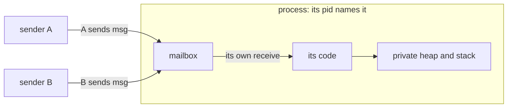
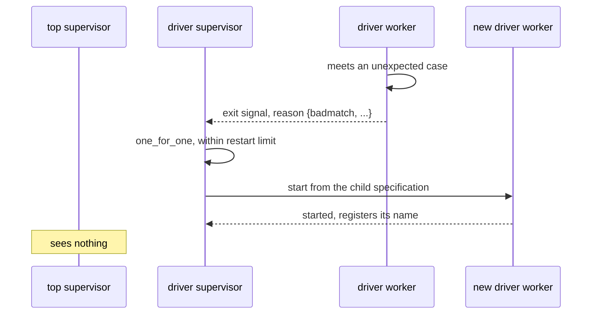
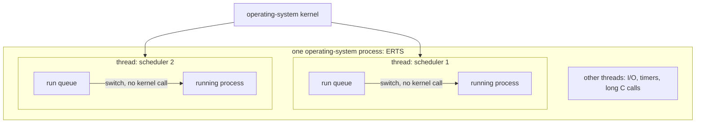

# Chapter 3. Erlang and OTP

> **Status.** Background: sections 3.1 to 3.8 describe stock Erlang/OTP
> 29.1.2, whose source erXos carries, modified, in `otp/`, and no mark
> applies to them. Section 3.9 says what erXos does with each idea and
> marks each claim there. **Built**: the Erlang runtime system (ERTS,
> section 3.5) runs in every **domain**, erXos's protected group of
> Erlang processes (section 3.9). Domains message each other as Erlang
> nodes do (section 3.6). Device drivers are supervised Erlang
> processes, and modules are reloaded from the development host.
> **Designed**: each domain's priority band, the refusal, by erXos's
> most trusted domain, of code that is not installed, and its decoding
> of other domains' messages without creating atoms.

**Background needed.** [Chapter
1](01-operating-systems.md) (processes,
threads, scheduling, address spaces, user mode) and, for section 3.9,
[chapter 2](02-microkernels.md) (microkernels, Fiasco, the root task).
No Erlang. A reader fluent in Erlang and OTP can skip to [section
3.5](#35-the-beam-and-erts), the runtime system, which is the part erXos
takes apart, and then read [section 3.9](#39-how-erxos-uses-these-ideas).

A telephone exchange cannot be switched off to fix a bug. It carries
thousands of calls at once, it runs for years, and its software, like
all software, has errors in it. Ericsson's Computer Science Laboratory
set out to find a way to program such systems. The language that came
out of that work, begun in 1986, is Erlang. Its designers did not try to
write software without errors. They tried to build systems that keep
working while some of their parts fail.

A UNIX programmer knows two ways to run several things at once.
Processes are isolated, but costly to create, and they talk through
pipes, sockets or shared memory. Threads are cheap but share one address
space: a wild write in one corrupts them all, and a crash ends the whole
program. Either way, errors come back as return codes that every caller
must check.

Erlang takes a third way. A process is part of the language, cheap
enough to create one per call, per connection or per device. It shares
no memory with any other process: processes talk only by sending each
other messages, which are copied. A process that meets an error it
cannot handle stops. Another process, told of the stop by the runtime,
decides what to do, usually by starting it again from a known state.
**OTP**, the Open Telecom Platform, is the set of libraries that ships
with Erlang. It packages these patterns, so a programmer writes the part
specific to the problem and reuses the rest.

## 3.1 The language in a sitting

Erlang is a small language, and the code in this book uses little of it.
The examples are sessions with the Erlang **shell**, an interactive
prompt that reads an expression, evaluates it and prints the result. The
prompt is a number and `>`, and every expression ends with a full stop.

### 3.1.1 Terms

Every value in Erlang is a **term**, of a few kinds.

* **Numbers.** Integers of any size (`42`, `16#ff` in hexadecimal) and
  floating-point numbers (`3.14`).
* **Atoms.** Named constants, written as lowercase words: `ok`, `error`,
  `eth0`, `undefined`. An atom stands for itself, as an enum member does
  in C, but needs no declaration. An atom that starts with a capital or
  holds other characters is quoted: `'EXIT'`.
* **Tuples.** A fixed number of terms in braces: `{point, 1, 2}`. By
  convention the first element is an atom that says what the tuple is,
  so a tuple reads like a tagged record.
* **Lists.** Any number of terms in brackets: `[1, 2, 3]`. A list is a
  head and a tail, written `[Head | Tail]`, so `[1, 2, 3]` is `[1 | [2,
  3]]`. A string in double quotes, `"eth0"`, is a list of character
  codes.
* **Binaries.** A sequence of bytes, written `<<1, 2, 3>>` or
  `<<"abc">>`. Network packets, file contents and device data are
  binaries.
* **Maps.** Keys and values: `#{name => "eth0", mtu => 1500}`.
* **Process identifiers, references and funs.** A **pid** names a
  process; a **reference** is a value unique in the running system; a
  **fun** is a function used as a value. Section 3.2 uses all three.

Erlang is dynamically typed: adding an atom to a number fails when the
program runs, not when it compiles.

### 3.1.2 Variables bind once

A variable starts with a capital letter, and it is given a value once.
After `X = 5`, `X` is 5 for the rest of the function. A second `X = 6`
does not change `X`; it fails, because `=` is not assignment.

```text
1> X = 5.
5
2> X = 6.
** exception error: no match of right hand side value 6
```

The `=` operator is a **match**. It compares the pattern on its left
with the value on its right. Unbound variables in the pattern take their
values from the matching parts of the value. If a bound variable meets a
different value, or the shapes differ, the match fails. The same
operator therefore takes a value apart:

```text
3> {point, A, B} = {point, 1, 2}.
{point,1,2}
4> A + B.
3
```

It binds `A` to 1 and `B` to 2; against `{circle, 5}` the same match
fails.

Since no variable changes, no value changes either: data in Erlang is
**immutable**. Adding an element to a list or a key to a map makes a new
value, and the old one stays as it was for anyone still holding it. The
runtime shares the unchanged parts between the two, so this costs less
than a copy.

```text
5> M = #{name => "eth0", mtu => 1500}.
#{name => "eth0",mtu => 1500}
6> M#{mtu := 9000}.
#{name => "eth0",mtu => 9000}
7> M.
#{name => "eth0",mtu => 1500}
```

`M#{mtu := 9000}` returns a new map; `M` is untouched. A value handed to
another function, or sent to another process, cannot change underneath
its holder, so reading it never needs a lock.

### 3.1.3 Functions, clauses and modules

A function is a list of **clauses**, each a pattern and a body. A call
runs the first clause whose pattern matches its arguments. This sketch,
a module written for this chapter, computes the area of three kinds of
shape:

```erlang
-module(shapes).
-export([area/1]).

area({square, Side}) -> Side * Side;
area({rect, W, H}) -> W * H;
area({circle, R}) -> math:pi() * R * R.
```

The first line names the **module**, the unit of code compiled and
loaded as one file. The second exports `area/1`: a function is named by
its name and its **arity**, the number of its arguments. Other modules
call it as `shapes:area(...)`. Semicolons separate the clauses, and a
full stop ends the last.

A clause can add a **guard**, a test on the bound variables written
after `when`: `area({square, Side}) when Side >= 0 -> ...`. A guard may
call only a fixed set of tests without side effects, so trying a clause
never changes anything.

Patterns also work on bits. A binary pattern says how many bits each
field takes, so parsing a packet or a register becomes one match. This
sketch takes apart the first byte of an IPv4 packet header, whose top
four bits are the version and whose low four are the header's length in
32-bit words:

```erlang
header(<<4:4, Words:4, _Rest/binary>>) when Words >= 5 -> {ok, Words * 4};
header(_) -> error.
```

The pattern matches only if the first four bits hold 4, binds the next
four to `Words`, and leaves the rest unread. The result, `{ok, Bytes}`
or `error`, is the usual way an Erlang function says which case
happened.

### 3.1.4 Recursion in place of loops

Erlang has no `for` or `while`. A function that walks a list calls
itself on the tail:

```erlang
len([]) -> 0;
len([_Head | Tail]) -> 1 + len(Tail).
```

A variable that starts with `_` is one the clause does not use. The
recursive call is not the last thing `len` does: it must still add 1. So
each call keeps a stack frame waiting, and a long list takes a deep
stack.

When the recursive call is the last thing a function does, nothing waits
for it. It is a **tail call**, and the runtime turns it into a jump that
uses no stack. This sum keeps its running total in an argument, so its
recursive call is a tail call:

```erlang
sum(List) -> sum(List, 0).

sum([], Acc) -> Acc;
sum([X | Rest], Acc) -> sum(Rest, Acc + X).
```

A loop that runs forever, such as a server waiting for requests, is a
function that calls itself last. A **list comprehension** builds one
list from another: `[2 * X || X <- [1, 2, 3]]` is `[2, 4, 6]`.

### 3.1.5 When nothing matches

A call that matches no clause is an error:

```text
1> shapes:area({triangle, 3, 4}).
** exception error: no function clause matching shapes:area({triangle,3,4}) (shapes.erl:4)
```

The runtime raises an **exception**. Unless some caller catches it with
`try ... catch`, it ends the process, with a report that names the
function, the arguments and the line. A defensive last clause, `area(_)
-> ...`, would have nothing sensible to return: the specification said
nothing about triangles. Erlang stops instead and leaves the repair to
code that knows what to do (section 3.3).

### 3.1.6 The notation used in this book

Code quoted from the tree uses two more pieces of notation.

* **Specs and types.** `-spec area(shape()) -> float().` declares a
  function's argument and result types, and `-type shape() :: {square,
  number()} | {circle, number()}.` names a type. The compiler does not
  enforce them. Dialyzer, OTP's static analyzer, reads the code and
  reports where it disagrees with them. erXos's style guide requires a
  spec on every exported function.
* **Macros.** `?MODULE` is the current module's name.

## 3.2 Processes and messages

An Erlang program that serves ten thousand network connections typically
runs ten thousand processes, one per connection. On a UNIX system an
Erlang process is not an operating-system process. The runtime creates
it, schedules it and frees it, and it costs memory in hundreds of words,
not in megabytes.

### 3.2.1 Spawn, send and receive

Three primitives make up Erlang's concurrency.

* `spawn(Fun)` creates a new process that runs the function `Fun` and
  returns its pid. The new process runs at the same time as its creator.
* `Pid ! Message` sends a message, any term, to the process `Pid`. The
  send never waits: the message goes into the receiver's queue and the
  sender goes on.
* `receive` takes a message from the calling process's own queue. It
  lists patterns, like a function's clauses, and waits until a message
  matches one of them.

Each process has one queue of incoming messages, its **mailbox**. A
message waits there until the process receives it. This sketch is a
process that holds a running total:

```erlang
-module(counter).
-export([start/0, add/2, total/1]).

start() -> spawn(fun() -> loop(0) end).

add(Counter, N) -> Counter ! {add, N}, ok.

total(Counter) ->
    Ref = make_ref(),
    Counter ! {total, self(), Ref},
    receive
        {Ref, Value} -> Value
    after 1000 ->
        timeout
    end.

loop(Total) ->
    receive
        {add, N} -> loop(Total + N);
        {total, From, Ref} -> From ! {Ref, Total}, loop(Total)
    end.
```

`fun() -> loop(0) end` is a fun: a function with no name and no
arguments, written in place, which `spawn` runs in the new process. The
process's state is the argument of `loop/1`; each message produces the
next state, passed on by a tail call. Nothing outside the process can
read or change `Total` except by a message.

In `total/1` the asker sends its own pid, from `self()`, so the counter
knows where to reply, and a fresh reference from `make_ref()`, to tell
this reply from any other message. `after 1000` gives up after 1000 ms.
A synchronous call in Erlang is always built this way, from two one-way
messages and a wait.

The shell compiles and loads the module with `c(counter)`, then uses it:

```text
1> c(counter).
{ok,counter}
2> C = counter:start().
<0.111.0>
3> counter:add(C, 10).
ok
4> counter:add(C, 32).
ok
5> counter:total(C).
42
```

The pid prints as `<0.111.0>`; the first number, 0, says it is local.

### 3.2.2 Selective receive and message order

A `receive` does not have to take the oldest message. It scans the
mailbox from the oldest message on and takes the first that matches any
of its patterns. Messages that match no pattern stay in the mailbox, in
order, for a later `receive`. This is **selective receive**. It lets
`total/1` wait for the one reply that carries its reference while other
messages wait their turn. It has a cost: a process whose mailbox fills
with messages it never matches scans them all on every receive, and its
memory grows.

Erlang promises one thing about order: two messages from process A to
process B arrive in the order they were sent. Between different senders
nothing is promised. Section 3.3's exit signals obey the same rule.

### 3.2.3 Names

A process learns another's pid by creating it, by receiving it in a
message, or by looking it up. A service that many processes use is given
a **registered name**, an atom, with `register(Name, Pid)`. Any process
in the same running system can then send to the name, `counter ! {add,
1}`, without knowing the pid. A name is removed when its process ends,
so it never refers to a dead process; a restarted process registers the
name again.

### 3.2.4 Why nothing is shared

Erlang processes share no memory. A message is copied from the sender's
memory to the receiver's, so after the send the two hold separate
copies. The one exception is a binary over 64 bytes: it lives outside
any process and is shared by reference count, which is safe because a
binary never changes.

Copying costs time, and Erlang pays it for three reasons:

1. A process that fails cannot leave a shared structure half-written;
   its memory dies with it.
2. Each process has its own heap, so the runtime collects one process's
   garbage without stopping any other (section 3.5).
3. A message to another machine must be copied anyway, so a program
   written for one machine works across several unchanged (section 3.6).

Joe Armstrong's thesis on Erlang (2003) puts isolation first among the
properties a system needs to tolerate errors: "errors occurring in a
process will not affect other processes in the system." Sharing nothing
makes that true inside one program.

### 3.2.5 How much a process costs

The OTP efficiency guide gives the size of a newly spawned process as
327 words, a heap of 233 words included: about 2.6 KiB on a 64-bit
machine, growing as the process needs. The runtime allows 1,048,576
processes at once by default, a limit set at startup. Creating an Erlang
process takes no system call. A thread in a UNIX process, by comparison,
reserves a stack of its own: on macOS, 512 KB of address space for every
thread but the main one.

Figure 3.1 gathers what belongs to one process.



*Figure 3.1. One Erlang process. Messages from any number of senders
queue in its one mailbox, and only its own code, through `receive`,
takes them out. Its heap and stack belong to it alone.*

## 3.3 Let it crash

When an Erlang process meets an error it cannot handle, it stops, and
another process, told of the stop by the runtime, does the repair.
Armstrong's thesis calls this rule "let it crash". Links carry the news
of a stop, monitors let a process watch another, and supervisors restart
what stopped.

### 3.3.1 Why stop instead of recover

A process that has met an unexpected case is in a state its programmer
did not foresee. Code written to recover would have to guess what went
wrong, and code that guesses is likely wrong itself. Stopping throws the
bad state away; a fresh process starts from a known one.

Restarting would be pointless if every error came straight back.
Armstrong cites Jim Gray's 1985 study of failures in Tandem's
fault-tolerant systems. Gray conjectured that most production software
faults are transient: reinitialize the program's state, retry the
operation, and it usually succeeds the second time. The thesis also
reports a limit, which Ulf Wiger found on Ericsson's AXD301 switch:
restarting a failed process often worked, but when it did not,
restarting the level above rarely helped. A fault that comes back every
time is a bug to fix.

### 3.3.2 Links and exit signals

A **link** joins two processes so that each learns when the other stops.
`link(Pid)` creates one. `spawn_link(Fun)` creates a process already
linked to its creator, in one step, so the new process cannot die
unnoticed in between. A link works in both directions.

When a process ends, the runtime sends an **exit signal** to every
process linked to it. A signal is like a message, but the runtime acts
on it before any `receive` sees it. The exit signal carries the ending
process's pid and its **exit reason**, a term. The reason is the atom
`normal` when the process finished its work. Otherwise it describes the
error, such as `{function_clause, ...}` for a call that matched no
clause.

What a linked process does with an exit signal depends on the reason and
on one flag, `trap_exit`.

* A process that does not trap exits ignores a signal with reason
  `normal`, so a process that finished its work takes nobody down with
  it. Any other reason ends it too, with the same reason, and its own
  links carry the signal further. A group of linked processes thus lives
  and dies together.
* A process that has set the flag, with `process_flag(trap_exit, true)`,
  is not ended. The runtime turns every exit signal, `normal` included,
  into an ordinary message, `{'EXIT', Pid, Reason}`, in its mailbox.

One reason is special: `kill`, sent on purpose with `exit(Pid, kill)`.
It ends the process even if it traps exits, so a process that has
stopped responding can always be ended. Its linked processes then see
the reason `killed`.

Here the shell's process traps exits. The signal from a linked process
that ends with `disk_gone` waits as a message, which `flush()` prints:

```text
1> process_flag(trap_exit, true).
false
2> P = spawn_link(fun() -> exit(disk_gone) end).
<0.93.0>
3> flush().
Shell got {'EXIT',<0.93.0>,disk_gone}
ok
```

A process that traps exits survives a linked process's failure and
learns of it as a message, so it can act on it. Supervisors are built on
exactly this.

### 3.3.3 Monitors

A **monitor** is a one-way link. `monitor(process, Pid)` asks the
runtime to tell the caller when `Pid` ends, and returns a reference that
names this monitor. When the watched process ends, the watcher gets a
message, `{'DOWN', Ref, process, Pid, Reason}`, and is never itself
ended. If the watched process does not exist, the message comes at once,
with the reason `noproc`.

Monitors suit a client watching a server: the client wants to know if
the server dies, but the server should not die because one client did.
Links suit processes that belong together.

### 3.3.4 Supervisors

A **supervisor** is a process whose only job is to start other
processes, its **children**, and to restart them when they stop. It
traps exits and links to each child. It runs no application logic, which
keeps it simple enough to trust.

Each child is described by a **child specification**, which names the
function that starts the child and its **restart type**:

* `permanent`: the child is always restarted.
* `transient`: the child is restarted only if it ended abnormally, with
  a reason other than `normal`, `shutdown` or `{shutdown, Term}`.
* `temporary`: the child is never restarted.

The supervisor's **restart strategy** says which children are restarted
when one fails:

* `one_for_one`: only the failed child. Use it when the children are
  independent.
* `one_for_all`: every child, after stopping the survivors. Use it when
  no child can work without the others.
* `rest_for_one`: the failed child and every child started after it. Use
  it when later children depend on earlier ones, as a connection handler
  depends on the listener that created it.
* `simple_one_for_one`: a variant of `one_for_one` for many children of
  one kind, all started on demand from one specification.

A supervisor also limits how often it restarts. Its **restart
intensity** allows `intensity` restarts within `period` seconds. By
default the limit is one restart in five seconds, so a second restart
within five seconds makes the supervisor give up. It stops all its
children and then itself, and its own supervisor sees that as a failure.
A fault that comes straight back thus becomes a failure one level up,
not an endless loop of restarts.

This supervisor, from `erlang/apps/erx_ui/src/erx_ui_sup.erl`, starts
erXos's widget servers, one per open user interface:

```erlang
start_link() ->
    supervisor:start_link({local, ?MODULE}, ?MODULE, []).

start_server(Spec) ->
    supervisor:start_child(?MODULE, [Spec]).

init([]) ->
    Server = #{id => erx_ui_server, start => {erx_ui_server, start_link, []},
               restart => temporary, shutdown => 5000, type => worker,
               modules => [erx_ui_server]},
    {ok, {#{strategy => simple_one_for_one}, [Server]}}.
```

By convention a function named `start_link` starts a process and links
it to the caller, so the caller learns of its end. Here
`supervisor:start_link` starts the supervisor process and registers it
under a local name, `{local, ?MODULE}`, the module's own name.
`start_server/1` adds a child, passing `[Spec]`, a one-element list of
extra arguments for the child's `start_link`.

Notice two things. The whole supervisor is data: `init/1` returns the
strategy and a map that describes the one kind of child, and OTP's
`supervisor` module does the rest. And each widget server is
`temporary`, because a user interface that ended is over; the program
that opened it learns of the end through a monitor. `shutdown => 5000`
gives a stopping child 5000 ms before it is killed.

### 3.3.5 Supervision trees

A supervisor can supervise other supervisors, so an application's
processes form a tree. **Workers**, the processes that do the work, are
the leaves; supervisors are the inner nodes. Each supervisor's strategy
describes how the processes beneath it depend on each other, and each
level's restart limit decides when a failure goes upward.

Figure 3.2 shows one restart in such a tree.



*Figure 3.2. One restart under a `one_for_one` supervisor. Only the
failed worker is replaced. Past the restart limit, the driver supervisor
would itself stop, and the top supervisor would apply its own strategy.*

The tree also orders starting and stopping: a supervisor starts its
children in order and stops them in reverse, so a child can rely on the
siblings started before it.

### 3.3.6 What let it crash does not fix

Restarting repairs only faults that a fresh start clears. The missing
triangle clause of section 3.1 fails again on the same input, and the
restart limit moves the failure upward until something handles it or the
application stops. A restart also loses the state the process held, so
state that must survive a crash belongs in another process, a table
owned by a longer-lived process, or on disk. Deciding which process
holds which state is most of the work of designing an Erlang system.

## 3.4 OTP behaviours

The counter of section 3.2 and the supervisor of section 3.3 share a
skeleton. Each waits in a loop for messages, keeps its state in the
loop's argument, answers some messages and acts on others. OTP writes
that skeleton once. A **behaviour** is OTP's name for such a pattern.
OTP supplies the generic part as a **behaviour module**. The programmer
writes a **callback module**, which exports the functions the behaviour
calls at each step, much as a C library calls a struct of function
pointers its user fills in. OTP's standard behaviours are `gen_server`,
`gen_statem`, `gen_event` and `supervisor`. A module names the one it
implements with an attribute, `-behaviour(gen_server).`, and the
compiler then warns about a missing callback.

### 3.4.1 gen_server

A `gen_server` is a server process that holds state and answers
requests. Its callback module provides:

* `init(Args)`: returns the initial state.
* `handle_call(Request, From, State)`: answers a synchronous request,
  which a client sent with `gen_server:call(Server, Request)` and waits
  on; returns `{reply, Reply, NewState}`.
* `handle_cast(Request, State)`: handles an asynchronous request, sent
  with `gen_server:cast(Server, Request)`; returns `{noreply,
  NewState}`.
* `handle_info(Message, State)`: handles any other message, such as an
  `'EXIT'` or `'DOWN'` message or a timer's.
* `terminate(Reason, State)`: cleans up when the server stops.

Every callback returns the next state, as `loop/1` did, and the
behaviour keeps it. A callback module has two halves. Its interface
functions run in the caller's process and send messages; its callbacks
run in the server's process, one message at a time. This server,
abridged from `erlang/apps/erx_bt/src/erx_bt_store.erl`, holds the
Bluetooth service's address:

```erlang
-module(erx_bt_store).
-behaviour(gen_server).

-export([start_link/0, address/0, static_address/1]).
-export([init/1, handle_call/3, handle_cast/2]).

start_link() ->
    gen_server:start_link({local, ?MODULE}, ?MODULE, [], []).

address() ->
    gen_server:call(?MODULE, address).

init([]) ->
    {ok, make_address()}.

handle_call(address, _From, Address) ->
    {reply, Address, Address}.

handle_cast(_Message, Address) ->
    {noreply, Address}.
%% ... make_address/0 and static_address/1 omitted
```

`start_link/0` and `address/0` are the interface. `init/1`,
`handle_call/3` and `handle_cast/2` are the callbacks. The state is the
address itself. `handle_call/3` has one clause, for the one request the
server knows. Any other request matches no clause, so the server
crashes, and its supervisor, `erx_bt_sup`, restarts it.

The behaviour does what the counter's `total/1` did by hand, and more.
`gen_server:call/2` makes the reference and monitors the server for the
length of the call, so a dead server fails the call at once; the call
gives up after a default 5000 ms. The behaviour also answers the system
messages that tools use to inspect a process (section 3.7), and gives
every server the same shape.

### 3.4.2 gen_statem

Some processes are state machines: what they do with a message depends
on which of a few states they are in. A network link is down,
negotiating or up; a lock is locked or open. `gen_statem` is the
behaviour for these. For each state and event, its callback module
returns the next state and a list of **actions**, such as replies to
send and timers to set, which the behaviour then carries out.

This sketch is a light with a button, which turns itself off after 30
seconds. It uses the callback mode `state_functions`, in which each
state is a function of the callback module:

```erlang
-module(light).
-behaviour(gen_statem).
-export([start_link/0, push/0]).
-export([callback_mode/0, init/1, off/3, on/3]).

start_link() -> gen_statem:start_link({local, ?MODULE}, ?MODULE, [], []).

push() -> gen_statem:cast(?MODULE, push).

callback_mode() -> state_functions.

init([]) -> {ok, off, #{}}.

off(cast, push, Data) ->
    {next_state, on, Data, [{state_timeout, 30000, auto_off}]}.

on(cast, push, Data) -> {next_state, off, Data};
on(state_timeout, auto_off, Data) -> {next_state, off, Data}.
```

Each state function takes the event's type, the event and the machine's
data. It returns `{next_state, State, Data}`, with an optional list of
actions. The action `{state_timeout, 30000, auto_off}` asks the
behaviour to deliver the event `auto_off` after 30000 ms unless the
state changes first. The programmer writes no timer and no cancellation:
leaving the state cancels the timeout.

Written by hand as a `gen_server`, the machine would check its state in
every clause and manage its own timers. In `gen_statem` the table of
states and events is the code.

### 3.4.3 supervisor, application and release

Above processes, OTP groups code into **applications**. An application
is a set of modules with a name, a version, a list of the applications
it needs, and usually a supervision tree that it starts. A small file
describes it, such as `erx_net.app`, and a callback module of the
`application` behaviour starts its top supervisor. `kernel` and
`stdlib`, the libraries every Erlang system needs, are applications. So
is each of erXos's services, from `erx_net` to `erx_ui`, the directories
under `erlang/apps/`. A **release** is a set of applications at fixed
versions, with the runtime system that runs them: a complete system that
boots.

Behaviours cost a little speed against hand-written loops, and buy a
system whose long-lived processes all start, stop, report errors and
answer inspection the same way. erXos's style guide therefore makes
every long-lived process an OTP behaviour under a supervisor.

## 3.5 The BEAM and ERTS

On a UNIX machine, a running Erlang system is one operating-system
process. Inside it, the runtime does for Erlang processes what a kernel
does for UNIX processes: it schedules them, gives them memory, delivers
their messages and keeps a table of them. This is the part of Erlang
that erXos takes apart.

Two names are used for it. The **BEAM** is Erlang's virtual machine: the
instruction set the compiler targets and the engine that runs it.
**ERTS**, the Erlang Run-Time System, is the whole program around it.
OTP 29.1.2 ships ERTS 17.1.1.

### 3.5.1 From source to running code

The compiler, `erlc`, turns `shapes.erl` into BEAM bytecode,
`shapes.beam`. The **loader** in ERTS reads that file when the module is
first needed and prepares it to run in one of two ways.

* The **interpreter** runs the BEAM instructions directly, one after
  another.
* **BeamAsm**, the JIT, translates each instruction into the processor's
  own machine code when the module is loaded, on x86-64 and AArch64.

A **JIT** (just-in-time compiler) is a compiler that runs inside the
program it serves and produces machine code while that program runs. The
memory that holds BeamAsm's output is first written by the JIT and then
executed by the processor. That matters to an operating system that
forbids memory to be writable and executable at once. Such a rule
([section 1.4.4](01-operating-systems.md#144-protection-bits)) stops an
attacker who can write data into a program from running it as code.
erXos keeps the rule, and section 3.9 shows what that does to the JIT.

### 3.5.2 Schedulers and reductions

ERTS runs one **scheduler** thread per logical processor by default, and
each scheduler has a **run queue** of Erlang processes ready to run. A
scheduler takes a process from its queue, runs it for a while, puts it
back and takes the next; an idle scheduler steals work from a busy one
(figure 3.3).



*Figure 3.3. The BEAM inside one operating-system process. The kernel
schedules a few threads; each scheduler thread runs thousands of Erlang
processes in turn, switching between them without entering the kernel.*

A process's turn is measured in **reductions**, roughly one per function
call. In ERTS 17.1.1 a turn is 4000 reductions. The running code checks
the count at every function call, and when it runs out the process goes
back to its run queue. Every loop in Erlang is a recursive call, so no
Erlang code can keep a scheduler forever. To the Erlang programmer the
scheduling is **preemptive**: a process is stopped when its turn ends,
ready or not. One stuck in an endless loop delays the others only a turn
at a time.

The guarantee stops at the edge of Erlang code. C code called from
Erlang runs until it returns, and its scheduler runs nothing else
meanwhile, so ERTS runs C calls known to take long on separate **dirty
schedulers**.

### 3.5.3 Memory and garbage collection

Each process has its own heap and stack, in one block of memory, and the
garbage collector works on one process at a time. When a process's heap
fills, the collector copies the terms the process can still reach into a
fresh area and frees the old area whole. Terms that have survived a
collection move, at the next one, to an **old heap** that is collected
less often, because data that has lived a while tends to live on. The
collector takes no locks against other processes, since no other process
can point into this heap.

A collection stops only its own process, so a system of many small
processes never pauses all at once, as a runtime with one shared heap
must.

Besides large binaries, two stores are shared. An **ETS table** (Erlang
Term Storage) is a table of tuples owned by one process. Other processes
can read it and, if allowed, write it, and it is deleted when its owner
ends unless the owner named an heir. It is the usual home for state that
many processes read. **persistent_term** holds terms that are read often
and changed rarely, such as configuration.

### 3.5.4 BIFs, NIFs and ports

Erlang code reaches the world outside the BEAM in three ways.

* A **BIF** (built-in function) is a function written in C inside ERTS,
  such as `spawn/1`, `length/1` or `term_to_binary/1`. To the caller it
  looks like any Erlang function.
* A **NIF** (native implemented function) is a C function in a shared
  library that a module loads; it then stands in for an Erlang function
  of that module. NIFs are how Erlang calls C libraries and does
  per-byte work, such as checksums, at C's speed.
* A **port** connects an Erlang process to something outside: an
  external program, or a **port driver**, C code linked into ERTS. To
  Erlang a port looks like a process. It has an identifier, it is sent
  messages and sends them back, and it can be linked.

A BIF or NIF runs inside the ERTS process, with full access to its
memory. A stray pointer in a NIF can corrupt any process's heap, and, in
the NIF documentation's words, "a native function that crashes will
crash the whole VM". Speed is bought with isolation.

### 3.5.5 The atom table

Every atom in a running system lives in one table, shared by all
processes. An atom term is an index into it, so comparing two atoms
costs as little as comparing two integers. The table only grows: atoms
are never freed. By default it holds 1,048,576 atoms; when it is full,
the runtime ends. A program that turns text from outside into atoms, say
with `list_to_atom/1` on a field of a network packet, lets anyone who
can send it text end the whole system. Careful code uses
`binary_to_existing_atom/2` instead, which refuses a name not already in
the table.

## 3.6 Code loading and distribution

A telephone exchange could neither stop for an upgrade nor live on one
computer. So an Erlang system can replace a module's code while it runs,
and it can span several machines with the same message passing it uses
inside one.

### 3.6.1 Two versions of a module

ERTS can hold two versions of a module at once, **current** and **old**.
Loading a new version makes the current one old; processes running old
code keep running it.

How a call is written decides which version it reaches. A **fully
qualified call**, `Module:Function(Args)`, always goes to the current
version. A local call, `Function(Args)` within the same module, stays in
the version the caller is running. A server loop that should move to new
code calls itself fully qualified, as in this sketch:

```erlang
loop(State) ->
    receive
        Msg -> ?MODULE:loop(handle(Msg, State))
    end.
```

After a new version loads, the process enters the new `loop/1` at its
next message. Before a third version can load, the oldest must go. The
code server, the process that manages loading, **purges** it: it removes
that code and ends the processes still running it.

The `gen_server` and `gen_statem` behaviours call their callback modules
fully qualified, so their processes pick up new callback code at the
next message. OTP's release handling builds on this to upgrade a whole
running system, converting each server's state to the new version's form
through a `code_change` callback.

### 3.6.2 Nodes

A running ERTS that takes part in distribution is a **node**. Each node
has a name, an atom of the form `name@host`. A process on one node sends
to a process on another with the same `!`, using its pid, because the
pid records which node the process lives on. Links and monitors work
across nodes too. If the connection to a linked process's node is lost,
the link delivers an exit signal with the reason `noconnection`.
Registered names are local to their node, so a send to a name on another
node names both: `{counter, 'b@host'} ! {add, 1}`.

A node connects to another the first time it needs to, for example on
its first send. On each host a small daemon, **epmd** (the Erlang Port
Mapper Daemon), tells a node which TCP port another node listens on.

When two nodes connect, each must present the same **cookie**, a secret
atom. The OTP documentation is explicit that this is not cryptographic
security. The cookie only checks that two nodes are meant to talk, and
the traffic is in clear text unless TLS is configured. Within a cluster,
any node can spawn processes on any other and run any code there, so an
attacker who can connect to one node owns the whole cluster.

### 3.6.3 How a message crosses between nodes

A message to another node must become bytes. Erlang's byte encoding of a
term is the **external term format**, which `term_to_binary/1` produces:
`term_to_binary({add, 1})` returns a binary of a few bytes from which
`binary_to_term/1` rebuilds the tuple. The sending node encodes the
message this way and sends it over the connection, a TCP socket by
default, as a **frame**: the bytes plus a small header. The header says
what the bytes are (a message, a link, a monitor or an exit signal) and
between which processes. The receiving node decodes the term onto the
receiver's heap. Order, links and monitors keep their meaning across the
wire, and the sending code does not change. Section 3.9 shows how erXos
reuses this machinery between its domains.

## 3.7 Looking at a running system

An Erlang programmer debugs a live system more often than a dead one:
the runtime answers questions about every process while the system keeps
working. The first tool is the shell, on the node or connected to it
from outside. From the shell, `i()` lists every process with its initial
function, its heap size and its reductions. `erlang:process_info(Pid)`
reports one process's mailbox length, heap size, links and current
function:

```text
1> erlang:process_info(whereis(code_server), [message_queue_len, links, current_function]).
[{message_queue_len,0},
 {links,[<0.49.0>]},
 {current_function,{code_server,loop,1}}]
```

`sys:get_state(Pid)` asks an OTP behaviour for its state, and
`c(Module)` recompiles and reloads a module (section 3.6).

The second tool is tracing. ERTS can report events of chosen processes
as they happen: each message sent or received, each call to chosen
functions with its arguments and result, each spawn, link and exit. The
`dbg` module switches tracing on for a running process, and off again,
with no recompilation and no restart.

These tools see one node, and nothing beneath it: threads, memory,
devices, other programs. [Chapter
21](21-live-machine.md) shows how erXos extends this
view to the whole machine.

## 3.8 Where the model stops

Erlang's isolation has limits: the runtime keeps it, and only as far as
the code it runs lets it. Armstrong's thesis says processes protect each
other only to a first approximation. They share one processor and one
memory, and one that takes too much of either harms the rest. On a stock
system every process of a node lives in one operating-system process,
and some things are shared by all of them.

* **Native code.** A NIF, a port driver or ERTS itself is C with access
  to the whole node's memory (section 3.5.4).
* **Memory.** Every process allocates from the same operating-system
  process. A process whose heap or mailbox grows without bound takes
  memory from all the others, and when the node runs out, the whole
  node fails. ERTS offers a limit on a process's heap size,
  `max_heap_size`, but it is unset by default.
* **The atom table.** One table, never freed; filling it ends the node
  (section 3.5.5).
* **Shared stores.** ETS tables, persistent terms and large binaries are
  shared by design.
* **Distribution.** A node with the right cookie can do anything on the
  node it reaches (section 3.6.2).
* **CPU time.** Reductions divide the schedulers evenly among processes
  of the same priority, not among the users or applications the
  processes belong to. An application with a thousand busy processes
  gets a thousand turns for each turn of an application with one.

None of this is a flaw where one organization writes and trusts all the
code on a node. It becomes one when a node runs code from several
sources, some untrusted, as an operating system does. The usual answer
on UNIX, a node per party in its own operating-system process, brings
back the cost of such processes and the all-or-nothing trust of the
cookie.

## 3.9 How erXos uses these ideas

erXos's premise is that Erlang's process model suits a whole operating
system, if something below the runtime builds the walls section 3.8
found missing. Its architecture document, [design.md](../design.md),
opens with the premise in one sentence: "In erXos, Erlang's process is
the operating system's process ..."

That something is the kernel. erXos runs on **Fiasco**, a microkernel of
the L4 family ([chapter
2](02-microkernels.md#25-the-l4-family-and-fiasco)), behind a kernel
interface of erXos's own. Each claim below is marked built or designed.

### 3.9.1 Every Erlang process is an operating-system process

Section 3.2 said an Erlang process is not an operating-system process.
On UNIX that is true; on erXos the word "process" means the Erlang kind
everywhere. The kernel has no processes of its own, only address spaces
and the threads that run in them. The process a user lists, inspects,
signals and supervises is an Erlang process: a pid, a mailbox, links and
monitors ([design.md, The model](../design.md#the-model)). No second
kind of process lies beneath it. Native programs written in C do run,
each in an address space of its own, as [chapter
13](13-native-programs.md#131-a-program-is-a-port) tells.

Erlang processes are grouped into **domains**. A domain is a group of
processes that share one address space, one ERTS and one memory budget.
Each domain's ERTS runs in user mode, as an Erlang node with a name of
its own ([chapter
10](10-domains.md#101-a-domain-is-a-node)). One
domain is special: the **system domain**, erXos's root task in the sense
of [section 2.5.3](02-microkernels.md#253-the-root-task). It holds the
authority over all memory and devices, builds every other domain, and
runs erXos's trusted system services.

The domain is the wall section 3.8 asked for. It has its own address
space, so a NIF's stray pointer stays inside it. It has its own atom
table, code and ETS tables. A domain that crashes ends alone. The
processes that linked to or monitored its processes get the exit signals
and `'DOWN'` messages Erlang already defines ([design-runtime.md, Crash
handling](../design-runtime.md#crash-handling)). **Built**: ERTS runs in
user mode as the system domain on Fiasco, and other domains each run
their own ERTS in an address space of their own ([the top-level README, Current
status](../../README.md#current-status)).

No domain gets a measured share of CPU time; each has a
**priority band**, the Fiasco priority its threads start at, and a set
of processors, so a spinning domain delays only its band and those
below ([design-fiasco.md,
Bands](../design-fiasco.md#bands)). The bands are **Designed** and not
built: today every thread but the watchdog's runs at one priority
(`liberx/backend/fiasco/service.c`).

Scheduling has two levels: ERTS switches between Erlang processes as
section 3.5.2 describes, and the kernel schedules ERTS's threads by
priority. [Chapter
9](09-processes.md#912-two-levels-in-one-picture)
treats both.

### 3.9.2 Distribution across a domain's wall

Every domain is an Erlang node, so processes in different domains talk
with Erlang's own distribution, unchanged in what it promises: the same
`!`, the same links and monitors, the same order. What changes is
underneath ([design-runtime.md, Connections in
ERTS](../design-runtime.md#connections-in-erts)).

The connection between two domains is not a TCP socket but a region of
memory both can see, which the system domain sets up. There is no cookie
and no epmd: the connection itself says which domain is at its other
end.

Each frame that arrives is decoded by the receiving domain's **funnel**,
the one function that decodes messages from another domain. The funnel
refuses any malformed frame and creates no atoms itself. The message
inside stays encoded until the receiving process takes it, and ERTS's
ordinary decoder then adds the atoms it names, so the atom-table
attack of section 3.5.5 can reach a domain that receives from another.
In the design, the system domain decodes other domains' messages in a
safe mode that creates no atom; that is designed and not built.

A domain reaches only the processes another domain has **exported** to
it. A domain exports one of its processes to a peer when it sends the
peer that process's pid, or explicitly, and records the export in its
own **export table**. A pid a domain guesses or overhears names nothing
it may reach: a message to it is dropped as if the process were dead.
Knowing a pid grants nothing. Figure 3.4 follows one message.

```mermaid
sequenceDiagram
    participant P as process P (domain A)
    participant EA as ERTS of A
    participant C as shared-memory connection
    participant F as funnel of domain B
    participant Q as process Q (domain B)
    P->>EA: Q ! {add, 1}
    EA->>C: frame: header and external term format bytes
    C->>F: frame arrives
    F->>F: decode; refuse if malformed; make no atoms
    F->>F: is Q exported to A? if not, drop
    F->>Q: message into Q's mailbox
```

*Figure 3.4. One message from domain A to domain B. P's code is the
same as for a local send; B checks the frame before Q sees anything.*

**Built**: domains message each other as Erlang nodes do, through the
funnel (`liberx/erx_funnel.c`) and an export table kept by each domain
([the top-level README, Current status](../../README.md#current-status)). Chapter 10 explains connections, the
funnel and exports.

### 3.9.3 Supervisors all the way down

A device driver in erXos is an Erlang process under a supervisor, over a
**shim**, a small piece of C that touches the device's registers
([design.md, Drivers and DMA](../design.md#drivers-and-dma)). A driver
whose device surprises it crashes, and its supervisor restarts it, as
section 3.3 describes. **Built**: the display and input drivers are
Erlang processes ([the top-level README, Current status](../../README.md#current-status)). A test under QEMU, the
machine emulator erXos's tests run on, kills the disk's driver in the
middle of a transfer. It finds each kept file cut at a sync (**Built**).
[Chapter 15](15-devices.md) treats drivers.

### 3.9.4 A functional core, with a behaviour at the edge

erXos's code follows a rule its style guide calls "functional core,
effects at the edge" ([style.md, Functional
core](../style.md#functional-core)). Every decision that can be is a
**pure function**: one whose result depends only on its arguments and
which changes nothing. It reads no clock, no device and no other
process. Around it, a `gen_server` or `gen_statem`, the edge, performs
the effects the decision names: it sends the messages, writes the
device, arms the timer.

A protocol's core maps the current state and an event to `{State,
Actions}`, the next state and a list of actions. This resembles a
`gen_statem` callback's result, `{next_state, State, Data, Actions}`: a
next state plus a list of actions for other code to perform. In erXos
the edge, not the behaviour, performs them, and they include the sends
and the device writes.

The style guide asks every service to perform a core's actions through
one loop. `erlang/apps/erx/src/erx_actions.erl` provides that loop, and
the Bluetooth controller process, `erx_bt_hci.erl`, uses it. This is the
whole of it:

```erlang
perform([{stop, Reason}], _Effect, State) -> {stop, Reason, State};
perform([{stop, _Reason} | _After], _Effect, _State) -> error(stop_not_last);
perform([Action | Actions], Effect, State) -> perform(Actions, Effect, Effect(Action, State));
perform([], _Effect, State) -> {continue, State};
perform(_NotAList, _Effect, _State) -> error(actions_not_a_list).
```

`Effect` is a fun the service passes in, which performs one action and
returns the service's new state. The rest is what section 3.1 taught:
clauses tried in order, patterns that take lists apart, recursion in
place of a loop. The second clause matters. A core that puts an action
after a stop has a bug. The loop does not guess what the core meant: it
crashes before performing anything after the stop, and the service's
supervisor takes over.

The DHCP client, which asks the network for an address when an interface
comes up, shows the pair. `erlang/apps/erx_net/src/erx_dhcp4_core.erl`
decides. `erlang/apps/erx_net/src/erx_dhcp4.erl`, a `gen_server`, passes
each action to its network interface, which frames and sends the
packets, and arms the timer. The core touches nothing, so
`test/erlang/erx_dhcp4_tests.erl` tests it on the development host by
stepping it through its states, with no network. [Chapter
6](06-construction.md#63-functional-core-effects-at-the-edge) explains the method.

### 3.9.5 ERTS as a parts bin

erXos treats ERTS as its own code to take apart, not as a program to
host ([design-runtime.md](../design-runtime.md)). It keeps the
scheduler, the collector, the loader, the JIT and distribution, and
removes the layers that only adapt it to running as a program on UNIX.

The JIT shows the kind of change. erXos's kernel interface has no
mapping that is writable and executable at once, and its C library
refuses to ask for one. BeamAsm's code memory is therefore mapped
twice, once writable for the JIT and once executable for the processor.
Only a domain whose runtime image is marked for JIT gets an address
space that allows this. The system domain runs the interpreter and makes
no machine code
([design-runtime.md, BeamAsm](../design-runtime.md#beamasm)). **Built**:
domains run either the interpreter or BeamAsm ([the top-level README, Current
status](../../README.md#current-status)).

The rule has limits. Any other memory object can be mapped writable in
one place and executable in another, so any domain can run code it
wrote into its own memory. Some of the system domain's own mappings,
through which it reaches every page, are writable and executable
([design-fiasco.md, Shared objects and the JIT
alias](../design-fiasco.md#shared-objects-and-the-jit-alias)).

### 3.9.6 Hot code loading, with a hash

`tools/erx load` replaces modules in the running system from the
development host. It names each module by the SHA-256 hash of its file,
and the system checks the bytes against that hash before the loader
reads them, refusing a mismatch with `hash_mismatch`
(`erlang/apps/erx_code/src/erx_code_store.erl`). **Built** ([the top-level README, Current status](../../README.md#current-status)). The system domain goes further and loads only code
from installed storage, never a binary a service merely received
([design-runtime.md, Code in the system
domain](../design-runtime.md#code-in-the-system-domain)). This is
**Designed** and not built: the boot information carries the flag that
asks for it, and ERTS ignores it. [Chapter
21](21-live-machine.md#214-code-from-the-host-named-by-its-hash) covers code from the host,
and the tools of section 3.7 extended to the machine.

### 3.9.7 The chapter's ideas at a glance

| Erlang idea | In erXos | Chapter |
| --- | --- | --- |
| lightweight process | the operating system's process | 9 |
| node | a domain, with its own address space, budget and priority band (designed) | 10 |
| distribution | connections between domains over shared memory, checked by the funnel | 10 |
| links, monitors, supervisors | kept across domains; drivers and services restart under supervisors | 10, 15 |
| `gen_server`, `gen_statem` | the edge that performs a pure core's actions | 6 |
| schedulers and reductions | the second level of two-level scheduling | 9 |
| BeamAsm | JIT memory mapped twice, never writable and executable in one mapping | 12 |
| atom table | the funnel creates no atoms | 10, 11 |
| hot code loading | modules loaded by hash; the system domain loads only installed code (designed) | 21 |
| tracing and the shell | extended to every domain and the kernel's objects | 21 |

## Summary

Erlang came from the need to keep telephone exchanges running while
their software failed in parts. Its answer is the process as a language
primitive: cheap, sharing no memory, talking only by copied messages. A
process that meets a case its programmer did not foresee stops; links
and monitors tell others, and supervisors restart it from a known state.
OTP's behaviours write the loop of a server, a state machine and a
supervisor once. ERTS runs it all in one operating-system process, and
inside it isolation rests on the runtime alone. erXos keeps the process
model, makes the Erlang process the operating system's process, and puts
each node in a domain whose walls the kernel enforces.

The next chapter turns from background to erXos itself: where it comes
from and what it sets out to do.

## Where to read next

* Joe Armstrong, *Making Reliable Distributed Systems in the Presence of
  Software Errors*, PhD thesis, Royal Institute of Technology,
  Stockholm, 2003,
  <https://erlang.org/download/armstrong_thesis_2003.pdf>. The reasons
  behind the design, from its author: chapter 2 for the architectural
  model and isolation (section 2.3 for its limits), section 4.4 for let
  it crash and for stopping on a case the specification does not cover,
  chapter 8 for the AXD301.
* Erlang/OTP 29.1.2 System Documentation,
  <https://www.erlang.org/doc/system/>. "Processes" in the reference
  manual covers signals, links and the ordering guarantee; "OTP Design
  Principles" covers behaviours, supervisors and release handling;
  "Distributed Erlang" and "Compilation and Code Loading" cover section
  3.6; the efficiency guide gives the size of a process.
* ERTS documentation, <https://www.erlang.org/doc/apps/erts/>: "BeamAsm,
  the Erlang JIT", "Erlang Garbage Collector", the `erl` command's `+S`
  flag for the default number of schedulers, and `erl_nif` for the
  warning about crashing NIFs. The `ets` page of the STDLIB
  documentation covers table ownership and heirs.
* Apple, *Threading Programming Guide*, "Thread Creation", table 2-1,
  for the default stack sizes of threads on macOS.
* Jim Gray, "Why Do Computers Stop and What Can Be Done About It?",
  Tandem Computers Technical Report 85.7, 1985. The study of transient
  faults that Armstrong cites for restarting.
* [research-erts-internals.md](../research-erts-internals.md): how ERTS
  29.1.2 works inside, read from its source, with file and line for each
  fact.
* [design-runtime.md](../design-runtime.md): what erXos keeps, changes
  and removes in ERTS.
* [style.md, Functional core](../style.md#functional-core) and
  [style.md, Erlang](../style.md#erlang): how erXos writes Erlang,
  including the rules on specs, behaviours and bare `spawn`.
