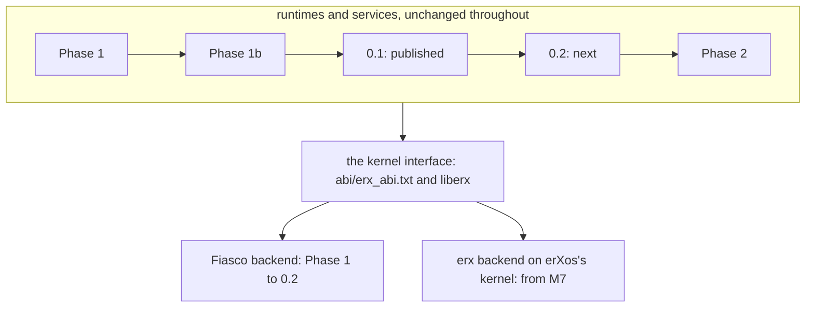

# Chapter 4. History and Goals

**Background needed.** [Chapter 1](01-operating-systems.md) for
processes, threads, address spaces and system calls;
[chapter 2](02-microkernels.md) for microkernels, L4, Fiasco and
capabilities; [chapter 3](03-erlang.md) for Erlang processes, links,
supervisors and ERTS. A reader who knows all three starts here.

> **Status.** The history, goals and principles carry no mark. erXos
> runs on
> Fiasco, an existing L4 microkernel, behind a kernel interface of its
> own; that first phase of the roadmap is Built. 0.1, the first public
> preview, is Built and published from the commit tagged `v0.1`. 0.2,
> the first release, is next, also on Fiasco; budgets that act as walls
> between domains come with it. erXos's own kernel is Phase 2: some of
> its parts are Built (host), built and tested as programs on the
> development machine, and none of it boots.

An Erlang program on FreeBSD can run hundreds of thousands of
processes, and `ps` lists one of them. That one line is `beam.smp`,
the Erlang runtime system. Inside it, each Erlang process has its own
heap and mailbox, a supervisor restarts it when it crashes, and new
code replaces old code while it runs. FreeBSD sees one process with a
few threads, one address space and one user id.

Joe Armstrong, who designed Erlang, wrote the overlap into his thesis:
"Many of the features which are conventionally provided by an
operating system have moved from the operating system into the
programming language." (Armstrong 2003, section 2.7.) Erlang took over
process creation, scheduling, messaging and recovery. It did not take
over protection: FreeBSD draws that around the whole node. A bug in
native code linked into the runtime can end every process in it, and
the file system beneath is kernel code that no supervisor can restart.

erXos turns this around: the Erlang process becomes the operating
system's process. A small capability microkernel sits underneath and
knows nothing of Erlang. Above it, the machine is divided into
domains, each an address space with its own Erlang runtime
([chapter 10](README.md#chapter-10-domains-a-wall-around-some-processes)).
The machine stays one Erlang system, whose processes link and message
one another across domains, and drivers and file systems are Erlang
processes under supervisors.

erXos has two kernels, one at a time. It runs on Fiasco, a microkernel
of the L4 family that others built, changed by a few patches.
Meanwhile it builds a kernel of its own on Fiasco's design, which
replaces Fiasco in Phase 2 of the roadmap. Programs reach either kernel
through one interface that erXos defines, so the switch moves nothing
above it
([chapter 2](02-microkernels.md#254-why-erxos-starts-on-fiasco-and-later-replaces-it)).
For each claim about erXos, this chapter says whether it is built,
only designed, or holds only partly on Fiasco.

Sections 4.1 and 4.2 state the problem and the history of its hardest
part, two-level scheduling; 4.3 traces what erXos borrows; 4.4 and 4.5
give its goals and principles; 4.6 to 4.8 say how it reaches a working
machine, where it stands and what the approach costs.

## 4.1 Erlang systems as operating systems

An Erlang system already does most of what an operating system does
for its programs. erXos asks what a machine looks like when that model
is the machine's own, instead of a guest inside another model.

### 4.1.1 What Erlang already provides

Take a web server written in Erlang, with one process per connection.
Each process has a private heap and can reach another only by sending
a message, copied into the receiver's mailbox. The scheduler counts
reductions, units of work about the size of a function call, so a busy
process cannot starve the rest. A process that crashes sends an exit
signal along its links, and its supervisor starts a fresh one. A new
version of a module loads while the old one runs
([chapter 3](03-erlang.md)).

These are the services a UNIX kernel gives to UNIX processes, and ERTS
gives them to Erlang processes in user mode, without entering the
kernel. Armstrong reported that creating an Erlang process was orders
of magnitude faster than creating a process in most operating systems
of the day (Armstrong 2003). That is why an Erlang system can afford a
process per connection, per request or per device.

### 4.1.2 What the host system does not see

The host operating system draws its boundaries around the runtime, not
inside it, with three consequences.

* **Protection is all or nothing.** OTP's own guidance states that all
  loaded code is trusted and that the runtime has no sandbox
  ([research-prior-art.md, The Erlang runtime](../research-prior-art.md#the-erlang-runtime)).
  Two applications that do not trust each other need two UNIX
  processes, two nodes and a network protocol between them.
* **Accounting stops at the process.** FreeBSD can limit the memory and
  CPU time of `beam.smp`, but not of one application inside it.
* **The services below are a different world.** The file system, the
  network stack and the drivers are kernel code. When a driver fails,
  the kernel panics or the device stops, and no supervisor restarts it.

### 4.1.3 The problem erXos starts from

erXos makes the Erlang process the system's process, and draws
hardware protection around groups of processes only where trust
requires it ([design.md, Context](../design.md#context)). A file
service or a driver is then something to message, inspect and
supervise, like any application component.

Hardware protection still matters, because the runtime that enforces
Erlang's isolation is a large body of native code. A bug in ERTS, in a
native extension, or in the JIT that compiles Erlang to machine code
can break every Erlang process in its address space. A domain is the
wall that stops such a bug. Each domain is also an Erlang node of its
own, so two applications in two domains behave like two applications
on two connected nodes, with differences the design lists and does not
promise to hide ([design.md, Requirements](../design.md#requirements)).

### 4.1.4 Erlang below the application, tried before

Earlier projects ran Erlang closer to the hardware, each with one wall
([research-prior-art.md, Other systems](../research-prior-art.md#other-systems)).

* **Nerves and GRiSP** run an unmodified BEAM over a conventional
  kernel, Linux or the real-time system RTEMS, which keeps the drivers
  and the protection.
* **LING** reimplemented the BEAM to boot with no operating system, as
  a guest of the Xen hypervisor. Its protection boundary is the whole
  virtual machine.
* **HydrOS** ran one BEAM per CPU core over a small kernel, with
  drivers written in Erlang. Its boundaries are cores.

None drew walls between groups of Erlang processes by trust while
keeping the machine one Erlang system. That gap is where erXos starts.

## 4.2 Thirty years of two-level scheduling

If each domain's runtime schedules its own Erlang processes, something
must still schedule the runtimes. In erXos the kernel shares the CPUs
among domains and among the native threads of C programs, and each
runtime switches between its own processes without asking the kernel.
This is **two-level scheduling**: the kernel at one level, a user-mode
scheduler at the other. Its history is mostly failure.

### 4.2.1 Two answers, both tried

The first answer gives every lightweight thread to the kernel. This
model is called **1:1**, because each user thread is one kernel
thread. Every spawn and every switch then enters the kernel. Erlang
processes are cheap because they never touch the kernel, so for Erlang
this is the cost to avoid.

The second answer is **M:N** threading: a user-level library runs M
lightweight threads on N kernel threads and schedules them itself,
promising cheap switches and parallelism together. NetBSD and FreeBSD
built theirs on **scheduler activations**, a design in which the
kernel calls into the user-level scheduler whenever one of its threads
blocks or is preempted (Anderson and others 1991). Every
general-purpose M:N library was abandoned. NetBSD 5.0 moved to 1:1
threads. FreeBSD replaced its M:N design, KSE, with `libthr`, a 1:1
library, as the default in 7.0. Solaris 9 made its 1:1 library the
default, Linux's NPTL chose 1:1, and Windows dropped its user-mode
scheduling from Windows 11
([research-hierarchical-scheduling.md, Negative evidence](../research-hierarchical-scheduling.md#negative-evidence)).

The developers' stated reasons agree: M:N was harder to write, debug
and maintain, and the cheap switch did not pay for that. Sun's white
paper on Solaris threads said the user-level locks had paid off, but
that a user-level scheduler working well alongside the kernel's had
proved a significant challenge.

### 4.2.2 The common failure

Every abandoned system was a thread library for arbitrary C code,
which can block anywhere: in a system call, on a lock, in a page
fault. Take a thread that calls `read` on a socket with no data. Under
scheduler activations the kernel must tell the user-level scheduler,
so that it can run another thread. That call from the kernel into user
code is an **upcall**, and it arrives at whatever point the program
had reached. If a preempted thread held a lock the scheduler needs,
the scheduler waits for a thread that cannot run until the scheduler
runs it; the scheduler activations paper needed a recovery path for
that case. The research record behind erXos's scheduler draws this
common factor as an inference, not a reason any implementer stated
([research-prior-art.md, Scheduler activations](../research-prior-art.md#scheduler-activations)).

### 4.2.3 Why erXos keeps two levels

erXos differs in the two ways that mattered. Its runtimes are few and
its own: ERTS first, maintained in erXos's tree. And an Erlang process
never blocks the thread that runs it: a receive with no message parks
the process, and the thread runs another. ERTS runs many processes on
a few threads, which erXos calls **executors**. Work that must block
goes to separate helper threads, as ERTS's dirty schedulers do
([chapter 3](03-erlang.md#352-schedulers-and-reductions)).

So erXos keeps both levels, under six rules its design sets for the
contract between kernel and runtime. Each removes a failure that ended
an earlier system ([design.md, Decisions](../design.md#decisions)):

1. Executors are ordinary preemptible threads.
2. No upcall ever reaches an executor, so the runtime is never entered
   at an unsafe point.
3. Wakeups and changes in CPU capacity are queued events, taken at the
   runtime's own safe points, so none is lost.
4. Executors never block except to park, so none is lost inside a
   system call.
5. The kernel enforces CPU limits whatever the runtime reports
   (in full only with the grants below).
6. No thread donates its CPU time to another, so no domain's
   scheduling depends on another's.

The kernel allocates CPU time to **groups** of threads. Each group has
a **grant**, a share of CPU time per period on a set of CPUs, which
its runtime divides among its processes
([chapter 9](README.md#chapter-9-processes-runtimes-and-two-level-scheduling)).
Grants come with erXos's own kernel, or with a later stage of the
scheduler on Fiasco. On Fiasco as 0.2 runs it, a domain gets a
priority band, a set of CPUs and a thread limit instead.

Akaros, a research system, shows what rule 2 avoids. It could take a
core away at any line of code, even under a lock, and then asked the
runtime to run code to handle the loss
([research-prior-art.md, Other systems](../research-prior-art.md#other-systems)).

## 4.3 The lineage

Almost every mechanism in erXos comes from an earlier system. What is
erXos's own is the way they meet: an Erlang process as the system's
process, across address spaces, with Erlang's semantics intact. Four
sources shaped erXos most (sections 4.3.1 to 4.3.4); table 4.1 lists
the others.

| System | Idea | What erXos took |
| --- | --- | --- |
| QNX | a UNIX look over a microkernel | a UNIX surface over services in user mode |
| Genera | one live machine: any object examined, code patched while it runs | the live machine of chapter 21, with walls Genera lacked |
| Inferno | a virtual machine at the center, with no memory protection | the runtime at the center, plus hardware walls |
| Singularity | type-safe processes in one address space | evidence that language safety makes crossings cheap |
| SPIN | kernel extensions in a safe language | a warning: a crashed extension could leave the system inconsistent |
| Midori | Erlang's supervisors as a model for a whole system | the same failure model, found outside Erlang |
| Genode | each session paid from a quota its client donates | memory shares for users |
| Barrelfish | hardware facts as data; a plan kept apart from the register writes | a checked manifest and one ABI file (section 4.5.4) |

*Table 4.1. Systems that each gave erXos one idea
([research-prior-art.md](../research-prior-art.md),
[research-os-ideas.md](../research-os-ideas.md)).*

Singularity's numbers carry the lesson that matters most. Its run-time
safety checks cost under 5 percent (Aiken and others 2006), and
hardware protection crossings 33 to 37.7 percent on a benchmark
dominated by messages (Hunt and Larus 2007). That is why erXos keeps a
domain's Erlang processes in one address space and switches between
them without the kernel. But one address space keeps no secrets.
Speculative execution attacks read data through traces the CPU leaves
when it guesses ahead, and they defeat any software barrier inside one
address space
([research-prior-art.md, Lessons](../research-prior-art.md#lessons)).
So erXos puts hardware walls between domains that do not trust each
other.

### 4.3.1 UNIX and FreeBSD: the surface

UNIX gives erXos its surface: files, processes, pipes of text, a shell
and small tools. Where UNIX systems differ, erXos follows FreeBSD.
musl, the C library under erXos's runtimes, uses FreeBSD's error and
signal numbers. The command shell's `ps`, `ls` and `grep` are Erlang
commands that print FreeBSD's output, and the network stack,
`erx_net`, is an Erlang redesign of FreeBSD's
([README.md, Current status](../../README.md#current-status)).

erXos leaves UNIX's inside. Its kernel is not monolithic, POSIX is not
its base, and a user id grants nothing by itself
([chapter 20](README.md#chapter-20-the-command-shell-and-the-unix-surface)).
QNX showed that a system can look like UNIX over a microkernel. For
erXos, UNIX is how the system looks wherever that is also how it
works.

### 4.3.2 L4 and Fiasco: the kernel

Jochen Liedtke's L4, from 1993, showed that a microkernel can be fast
by keeping only address spaces, threads and fast message passing
([chapter 2](02-microkernels.md#251-from-l3-to-sel4)). Fiasco, a C++
implementation of L4 begun at TU Dresden in 1998, is the kernel erXos
runs on (Elphinstone and Heiser 2013).

erXos's own kernel, being written for Phase 2, rewrites Fiasco's design in
C17, the 2017 edition of C, and keeps Fiasco's model wherever erXos
needs nothing else. Its design document records each departure with
its reason ([design-kernel.md, L4 lineage](../design-kernel.md#l4-lineage)).
The main ones are CPU grants to groups (section 4.2) and budgets
(section 4.3.4). Another is that an address space stops when its
creator stops, so no program outlives its domain. seL4, the L4 kernel with a formal proof
of correctness, was the other candidate, but a fork changed for erXos
would lose the proof
([design.md, Alternatives considered](../design.md#alternatives-considered)).

### 4.3.3 Plan 9: names and files

Plan 9, built at Bell Labs from the late 1980s, reached every resource
through files. Servers present resources as file trees, and one
protocol, 9P, carries every request. Each group of processes assembles
its own view of the tree, its namespace, from the servers it mounts
(Pike and others 1995). Its window system served each window as files, and
its shell was rc.

erXos takes most of this. Each domain resolves paths through its own
namespace, a table from paths to the file servers it was granted, with
no machine-wide root. A path is therefore the visible face of a
capability: a domain with no grant for the storage service has no
`/data`, and no name it can write reaches that server. File servers
speak 9P2000.L, a version of 9P. A display serves each window as a
directory of files, and the command shell speaks rc's language
([chapter 14](README.md#chapter-14-files-namespaces-and-service-trees),
[chapter 22](README.md#chapter-22-displays-windows-and-the-web)).

### 4.3.4 EROS, Safe Erlang and Zircon: authority and payment

A process in erXos acts only on what it was handed, and everything it
creates is paid for by someone. Both ideas come from capability
systems.

In stock Erlang a pid is both a name and an authority: anyone who
knows or forges a pid can send to it, link to it or kill it. Safe
Erlang, a 1999 proposal for running mobile code, called pids "both
forgeable and too powerful" and replaced them with capabilities (Brown
and Sahlin 1999). Zircon, Fuchsia's kernel, gives programs no ambient
authority ([chapter 2](02-microkernels.md#231-authority-in-unix)).
erXos takes both ideas. In its design, a domain reaches another
domain's process only if that process's own runtime exported it, so a
forged pid reaches nothing. Inside a domain, pids keep their stock meaning, because the
domain is the unit of trust
([chapter 11](README.md#chapter-11-authority-and-security)).

Payment comes from EROS
([chapter 2](02-microkernels.md#236-capability-systems-in-practice)).
EROS allocated every object from a **space bank**. Banks formed a
hierarchy, and destroying one destroyed, or handed to its parent,
everything allocated from it and the banks below it (Shapiro, Smith
and Farber 1999). erXos's **budgets** follow that model. On erXos's
own kernel (Phase 2), every kernel object and page is charged to a
budget carved from its parent's. Deleting a budget deletes everything
charged to it at once, so ending a domain leaves nothing to chase. On Fiasco the design is cut down: in the preview a budget
records its limit but refuses nothing, and 0.2 makes each domain's
budget a hard wall at its guarantee
([chapter 12](README.md#chapter-12-memory-and-budgets)).

## 4.4 Goals and non-goals

erXos must run ordinary Erlang applications unchanged, protect them
from one another, and still be one system. The other goals follow from
those three, and the non-goals mark where erXos stops
([design.md, Requirements](../design.md#requirements)).

### 4.4.1 What erXos must do

A **principal** is a user in erXos's sense, an identity with its own
budget, CPU share and quotas
([chapter 11](README.md#chapter-11-authority-and-security)).

| Requirement | What it means |
| --- | --- |
| Run Erlang applications | applications run on OTP 29.1.2 unmodified, with Erlang's semantics, checked against stock OTP |
| Protection | untrusted code cannot read, write, crash or exhaust anything beyond its grant |
| One system | one pid space, message system and view of identity, supervision and inspection across domains; one CPU authority |
| Generic runtimes | the kernel knows no runtime; ERTS runs on a contract another runtime could use |
| A live machine | whoever holds the authority can inspect, trace and change every process, domain and kernel object from a shell |
| Drivers | supervised Erlang processes in domains that hold their devices |
| Users | principals, each with a default domain |
| Storage, updates, networking | storage that survives power cuts, updates that always leave a bootable system, networking to other machines |
| UNIX programs where they pay | a shell with rc's language, toybox's small tools, programs recompiled against a small POSIX layer |

*Table 4.2. What erXos must do.*

Four more requirements say how well.

* **Performance.** Process switch, spawn and messaging inside a domain
  within 1.2 times stock ERTS on the same host; messaging between
  domains an order of magnitude cheaper than Erlang distribution; no
  CPU for an idle domain. These are targets, not measurements.
* **Security on equal footing with correctness.** The party that bears
  the consequences of an input from across a trust boundary checks it,
  with a bound on the work.
* **Reproducibility.** The same inputs give byte-identical boot images.
* **Portability.** QEMU's `virt` machine first, then the Raspberry Pi 4
  and 5. AArch64 is the first architecture, and others are ports, not
  redesigns ([design-kernel.md](../design-kernel.md)).

### 4.4.2 What erXos refuses

* **POSIX is not the base.** POSIX is an optional personality for
  native programs. A POSIX base would put UNIX's model of authority, a
  process that holds whatever its user id allows, under every domain.
* **No Linux binaries and no Linux virtual machine.** Stock nodes on a
  Linux-compatible layer would lose the pids, connections and
  supervision that span domains
  ([design.md, Alternatives considered](../design.md#alternatives-considered)).
* **No secrecy inside a domain.** Speculative side channels defeat any
  software barrier inside one address space (section 4.3). Two parties
  that keep secrets from each other belong in two domains.
* **No runtime other than ERTS, and no unmodified ERTS.** The kernel's
  contract leaves room for others, but the design names none, and
  erXos changes ERTS freely (section 4.5.2).

## 4.5 Five principles

Five principles shape every design in erXos, each shown here in one
concrete choice.

### 4.5.1 Erlang wherever practical

As much of the system as is practical is written in Erlang, drivers
included. "Practical" means that no design is complicated, and no
needed performance given up, to keep it in Erlang.

In erXos a **driver** is an Erlang process under a supervisor, over a
thin layer of C, the device shim, that touches the device's registers
and does not interpret the data the device sends. The drivers for
QEMU's virtual display and input devices are Erlang, and so is the
Raspberry Pi's framebuffer driver. One QEMU test kills the virtual
disk's driver in the middle of a transfer, then finds each kept file
intact up to its last sync, the last moment its data was forced to
disk ([README.md, Current status](../../README.md#current-status)).
The kernel, the device shims and per-byte work such as checksums stay
in C ([chapter 15](README.md#chapter-15-devices-and-drivers)).

### 4.5.2 erXos owns OTP

OTP 29.1.2's source lives in erXos's tree and changes by ordinary
edits; erXos does not track upstream. ERTS is a parts bin, taken apart
and recombined wherever that makes the system simpler or faster, and
so is musl. In erXos, ERTS runs in user mode over `liberx`, erXos's
library under every runtime, and its pids name the domain that owns
them.

Owning OTP does not mean drifting from it. OTP's own test suites run
on erXos and on stock OTP, and the results are compared case by case.
Every difference is a bug in erXos, a documented difference with a
test, or an upstream bug recorded as such
([chapter 25](README.md#chapter-25-checking-the-system)).

### 4.5.3 Beauty and simplicity

A small loss of performance is acceptable when it buys a lot of
simplicity. erXos judges simplicity by the model a maintainer must
hold, the concepts, owners and rules a change adds or removes, not by
line count. Its model has seven concepts, each with one owner:
process, domain, runtime, group, budget, capability and principal
([design.md, The model](../design.md#the-model)). Making each domain
an Erlang node shows the principle at work: messaging between domains
needs no new model, because Erlang distribution already says what a
message to another node means.

### 4.5.4 Declarative where it simplifies

Where a description is simpler than code, erXos writes the description
and derives the code from it. The ABI, the binary interface a program
uses to call the kernel, is defined once in `abi/erx_abi.txt`. The
build's ABI generator, written in Ruby like erXos's other host tools,
derives the C headers and the matching Erlang, Ruby and TypeScript, so
no constant is copied by hand. The system's configuration is one
**system manifest**, a file that names every domain the machine runs,
with its budget, its devices and the services it may reach; the build
checks it before making the image. On Fiasco that check is reduced,
and later milestones complete it
([plan.md, Stopgaps and Fiasco](../plan.md#stopgaps-and-fiasco),
[chapter 7](README.md#chapter-7-one-source-for-every-fact)).

### 4.5.5 UNIX look and feel, honestly

To its users erXos feels like UNIX. Familiar names, commands and
formats stay wherever they fit what the thing is, and nothing wears
the name or shape of something it is not. Designers call that fault
**skeuomorphism**: copying the look of an old object whose function is
gone, like a calendar app drawn as torn paper.

The principle cuts both ways. `ps` prints FreeBSD's columns, because a
process list is a process list, and a value erXos does not measure
shows as `-`, not an invented number
([design.md, Signature experiences](../design.md#signature-experiences)).
But erXos has no `sysctl` command. FreeBSD's `sysctl` is a tree of
values, some to read and some to set. erXos's system values are one
read-only tree, shown by the inspector, `/proc`, the host tool and a
read-only `sysctl(3)` library call. Configuration lives in the system
manifest ([design.md, Decisions](../design.md#decisions)). A
`sysctl` command that refused every write would promise what it does
not do.

## 4.6 A working system first: phases and seams

A capability microkernel with every guarantee erXos asks for is the
slowest part to build and the hardest to check. Rather than wait for
it, erXos builds the system first, on components that already work,
and replaces them one at a time behind interfaces it owns.

### 4.6.1 Seams

A **seam** is one of erXos's own interfaces with a borrowed component
behind it, placed so that replacing the component changes nothing above
it. The most important is the **kernel interface**: the calls, rights,
status codes and binary layouts of `abi/erx_abi.txt`, which `liberx`
offers to every runtime and service. `liberx/backend/fiasco`
implements it over Fiasco, `liberx/backend/hosted` inside a macOS
process for fast testing, and erXos's own kernel gets a backend in
Phase 2.

A seam works only if nothing leaks through it: a call the Fiasco
backend cannot implement fails with erXos's own status, `ERX_ENOTSUP`,
not a Fiasco error
([design-fiasco.md, Contract](../design-fiasco.md#contract)). Without
the seam, the later port would touch every service that ever made a
kernel call; with it, the switch is one change behind `liberx`.

### 4.6.2 What a stopgap promises

A **stopgap** is a component the roadmap replaces. Hardening it is
wasted work, and hiding its gaps would make every claim above it
unreliable. littlefs, the small file system that serves `/data`, and
LVGL, the widget library that draws on panels, are stopgaps
([plan.md, Stopgaps and Fiasco](../plan.md#stopgaps-and-fiasco)).

For trusted workloads a stopgap promises only three things: no memory
errors, no deadlock, and the right results for the calls it offers. A
call it does not offer fails with `ERX_ENOTSUP`, and a value it cannot
measure reads as unsupported or partial, with the reporter named.
Fairness, latency bounds and exact accounting belong to the
replacement; on the stopgap they are recorded gaps.

### 4.6.3 Release contracts and the downsides table

A stopgap that a release ships needs more, because a release runs code
nobody trusts. It has a **release contract**, a short list of what the
release commits to for untrusted workloads, each with its test.
littlefs's contract
([design-stopgap.md, Release contract](../design-stopgap.md#release-contract))
says, among other things:

* littlefs runs only inside the storage domain;
* partition bytes and client requests reach it only through decoding
  that checks every bound;
* a crash ends only the storage domain, which restarts;
* a file synced before a power cut survives it.

Fiasco, the kernel 0.2 ships on, is not a stopgap: every domain's
isolation rests on it. For 0.2 its contract promises that Fiasco's
address spaces isolate each domain's memory and capabilities, and that rights
only shrink: a copy of a capability never has more rights than the
original. A deleted object is gone for every holder at once, and each
domain's memory budget is a hard wall. Isolation also rests on the
system domain's code that checks requests and places kernel objects,
and on the domain that drives a device no hardware confines. Unless a
patch closes the gap, it rests too on the CPU's branch predictors,
which guess where code goes next
([design-fiasco.md, Contract](../design-fiasco.md#contract)).

What Fiasco lacks against erXos's own kernel is one list, the
**downsides table**
([design-fiasco.md, Downsides](../design-fiasco.md#downsides-against-erxoss-kernel)).
Each row names the property lost, what a user sees and what closes it,
and a release publishes the rows it accepts. The backend rebuilds none
of these properties in user mode, because they belong to a kernel.

### 4.6.4 The phases

The roadmap has two phases, with releases between them, as figure 4.1
shows ([plan.md, Overview](../plan.md#overview)).

*Figure 4.1. The phases above the seam and the two kernels below it.
The kernel interface stays put: at milestone M7 erXos's own kernel
replaces the Fiasco backend, and nothing above the line moves.*

* **Phase 1** brings the system up on a near-stock Fiasco: the boot
  image, the live machine, basic file systems and the command shell.
  ERTS runs in user mode in the system domain
  ([chapter 2](02-microkernels.md#253-the-root-task)), the Erlang
  domain that decides policy and builds every other domain. Phase 1
  asks for no security or robustness, and plugs no gap of Fiasco's.
* **Phase 1b**, the second half of Phase 1, adds the user-facing
  system on the same backend: domains and their connections, native
  programs and pipes, the display, drivers in their own domains,
  storage, networking and the Raspberry Pi 4.
* **0.1, the preview**, publishes part of that system (section 4.7).
* **0.2, the first release**, ships the system on Fiasco with logins
  and untrusted apps. It reaches the security closure, the point after
  which the system may run code nobody trusts, in its Fiasco form
  ([plan.md, 0.2](../plan.md#02-the-first-release-on-fiasco)).
* **Phase 2** builds erXos's own kernel, boots the same boot image,
  and replaces Fiasco at milestone M7
  ([plan.md, M7](../plan.md#m7-fiasco-leaves)). Most rows of the
  downsides table close only there; a few close earlier, on Fiasco or
  at other milestones.

The switch is gated on **parity**: the new kernel runs the same system
and tests as Fiasco, and every difference is explained and pinned by a
test, as with OTP's suites. The same rule governs every stopgap's
replacement. Every build until the security closure, 0.1 included, is
a **development build**: it runs only trusted code and prints
`development build: trusted code only` on boot.

### 4.6.5 Why not another order

Building erXos's kernel first would delay every user-facing feature
and test the kernel against no real workload; erXos's order gives the
new kernel a working system as its test corpus. Keeping Fiasco, or
seL4, for good would leave a kernel that does not follow the
construction rules of
[chapter 6](README.md#chapter-6-correct-by-construction), with
budgets and groups grafted on
([design.md, Alternatives considered](../design.md#alternatives-considered)).
The afterword,
[The Road to erXos's Own Kernel](README.md#afterword-the-road-to-erxoss-own-kernel),
follows Phase 2.

## 4.7 Where erXos stands

0.1, erXos's first public preview, is published, and it runs on
Fiasco: most of erXos's own kernel exists only as C17 parts tested on
the host. The website offers a browser demo, a Raspberry Pi 4 card and
a QEMU image, built from the commit tagged `v0.1`
([plan.md, 0.1](../plan.md#01-the-preview)). The browser demo runs
erXos on an emulator compiled to WebAssembly, with a menu of hardware
faults to inject (`site/README.md`).

The preview is a development build. On a Raspberry Pi 4 it:

* boots from the SD card to the command shell on the serial console;
* shows the kiosk, a dashboard with a clock and live quotes fetched
  over HTTPS, on its HDMI screen;
* lets another machine reach its `rc` shell with `ssh -p 2222`, using
  the key its user put on the card;
* keeps closed files under `/data` through a power cut.

Doom, an example game that is not part of the system, runs on both
images. Underneath run the system domain, domains with a runtime each,
the inspector, live code loading, a storage domain over littlefs that
restarts after a failure, and `erx_net`
([README.md, Current status](../../README.md#current-status)).

The rest is designed and not built: the POSIX-lite layer, drivers for
USB, Bluetooth and WiFi beyond their host-tested cores, and most of the
browser client. 0.2 comes next, with logins, untrusted apps and the
security closure on Fiasco; Phase 2 follows it.

## 4.8 What the approach costs, and how it fails

Every choice in this chapter has a price
([overview.md](../overview.md)).

**A runtime per domain costs memory.** Each domain runs its own ERTS,
with its own atoms, code and tables, so ten domains hold ten copies of
the runtime's state. Domains are a tool for trust, not for every
application.

**The system domain is critical.** It decides policy and builds every
other domain, so a fault in it resets the machine
([design.md, Trust placement](../design.md#trust-placement)). A shared
service can also become a bottleneck, so each service limits how much
work any one client can make it do.

**Device isolation needs hardware.** A device that writes memory
directly can write anywhere, unless an IOMMU, a unit that checks each
device access against a table, confines it. No device on 0.2's
platforms is behind one, so a bad driver domain can make its device
write anywhere in memory.

**Fiasco is not erXos's kernel.** Until Phase 2, what only erXos's
kernel enforces is absent, and the downsides table says so: there are
no CPU grants, for example, and a page can be writable through one
mapping while executable through another. That nothing a domain does
can panic the kernel rests on Fiasco's own code, on erXos's fuzzing of
the system calls and on a monthly review of Fiasco's security fixes; a
reachable Fiasco bug could break isolation. That nothing a device does
can panic it, and that a fault ends only the faulting domain, hold only
as far as Fiasco's code gives them, and whether 0.2 accepts that is an
open decision.

**A stopgap fails safely or not at all.** The plan defers only gaps
that fail with an error, a stop or a restart, never one that would
lose data, widen authority or return a wrong answer as a right one. A
crash of littlefs ends the storage domain, which the domain service
restarts, and until then every request answers `{error, eio}`.

**The plan can fail at the seam.** If Fiasco's model leaked above
`liberx`, Phase 2 would become a rewrite. The generated interface
guards against that, and so does the rule that both backends pass one
test set, refusals included ([plan.md, Overview](../plan.md#overview)).

## 4.9 Summary

erXos makes the Erlang process the system's process, draws domains
around groups of processes where trust requires them, and keeps the
machine one Erlang system. Two-level scheduling failed in every
general thread library; it works for erXos because its runtimes are
its own and an Erlang process never blocks its thread. erXos's surface
comes from UNIX and FreeBSD, its kernel design from L4 and Fiasco, its
namespaces from Plan 9, and its authority and payment from EROS, Safe
Erlang and Zircon. It refuses POSIX as a base, Linux binaries and
secrecy inside a domain. The system runs first on Fiasco behind erXos's
own kernel interface, with every gap published, and erXos's kernel
replaces Fiasco at parity in Phase 2.

The next chapter assembles these pieces into one picture: the kernel,
the domains, the system domain and the services, and how a request
travels between them.

## 4.10 Where to read next

* [design.md, Context](../design.md#context),
  [Requirements](../design.md#requirements) and
  [Decisions](../design.md#decisions): the problem, the goals and the
  decisions that span subsystems.
* [plan.md, Overview](../plan.md#overview) and
  [design-fiasco.md, Contract](../design-fiasco.md#contract): the
  phases, and what the first release promises on Fiasco.
* [research-hierarchical-scheduling.md](../research-hierarchical-scheduling.md)
  and [research-prior-art.md](../research-prior-art.md): the evidence
  behind sections 4.2 and 4.3.
* Joe Armstrong, *Making reliable distributed systems in the presence
  of software errors*, PhD thesis, KTH, Stockholm, 2003: section 2.3 on
  process creation, section 2.7 for the quotation.
* Thomas Anderson and others, "Scheduler Activations", SOSP 1991, and
  ACM TOCS 10(1), 1992: the classic two-level design.
* Kevin Elphinstone and Gernot Heiser, "From L3 to seL4", SOSP 2013:
  L4's history.
* Rob Pike and others, "Plan 9 from Bell Labs", 1995.
* Jonathan Shapiro, Jonathan Smith and David Farber, "EROS: a fast
  capability system", SOSP 1999, section 5.1: space banks.
* Lawrie Brown and Dan Sahlin, "Extending Erlang for Safe Mobile Code
  Execution", ICICS 1999: pids as capabilities.
* Mark Aiken and others, "Deconstructing Process Isolation", MSPC 2006
  (x86), and Galen Hunt and James Larus, "Singularity: Rethinking the
  Software Stack", ACM SIGOPS OSR, 2007 (WebFiles on an Athlon 64
  3000+): the two costs measured.
