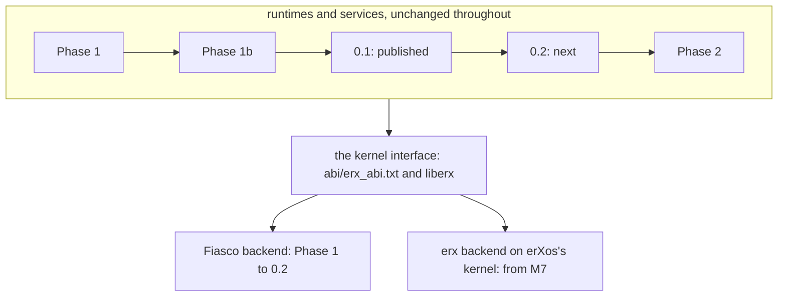

# Chapter 4. History and Goals

**Background needed.** Chapters 1 to 3, for the terms.
[Chapter 1](01-operating-systems.md) covers
processes, threads, address spaces and system calls;
[chapter 2](02-microkernels.md) microkernels, L4 and
capabilities; [chapter 3](03-erlang.md) Erlang processes,
links, supervisors and ERTS. A reader who knows operating systems,
microkernels and Erlang starts here.

> **Status.** The history, the lineage, the goals and the principles
> carry no mark: they are reasons, not mechanisms. Phase 1 is Built:
> the system runs on a near-stock Fiasco kernel behind erXos's own
> kernel interface. 0.1, the first public preview, is Built and
> published from the commit tagged `v0.1`, as a browser demo, a
> Raspberry Pi 4 card and a QEMU image. 0.2, the first release, is
> next, on Fiasco. erXos's own kernel is Phase 2; parts of its core
> are Built (host), and none of it boots.

An Erlang program on FreeBSD can run hundreds of thousands of
processes, and `ps` lists one of them. That one line is `beam.smp`,
the Erlang runtime system. Inside it, each Erlang process has its own
heap and mailbox. A scheduler preempts it fairly, a supervisor
restarts it when it crashes, and new code replaces old code while it
runs. FreeBSD sees none of this. To FreeBSD the whole system is one
process with a few threads, one address space and one user id.

Joe Armstrong, who designed Erlang, wrote the overlap into his thesis:
"Many of the features which are conventionally provided by an
operating system have moved from the operating system into the
programming language." (Armstrong, *Making reliable distributed
systems in the presence of software errors*, 2003, chapter 2.) Erlang
took over process creation, scheduling, messaging and recovery. It did
not take over protection, and the operating system underneath does not
know where to draw it.

On FreeBSD the boundaries fall where the kernel's model puts them:
around each UNIX process, with its address space, file descriptors and
user id. Every Erlang process of a node shares one of each. A bug in
native code linked into the runtime can end the whole node, and the
file system beneath it is kernel code that no supervisor can restart.

erXos turns this around: the Erlang process becomes the operating
system's process. A small capability microkernel sits underneath and
knows nothing of Erlang. Above it, the machine is divided into
**domains**, each an address space with its own Erlang runtime
([chapter 10](README.md#chapter-10-domains-a-wall-around-some-processes)). The whole
machine stays one Erlang system, whose processes link, monitor and
message one another across domains. Drivers, file systems and system
services are Erlang processes under supervisors. Until its own kernel
exists, erXos runs on a near-stock Fiasco kernel behind an interface of
its own, so that replacing Fiasco moves nothing above that interface.

Section 4.1 states the problem erXos starts from, and 4.2 the
thirty-year history of its hardest part, two-level scheduling. Section
4.3 traces the systems erXos borrows from, 4.4 lists its goals and
non-goals, and 4.5 its five principles. Sections 4.6 and 4.7 describe
how the project reaches a working machine and where it stands, and 4.8
what the approach costs and how it fails.

## 4.1 Erlang systems as operating systems

An Erlang system already does most of what an operating system does
for its programs. It creates processes, schedules them, isolates their
memory, carries messages between them and decides what happens when
one fails. erXos asks what a machine looks like when that model is the
machine's own, instead of a guest inside another model.

### 4.1.1 What Erlang already provides

Take an ordinary OTP application, a web server, in which each
connection is an Erlang process. Each process has a private heap, so
one process cannot read or write another's data. It can only send a
message, which is copied into the receiver's mailbox. The runtime's
scheduler counts **reductions**, units of work roughly equal to
function calls. When a process has used its share, the scheduler
switches to another, so a busy process cannot starve the rest. A
process that crashes sends an exit signal along its links, and a
**supervisor**, an OTP process whose job is to restart the processes
below it, starts a fresh one. A new version of a module can be loaded
while the old one runs. [Chapter 3](03-erlang.md) explains
each of these.

These are the services a UNIX kernel gives to UNIX processes:
isolation, scheduling, communication and cleanup after failure. ERTS
gives them to Erlang processes, in user mode, at a fraction of the
cost. Armstrong's thesis reports that creating an Erlang process was
orders of magnitude faster than creating a process in most operating
systems of its day
<!-- check: the thesis's claim (chapter 2, section 2.3) is about 2003 systems; keep it attributed, not as a present measurement -->.
That is why an Erlang system can afford a process per connection, per
request or per device.

### 4.1.2 What the host system does not see

The host operating system draws its boundaries around the runtime, not
inside it. Three consequences follow.

* **Protection is all or nothing.** OTP's own guidance states that all
  loaded code is trusted, and that the runtime has no sandbox for
  untrusted Erlang code
  ([research-prior-art.md, The Erlang runtime](../research-prior-art.md#the-erlang-runtime)).
  Two applications that do not trust each other need two UNIX
  processes, two Erlang nodes and a network protocol between them.
* **Accounting stops at the process.** FreeBSD can limit the memory and
  CPU time of `beam.smp`, but not of one application inside it.
* **The services below are a different world.** The file system, the
  network stack and the drivers are kernel code. When a driver fails,
  the kernel panics or the device stops. No supervisor restarts it, and
  no Erlang tool can inspect it.

So an Erlang programmer works with two models of the machine: processes
to message, trace and restart above the runtime, and file descriptors,
system calls and kernel threads below it.

### 4.1.3 The problem erXos starts from

erXos's starting point is to make the Erlang process the system's
process, and to draw hardware protection around groups of processes
only where trust requires it ([design.md, Context](../design.md#context)).
A file service or a driver is then something to message, inspect and
supervise, like any application component. One process space, one
message system and one view of identity, supervision and inspection
span the machine.

Hardware protection still matters, because the runtime that enforces
Erlang's isolation is a large body of native code. A bug in ERTS, in a
native extension, or in the JIT that compiles Erlang to machine code
can break every Erlang process in its address space. A domain is the
wall that stops such a bug: a fault inside it reaches nothing outside. Each domain is also an Erlang node of its own, so placing two
applications in two domains behaves like placing them on two connected
nodes ([design.md, Requirements](../design.md#requirements)).

### 4.1.4 Erlang below the application, tried before

Running Erlang closer to the hardware is not a new idea, and the
earlier attempts show the gap erXos aims at
([research-prior-art.md, Other systems](../research-prior-art.md#other-systems)).

* **Nerves and GRiSP** run an unmodified BEAM over a conventional
  kernel: Nerves over Linux, GRiSP over the real-time system RTEMS.
* **LING** reimplemented the BEAM to boot with no operating system
  beneath it, as a guest of the Xen hypervisor, a layer that runs
  virtual machines. Its protection boundary is the whole virtual
  machine.
* **HydrOS** ran one BEAM per CPU core over a small kernel, with
  drivers written only in Erlang and restartable on demand. Its
  boundaries are cores.

Each kept one wall, around the runtime or around a core. None drew
walls between groups of Erlang processes by trust while keeping the
whole machine one Erlang system. That combination is erXos's.

## 4.2 Thirty years of two-level scheduling

If each domain's runtime schedules its own Erlang processes, something
must still schedule the runtimes. The kernel shares the CPUs among
domains, and among the native threads of C programs, while each
runtime switches between its own processes without asking the kernel.
This arrangement is **two-level scheduling**: the kernel at one level,
a user-mode scheduler at the other. Its history is mostly failure.

### 4.2.1 Two answers, both tried

The first obvious answer gives every lightweight thread to the kernel.
This model is called **1:1**, because each user thread is one kernel
thread. Every spawn and every switch then enters the kernel, and every
thread holds a kernel object. Erlang processes are cheap because they
never touch the kernel, so for Erlang this is the cost to avoid.

The second answer is **M:N** threading: a user-level library runs M
lightweight threads on N kernel threads and schedules them itself. It
promises cheap switches and kernel-level parallelism together. Its
general-purpose versions were built in the 1990s and 2000s, and each
was abandoned
([research-hierarchical-scheduling.md, Negative evidence](../research-hierarchical-scheduling.md#negative-evidence)).

| System | What was tried | What happened |
| --- | --- | --- |
| NetBSD | scheduler activations in `libpthread` | replaced by 1:1 threads, first released in NetBSD 5.0 |
| FreeBSD | KSE and `libkse` | `libthr`, a 1:1 library, became the default in 7.0; kernel KSE was removed in March 2008 |
| Solaris | an M:N thread library | Solaris 9 made the 1:1 library the default |
| Windows | user-mode scheduling | not supported from Windows 11, and never on Arm64 |
| Linux | M:N candidates for a new thread library | NPTL chose 1:1 |

A FreeBSD reader has met the second row. The developers' stated
reasons agree: M:N was harder to write, debug and maintain, and the
cheap user-level switch did not pay for that. Sun's white paper on
Solaris threads found that the user-level locks of the M:N design had
paid off. Making a user-level scheduler work well together with the
kernel's had proved hard.

### 4.2.2 The common failure

The research record behind erXos's scheduler names a common factor. It
marks the factor as an inference from the sources, not a reason any
implementer stated. Every abandoned system was a general thread library
for arbitrary C code, and such code can block anywhere: in a system
call, on a lock, in a page fault. To keep the user scheduler informed,
the kernel called back into it whenever a thread blocked or was
preempted. Such a call from the kernel into user code is an
**upcall**. The user scheduler then ran at arbitrary points, possibly
while one of its own locks was held. The kernel and the library jointly
owned each thread's state, and POSIX signals needed yet another layer
of cooperation between them. The scheduler activations paper itself
needed a recovery path for a thread preempted while holding a lock
([research-prior-art.md, Scheduler activations](../research-prior-art.md#scheduler-activations)).

### 4.2.3 Why erXos keeps two levels

erXos differs in the two ways that mattered. Its runtimes are few and
its own: ERTS first, maintained in erXos's tree. And its lightweight
processes are Erlang's, which never block a thread. An Erlang process
is suspended only at a function call or a receive, after it has used
its reductions. A receive with no message parks the process, not the
thread under it. ERTS already runs many processes on a few threads,
which erXos calls **executors**, and scales across CPUs
([design.md, Context](../design.md#context)).

So erXos keeps both levels. Six rules for the contract between kernel
and runtime ([design.md, Decisions](../design.md#decisions)) each
remove a cause of failure named above:

1. Executors are ordinary preemptible threads.
2. Preemption never runs runtime code: there are no upcalls.
3. Wakeups and changes of CPU capacity are queued events, which the
   runtime takes at its own safe points.
4. Executors never block except to park, waiting for their group's
   next event.
5. The kernel enforces CPU budgets whatever the runtime reports.
6. No thread donates its CPU time to another.

The kernel allocates time to **groups** of threads. Each group has a
**grant**, a quota per period and a set of CPUs, and each runtime
divides its group's grant among its own processes.
[Chapter 9](README.md#chapter-9-processes-runtimes-and-two-level-scheduling)
explains the contract. Grants are a mechanism of erXos's own kernel
(Phase 2). On Fiasco, which 0.2 runs on, a domain gets a priority
band, a set of CPUs and a thread limit instead. The downsides table
lists the gap as FD15
([design-fiasco.md, Downsides](../design-fiasco.md#downsides-against-erxoss-kernel)).

Two lessons of the old systems still apply. A preempted executor may
hold a lock another executor needs. And tools must see every
lightweight process, as they see every 1:1 thread, so erXos's
inspector shows Erlang processes as objects of the machine
([chapter 21](README.md#chapter-21-the-live-machine)).

Three research systems, Psyche, Barrelfish and Akaros, explored how a
kernel and a runtime share CPUs, and showed the way for the part that
works. Akaros also showed the danger. Its runtimes had to cope with
losing a core at any line of code, even while holding a lock, which
erXos's rule 2 forbids
([research-prior-art.md, Other systems](../research-prior-art.md#other-systems)).

## 4.3 The lineage

Almost every mechanism in erXos comes from an earlier system. erXos's
own part is the way they meet: an Erlang process as the system's
process, across address spaces, with Erlang's semantics intact. Figure
4.1 places the main sources in time; the subsections say what erXos
took from each and what it left.

```text
1969        UNIX ........................ files, processes, the shell
1986        Erlang ...................... processes, links, supervision
1987        Genera (paper) .............. a machine open to inspection
late 1980s  Plan 9 ...................... private namespaces, 9P, rc
1991        EROS ........................ space banks: memory paid for
1991        scheduler activations ....... the two-level design to avoid
1993        L4 .......................... a small, fast kernel
1993        FreeBSD ..................... the UNIX surface erXos follows
1995        SPIN (paper) ................ extensions under language safety
1997        Inferno (paper) ............. a VM at the center, Styx
1998        Fiasco ...................... the kernel design erXos keeps
1999        Safe Erlang (paper) ......... pids replaced by capabilities
2007        Singularity (paper) ......... the cost of hardware crossings
2009        Barrelfish (paper) .......... the system described as data
            Zircon ...................... no ambient authority
```

*Figure 4.1. The systems erXos draws on, with the idea taken from
each. Years are first work, or the paper cited; the figure orders the
sources and does not date erXos.*
<!-- check: 1969 for UNIX and 1993 for FreeBSD are not from a source read for this chapter; 1993 for L4 and 1998 for Fiasco are from the Wikipedia article on the L4 family; 1991 for scheduler activations is the SOSP paper per research-prior-art.md -->

### 4.3.1 UNIX and FreeBSD: the surface

UNIX gives erXos its surface: files, processes, pipes of text, a shell
and small tools that read and write them. Where UNIX systems differ,
erXos follows FreeBSD. musl is the C library under erXos's runtimes and
native programs, and its error and signal numbers in erXos are
FreeBSD's, generated from the ABI's sources. The command shell's `ps`,
`ls` and `grep` are Erlang commands that print FreeBSD's output.
`service` enables and stops services as FreeBSD's does. The network
stack, `erx_net`, is an Erlang redesign of FreeBSD's
([README.md, Current status](../../README.md#current-status)).

erXos leaves UNIX's inside. Its kernel is not monolithic, POSIX is not
its base, and a user id grants nothing by itself
([chapter 20](README.md#chapter-20-the-command-shell-and-the-unix-surface)).

### 4.3.2 L4 and Fiasco: the kernel

Jochen Liedtke's L4, from 1993, showed that a microkernel can be fast.
It keeps only what cannot move out of the kernel: address spaces,
threads and fast message passing between them
([chapter 2](02-microkernels.md)). Fiasco is a C++
implementation of the L4 interface, begun at TU Dresden in 1998; its
descendant, the L4Re microkernel, reaches every kernel object through
capabilities.

erXos's own kernel is Fiasco's design rewritten in C17. It keeps
Fiasco's model wherever erXos needs nothing else. Every departure, with
its reason, is in the kernel's L4 lineage ledger
([design-kernel.md, L4 lineage](../design-kernel.md#l4-lineage)). The
main departures are the scheduling groups of section 4.2, budgets
(section 4.3.3), and spaces that cannot outlive their parents.

Two other kernels of the family gave lessons. seL4 has a formal proof
of correctness. A modified fork would void that proof, and erXos does
not need one, so erXos's kernel takes neither seL4's code nor Fiasco's,
only Fiasco's design
([design.md, Alternatives considered](../design.md#alternatives-considered)).
Zircon, the kernel of Fuchsia, reaches every object through handles
whose rights only shrink (section 4.3.7).

### 4.3.3 EROS and Genode: paying for resources

EROS was a capability system that Jonathan Shapiro began in 1991 as a
reconstruction of KeyKOS. It allocated memory from **space banks**, so
that destroying a bank destroyed everything allocated from it
<!-- check: the description of EROS's space banks rests on design.md and design-kernel.md, not on an EROS paper read for this chapter -->.
erXos's **budgets** follow that model. Every kernel object and page is
charged to a budget carved from its parent's. Deleting a budget deletes
everything charged to it, at once
([design-kernel.md, Budgets](../design-kernel.md#budgets)), so ending a
domain is one operation with nothing left to chase. Genode, a component
framework on L4 kernels, gives each session its own memory quota
<!-- check: Genode's per-session quotas are taken from design.md's Context, not from Genode's documentation -->.
erXos takes that idea for users, who get memory and a CPU share
without a container runtime.

On Fiasco the design is cut down. 0.2 makes each domain's budget a
hard wall, with no spending beyond its guarantee; the downsides table
lists that as FD25. The preview's inspector reports another domain's
budget as unsupported. [Chapter 12](README.md#chapter-12-memory-and-budgets) covers
budgets.

### 4.3.4 Plan 9 and Inferno: names and files

Plan 9, built at Bell Labs from the late 1980s, rested on three ideas.
Resources are named and reached like files in a hierarchy. One
protocol, 9P, reaches them all. And each user sees a private namespace
assembled from many servers (Pike and others, "Plan 9 from Bell Labs",
1995). Its window system served each window as a set of files, and its
shell was rc.

erXos takes most of this. Each domain sees files through its own table
of file servers, and there is no global root. A path is therefore the
visible face of a capability: a domain cannot name a file server it
was never handed. Every file server speaks 9P2000.L, a version of 9P.
A display serves each window as a directory of files, and a program
draws with Plan 9's draw protocol. The command shell speaks rc's
language ([chapter 14](README.md#chapter-14-files-namespaces-and-service-trees),
[chapter 22](README.md#chapter-22-displays-windows-and-the-web)).

Inferno, a later Bell Labs system, put a virtual machine, Dis, at the
center, and ran programs safely without memory protection because the
loader checked each module's types. erXos shares the runtime at the
center, not the reliance on it alone: language safety holds only while
the runtime has no bugs
([research-prior-art.md, Inferno and Dis](../research-prior-art.md#inferno-and-dis)).

### 4.3.5 QNX and Genera: UNIX on top, a machine open inside

QNX runs its services in user mode over a small kernel, and still
looks and feels like UNIX to its users
<!-- check: QNX's structure is stated from README.md's Architecture, not from QNX documentation read for this chapter -->.
erXos follows it. UNIX is how erXos looks wherever that is also how it
works, not what it is built on.

Genera, the Lisp machine environment of Symbolics, made the whole
machine one inspectable, changeable environment. Any object could be
examined, and the debugger opened the source of any stack frame. Code
was patched while the system ran (Walker and others, "The Symbolics
Genera Programming Environment", 1987). erXos takes that live machine.
One inspector shows CPUs, kernel objects, domains and processes as
live records. `source(Pid)` opens the line a process is executing, and
code loads into the running machine from a laptop
([chapter 21](README.md#chapter-21-the-live-machine)). Genera had no protected core,
and its authors called the missing "keep out" signs a hazard. erXos
keeps its walls visible. Every value the inspector shows says who
reported it, and what a process may change depends on what it holds.

### 4.3.6 Systems built around a language

Several research systems organized a whole machine around a language
and its runtime ([research-prior-art.md](../research-prior-art.md)).

* **Singularity**, from Microsoft Research, ran each program as a
  sealed, type-safe process. It measured the cost of isolation on a
  benchmark dominated by messages between processes. Its run-time
  safety checks cost 4.5 to 4.7 percent; hardware protection crossings
  cost 33 to 37.7 percent.
* **SPIN** linked extensions written in a safe language into the
  kernel. Later work reported that a crashing extension could leave
  the system inconsistent.
* **Midori**, another Microsoft system, took Erlang's supervisors as
  its model and tore a failed process down at once.

erXos draws two lessons. First, language safety makes crossings cheap,
which is why erXos keeps a domain's Erlang processes in one address
space and switches between them without the kernel. Second, one
address space keeps no secrets. Speculative execution attacks read
data through traces the CPU leaves when it guesses ahead, and they
defeat language-enforced confidentiality. That moved the V8 JavaScript
engine to process isolation
([research-prior-art.md, Lessons](../research-prior-art.md#lessons)).
So erXos puts hardware walls between domains that do not trust each
other, and promises no confidentiality between the processes of one
domain (section 4.4).

### 4.3.7 Safe Erlang and Zircon: authority

In stock Erlang a pid is both a name and an authority. Anyone who
knows or forges a pid can send to it, link to it or kill it. Safe
Erlang, a 1999 proposal for running mobile code, called pids "both
forgeable and too powerful" and replaced them with capabilities that
carry rights
([research-prior-art.md, Safe Erlang](../research-prior-art.md#safe-erlang)).
Zircon's applications have no **ambient authority**, authority a
program holds merely by existing, like a UNIX process's right to open
any file its user id may open.

erXos takes both. A pid is a name, not an authority. A domain reaches
another domain's process only if that process's own runtime exported
it, so a forged pid reaches nothing. Inside a domain, pids keep their
stock meaning, because the domain is the unit of trust
([chapter 11](README.md#chapter-11-authority-and-security)).

### 4.3.8 Barrelfish and BOOM: the system described as data

Barrelfish kept a knowledge base of the hardware's facts, and solved
device configuration as a set of constraints. It separated the plan
from the register writes that apply it
([research-os-ideas.md, Barrelfish](../research-os-ideas.md#barrelfish-and-declarative-hardware-management)).
The BOOM project at Berkeley wrote distributed services as rules over
state and events. erXos takes the stance more than the tools. One
system manifest says which domains the machine runs and which devices
each holds, and the build checks it before making the image. One file
defines the kernel's calls and binary layouts, and every C, Erlang and
Ruby form of them is generated from it
([chapter 7](README.md#chapter-7-one-source-for-every-fact)). BOOM-style services
are a research direction for erXos, not part of its design
([research-os-ideas.md, Declarative OS services](../research-os-ideas.md#declarative-os-services-from-boom-and-dedalus)).

## 4.4 Goals and non-goals

erXos's goals are a short list of what the system must do, and a
shorter list of what it refuses, both from
[design.md, Requirements](../design.md#requirements).

### 4.4.1 What erXos must do

One term first: a **principal** is a user in erXos's sense, an
identity with its own budget, CPU share and quotas
([chapter 11](README.md#chapter-11-authority-and-security)).

| Requirement | What it means | Why |
| --- | --- | --- |
| Run Erlang applications | OTP 29.1.2 applications run unmodified in a domain, with Erlang's semantics, checked against stock OTP | Erlang programs must not need porting |
| Protection | untrusted Erlang code, drivers and native programs cannot read, write, crash or exhaust anything beyond their grant | the reason for a kernel at all |
| One system | one pid space, one message system and one view of identity, supervision and inspection span every domain; one CPU authority schedules every thread | the continuity of section 4.1 |
| Generic runtimes | the kernel knows no runtime; ERTS runs on a contract of groups and grants that another runtime could use | a small kernel, with room for more than ERTS |
| A live machine | a shell from which every process, domain and kernel object can be inspected, traced and changed by whoever holds the authority | Genera's lesson, with walls |
| Drivers | supervised Erlang processes in domains that hold their devices | a crashed driver restarts; nothing panics |
| Users | principals with budgets, CPU shares and quotas, each with a default domain | users without a container runtime |
| Storage, updates and networking | storage that survives power cuts, updates that always leave a bootable system, networking to other machines | a machine people can depend on |
| UNIX programs where they pay | per-domain namespaces, a shell with rc's language and toybox's small UNIX tools, programs recompiled against a small POSIX layer | the tools people already know |

Four further requirements say how well the system must do this.

* **Performance.** Process switch, spawn and messaging inside a domain
  within 1.2 times stock ERTS on the same host. Messaging between
  domains an order of magnitude cheaper than Erlang distribution
  between nodes. An idle domain costs no CPU. These are targets; the
  book gives a number only where a recorded measurement gives it.
* **Security on equal footing with correctness.** Every input that
  crosses a trust boundary is checked, with bounded work, by the party
  that bears its consequences.
* **Reproducibility.** The same inputs give byte-identical boot images,
  and a deterministic boot mode gives byte-identical transcripts.
* **Portability.** QEMU's `virt` machine first, then the Raspberry Pi 4
  and the Raspberry Pi 5, each behind the kernel's platform layer.
  AArch64 is the first architecture; others are ports, not redesigns.

### 4.4.2 What erXos refuses

The non-goals shape the system as much as the goals do.

* **POSIX is not the base.** POSIX is an optional personality for
  native programs, and nothing above the kernel interface depends on
  it. A POSIX base would put UNIX's model of authority, a process that
  holds whatever its user id allows, under every Erlang domain.
* **No Linux binaries and no Linux virtual machine.** Domains that ran
  stock nodes on a Linux-compatible layer would make erXos a container
  runtime with Erlang inside. They would lose the pids, connections and
  supervision that span domains
  ([design.md, Alternatives considered](../design.md#alternatives-considered)).
* **No confidentiality inside a domain.** The processes of one domain
  share an address space, and speculative side channels defeat any
  software barrier there (section 4.3.6). Two parties that must keep
  secrets from each other belong in two domains.
* **No runtime other than ERTS.** The kernel's contract leaves room
  for others; the design names none.
* **No unmodified ERTS.** erXos owns its runtime and changes it
  (section 4.5.2).

## 4.5 Five principles

Five principles shape every design and change in erXos, and each costs
something to keep. This section shows each at work in one concrete
choice.

### 4.5.1 Erlang wherever practical

As much of the system as is practical is written in Erlang, drivers
included. "Practical" means that no design is complicated, and no
needed performance given up, to keep it in Erlang.

The concrete choice is the driver. In erXos a **driver** is an Erlang
process under a supervisor, over a thin layer of C, the device shim,
that touches registers and parses nothing a device wrote. The drivers
for QEMU's virtual display and input devices are Erlang processes, and
so is the Raspberry Pi's framebuffer driver. A QEMU suite kills the
block driver in the middle of a transfer and finds each file intact up
to its last sync ([README.md, Current status](../../README.md#current-status)).
The kernel, the library under the runtimes, the device shims and
per-byte work such as checksums and hashes stay in C, which does them
better. A native driver exists only as a measured row of a table that
justifies it ([chapter 15](README.md#chapter-15-devices-and-drivers)).

### 4.5.2 erXos owns OTP

OTP 29.1.2's source lives in erXos's tree and changes by ordinary
edits. erXos does not track upstream. It treats ERTS as a parts bin,
taken apart and recombined wherever that makes the system simpler or
faster ([design.md, Decisions](../design.md#decisions)). The same holds
for musl.

The concrete choice is ERTS itself. In erXos it runs in user mode over
`liberx`, erXos's library under every runtime, and its pids name the
domain that owns them. Owning OTP does not mean drifting from it.
OTP's own test suites run on erXos and on stock OTP on the development
host, and the results are compared case by case. Every difference is a
bug in erXos, a documented difference with a test, or an upstream bug
recorded as such ([chapter 25](README.md#chapter-25-checking-the-system)).

### 4.5.3 Beauty and simplicity

The system and its architecture must be simple. A small loss of
performance is acceptable when it buys a lot of simplicity. erXos
judges simplicity by the model a maintainer must hold: the concepts,
owners and rules a change adds or removes, not its line count.

The concrete choice is the model of
[design.md, The model](../design.md#the-model): seven concepts, each
with one owner: process, domain, runtime, group, budget, capability
and principal. Making each
domain an Erlang node is the same principle at work. Messaging between
domains needs no new model, because Erlang distribution already says
what a message to another node means.

### 4.5.4 Declarative where it simplifies

Where a description is simpler than code, erXos writes the description
and derives the code from it. Where a declarative form would add
complexity, it stops.

Two choices show it. The ABI (every kernel call, status code, limit
and fixed binary layout) is defined once in `abi/erx_abi.txt`.
`tools/gen_abi.rb` generates the C headers and the matching Erlang and
Ruby from it, so no constant is copied by hand. And the system's
configuration is one **system manifest**: a file that names every
domain the machine runs, with its budget, its devices and the services
it may reach. The build checks the manifest before it makes the image
([design.md, Decisions](../design.md#decisions)); the development
manifests are in `config/manifest/`. On Fiasco the build runs a
reduced form of that check, which later milestones complete
([plan.md, Stopgaps and Fiasco](../plan.md#stopgaps-and-fiasco)).
[Chapter 7](README.md#chapter-7-one-source-for-every-fact) tells the whole story.

### 4.5.5 UNIX look and feel, honestly

To its users erXos feels like UNIX, as QNX and Plan 9 do. Familiar
names, commands and formats stay wherever they fit what the thing is.
But there is no **skeuomorphism**: no thing wears the name, syntax or
shape of something it is not. The word comes from design, where it
means copying the look of an old object whose function is gone, like a
calendar app drawn as torn paper. Where erXos's model differs from
FreeBSD's, the surface shows erXos's model.

Two choices show the principle cutting both ways. `ps` in the command
shell prints FreeBSD's columns, because a process list is a process
list. Where erXos does not measure a value, the column shows `-`, not
an invented number
([design.md, Signature experiences](../design.md#signature-experiences)).
And erXos has no `sysctl`. FreeBSD's `sysctl` is a tree of values, some
to read and some to set. erXos's system values are one read-only tree,
which the inspector, `/proc` and the host tool all show. Each piece of
configuration is changed through the service that owns it
([design.md, Decisions](../design.md#decisions)). A `sysctl` that read
the tree but refused every write would promise what it does not do.

## 4.6 A working system first: phases and seams

A capability microkernel with every guarantee erXos's design asks for
is the slowest part of the system to build and the hardest to check.
If everything waited for it, nothing above it could meet real use for
years. erXos therefore builds the system first, on components that
already work, and replaces them one at a time behind interfaces it
owns.

### 4.6.1 Seams

A **seam** is one of erXos's own interfaces with a borrowed component
behind it, placed so that replacing the component changes nothing above
the interface. The most important seam is the **kernel interface**:
the calls, rights, status codes and binary layouts defined in
`abi/erx_abi.txt`, which `liberx` offers to every runtime and service.
Backends sit behind it. `liberx/backend/fiasco` implements the calls
over Fiasco, and `liberx/backend/hosted` inside a macOS process, for
fast testing. erXos's own kernel gets a backend of its own in Phase 2.

A seam works only if the component behind it never leaks. Fiasco's
data model and ABI never reach Erlang code or users. The boot image
format, the host link protocol and the inspector's schema are erXos's
from the first day. A call the Fiasco backend cannot implement fails
with erXos's own status, `ERX_ENOTSUP`, not with something
Fiasco-shaped ([design-fiasco.md, Contract](../design-fiasco.md#contract)).

Building on Fiasco's interface directly would make the later port
touch every service that ever made a kernel call. With a seam, the
switch is one change behind `liberx`, judged by the tests above it.

### 4.6.2 What a stopgap promises

A **stopgap** is a component the roadmap replaces. littlefs, the small
file system that serves `/data`, and LVGL, the widget library that
draws on panels, are stopgaps. Each is marked so in the dependency
table, and the plan names the milestone that replaces it
([plan.md, Stopgaps and Fiasco](../plan.md#stopgaps-and-fiasco)).
Fiasco, which the roadmap also replaces, has a status of its own
(section 4.6.3).

A stopgap promises little, and says so. For trusted workloads it
promises no memory errors, no deadlock and the right results for the
calls it offers. A call it does not offer fails with `ERX_ENOTSUP`. A
value it cannot measure reads as unsupported or partial, with the
component that reported it named; the inspector never shows a made-up
number. Its weaknesses are not worked around unless the work is cheap
or needed for its replacement anyway. Fairness, latency bounds and
exact accounting belong to the replacement, and on the stopgap they
are recorded gaps.

Hardening a component that is going away is wasted work, and hiding
its gaps would make every measurement and security claim above it
unreliable.

### 4.6.3 Release contracts and the downsides table

A stopgap that a release ships needs more, because a release runs code
nobody trusts. Such a stopgap has a **release contract**, a short list
of what the release commits to for untrusted workloads, each with its
test. littlefs's contract says four main things
([design-stopgap.md, Release contract](../design-stopgap.md#release-contract)).
littlefs runs inside the storage domain and nowhere else. Every byte of
the partition and every client request is untrusted, and reaches
littlefs only through bounded decoding. A crash ends only the storage
domain, which restarts. A file synced before a power cut survives it.
Fuzz targets check the image reader and the request decoder.

Fiasco is a special case, because every domain's isolation rests on
it. Its status is `release`, not `stopgap`: it is the kernel the first
release ships on. Its contract promises that Fiasco's address spaces
isolate each domain's memory and capabilities, and that rights only
shrink. A deleted object is gone for every holder at once, and memory
budgets are hard walls
([design-fiasco.md, Contract](../design-fiasco.md#contract)).

What Fiasco lacks against erXos's own kernel is one list, the
**downsides table**, rows FD1 to FD34
([design-fiasco.md, Downsides](../design-fiasco.md#downsides-against-erxoss-kernel)).
Each row names the property lost, what a user sees and what closes it.
A release publishes the rows it accepts; whether to accept FD33 is an
open decision before 0.2. Nothing in the backend rebuilds those
properties in user mode, because they belong to a kernel.

### 4.6.4 The phases

The roadmap in [plan.md, Overview](../plan.md#overview) has two
phases, with milestones between them, as figure 4.2 shows.



*Figure 4.2. The phases above the seam and the two kernels below it.
The kernel interface stays put: at M7 erXos's own kernel replaces the
Fiasco backend, and nothing above the line moves.*

* **Phase 1** brings the system up on a near-stock Fiasco: the boot
  image, the live machine, basic file systems and the command shell.
  ERTS runs in user mode as the **system domain**, the Erlang domain
  that decides policy and builds every other domain. Phase 1 demands
  no security, robustness or scheduling efficiency, and plugs no gap of
  Fiasco's.
* **Phase 1b** carries the user-facing system further on the same
  backend. It adds domains and their connections, native programs and
  pipes, the display and the kiosk, drivers in their own domains,
  storage, networking and the Raspberry Pi 4.
* **0.1, the preview**, is a development build of part of that system,
  published (section 4.7).
* **0.2, the first release**, ships the system on Fiasco with every
  user feature, logins and untrusted apps, and reaches a security
  closure in its Fiasco form
  ([plan.md, 0.2](../plan.md#02-the-first-release-on-fiasco)).
* **Phase 2** builds erXos's own kernel with every guarantee, boots the
  same boot image, and replaces Fiasco at milestone M7
  ([plan.md, Track K](../plan.md#track-k-erxoss-kernel),
  [plan.md, M7](../plan.md#m7-fiasco-leaves)). Every row of the
  downsides table closes on erXos's kernel alone.

The switch is gated on **parity**. The new kernel runs the same system
and test corpus as Fiasco, side by side with it. Every difference is a
bug in the new kernel, an improvement documented with a test, or a bug
in Fiasco recorded as such. The same rule governs the replacement of
every stopgap.

Every build until the security closure is a **development build**: it
runs only trusted code and prints `development build: trusted code
only` on boot.

### 4.6.5 Why not another order

Two other orders were possible. Building erXos's kernel first delays
every user-facing feature and tests the kernel against no real
workload. erXos's order gives the new kernel a working system as its
test corpus.

The other order keeps Fiasco, or seL4, for good. Fiasco's C++ would
stay outside the rules erXos's kernel is built under. Those rules ask
for a proven stack depth, recursion only through calls the compiler
turns into jumps, and build checks on who may do what. erXos's budgets and groups would be
grafted onto it
([design.md, Alternatives considered](../design.md#alternatives-considered)).
The afterword,
[The Road to erXos's Own Kernel](README.md#afterword-the-road-to-erxoss-own-kernel),
follows Phase 2.

## 4.7 Where erXos stands

0.1, erXos's first public preview, is published. Its website offers a
browser demo, a Raspberry Pi 4 card and a QEMU image, all built from
the commit tagged `v0.1` ([plan.md, 0.1](../plan.md#01-the-preview)).
The browser demo boots erXos in the visitor's browser, on an AArch64
emulator compiled to WebAssembly, with a menu of hardware faults to
inject (`site/README.md`).

The preview is a development build. A Raspberry Pi 4 boots it from the
SD card to the command shell on the serial console. Its HDMI screen
shows the kiosk, a dashboard with a clock and live quotes fetched over
HTTPS. From another machine, `ssh -p 2222` reaches the board's `rc`
shell with the key its user put on the card. Files under `/data`
survive a power cut once closed. Doom, an example game that is not
part of the system, runs on both images.

Under it run the system domain, domains with a runtime each, rc, the
inspector and live code loading. A storage domain over littlefs
restarts after a failure, `erx_net` carries the network, and windows
are served as files
([README.md, Current status](../../README.md#current-status)).

The rest is designed and not built. Most of erXos's own kernel exists
only as C17 cores tested on the host. The POSIX-lite layer is not
built. Drivers for USB, Bluetooth and WiFi have host-tested cores only,
and most of the browser client is missing. 0.2 comes next, with logins,
untrusted apps and the closure on Fiasco. Phase 2 follows it.

## 4.8 What the approach costs, and how it fails

Every choice in this chapter has a price, and the design states it
([overview.md](../overview.md)).

**A runtime per domain costs memory.** Each domain runs its own ERTS,
with its own atoms, code and tables, so ten domains hold ten copies of
the runtime's state. Domains are a tool for trust, not for every
application.

**The system domain is critical.** It decides policy and builds every
other domain, so a fault in it resets the machine
([design.md, Trust placement](../design.md#trust-placement)). A shared
service can also become a bottleneck. Each runs on its own CPU grant
and does only bounded work for any one client.

**Device isolation needs hardware.** A device that writes memory
directly can write anywhere, unless an IOMMU confines it: a unit that
checks each device access against a table. No device on 0.2's
platforms is behind one. Isolation therefore also rests on the domain
that drives such a device, and the downsides table lists that as FD12.

**Fiasco is not erXos's kernel.** Until Phase 2, what only erXos's
kernel enforces is absent and published: CPU grants (FD15), bounded
stops (FD20) and spending beyond a budget's guarantee (FD25), among
others. A page can be writable through one mapping while
executable through another (FD8). That nothing a domain does can
panic the kernel rests on Fiasco's own code and on erXos's fuzzing of
the system calls (FD24).

**A stopgap fails safely or not at all.** A call it cannot serve
refuses with `ERX_ENOTSUP`. A value it cannot measure reads as
unsupported. A crash of littlefs ends the storage domain, which its
supervisor restarts, and until then every request answers
`{error, eio}`. The plan defers only gaps that fail this way, with an
error, a stop or a restart. It never defers one that would lose data,
widen authority or return a wrong answer as a right one.

**The plan can fail at the seam.** If Fiasco's model leaked above
`liberx`, Phase 2 would become a rewrite. The generated interface
guards against that, and so does the rule that both backends pass one
test set, refusals included ([plan.md, Overview](../plan.md#overview)).

## 4.9 Summary

Erlang systems already do much of an operating system's work, for
processes the host system cannot see. erXos makes the Erlang process
the system's process, draws domains around groups of processes where
trust requires them, and keeps the machine one Erlang system.
Two-level scheduling, which failed in every general thread library,
works for erXos because its runtimes are its own and Erlang processes
never block a thread. Its mechanisms come from L4 and Fiasco, EROS,
Plan 9, Genera, Safe Erlang, Zircon, Barrelfish and FreeBSD; its own
part is how they meet. It refuses POSIX as a base, Linux binaries and
secrecy inside a domain. Five principles guide every choice: Erlang
wherever practical, ownership of OTP, simplicity, declarative
description and an honest UNIX surface. The system runs first on
Fiasco behind erXos's own kernel interface, with every gap published,
and erXos's kernel replaces Fiasco at parity in Phase 2.

The next chapter assembles these pieces into one picture: the kernel,
the domains, the system domain and the services, and how a request
travels between them.

## 4.10 Where to read next

* [design.md, Context](../design.md#context) and
  [Requirements](../design.md#requirements): the problem, the goals and
  the non-goals as the architecture states them.
* [design.md, Decisions](../design.md#decisions): every decision that
  constrains more than one subsystem, with its reason.
* [overview.md](../overview.md): a short introduction to the ground of
  this chapter and the next.
* [plan.md, Overview](../plan.md#overview): the phases, milestones and
  tracks, with their exit criteria.
* [design-fiasco.md, Contract](../design-fiasco.md#contract) and its
  downsides table: what the first release promises on Fiasco.
* [design-stopgap.md, Release contract](../design-stopgap.md#release-contract):
  littlefs's release contract.
* [research-hierarchical-scheduling.md](../research-hierarchical-scheduling.md):
  the evidence behind section 4.2.
* [research-prior-art.md](../research-prior-art.md): the systems of
  section 4.3, with their costs and sources.
* Joe Armstrong, *Making reliable distributed systems in the presence
  of software errors*, PhD thesis, Royal Institute of Technology,
  Stockholm, 2003: Erlang's design, from its author.
* Rob Pike and others, "Plan 9 from Bell Labs", 1995: the namespaces,
  9P and windows as files that erXos borrows.
* Thomas Anderson and others, "Scheduler Activations", ACM TOCS, 1992:
  the classic two-level design, and the upcalls erXos refuses.
* Galen Hunt and James Larus, "Singularity: Rethinking the Software
  Stack", ACM SIGOPS OSR, 2007: a system built around a language, with
  its costs measured.
* J. H. Walker and others, "The Symbolics Genera Programming
  Environment", IEEE Software, 1987: the live machine.
* Lawrie Brown and Dan Sahlin, "Extending Erlang for Safe Mobile Code
  Execution", ICICS, 1999: pids as capabilities.
