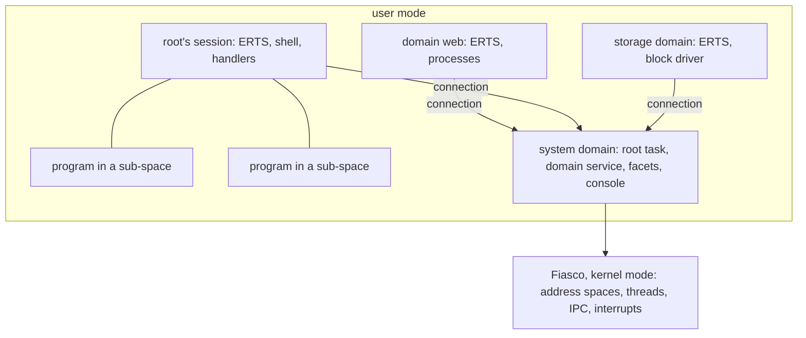
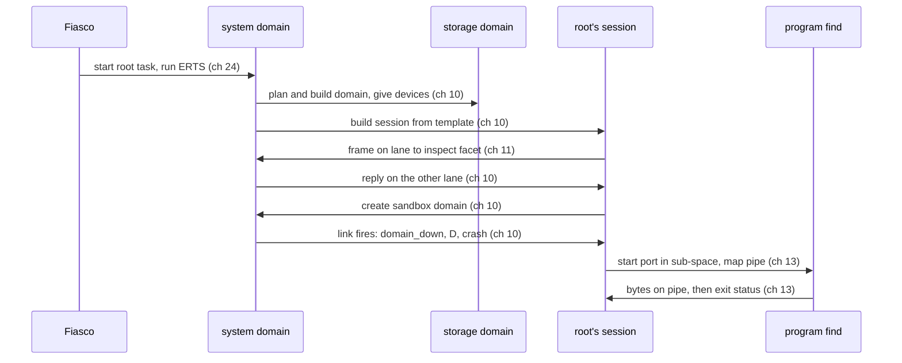

# Chapter 5. Design Overview of erXos

**Background needed.** Chapters [1](01-operating-systems.md) to
[4](04-history.md). Where this chapter uses a term they define, it
links back to it.

> **Status.** **Built**: a machine boots on Fiasco into the system
> domain, which starts the storage, network and display domains and
> logs root in at the console. Root can run shell commands and a
> pipeline of a native program and Erlang commands, read the system's
> state under `/proc`, inspect any process from the Erlang shell, and
> create a domain and see a link report its end. Memory and threads are
> held as records, and ending a domain ends everything charged to it.
> **Designed** and not built: memory limits that refuse a domain more,
> CPU limits per domain, rights on handles and handles that stay stale
> after their own close, a login that gives each person a domain of
> their own, and toybox's UNIX programs in the session's `/bin`.

A FreeBSD machine that runs a web shop has two worlds in it. One is
the kernel's: processes, file descriptors, sockets, a scheduler, a
`ps` listing. The other is the application's: inside the one
`beam.smp` process that `ps` shows, thousands of Erlang processes
serve requests, crash, restart and are replaced while they run.
Neither world sees into the other. When the shop is slow, the
operator asks the kernel about one process and Erlang about its
processes, and joins the answers by hand.

FreeBSD's kernel holds every facility, and processes reach it through
system calls. erXos is built another way. Its kernel is Fiasco, a
microkernel of the L4 family that knows nothing of Erlang
([chapter 2](02-microkernels.md#25-the-l4-family-and-fiasco)). Above
it, the machine is one Erlang system divided by walls. Every process a
user lists, links to or supervises is an Erlang process, and so are
the services, file systems and drivers.

This chapter is the map: the seven concepts the system is built from,
what runs where and what its failure reaches, a day in the life of a
machine, what that lets a person do, and the decisions and tensions
behind it.

## 5.1 Seven concepts, each with one owner

Take one Erlang process on a running machine: the one that serves
`/data` from the SD card. Seven questions about it have seven
different answers, and each answer is one of the concepts the whole
system is built from.

* *What is it?* A **process**: a pid, a mailbox, links and monitors.
* *Which wall is it behind?* The storage **domain**, an address space
  it shares with the other storage processes.
* *What runs it?* The storage domain's **runtime**, its own copy of
  ERTS.
* *Which threads give it CPU time?* Those of the storage domain's
  **group**.
* *Who pays for its memory?* The storage domain's **budget**.
* *What may it reach, and who may reach it?* Its domain's
  **capabilities**, such as the one for the SD card's interrupt, and
  the **exports** that let other domains send to it.
* *On whose behalf does it run?* The system's **principal**, which
  the **system manifest**, the one file that configures the machine,
  names for the storage domain.

Each concept is the unit of one thing: the process of execution and
failure, the domain of isolation, the budget of memory. And each has
exactly one **owner**, the part of the system that alone creates,
changes and ends it
([design.md, The model](../design.md#the-model)). Table 5.1 sets the
seven side by side.

| Concept | Unit of | What it is | Owner |
| --- | --- | --- | --- |
| process | execution and failure | a pid, a mailbox, links and monitors | its domain's runtime |
| domain | isolation | an Erlang node with an address space, a runtime, a budget and a group | the system domain |
| runtime | scheduling inside a wall | ERTS, switching between a domain's processes | its domain |
| group | CPU time | the threads a domain's runtime runs on | the root service |
| budget | memory | a record that pays for every object and page | the root service |
| capability | authority | a handle to a kernel object, or a domain's export | the root service; each runtime for its exports |
| principal | identity | a user, with a budget, quotas and sessions | the system domain's Erlang policy |

*Table 5.1. The seven concepts and their owners. No concept has two
owners, so no two parts of the system can disagree about one.*

### 5.1.1 Process

In erXos "process" always means an Erlang process: a pid, a heap of
its own, a mailbox, and links and monitors
([section 3.2](03-erlang.md#32-processes-and-messages)). Fiasco has
no processes, only address spaces and threads
([section 3.9.1](03-erlang.md#391-every-erlang-process-is-an-operating-system-process)).
So the machine has one kind of process, and every tool lists, traces
and ends that kind.

A pid prints as `<D.N.S>`, where `D` is the id of the process's
domain, never reused while the machine runs. So anyone can read from
a pid which wall the process is behind, and a pid left from a domain
that ended can never name a process of a new one
([design-domains.md, Domain ids, pids and references](../design-domains.md#domain-ids-pids-and-references)).
This is **Built**.

### 5.1.2 Domain

A **domain** is erXos's unit of isolation, a group of Erlang processes
behind one wall
([chapter 10](README.md#chapter-10-domains-a-wall-around-some-processes)).
The wall is an address space of its own. A stray pointer in a NIF,
the C code a module can link into ERTS
([section 3.5.4](03-erlang.md#354-bifs-nifs-and-ports)), corrupts
only its own domain.

A domain is also an Erlang node with a name, such as `storage@erxos`,
and its own atom table, loaded code and ETS tables. It has a budget, a
group and a **connection** to the system domain: a pair of lanes, one
each way, the only way two domains exchange messages
([section 1.7.4](01-operating-systems.md#174-talking-without-sharing)).
When a domain ends, every link and monitor to its processes fires.

The system domain owns every domain. Its **domain service**, in
Erlang, decides to create a domain, records it, and calls C code in
`liberx` to build it
([design-system.md, The domain library](../design-system.md#the-domain-library)).
No domain creates another directly. Domains each with their own ERTS,
started from the system manifest or on request, are **Built**.

### 5.1.3 Runtime

A domain's **runtime** is the code that schedules its processes. In
every domain it is ERTS, built from OTP 29.1.2 with erXos's changes
([section 3.5](03-erlang.md#35-the-beam-and-erts)). The runtime
belongs to its domain, and that is the point. It runs in user mode
inside the domain's address space, so a bug in it, or in code it
runs, damages that domain alone. Every domain runs its ERTS in user
mode, the system domain included.

Domains differ in one respect. An ERTS may compile each module to
machine code as it loads, with BeamAsm, the JIT compiler
([section 3.5.1](03-erlang.md#351-from-source-to-running-code)), or
interpret the BEAM's instructions one at a time. The system domain
always interprets, so no writer of machine code sits in the part every
domain trusts; another domain may be given the JIT
([design-runtime.md, BeamAsm](../design-runtime.md#beamasm)). This is
**Built**. The development manifests in `config/manifest/` start every
domain on the interpreter.

### 5.1.4 Group

A domain gets CPU time through the threads its runtime runs on. Those
threads form the domain's **group**, the unit of CPU time. erXos calls
them **executors**: each runs many Erlang processes in turn
([section 4.2.3](04-history.md#423-why-erxos-keeps-two-levels)). When
a domain has no work, its executors sleep until an interrupt, a
message or a timer brings some. One such event wakes one of them,
however many the domain has
([design-fiasco.md, The park protocol](../design-fiasco.md#the-park-protocol)).

On Fiasco a group is a record kept by the **root service**, the part
of the system domain that alone creates kernel objects
([section 2.5.3](02-microkernels.md#253-the-root-task)). Groups as
records, and the sleeping and waking of executors, are **Built**
(`liberx/backend/fiasco/group.c`, `liberx/backend/fiasco/park.c`).

The design limits each domain's CPU with three settings. A **priority
band** is a range of Fiasco priorities the domain's threads may use,
so a domain whose threads spin delays only its own band and those
below. A **CPU set** names the processors they may use, and a
**thread limit** caps how many there are
([design-fiasco.md, Threads, bands and stops](../design-fiasco.md#threads-bands-and-stops)).
These limits are **Designed** and not built. Every thread but the root's
watchdog thread runs at one priority, so a busy domain takes turns
with every other thread on its CPU
([chapter 9](README.md#chapter-9-processes-runtimes-and-two-level-scheduling)).

### 5.1.5 Budget

A **budget** is the unit of memory
([section 1.4.7](01-operating-systems.md#147-who-pays-for-memory)).
Every object and page the root service makes for a domain is charged
to one of its budgets, or bounded by the domain's limits. Each budget
is carved from its parent's, after the space banks of EROS
([section 4.3.4](04-history.md#434-eros-safe-erlang-and-zircon-authority-and-payment)).

The property every caller relies on is that **an object goes with its
budget**. Ending a domain is destroying its budgets, which deletes
everything charged to them at once. No list of objects is walked, and
no rule says who keeps a dead domain's objects alive
([design-fiasco.md, Budgets and groups as records](../design-fiasco.md#budgets-and-groups-as-records)).

Each domain gets two budgets. Its **own budget** pays for what the
domain alone uses, and ends with it. Its **outer budget** pays for
what another domain may still use after this one is gone, such as the
ring a peer reads on their connection; the domain holds no capability
to it. The split lets a domain end at once without pulling memory from
under a peer that still maps its side of a connection
([design-system.md, Ending a domain](../design-system.md#ending-a-domain)).

Budgets as records, which end everything charged to them, are
**Built**. Budgets as walls are **Designed** and not built. In the
design, a domain's budget sets aside memory no other budget can take,
and refuses the domain more once it is spent
([design-fiasco.md, Memory and budgets](../design-fiasco.md#memory-and-budgets);
[chapter 12](README.md#chapter-12-memory-and-budgets)).

### 5.1.6 Capability and export

A domain's authority has two forms.

The first is a **capability**, chapter 2's reference to a kernel
object
([section 2.3.2](02-microkernels.md#232-a-capability-is-a-reference-with-rights)).
A domain holds its capabilities as **handles**. A handle is a small
number, like a UNIX file descriptor, that indexes the root service's
handle table for that domain. Its entry names an object, such as an
address space, a thread or a device's interrupt, and records the
object's **generation**, a count that grows each time the root
service frees an object's record. So when an object is destroyed,
every handle to it answers `ERX_ESTALE` until it is closed, and never
names whatever object comes next. A closed number answers `ERX_EINVAL`
until it is reused, lowest first, as UNIX reuses descriptors, so a
program that uses a number after its own close reaches whatever object
took it next. Unlike chapter 2's
capabilities, handles carry no rights: whoever holds one may use its object, and only the object's creator
may destroy it (`liberx/backend/core/handles.h`). The design gives
handles rights that only shrink as a handle is passed, and a value
that carries the generation, so a use after the holder's own close
answers `ERX_ESTALE` too; that is designed and not built.

The second is an **export**, which does the same job for Erlang
processes. A domain reaches only the processes another domain exported
to it, and a domain exports a process by sending its pid, by spawning
it for the other domain, or by exporting it explicitly. Each runtime
keeps its own **export table** and checks every arriving message
against it
([section 3.9.2](03-erlang.md#392-distribution-across-a-domains-wall)).
A pid a domain guessed or overheard names nothing it may reach.

The root service owns handles. Each runtime owns its exports, so who
may send to a domain's processes depends on that domain alone, and on
nothing between it and the sender. Both are **Built**.

### 5.1.7 Principal

A **principal** is the unit of identity: a user in erXos's sense, with
a budget, quotas and sessions
([section 4.4.1](04-history.md#441-what-erxos-must-do)). A UNIX user
is a number the kernel compares on every file access. A principal is
a record in the system domain's Erlang policy, which decides what the
domains started for it receive. The kernel never sees it.

Each principal has a **session template**, which describes the domain
a session of that principal gets: its runtime, its Erlang release, its
limits and the services it may use. A **session** is a domain started
from that template, in which a person's shell, commands and programs
run. The system manifest's principals are **Built**: the system
principal, whose template gives root's session, and app principals
such as `ntpd` on the Raspberry Pi
(`config/manifest/raspi4b-development.txt`). A person who logs in and
gets a session domain of their own principal is **Designed** and not
built
([design-domains.md, Principals, sessions and quotas](../design-domains.md#principals-sessions-and-quotas)).

An app is a principal too, with a template of its own. It reaches a
machine as a **package**, one `.app` file. The file holds an
authenticated header, a read-only image of the app's files, and a hash
tree over the image's blocks, so a changed byte fails the read
([design-packaging.md, Where a package lies](../design-packaging.md#where-a-package-lies);
[chapter 23](README.md#chapter-23-apps-and-packages)). The packer is
**Built**. In the design a package lies in the system partition the
machine booted from, or, once a user installs it, in the data
partition's `packages/` directory. That is **Designed** and not built:
packages ride in the boot image.

### 5.1.8 Why each concept has exactly one owner

A concept with two owners needs a protocol between them, and every
such protocol has a moment when the two disagree.

UNIX shows the cost. A file's permission is checked at `open(2)`, not
at each later `read(2)`. When the file's owner removes a user's
access, a process that opened the file before keeps reading it. The
right to read has two owners, the file's mode and every open
descriptor. "Revoking access does not reach open files" is a rule
every caller must remember. erXos gives each concept one owner, so
"who decides this?" has one answer and one place in the code.
[Chapter 6](06-construction.md) shows how a single owner turns a list
of rules into a property that holds by construction.

## 5.2 What runs where

Where does each part run, and what does its failure reach? Fiasco
alone runs in kernel mode. Everything else runs in user mode, in one
of four kinds of place, each trusted by different parties and failing
in its own way: the system domain, an Erlang domain, a driver domain,
or a sub-space of a session
([design.md, Overview](../design.md#overview)).

Figure 5.1 draws the layers. Read it from the bottom.



*Figure 5.1. The layers of a running machine. Every box above Fiasco
runs in user mode, the system domain too. Programs hang from their
session and reach nothing else; domains reach each other only over
connections. Connections between two introduced domains, such as the
session and storage, are left out.*

### 5.2.1 Fiasco, the only code in kernel mode

Fiasco provides address spaces, threads, IPC, interrupts and
capabilities, and knows nothing of Erlang, domains or budgets
([section 2.5.2](02-microkernels.md#252-fiasco-and-l4re)). Every
program reaches it through `liberx`, erXos's C library for kernel
calls, whose calls and status codes are erXos's own
([section 2.5.4](02-microkernels.md#254-why-erxos-uses-fiasco-and-liberx-above-it);
[chapter 8](08-kernel-interface.md#82-liberx-the-one-issuer-of-kernel-calls)).

Everything trusts Fiasco, so a bug in it is every domain's bug.
Nothing a domain does may panic it. That rests on Fiasco's own code,
and on erXos's fuzz campaign, which feeds the system calls random and
malformed arguments to find any that do
([design-fiasco.md, Contract](../design-fiasco.md#contract)).

### 5.2.2 The system domain

The **system domain** is the root task: the program Fiasco starts
with every initial capability
([section 2.5.3](02-microkernels.md#253-the-root-task)). It runs ERTS
on the interpreter. Three kinds of code live in it.

* The root service, C code in `liberx`: the only creator of kernel
  objects and the only writer of any address space's mappings. Every
  other program asks it, through `liberx`, to make a thread or map a
  page.
* The **domain library**, C code in `liberx` that the domain service
  calls to plan, build and end domains.
* The **system services**, in Erlang. They include the domain service;
  the device service, which gives each device to the domain the
  manifest names; the facets; the console; the inspector; and the
  host link to the developer's machine.

Every domain trusts the system domain twice: to decide fairly who
gets what, and to have built the domain correctly. So it is kept
small. It runs the interpreter, which slows its bounded control work
little
([design.md, Decisions](../design.md#decisions)). No network device
or service is given to it, so no packet from outside the machine is
parsed in it.

A fault in the system domain cannot be contained, since every other
domain's address space is its child. The system writes a **crash
record**, the faulting address and registers among it, to the console
and resets the machine. No record survives the reset; the console's
copy is the only one
([design-fiasco.md, The end path](../design-fiasco.md#the-end-path)).
The system domain on Fiasco, its end path included, is **Built**.

### 5.2.3 Erlang domains

An **Erlang domain** runs one ERTS and the Erlang code of one purpose:
a web front end, a session, an app. Its code may be untrusted. It
trusts Fiasco and the system domain, and its own runtime decides who
may send to its processes.

When a NIF faults, the runtime crashes or runs out of memory, or the
domain is stopped, the domain service ends it by destroying its
budgets. Every link and monitor to its processes fires with the
reason `{domain_down, D, Info}`, where `D` is the domain and `Info`
says how it ended
([design.md, Overview](../design.md#overview)). The log gets one line
naming where a fault struck: the instruction, the cause and the
address. Both are **Built**
(`erlang/apps/erx_domain/src/erx_domain_links.erl`;
[README.md, Current status](../../README.md#current-status)).

### 5.2.4 Driver domains

A **driver domain** is an Erlang domain that holds devices. Its
drivers are Erlang processes under supervisors, over the **device
NIF**: the one module through which Erlang reaches a device's
registers, buffers and interrupts. The device NIF's C parses nothing
the device wrote
([design-runtime.md, The device NIF](../design-runtime.md#the-device-nif)).
Parsing happens in Erlang, where a bad value crashes a process instead
of corrupting memory.

What a driver's crash reaches depends on how its supervisors are
arranged. When the network driver ends, its supervisor starts it
again and resets the device, and the rest of the network domain runs
on (`erlang/apps/erx_net/src/erx_net_sup.erl`). The block driver is
not restarted alone. Its end ends the storage domain, and the domain
service starts the domain again whole, with its device
(`erlang/apps/erx_blk/src/erx_blk_sup.erl`). A fault in the device NIF
ends its domain, as any NIF fault does. The storage, network and
display domains are **Built** (the development manifests in
`config/manifest/`).

A driver domain is trusted for one thing more. A device that writes
memory directly, by DMA, writes wherever its driver aims it, unless an
IOMMU confines it
([section 1.5.4](01-operating-systems.md#154-direct-memory-access)).
No device on QEMU `virt` or the Raspberry Pi 4 sits behind an IOMMU.
On those machines a driver domain that misbehaves can make its device
write anywhere in memory, so every domain trusts each driver domain
that far
([design-fiasco.md, Devices](../design-fiasco.md#devices)).

### 5.2.5 Programs in sub-spaces

A native **program**, C compiled against erXos's C library, runs in a
**sub-space** of its session's domain: an address space the domain
creates for it, which holds only what the session gives it and ends
with its creator. The program trusts its session for everything it
reaches, and has no domain id, connection or facet. Its whole world is
the memory the session mapped for it and one **channel**, a pair of
lanes to its **handler**, the session's process that serves its
requests
([design-programs.md, A program is a port](../design-programs.md#a-program-is-a-port)).
When it opens a file, its C library sends the request on the channel,
and the handler checks it and serves it with the session's authority.

To the session's Erlang code, a program is a port
([section 3.5.4](03-erlang.md#354-bifs-nifs-and-ports)). When it ends,
by exit or fault, its sub-space ends, with every sub-space it started,
and the port's owner gets `{exit_status, N}`. Programs in sub-spaces,
with pipes, are **Built**: the command shell runs a program from the
session's `/bin`, alone or in a pipeline with Erlang commands. A
program does not read the terminal
([README.md, Current status](../../README.md#current-status)).

### 5.2.6 What a failure reaches

Table 5.2 gathers the five kinds of place.

| Part | Runs | Trusted by | When it fails |
| --- | --- | --- | --- |
| Fiasco, kernel mode | address spaces, threads, IPC, interrupts | everything | a bug is everyone's bug |
| system domain | the root service, the domain library, the system services | every domain | the machine resets |
| Erlang domain | one ERTS and one purpose's Erlang code | itself | the domain ends; links fire with `{domain_down, D, Info}` |
| driver domain | ERTS and supervised drivers over the device NIF | itself; others as far as its devices' DMA is unconfined | the driver restarts, or the whole domain does; a NIF fault ends the domain |
| program | one native program in a sub-space | itself; its session | its sub-space ends, with its children; the port's owner gets `{exit_status, N}` |

*Table 5.2. What runs where, who trusts it, and how far a failure
reaches.*

Failure is contained at three nested levels, each with its own
recovery: a process restarted by its supervisor, a domain ended and
reported to its links, the machine reset. Erlang already had the
first. The domain adds the second. Only the system domain's failure
reaches the third. A conventional system has the third level, the
kernel panic, and no second.

## 5.3 A day in the life

How do these parts work together? This section follows one machine
through boot, a session, a message to a service, a crash and a
pipeline. Each step names the chapter that explains it and says
whether it is built.

> **Background: the boot image.** A machine starts from whatever its
> boot loader finds. On erXos that is one **bootable file**: Fiasco's
> first stage, `bootstrap`, with the **boot image** inside it. The
> boot image is one archive holding everything the machine starts
> with: Fiasco's kernel, the root task, ERTS, the system manifest and
> the Erlang releases of the configured domains
> ([design-fiasco.md, Boot handoff](../design-fiasco.md#boot-handoff)).
> A FreeBSD machine reads its kernel and modules from a file system;
> an erXos machine needs none until the storage domain is up.

### 5.3.1 Power-on to the first Erlang process

The boot loader loads the bootable file, and `bootstrap` runs. It
finds the archive, checks each file it needs, and places Fiasco's
kernel, `sigma0` (Fiasco's first memory server) and the root task. It
checks every range before it moves a byte, so a bad image stops the
boot with a reason on the console and nothing copied
([design-fiasco.md, Boot handoff](../design-fiasco.md#boot-handoff)).

Fiasco starts the root task, the system domain's first program. Its
one thread reads the record `bootstrap` left, opens the archive, reads
the system manifest and accepts the firmware's device tree
([section 1.5.6](01-operating-systems.md#156-finding-the-devices)).
It takes the machine's memory into the root service's pool, starts the
root service, and runs
ERTS through the start path of musl, the C library ERTS is built on
(`liberx/backend/fiasco/root.c`). ERTS boots OTP's `kernel` and
`stdlib`, then the system release, and a development build prints
`development build: trusted code only`. All of this is **Built**
([chapter 24](README.md#chapter-24-startup-configuration-and-shutdown)).

### 5.3.2 The system domain starts the configured domains

> **Background: the system manifest.** A **manifest** is a file that
> lists what a whole is made of. The system manifest lists every
> configured domain with its principal, runtime image, limits, devices
> and facets
> ([section 4.5.4](04-history.md#454-declarative-where-it-simplifies)).
> The build packs it into the boot image. A build check proves its
> security properties first, such as that no domain parsing hostile
> input holds a device whose DMA is unconfined
> ([design-system.md, The manifest](../design-system.md#the-manifest)).

The system release starts the domain service, which starts each domain
the manifest lists. For each, the domain library plans the whole
domain first. The plan holds two budgets, a group, an address space
whose parent is the system domain's, a connection to the system
domain, the runtime image and the release. The library creates nothing
until the whole plan checks, and a failure part way destroys the
budgets and leaves nothing behind
([design-system.md, Creating a domain](../design-system.md#creating-a-domain)).

The device service gives each device to the domain the manifest names,
such as the SD card to the storage domain, and each domain's ERTS
boots its own small release as a node. Domain creation from the manifest is **Built**
([chapter 10](README.md#chapter-10-domains-a-wall-around-some-processes);
[chapter 15](README.md#chapter-15-devices-and-drivers)).

### 5.3.3 A session starts

The console starts a session for its line's principal. In a
development build that is `root`, logged in at the serial line. The
domain service builds a session domain from the system principal's
session template, and the command shell, `rc`, prints its prompt
(`erlang/apps/erx/src/erx_console.erl`). Root's session domain,
started at boot, is **Built**.

In the design, a person logs in at a console line with a name and a
passphrase, and gets a session domain of their own principal, a node
such as `alice@erxos`. Logins and per-person session domains are
**Designed** and not built
([design-live.md, The console](../design-live.md#the-console)).

### 5.3.4 A message to a service, through a facet

Inside the session, ERTS moves a message between heaps with no kernel
call. A message to another domain goes through a connection. Take a
command that reads the clock's state:

```sh
% cat /proc/time/status
```

`cat` is an Erlang command. The inspector in the system domain serves
`/proc`, and the session reaches it through its `inspect` **facet**: a
process in the system domain that stands for this session's right to
use one service, and admits only what that right allows
(`config/manifest/development.txt`). The session is introduced to the
facet, never to the inspector, so the facet's limits are the
session's. The request goes as follows.

1. The session's ERTS encodes it as a frame
   ([section 3.6.3](03-erlang.md#363-how-a-message-crosses-between-nodes))
   and writes it into the ring of its lane toward the system domain.
2. If the system domain's executors are asleep, the session rings the
   lane's **doorbell**, an interrupt object of Fiasco's, to wake one.
3. The system domain's funnel, the one reader of its lanes
   ([section 3.9.2](03-erlang.md#392-distribution-across-a-domains-wall)),
   copies the frame out of the ring before it looks at it. The sender
   can still write the ring, and the copy keeps it from changing the
   frame between the check and the use. The funnel then checks that
   the frame is well formed and that its target is exported to the
   sending domain, and decodes it. The lane, not a field in the frame,
   says who sent it.
4. The facet admits the request only if the session has fewer requests
   in flight than its limit
   ([design-domains.md, Facets](../design-domains.md#facets)). The
   design also admits it only while the session has system-domain
   time left this period; that check is designed and not built.
5. The inspector answers. The reply returns on the other lane, through
   the session's own funnel, to `cat`, which prints it.

Connections, the funnel, exports, facets and `/proc/time/status` are
**Built** ([README.md, Current status](../../README.md#current-status)).
The funnel sits with the receiver, so the party that bears the cost
of a bad frame checks it, on its own CPU time. No third party stands
between two domains where its failure could reach either
([chapter 10](README.md#chapter-10-domains-a-wall-around-some-processes);
[chapter 11](README.md#chapter-11-authority-and-security)).

### 5.3.5 A domain crashes, and a link reports it

From the Erlang shell, root creates a small domain with
`erx_domain:create/1` and spawns a process into it with a link. Then
that domain's runtime crashes, as an ERTS fatal error crashes it: an
assertion fails, or a table runs out. The runtime's end reaches the
domain library, which reports it to the domain service. The domain
service ends the domain by destroying its budgets, which deletes every
object the domain paid for at once, and takes its connections down.
The shell's process, linked to the process in the dead domain,
receives the exit signal `{domain_down, D, crash}`.

Nothing had to find the dead domain's objects one by one: the budget
was the list. And the shell learned of the crash through an ordinary
Erlang link. Creating a domain from Erlang, ending it by its budgets
and delivering `{domain_down, D, Info}` to links are **Built**
(`erlang/apps/erx_domain/src/erx_domain.erl`,
`erlang/apps/erx_domain/src/erx_domain_links.erl`).

### 5.3.6 A pipeline of a program and a command

Root types a pipeline into the command shell. `find` here is one of
toybox's BSD-licensed UNIX commands, which the session's `/bin` holds
in the design. Toybox is **Designed** and not built; the port and pipe
under it are built, for any program a build puts in `/bin`.

```sh
% find /tmp -type f | wc -l
```

`find` is a native program; `wc` is an Erlang command. The session
starts `find` as a port: a sub-space with a channel to a new handler.
It maps into the sub-space, as standard output, a **pipe**: a one-way
byte stream held in a ring that the session's pipe server makes. `wc`
runs as an Erlang process of the session. The pipe's other end is
held by a **pump**, an Erlang process of the shell's program starter,
which reads what `find` writes and passes the bytes on to `wc`
through the shell's own pipe between the two stages
(`erlang/apps/erx_shell/src/erx_shell_program.erl`). When `find`
has exited and the pump has passed on all it wrote, the shell puts
`find`'s exit status in `$status`, and `wc` sees the end of its
input and prints its count.

The end of the stream is the subtle part. On UNIX the kernel tracks
when every descriptor for the write end is closed. On erXos the
session itself hands every pipe end to every program and command it
starts, so it knows who holds each, and the end of the stream follows
([design-pipes.md](../design-pipes.md)). Programs in pipelines with
Erlang commands are **Built**
([README.md, Current status](../../README.md#current-status);
[chapter 13](README.md#chapter-13-native-programs-pipes-and-posix-lite);
[chapter 20](README.md#chapter-20-the-command-shell-and-the-unix-surface)).

### 5.3.7 The day as one diagram

> **Background: reading a sequence diagram.** A sequence diagram shows
> messages over time. Each column is one participant, named at the
> top, and time runs downward. An arrow between columns is one message
> or call, labelled with what it carries. Read it top to bottom, one
> arrow at a time.

Figure 5.2 draws the day. Each label ends with the chapter that
explains the step.



*Figure 5.2. A day in the life. Every step between domains goes
through the system domain or over a connection it made; a program
talks only to its session. Every step is built except the program
`find`, a toybox applet, which is designed.*

## 5.4 Signature experiences

What can a person do on erXos that a conventional system does not
offer? The architecture names a handful of experiences
([design.md, Signature experiences](../design.md#signature-experiences)).
Each is shown as a sketch of what the reader types; outputs are left
out.

### 5.4.1 The shell is the operating system

From the Erlang shell, every process the session's inspect facet
covers, in every domain, can be inspected and traced. Sketch:

```erlang
1> erx:i().
2> erx:source(Pid).
3> erx:trace(Pid).
```

`erx:i()` shows CPUs, threads, groups, domains, budgets and processes
as live records, each value marked with who reported it.
`erx:source(Pid)` opens the source line a process is executing. A
value Fiasco cannot measure, such as another domain's budget, reads as
unsupported, never as a made-up number. All three are **Built**
([README.md, Current status](../../README.md#current-status)).

### 5.4.2 The machine is an object you edit

`tools/erx watch`, on the developer's Mac, recompiles a module when
its source changes and loads it over the host link into the running
machine, which replaces the old version as
[section 3.6.1](03-erlang.md#361-two-versions-of-a-module) describes,
with no reboot. This is **Built**.

### 5.4.3 A driver is a process

A driver is an Erlang process, so it can be killed like one. Kill the
network driver's process in the middle of a transfer, and its
supervisor starts it again and resets the device, while the rest of
the network domain runs on. Sketch:

```erlang
1> exit(NetDriver, kill).
```

Kill the block driver instead, and the storage domain restarts whole.
A QEMU test does this in the middle of a transfer and finds each file
it kept cut at a `sync`, never corrupt. Both are **Built**
(`erlang/apps/erx_net/src/erx_net_sup.erl`;
[README.md, Current status](../../README.md#current-status)). On
FreeBSD either driver is kernel code, and its crash is a kernel panic.

### 5.4.4 A wall around some processes

Section 5.3.5 showed a domain's crash reported through a link. The
wall works the other way too: inside such a domain, build a pid of
another domain by hand and send to it, and nothing happens. The
receiver's funnel drops the message as if the process were dead, so
the sender cannot learn whether it exists. This is **Built**.

### 5.4.5 UNIX tools over live Erlang state

The command shell's commands are Erlang commands that follow FreeBSD's
output, and `/proc` shows the inspector's state as files. Sketch:

```sh
% ps | wc -l
% top
```

`ps` lists the session's Erlang processes in FreeBSD's columns, `wc`
counts the lines, and `top` refreshes the listing. These are
**Built**.

### 5.4.6 A user with a domain of their own

A person logs in and gets a domain with their own memory and CPU
limits; exhausting either ends or slows only that domain. This is
**Designed** and not built, on three counts: logins with a session
domain per person, budgets as walls, and priority bands and CPU sets.

## 5.5 Four decisions every chapter assumes

Which choices does every later chapter assume? The architecture
records several dozen decisions that cross subsystems
([design.md, Decisions](../design.md#decisions)). Beyond the three
this chapter has shown (runtimes in user mode, messages checked by
the receiver, budgets as space banks), four are needed to read any
later chapter.

**`liberx` is the only issuer of kernel calls.** Every program, every
ERTS and the root task reach Fiasco through `liberx`, whose calls are
generated from one file, `abi/erx_abi.txt`. Nothing above `liberx`
sees Fiasco's names, so Fiasco's model never leaks into Erlang code
([design-runtime.md, liberx](../design-runtime.md#liberx);
[chapter 7](07-one-source.md#72-the-abi-file)).

**Every domain is a node.** Each domain is an Erlang node, with its
domain id as the node's creation number, the field that tells apart
two lives of a node with the same name. Stock distribution's identity
then does the work of section 5.1.1: a pid is unique, says where it
lives and goes stale safely. The differences from stock OTP, such as
sending to a registered name in another domain, are documented and
tested
([design-domains.md, Domain ids, pids and references](../design-domains.md#domain-ids-pids-and-references)).

**System code is Erlang, drivers included.** Every connection, file
and device is an inspectable, supervised process, and a parsing bug
crashes a process instead of corrupting memory. C is kept for the
device NIF and for per-byte work such as checksums and bulk copies. A
native driver exists only as a row of the driver table, with the
measurement that justifies it
([design-system.md, The driver table](../design-system.md#the-driver-table)).

**Formats are erXos's own.** The boot image, the kernel interface, the
host link protocol and the inspector's schema are defined by erXos.
Where a standard fits, erXos implements it: files travel in 9P2000.L,
Plan 9's file protocol. A component erXos uses, Fiasco included, sits
behind one of these interfaces and never shows its own data model
above it ([design.md, Formats](../design.md#formats)).

Behind all of them sits the shape of section 5.1: one owner per
concept, and one route to each operation.

## 5.6 Tensions and alternatives

Where does the design pull against itself, and what larger designs
did it turn down
([design.md, Tensions](../design.md#tensions))?

### 5.6.1 Performance against isolation

A message inside a domain is a copy between two heaps. A message
between domains is an encode, a copy into a ring, perhaps a doorbell,
a copy out by the funnel, and a decode. A design that put every
component in a domain of its own would pay that price everywhere.
erXos does not: a domain is a tool for trust, and the processes of
one purpose share one. A
runtime per domain also costs memory, since each domain holds its own
atoms, code and tables. No measurement of a crossing's cost on Fiasco
has been recorded.

### 5.6.2 Erlang against C

A driver in Erlang can be inspected, traced and replaced while it
runs. The price is latency: an interrupt reaches its handler through
the runtime's scheduler, not straight from the kernel. And since
devices are grouped into driver domains by configuration, a fault in
the device NIF ends the whole group. The driver table settles the
tension case by case, by measurement.

### 5.6.3 A trusted base above the kernel

Every user must trust the system domain, and its fault resets the
machine. A separate small native root task could restart the system
domain after a fault while other domains run on. erXos turns that
down. It would need a second trusted program with its own protocol,
and rules for handing authority and devices back after the restart,
and that program's fault would still end the machine. erXos takes the
reset instead, as OTP's `heart` restarts a node
([design.md, Alternatives considered](../design.md#alternatives-considered)).

### 5.6.4 A familiar surface over a different model

erXos looks like UNIX: `ls`, `cat`, `ps` and `service` behave as
FreeBSD's do. But a path is resolved in the domain's **namespace**,
its private table from paths to the file servers it was given, with
no machine-wide root; a process is an Erlang process, and a user is a
principal. Each familiar name must behave as it promises, or take a
name of its own
([section 4.5.5](04-history.md#455-unix-look-and-feel-honestly)). So
the command shell's pipes carry text, as UNIX's do, while structured,
live values belong to the Erlang shell and the inspector.

### 5.6.5 Shared services and shared CPU

Fiasco charges each thread on its own and gives no domain a share of
a CPU, so CPU time between domains is a matter of priority, not of
fraction
([design-fiasco.md, The scheduler on Fiasco](../design-fiasco.md#the-scheduler-on-fiasco)).
A service such as storage runs on its own threads, never its clients'.
Some kernels lend a client's CPU time to the service that works for
it; erXos does not, so nothing must work out who pays. The price is
that a saturated service slows all its clients together.

### 5.6.6 The large alternatives

Four whole designs would each have been simpler to start. Each lost
for a reason that names something erXos is for.

**Linux underneath.** erXos could run one Erlang node on Linux, as
Nerves does, or each domain as a stock node over TCP distribution.
Either is a conventional kernel running Erlang nodes. The kernel's
processes and Erlang's stay two worlds, and the kernel sees nothing of
supervision or of who may message whom
([design.md, Alternatives considered](../design.md#alternatives-considered)).
erXos keeps stock distribution's meaning between domains, but on
connections the system domain makes, with each runtime's export table
as the authority
([design-domains.md, Alternatives considered](../design-domains.md#alternatives-considered)).

**POSIX as the base.** erXos could have made a POSIX kernel and run
ERTS on it as one more program. The UNIX process, not the Erlang
process, would then be what the system knows, and drivers and file
systems would be kernel code again. erXos keeps POSIX as a layer for
recompiled programs in sub-spaces, over musl with FreeBSD's error and
signal numbers, and does not run Linux binaries unmodified
([design-programs.md, Alternatives considered](../design-programs.md#alternatives-considered)).

**One runtime for the whole machine.** ERTS could run in kernel mode
as the only scheduler. Every process switch would become a kernel
dispatch, a JIT compiler would run in kernel mode, and no second
runtime or native program would fit. erXos keeps two levels: the
kernel schedules threads, and each runtime schedules its own processes
on them
([section 4.2.3](04-history.md#423-why-erxos-keeps-two-levels)).

**A verifier instead of hardware protection.** All code could share
one address space, kept apart by a verifier that proves before it runs
that code touches only its own memory, as Singularity kept processes
apart by a type-safe language. ERTS has no verifier and trusts the
code it loads. A verifier is itself attack surface, as the bugs found
in Linux's verifier for programs loaded into its kernel show. And the
CPU's speculative execution leaks data across any boundary drawn only
by a language inside one address space. erXos runs untrusted code only in a domain
of its own, where it can corrupt only that domain's runtime
([design.md, Why no verifier](../design.md#why-no-verifier)).

## 5.7 Summary

erXos is built from seven concepts, each with one owner. Fiasco is
the only code in kernel mode; the system domain, as root task, creates
every kernel object and builds every domain; every runtime runs in
user mode. Failure is contained at three levels: a process, a domain,
the machine. A message between domains travels on a connection the
system domain made, and the receiver's funnel checks it against its
own export table. A program reaches nothing but its session.
[Chapter 6](06-construction.md) shows how one owner per
concept and one route to each operation turn lists of rules into
properties that hold by construction.

## 5.8 Where to read next

* [overview.md](../overview.md): the system in a few pages.
* [design.md](../design.md), sections
  [The model](../design.md#the-model),
  [Overview](../design.md#overview),
  [Decisions](../design.md#decisions),
  [Tensions](../design.md#tensions),
  [Alternatives considered](../design.md#alternatives-considered) and
  [Trust placement](../design.md#trust-placement): the concepts, the
  layers, every cross-cutting decision with its reason, every design
  turned down, and what each isolation property depends on.
* [design-fiasco.md](../design-fiasco.md): how the system runs on
  Fiasco, with its budgets, bands and boot.
* [design-domains.md](../design-domains.md) and
  [design-system.md](../design-system.md): domains, connections,
  facets and the system domain.
* Marshall Kirk McKusick, George V. Neville-Neil and Robert N. M.
  Watson, *The Design and Implementation of the FreeBSD Operating
  System*, 2nd ed., Addison-Wesley, 2014: chapter 2, the design
  overview of a conventional kernel, the model this chapter sets
  erXos against.
* Galen Hunt and James Larus, "Singularity: Rethinking the Software
  Stack", ACM SIGOPS Operating Systems Review 41(2), 2007: isolation
  by language safety, the alternative of section 5.6.6.
