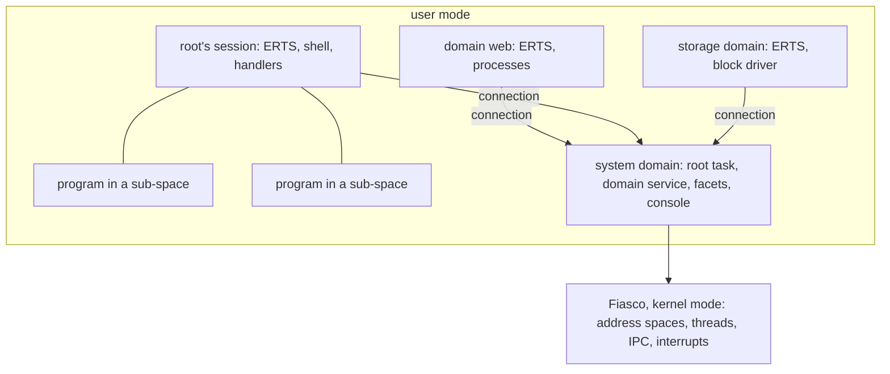
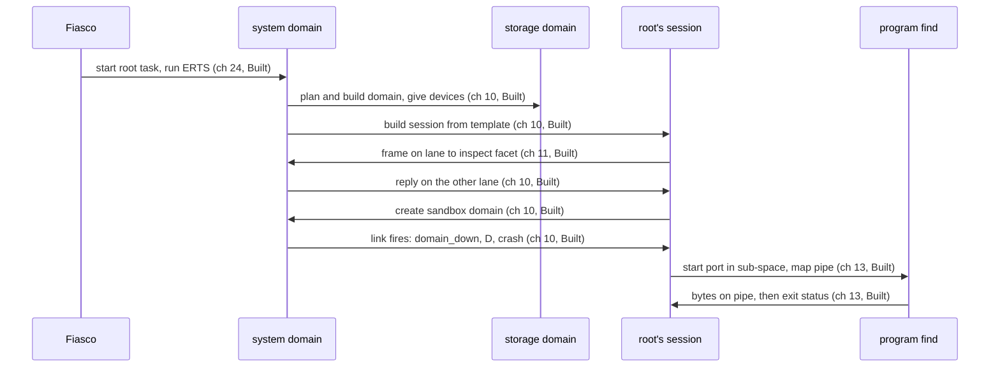

# Chapter 5. Design Overview of erXos

**Background needed.** Chapters [1](01-operating-systems.md) to
[4](04-history.md). This chapter uses their terms without defining
them again: address space, capability, root task, Erlang process,
link, supervisor, node, domain, budget. Each links back where it first
appears.

> **Status.** The system domain as root task on Fiasco, domains each
> with its own ERTS, connections, the funnel, exports, facets, the
> command shell, programs in sub-spaces with pipes, the storage,
> network and display domains, root's session, `/proc` and the
> inspector are **Built**. So are budgets as records that end
> everything charged to them, and groups as records that hold a
> domain's threads. Budgets that refuse a charge past their limit,
> priority bands and per-domain CPU sets, a login that gives each
> person a domain, and toybox's applets as the session's UNIX programs
> are **Designed**. Section 5.3 marks each step of its walk-through.

A FreeBSD machine that runs a web shop has two worlds in it. One is
the kernel's: processes, file descriptors, sockets, a scheduler, a
`ps` listing. The other is the application's: inside the one
`beam.smp` process that `ps` shows, thousands of Erlang processes
serve requests, crash, restart and are replaced while they run.
Neither world sees into the other. When the shop is slow, the
operator asks the kernel about one process and Erlang about its
processes, and joins the answers by hand.

FreeBSD's design overview, chapter 2 of McKusick, Neville-Neil and
Watson's book, lays out one model: a kernel that holds every facility,
and processes that reach it through system calls. erXos lays out
another. Its kernel is Fiasco, a microkernel of the L4 family that
knows nothing of Erlang
([chapter 2](02-microkernels.md#25-the-l4-family-and-fiasco)). Above
it, the machine is one Erlang system divided by walls. Every process a
user lists, links to or supervises is an Erlang process, and so are
the services, file systems and drivers.

This chapter is the map. Section 5.1 names the seven concepts the
system is built from and the owner of each. Section 5.2 says what runs
where, who trusts it and what its failure reaches. Section 5.3 follows
the machine through a day, from power-on to a pipeline. Section 5.4
shows what a person can do on erXos that a conventional system does
not offer. Section 5.5 tours the decisions every later chapter
assumes, and 5.6 names the design's tensions and the alternatives it
turned down.

## 5.1 Seven concepts, each with one owner

What must a reader hold in mind to follow any part of erXos? Seven
concepts: process, domain, runtime, group, budget, capability and
principal. Each is the unit of one thing, and each has exactly one
owner, the part of the system that alone creates, changes and ends it
([design.md, The model](../design.md#the-model)).

### 5.1.1 One process, seen seven ways

Take one Erlang process on a running machine: the one that serves
`/data` from the SD card. Each concept answers a different question
about it.

* *What is it?* A **process**: a pid, a mailbox, links and monitors.
* *Which wall is it behind?* The storage **domain**, an address space
  it shares with the other storage processes.
* *What runs it?* The storage domain's **runtime**, its own copy of
  ERTS.
* *Which threads give it CPU time?* Those of the storage domain's
  **group**.
* *Who pays for its memory?* The storage domain's **budget**.
* *What may it reach, and who may reach it?* Its domain's
  **capabilities**, such as those to the SD card's registers, and the
  **exports** that let other domains send to it.
* *On whose behalf does it run?* The system's **principal**, which
  the system manifest names for the storage domain.

Figure 5.2 sets the seven side by side.

| Concept | Unit of | What it is | Owner |
| --- | --- | --- | --- |
| process | execution and failure | a pid, a mailbox, links and monitors | its domain's runtime |
| domain | isolation | an Erlang node with an address space, a runtime, a budget and a group | the system domain |
| runtime | scheduling inside a wall | ERTS, switching between a domain's processes | its domain |
| group | CPU time | the threads a domain's runtime runs on | the root service |
| budget | memory | a record that pays for every object and page | the root service |
| capability | authority | a kernel object reference with rights, or a domain's export | Fiasco and the root service; each runtime for its exports |
| principal | identity | a user, with a budget, quotas and sessions | the system domain's Erlang policy |

*Figure 5.2. The seven concepts and their owners. No concept has two
owners, so no two parts of the system can disagree about one.*

### 5.1.2 Process

In erXos "process" always means an Erlang process: a pid, a heap of
its own, a mailbox, and links and monitors
([section 3.2](03-erlang.md#32-processes-and-messages)). Fiasco has
no processes, only address spaces and threads
([section 3.9.1](03-erlang.md#391-every-erlang-process-is-an-operating-system-process)).
So the machine has one kind of process, and every tool lists, traces
and ends that kind.

A pid names the domain its process lives in. It prints as `<D.N.S>`,
where `D` is the domain's id, never reused while the machine runs.
Any part of the system can read from a pid which wall the process is
behind, with no registry to ask. And a pid left from a domain that
ended can never name a process of a new one
([design-domains.md, Domain ids, pids and references](../design-domains.md#domain-ids-pids-and-references)).
The domain's runtime owns its processes: it alone creates, schedules
and ends them. This is **Built**.

### 5.1.3 Domain

A **domain** is erXos's unit of isolation, a group of Erlang processes
behind one wall
([chapter 10](README.md#chapter-10-domains-a-wall-around-some-processes)).
The wall is an address space of its own. A stray pointer in a NIF,
the C code a module can link into ERTS
([section 3.5.4](03-erlang.md#354-bifs-nifs-and-ports)), corrupts
only its own domain.

A domain is also an Erlang node with a name, such as `storage@erxos`,
and its own atom table, loaded code and ETS tables. It has a budget, a
group and a connection to the system domain. It has one **domain
pid**, a process that stands for the whole domain: linking to it is
linking to the domain, and when the domain ends, every link and
monitor to it fires.

The system domain owns every domain. Its **domain service**, in
Erlang, decides to create a domain and records it. Its **domain
library**, C code in `liberx` that the service calls, plans the domain
whole and then builds it
([design-system.md, The domain library](../design-system.md#the-domain-library)).
No domain creates another directly. Domains each with their own ERTS,
started from the system manifest or on request, are **Built**.

### 5.1.4 Runtime

A domain's **runtime** is the code that schedules its processes. In
every domain it is ERTS, built from OTP 29.1.2 with erXos's changes
([section 3.5](03-erlang.md#35-the-beam-and-erts)). A domain runs one
of three runtime images. The system image is the interpreter with no
JIT compiler, the part of ERTS that turns Erlang code into machine
code as it loads. The interpreter image adds the cryptography library.
The BeamAsm image has the JIT compiler
([design-runtime.md, BeamAsm](../design-runtime.md#beamasm)).

The runtime belongs to its domain, and that is the point. It runs in
user mode inside the domain's address space, so a bug in it, or in
code it runs, damages that domain alone. Every domain runs its ERTS in
user mode, the system domain included. This is **Built**. The
development manifests start every domain on the interpreter
(`config/manifest/development.txt`).

### 5.1.5 Group

A **group** is the unit of CPU time: the threads a domain's runtime
runs its processes on. erXos calls these threads **executors**: each
runs many Erlang processes in turn
([section 4.2.3](04-history.md#423-why-erxos-keeps-two-levels)). When
a domain has no work, its executors **park**: they sleep on the group
until an interrupt, a message or a timer brings work. Because they
park on the group and not each on its own, one event wakes the domain
however many executors it has
([design-fiasco.md, The park protocol](../design-fiasco.md#the-park-protocol)).

On Fiasco a group is a record kept by the **root service**, the
thread of the system domain that alone creates kernel objects
([section 2.5.3](02-microkernels.md#253-the-root-task)). Groups as
records and the park protocol are **Built**
(`liberx/backend/fiasco/group.c`, `liberx/backend/fiasco/park.c`).

What a group may spend is its domain's **grant**. On Fiasco a grant is
three limits: a priority band, the run of Fiasco priorities the
domain's threads start in; a CPU set, the processors they may use; and
a thread limit
([design-fiasco.md, Threads, bands and stops](../design-fiasco.md#threads-bands-and-stops)).
A domain that spins then delays only its own band and those below.
The grant is **Designed** and not built. Every thread but the
watchdog's runs at one priority, so a busy domain takes turns with
every other thread on its CPU
([chapter 9](README.md#chapter-9-processes-runtimes-and-two-level-scheduling)).

### 5.1.6 Budget

A **budget** is the unit of memory
([section 1.4.7](01-operating-systems.md#147-who-pays-for-memory)).
Every object and page the root service makes for a domain is charged
to one budget, and each budget is carved from its parent's, after the
space banks of EROS
([section 4.3.4](04-history.md#434-eros-safe-erlang-and-zircon-authority-and-payment)).

The property every caller relies on is that **an object goes with its
budget**. Ending a domain is destroying its budget, which deletes
everything charged to it at once. No list of objects is walked, and no
rule says who keeps a dead domain's objects alive
([design-fiasco.md, Budgets and groups as records](../design-fiasco.md#budgets-and-groups-as-records)).

Each domain gets two budgets. Its **own budget** pays for what the
domain alone maps, and ends with it. Its **outer budget** pays for
what other domains map on its behalf, such as the rings of its
connections, and the domain holds no capability to it. The split
keeps a domain from making another pay for memory the first one asked
for ([design-system.md, Ending a domain](../design-system.md#ending-a-domain)).

Budgets as records in the root service, which end everything charged
to them, are **Built**. Budgets as walls are **Designed** and not
built. In the design, a domain's budget has a **guarantee**, memory
set aside that no other budget can take, and a **cap** equal to it.
A domain that has spent its budget is then refused more, and takes
nothing from anyone else
([design-fiasco.md, Memory and budgets](../design-fiasco.md#memory-and-budgets);
[chapter 12](README.md#chapter-12-memory-and-budgets)).

### 5.1.7 Capability and export

A domain's authority has two forms, one for kernel objects and one for
processes.

The first is a **capability** as chapter 2 described it: a reference
to a kernel object, such as an address space, a thread or a device's
interrupt, with rights, held in a slot of a table the kernel keeps
([section 2.3.2](02-microkernels.md#232-a-capability-is-a-reference-with-rights)).
On erXos these are Fiasco's capabilities, and the root service places
every one. Rights only shrink: a copy may have fewer rights than its
original, never more.

The second is an **export**, which does the same job for Erlang
processes. A domain reaches only the processes another domain exported
to it: by sending it a pid, by spawning a process for it, or by an
explicit call. Each runtime keeps its own **export table** and checks
every arriving message against it
([section 3.9.2](03-erlang.md#392-distribution-across-a-domains-wall)).
A pid a domain guessed or overheard names nothing it may reach.

The two forms have different owners. Fiasco and the root service own
capabilities. Each runtime owns its exports, so who may send to a
domain's processes depends on that domain alone, and on nothing
between it and the sender. Both are **Built**.

### 5.1.8 Principal

A **principal** is the unit of identity: a user in erXos's sense, with
a budget, quotas and sessions
([section 4.4.1](04-history.md#441-what-erxos-must-do)). A UNIX user
is a number the kernel compares on every file access. A principal is
a record in the system domain's Erlang policy, which decides what the
domains started for it receive. The kernel never sees it.

Each principal has a **session template**, which describes the domain
a session of that principal gets: its runtime, its Erlang release, its
limits and its grants. A **session** is a domain started from that
template, in which a person's shell, commands and programs run. An
app is a principal too, with a template of its own
([chapter 23](README.md#chapter-23-apps-and-packages)).

The system manifest's principals are **Built**: the system principal,
whose template gives root's session, and app principals such as
`ntpd` on the Raspberry Pi
(`config/manifest/raspi4b-development.txt`). A person who logs in and
gets a session domain of their own principal is **Designed** and not
built
([design-domains.md, Principals, sessions and quotas](../design-domains.md#principals-sessions-and-quotas)).

### 5.1.9 Why each concept has exactly one owner

A concept with two owners needs a protocol between them, and every
such protocol has a moment when the two disagree.

UNIX shows the cost. A FreeBSD process's user id is changed by the
kernel and by every set-user-id program. A file's permission is
checked at `open(2)`, not at each later `read(2)`. Each split is a
rule that every caller must remember. erXos gives each concept one
owner, so "who decides this?" has one answer and one place in the
code. [Chapter 6](README.md#chapter-6-correct-by-construction) shows
how a single owner turns a list of rules into a property that holds
by construction.

### 5.1.10 The rest of the vocabulary

Later chapters use a dozen more terms. Each is defined here in a line,
so this table can serve as a map; the last column names the chapter
that treats it.

| Term | Meaning | Chapter |
| --- | --- | --- |
| **connection** | the one transport between two domains the system domain has introduced: two lanes, one per direction | [10](README.md#chapter-10-domains-a-wall-around-some-processes) |
| lane | one direction of a connection, a ring of memory the sender alone writes ([section 1.7.4](01-operating-systems.md#174-talking-without-sharing)) | 10 |
| **doorbell** | an interrupt object that wakes a parked receiver when a frame arrives on its lane | 10 |
| funnel | the receiving runtime's one reader of its lanes, which copies each frame once, checks it and decodes it ([section 3.9.2](03-erlang.md#392-distribution-across-a-domains-wall)) | 10 |
| **facet** | a process that stands for one grant of one service to one domain, and admits only what the grant allows | [11](README.md#chapter-11-authority-and-security) |
| namespace | a domain's private table from paths to the file servers it was given | [14](README.md#chapter-14-files-namespaces-and-service-trees) |
| **file server** | a process that serves a tree of files over Plan 9's file protocol, 9P2000.L | 14 |
| **sub-space** | an address space a domain creates for code it chooses to run, holding only what its creator gives it and ending with its creator | [13](README.md#chapter-13-native-programs-pipes-and-posix-lite) |
| **program** | a native program, C compiled for erXos, running in a sub-space of a session | 13 |
| port | what a program is to its session's Erlang: owned by a process, linked to it, reporting `{exit_status, N}` when it ends ([section 3.5.4](03-erlang.md#354-bifs-nifs-and-ports)) | 13 |
| **channel** | a program's one way out: a pair of lanes to its session, carrying every request it makes | 13 |
| **handler** | the session's Erlang process that serves one program's requests with the session's authority | 13 |
| pipe | a one-way byte stream: a ring in memory that the session's pipe server makes | 13 |
| driver | an Erlang process under a supervisor that drives one device through a thin C shim | [15](README.md#chapter-15-devices-and-drivers) |

Two of these need a word more. A connection is the only way two
domains talk; no third party carries their messages. A facet is how a
domain uses a service it does not own. The domain is introduced to the
facet, never to the service, so the facet's limits are the domain's.

## 5.2 What runs where

Where does each part run, and what does its failure reach? Fiasco
alone runs in kernel mode. Everything else runs in user mode, in one
of four kinds of place: the system domain, an Erlang domain, a driver
domain, or a sub-space of a session. Each kind is trusted by different
parties and fails in its own way
([design.md, Overview](../design.md#overview)).

Figure 5.1 draws the layers. Read it from the bottom.



*Figure 5.1. The layers of a running machine. Every box above Fiasco
runs in user mode, the system domain too. Programs hang from their
session and reach nothing else; domains reach each other only over
connections. Connections between two introduced domains, such as the
session and storage, are left out.*

### 5.2.1 Fiasco, the only code in kernel mode

Fiasco provides address spaces, threads, IPC, interrupts and
capabilities, and knows nothing of Erlang, domains or budgets
([section 2.5.2](02-microkernels.md#252-fiasco-and-l4re)). Every
program reaches it through `liberx`, erXos's C library for kernel
calls, whose calls and status codes are erXos's own
([section 2.5.4](02-microkernels.md#254-why-erxos-uses-fiasco-and-liberx-above-it);
[chapter 8](README.md#chapter-8-the-kernel-interface-and-fiasco)).

Everything trusts Fiasco, so a bug in it is every domain's bug. That
nothing a domain does can panic it rests on Fiasco's own code and on
erXos's fuzzing of the system calls
([design-fiasco.md, Contract](../design-fiasco.md#contract)).

### 5.2.2 The system domain

The **system domain** is the root task: the program Fiasco starts
with every initial capability
([section 2.5.3](02-microkernels.md#253-the-root-task)). It runs ERTS
on the interpreter, with no JIT compiler and no C++. Three kinds of
code live in it.

* The **root service**, C code in `liberx`: the only creator of kernel
  objects and the only writer of any address space's mappings. Every
  other program asks it, through `liberx`, to make a thread or map a
  page.
* The domain library, C code that plans, builds and ends domains.
* The **system services**, in Erlang. They include the domain service;
  the device service, which gives each device to the domain the
  manifest names; the facets; the console; the inspector; and the
  host link to the developer's machine.

Every domain trusts the system domain twice: for policy, since it
decides who gets what, and for having built the domain. So the system
domain is kept small. It runs the interpreter because a JIT compiler
in it would be a writer of machine code that every domain trusts. Its
work is bounded control, which loses little to the interpreter
([design.md, Decisions](../design.md#decisions)). It holds no network
grant, so no packet from outside the machine is parsed in it.

A fault in the system domain cannot be contained, since every other
domain's address space is its child. The design resets the machine
after writing a **crash record**, which the next boot shows to the
system shell
([design-system.md, The root task](../design-system.md#the-root-task)).
<!-- check: whether the crash record after a system-domain fault is
written on Fiasco; kernel/core/crash.c and liberx/backend/fiasco/end.c
suggest it, README does not say -->
The system domain on Fiasco is **Built**.

### 5.2.3 Erlang domains

An **Erlang domain** runs one ERTS and the Erlang code of one purpose:
a web front end, a session, an app. Its code may be untrusted. It
trusts Fiasco and the system domain, and its own runtime decides who
may send to its processes.

An Erlang domain can fail by a fault in a NIF, by its runtime running
out of memory, or by being stopped. The domain service then ends it by
destroying its budget. Every link and monitor to its processes fires
with the reason `{domain_down, D, Info}`, where `D` is the domain and
`Info` says how it ended
([design.md, Overview](../design.md#overview)). The log gets one line
naming where a fault struck: the instruction, the cause and the
address. Both are **Built**
(`erlang/apps/erx_domain/src/erx_domain_links.erl`;
[README.md, Current status](../../README.md#current-status)).

### 5.2.4 Driver domains

A **driver domain** is an Erlang domain that holds devices. Its
drivers are Erlang processes under supervisors, over the **device
NIF**: the one module through which Erlang reaches a device's
registers, buffers and interrupts. The device NIF's C parses nothing
the device wrote
([design-runtime.md, The device NIF](../design-runtime.md#the-device-nif)).
Parsing happens in Erlang, where a bad value crashes a process instead
of corrupting memory.

A driver that crashes is restarted by its supervisor, which resets the
device, and the rest of the domain runs on. A fault in the device NIF
ends the domain, as any NIF fault does. The storage domain (the SD and
virtio block drivers, with the littlefs file system), the network
domain (the virtio-net and GENET drivers, with `erx_net`) and the
display domain are **Built** (`config/manifest/development.txt`).

A driver domain is trusted for one thing more. A device that writes
memory directly, by DMA, writes wherever its driver aims it, unless an
IOMMU confines it
([section 1.5.4](01-operating-systems.md#154-direct-memory-access)).
No device on QEMU `virt` or the Raspberry Pi 4 sits behind an IOMMU.
On those machines a driver domain that misbehaves can make its device
write anywhere in memory
([design-fiasco.md, Devices](../design-fiasco.md#devices)).

### 5.2.5 Programs in sub-spaces

A native program, C compiled against erXos's C library, runs in a
sub-space of its session's domain and trusts its session for
everything it reaches. It has no domain id, connection or facet. Its
whole world is one channel to its handler in the session, and the
memory the session mapped for it
([design-programs.md, A program is a port](../design-programs.md#a-program-is-a-port)).
When it opens a file, its C library sends the request on the channel.
The handler checks it against the program's own table and serves it
with the session's grants.

When a program ends, by exit or fault, its sub-space ends, and so does
every sub-space it started. The process that owns its port gets
`{exit_status, N}`. Programs in sub-spaces, with pipes, are **Built**:
the command shell runs a program from the session's `/bin`, alone or
in a pipeline with Erlang commands. A program does not read the
terminal ([README.md, Current status](../../README.md#current-status)).

### 5.2.6 What a failure reaches

Table 5.1 gathers the five kinds of place.

| Part | Runs | Trusted by | When it fails |
| --- | --- | --- | --- |
| Fiasco, kernel mode | address spaces, threads, IPC, interrupts | everything | a bug is everyone's bug |
| system domain | the root service, the domain library, the system services | every domain | the machine resets |
| Erlang domain | one ERTS and one purpose's Erlang code | itself | the domain ends; links fire with `{domain_down, D, Info}` |
| driver domain | ERTS and supervised drivers over the device NIF | itself; others as far as its devices' DMA is unconfined | a driver restarts; a NIF fault ends the domain |
| program | one native program in a sub-space | itself; its session | its sub-space ends, with its children; the port's owner gets `{exit_status, N}` |

*Table 5.1. What runs where, who trusts it, and how far a failure
reaches.*

Failure is contained at three nested levels, each with its own
recovery: a process restarted by its supervisor, a domain ended and
reported to its links, the machine reset. Erlang already had the
first. The domain adds the second. Only the system domain's failure
reaches the third. A conventional system has the third level, the
kernel panic, and no second.

## 5.3 A day in the life

How do these parts work together? This section follows one machine
through boot, a session, a message to a service, a crash and a
pipeline. Each step names the chapter that explains it and says
whether it is built. Four background boxes come first; figure 5.3 at
the end draws the day.

> **Background: the boot image.** A machine starts from whatever its
> boot loader finds. On erXos that is one **bootable file**: Fiasco's
> first stage, `bootstrap`, with the **boot image** inside it. The
> boot image is one archive holding everything the machine starts
> with: Fiasco's kernel, the root task, ERTS and the Erlang releases
> of the configured domains
> ([design-kernel.md, The boot image](../design-kernel.md#the-boot-image)).
> A FreeBSD machine reads its kernel and modules from a file system;
> an erXos machine needs none until the storage domain is up.

> **Background: the system manifest.** A **manifest** is a file that
> lists what a whole is made of. The **system manifest** is the one
> file of the machine's configuration
> ([section 4.5.4](04-history.md#454-declarative-where-it-simplifies)):
> every configured domain with its principal, runtime image, limits,
> devices and facets. The build packs it into the boot image. A build
> check proves its security properties first, such as that no domain
> parsing hostile input holds a device whose DMA is unconfined
> ([design-system.md, The manifest](../design-system.md#the-manifest)).

> **Background: a package.** A **package** is how an app reaches a
> machine without a rebuild: one `.app` file holding a signed header,
> a read-only image of the app's files, and a hash tree over that
> image's blocks, so a changed byte fails the read
> ([design-packaging.md](../design-packaging.md)). The packer,
> `erx-app pack`, is **Built**. In the design a package lies in a
> partition of its own, never in the boot image; that is **Designed**
> and not built, and packages ride in the boot image.

> **Background: reading a sequence diagram.** A sequence diagram shows
> messages over time. Each column is one participant, named at the
> top, and time runs downward. An arrow between columns is one message
> or call, labelled with what it carries. Read it top to bottom, one
> arrow at a time.

### 5.3.1 Power-on to the first Erlang process

The boot loader loads the bootable file, and `bootstrap` runs. It
finds the archive, checks each file it needs, and places Fiasco's
kernel, `sigma0` (Fiasco's first memory server) and the root task. It
checks every range before it moves a byte, so a bad image stops the
boot with a reason on the console and nothing copied
([design-fiasco.md, Boot handoff](../design-fiasco.md#boot-handoff)).

Fiasco starts the root task, the system domain's first program. Its
one thread reads the record `bootstrap` left, opens the archive, reads
the system manifest and accepts the firmware's device tree. It takes
the machine's memory into the root service's pool, starts the root
service, and runs ERTS through musl's start path
(`liberx/backend/fiasco/root.c`). ERTS boots OTP's `kernel` and
`stdlib`, then the system release, and a development build prints
`development build: trusted code only`. All of this is **Built**
([chapter 24](README.md#chapter-24-startup-configuration-and-shutdown)).

### 5.3.2 The system domain starts the configured domains

The system release starts the domain service, which starts each domain
the manifest lists. For each, the domain library plans the whole
domain first: two budgets, a group, an address space whose parent is
the system domain's, a connection to the system domain, the runtime
image and the release. It creates nothing until the plan checks whole,
and a failure part way destroys the budgets and leaves nothing behind
([design-system.md, Creating a domain](../design-system.md#creating-a-domain)).

The device service gives each device to the domain the manifest names:
the SD card or virtio disk to the storage domain, the network card to
the network domain, the screen to the display domain. Each domain's
ERTS boots its own small release as a node, such as `storage@erxos`.
Domain creation from the manifest is **Built**
([chapter 10](README.md#chapter-10-domains-a-wall-around-some-processes);
[chapter 15](README.md#chapter-15-devices-and-drivers)).

### 5.3.3 A session starts

The console starts a session for its line's principal. In a
development build that is `root`, logged in at the serial line. The
domain service builds a session domain from the system principal's
session template, with the console's facet, and the command shell,
`rc`, prints its prompt (`erlang/apps/erx/src/erx_console.erl`).
Root's session domain, started at boot, is **Built**.

In the design, a person logs in at a console line with a name and a
passphrase. The domain service then plans that person's session domain
from their principal, with a budget and a group carved from the
principal's, and an ERTS that boots as a node of its own, such as
`alice@erxos`. Logins and per-person session domains are **Designed**
and not built
([design-live.md, The console](../design-live.md#the-console)).

### 5.3.4 A message to a service, through a facet

Inside the session, the shell's processes message each other with no
kernel call: ERTS moves a message between heaps in one address space.
A message to another domain goes through a connection. Take a command
that reads the clock's state:

```sh
% cat /proc/time/status
```

`cat` is an Erlang command. The inspector in the system domain serves
`/proc`, and the session reaches it through its `inspect` facet, a
system-domain process that stands for this session's right to inspect
(`config/manifest/development.txt`). The request goes as follows.

1. The session's ERTS encodes it as a **frame**, one message in
   Erlang's external term format
   ([section 3.6.3](03-erlang.md#363-how-a-message-crosses-between-nodes)),
   and writes it into the ring of its lane toward the system domain.
2. If the system domain's executors are parked, the session rings the
   lane's doorbell to wake them.
3. The system domain's funnel copies the frame out of the ring once
   and checks its structure. It checks that the target is exported to
   the domain whose lane the frame came on, then decodes it. The lane,
   not a field in the frame, says who sent it.
4. The facet checks the request against its grant: the operation, the
   size, the requests in flight, and how much of the system domain's
   time this session has used this period
   ([design-domains.md, Facets](../design-domains.md#facets)).
5. The inspector answers. The reply returns on the other lane, through
   the session's own funnel, to `cat`, which prints it.

Connections, the funnel, exports, facets and `/proc/time/status` are
**Built** ([README.md, Current status](../../README.md#current-status)).
The funnel sits with the receiver so that a frame is checked by the
party that bears the cost of a bad one, on its own CPU time. No third
party stands between two domains whose failure could reach either
([chapter 10](README.md#chapter-10-domains-a-wall-around-some-processes);
[chapter 11](README.md#chapter-11-authority-and-security)).

### 5.3.5 A domain crashes, and a link reports it

From the Erlang shell, root creates a small domain and spawns a
process into it with a link. That domain's code then crashes its
runtime. The fault reaches the root service, which reports it to the
domain service. The domain service ends the domain by destroying its
budget, which deletes every object the domain paid for at once, and
takes its connections down. The shell's process, linked to the dead
one, receives the exit signal `{domain_down, D, crash}`.

Two things are worth seeing. Nothing had to find the dead domain's
objects one by one: the budget was the list. And the shell learned of
the crash through the link Erlang has always had, with no new
mechanism. Creating a domain from Erlang (`erx_domain:create/1`),
ending it by its budget and delivering `{domain_down, D, Info}` to
links are **Built** (`erlang/apps/erx_domain/src/erx_domain.erl`,
`erlang/apps/erx_domain/src/erx_domain_links.erl`).

### 5.3.6 A pipeline of a program and a command

Root types a pipeline into the command shell:

```sh
% find /tmp -type f | wc -l
```

`find` is a native program; `wc` is an Erlang command. The session
starts `find` as a port: a sub-space with a channel to a new handler,
and a pipe's ring, made by the session's pipe server, mapped into the
sub-space as standard output. `wc` runs as an Erlang process of the
session that reads the pipe's other end. When `find` exits, the shell
puts its exit status in `$status`. When the pipe is drained, `wc` sees
the end of the stream and prints its count.

The end of the stream is the subtle part. On UNIX a reader sees end of
file once every descriptor for the write end is closed, which the
kernel tracks. On erXos the session installs every pipe end into every
program and command, so it knows who holds each, and the end of the
stream follows from that
([design-pipes.md](../design-pipes.md)).

Programs in pipelines with Erlang commands are **Built**. `find`
itself is one of toybox's applets, the BSD-licensed UNIX commands the
session's `/bin` holds in the design. Toybox is **Designed** and not
built, so the pipeline runs with the programs a build puts in `/bin`,
such as `doom`
([README.md, Current status](../../README.md#current-status);
[chapter 13](README.md#chapter-13-native-programs-pipes-and-posix-lite);
[chapter 20](README.md#chapter-20-the-command-shell-and-the-unix-surface)).

### 5.3.7 The day as one diagram

Figure 5.3 draws the day. Each label ends with the chapter that
explains the step and its status.



*Figure 5.3. A day in the life. Every step between domains goes
through the system domain or over a connection it made; a program
talks only to its session. The program `find` is a toybox applet,
which is designed; the port and pipe beneath it are built.*

## 5.4 Signature experiences

What can a person do on erXos that a conventional system does not
offer? The architecture names a handful of experiences
([design.md, Signature experiences](../design.md#signature-experiences)).
Each is shown below as a sketch of what the reader types. Outputs are
left out, since none was copied from a recorded run.

### 5.4.1 The shell is the operating system

The Erlang shell reaches every process its inspect facet covers, in
every domain, each pid showing its domain. Any of them can be linked
to, monitored or traced from the prompt. Sketch:

```erlang
1> erx:i().
2> erx:source(Pid).
3> erx:trace(Pid).
```

`erx:i()` shows CPUs, threads, groups, domains, budgets and processes
as live records, each value marked with who reported it.
`erx:source(Pid)` opens the source line a process is executing. A
value Fiasco cannot measure, such as another domain's budget, reads as
unsupported, never as a made-up number. All three are **Built**
([README.md, Current status](../../README.md#current-status)).

### 5.4.2 The machine is an object you edit

The host tool, `tools/erx`, talks to the machine over the host link.
`tools/erx watch` recompiles a module on the developer's Mac when its
source changes, and loads it into the running machine, which replaces
the old version as
[section 3.6.1](03-erlang.md#361-two-versions-of-a-module) describes.
No reboot follows. This is **Built**.

### 5.4.3 A driver is a process

A driver is an Erlang process, so it can be killed like one. Kill the
block driver's process in the middle of a transfer, and its supervisor
restarts it and resets the device. Sketch:

```erlang
1> exit(BlockDriver, kill).
```

A QEMU test does this and finds each file it kept cut at a `sync`,
never corrupt. This is **Built**
([README.md, Current status](../../README.md#current-status)). On
FreeBSD the same driver is kernel code, and its crash is a kernel
panic.

### 5.4.4 A wall around some processes

Create a domain, spawn into it with a link, and crash it: the link
delivers `{domain_down, D, crash}`, as in section 5.3.5. Sketch:

```erlang
1> {ok, D} = erx_domain:create(#{name => <<"sandbox">>}).
2> spawn_link(erx_domain:node(D), fun() -> exit(crash) end).
```

Inside such a domain, build a pid of another domain by hand and send
to it. Nothing happens. The receiver's funnel finds no export for the
sender and drops the message as if the process were dead, so the
sender cannot learn whether it exists. Both behaviors are **Built**.

### 5.4.5 UNIX tools over live Erlang state

The command shell's commands are Erlang commands that follow FreeBSD's
output, and `/proc` shows the inspector's state as files, so UNIX
habits work on Erlang state. Sketch:

```sh
% ps | wc -l
% cat /proc/time/status
% top
```

`ps` lists the session's Erlang processes in FreeBSD's columns, `wc`
counts the lines, and `top` refreshes the listing. These are
**Built**. The same pipes joined by toybox's applets, each a port in a
sub-space, are **Designed**.

### 5.4.6 Users without a container runtime

A person logs in and gets a domain with their own memory and CPU
limits; exhausting either ends or slows only that domain. This is
**Designed** and not built, on three counts: logins with a session
domain per person, budgets as walls, and grants as bands and CPU sets.

## 5.5 The decisions every reader needs

Which choices does every later chapter assume? The architecture
records several dozen decisions that cross subsystems, each with its
reason ([design.md, Decisions](../design.md#decisions)). Eight of them
are needed to read any chapter of this book.

**Every runtime runs in user mode, the system domain's too.** A fault
in a runtime ends a domain, not the machine, and the kernel carries no
runtime and writes no machine code.

**`liberx` is the only issuer of kernel calls.** Every program, every
ERTS and the root task reach Fiasco through `liberx`, whose calls are
generated from one file, `abi/erx_abi.txt`. Nothing above `liberx`
sees Fiasco's names, so Fiasco's model never leaks into Erlang code
([design-runtime.md, liberx](../design-runtime.md#liberx);
[chapter 7](README.md#chapter-7-one-source-for-every-fact)).

**Every domain is a node, and a pid carries its domain.** Each domain
is an Erlang node named by its identifier at the machine's host name,
with its domain id as the node's creation number. Stock distribution's
identity then does the work: a pid is unique, says where it lives and
goes stale safely, with no registry. The differences from stock OTP,
such as sending to a registered name in another domain, are documented
and tested
([design-domains.md, Domain ids, pids and references](../design-domains.md#domain-ids-pids-and-references)).

**Every message between domains travels on a connection, and the
receiver's funnel checks it.** The lane names the sender, so identity
holds without trusting a field of the frame. The receiver checks on
its own CPU time, and no third party carries frames. The price is two
lanes for every pair of domains introduced to each other
([design-domains.md, Connections](../design-domains.md#connections)).

**Budgets are space banks.** Ending a domain is destroying its budget,
one act with nothing left to drain. The price is that whatever must
outlive a party must be charged, from the start, to a budget that
outlives it
([design-kernel.md, Budgets](../design-kernel.md#budgets)).

**System code is Erlang, drivers included.** Every connection, file
and device is an inspectable, supervised process, and a parsing bug
crashes a process instead of corrupting memory. C is kept for the
device NIF and for per-byte work such as checksums and bulk copies. A
native driver exists only as a row of the driver table, with the
measurement that justifies it
([design-system.md, The driver table](../design-system.md#the-driver-table)).

**Formats are erXos's from the first day.** The boot image, the kernel
interface, the host link protocol and the inspector's schema are
erXos's own. Where a standard fits, erXos implements it: files travel
in 9P2000.L. A component erXos uses, Fiasco included, sits behind one
of these interfaces and never shows its own data model above it
([design.md, Formats](../design.md#formats)).

**No backward compatibility during development.** A change to a
format or stored state replaces the old form outright, and old state
that does not parse is refused with a message, never misread. No
conversion code exists, so none can be wrong
([design.md, Compatibility](../design.md#compatibility)).

Behind all eight sits the shape of section 5.1: one owner per concept,
and one route to each operation.

## 5.6 Tensions and alternatives

Where does the design pull against itself, and what larger designs
did it turn down
([design.md, Tensions](../design.md#tensions))?

### 5.6.1 Performance against isolation

A message inside a domain is a copy between two heaps. A message
between domains is an encode, a copy into a ring, perhaps a doorbell,
a copy out by the funnel, and a decode. Isolation has a price on every
message that crosses a wall. A design that put every component in a
domain of its own would pay it everywhere. erXos does not: a domain
is a tool for trust, and the processes of one purpose share one. A
runtime per domain also costs memory, since each domain holds its own
atoms, code and tables.

The cost of a crossing on Fiasco is not recorded in this chapter's
sources; [todo-performance.md](../todo-performance.md) lists costs
still to measure. <!-- check: whether a recorded bench of a
cross-domain message round trip exists to cite here -->

### 5.6.2 Erlang against C

A driver in Erlang can be inspected, traced and replaced while it
runs, and a device that sends a bad length crashes a process, not the
machine. The price is latency: an interrupt reaches its handler
through the runtime's scheduler, not straight from the kernel. And
with one ERTS per driver domain, devices are grouped into domains by
configuration, and a fault in the device NIF ends the whole group. The
driver table settles the tension case by case, by measurement.

### 5.6.3 A trusted base above the kernel

The system domain runs in user mode, so its defects cannot reach
another domain's memory directly. But every user must trust it, and
its fault resets the machine. A separate small native root task could
restart the system domain after a fault while other domains run on.
erXos turns that down. It would need a second trusted program with
its own protocol, rules for giving grants back after the restart, and
a reconciliation of devices. And that program's fault would still end
the machine. erXos takes the reset instead, as OTP's `heart` restarts
a node
([design.md, Alternatives considered](../design.md#alternatives-considered)).

### 5.6.4 A familiar surface over a different model

erXos looks like UNIX: `ls`, `cat`, `ps` and `service` behave as
FreeBSD's do, and paths look like paths. But a path is the face of a
capability, resolved in a namespace private to the domain, with no
machine-wide root. A process is an Erlang process, and a user is a
principal. Each familiar name must behave as it promises, or take a
name of its own
([section 4.5.5](04-history.md#455-unix-look-and-feel-honestly)). So
the command shell's pipes carry text, as UNIX's do, while structured,
live values belong to the Erlang shell and the inspector.

### 5.6.5 Shared services and shared CPU

A service such as storage runs on its own CPU time, never its
clients'. No account moves between domains and no payer must be
computed. The price is that a saturated service slows all its clients
together, and that sizing each service is policy's job. On Fiasco a
further limit applies: Fiasco charges each thread on its own and gives
no domain a share of a CPU. CPU time between domains is a matter of
priority, not of fraction
([design-fiasco.md, The scheduler on Fiasco](../design-fiasco.md#the-scheduler-on-fiasco)).

### 5.6.6 The large alternatives

Four whole designs would each have been simpler to start. Each lost
for a reason that names something erXos is for.

**Linux underneath.** Each domain could be an unmodified Erlang node
on Linux, talking over TCP distribution, as Nerves runs one node on
Linux. That is a container runtime with Erlang inside. The kernel's
processes and Erlang's stay two worlds, and the kernel sees nothing of
supervision or of who may message whom. erXos keeps stock
distribution's meaning between domains, but on connections the system
domain makes, with each runtime's export table as the authority
([design-domains.md, Alternatives considered](../design-domains.md#alternatives-considered)).

**POSIX as the base.** erXos could have made a POSIX kernel and run
ERTS on it as one more program. The UNIX process, not the Erlang
process, would then be what the system knows, and drivers and file
systems would be kernel code again. erXos keeps POSIX as a layer for
recompiled programs, over musl with FreeBSD's error and signal
numbers, in sub-spaces of a session. Running Linux binaries
unmodified, by system-call emulation or a Linux virtual machine, is
turned down too
([design-programs.md, Alternatives considered](../design-programs.md#alternatives-considered)).

**One runtime for the whole machine.** ERTS could run in kernel mode
as the only scheduler, with a record for every process of every
domain. Every process switch would become a kernel dispatch, and a JIT
compiler would run in kernel mode. No second runtime or native program
would fit. erXos keeps two levels: the kernel schedules
threads, and each runtime schedules its own processes on them
([section 4.2.3](04-history.md#423-why-erxos-keeps-two-levels)).

**A verifier instead of hardware protection.** All code could share
one address space, kept apart by a bytecode verifier, as Singularity
kept processes apart by language safety. ERTS has no verifier and
treats loaded code as fully trusted. A verifier in the trusted base
is itself attack surface, as the history of Linux's eBPF verifier
shows. And the CPU's speculative side channels defeat isolation by
language inside one address space. erXos runs untrusted code only in
a domain of its own, where it can corrupt only that domain's runtime
([design.md, Why no verifier](../design.md#why-no-verifier)).

## 5.7 Summary

erXos is built from seven concepts, each with one owner. The process
belongs to its domain's runtime, the domain to the system domain, the
runtime to its domain, the group and the budget to the root service,
the capability to Fiasco and the root service, the export to its
domain's runtime, and the principal to the system domain's policy.
Fiasco is the only code in kernel mode; the system domain, as root
task, creates every kernel object and builds every domain; every
runtime runs in user mode. Failure is contained at three levels: a
process restarted by its supervisor, a domain ended and reported to
its links as `{domain_down, D, Info}`, and the machine reset when the
system domain fails. A message between domains travels on a
connection the system domain made, and the receiver's funnel checks it
against the receiver's own export table. A program reaches nothing
but its session. Domains, connections, facets, programs with pipes and
the inspector are built; budgets as walls, priority bands and logins
with a domain per person are designed.
[Chapter 6](README.md#chapter-6-correct-by-construction) shows how one
owner per concept and one route to each operation turn lists of rules
into properties that hold by construction.

## 5.8 Where to read next

* [overview.md](../overview.md): the system in a few pages.
* [design.md, The model](../design.md#the-model) and
  [Overview](../design.md#overview): the seven concepts, the
  supporting terms and the layer diagram this chapter redraws.
* [design.md, Decisions](../design.md#decisions),
  [Tensions](../design.md#tensions) and
  [Alternatives considered](../design.md#alternatives-considered):
  every cross-cutting decision with its reason, and every design
  turned down.
* [design.md, Trust placement](../design.md#trust-placement): what
  each isolation property depends on.
* [design-fiasco.md](../design-fiasco.md): how the system runs on
  Fiasco, with its budgets, bands and boot.
* [design-domains.md](../design-domains.md) and
  [design-system.md](../design-system.md): domains, connections,
  facets and the system domain.
* Marshall Kirk McKusick, George V. Neville-Neil and Robert N. M.
  Watson, *The Design and Implementation of the FreeBSD Operating
  System*, 2nd ed., Addison-Wesley, 2014: chapter 2, the design
  overview whose place this chapter takes.
* Galen Hunt and James Larus, "Singularity: Rethinking the Software
  Stack", ACM SIGOPS Operating Systems Review 41(2), 2007: isolation
  by language safety, the alternative of section 5.6.6.
