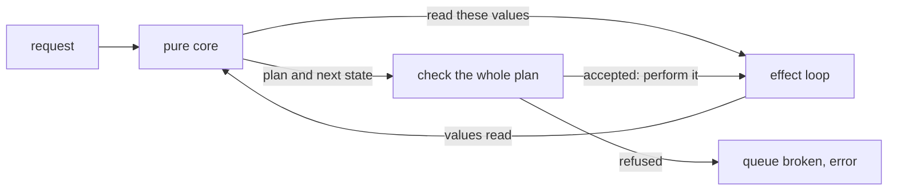

# Chapter 6. Correct by Construction

> **Status.** The method is Built and runs through the tree: pure
> Erlang cores that return `{State, Actions}`, with edges that perform
> the actions; the device NIF's pure cores, the independent check of
> every plan and the one effect loop; the funnel; the chokepoint build
> checks, each with a seeded violation; and the stack proof of the C17
> code that Fiasco links. Of the properties in section 6.2, three are
> Designed: the memory wall of a domain's budget, Fiasco's refusal of
> a mapping that is writable and executable at once, and rights on
> handles checked on every use. The rest are Built, with the
> limits the section states.

**Background needed.** [Chapter 1](01-operating-systems.md): caches,
DMA, barriers. [Chapter 2](02-microkernels.md): capabilities, and
section 2.4's mistakes that cannot be written.
[Chapter 3](03-erlang.md): Erlang, pure functions, the funnel.

Every operating system must answer one question: which code may hand
the runtime a message that arrived from another, untrusted part of the
machine? In a conventional design the answer is a list. The socket
layer checks, the protocol handler checks, the code that copies the
payload out checks. The argument that nothing unchecked gets through
is only as good as the list. A new protocol, fast path or debugging
hook adds one more place that must remember to check.

In erXos the answer is one line of a build check. A frame from another
domain reaches ERTS only through the lane driver, the C code that reads
frames out of a lane, and only after the funnel has judged it. Any
other caller of ERTS's entry point for such frames, in erXos's C or in
the OTP and musl sources erXos carries, fails `make check`. There is
no list to keep complete, because there is nowhere else to put a
check.

FreeBSD keeps most of its properties by careful authors and review,
but some are structural even there. A process cannot address another process's
memory, because its page tables give it no address that reaches it.
Capsicum, FreeBSD's capability mode, extends the idea to file
descriptors: a process in capability mode reaches only what its
descriptors name. Chapter 2 called such a property one that holds **by
construction**.

erXos makes construction the method of the whole design. Where a
property can hold because the wrong state cannot be written down, it
is built that way. Where
construction cannot say enough, the build checks the shape of the code
and the development host checks the behavior of its pure cores.

Sections 6.1 to 6.4 show the method, the properties it gives and the
code shape behind it, ending with a worked example in the C that
drives DMA. Sections 6.5 to 6.10 cover what construction cannot say
alone, what happens when it fails, and the alternatives.

## 6.1 The list that is never complete

A correctness argument that names every caller is broken by the next
caller.

### 6.1.1 The smell: open-ended enumeration

Programmers call a sign of a design problem a *smell*. Here is one.
Write the conventional argument for the opening question out, as a
conventional design would make it. A message from another domain is
safe to act on because the distribution receiver checks it. The code
that handles `link` signals checks the pids in it. The `spawn` handler
checks its options. The debugging path that dumps frames checks the
length before it reads. The argument is a list of participants, each
of which must do its part, and every item is a place where a missing
check is a hole.

The list is **open-ended**: nothing in the code says how many items it
has. A reviewer can check each item, but not that the list is complete,
because completeness is a property of code not yet written. The
project's rules treat such an argument as a warning. When review keeps
finding a missing participant, the fix is not one more entry
([design.md, Correct by construction in
code](../design.md#correct-by-construction-in-code)).

Not every list is a smell. A closed set written out in full can make a
design easier to understand. The three actions of the DHCP client's
core (section 6.3.3) are such a set: the type names all of them, and
the core has no other way to act. The smell is the list whose length
depends on how many authors remember a rule.

### 6.1.2 Two questions

Two questions turn such a list into a design.

* **What is this list protecting?** In the example: no process acts on
  bytes from another domain that no one has checked.
* **What would make the list empty?** If exactly one function can turn
  those bytes into something the runtime acts on, the list has one
  entry. A build check can prove there is no second.

The answer is usually wider than the patch a reviewer would write:
moving every frame through one function touches every place that read
frames before. The project prefers that trade. Many call-site edits,
each failing loudly if wrong, beat a small clever interlock that fails
only under some rare order of events.

### 6.1.3 Three ways out

There are three ways to make such a list empty, and erXos uses all
three.

1. **Make the illegal state unrepresentable.** Choose a type in which
   the wrong value cannot be written. A queue that is idle, armed or in
   flight is one value of an enumeration, not three booleans that could
   all be true at once. A **file grant**, the process at a file server
   that stands for one client domain's right to one tree, has rights
   `ro`, `rw` or `rx`. No fourth value means "writable and runnable",
   so no code can create one.
2. **Make the invariant a derived fact.** If two values must agree,
   compute both from one source, so nothing can change one alone. Every
   layer of erXos agrees on the kernel interface because every layer's
   code is generated from the files under `abi/`. No test compares one
   layer's view of a structure with another's, because there are not
   two views. [Chapter 7](07-one-source.md) is about this method.
3. **Make one funnel the only way to the operation.** Put the check in
   one function. Then make every other path to the operation
   impossible to write, by a type or visibility boundary or by a build
   check. The funnel of the opening is the namesake.

Each way deletes mechanism rather than adding it, and a check is added
only when none of them works.

## 6.2 The properties erXos holds by construction

On Fiasco, erXos holds six properties by construction. Table 6.1
lists them, the one mechanism behind each, and the chapter that
explains it in full. Where the system gives less than a reader might
expect, this section says so.

| Property | The one mechanism | Chapter |
| --- | --- | --- |
| Only the root service creates kernel objects | no domain holds Fiasco's factory; `liberx` sends every such request to the root service | [8](08-kernel-interface.md#83-the-root-service-who-holds-what), [10](10-domains.md#108-the-system-domain-and-the-domain-library) |
| A destroyed object is gone for every holder at once | every use of a handle passes one lookup that checks the object's generation | [8](08-kernel-interface.md#842-destroying-an-object) |
| Ending a budget ends what was charged to it | one walk over the root service's records of that budget | [12](12-memory.md#1212-ending-a-budget) |
| A pid is a name, not an authority | the receiver's funnel admits an operation only on a process its own export table lists | [10](10-domains.md#104-exports-a-pid-is-a-name-not-an-authority) |
| No process acts on a message from another domain that its protocol's owner did not admit | every such message arrives wrapped as `{erx_origin, D, Msg}`; only the protocol's owner unwraps it | [10](10-domains.md#105-the-origin-envelope) |
| Every layer agrees on the kernel interface | all are generated from the files under `abi/` | [7](07-one-source.md#72-the-abi-file) |

*Table 6.1. The "by construction" properties on Fiasco. No row
depends on every caller remembering a rule.*

### 6.2.1 One creator of kernel objects

On Fiasco, the system domain's first program runs the **root
service**, the thread that alone creates kernel objects and maps
memory into other domains (chapter 1). Fiasco creates objects only on
request to a **factory**, a kernel object whose holder may create
others, and no domain but the system domain holds one. A domain that
wants a thread, a memory object or a mapping calls `liberx`, which
sends the request to the root service. The root service decodes it,
checks that each handle the request names is live and of the right
kind, and acts. No program can skip a check it has no way around.
**Built** ([design-fiasco.md, Contract](../design-fiasco.md#contract)).

The cost is that isolation between domains rests on the root
service's own C code as well as on Fiasco, and a bug there is a hole
that construction does not prevent.

### 6.2.2 Handles, and an object that is gone

A program names a kernel object by a **handle**, a small number like a
UNIX file descriptor. The handle is an entry in a table the root
service keeps for each **task**, Fiasco's word for an address space
together with the kernel objects its threads may use. The entry names
the root service's record of the object and the record's
**generation**, a counter that grows each time the record is freed.
Every call that names a handle goes through one lookup, and the lookup
compares the two generations
(`liberx/backend/core/handles.h`, `handles.c`).

So when an object is destroyed, every handle to it, in every task,
answers `ERX_ESTALE` ("stale": the object this handle named is gone)
until its holder closes it. No holder needs to be told, so no holder
can be missed. A record whose generation reaches its largest value is
retired and never used again, so a stale handle never names a
successor object. **Built.**

A holder's own close is covered by a second generation, the entry's,
which the handle's value carries in its upper 40 bits and every close
advances. A program that closes a handle and goes on using its value
gets `ERX_ESTALE`, even after the entry is taken again: free entries
are reused first in, first out, and an entry whose generation reaches
its largest value retires too. **Built.**

Each entry records its rights, but no call except destroy checks them:
any holder may use an object as its type allows, and only destroying
it is kept to the task that created it. The design closes that gap; it
is designed and not built. A create records its creation kind's
default rights, which shrink when the handle is duplicated or passed,
and every call checks the right it needs.

### 6.2.3 Budgets

Every object the root service creates for a domain is charged, in the
root service's records, to one of that domain's **budgets**, the
accounts chapter 1 introduced. Ending a budget ends everything charged
to it, in one walk over those records. No caller lists what to free, so
no caller can leak an item it forgot. The record and the walk are
**Built**.

A stronger property makes the budget a wall. A domain's memory is
bounded by its own budget, and a charge past the limit is refused, so
no domain can take memory another was promised. The wall is designed
and not built ([design-fiasco.md, Memory and
budgets](../design-fiasco.md#memory-and-budgets)).
[Chapter 12](12-memory.md#124-walls-what-is-built-what-is-designed) explains both.

### 6.2.4 Pids, exports and the envelope

A **pid**, an Erlang process identifier, names a process in some
domain, and knowing one grants nothing. A frame from another domain
reaches a process only if the receiving domain's funnel finds that
process in its own **export table**, the domain's record of the
processes it has made reachable from each peer. Otherwise the pid
behaves as a dead process: a message to it is dropped without a word,
as ERTS drops a message to a dead process. The
only path into a domain is the funnel, and the funnel decides from a
table the sender cannot write, so a forged pid reaches nothing.
**Built** (`liberx/erx_funnel.c`; [design-domains.md, The
funnel](../design-domains.md#the-funnel)).

Follow one frame. A process in a domain that runs untrusted code sends
`{get, Key}` to a pid it guessed in the domain that stores files. Its
runtime writes a frame into the **lane**, the one-way ring of shared
memory from the sender's domain to the receiver's, which only the
sender writes. In the receiving domain, the lane driver hands the
frame to the funnel, which works in four steps:

1. It copies the frame out of the shared ring into private memory, so
   the sender can no longer change it.
2. It checks every length in the frame's header, with arithmetic that
   cannot overflow.
3. It parses the operation the frame asks for: a send, a link, a
   spawn.
4. It looks up the target pid in the receiver's export table, to see
   whether a send to it is allowed.

The guessed pid is not there, so the frame is dropped, and nothing in
the receiving domain ever sees `{get, Key}`. Had the pid been
exported, the payload would next be checked against the receiver's
limits, and only then handed to ERTS.

What the funnel admits is not yet trusted. It arrives in the receiving
process's mailbox wrapped as `{erx_origin, D, Msg}`, where `D` names the
sending domain. A `receive` that matches `{get, Key}` does not match
`{erx_origin, D, {get, Key}}`, so a process cannot act on a remote
message by accident. Only the module that owns a protocol unwraps its
own shapes, after checking them. A build check,
`tools/lib/erx/origin_unwraps.rb`, refuses the atom `erx_origin` in
other OTP modules. The rule has no flag to turn it off and no exception
for system code. The wrapping is **Built**: `erlang/apps/erx/src/erx_dist.erl`
and the network stack's admission modules handle it.

### 6.2.5 One source for the kernel interface

The kernel interface's calls, status codes and binary layouts are
defined once, in the files under `abi/`: `abi/erx_abi.txt` for the
calls and most layouts, and files such as `abi/formats/virtio.txt` for
the device descriptor layouts. Ruby generators produce every layer's C
headers and Erlang constants from them, so that every layer agrees on
a layout is a derived fact. **Built**; chapter 7 tells how.

### 6.2.6 A mapping that is never writable and executable

A page that is **writable and executable at once** lets a bug that
writes memory become a bug that runs code (chapter 1). In the design,
a patch to Fiasco's map refuses a user mapping that is both
([design-fiasco.md](../design-fiasco.md#the-releases-fiasco-build)).
That patch is designed and not built. What is built is the layer
above: the root service refuses any request for a mapping that is
both, so erXos's kernel interface offers none
(`liberx/backend/core/vm_table.h`). Even the design's rule covers one
mapping, not one page. A page can be writable through one mapping and
executable through another, as BeamAsm's code memory is (chapter 3),
so the property is not in table 6.1.

## 6.3 Functional core, effects at the edge

Most of erXos's code is written so that a decision cannot be half
made.

> **Background: side effects.** A function has a *side effect* when it
> changes something outside its result: it sends a message, writes a
> register, reads the clock, or updates a table another function
> reads. A **pure function**, as chapter 3 defined it, has none. In
> Erlang, `lists:sum([1, 2, 3])` is pure: it returns 6 every time, and
> calling it twice changes nothing. `gen_tcp:send(Socket, <<"hi">>)`
> is not: calling it twice sends two packets. A test of a pure
> function gives it arguments and compares the result, with no device,
> network or timer to set up.

### 6.3.1 The shape

Every decision that can be a pure function is one. Driver, runtime and
service code has two layers
([design.md, Functional core, effects at the
edge](../design.md#functional-core-effects-at-the-edge)):

* **A functional core** of pure decisions. Its most common form is a
  **state machine**, a function from the current state and an event to
  the next state and a list of actions to perform. For an operation
  that changes several things at once, the core builds a complete
  **plan** and has it checked whole before anything is applied. So
  applying cannot fail halfway for a reason the check could have
  caught. The core reads no hardware and no global state, builds for
  the development host, and is tested there.
* **A thin layer of effects**: device register writes, ring writes and
  message delivery. It carries out what the core decided and decides
  nothing a pure function could.

Figure 6.1 shows the pair as the device NIF uses it (section 6.4). A
request comes in. The core either asks for some values to be read
from the device, or answers with a plan and the next state. The effect
loop performs the reads and hands the values back, or has the plan
checked and performs it.



*Figure 6.1. A pure core and its effect loop. The core never touches
the device; the loop never decides. A plan reaches the device only
after it has been checked whole.*

### 6.3.2 Why callers that string helpers together fail

The opposite shape is a caller that calls several helpers and must
call them in the right order. The style guide's example, a sketch
rather than code from the tree, maps `len` bytes of memory at address
`va` in the address space `as`:

```c
	/* Before: every caller must remember the order. */
	if (!erx_range_is_free(as, va, len))
		return (ERX_EBUSY);
	erx_range_reserve(as, va, len);
	erx_pt_map(as, va, pages, prot);
	erx_tlb_sync(as);

	/* After: the plan is computed and validated whole, then applied. */
	error = erx_map_plan(&as->layout, &req, &plan);
	if (error != 0)
		return (error);
	erx_map_apply(as, &plan);
```

The first version asks a lot of every caller. It must check before it
reserves, reserve before it maps, and synchronize the TLB, the
processor's cache of translations, after it maps. A caller that
forgets the last line leaves a stale translation that passes every
test until the timing changes. The ordering rule is an open-ended list
again, one entry per caller. In the second version the order lives in
one function, and a caller gets the whole operation or an error. Four
obligations per caller become one.

The style guide judges a design by that measure, the obligations a
maintainer must hold, not by lines of code
([style.md, Architectural complexity](../style.md#architectural-complexity)).

### 6.3.3 The shape in Erlang

**DHCP** is the protocol by which a machine asks the network for an
address. erXos's DHCP client, met in chapter 3, is a full example of
the shape. Its core, `erlang/apps/erx_net/src/erx_dhcp4_core.erl`,
declares its events, its actions and its step (trimmed):

```erlang
-type event() :: timeout | {reply, #dhcp4{}}.

-type action() :: {send, broadcast | <<_:32>>, From :: <<_:32>>, #dhcp4{}}
                | {configure, lease()}
                | unconfigure.

% ...
-spec step(event(), core(), integer()) -> {core(), [action()]}.
```

An event is a timeout or a reply from a server. The step takes an
event, the client's state and the time, and returns the next state and
a list of actions. Three things are worth noticing. The time is an
argument, so the core never reads a clock, and a test can step it a
minute forward without waiting a minute. The actions are a closed set
of three: send a packet, configure the interface, remove the
configuration. The core has no other way to act. And the state type,
`core()`, is declared **opaque**: Dialyzer, OTP's type checker,
reports any other module that looks inside it, so no other code can
put the client into a state the core did not choose.

`test/erlang/erx_dhcp4_tests.erl` drives the core through whole leases,
renewals and refusals, with no network and no timer. The `gen_server`
that wraps it, `erx_dhcp4.erl`, holds the timer and passes each action
to the network interface. Some other edges share one loop for
performing actions, `erx_actions:perform/3`, which chapter 3 showed;
the Wi-Fi join and Bluetooth controller code use it. **Built.**

### 6.3.4 Variants, not flags

The DHCP core's phase, the step of a lease it is in, is one value of
`init | selecting | requesting | bound | renewing | rebinding`, not a
set of booleans such as `have_offer` and `is_bound`. Two booleans have
four combinations. If only three are legal, every writer must keep the
fourth from occurring. A variant has exactly the legal values. The
style guide makes this the rule: a state is one value of an
enumeration or a tagged union, never a pair of flags kept consistent
by hand.

The style guide applies the same rule to deadlines. It keeps each
deadline inside the variant it guards, `{wait, Deadline}` or `{sent,
Request, Deadline}`, so leaving that state drops the deadline with it.
No code must remember to cancel a timer on each way out. The DHCP
core is simpler still: it keeps one deadline for the whole client,
and its edge sets one timer to it.

## 6.4 A worked example: the device DMA plan

The device DMA path shows the chapter's ideas in one place.
[Chapter 15](15-devices.md) explains the
device NIF in full; this section follows one call.

> **Background: a device that does not see the cache.** A device that
> is not cache-coherent reads and writes memory directly, without
> looking in the CPU's caches (chapter 1, section 1.5.5). If the CPU
> writes a descriptor and the bytes are still in a cache line, the
> device reads the old bytes from memory. If the device writes a
> packet while the CPU holds a stale copy of that line, the CPU reads
> the stale copy. Worse, a later writeback of a dirty line can
> overwrite what the device wrote. So the CPU *cleans* a line, writing
> it back, before the device reads. It *invalidates* a line,
> discarding it, before it reads what the device wrote. Barriers keep
> the steps in order. The Raspberry Pi 4's Ethernet controller, GENET,
> is such a device, so its driver needs all of this.

### 6.4.1 The problem the plan solves

A driver for a device that moves data by DMA must get three things
right on every transfer. Every address it gives the device must lie in
memory the driver's domain owns; a wrong one lets the device overwrite
any page of the machine. The CPU and the device must never both write
the same memory at once. And every clean, invalidate and barrier must
be in the right place, or the driver works on one board and corrupts
packets on another.

Conventional drivers get this right by care, each cache call placed by
hand. In erXos a driver's Erlang process never touches the device. Its C part, the **device NIF**
(native code that ERTS calls like an Erlang function), holds a
**form** for each kind of device: the code that knows that device's
ring layout. A form is a pure core. It produces a plan, and the plan
is checked whole before anything touches the hardware.

### 6.4.2 The core, the check and the loop

A queue call, such as posting a buffer or collecting completions, runs
in rounds ([design-device-dma.md, Calls, observations and
plans](../design-device-dma.md#calls-observations-and-plans)). In each
round the form's core takes the request and the values the last round
read. It answers with the reads it needs next, or with a plan and the
queue's next state, or with the call's end and its status. The core
works only on the queue state it is handed and touches no memory the
device sees.

Between the core and the hardware stands one independent check. It
sees the queue's state before and after the plan, and the plan between
them, and refuses the plan unless two things hold. Every device
address and length the plan gives the device stays inside the queue's
DMA memory, as the device sees it. And no **region**, a span of the
device's memory such as a ring or a buffer, has two writers: at every
moment either the CPU or the device writes it, never both. The check
refuses anything it cannot prove safe.

The effect layer, in `otp/erts/emulator/nifs/erxos/erx_device.c`, is
one loop shared by every form, and it applies only a plan the check
has accepted. A call ends within a fixed number of rounds or the queue
breaks, so a confused form cannot spin forever.

The cache maintenance is not in the plan at all. A form has no way to
say "clean this line" or "issue a barrier", so it cannot forget one or
put one in the wrong place. Instead, which side writes each region is
a function of the queue's state. A region whose writer differs between
the state before and the state after has been handed over. From that
change alone, code outside every form computes which lines to clean or
invalidate and where the barriers go
([design-device-dma.md, The construction: handoffs of
granules](../design-device-dma.md#the-construction-handoffs-of-granules)).
Regions start and end on whole cache granules, the unit a cache
writes back at once, so maintaining one region never touches another's
bytes. For a cache-coherent device the maintenance is empty.

### 6.4.3 Following one post

Here is a post of one outgoing packet.

1. The Erlang driver asks the NIF to post a buffer holding the packet.
2. The form's core returns a plan that hands a free buffer, holding
   the packet, to the device, and a next state in which that buffer's
   writer is the device.
3. The check confirms that the buffer's device address and length lie
   inside the queue's DMA memory, and that the buffer has one writer
   in each state.
4. Code outside the form sees that the buffer passed from the CPU to the
   device. It cleans the buffer's lines and puts a barrier before the
   device is told.
5. The effect loop performs all of this in that order, and the next
   round ends the call with `ERX_OK`.

No line of the driver or the form places a clean or a barrier; they
follow from the change of writer. The cores, the check and the
effect loop are **Built**. The GENET driver on the Raspberry Pi 4
and the virtio drivers on QEMU run through them ([the top-level README, Current
status](../../README.md#current-status); `otp/erts/emulator/nifs/erxos/erx_device_genet.c`).

### 6.4.4 The edge, held by a build check

A pure core is only as good as the guarantee that nothing goes around
it. The device's chokepoint rules, in
`tools/lib/erx/chokepoint_rules/device.rb`, hold that edge.
`device-dma-maintenance` allows the cache maintenance and barrier
calls only in `erx_device.c`'s effect layer, and
`device-register-access` allows the generated accessors that touch a
device's registers only in `erx_device.c`. Other C code that cleaned a
cache line itself, or wrote a register outside that file, fails `make
check`. Section 6.6 shows how such a rule is written and proved.

## 6.5 What construction cannot say

A structure can prove where an operation can be done from. It cannot
prove that the code allowed to do it does it only when it should: that
the funnel admits only what its export table allows, or that a DMA
plan matches its state. erXos checks such behavior in other ways
([design.md, Correct by construction in
code](../design.md#correct-by-construction-in-code)).

> **Background: three kinds of checking.** *Model checking* explores
> every state a system can reach, trying every event in every state up
> to a stated depth, and checks a property in each. It finds the bug
> that needs a rare order of events. *Fuzzing* feeds a parser millions
> of generated inputs and reports any input that crashes it or trips
> a *sanitizer*, a compiler option that makes a program stop at the
> first memory error or undefined behavior. A *static check* reads source or compiled code
> without running it and proves a property of its shape: which
> functions call which, which files name a symbol, how deep a stack
> can grow. None replaces the others.

erXos uses all three. The protocol state machines are pure, so they
are explored exhaustively on the host: every event in every reachable
state, up to a stated depth. The lane, the connections between domains
and the links between processes are each specified in **TLA+**, Leslie
Lamport's language for describing a concurrent protocol, and checked
by **TLC**, its model checker. **Litmus tests**, small programs that
ask which orders of memory accesses the processor allows, check that
the lane's fences do their job. **CBMC**, a model checker for C,
checks the budget arithmetic and other C cores for every input within
stated bounds. Every parser of untrusted input has a fuzz target, among
them the funnel's term decoder, the boot image and executable headers.
The static checks are the chokepoint rules and the stack proof of
sections 6.6 and 6.7. All of these are **Built** ([the top-level README, Current
status](../../README.md#current-status)).

### 6.5.1 Seeded faults

A check that has never failed proves nothing: it may not run, or it may
not see what it guards. So for each subtle check, erXos plants the
fault the check exists for and requires the check to fail on it. Each
TLA+ model carries seeded defects, such as a dropped fence in the lane
or an answer sent early in the links model, and each must fail the
property it names. Each CBMC harness has a seeded defect that must make
it fail. A failure seeded into a copy of the Fiasco backend must make
the QEMU test run, the system booted in an emulated machine, fail,
while an unmutated copy passes. Section 6.6.3 follows one seeded fault
from end to end.

## 6.6 Only X may do Y: chokepoints as build checks

Many of erXos's rules have the form "only X may do Y": only the lane
driver hands ERTS a frame from another domain, only `liberx`'s Fiasco
backend speaks Fiasco's interface. Each such rule is a funnel, and a
funnel is worth something only if nothing goes around it.

### 6.6.1 Types and visibility first

The cheapest way to make a path impossible is to make it fail to
compile:

* **Opaque types in C.** `include/erx/budget.h` declares
  `typedef struct erx_budget erx_budget_t;` and never defines the
  structure for its callers. Code outside the budget core can hold a
  pointer to a budget but cannot read or write a field of one.
* **`static` functions and module-private headers in C**, which no
  other file can name.
* **Unexported functions and opaque types in Erlang.** A module that
  owns a representation exports only the functions that keep it
  correct, and declares the type `-opaque`, as the DHCP core does.
* **Constructors that check, in Ruby**, as section 6.6.3 shows.

Before anyone claims a mistake cannot be written, the project's rule
is to try writing it. If it builds, the design changes. If it does
not, the attempt can be kept as a test that expects the build to fail.

### 6.6.2 What a chokepoint check is

Some rules no type can express. C has no way to say "only the files of
this one directory may include a Fiasco header". For such a rule erXos
writes a **chokepoint check**, a build check that fails on any new site
of a forbidden operation. Each check has a test that seeds a violation
and expects the check to catch it ([design.md, Chokepoint
checks](../design.md#chokepoint-checks)). The rules over erXos's C are
data, in `tools/lib/erx/chokepoint_rules/`, and `make check` runs them
all.

Here is a whole rule, from
`tools/lib/erx/chokepoint_rules/fiasco_seam.rb`:

```ruby
Chokepoints::Forbidden.new(
  name: 'fiasco-headers-in-backend',
  rule: "only liberx's fiasco backend includes an l4sys header",
  design: "#{KERNEL}#chokepoint-checks",
  scope: ERXOS_C_OUTSIDE_FIASCO_BACKEND,
  pattern: %r{[<"]l4/|l4sys|l4re}i,
  seed: { 'liberx/seeded.c' => "#include <l4/sys/ipc.h>\n", 'kernel/core/seeded.c' => "#include <l4/re/env.h>\n" }
),
```

Read it field by field. A failure prints the `name`, so a developer
sees which rule broke. The `rule` says in plain words what is
forbidden, and `design` points at the design document that justifies
it (`KERNEL` is a constant naming that document). `scope` is every C
file of erXos's own outside the Fiasco backend, and `pattern`, a
regular expression, is what may not appear there: an include of
Fiasco's or L4Re's headers. Last, `seed` is the violation the rule must
catch: two files, each with one such include.

Without the rule, one convenient include of a Fiasco header in the
funnel or the device NIF would tie that code to Fiasco's data model.
The kernel interface would erode one shortcut at a time.

### 6.6.3 A seeded fault, from end to end

The test that proves each rule still works is in
`test/host/chokepoints_test.rb`, a Ruby test file that `make check`
runs:

```ruby
  # Every active rule catches every file of its seed, each alone, so no
  # seed passes on the strength of another file's violation.
  def test_every_active_rule_fails_on_each_seeded_file
    refute_empty Rules::ACTIVE
    Rules::ACTIVE.each do |active|
      active.seed.each do |path, text|
        found = evaluate([active], { path => text })
        refute_empty found, "#{active.name} missed its seed #{path}"
        assert(found.all? { |violation| violation.rule == active.name && violation.path == path })
      end
    end
  end
```

For each rule and each file of its seed, the test builds a tree of
that one file and runs the rule over it. The rule must report a
violation (`refute_empty found`), and every violation must name this
rule and this file, not some other rule that happened to fire.

Suppose someone breaks the rule while editing it. The scope is
narrowed by mistake to `kernel/`, or the pattern loses its `l4/`
alternative. The rule no longer sees the seed in `liberx/`, the test
reports "fiasco-headers-in-backend missed its seed liberx/seeded.c",
and `make check` fails. The check cannot quietly stop checking.

The tooling applies construction to itself. A rule cannot be declared
without a seed: the constructor refuses it, and a test in the same
file expects that refusal. A rule whose sites do not exist yet is
marked pending, and fails the moment a file it awaits appears, so it
cannot be forgotten either. All of this is **Built** and runs in `make
check`.

### 6.6.4 What a chokepoint proves, and what it does not

A chokepoint check proves where Y can be done from, not that X does Y
only when it should. The rule `funnel-net-message`, in
`tools/lib/erx/chokepoint_rules/funnel.rb`, allows only the lane
driver, besides OTP's own declaration and definition of it, to call
`erts_net_message`, ERTS's entry for frames from another domain. That the
funnel's verdicts are right is the job of its fuzz target and of a
differential check, which compares the
funnel's decoding of each payload with that of Erlang's own decoder,
`binary_to_term/1`. The chokepoint makes those tests sufficient by
leaving no other door to test.

## 6.7 Bounded stacks

A stack overflow in a kernel is not a crash of one program. A guard
page, an unmapped page below the stack, faults on any access; without
one, an overflow silently overwrites whatever lies below. erXos turns the
question "can this code overflow its stack?" into a computation the
build performs.

### 6.7.1 The stack proof

Fiasco links a set of erXos's C17 functions, chiefly the cores
collected into `erx_cores.a` from `kernel/core/` and `kernel/sched/`,
and calls them only from a thin layer of glue ([design-fiasco.md,
Interfaces](../design-fiasco.md#interfaces)). A kernel is entered in
only a few ways, its **entries**: at boot, on a system call or fault,
and on an interrupt. Every build computes the worst-case stack depth
of the linked C17 code from each place those paths call into it
([design.md, Bounded stacks](../design.md#bounded-stacks)). The
compiler reports each function's frame size, and
`tools/lib/erx/stack_proof.rb` combines the sizes with the call graph.
A function's depth is its own frame plus the deepest function it calls.

The proof refuses three things. A frame larger than 1 KiB
(`FRAME_CAP_BYTES` in `stack_proof.rb`) fails it. So does a call
through a function pointer, unless the functions it may reach are
listed, since otherwise the proof cannot know what is called. So does
a cycle in the call graph, because a cycle is recursion, and recursion
whose depth an input controls has no bound. The one exception is a
call marked `musttail`, a Clang attribute that makes the compiler turn
the call into a jump or refuse to compile. A tail jump replaces the
caller's frame instead of adding one, as chapter 3 explained for
Erlang, so it adds no depth. `make check-stack-proof` runs as part of
`make check`, and the proof is **Built**.

Fiasco's own C++ is not covered: its thread stacks are measured, not
proven, a limitation of the system.

### 6.7.2 Parsers outside the kernel

The design bounds user-mode parsers another way. The funnel and
`liberx`'s channel decoder parse untrusted input iteratively, with
explicit stacks, so no input can drive them into deep
recursion. The storage, network and driver domains parse disk images,
packets and what devices wrote in Erlang processes with a heap limit
(`max_heap_size`). A crafted input that makes such a parser grow ends
that one process, and its supervisor restarts it. The build's cycle
check covers only the C17 code of section 6.7.1; for `liberx` the rule
is designed and not built.

## 6.8 One interface below every runtime

The last construction is the widest. Every runtime and every native
program reaches the kernel through `liberx`, and nothing above it sees
Fiasco ([design.md, Decisions](../design.md#decisions)).

The rule is held at three levels. At the kernel interface, a
chokepoint rule allows the instruction that enters the kernel only in
`liberx`'s backends, and the rule of section 6.6 keeps Fiasco's headers
inside the Fiasco backend. At the runtime, a build check compares
ERTS's imports with its import list, which allows only `liberx`'s
calls and the C library's. At the formats, every format two parts of
the system share is erXos's own (chapter 14 shows the file protocol),
and none leaks the data model of the component behind it. All three
are **Built**.

So a component below the interface can change without anything above
it moving. Erlang code that opens a file or draws a window is written
against erXos's names, not Fiasco's, littlefs's or LVGL's, and so are
the tests.

## 6.9 When a construction fails

The method moves most failures from the running system to the build,
and those that remain end small.

* **A chokepoint violation** fails `make check` with the rule's name and
  the file, and no image is built. The fix is to move the code behind
  the funnel or bring the need to the design.
* **A stack proof failure** fails the build with the path that exceeds
  the cap, or the cycle it found.
* **A refused DMA plan** breaks that queue and raises `badarg` in the
  driver's Erlang process, and the bad plan never touches the device.
  The process crashes and its supervisor restarts it (chapter 15).
* **A core that puts an action after `{stop, Reason}`** makes
  `erx_actions:perform/3` raise `stop_not_last` before it performs that
  action. The process crashes and its supervisor restarts it.
* **A malformed frame from another domain** is refused by the funnel
  and ends that connection. A frame over the receiver's limits is
  dropped and counted. Neither reaches a process.

Some failures construction does not prevent, and the system states
them. A bug in the root service's request decoder can break isolation
between domains. A handle used after its own holder closed it may
reach another object. No DMA device on the platforms erXos runs on sits
behind an IOMMU, the unit that would check each device access against
the memory the device may reach (chapter 1). So a device could be made
to write anywhere, and isolation also rests on the domain that drives
it ([design-fiasco.md, Contract](../design-fiasco.md#contract)). The
device NIF's check narrows what a driver can make the device do; it
cannot make the hardware obey.

## 6.10 Design choices

**Careful review instead of construction.** Most systems write the
rules down and review every change against them. erXos reviews every
commit too, but review checks the change in front of the reviewer,
and an open-ended list fails on the change nobody thought to check. A
build check reviews every change, at no cost per change. Its cost is that each rule is code
with a seed, so the checks must stay few. Each names the failure it
prevents, and a rule that only its own test needs is deleted.

**Checks at run time everywhere.** Defensive code re-checks its
arguments in every function, which catches bugs late and spreads one
rule over many places that can drift.
erXos defends once, at the boundaries where untrusted input enters: the
funnel, the image and executable readers, the device NIF's plan check.
Inside them it relies on types and on its own generated code.

**A verified kernel.** seL4 has a machine-checked proof that its C
implements its specification (chapter 2). That is a far stronger
guarantee than a build check, and it costs years of proof work per
change of design. erXos runs on Fiasco, which is not verified, and spends its
effort on keeping its own code simple enough to hold by construction.

**A language that enforces more.** A language with a richer type
system, such as Rust or Haskell, could express some chokepoints as
types. erXos writes its own code in C17, Erlang and Ruby, uses each
language's boundaries first, and adds a chokepoint check for what they
cannot say. The cost is visible: about fifty rule files in
`tools/lib/erx/chokepoint_rules/`, each of them code to maintain.

**Lineage.** The idea that structure should make a mistake impossible
is older than erXos. Capability systems from KeyKOS and EROS onward
made authority a matter of what a program holds (chapter 2). The
phrase "make illegal states unrepresentable" comes from Yaron Minsky's
advice on programming in OCaml. Gary Bernhardt's "functional core,
imperative shell" names the split of section 6.3. Barrelfish applied
declarative techniques to configuring an operating system, which
[chapter 7](07-one-source.md#710-where-logic-languages-fit-and-where-they-do-not) takes up.

## Summary

A correctness argument that depends on every caller remembering a rule
breaks with the next caller. erXos replaces such lists three ways:
make the illegal state unrepresentable, derive the invariant from one
source, or make one funnel the only path. On Fiasco this gives one
creator of kernel objects and handles that answer `ERX_ESTALE` once
their object is gone. It gives budgets whose end frees what they paid
for, pids that grant nothing, wrapped messages from other domains and
one generated interface. Code is a pure core that decides and a thin
edge that acts, so decisions are tested on the host and plans are
checked whole. In the DMA path, cache maintenance follows from a
change of writer.
Chokepoint checks, each proved by a seeded violation, and a stack
proof turn whole classes of mistake into build failures. What
construction cannot prove, the behavior of the code a funnel lets
through, is held by model checking, fuzzing and seeded faults.

## Where to read next

* [design.md, Correct by construction in
  code](../design.md#correct-by-construction-in-code): what each kind of
  check proves, the functional core, chokepoints and bounded stacks.
* [design-fiasco.md, Contract](../design-fiasco.md#contract): what the
  system promises on Fiasco, and where it stops.
* [style.md, Functional core](../style.md#functional-core): the code
  shapes, with examples.
* [design-device-dma.md, Calls, observations and
  plans](../design-device-dma.md#calls-observations-and-plans): the DMA
  plan and its check in full.
* Jerome Saltzer and Michael Schroeder, "The Protection of Information
  in Computer Systems", 1975: economy of mechanism and complete
  mediation, the principles behind one funnel.
* Gerwin Klein and others, "seL4: Formal Verification of an OS Kernel",
  SOSP 2009: the alternative of proving a kernel correct.
