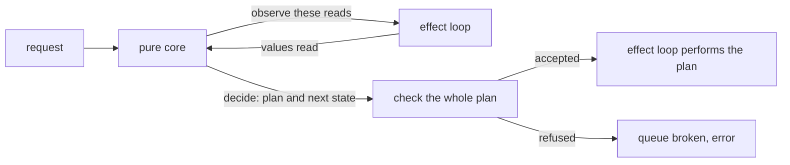
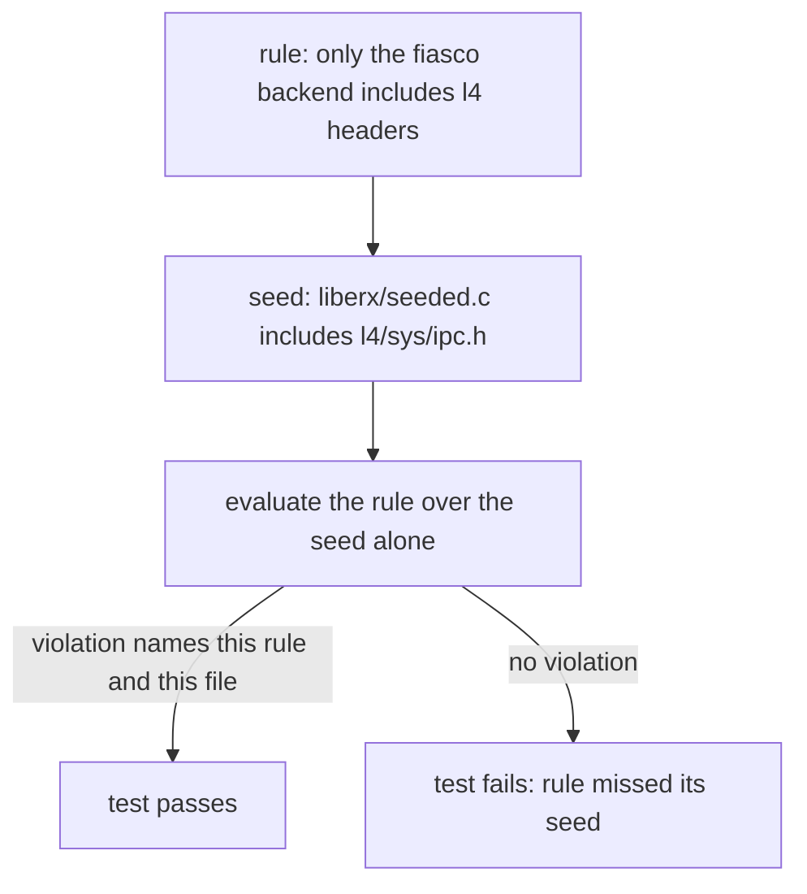

# Chapter 6. Correct by Construction

> **Status.** The method is Built and runs through the tree: pure
> Erlang cores that return `{State, Actions}`, performed by one loop,
> `erx_actions:perform/3`; the device NIF's round functions, with
> `erx_device_dma_check` and the effect loop `run_call`; the funnel;
> the chokepoint build checks, each with a seeded violation; and the
> stack proof of the C17 code that Fiasco links. Of the properties in
> section 6.2, the memory wall of a domain's budget is Designed; the
> rest are Built, with the limits the section states.

**Background needed.** [Chapter 1](01-operating-systems.md): caches,
DMA, barriers. [Chapter 2](02-microkernels.md): capabilities, and
section 2.4's mistakes that cannot be written.
[Chapter 3](03-erlang.md): Erlang, pure functions, the funnel.

Every operating system must answer one question: which code may hand
the runtime a message that arrived from another, untrusted part of the
machine? In a conventional design the answer is a list. The socket
layer checks, the protocol handler checks, the code that copies the
payload out checks. The argument that nothing unchecked gets through
is only as good as the list. A new protocol, fast path or debugging
hook adds one more place that must remember to check.

In erXos the answer is one line of a build check. A frame from another
domain reaches ERTS only through one C function, the lane driver's
drain, and only after the funnel has judged it. Any other file of
erXos's C, or of the OTP and musl sources erXos carries, that names
ERTS's entry point for such frames fails `make check`. There is no list
to keep complete, because there is nowhere else to put a check.

FreeBSD keeps most of its properties the conventional way: careful
authors, code review and a long history of fixes. Some properties are
structural even there. A process cannot address another process's
memory, because its page tables give it no address that reaches it.
Capsicum extends the idea to file descriptors: in capability mode a
process reaches only what its descriptors name. Chapter 2 called such
a property one that holds **by construction**.

erXos makes construction the method of the whole design. Where a
property can hold because the wrong state cannot be written down, it
is built that way. The tools are one funnel through which an operation
must pass, a type that cannot express the illegal state, and a fact
derived from a single source so that nothing can make it false. Where
construction cannot say enough, the build checks the shape of the code
and the development host checks the behavior of its pure cores.

Section 6.1 shows how to find a list that should not exist, and three
ways to delete it. Section 6.2 tours the properties erXos holds that
way on Fiasco. Sections 6.3 and 6.4 show the code shape that makes
this practical, in Erlang and then in the C that drives DMA. Sections
6.5 to 6.8 cover what construction cannot say alone: checks on
behavior, chokepoint build checks, bounded stacks and the one interface
below every runtime. The chapter ends with failures, costs and
alternatives.

## 6.1 The list that is never complete

A correctness argument that names every caller is broken by the next
caller. This section shows how to recognize such an argument and how to
replace it.

### 6.1.1 The smell: open-ended enumeration

Write the conventional argument for the opening question out. A
message from another domain is safe to act on because the distribution
receiver checks it. The code that handles `link` signals checks the
pids in it. The `spawn` handler checks its options. The debugging path
that dumps frames checks the length before it reads. The argument is a
list of participants, each of which must do its part, and every item
is a place where a missing check is a hole.

The list is **open-ended**: nothing in the code says how many items it
has. A reviewer can check each item, but not that the list is complete,
because completeness is a property of code not yet written. The
project's rules treat such an argument as a warning. When review keeps
finding a missing participant, the fix is not one more entry
([design.md, Correct by construction in
code](../design.md#correct-by-construction-in-code)).

Not every list is a smell. A closed set written out in full can make a
design easier to understand. The four kinds of step a DMA plan may
contain (section 6.4) are such a set: the compiler sees all of them,
and a `switch` that misses one draws a warning. The smell is the list
whose length depends on how many authors remember a rule.

### 6.1.2 Two questions

Two questions turn such a list into a design.

* **What is this list protecting?** In the example: no process acts on
  bytes from another domain that no one has checked.
* **What would make the list empty?** If exactly one function can turn
  those bytes into something the runtime acts on, the list has one
  entry. A build check can prove there is no second.

The answer to the second question is usually wider than the patch a
reviewer would write. Moving every frame through one function touches
every place that read frames before. The project prefers that trade. A
wide but shallow fix changes many call sites, each of which fails
loudly if it is wrong. It beats a narrow but deep one, a small clever
interlock that fails only under some rare order of events.

### 6.1.3 Three ways out

There are three ways to make such a list empty, and erXos uses all
three.

1. **Make the illegal state unrepresentable.** Choose a type in which
   the wrong value cannot be written. A queue that is idle, armed or in
   flight is one value of an enumeration, not three booleans that could
   all be true at once. A file grant is `ro`, `rw` or `rx`. No fourth
   value means "writable and runnable", so no code can create one.
   The phrase comes from Yaron Minsky's advice on programming in OCaml.
   <!-- check: Minsky, "Effective ML", 2010 talk / 2011 Jane Street blog, coined "make illegal states unrepresentable" -->
2. **Make the invariant a derived fact.** If two values must agree,
   compute both from one source, so nothing can change one alone. Every
   layer of erXos agrees on the kernel interface because every layer's
   code is generated from one file, `abi/erx_abi.txt`. No test compares
   the kernel's view of a structure with `liberx`'s, because there are
   not two views.
   [Chapter 7](README.md#chapter-7-one-source-for-every-fact) is about
   this method.
3. **Make one funnel the only way to the operation.** Put the check in
   one function. Then make every other path to the operation
   impossible to write, by a type or visibility boundary or by a build
   check. The funnel of the opening is the namesake.

Each way deletes mechanism rather than adding it. That is the test the
project applies to a proposed fix: first remove a path, narrow a type
or derive a value, and add a check only when none of those works.

## 6.2 The properties erXos holds by construction

Each property in this section holds because one mechanism makes the
wrong state impossible to reach, not because every caller behaves. Each
holds in the system as it runs on Fiasco. Where Fiasco gives less than
a reader might expect, the section says so.

Figure 6.2 lists the properties, the one mechanism behind each, and the
chapter that explains it in full.

| Property | The one mechanism | Chapter |
| --- | --- | --- |
| Only the root service creates kernel objects and writes object spaces | `liberx` sends every such request to the root service, and only the Fiasco backend speaks Fiasco's interface | [8](README.md#chapter-8-the-kernel-interface-and-fiasco), [10](README.md#chapter-10-domains-a-wall-around-some-processes) |
| Rights only shrink | every duplicate or pass intersects the source's rights with a mask | [11](README.md#chapter-11-authority-and-security) |
| A destroyed object is gone for every holder at once | Fiasco removes it from every object space; every later use answers `ERX_ESTALE` | [8](README.md#chapter-8-the-kernel-interface-and-fiasco) |
| Ending a budget ends what was charged to it | the root service's one walk over its records of that budget | [12](README.md#chapter-12-memory-and-budgets) |
| A pid is a name, not an authority | the receiver's funnel admits an operation only on a process its own export table lists | [10](README.md#chapter-10-domains-a-wall-around-some-processes) |
| No process acts on a message from another domain that its protocol's owner did not admit | every such message arrives as `{erx_origin, D, Msg}`; only the protocol's owner unwraps it | [10](README.md#chapter-10-domains-a-wall-around-some-processes) |
| The kernel interface's users agree on the ABI | all are generated from `abi/erx_abi.txt` | [7](README.md#chapter-7-one-source-for-every-fact) |

*Figure 6.2. The "by construction" list as it holds on Fiasco. Each row
has one mechanism; none depends on every caller remembering a rule.*

### 6.2.1 One creator of kernel objects

On Fiasco, the system domain's first program runs the **root
service**, the thread that alone creates kernel objects and maps
memory into other domains (chapter 1). A domain that wants a thread, a
memory object or a mapping calls `liberx`, which sends the request to
the root service. The root service decodes it, checks the caller's
rights in its own record of the caller's slots, and acts. No domain
holds Fiasco's factory for itself, so no domain can create a kernel
object, and no program can skip a check it has no way around.
**Built** ([design-fiasco.md, Contract](../design-fiasco.md#contract)).

The cost is that isolation between domains rests on the root service's
request decoder and placement code as well as on Fiasco. That code is
erXos's own C, and a bug in it is a hole that construction does not
prevent. The design names that dependency rather than hiding it.

### 6.2.2 Rights that only shrink

When the root service duplicates or passes a handle, it intersects the
source slot's recorded rights with the caller's mask and records the
result for the new slot. It then maps a capability there with only the
Fiasco rights that result allows ([design-fiasco.md,
Rights](../design-fiasco.md#rights)). No call adds rights, so no
sequence of calls can grow one. **Built.**

### 6.2.3 Destroying an object, and the slot that is reused

When an object is destroyed, Fiasco removes its capability from every
holder's object space at once, and every later use of the slot answers
`ERX_ESTALE` ([design-fiasco.md, Destroying an
object](../design-fiasco.md#destroying-an-object)). No holder needs to
be told, so no holder can be missed. **Built.**

One related property holds only as a likelihood. A holder that closes
a handle and then uses the same slot number may reach whatever the root
service has placed in that slot since. Fiasco's slots carry no
generation counter, so the mistake is not refused. The root service
reuses a closed slot as late as the table allows, so such a bug rarely
meets another object ([design-fiasco.md, Handles are
slots](../design-fiasco.md#handles-are-slots)). This is a limitation of
the system, and section 2.5.4 explains it.

### 6.2.4 Budgets

Every object the root service creates for a domain is charged, in the
root service's records, to one of that domain's **budgets**, the
accounts chapter 1 introduced. Ending a budget ends everything charged
to it, in one walk over those records. No caller lists what to free, so
no caller can leak an item it forgot. The record and the walk are
**Built**.

A stronger property makes the budget a wall. A domain's memory is
bounded by its own budget, and a charge past the limit is refused, so
no domain can take memory another was promised. The wall is designed
and not built ([design-fiasco.md, Memory and
budgets](../design-fiasco.md#memory-and-budgets)).
[Chapter 12](README.md#chapter-12-memory-and-budgets) explains both.

### 6.2.5 Pids, exports and the envelope

A **pid**, an Erlang process identifier, names a process in some
domain, and knowing one grants nothing. A frame from another domain
reaches a process only if the receiving domain's funnel finds that
process in its own **export table**, the domain's record of what it has
exported to peers. Otherwise the sender gets the answer it would get
for a dead process. The only path into a domain is the funnel, and the
funnel decides from a table the sender cannot write, so a forged pid
reaches nothing. **Built** (README.md, "Current status").

Follow one frame. A process in a sandbox domain sends `{get, Key}` to
a pid it guessed in the storage domain. Its runtime writes a frame into
the **lane**, the one-way ring from the sandbox to the storage domain
that only the sandbox writes. In the storage domain, the lane driver's
drain calls the funnel
([design-domains.md, The funnel](../design-domains.md#the-funnel)).
`erx_lane_take`, the only function that loads from a lane's pages,
copies the record into private memory, so the sender can no longer
change it. `erx_funnel_check`, which is pure, checks the header's
lengths with checked arithmetic. It parses the control term in the
grammar of the operations a frame may carry. It looks up the target pid
in the storage domain's export table, for the right a send needs. The
guessed pid is not there, so the verdict is to answer as for a dead
process, and the frame is dropped. Nothing in the storage domain ever
saw `{get, Key}`. Had the pid been exported, the payload would next be
checked against the receiver's limits, and only then handed to ERTS.
Section 6.6.4 shows the build check that keeps every other function
away from ERTS's input.

What the funnel admits is not yet trusted. It arrives in the receiving
process's mailbox wrapped as `{erx_origin, D, Msg}`, where `D` names the
sending domain. A `receive` that matches `{get, Key}` does not match
`{erx_origin, D, {get, Key}}`, so a process cannot act on a remote
message by accident. Only the module that owns a protocol takes its
own shapes out of the envelope, after checking them. A build check,
`tools/lib/erx/origin_unwraps.rb`, refuses the atom `erx_origin` in
other OTP modules. The rule has no flag to turn it off and no exception
for system code. The wrapping is **Built**: `erlang/apps/erx/src/erx_dist.erl`
and the network stack's admission modules handle it.

### 6.2.6 One file for the ABI

The kernel interface's calls, rights, status codes and binary layouts
are defined once, in `abi/erx_abi.txt`. Ruby generators produce from
it the Fiasco backend's call stubs, the funnel's layouts, the device
NIF's descriptor layouts and the Erlang constants. That every layer
agrees on a frame's layout is a derived fact: there is one description,
so nothing can disagree with it. **Built**; chapter 7 tells how.

### 6.2.7 One mapping, never writable and executable

A page that is **writable and executable at once** lets a bug that
writes memory become a bug that runs code (chapter 1). Fiasco's map,
as erXos builds it, refuses a user mapping that is both, in every task
but the two its boot creates, `sigma0` and the root task
([design-fiasco.md, The release's Fiasco
build](../design-fiasco.md#the-releases-fiasco-build)).
<!-- check: whether the fork's map patch refusing W+X user mappings is in the tree; if not, this paragraph must say Designed -->
The rule covers one mapping. A page can still be writable through one
mapping and executable through another, and chapter 3 showed where the
system uses that. So the property holds for a mapping, not for a page,
and it is not in figure 6.2.

## 6.3 Functional core, effects at the edge

Most of erXos's code is written so that a decision cannot be half
made. This section explains the shape that makes it so, and why its
opposite keeps producing bugs.

> **Background: side effects.** A function has a *side effect* when it
> changes something outside its result: it sends a message, writes a
> register, reads the clock, or updates a table another function
> reads. A **pure function**, as chapter 3 defined it, has none. In
> Erlang, `lists:sum([1, 2, 3])` is pure: it returns 6 every time, and
> calling it twice changes nothing. `gen_tcp:send(Socket, <<"hi">>)`
> is not: calling it twice sends two packets. A test of a pure
> function gives it arguments and compares the result, with no device,
> network or timer to set up. Code with side effects needs the world
> it acts on, and its result depends on the order of events.

### 6.3.1 The shape

Every decision that can be a pure function is one. Kernel-side, driver
and runtime code has two layers
([design.md, Functional core, effects at the
edge](../design.md#functional-core-effects-at-the-edge)):

* **A functional core** of pure decisions, pure state machines that
  return the next action, and plans checked whole before anything is
  applied. It reads no hardware and no global state, builds for the
  development host, and is tested there.
* **A thin layer of effects**: page-table writes, device register
  writes, ring writes and message delivery. It carries out what the
  core decided and decides nothing a pure function could.

Figure 6.1 shows the pair as the device NIF uses it (section 6.4). A
request comes in. The core answers with an observation, a list of
reads it needs, or with a decision, a plan and the next state. The
effect loop performs the reads and hands the values back, or checks
the plan and performs it.



*Figure 6.1. A pure core and its effect loop. The core never touches
the device; the loop never decides. A plan reaches the device only
after it has been checked whole.*

The core takes four shapes
([style.md, Functional core](../style.md#functional-core)):

* **pure decisions**, a check or computation over plain values;
* **pure state machines**, a function from the current state and an
  event to the next state and the actions to perform;
* **plan, then apply**, for an operation that changes several things
  at once: build the complete plan and check it whole before applying
  it, so applying cannot fail halfway for a reason the check could
  have caught;
* **pure data structures**, such as allocators, capability tables and
  queues, which work only on memory they are handed.

### 6.3.2 Why callers that string helpers together fail

The opposite shape is a caller that calls several helpers and must
call them in the right order. The style guide's example, a sketch
rather than code from the tree, maps a range of memory:

```c
	/* Before: every caller must remember the order. */
	if (!erx_range_is_free(as, va, len))
		return (ERX_EBUSY);
	erx_range_reserve(as, va, len);
	erx_pt_map(as, va, pages, prot);
	erx_tlb_sync(as);

	/* After: the plan is computed and validated whole, then applied. */
	error = erx_map_plan(&as->layout, &req, &plan);
	if (error != 0)
		return (error);
	erx_map_apply(as, &plan);
```

Notice what the first version asks of every caller. It must check
before it reserves, reserve before it maps, and synchronize the TLB,
the processor's cache of translations, after it maps. A caller that
forgets the last line leaves a stale translation that passes every
test until the timing changes. The ordering rule is an open-ended list
again, one entry per caller. In the second version the order lives in
one function, and a caller gets the whole operation or an error. Four
obligations per caller become one.

The style guide judges every design by that measure: not the lines a
change adds, but the concepts, states and obligations a maintainer
must hold before and after it
([style.md, Architectural complexity](../style.md#architectural-complexity)).
A larger module that takes an ordering rule away from every caller
simplifies the system. A small one that moves the same rule behind a
new interface does not.

### 6.3.3 The shape in Erlang

Chapter 3 showed the Erlang form: a core's step returns `{State,
Actions}`, and the edge performs the actions through one loop,
`erx_actions:perform/3`. The DHCP client is a full example. Its core,
in `erlang/apps/erx_net/src/erx_dhcp4_core.erl`, declares its events,
its actions and its step:

```erlang
-type event() :: timeout | {reply, #dhcp4{}}.

-type action() :: {send, broadcast | <<_:32>>, From :: <<_:32>>, #dhcp4{}}
                | {configure, lease()}
                | unconfigure.

-opaque core() :: #core{}.

-spec step(event(), core(), integer()) -> {core(), [action()]}.
step(timeout, #core{deadline = Deadline} = Core, Now) when Deadline =:= infinity; Now < Deadline ->
    {Core, []};
step(timeout, Core, Now) ->
    expired(Core, Now);
step({reply, Msg}, Core, Now) ->
    case ours(Msg, Core) of
        true -> reply(message_type(Msg), Msg, Core, Now);
        false -> {Core, []}
    end.
```

Three things are worth noticing. The time is an argument, `Now`, so
the core never reads a clock, and a test can step it a minute forward
without waiting a minute. The actions are a closed set of three: send
a packet, configure the interface, remove the configuration. The core
has no other way to act. And `core()` is **opaque**: Dialyzer,
Erlang's type checker, reports any other module that looks inside the
record, so no other code can put the client into a state the core did
not choose.

`test/erlang/erx_dhcp4_tests.erl` drives the core through whole leases,
renewals and refusals, with no network and no timer. The `gen_server`
that wraps it, `erx_dhcp4.erl`, holds the timer and the interface and
passes each action on. **Built.**

### 6.3.4 Variants, not flags

The DHCP core's phase is one value of `init | selecting | requesting |
bound | renewing | rebinding`, not a set of booleans such as
`have_offer` and `is_bound`. Two booleans have four combinations. If
only three are legal, every writer must keep the fourth from
occurring. A variant has exactly the legal values. The rule holds
across erXos: a state is one value of an enumeration or a tagged
union, never a pair of flags kept consistent by hand.

Deadlines follow the same rule. The style guide keeps each deadline
inside the variant it guards, `{wait, Deadline}` or `{sent, Request,
Deadline}`, so leaving that state drops the deadline with it. No code
must remember to cancel a timer on each way out of a state. The edge
keeps one timer, set to the earliest deadline the core reports.

## 6.4 A worked example: the device DMA plan

The device DMA path shows every idea of the chapter in one place: a
closed set of steps, a pure core, a plan checked whole, an ordering
rule derived rather than remembered, and one effect loop.
[Chapter 15](README.md#chapter-15-devices-and-drivers) explains the
device NIF in full; this section follows one call.

> **Background: a device that does not see the cache.** A device that
> is not cache-coherent reads and writes memory directly, without
> looking in the CPU's caches (chapter 1, section 1.5.5). If the CPU
> writes a descriptor and the bytes are still in a cache line, the
> device reads the old bytes from memory. If the device writes a
> packet while the CPU holds a stale copy of that line, the CPU reads
> the stale copy. Worse, a later writeback of a dirty line can
> overwrite what the device wrote. So the CPU *cleans* a line, writing it back,
> before the device reads. It *invalidates* a line, discarding it,
> before it reads what the device wrote. Barriers keep the steps in
> order. The Raspberry Pi 4's Ethernet controller is such a
> device.

### 6.4.1 The problem the plan solves

A driver for a device that moves data by DMA must get three things
right on every transfer. Every address it gives the device must lie in
memory the driver's domain owns; a wrong one lets the device overwrite
any page of the machine. The CPU and the device must never both write
the same memory at once. And every clean, invalidate and barrier must
be in the right place, or the driver works on one board and corrupts
packets on another.

Conventional drivers get this right by care: each author places the
cache calls by hand, transfer by transfer. In erXos a driver's Erlang
process never touches the device, and its C part, the device NIF,
never pokes a register freely. It runs a pure core that produces a
plan, and one function checks the plan whole before anything touches
the hardware.

### 6.4.2 A closed set of steps

A plan is a list of steps over a closed set. The step kinds are an
enumeration in `otp/erts/emulator/nifs/erxos/erx_device_dma.h`:

```c
typedef enum erx_dma_step_kind {
	ERX_DMA_WRITE,		/* a store into memory the CPU writes: hand-over calls only */
	ERX_DMA_PUBLISH,	/* a write that tells the device: hand-over calls only */
	ERX_DMA_COPY,		/* bytes of a buffer coming back, to the caller: COMPLETE only */
	ERX_DMA_REPORT,		/* a read of the device's report: OBSERVE only */
} erx_dma_step_kind_t;
```

Notice what is missing. No step kind says "clean this line",
"invalidate that region" or "issue a barrier". A form, the code that
knows one device's ring layout, cannot ask for cache maintenance, so it
cannot forget it or misplace it. A plan with misplaced maintenance
cannot be written.

### 6.4.3 One call, round by round

A queue call, such as posting a buffer or collecting completions, runs
in rounds ([design-device-dma.md, Calls, observations and
plans](../design-device-dma.md#calls-observations-and-plans)). Each
device's form supplies one pure **round function**, its only entry
from the effect layer. It takes the request and the values the last
round read. It returns an **observation**, a bounded list of reads it
needs; a **decision**, a plan and the queue's next state; or the
call's end with its status.

The effect layer, `otp/erts/emulator/nifs/erxos/erx_device.c`, has one
loop for every form, `run_call`. Trimmed of its bookkeeping, it reads:

```c
	for (uint32_t number = 0; number < ERX_DMA_ROUNDS_MAX; number++) {
		/* ... set up this round's buffers ... */
		form_round(record, request, &round);
		if (round.ends) {
			/* ... report the count and value ... */
			return (round.status);
		}
		plan = (erx_dma_plan_t){ .call = round.call, .count = round.count, .steps = plan_steps };
		after = round.keeps ? &record->state : &plan_after;
		if (!answers_fit(&round, sink) || !accept_plan(record, &plan, after, &effects)) {
			break_queue(record);
			return (ERX_EINVAL);
		}
		deliver(&round, sink, context);
		apply_plan(record, &plan, &effects, after);
		total += round.answer_count;
		values = round.call == ERX_DMA_CALL_OBSERVE ? round.count : 0;
	}
	break_queue(record);
	return (ERX_EINVAL);
```

Notice two things. The loop is bounded: a call ends within
`ERX_DMA_ROUNDS_MAX` rounds or the queue breaks, so a confused form
cannot spin forever. And nothing reaches the device except through
`apply_plan`, which runs only after `accept_plan` has said yes.

`accept_plan` is three checks in a row:

```c
	return (erx_device_dma_check(&record->context, &record->state, after, plan) &&
	    erx_device_dma_order(&record->state, after, plan, record->device->coherent, record->context.granule,
	    erx_dma_line(), effects) && resolve_registers(record, plan));
```

`erx_device_dma_check` sees the queue's state before and after, and
the plan between them. It accepts the plan only if three things hold.
The two states differ only as the call allows. Every step stays inside
the regions its kind may touch. Every device address the plan writes
lies inside the domain's DMA memory as the device sees it. It returns false for
anything it cannot prove safe.

`erx_device_dma_order` then derives the cache maintenance. Every region
of a device's memory, a ring part or a buffer, has one writer at a
time, the CPU or the device. Which one is a function of the queue's
state ([design-device-dma.md, The construction: handoffs of
granules](../design-device-dma.md#the-construction-handoffs-of-granules)).
A region whose writer differs between the state before and the state
after has been handed over. From that change alone the function
computes which regions to zero, to clean, and to clean and invalidate,
and places the barriers in their one valid order. For a coherent
device the maintenance is empty and the barriers remain.

### 6.4.4 Following one post

Here is a post of one outgoing packet, as the design describes it. The
Erlang driver asks the NIF to post a buffer with the packet's bytes.
`run_call` asks the form's round function for round 0. The round
function, working only on the queue state it is handed, returns a
decision. The plan writes the packet's bytes into a free buffer,
writes a descriptor naming that buffer's device address, and publishes
the ring's next index to the device. In the next state the buffer's
writer is the device. `erx_device_dma_check` confirms that the buffer
and the descriptor lie in the queue's regions and that the address in
the descriptor is one of the domain's. `erx_device_dma_order` sees that
the buffer passed from the CPU to the device. It zeroes the bytes the
packet does not fill, cleans the buffer's lines and the descriptor's,
and puts a barrier before the publish. `apply_plan` runs those effects
in that order, and the next round ends the call with `ERX_OK`.

No line of the driver, the form or the effect loop places a clean or a
barrier. They follow from the change of writer, which follows from the
state, which the round function computes and the host tests check. The
core, the check and the sequencer are **Built**. The GENET Ethernet
driver on the Raspberry Pi 4 and the virtio drivers on QEMU run through
them (README.md, "Current status"; `erx_device_genet_round` in
`otp/erts/emulator/nifs/erxos/erx_device_genet.c`).

### 6.4.5 The edge, held by a build check

A pure core is only as good as the guarantee that nothing goes around
it. The device's chokepoint rules, in
`tools/lib/erx/chokepoint_rules/device.rb`, hold that edge.
`device-dma-maintenance` allows the cache maintenance and barrier
calls only in `erx_device.c`'s effect layer, and
`device-register-access` allows the generated accessors that touch a
device's registers only in `erx_device.c`. Other C code that cleaned a
cache line itself, or wrote a register outside that file, fails `make
check`. Section 6.6 shows how such a rule is written and proved.

## 6.5 What construction cannot say

A structure can prove where an operation can be done from. It cannot
prove that the code allowed to do it does it only when it should. Two
examples: the funnel admits only what its domain's export table
allows, and a DMA plan matches the state it is applied to. These are
properties of behavior, and erXos checks them in other ways
([design.md, Correct by construction in
code](../design.md#correct-by-construction-in-code)).

> **Background: three kinds of checking.** *Model checking* explores
> every state a system can reach, trying every event in every state up
> to a stated depth, and checks a property in each. It finds the bug
> that needs a rare order of events. *Fuzzing* feeds a parser millions
> of generated inputs, mutating those that reach new code, and reports
> any input that crashes it or trips a sanitizer. It finds the
> malformed input no one thought to write. A *static check* reads
> source or compiled code without running it and proves a property of
> its shape: which functions call which, which files name a symbol,
> how deep a stack can grow. Each finds a different class of bug, and
> none replaces the others.

erXos uses all three, each where it fits. The protocol state machines
are pure, so they are explored exhaustively on the host: every event in
every reachable state, up to a stated depth, with their properties
checked after each step. The lane between two domains is checked by
models in TLA+, Leslie Lamport's specification language, under its
model checker TLC, and by litmus tests of its memory ordering. The
budget arithmetic, the capability table and other C cores are checked
by CBMC, a bounded model checker for C. Every parser of untrusted input
has a fuzz target, among them the funnel's term decoder, the boot image
and executable headers. The static checks are the chokepoint rules and
the stack proof of the next two sections. All of these are **Built**
(README.md, "Current status").

A pure core makes the first two practical. A state machine that reads
no clock and no device can be stepped through every interleaving on
the development host in seconds. One that writes registers as it
decides can be tested only on the machine, and only along the paths a
test happens to take.

### 6.5.1 Seeded faults

A check that has never failed proves nothing: it may not run, or it may
not see what it guards. So for each subtle check, erXos plants the
fault the check exists for and requires the check to fail on it. The
TLA+ models of the lane carry seeded defects, such as a dropped fence
or an answer sent early, each of which must fail the property it names.
Each CBMC harness has a seeded defect that must make it fail. A failure
seeded into a copy of the Fiasco backend must make the QEMU gate fail,
while an unmutated copy passes. Section 6.6.3 follows one seeded fault
from end to end.

## 6.6 Only X may do Y: chokepoints as build checks

Many of erXos's rules have the form "only X may do Y". Only the device
NIF writes a device address. Only the lane driver hands ERTS a frame
from another domain. Only `liberx`'s Fiasco backend speaks Fiasco's
interface. Each such rule is a funnel, and a funnel is worth something
only if nothing goes around it.

### 6.6.1 Types and visibility first

The cheapest way to make a path impossible is to make it fail to
compile. erXos uses each language's own boundaries wherever they can
state the rule:

* **Opaque types in C.** `include/erx/budget.h` declares
  `typedef struct erx_budget erx_budget_t;` and never defines the
  structure for its callers. Code outside the budget core can hold a
  pointer to a budget but cannot read or write a field of one.
* **`static` functions and module-private headers in C.** A helper that
  only one file may call is `static` there, and no other file can name
  it.
* **Unexported functions and opaque types in Erlang.** A module that
  owns a representation exports only the functions that keep it
  correct, and declares the type `-opaque`, as the DHCP core does.
* **Constructors that check, in Ruby.** The build's own tools refuse to
  build a value that breaks a rule, as section 6.6.3 shows.

Before anyone claims a mistake cannot be written, the project's rule
is to try writing it. If it builds, the design changes. If it does
not, the attempt can be kept as a test that expects the build to fail.

### 6.6.2 What a chokepoint check is

Some rules no type can express. C has no way to say "only the files of
this one directory may include a Fiasco header". For such a rule erXos
writes a **chokepoint check**, a build check that fails on any new site
of a forbidden operation. Each check has a test that seeds a violation
and expects the check to catch it ([design.md, Chokepoint
checks](../design.md#chokepoint-checks)). The rules over erXos's C are
data, a group per core, in `tools/lib/erx/chokepoint_rules/`, and `make
check` runs them all. The checks over Erlang call graphs, compiled
BEAM files, manifests and images live with the tools their designs
name.

Here is a whole rule, from
`tools/lib/erx/chokepoint_rules/fiasco_seam.rb`:

```ruby
Chokepoints::Forbidden.new(
  name: 'fiasco-headers-in-backend',
  rule: "only liberx's fiasco backend includes an l4sys header",
  design: "#{KERNEL}#chokepoint-checks",
  scope: ERXOS_C_OUTSIDE_FIASCO_BACKEND,
  pattern: %r{[<"]l4/|l4sys|l4re}i,
  seed: { 'liberx/seeded.c' => "#include <l4/sys/ipc.h>\n", 'kernel/core/seeded.c' => "#include <l4/re/env.h>\n" }
),
```

Read it field by field. A failure prints the `name`, so a developer
sees which rule broke. The `rule` says in plain words what is
forbidden, and `design` points at the document that justifies it.
`scope` is every C file of erXos's own outside the Fiasco backend, and
`pattern` is what may not appear there: an include of Fiasco's or
L4Re's headers. Last, `seed` is the violation the rule must catch: two
files, each with one such include, in two places the rule must cover.

The rule keeps Fiasco behind the kernel interface. Without it, one
convenient include of a Fiasco header in the funnel or the device NIF
would tie that code to Fiasco's data model. The promise that nothing
above `liberx` depends on the kernel would erode one shortcut at a
time.

### 6.6.3 A seeded fault, from end to end

Figure 6.3 shows how the seed proves the rule works.



*Figure 6.3. A chokepoint check with its seeded violation. The rule is
run over its own seed, one file at a time; if it does not report the
violation, the build fails.*

The test that does this is in `test/host/chokepoints_test.rb`:

```ruby
  # Every active rule catches every file of its seed, each alone, so no
  # seed passes on the strength of another file's violation.
  def test_every_active_rule_fails_on_each_seeded_file
    refute_empty Rules::ACTIVE
    Rules::ACTIVE.each do |active|
      active.seed.each do |path, text|
        found = evaluate([active], { path => text })
        refute_empty found, "#{active.name} missed its seed #{path}"
        assert(found.all? { |violation| violation.rule == active.name && violation.path == path })
      end
    end
  end
```

Follow the seed `liberx/seeded.c`. The test builds a tree of one file,
at that path, holding `#include <l4/sys/ipc.h>`, and runs the rule over
it. The path lies in the rule's scope, since `liberx/` is erXos's C
outside the backend, and the line matches the pattern, so the rule
reports a violation. The test then checks that the violation names
this rule and this file, not some other rule that happened to fire.

Suppose someone breaks the rule while editing it. The scope is
narrowed by mistake to `kernel/`, or the pattern loses its `l4/`
alternative. The rule no longer sees the seed in `liberx/`, the test
reports "fiasco-headers-in-backend missed its seed liberx/seeded.c",
and `make check` fails. The check cannot quietly stop checking.

The tooling applies construction to itself. A rule cannot be declared
without a seed: the constructor refuses it, and
`test_an_active_rule_without_a_seed_cannot_be_declared`, in the same
file, expects that refusal. A rule whose sites do not exist yet is
marked pending, and fails the moment a file it awaits appears, so it
cannot be forgotten either. All of this is **Built** and runs in `make
check`.

### 6.6.4 What a chokepoint proves, and what it does not

A chokepoint check proves where Y can be done from, not that X does Y
only when it should. The rule `funnel-net-message`, in
`tools/lib/erx/chokepoint_rules/funnel.rb`, allows only the lane driver
to call `erts_net_message`, ERTS's entry for frames from another domain.
That the driver calls it only with a frame the funnel delivered is the
driver's own test's job. That the funnel's verdicts are right is the
job of its fuzz target and its differential check against
`binary_to_term/1`. The chokepoint makes those tests sufficient by
leaving no other door to test.

## 6.7 Bounded stacks

A stack overflow in a kernel is not a crash of one program. Without a
guard page it silently overwrites whatever lies below the stack. erXos
turns the question "can this code overflow its stack?" into a
computation the build performs.

### 6.7.1 The stack proof

Fiasco links a set of erXos's C17 functions, the cores collected into
`erx_cores.a` from `kernel/core/` and `kernel/sched/`, and calls them
only from a thin layer of glue ([design-fiasco.md,
Interfaces](../design-fiasco.md#interfaces)). Every build computes the
worst-case stack depth of that code from each entry
([design.md, Bounded stacks](../design.md#bounded-stacks)). The
compiler reports each function's frame size, `llvm-objdump` gives the
call graph, and `tools/lib/erx/stack_proof.rb` combines them. A
function's depth is its own frame plus the deepest function it calls.

The proof refuses three things. A frame larger than 1 KiB
(`FRAME_CAP_BYTES` in `stack_proof.rb`) fails it. So does an indirect
call through a function pointer whose possible targets are not listed.
So does a cycle in the call graph, because a cycle is recursion, and
recursion whose depth an input controls has no bound. The one exception
is a call marked `musttail`, a Clang attribute that makes the compiler
turn the call into a jump or refuse to compile. A tail jump replaces
the caller's frame instead of adding one, as chapter 3 explained for
Erlang, so it adds no depth. `make check-stack-proof` runs as part of
`make check`, and the proof is **Built**.

The proof covers the C17 code Fiasco links, not Fiasco's own C++,
whose thread stacks are measured, not proven. That is a limitation of
the system as it runs on Fiasco.

### 6.7.2 Parsers outside the kernel

Code in user mode is bounded another way. The funnel and `liberx`'s
channel decoder parse untrusted input iteratively, with explicit
stacks, and the same cycle check runs on `liberx`, so no input can
drive them into deep recursion. The storage, network and driver
domains parse disk images, packets and what devices wrote in Erlang
processes with `max_heap_size` set. A crafted input that makes such a
parser grow ends that one process, and its supervisor restarts it.
Every runtime's stacks have guard pages, so an overflow ends only that
domain.

## 6.8 One interface below every runtime

The last construction is the widest. Every runtime and every native
program reaches the kernel through `liberx`, and nothing above it sees
Fiasco ([design.md, Decisions](../design.md#decisions)).

The rule is held at three levels. At the kernel interface, the
chokepoint rule `one-erx-trap` allows the instruction that enters the
kernel only in `liberx`'s backends, and the rule of section 6.6 keeps
Fiasco's headers inside the Fiasco backend. At the runtime, `make
check-runtime-seam` proves that ERTS imports only `liberx` and its
listed names. At the formats, every format two parts of the system
share is erXos's own: the file protocol is 9P2000.L (chapter 14), and
windows speak Plan 9's draw protocol (chapter 22). Neither leaks the
data model of the component behind it. All three are **Built**.

So a component below the interface can change without anything above
it moving. Erlang code that reads `/proc`, opens a file or draws a
window is written against erXos's names, not Fiasco's, littlefs's or
LVGL's. The same holds for the tests: behavior is defined at the
interface, so a test written there stays valid whatever implements it.

## 6.9 When a construction fails

The method moves most failures from the running system to the build,
and those that remain end small.

* **A chokepoint violation** fails `make check` with the rule's name and
  the file, and no image is built. The fix is to move the code behind
  the funnel or bring the need to the design, never to add the file to
  the rule's sites without a reason the design states.
* **A stack proof failure** fails the build with the path that exceeds
  the cap, or the cycle it found.
* **A refused DMA plan** breaks that queue and returns `ERX_EINVAL` to
  the driver, and the bad plan never touches the device. The driver's
  Erlang process sees the error, and its supervisor restarts it if it
  crashes (chapter 15).
* **A core that puts an action after `{stop, Reason}`** makes
  `erx_actions:perform/3` raise `stop_not_last` before it performs that
  action. The process crashes and its supervisor restarts it. The stack
  trace names the loop, not the state, so nothing private reaches the
  log.
* **A malformed frame from another domain** is refused by the funnel
  and ends that connection. A frame over the receiver's limits is
  dropped and counted. Neither reaches a process.

Some failures construction does not prevent, and the system states
them. A bug in the root service's request decoder can break isolation
between domains. A handle used after its own holder closed it may
reach another object. No DMA device on the platforms erXos runs on sits
behind an IOMMU, so a device could be made to write anywhere, and
isolation also rests on the domain that drives it
([design-fiasco.md, Contract](../design-fiasco.md#contract)). The
device NIF's check narrows what a driver can make the device do; it
cannot make the hardware obey.

## 6.10 Design choices

**Careful review instead of construction.** Most systems write the
rules down and review every change against them. Review is necessary,
and erXos reviews before every commit. But review checks the change in
front of the reviewer, and an open-ended list fails on the change
nobody thought to review against it. A build check reviews every
change, at no cost per change. Its cost is that each rule is code
with a seed, so the checks must stay few. Each names the failure it
prevents, and a rule that only its own test needs is deleted.

**Checks at run time everywhere.** Defensive code re-checks its
arguments in every function. That catches bugs late, in the running
system, and spreads one rule over many places, each of which can drift.
erXos defends once, at the boundaries where untrusted input enters: the
funnel, the image and executable readers, the device NIF's plan check.
Inside them it relies on types and on its own generated code.

**A verified kernel.** seL4 has a machine-checked proof that its C
implements its specification (chapter 2). That is a far stronger
guarantee than a build check, and it costs years of proof work per
change of design. erXos runs on Fiasco, which is not verified, and
spends its effort on keeping its own code above Fiasco simple enough to
hold by construction and to explore as section 6.5 describes.

**A language that enforces more.** A richer type system could express
some chokepoints as types. erXos writes its own code in C17, Erlang and
Ruby, uses each language's boundaries first, and adds a chokepoint
check for what they cannot say. The cost is visible: about fifty rule
files in `tools/lib/erx/chokepoint_rules/`, each of them code to
maintain.

**Lineage.** The idea that structure should make a mistake impossible
is older than erXos. Capability systems from KeyKOS and EROS onward
made authority a matter of what a program holds (chapter 2). Gary
Bernhardt's "functional core, imperative shell" names the split of
section 6.3. <!-- check: Gary Bernhardt, "Boundaries" talk (2012) and "Functional Core, Imperative Shell" screencast, Destroy All Software -->
Barrelfish applied declarative techniques to configuring an operating
system, which [chapter 7](README.md#chapter-7-one-source-for-every-fact)
takes up.

## Summary

A correctness argument that depends on every caller remembering a rule
breaks with the next caller. erXos replaces such lists three ways: it
makes the illegal state unrepresentable, derives the invariant from one
source, or makes one funnel the only path to an operation. On Fiasco
this gives one creator of kernel objects, rights that only shrink,
destroyed objects gone for every holder, pids that grant nothing,
messages from other domains that arrive wrapped, and one ABI generated
from one file. The budget's memory wall is designed, and a reused slot
is a limitation. Code takes the shape of a pure core that decides and a
thin edge that acts, so decisions are tested exhaustively on the host
and multi-step operations are checked whole before they start. In the
DMA path, cache maintenance is derived from a change of writer rather
than placed by hand. A chokepoint check fails the build on any new site
of an operation only one place may perform, and its seeded violation
proves it still catches what it guards. A stack proof bounds the C17
code Fiasco links. What construction cannot prove, the behavior of the
code a funnel lets through, is held by model checking, fuzzing and
seeded faults.

## Where to read next

* [design.md, Invariants](../design.md#invariants): the system-wide
  properties and the mechanism that holds each.
* [design.md, Correct by construction in
  code](../design.md#correct-by-construction-in-code): what each kind of
  check proves, the functional core, chokepoints and bounded stacks.
* [design-fiasco.md, Contract](../design-fiasco.md#contract): what the
  system promises on Fiasco, and where it stops.
* [style.md, Functional core](../style.md#functional-core) and
  [Architectural complexity](../style.md#architectural-complexity): the
  code shapes, and how to judge whether a change simplifies.
* [design-device-dma.md, Calls, observations and
  plans](../design-device-dma.md#calls-observations-and-plans): the DMA
  plan, the round function and the sequencer in full.
* [design-domains.md, The funnel](../design-domains.md#the-funnel): the
  one reader of a lane, step by step.
* `tools/lib/erx/chokepoint_rules/` and `test/host/chokepoints_test.rb`:
  every chokepoint rule, and the test that seeds them.
* Jerome Saltzer and Michael Schroeder, "The Protection of Information
  in Computer Systems", 1975: economy of mechanism and complete
  mediation, the principles behind one funnel.
* Gerwin Klein and others, "seL4: Formal Verification of an OS Kernel",
  SOSP 2009: the alternative of proving a kernel correct.
