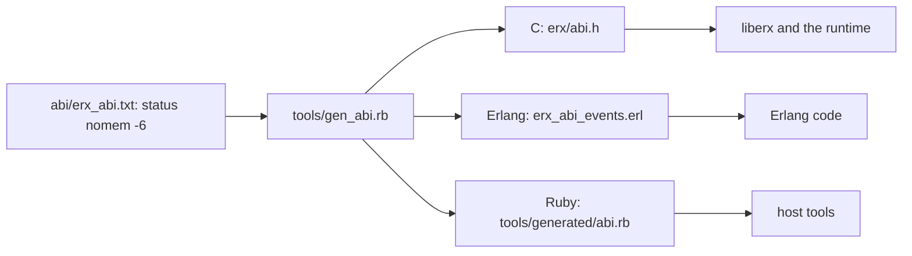
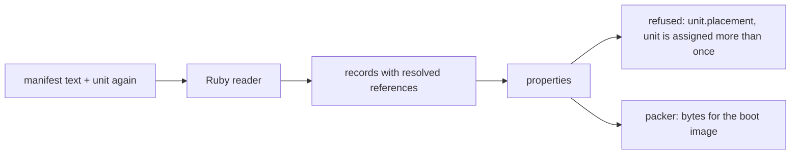

# Chapter 7. One Source for Every Fact

> **Status.** **Built**: the ABI file, `abi/erx_abi.txt`, with the
> files it includes, and the Ruby generators that turn it into C,
> Erlang, Ruby and TypeScript; the hardware sources (CMSIS-SVD files
> for device registers and Arm's machine-readable data for system
> registers) and the accessors generated from them; the theme file and
> its contrast rules; the errno and signal tables with FreeBSD's
> numbers; the descriptor layouts the DMA check reads, for virtio's
> split ring and GENET's register ring; the system manifest and its
> build check, with a seeded test per property; the table of declared
> services and the check that holds code to it; the inspection schema.
> **Designed**: the ADMA2 descriptor form for the SD controller, and
> an evaluation of the manifest's relational rules in awklog, a
> Datalog engine. The build uses no Datalog.

**Background needed.** [Chapter 6](README.md#chapter-6-correct-by-construction)
for "by construction" and chokepoint checks;
[chapter 3](03-erlang.md) for Erlang modules, atoms, macros and
guards; [chapter 1, section 1.5](01-operating-systems.md#15-devices-interrupts-dma-and-caches)
for device registers, DMA and descriptor rings.

The number -6 means "memory budget exhausted" in erXos. The C code in
`liberx` returns it, the Erlang runtime turns it into the atom
`nomem`, and the host tools print its description. If one of them said
-7, a program would report the wrong error, and nothing would crash to
show it.

No one in erXos writes -6 in any of those places. It is written once,
on one line of one text file, and a program in the build writes every
other copy. This chapter is about that habit: state a fact once, and
let the build write every copy and check every rule that follows.

UNIX systems know the idea in a few places. FreeBSD keeps its system
calls in one file, `sys/kern/syscalls.master`, whose header says it is
"Processed to created init_sysent.c, syscalls.c and syscall.h". The
entry for `read` gives its number, 3, and its C prototype; the
kernel's dispatch table and its table of call names follow from it.
Much else is still written twice by hand. The errno numbers sit in a
header and again in the messages `strerror` reads; a device's register
offsets sit in a driver and again in a debugger.

erXos makes the FreeBSD habit the rule. Every table, format and
decision has one source. Where C, Erlang, Ruby and TypeScript need the
same fact, a Ruby generator writes all four from it during the build.
Where a fact can be checked, such as a color's contrast or a
configuration's sums, the build checks it.

Section 7.1 states the problem and the rule. Sections 7.2 and 7.3 walk
the ABI file and the rules its specs follow. Sections 7.4 to 7.8 apply
the idea to hardware registers, the desktop's theme, the DMA check,
the machine's configuration and its services. Section 7.9 says what
happens when a source is wrong, and section 7.10 where Datalog fits.

## 7.1 Parallel copies, and the rule that replaces them

Two copies of one fact stay equal only while everyone who changes one
remembers the other. A C header defines a structure; an Erlang module
decodes the same bytes with its own offsets; a Ruby tool packs them
for the boot image. Change a field's width in the header and the
system still builds, but the Erlang decoder reads the wrong bytes
until someone notices a wrong value.

> **Background: application binary interface.** An ABI says what two
> pieces of compiled code must agree on to work together at the level of
> bits: which number names each call, which register holds each
> argument, how many bytes a structure has and where each field sits,
> which integer means which error. An API is a promise in source code:
> "call `read` with a descriptor, a buffer and a length". An ABI is the
> same promise after compilation: "put 3 in this register, the
> descriptor in that one". Programs compiled from different languages
> share no source, so the ABI is all they share. If they disagree,
> nothing fails at build time.

erXos's kernel interface is such an ABI, and so is each format that
crosses a boundary: a message between domains, a boot image, a ring a
device reads. Each is read and written in several languages: C in
`liberx`, C and Erlang in the runtime, Ruby in the tools that pack
images and talk to a booted machine, TypeScript in the web client.

The usual defense is a test that compares the copies. It covers the
copies someone thought to compare. [Chapter
6](README.md#chapter-6-correct-by-construction) calls this open-ended
enumeration: the claim "every copy agrees" rests on a list, and the
next person to add a consumer does not know the list exists. erXos
removes the list. Its rule, from [design.md, One source for the ABI
and the
hardware](../design.md#one-source-for-the-abi-and-the-hardware), has
two parts:

* every decision, table and format has exactly one implementation, and
  C, Erlang, Ruby and TypeScript share a table only by generation from
  one source;
* a fact the build can compute is never written by hand and then
  checked for agreement; the build computes it.

> **Background: code generation.** A generator is a program that writes
> another program's source. It reads a specification, a file that states
> facts in a fixed, simple grammar, and prints C, Erlang or any other
> language from it. `yacc` is a familiar one: it reads a
> grammar and prints a C parser. A generator turns "remember to update
> the other file" into "run the build". Its outputs cannot disagree,
> since they all come from one reading of one file.

The second part matters as much. A structure's size follows from its
fields, and a count from a list. Written by hand, such a value is one
more copy, and the check that compares it with the real value is one
more test to keep.

## 7.2 The ABI file

The kernel interface and every fixed binary layout erXos defines live
in `abi/erx_abi.txt` and its includes. The root file, about 1,160
lines, includes about forty fragments under `abi/`: `kernel.txt` for
rights and kernel-visible layouts, `services/*.txt` for interfaces
between domains, `formats/*.txt` for on-disk and on-wire records, and
others. [design-generation.md, Sources and
outputs](../design-generation.md#sources-and-outputs) lists what each
holds. The generator, `tools/gen_abi.rb` with its library under
`tools/lib/erx/abi_*.rb`, reads all of them as one declaration set.

### 7.2.1 One line, three outputs

Status codes are the simplest declarations. Here are four of the
eighteen, from `abi/erx_abi.txt`:

```text
status ok 0 "success"
status inval -1 "invalid argument"
status stale -2 "stale capability or object"
status nomem -6 "memory budget exhausted"
```

Each line is a keyword, a name, a value and a description, and nothing
else. Figure 7.1 shows where the `nomem` line goes.



*Figure 7.1. One declaration and its outputs. Every consumer reads a
generated file; none reads another consumer's copy.*

Figure 7.2 shows the three outputs, which the build writes under
`build/gen/`. In C, `build/gen/include/erx/abi.h` has a constant and a
lookup table:

```c
#define ERX_ENOMEM (-INT32_C(6))
/* ... */
static inline const char *
erx_status_name(erx_status_t status)
{
	static const char *const table[] = {
		[0] = "ok",
		/* ... */
		[6] = "nomem",
		/* ... */
```

In Erlang, `build/gen/erlang/apps/erx/src/generated/erx_abi_events.erl`
has a function with one clause per status:

```erlang
%% Generated by tools/gen_abi.rb from abi/erx_abi.txt and its inputs.
%% Do not edit this file.
%% ...
-spec status(integer()) -> atom() | unknown.
status(0) -> 'ok';
%% ...
status(-6) -> 'nomem';
```

In Ruby, `build/gen/tools/generated/abi.rb` has a frozen constant the
host tools look up by name:

```ruby
"enomem" => Constant.new(
  name: "enomem",
  value: -6,
  type: types.fetch("i32"),
  description: "memory budget exhausted".b
).freeze,
```

*Figure 7.2. The `nomem` declaration in C, Erlang and Ruby. The
name, value and description agree because one program wrote all
three from one line.*

Notice what each language gets: a shape that suits it. C gets a macro
and an array indexed by the negated value. Erlang gets a function that
answers `unknown` for a value no status holds, so an untrusted number
never becomes an atom it did not already know. Ruby gets an immutable
object. The generator does not translate a C header; it derives each
language's form from the declaration.

### 7.2.2 A layout, its offsets and the compiler's word on them

Binary layouts carry many numbers each, and that is where hand-written
copies fail most often. Here is the entry of a virtio descriptor
table, from `abi/formats/virtio.txt`:

```text
# One entry of a queue's descriptor table.
layout erx_virtq_desc wire_le 8 16
  field addr u64 0
  field len u32 8
  field flags u16 12
  field next u16 14
```

The first line says the layout is little-endian on the wire
(`wire_le`), aligned to 8 bytes and 16 bytes long. Each field gives its
type and its offset. The generator checks that the fields do not
overlap, that each is aligned to its own width, and that they fit the
16 bytes. Then it writes a C structure and asks the compiler to
confirm it:

```c
struct erx_virtq_desc {
	_Alignas(8) uint64_t	addr;
	uint32_t	len;
	uint16_t	flags;
	uint16_t	next;
};
_Static_assert(sizeof(erx_virtq_desc_t) == ERX_VIRTQ_DESC_SIZE, "erx_virtq_desc size");
/* ... */
_Static_assert(offsetof(erx_virtq_desc_t, len) ==
    ERX_VIRTQ_DESC_OFF_LEN, "erx_virtq_desc.len offset");
```

The offsets are written in the spec because the virtio specification
fixes them, and the spec should read like that document. Where a spec
writes a value the generator could compute, the generator checks it.
The `_Static_assert` lines add a second witness, the C compiler, a
tool erXos does not control: if it laid the structure out differently,
the build would stop.

The same declaration yields a Ruby description of the layout for the
host tools, so they agree with the C. Section 7.6 shows one more
consumer: the check that every DMA plan passes.

### 7.2.3 What else the file declares

The grammar ([design-abi.md, Source
grammar](../design-abi.md#source-grammar)) has a fixed set of forms,
among them:

| Form | States |
| --- | --- |
| `limit` | a named constant of a given type, such as `page_size` |
| `enum`, `flags` | a closed set of names with explicit values or bit positions |
| `layout` | a fixed binary record, as above |
| `status`, `errno`, `signal` | result codes and the POSIX tables |
| `reader` | a bounded table-and-string structure, with a generated reader that checks every reference |
| `call` | a kernel call: its arguments, where each travels, what it may wait for and what it charges |
| `service` | an interface between domains and its operations |

The `reader` form describes packed tables such as the system manifest
(section 7.7). From it the generator writes a C reader that takes a
byte span and returns either a checked view or a typed diagnostic,
never a half-checked view. The `call` form is built; the file declares
one call with it, `debug_log`, and the generator writes its stubs for
each backend of `liberx`. `liberx`'s other kernel calls are declared
by hand in `liberx/backend/api.h`, using the generated types and
status codes. [Chapter
8](README.md#chapter-8-the-kernel-interface-and-fiasco) describes
them.

## 7.3 The rules every spec follows

A spec helps only if it is easier to trust than the code it replaces.
Seven rules, from erXos's working agreement and [design-abi.md, Source
grammar](../design-abi.md#source-grammar), keep its specs so.

**State facts; derive the rest.** A spec says what is true. The
generator computes every value that follows: a C name from a spec
name, a table's size, a hash, a lookup in the other direction. Section
7.2.2 showed the one exception, values a source document fixes, and
those the generator checks.

**Close every set.** Every column that names something has a fixed
list of allowed values. A layout's storage is one of `wire_le`,
`shared`, `native`, `packed_le` or `packed_be`; a signal's default
action is one of `terminate`, `ignore`, `stop`, `continue` or
`reserved`. An `enum` lists every member with an explicit value. A
value outside the list is an error at generation, not a new case
that some consumer forgets.

**No expressions.** The grammar has no arithmetic, no interpolation,
no conditionals and no includes searched for by name. A reader of the
spec sees each value written out, and the generator has nothing to
evaluate. A spec that grows a language of its own becomes a second
program to debug.

**Strict.** Unknown keywords, surplus tokens, a repeated property and
a tab in the indentation all fail the run. So do two names that differ
in the spec but would yield the same C, Erlang or Ruby name.

**Fail whole.** The generator runs three pure stages. It parses the
bytes into declarations with their file and line, checks the whole
set, and builds an immutable plan of every output path and its bytes.
Only then does it write; an invalid declaration produces a diagnostic
and no output ([design-abi.md, Contract and
ownership](../design-abi.md#contract-and-ownership)). This is chapter
6's functional core again: the decisions are pure, and the one effect,
writing files, comes last.

**Sorted and deterministic.** The constants in `erx/abi.h` appear
sorted by name (`ERX_ELIMIT`, `ERX_END_OFF`, ..., `ERX_ENOMEM`),
whatever order the spec lists them in. The same inputs give the same
bytes, one reason erXos's boot images are reproducible.

**Generated files are not checked in.** A generated file in the tree
would be a second copy, and someone would edit it.

### 7.3.1 Tables that must match someone else's

Some facts belong to another system. A program ported from FreeBSD
expects `ENOENT` to be 2 and `strerror` to say "No such file or
directory". erXos's errno table, `abi/errno.txt`, holds every name its
C library defines with FreeBSD 15.1's number. The generator writes
musl's `bits/errno.h` from it, so musl's errno values, and the
`strerror` table indexed by them, are FreeBSD's.

The real source here is outside the tree, so erXos adds one test,
`test/host/abi_errno_test.rb`, that compares its table with FreeBSD's
`sys/sys/errno.h` at a pinned version. The test compares erXos's one
copy with FreeBSD's; erXos has no copies of its own to compare. The
signal table, `abi/signals.txt`, takes FreeBSD's numbers and its
`sys_siglist` texts the same way.

## 7.4 The hardware has one source too

A driver writer usually copies a device's register layout from the
chip's manual into `#define` lines: this field starts at bit 21 and is
5 bits wide. A wrong shift or mask is silent; the device does
something other than asked. erXos takes register meanings from
machine-readable sources instead.

> **Background: CMSIS-SVD.** Chip vendors describe their devices'
> registers in machine-readable files so that debuggers and code
> generators need not copy manuals by hand. CMSIS-SVD, the System View
> Description format, is Arm's XML format for such files. An SVD file
> describes memory-mapped registers "from high-level peripheral
> functions down to individual register bit fields" (Arm, CMSIS-SVD
> documentation). It gives each register's offset, width and access,
> and each field's bit position, width and named values.
> Vendors ship these files with their device support packs.

Every peripheral erXos drives has an SVD file under `hw/svd/`, from
the PL011 UART and the PL031 real-time clock to the Raspberry Pi 4's
GENET Ethernet controller, SD controller and watchdog, and the
virtio-mmio transport. A vendor's file enters the tree as an import
with its origin recorded. The PL011's is UART0 from the Raspberry Pi
Pico SDK's `rp2040.svd`, carved out by `tools/carve_pl011_svd.rb`,
which refuses an upstream file whose SHA-256 differs from the pinned
one (`hw/svd/pl011/ORIGIN.md`). Where no vendor file exists, erXos
writes one from the device's documentation and cites it in the file's
head comment.

### 7.4.1 One register, from XML to a driver

The GENET controller talks to the Ethernet PHY, the chip that drives
the cable, through one command register. Its declaration in
`hw/svd/genet/genet.svd` reads, shortened:

```text
<register>
  <name>MDIO_CMD</name><ownedByNif>false</ownedByNif>
  <addressOffset>0xe14</addressOffset><access>read-write</access>
  <fields>
    <field><name>VALUE</name>  ...<bitOffset>0</bitOffset><bitWidth>16</bitWidth></field>
    <field><name>REG</name>    ...<bitOffset>16</bitOffset><bitWidth>5</bitWidth></field>
    <field><name>PMD</name>    ...<bitOffset>21</bitOffset><bitWidth>5</bitWidth></field>
    <field><name>WRITE</name>  ...<bitOffset>26</bitOffset><bitWidth>1</bitWidth></field>
    <field><name>READ</name>   ...<bitOffset>27</bitOffset><bitWidth>1</bitWidth></field>
    <!-- ... READ_FAILED, START_BUSY -->
  </fields>
</register>
```

Each field's description in the file cites the FreeBSD header the
meaning was taken from (`if_genetreg.h`). `tools/gen_hw.rb` reads the
file, checks it, and writes a C header and an Erlang include file. For
the `PMD` field, the PHY's address, the Erlang file
`erx_hw_genet.hrl` defines its shift, width and mask, and three macros:

```erlang
-define(ERX_HW_GENET_MDIO_CMD_PMD_SHIFT, 21).
-define(ERX_HW_GENET_MDIO_CMD_PMD_WIDTH, 5).
-define(ERX_HW_GENET_MDIO_CMD_PMD_MASK, 16#3e00000).
-define(ERX_HW_GENET_MDIO_CMD_PMD_GET(Word), (((Word) bsr 21) band 16#1f)).
-define(ERX_HW_GENET_MDIO_CMD_PMD_FITS(Value), (is_integer(Value) andalso (Value) >= 0 andalso (Value) =< 16#1f)).
%% ERX_HW_GENET_MDIO_CMD_PMD_PUT(Value) places Value at bit 21, or fails
%% with badfield when it does not fit.
```

The Erlang driver that sends PHY commands,
`erlang/apps/erx_net/erxos/erx_mdio.erl`, builds its command word from
those macros alone:

```erlang
command({read, Phy, Reg}) when ?ERX_HW_GENET_MDIO_CMD_PMD_FITS(Phy), ?ERX_HW_GENET_MDIO_CMD_REG_FITS(Reg) ->
    ?READ bor ?ERX_HW_GENET_MDIO_CMD_PMD_PUT(Phy) bor ?ERX_HW_GENET_MDIO_CMD_REG_PUT(Reg);
```

Notice two things. The driver has no shift and no mask; 21 and `16#1f`
appear only in the generated file. And the `FITS` macro is an Erlang
guard, so a PHY address of 32 matches no clause. A hand-written `(Phy
bsl 21)` would let it spill into the neighboring `WRITE` bit.

The generator refuses an SVD file it does not wholly understand.
Fields must fit their register without overlapping, and registers must
fit their peripheral's address block. Every register must say whether
the device NIF, the C part of ERTS that touches devices for Erlang
drivers, owns it (`ownedByNif`, erXos's one extension, used in section
7.6). An unknown extension element is an error, so no file is ever
half read ([design-generation.md, Register
inputs](../design-generation.md#register-inputs)).

The C side gets accessors that perform one volatile access of the
declared width. It also gets the table through which the device NIF,
`erx_device`, resolves the register names an Erlang driver uses. A
driver reads and writes registers by name, such as `mdio_cmd`, and the
NIF refuses an access the register's declaration does not allow.

### 7.4.2 The processor's own registers

A processor also has system registers, read with special instructions
rather than at memory addresses, such as the counter's frequency or
the registers that say which instructions the CPU supports. Arm
publishes their encodings and fields as machine-readable data under a
BSD license. erXos pins one release (its SHA-256 is in `deps.lock`)
and extracts the eight registers it uses into
`hw/sysreg/aarch64.json`, keeping Arm's notice and the exact source
identity (`hw/sysreg/ORIGIN.md`). The generator writes
`erx/arch/aarch64/sysreg.h` from it, and `liberx`'s CPU-feature code
reads the registers through it. A check recreates the JSON from the
pinned archive, so it cannot drift from Arm's.

Terminal escape rules (`abi/terminal.txt`) and keyboard layouts
(`abi/keymaps/us.txt`) have generators of their own in the same way.

## 7.5 One theme, three languages

erXos's desktop draws the same look in three places: Erlang widgets, C
drawing code, and the web client in a browser. Each needs the same
font sizes, spacing, corner radii and colors. `abi/theme.txt` declares
them once:

```text
  role body     font ui size 13 line 20 weight regular
  color text       1B1C1E FFFFFF
  color accent     0E7A6B 7FE7F2
  color on_accent  FFFFFF 0D0F2A
  # The WCAG 2 contrast ratio each foreground meets on each background
  # named, in each palette.
  contrast on_accent on accent 4.5
```

Each `color` row gives a light-palette value and a dark one. The
`contrast` row is a rule: text drawn in `on_accent` over `accent` must
reach a contrast ratio of 4.5 in both palettes, as the WCAG 2
accessibility guidelines define it. The generator computes the ratio
for every pair a rule names (`contrast_ratio` in
`tools/lib/erx/abi_theme.rb`) and fails the build if one falls short.
A designer who darkens `accent` and forgets the text on it gets a
build error, not a button no one can read.

From the one file the generator writes `erx_theme.erl` for the Erlang
renderer (`color(light, accent) -> 16#0e7a6bff;`), `erx/theme.h` for C
(`.accent = 0x0e7a6bu`), and `theme.ts` for the browser
(`["--erx-color-accent", "#0e7a6b"]`, a CSS custom property).
[design-desktop-programs.md, The theme: one
declaration](../design-desktop-programs.md#the-theme-one-declaration)
describes the theme's roles.

## 7.6 The descriptor formats behind the DMA check

[Chapter 6](README.md#chapter-6-correct-by-construction) introduced
`erx_device_dma_check`, in
`otp/erts/emulator/nifs/erxos/erx_device_dma.h`, which refuses a DMA
plan that would give a device an address outside the domain's DMA
memory. To do that it must know where a device finds addresses. A
descriptor (chapter 1's [descriptor
ring](01-operating-systems.md#154-direct-memory-access)) holds an
address field and a length field, and the check must find every store
to either.

That knowledge comes from the declarations of this chapter, not from
numbers in the check. For virtio's split ring, the queue's code fills
the check's description of the form from the generated layout of
section 7.2.2, in `erx_device_queue.c`:

```c
	context->descriptor_size = ERX_VIRTQ_DESC_SIZE;
	context->address_field = offsetof(erx_virtq_desc_t, addr);
	context->address_width = sizeof(((erx_virtq_desc_t *)0)->addr);
	context->length_field = offsetof(erx_virtq_desc_t, len);
	context->length_width = sizeof(((erx_virtq_desc_t *)0)->len);
```

With these the check holds every plan to two rules
([design-device-dma.md, Calls, observations and plans](../design-device-dma.md#calls-observations-and-plans)):
an address reaches a descriptor only as an address step, which was
checked against the domain's memory, and the same plan stores that
descriptor's length equal to the reach that was checked. A plain number
cannot land in an address field, and a length cannot pass what its
address was checked for.

GENET's descriptors are registers, not memory. For it the form names
the descriptor registers (`rx_desc_status`, `rx_desc_addr_lo`,
`rx_desc_addr_hi` and their transmit twins, in `erx_device_genet.c`).
The NIF resolves them through the register table generated from
`genet.svd`, so their offsets and stride come from section 7.4's
source. The `ownedByNif` mark on each register says which registers
only the NIF may write: those through which a write could aim the
device at memory. A driver's write to an owned field fails with
`badarg`.

The result is a check with no layout knowledge of its own. If the
virtio layout in the spec changed, the queue code and the check would
follow it in the next build. The ADMA2 form, which would let the
Raspberry Pi 4's SD controller move blocks by DMA through descriptor
tables, follows the same pattern in [design-device-dma.md, The
descriptor forms](../design-device-dma.md#the-descriptor-forms). The
ADMA2 form is designed and not built.

## 7.7 The system manifest: the machine's configuration, checked

A FreeBSD machine's configuration is spread across `/boot/loader.conf`,
`/etc/rc.conf`, `/etc/devfs.rules`, jail configurations and more, each
read by a different program at a different moment. No program sees all
of it, so no program can say whether the whole is safe.

erXos has one file, the **system manifest** ([chapter 4, section
4.5.4](04-history.md#454-declarative-where-it-simplifies)). For QEMU's
`virt` machine it is the records every board takes,
`config/manifest/development.txt`, followed by the board's own part,
`config/manifest/qemu-virt-development.txt`. It names the machine's
memory, each domain with its principal, limits and release, and each
device with its holder. It also names each service and each **facet**,
a grant that lets one domain reach one service of another ([chapter
11](README.md#chapter-11-authority-and-security) explains facets). A
domain and a device look like this:

```text
domain storage
  principal @principal.system
  limits @limits.storage
  kind service
  runtime @artifact.emu
  release @artifact.storage
  restarts 5
  restart_period_s 600
  # ...
unit block
  placement "block"
  holder @domain.storage
```

The `unit` record gives the block device to the storage domain. An `@`
name refers to another record.

### 7.7.1 The check

The packer, `tools/erx pack`, reads the manifest with the Ruby reader
in `tools/lib/erx/manifest.rb`, runs the manifest check over it, and
packs only the bytes the check returns. No other path leads from the
text to the boot image. The packer's one way to get the manifest's
bytes is `Manifest.admit`, which returns them only when every property
holds ([design-fiasco.md, The manifest
check](../design-fiasco.md#the-phase-1-manifest-check)). At boot, the
system domain reads those bytes through readers generated from the
manifest's layout in `abi/manifest.txt`, and nothing else configures a
domain, a device's holder or a budget.

The properties come from
[design-system.md, The manifest](../design-system.md#the-manifest).
On Fiasco the check keeps most of them, among them:

* each device and unit has one holder;
* every facet names a service the manifest declares, served by a
  domain the manifest configures;
* exactly one domain, `pcie`, holds a PCIe bridge's configuration
  space, and nothing else;
* budgets and CPU shares sum within the machine's memory and the
  parent's share;
* the system domain, which every other domain depends on, is not given
  a runtime that compiles code at run time;
* the domains' boot order has no cycle.

The sums are checked when the image is built. Fiasco does not enforce
a budget's limit at run time. A configuration that passes the check is
one whose numbers add up, not one the kernel holds to them ([chapter
12](README.md#chapter-12-memory-and-budgets) says what the system does
enforce).

### 7.7.2 A seeded violation, traced

Each property has a test in `test/host/manifest_check_test.rb` that
plants one violation and expects one diagnostic. The test for "each
unit has one holder" appends a second record for the block device to
the development manifest:

```text
unit again
  placement "block"
  holder system
```

Figure 7.3 follows the record through the check.



*Figure 7.3. The manifest check as a pipeline. The seeded record is
read and resolved like any other; the one-holder property refuses
it, and the packer receives nothing.*

The reader accepts the record, which is well formed. The property then
finds two units placed at `"block"` and refuses the manifest, naming
the field, `unit.placement`, and the reason, "unit is assigned more
than once". No image is built. The test passes only on that
diagnostic, so a change that broke the property, or reported it under
another rule, would fail it.

## 7.8 Declared services and inspection paths

A design document can say "a domain reaches another only through a
declared service", but a sentence stops nothing. erXos turns the
sentence into data the build checks.

Every interface between domains is declared in a file under
`abi/services/`. The clock's, `abi/services/clock.txt`, is short:

```text
# The clock interface (docs/design-time.md, "The clock facet"): the wall clock's one
# authority, served by the system domain's clock service, erx_clock. ...
service clock 13
  served_as message
  operation sample 1
  operation set 2
```

The citation in the head comment is not decoration. The facet check,
in `tools/lib/erx/facet_names.rb`, reads the first design citation in
each file as the section that justifies the interface. It refuses a
file that cites none, or cites a section the document does not have.
It also refuses a manifest service whose interface no file declares,
and a facet name used in Erlang code that no manifest service
publishes. A programmer who adds a way for one domain to reach another
must add a declaration, and the declaration must point at a design.
[Chapter 11](README.md#chapter-11-authority-and-security) shows how a
facet admits each request.

What the system observes about itself goes the same way.
`abi/inspection.txt` declares each value `/proc` and the inspector can
show, with its type, its unit, who may report it, who may see it and
where it is projected:

```text
    attr processes count reporters runtime visible owner build all projections shell,host,proc,web
```

From the schema the generator writes the Erlang module `erx_schema`
and the TypeScript the web client reads. The shell, `/proc` and the
browser therefore name each field and its unit alike
([design-generation.md, Inspection and
diagnostics](../design-generation.md#inspection-and-diagnostics)). A
field that is not declared cannot be shown, and a value that was not
measured is shown as unknown, unsupported or partial, never as a
made-up number.

## 7.9 When a source is wrong

One wrong source makes every copy wrong together. erXos accepts that
trade and makes a wrong source fail early.

**A malformed spec** fails generation with a diagnostic naming the
file, line, declaration and rule, before any compiler runs. A
publication cut short, by a full disk say, leaves a tree that fails
its stamp, and the next build regenerates it.

**A well-formed but wrong value**, such as a field offset that
disagrees with the virtio specification, passes generation. Tests that
check the format against an independent description catch it: the
Erlang reader's hostile corpus, the fuzz targets built from the
generated C readers, the boots that drive QEMU's virtio devices. The
fix goes in the spec, and every consumer moves with it.

**A wrong hardware description** shows up as a device misbehaving.
Each SVD field cites its source, so "where did bit 21 come from?" has
an answer in the file.

**A wrong configuration** fails the manifest check before an image
exists. One that passes the check but leaves the machine too little
memory fails at boot with a diagnostic, as
[design-fiasco.md, The manifest check](../design-fiasco.md#the-phase-1-manifest-check)
describes for `root_memory`.

What cannot happen is the failure this chapter began with: two copies
that disagree.

## 7.10 Where Datalog fits, and where it does not

erXos's principles name Datalog as one of the declarative forms it may
use, after Barrelfish and the BOOM project
([chapter 4, section 4.5.4](04-history.md#454-declarative-where-it-simplifies)).
The build uses none. This section says why.

> **Background: Datalog.** Datalog is a logic language for asking
> questions of a set of facts. A **fact** states that something holds:
> `parent(xerces, brooke).` A **rule** derives facts from facts:
> `ancestor(X, Y) :- parent(X, Y).` and
> `ancestor(X, Y) :- parent(X, Z), ancestor(Z, Y).`, read "X is an
> ancestor of Y if X is a parent of Y, or a parent of some Z who is an
> ancestor of Y". A **query** asks which values fit a pattern:
> `?- ancestor(xerces, X).` Datalog borrows Prolog's syntax but works
> from facts to conclusions, and every program terminates. It suits
> questions about relations: who reaches whom, what depends on what.

Barrelfish, an operating system from ETH Zurich and Microsoft
Research, kept a **system knowledge base**. In its authors' words, it
"maintains knowledge of the underlying hardware in a subset of
first-order logic" (Baumann and others, 2009), and it answered queries
such as which core should run a device's driver. The BOOM project at
Berkeley wrote distributed systems as rules over state and events.
[research-os-ideas.md](../research-os-ideas.md#declarative-os-services-from-boom-and-dedalus)
records both as research ideas, not as erXos's design.

One rule decides each case: a declarative form is chosen when it turns
a property into a checked constraint and is simpler than code. The
specs of this chapter need no rules engine, because each fact follows
from one line.

The manifest is the one place where relations matter: who holds which
device, which facet points at which server, whether boot order has a
cycle.
[design-verification.md, Focused tool evaluations](../design-verification.md#focused-tool-evaluations)
describes an evaluation of those rules in awklog, a Datalog engine
written in AWK. Ruby would read and check the manifest as it does and
emit typed facts. awklog would then check ownership, facet targets,
boot-order cycles and rescue closure, with the Ruby check as an
independent oracle. The budget sums would stay in Ruby, because awklog
has no arithmetic. awklog would be adopted only if the rules came out
clearer without becoming a second source of policy. The evaluation is
designed and not built.

The desktop's find-and-act rules show the other outcome.
[design-find-act.md, Alternatives considered](../design-find-act.md#alternatives-considered)
weighed awklog, Soufflé (a Datalog engine built for program analysis)
and a Datalog engine in Erlang for them, and chose none: those rules
use no joins, so each engine would add a tool for nothing.

## 7.11 Design choices

**Write the headers by hand and test them.** This works when one
language consumes the ABI. erXos has four, and each test that compares
two of them is one more entry in a list someone forgets to extend.
Generation costs about forty Ruby files under
`tools/lib/erx/abi_*.rb` and a grammar to learn. That cost is paid
once; the cost of copies grows with every consumer.

**Make the C header the source, and parse it for the others.** C has
no way to state a closed set of values or who owns each field of
shared memory. Nor can it say which fields a release build may show,
or which design section justifies an interface. A C parser would also
be a large tool to trust. A small grammar made for the purpose says
more and is easier to check.

**Use a general interface language**, such as Protocol Buffers or
ASN.1. These describe messages well, but bring wire formats, runtimes
and generators of their own, and they do not describe kernel calls,
register fields or contrast rules. erXos's grammar shares one model
across all of these, so `u32` or `page_size` is declared once for
every form.

**Check the configuration at boot.** The manifest check could run in
the system domain as it starts. It runs in the build instead, so a bad
configuration never becomes an image, and each property is tested on
the host, where a failure costs seconds.

The ABI file describes the kernel interface; behind that interface sit
`liberx` and Fiasco, and
[chapter 8](README.md#chapter-8-the-kernel-interface-and-fiasco)
follows a call through both.

## Summary

erXos states each fact once, in a text file a program reads, and the
build writes every copy. `abi/erx_abi.txt` and its fragments hold the
kernel interface's status codes, rights, limits and layouts, from
which Ruby generators write C, Erlang, Ruby and TypeScript that is
never checked in. The specs state facts only, close every set of
values, allow no expressions, parse strictly, fail whole and print
sorted output. Device registers come from CMSIS-SVD files and system
registers from Arm's data, so no driver packs a bit by hand, and the
DMA check reads its descriptor layouts from the same declarations. One
theme file gives three languages the desktop's look and holds its
colors to contrast rules. The build packs only a system manifest that
passes every property, each with a seeded test. Services and
inspection paths are declared in tables the build holds code to.
Datalog is not used; an awklog form of the manifest's relational rules
is designed and not built.

## Where to read next

* [design-generation.md](../design-generation.md): the generation
  rules, every source and its outputs, the hardware and terminal
  sources.
* [design-abi.md](../design-abi.md): the declaration grammar, with
  [A complete declaration example](../design-abi.md#a-complete-declaration-example)
  and the
  [System-manifest representation](../design-abi.md#system-manifest-representation).
* [design-system.md, The manifest](../design-system.md#the-manifest):
  the manifest's records and the properties the check holds it to.
* [design-device-dma.md](../design-device-dma.md): the DMA check, the
  sequencer and the descriptor forms.
* [design-verification.md, Focused tool evaluations](../design-verification.md#focused-tool-evaluations):
  the awklog evaluation.
* FreeBSD, `sys/kern/syscalls.master`
  (<https://github.com/freebsd/freebsd-src/blob/releng/14.3/sys/kern/syscalls.master>):
  the UNIX precedent for generating system-call tables.
* Arm, CMSIS-SVD documentation
  (<https://open-cmsis-pack.github.io/svd-spec/main/index.html>): the
  register description format.
* Andrew Baumann and others, "The Multikernel: A new OS architecture
  for scalable multicore systems", SOSP 2009, section 4.9: Barrelfish's
  system knowledge base.
* [research-os-ideas.md](../research-os-ideas.md#declarative-os-services-from-boom-and-dedalus):
  BOOM, Dedalus and Barrelfish's declarative hardware management, with
  links to the papers.
