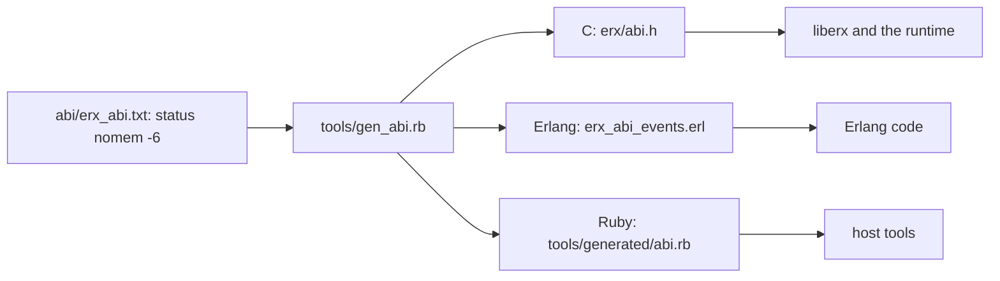
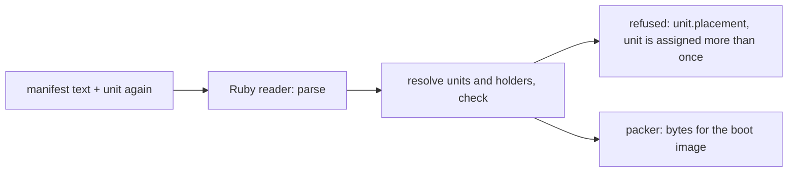

# Chapter 7. One Source for Every Fact

> **Status.** **Built**: the ABI file and its generators; register
> accessors generated from the hardware sources; the theme and its
> contrast rules; the errno and signal tables; the system manifest and
> its build-time check; the declared services and inspection schema.
> **Designed**: the ABI file declaring every kernel call (it declares
> one); budgets that refuse a charge at run time; per-domain CPU
> limits; the ADMA2 descriptor form for the SD controller.

**Background needed.** [Chapter 6](06-construction.md) for "by
construction" and chokepoint checks; [chapter 3](03-erlang.md) for
Erlang modules, atoms, macros and guards; [chapter 1, section
1.5](01-operating-systems.md#15-devices-interrupts-dma-and-caches) for
device registers, DMA and descriptor rings.

The number -6 means "memory budget exhausted" in erXos. The C code in
`liberx` returns it, the Erlang runtime turns it into the atom
`nomem`, and the host tools print its description. If one of them said
-7, a program would report the wrong error, and nothing would crash to
show it.

No one in erXos writes -6 in any of those places. It is written once,
on one line of one text file, and a program in the build writes every
other copy. This chapter is about that habit: state a fact once, and
let the build write every copy and check every rule that follows.

UNIX systems know the idea in a few places. FreeBSD keeps its system
calls in one file, `sys/kern/syscalls.master`, whose header says it is
"Processed to created init_sysent.c, syscalls.c and syscall.h". The
entry for `read` gives its number, 3, and its C prototype, and the
kernel's dispatch table follows from it. Much else is still written
twice by hand, such as a device's register offsets, in a driver and
again in a debugger.

erXos makes the FreeBSD habit the rule. Where C, Erlang, Ruby and
TypeScript need the same fact, a Ruby generator writes all four from
one source during the build. Where a fact can be checked, such as a
color's contrast or a configuration's sums, the build checks it.

## 7.1 Parallel copies, and the rule that replaces them

Two copies of one fact stay equal only while everyone who changes one
remembers the other. A C header defines a structure; an Erlang module
decodes the same bytes with its own offsets. Change a field's width in
the header and the system still builds, but the Erlang decoder reads
the wrong bytes until someone notices a wrong value.

> **Background: application binary interface.** An ABI says what two
> pieces of compiled code must agree on at the level of bits: which
> number names each call, which register holds each argument, where
> each field of a structure sits, which integer means which error. An
> API is a promise in source code: "call `read` with a descriptor, a
> buffer and a length". An ABI is the same promise after compilation:
> "put 3 in this register, the descriptor in that one". Programs
> compiled from different languages share no source, so the ABI is all
> they share. If they disagree, nothing fails at build time.

erXos's kernel interface is such an ABI, and so is each format that
crosses a boundary: a message between domains, a boot image, a ring a
device reads. C, Erlang, Ruby and TypeScript code all read and write
them.

The usual defense is a test that compares the copies someone thought
to compare. [Chapter 6](06-construction.md#611-the-smell-open-ended-enumeration)
calls this open-ended enumeration: the claim "every copy agrees" rests
on a list, and the next person to add a consumer does not know the
list exists.

erXos removes the list. The project's rules for its code state the
rule in two parts, and [design-generation.md](../design-generation.md)
applies it to every interface:

* every table and format has exactly one source, and C, Erlang, Ruby
  and TypeScript share it only through files generated from that
  source;
* a fact the build can compute is never written by hand and then
  checked for agreement; the build computes it.

> **Background: code generation.** A generator is a program that writes
> another program's source. It reads a specification, a file that states
> facts in a fixed, simple grammar, and prints C, Erlang or any other
> language from it. `yacc` is a familiar one: it reads a grammar and
> prints a C parser. Its outputs cannot disagree, since they all come
> from one reading of one file.

The second part matters as much. A structure's size follows from its
fields; written by hand, it is one more copy, with one more test to
keep it right.

## 7.2 The ABI file

Every status code, right, limit and fixed binary layout erXos defines
is a line in `abi/erx_abi.txt` or one of the fragments it includes
under `abi/`: kernel layouts, interfaces between domains, on-disk and
on-wire records ([design-generation.md, Sources and
outputs](../design-generation.md#sources-and-outputs)). The
generator, `tools/gen_abi.rb`, reads all of them as one declaration
set.

### 7.2.1 One line, three outputs

A status code is one line. Here are two of the eighteen, from
`abi/erx_abi.txt`:

```text
status ok 0 "success"
status nomem -6 "memory budget exhausted"
```

Each line is a keyword, a name, a value and a description. Figure 7.1 shows where the `nomem` line goes.



*Figure 7.1. One declaration and its outputs. Every consumer reads a
generated file; none reads another consumer's copy.*

The next three blocks, together Figure 7.2, are what the build writes
under `build/gen/`. In C, `build/gen/include/erx/abi.h` has a constant
and a lookup table:

```c
#define ERX_ENOMEM (-INT32_C(6))
/* ... */
static inline const char *
erx_status_name(erx_status_t status)
{
	static const char *const table[] = {
		[0] = "ok",
		/* ... */
		[6] = "nomem",
		/* ... */
```

In Erlang, `build/gen/erlang/apps/erx/src/generated/erx_abi_events.erl`
has a function with one clause per status:

```erlang
-spec status(integer()) -> atom() | unknown.
status(0) -> 'ok';
%% ...
status(-6) -> 'nomem';
```

In Ruby, `build/gen/tools/generated/abi.rb` has a frozen constant the
host tools look up by name:

```ruby
"enomem" => Constant.new(
  name: "enomem",
  value: -6,
  # ...
  description: "memory budget exhausted".b
).freeze,
```

*Figure 7.2. The `nomem` declaration in C, Erlang and Ruby, written by
one program from one line.*

Notice that each language gets a shape that suits it. C gets a macro
and an array indexed by the negated value. Erlang gets a function that
answers `unknown` for a value no status holds, so an untrusted number
never becomes a new atom. Ruby gets an immutable object.

### 7.2.2 A layout, its offsets and the compiler's word on them

A binary layout carries many numbers, and each is a chance for a
hand-written copy to go wrong. Here is the entry of a virtio
descriptor table, from `abi/formats/virtio.txt`:

```text
# One entry of a queue's descriptor table.
layout erx_virtq_desc wire_le 8 16
  field addr u64 0
  field len u32 8
  field flags u16 12
  field next u16 14
```

The layout is little-endian on the wire (`wire_le`), aligned to 8
bytes and 16 bytes long. The generator checks that the fields neither
overlap nor leave a gap, that each is aligned to its own width, and
that they fill the 16 bytes. Then it writes a C structure and asks the
compiler to confirm it:

```c
struct erx_virtq_desc {
	_Alignas(8) uint64_t	addr;
	uint32_t	len;
	uint16_t	flags;
	uint16_t	next;
};
_Static_assert(sizeof(erx_virtq_desc_t) == ERX_VIRTQ_DESC_SIZE, "erx_virtq_desc size");
/* ... */
_Static_assert(offsetof(erx_virtq_desc_t, len) ==
    ERX_VIRTQ_DESC_OFF_LEN, "erx_virtq_desc.len offset");
```

The offsets are written in the spec because the virtio specification
fixes them; section 7.3 names this exception to "derive the rest".
The `_Static_assert` lines add a second check by a tool erXos does not
control, the C compiler: if it laid the structure out differently, the
build would stop. The same declaration yields a Ruby description for
the host tools, and section 7.6 shows one more consumer, the check
that decides whether a device may be handed an address.

### 7.2.3 What else the file declares

Besides `status` and `layout`, the grammar ([design-abi.md, Source
grammar](../design-abi.md#source-grammar)) has a fixed set of forms,
among them:

| Form | States |
| --- | --- |
| `limit` | a named constant of a given type, such as `page_size` |
| `enum`, `flags` | a closed set of names with explicit values or bit positions |
| `errno`, `signal` | the POSIX tables |
| `reader` | a packed table, such as the system manifest of section 7.7, with a generated C reader that returns a checked view or a diagnostic |
| `call` | a kernel call: its arguments, where each travels, what it may wait for and what it charges |
| `service` | an interface between domains and its operations |

Kernel calls are the one large exception to this chapter's rule. In
the design, the ABI file declares every kernel call, and `liberx`'s
code for each backend (one per kernel the interface can sit over) is
generated from it. That is designed and not built. Today the file
declares one call with the `call` form, `debug_log`, and the generator
writes its stubs. `liberx`'s other kernel calls are written by hand in
`liberx/backend/api.h`, using the generated types and status codes.
[Chapter 8](08-kernel-interface.md#82-liberx-the-one-issuer-of-kernel-calls) describes them.

## 7.3 The rules every spec follows

A spec helps only if it is easier to trust than the code it replaces.
Six rules, from the project's rules and [design-abi.md, Source
grammar](../design-abi.md#source-grammar), keep its specs so.

**State facts; derive the rest.** A spec says what is true. The
generator computes every value that follows: a C name from a spec
name, a table's size, a hash, a lookup in the other direction. The one
exception is a value a source document fixes, such as section 7.2.2's
offsets, and the generator checks those.

**Close every set, strictly.** Every column that names something has a
fixed list of allowed values: a signal's default action is one of
`terminate`, `ignore`, `stop`, `continue` or `reserved`. A value
outside the list is an error at generation, not a new case some
consumer forgets. So are unknown keywords, surplus tokens and two
names that would yield the same C, Erlang or Ruby name.

**No expressions.** The grammar has no arithmetic, no interpolation
and no conditionals. A reader of the spec sees each value written out.
A spec that grows a language of its own becomes a second program to
debug.

**Fail whole.** The generator parses the bytes into declarations with
their file and line, checks the whole set, and builds an immutable
plan of every output path and its bytes. Only then does it write. An
invalid declaration produces a diagnostic and no output
([design-abi.md, Contract and
ownership](../design-abi.md#contract-and-ownership)). This is chapter
6's functional core: the decisions are pure, and the one effect comes
last.

**Sorted and deterministic.** Outputs are sorted by name, whatever
order the spec lists them in, so the same inputs give the same bytes,
one reason erXos's boot images are reproducible.

**Generated files are not checked in.** A generated file in the tree
would be a second copy, and someone would edit it.

### 7.3.1 Tables that must match someone else's

Some facts belong to another system. A program ported from FreeBSD
expects `ENOENT` to be 2 and `strerror` to say "No such file or
directory". erXos's errno table, `abi/errno.txt`, gives every name
FreeBSD 15.1's number, and the generator writes musl's `bits/errno.h`
from it. Here the real source is outside the tree, so a test,
`test/host/abi_errno_test.rb`, holds erXos's one table to FreeBSD's
`sys/sys/errno.h` at a pinned version. The signal table,
`abi/signals.txt`, takes FreeBSD's numbers and texts the same way.

## 7.4 The hardware has one source too

A driver writer usually copies a device's register layout from the
chip's manual into `#define` lines: this field starts at bit 21 and is
5 bits wide. A wrong shift or mask is silent; the device does
something other than asked. erXos takes register meanings from
machine-readable sources instead.

> **Background: CMSIS-SVD.** CMSIS-SVD, the System View Description
> format, is Arm's XML format in which chip vendors describe their
> devices' registers for debuggers and code generators. In the format's
> documentation, the information "ranges from high level functional
> descriptions of a peripheral all the way down to the definition and
> purpose of an individual bit field in a memory mapped register". A
> file gives each register's offset, width and access, and each
> field's bit position, width and named values.

Every peripheral erXos drives has an SVD file under `hw/svd/`. A
vendor's file enters the tree as an import with its origin and
checksum recorded. Where no vendor file exists, erXos writes one from
the device's documentation and cites it in the file.

### 7.4.1 One register, from XML to a driver

The Raspberry Pi 4's GENET Ethernet controller talks to the PHY, the
chip that drives the cable, through one command register. Its
declaration in `hw/svd/genet/genet.svd` reads, shortened:

```text
<register>
  <name>MDIO_CMD</name><ownedByNif>false</ownedByNif>
  <addressOffset>0xe14</addressOffset><access>read-write</access>
  <fields>
    <!-- VALUE at bit 0, REG at bit 16 ... -->
    <field><name>PMD</name>    ...<bitOffset>21</bitOffset><bitWidth>5</bitWidth></field>
    <field><name>WRITE</name>  ...<bitOffset>26</bitOffset><bitWidth>1</bitWidth></field>
    <field><name>READ</name>   ...<bitOffset>27</bitOffset><bitWidth>1</bitWidth></field>
    <!-- ... READ_FAILED, START_BUSY -->
  </fields>
</register>
```

Each field cites the FreeBSD header its meaning came from.
`tools/gen_hw.rb` checks the file and writes a C header and an Erlang
include file. For the `PMD` field, the PHY's
address, `erx_hw_genet.hrl` defines its shift, width and mask, and
macros to get, check and put it (shortened):

```erlang
-define(ERX_HW_GENET_MDIO_CMD_PMD_SHIFT, 21).
-define(ERX_HW_GENET_MDIO_CMD_PMD_MASK, 16#3e00000).
-define(ERX_HW_GENET_MDIO_CMD_PMD_GET(Word), (((Word) bsr 21) band 16#1f)).
-define(ERX_HW_GENET_MDIO_CMD_PMD_FITS(Value), (is_integer(Value) andalso (Value) >= 0 andalso (Value) =< 16#1f)).
%% In summary (not the file's text): ERX_HW_GENET_MDIO_CMD_PMD_PUT(Value)
%% places Value at bit 21, or fails with badfield when it does not fit.
```

The Erlang module that builds PHY commands,
`erlang/apps/erx_net/erxos/erx_mdio.erl`, makes its command word from
those macros alone. Its `?READ` is its own short name for the
generated mask of the `READ` bit:

```erlang
command({read, Phy, Reg}) when ?ERX_HW_GENET_MDIO_CMD_PMD_FITS(Phy), ?ERX_HW_GENET_MDIO_CMD_REG_FITS(Reg) ->
    ?READ bor ?ERX_HW_GENET_MDIO_CMD_PMD_PUT(Phy) bor ?ERX_HW_GENET_MDIO_CMD_REG_PUT(Reg);
```

Notice two things. The module has no shift and no mask; 21 and
`16#1f` appear only in the generated file. And the `FITS` macro is an
Erlang guard, so a PHY address of 32 matches no clause. A hand-written
`(Phy bsl 21)` would put 32's one set bit at bit 26, the `WRITE` bit.

The generator refuses an SVD file it does not wholly understand:
overlapping fields, a register outside its peripheral's address block,
an unknown element ([design-generation.md, Register
inputs](../design-generation.md#register-inputs)). erXos adds one
element of its own, `ownedByNif`, which section 7.6 explains.

The C side gets accessors of the declared width. It also gets the
table through which the device NIF, `erx_device`, resolves register
names such as `mdio_cmd`; the device NIF is the C part of ERTS that
touches devices for Erlang drivers. The NIF refuses an access the declaration does not allow.

### 7.4.2 The processor's own registers

A processor also has system registers, read with special instructions
rather than at memory addresses, such as those that say which
instructions the CPU supports. Arm publishes their encodings and
fields as machine-readable data under a BSD license. erXos extracts
the registers it uses from one pinned release into
`hw/sysreg/aarch64.json`, and the generator writes
`erx/arch/aarch64/sysreg.h` from it. erXos's boot code reads the
registers through it, in kernel mode, and `liberx` decodes their
fields with it. A command recreates the JSON from the pinned archive
and reports any difference. Terminal escape rules and keyboard layouts
have generators of their own in the same way.

## 7.5 One theme, three languages

erXos's desktop draws the same look in Erlang widgets, C drawing code
and the web client. Each needs the same font sizes, spacing and
colors, and `abi/theme.txt` declares them once:

```text
  role body     font ui size 13 line 20 weight regular
  color text       1B1C1E FFFFFF
  color accent     0E7A6B 7FE7F2
  color on_accent  FFFFFF 0D0F2A
  contrast on_accent on accent 4.5
```

Each `color` row gives a light-palette value and a dark one. The
`contrast` row is a rule: text drawn in `on_accent` over `accent` must
reach a contrast ratio of 4.5 in both palettes. The WCAG 2
accessibility guidelines define the ratio: 1 is no contrast, 21 is
black on white, and 4.5 is their minimum for body text. The generator
computes the ratio for every pair a rule names and fails the build if
one falls short. A designer who darkens `accent` gets a build error,
not a button no one can read.

From the one file the generator writes `erx_theme.erl` for Erlang,
`erx/theme.h` for C, and `theme.ts` for the browser
([design-desktop-programs.md, The theme: one
declaration](../design-desktop-programs.md#the-theme-one-declaration)).

## 7.6 The descriptor formats behind the DMA check

Suppose the block driver wants the virtio disk to read one 4,096-byte
sector into a buffer. A descriptor (chapter 1's [descriptor
ring](01-operating-systems.md#154-direct-memory-access)) carries the
buffer's device address in its `addr` field and 4,096 in its `len`
field, and the device then writes 4,096 bytes there on its own. If
either were wrong, the device would write over memory the domain does
not own, and nothing in the processor would stop it.

So no driver writes a descriptor directly. The device NIF's code for
each **descriptor form**, the description of one kind of device's
descriptors (virtio's split ring, GENET's register ring), is pure. It
returns a plan of what to place in the descriptors. One independent
check reads the whole plan before anything reaches the hardware. It
verifies that every device address, with its length, stays inside the
queue's DMA memory, and that no region of that memory has two writers.
Only a checked plan reaches the effect layer, which writes it
([design-device-dma.md](../design-device-dma.md)).

The check must know where a descriptor keeps its address and its
length, and how wide each is. It takes those numbers from the
declarations of this chapter and holds none of its own. For virtio,
the queue code and the check read the offsets and widths of `addr` and
`len` from the generated layout of section 7.2.2. If the spec changed,
both would follow it in the next build.

GENET's descriptors are registers, not memory, and the NIF finds them
through the register table generated from `genet.svd`. Here
`ownedByNif` does its job. It marks the registers, or single
fields, that only the NIF may write, those through which a write could
change where or how much the device moves, or which descriptors it
takes as valid. A driver's write to an owned field fails with
`badarg`.

The Raspberry Pi 4's SD controller has a DMA descriptor format of its
own, ADMA2, whose form follows the same pattern
([design-device-dma.md, The descriptor
forms](../design-device-dma.md#the-descriptor-forms)). The ADMA2 form
is designed and not built.

## 7.7 The system manifest: the machine's configuration, checked

A FreeBSD machine's configuration is spread across `/boot/loader.conf`,
`/etc/rc.conf`, `/etc/devfs.rules` and more, each read by a different
program at a different moment, so no program can say whether the
whole is safe.

erXos has one, the **system manifest** ([chapter 4, section
4.5.4](04-history.md#454-declarative-where-it-simplifies)), assembled
from a part every board shares (`config/manifest/development.txt`)
and the board's own part. It names the machine's memory, each domain,
and each device's **holder**, the one domain the device belongs to
and whose code drives it. It also names each service and each
**facet**, the permission that lets one domain
reach one service of another ([chapter
11](11-security.md#116-facets-authority-over-services) explains facets).
A domain, from the shared part, and a unit, from the board's part,
look like this:

```text
domain storage
  principal @principal.system
  limits @limits.storage
  kind service
  # ...
  runtime @artifact.emu
  release @artifact.storage
  # ...
unit block
  placement "block"
  holder @domain.storage
```

An `@` name refers to another record. The domain record names the
user it runs for (its principal), its memory and CPU limits, the
runtime it boots (`emu`, the ERTS emulator) and the OTP release with
its Erlang code. Devices are given out by **unit**. Devices that share
a register page or an interrupt line form one unit, given whole to one
domain, so no page or line is ever held by two. The `unit` record
gives the board's block device to the storage domain.

### 7.7.1 The check

The packer, `tools/erx pack`, gets the manifest's bytes only from
`Manifest.admit` in `tools/lib/erx/manifest.rb`, which returns them only when every property
holds ([design-fiasco.md, The manifest
check](../design-fiasco.md#the-phase-1-manifest-check)). At boot, the
system domain reads those bytes through readers generated from
`abi/manifest.txt`, and nothing else configures a domain, a device's
holder or a budget.

The properties come from [design-system.md, The
manifest](../design-system.md#the-manifest). Among them:

* each device and unit has one holder;
* every facet names a service the manifest declares, served by a
  domain the manifest configures;
* exactly one domain, `pcie`, holds the configuration space of a PCIe
  bridge (the controller through which the processor finds and sets
  up PCIe devices), and nothing else;
* the domains' memory budgets, and their CPU shares, sum within what
  the machine has;
* the system domain, which every other domain depends on, gets no
  runtime with a just-in-time compiler, so it never makes code at run
  time;
* the domains' boot order has no cycle.

These are build-time checks. At run time no budget refuses a charge.
The root service records each budget's guarantee and cap but turns no
request away for them, and every kernel object comes from the root's
one Fiasco factory, the kernel object that creates others. In the
design, each domain's budget is a wall: a factory of its own with a
quota for its kernel memory, and a page count in the root service for
its user pages. That is designed and not built. Nor are CPU limits
enforced: the design's priority band, CPU set and thread limit per
domain are designed and not built, and every thread but the watchdog
runs at one priority. A manifest that passes the check is one whose
numbers add up, not one the system holds to them ([chapter
12](12-memory.md#1241-accounts-without-walls)).

### 7.7.2 A seeded violation, traced

How do we know the check catches what it claims? Each property has a
**seeded test** in `test/host/manifest_check_test.rb`: a test that
plants one deliberate violation in a good manifest and passes only if
the check refuses it with the expected diagnostic. The test for "each
unit has one holder" appends a second record for the block device to
the `virt` manifest:

```text
unit again
  placement "block"
  holder system
```

(`system` is the manifest's bare name for the system domain.) Figure
7.3 follows the record through the check.



*Figure 7.3. The manifest check as a pipeline. The seeded record
parses like any other; resolving units against the board's placements
refuses it, and the packer receives nothing.*

The check finds `"block"` placed twice and refuses the manifest,
naming the field and the reason. No image is built. The test passes
only on that diagnostic, so a change that broke the property, or
reported it under another rule, would fail it.

## 7.8 Declared services and inspection paths

A design document can say "a domain reaches another only through a
declared service", but a sentence stops nothing. erXos turns the
sentence into data the build checks.

Every interface between domains is declared in a file under
`abi/services/`. The clock's, `abi/services/clock.txt`, is short:

```text
# The clock interface (docs/design-time.md, "The clock facet"): the wall clock's one
# authority, served by the system domain's clock service, erx_clock. ...
service clock 13
  served_as message
  operation sample 1
  operation set 2
```

The service has a number, 13, is reached by messages, and offers two
operations: `sample`, by which ntpd hands the clock a measurement of
the time, and `set`, by which the operator sets it. The citation in the head
comment is not decoration. The facet check,
`tools/lib/erx/facet_names.rb`, takes it as the section that justifies
the interface, and refuses a file that cites no section or one the
document does not have. It also refuses a manifest service whose
interface no file declares, and a facet name in Erlang code that no
manifest service publishes. A new way for one domain to reach another
needs a declaration, and the declaration must point at a design.

What the system observes about itself goes the same way.
`abi/inspection.txt` declares each value `/proc` and the inspector can
show: its type and unit, who may report it, who may see it, and where
it is shown. The shell, the host tool and `/proc` therefore give each
field the same name, order and unit label. A field that is not
declared cannot be shown ([design-generation.md, Inspection and
diagnostics](../design-generation.md#inspection-and-diagnostics)).

## 7.9 When a source is wrong

One wrong source makes every copy wrong together. erXos accepts that
trade and makes a wrong source fail early.

**A malformed spec** fails generation with a diagnostic naming the
file, line, declaration and rule, before any compiler runs.

**A well-formed but wrong value**, such as a field offset that
disagrees with the virtio specification, passes generation. A test
against something independent catches it: the boots that run erXos's
virtio drivers against QEMU's devices. The fix goes in the spec, and
every consumer moves with it.

**A wrong configuration** fails the manifest check before an image
exists.

For every fact the generators cover, the failure this chapter began
with cannot happen: two copies that disagree.

## 7.10 Where logic languages fit, and where they do not

Barrelfish, an operating system from ETH Zurich and Microsoft
Research, kept a **system knowledge base**. In its authors' words, it
"maintains knowledge of the underlying hardware in a subset of
first-order logic" (Baumann and others, 2009), and it answered queries
such as which core should run a device's driver. The BOOM project at
Berkeley wrote distributed systems as rules over state and events.
Both described a system in a logic language, and erXos's principles
name one such language, Datalog, as a form it may use ([chapter 4,
section 4.5.4](04-history.md#454-declarative-where-it-simplifies)).

> **Background: Datalog.** Datalog is a logic language for asking
> questions of a set of facts. A **fact** states that something holds:
> `parent(xerces, brooke).` A **rule** derives facts from facts:
> `ancestor(X, Y) :- parent(X, Y).` and
> `ancestor(X, Y) :- parent(X, Z), ancestor(Z, Y).`, read "X is an
> ancestor of Y if X is a parent of Y, or a parent of some Z who is an
> ancestor of Y". Datalog works from facts to conclusions, and every
> program terminates. It suits questions about relations: who reaches
> whom, what depends on what.

erXos uses no Datalog. One rule decides each case: a declarative form
is chosen when it turns a property into a checked constraint and is
simpler than code. The specs of this chapter need no rules engine,
because each fact follows from one line.

The manifest is the one place where relations matter: who holds which
device, which facet points at which server, whether boot order has a
cycle. The Ruby check of section 7.7 decides them all.
[design-verification.md, Focused tool
evaluations](../design-verification.md#focused-tool-evaluations)
records an evaluation of those relations in awklog, a Datalog engine
written in AWK, with the Ruby check as the answer to compare against.
It is an evaluation, not part of the system's design.

## 7.11 Design choices

**Write the headers by hand and test them.** This works when one
language consumes the ABI. erXos has four, and each test that compares
two of them is one more entry in a list someone forgets to extend.
Generation costs a library of Ruby files and a grammar to learn. That
cost is paid once; the cost of copies grows with every consumer.

**Make the C header the source, and parse it for the others.** C has
no way to state a closed set of values, who owns each field of shared
memory, or which design section justifies an interface. A C parser
would also be a large tool to trust. A small grammar made for the
purpose says more and is easier to check.

**Use a general interface language**, such as Protocol Buffers or
ASN.1. These describe messages well, but bring runtimes of their own
and do not describe kernel calls, register fields or contrast rules,
which erXos's one grammar covers.

**Check the configuration at boot.** The manifest check could run in
the system domain as it starts. It runs in the build instead, so a bad
configuration never becomes an image, and each property is tested on
the host, where a failure costs seconds.

Behind the kernel interface sit `liberx` and Fiasco, and [chapter
8](08-kernel-interface.md) follows a call through both.

## Summary

erXos states each fact once, in a text file a program reads, and the
build writes every copy in C, Erlang, Ruby and TypeScript; kernel
calls other than `debug_log` are still written by hand. The specs
state facts only, close every set, allow no expressions and fail
whole. Registers come from vendor data, so no driver packs a bit by
hand, and the DMA check takes its descriptor layouts from the same
declarations. The theme holds its colors to contrast rules. The build
packs only a system manifest that passes every property, each with a
seeded test; at run time no budget or CPU limit is enforced. Services
and inspection paths are declared in tables the build holds code to.
erXos uses no Datalog.

## Where to read next

* [design-generation.md](../design-generation.md): the generation
  rules, every source and its outputs, the hardware and terminal
  sources.
* [design-abi.md](../design-abi.md): the declaration grammar, with
  [A complete declaration example](../design-abi.md#a-complete-declaration-example)
  and the
  [System-manifest representation](../design-abi.md#system-manifest-representation).
* [design-system.md, The manifest](../design-system.md#the-manifest):
  the manifest's records and the properties the check holds it to.
* [design-device-dma.md](../design-device-dma.md): the DMA check and
  the descriptor forms.
* [design-verification.md, Focused tool evaluations](../design-verification.md#focused-tool-evaluations):
  the awklog evaluation.
* FreeBSD, `sys/kern/syscalls.master`
  (<https://github.com/freebsd/freebsd-src/blob/releng/14.3/sys/kern/syscalls.master>):
  the UNIX precedent for generating system-call tables.
* Arm, CMSIS-SVD documentation
  (<https://open-cmsis-pack.github.io/svd-spec/main/index.html>): the
  register description format.
* Andrew Baumann and others, "The Multikernel: A new OS architecture
  for scalable multicore systems", SOSP 2009, section 4.9: Barrelfish's
  system knowledge base.
* [research-os-ideas.md](../research-os-ideas.md#declarative-os-services-from-boom-and-dedalus):
  BOOM and Barrelfish as research ideas, with links to the papers.
