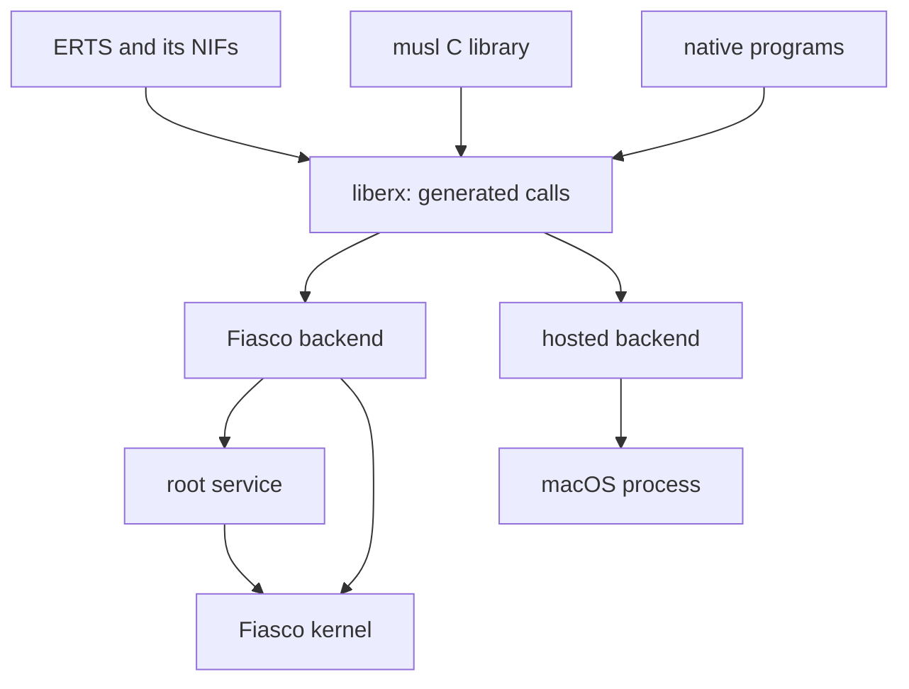
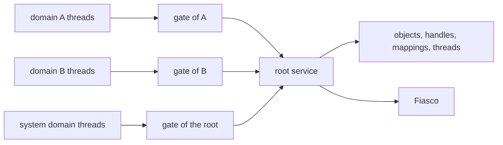
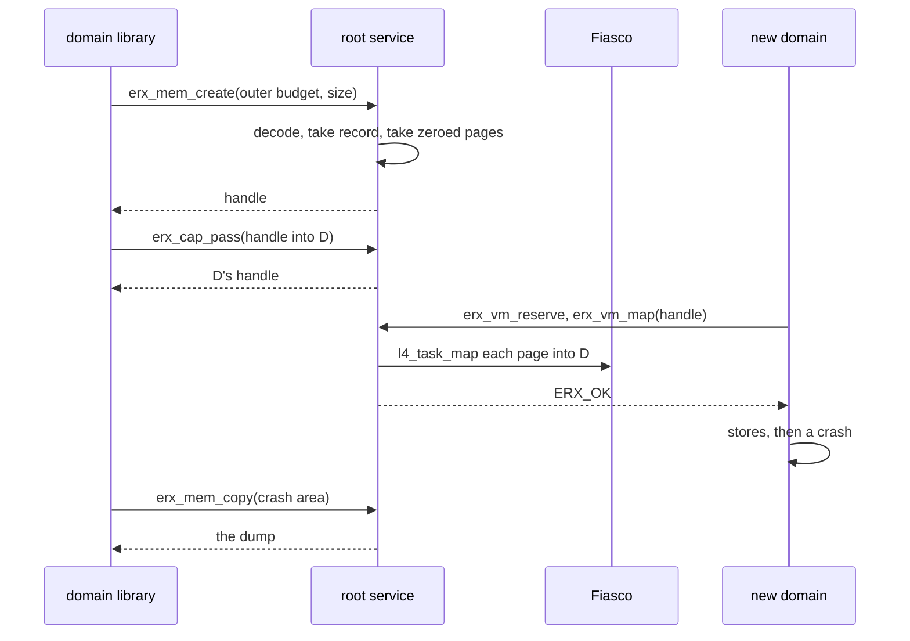
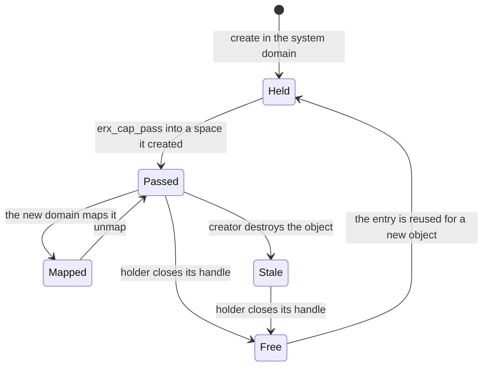

# Chapter 8. The Kernel Interface and Fiasco

> **Status.** **Built:** `liberx` with its Fiasco backend and its
> hosted backend, held to one test set; the root service, its request
> decoder and its tables; handles as entries of the root's per-task
> tables, each carrying its object's generation; memory objects,
> mappings and the root's page pool; doorbells and device lines; thread
> creation, umtx waits and parking; fault gates and exit records; the
> machine's end on a fault of the root task; budgets as records that
> end what is charged to them. **Designed:** handles as slots of each
> holder's own Fiasco capability table, used directly; rights recorded
> per handle and checked on every use; a Fiasco factory per domain
> budget; priority bands and per-domain CPU sets; the whole-space
> pause; signals through vCPU upcalls; DMA spaces behind an IOMMU; and
> the system-call fuzz campaign.

**Background needed.** [Chapter 1](01-operating-systems.md) for system
calls, address spaces and page tables; [chapter 2](02-microkernels.md)
for capabilities, IPC gates, labels, the UTCB and the root task
(section 2.5 traces one call through Fiasco); [chapter
3](03-erlang.md) for ERTS and NIFs. Chapters 5 to 7 help but are not
required.

ERTS, the Erlang runtime, needs memory for every process heap it
allocates. On FreeBSD it calls `mmap`, and the kernel finds free
addresses, creates a VM object to hold the pages, and fills page-table
entries as the runtime touches them. On erXos the same runtime runs as
an ordinary program in user mode, on a kernel that knows nothing of
`mmap`, files or Erlang. Somebody has to turn "give me 2 MiB" into
pages, page-table entries and a record of who pays for them.

The answer cannot be "each runtime talks to Fiasco directly". A
runtime that calls Fiasco by name is tied to Fiasco's data structures,
capability numbers and error codes. Worse, if every domain could write
its own page tables, nothing would keep one domain out of another's
memory.

FreeBSD solves the first half with its C library. A program calls
`mmap` in libc. A short stub loads the arguments into registers and
traps, and the kernel's system call table sends the trap to the code
that does the work
<!-- check: FreeBSD libc system-call stubs and the sysent table, from general knowledge -->.
The second half does not arise on FreeBSD, because the kernel itself
does all the work and trusts no program.

erXos answers both halves with one library and one thread. Every
kernel call goes through **`liberx`**, whose calls are erXos's own and
are generated from one file. Behind `liberx`, a call either runs in
the caller's own thread or becomes a request to the root service. The
root service is one thread of the system domain, and it alone creates
kernel objects and writes page tables. Fiasco checks every use of what
the root made; the root decides what each domain may make.

The chapter goes from the kernel's objects to the library that names
them, then to the root service and one request traced end to end. It
then covers handles and rights, threads and their waits, memory,
interrupts and devices, and what Fiasco gives the system and what it
does not.

> **Background: a capability table, recalled.** Chapter 2 introduced
> the capability table: an array the kernel keeps for each address
> space, with one slot per capability. A program names an object by its
> slot number, and the kernel looks the number up in the caller's own
> table. Take a program whose table holds, at slot 5, a reference to a
> memory object with the right to read. The program asks "map slot 5
> for writing". The kernel finds slot 5, finds the memory object, finds
> that the slot carries read and not write, and refuses. A second
> program that also says "slot 5" reaches its own slot 5, which may
> hold nothing. The number is meaningless outside the table it indexes,
> so it cannot be forged into authority. A generation, a counter
> stored with each slot and bumped when the slot is reused, lets the
> kernel tell an old reference from a new one
> ([section 2.3.5](02-microkernels.md#235-delegation-shrinking-rights-and-revocation)).

> **Background: Fiasco, L4Re and the root task in a page.** Fiasco is
> an L4 microkernel written in C++. Its objects are tasks (address
> spaces with their capability tables), threads, IPC gates, IRQ
> objects, semaphores and factories, the objects that create other
> objects. L4Re is the user-mode environment usually built around it.
> Its root task, Moe, receives every initial capability at boot and
> builds the rest of the system; Sigma0 hands out physical memory. In
> L4Re a program invokes the kernel objects it was given, and asks Moe
> only for memory and faults
> ([section 2.5](02-microkernels.md#25-the-l4-family-and-fiasco)).
> erXos uses Fiasco and Sigma0 from that world, and puts its own root
> task, the system domain, in Moe's place.

## 8.1 What the kernel knows, and what it does not

A domain's runtime needs six things from below it, and none of them
mentions Erlang: threads to run on, a way to wait for work, memory, a
way to hand a reference to another domain, notice that a device or a
peer wants attention, and notice that something it started has failed.

### 8.1.1 The kernel's objects

The kernel interface names its objects in erXos's own terms:

| Object | What it is | Example of use |
| --- | --- | --- |
| space | an address space, with its own handle table | a domain; a native program inside a session |
| thread | a stream of execution in a space | an ERTS scheduler thread |
| **group** | the threads of one runtime that share its readiness | every scheduler thread of one domain's ERTS |
| memory object | a set of pages that mappings place in spaces | a process heap; one side of a connection |
| **IRQ object** | a source of notifications, from a device line or from software | a disk's interrupt; a **doorbell** a peer rings |
| **gate** | a queue of fault and exit records for one receiving thread | where a domain's crash is reported |
| budget | an account that the objects made for a domain are charged to | the domain's own memory |

Each of these is **Built**, in the form the rest of the chapter
describes. The kernel knows threads and address spaces
and moves pages between them. It knows that an IRQ object fired. It
does not know what a pid is, that a process has a mailbox, or which
Erlang process a page holds. Those live in ERTS, one level up
([chapter 9](README.md#chapter-9-processes-runtimes-and-two-level-scheduling)).

### 8.1.2 Why the line falls there

The line falls where the hardware's protection falls. Only kernel-mode
code can write page tables and switch address spaces, so the objects
that need those powers belong to the kernel. Everything that needs
only ordinary instructions runs in user mode: ERTS and its scheduler,
the system services, the drivers and their device shims
([design.md, Trust placement](../design.md#trust-placement)).

This buys a small trusted base. A bug in the network stack, in a
driver or in a domain's runtime faults in that domain's address space
and ends that domain. It does not reach the kernel's memory, because
it has no mapping of it. erXos takes chapter 2's argument further than
most systems: even the runtime that runs the system's own services is
a user-mode program.

The cost is crossings. Each kernel call enters kernel mode and leaves
it, and each move of work between address spaces pays for a switch.
Singularity measured hardware protection crossings at 33 to 37.7
percent of a message-heavy benchmark, against under 5 percent for
language checks (Hunt and Larus 2007;
[section 4.3](04-history.md#43-the-lineage)). erXos's answer is to
cross rarely. Inside a domain, thousands of Erlang
processes switch without the kernel. Between domains, data moves
through shared memory that no kernel call touches while both sides are
awake. The kernel is entered to wait, to wake, and to set things up.
The cost of one request to the root service on Fiasco is not measured;
[design-fiasco.md, Measurements](../design-fiasco.md#measurements)
names the run that would price it.

## 8.2 `liberx`: the one issuer of kernel calls

No line of ERTS, of musl or of a native program calls Fiasco. They call
`liberx`, and `liberx` is the only code in the system that issues a
kernel call ([design-runtime.md, liberx](../design-runtime.md#liberx)).

### 8.2.1 One file, generated calls

Every call of the kernel interface, its arguments, rights and status
codes, and every binary layout a call uses, is defined once in
`abi/erx_abi.txt`. A Ruby generator turns that file into C headers for
`liberx` and into the tables other languages need, so no constant is
copied by hand
([chapter 7](README.md#chapter-7-one-source-for-every-fact) tells the
general story). The declaration a C caller sees for creating a memory
object, in `liberx/backend/api.h`, is:

```c
int	erx_mem_create(uint64_t budget, uint64_t size, uint32_t flags, uint64_t *mem) ERX_WARN_UNUSED_RESULT;
```

The caller names the budget that pays, the size and flags, and gets
back a **handle**, a number that stands for the new object in the
caller's own table (section 8.4). The attribute makes the compiler
warn when a caller ignores the status, because every call can be
refused.

The status codes are erXos's own. `ERX_ENOMEM` means the pages are not
there, `ERX_EINVAL` an argument out of shape, `ERX_ERIGHTS` a missing
right, `ERX_ESTALE` a handle whose object is gone, and `ERX_ENOTSUP` a
call the system does not carry out. No Fiasco error number reaches a
caller.

### 8.2.2 Two backends behind one set of names

Behind the generated names sit two implementations, called
**backends**, as figure 8.1 shows.



*Figure 8.1. The kernel interface. Everything above `liberx` calls the
same generated names. The Fiasco backend runs a call in the caller's
thread or sends it to the root service; the hosted backend runs the
same calls inside one macOS process.*

The **Fiasco backend**, in `liberx/backend/fiasco/`, is what the
system runs on. Each call is one of two kinds. A **local** call runs
in the caller's own thread: waiting on its semaphore, parking, a umtx
wait, reading the clock. A **service** call becomes a request to the
root service, which runs the call's body and replies: creating
anything, mapping anything, passing a handle. Both are **Built**.

The **hosted backend**, in `liberx/backend/hosted/`, runs a runtime as
a macOS process, under the sanitizers and a debugger. A space is the
process, a thread is a pthread, a memory object's pages are one
`mmap`ped area. It carries the calls one process can carry cheaply and
answers the rest `ERX_ENOTSUP`
([design-fiasco.md, The hosted backend](../design-fiasco.md#the-hosted-backend)).

One test set holds both backends to the same results.
`test/guest/function_api` runs each case against whichever backend
carries the call, through two small harnesses, `guest.c` and
`hosted.c`; no case reads which backend it is on. A refusal is a
result like any other: where both carry a call and the Fiasco backend
answers `ERX_ERANGE`, the hosted one must too. The code that decides
those results, the handle table and the range table among it, lives
once, in `liberx/backend/core/`, and builds for the host. This is
**Built**.

### 8.2.3 Refusing, and never inventing

A kernel interface written for a system's needs asks for things
its kernel does not offer. Fiasco has no notion of a CPU grant, keeps
no idle time worth reporting, and gives no object a system-wide id.
The backend has two rules for such cases
([design-fiasco.md, Contract](../design-fiasco.md#contract)).

* A call the backend cannot carry out over Fiasco fails with
  `ERX_ENOTSUP`, and every caller checks for it.
* A value the backend cannot measure is reported as `unsupported`, or
  as `partial` with the part it does know and who reported it. It is
  never filled with a guess.

You can see the second rule from the Erlang shell. The inspector,
erXos's tool for reading the live system
([chapter 21](README.md#chapter-21-the-live-machine)), shows another
domain's group and budget as unsupported, because Fiasco answers for
the system domain's own only (README.md, "Current status"). It does
not print zero: a zero would look like a fact, and a reader would act
on it.

### 8.2.4 The seam as a build check

The rule "only the Fiasco backend speaks Fiasco" is easy to state and
easy to break by accident, with one stray `#include`. So it is a build
check. The chokepoint rules `fiasco-headers-in-backend` and
`fiasco-symbols-in-backend`, in
`tools/lib/erx/chokepoint_rules/fiasco_seam.rb`, fail the build if a
Fiasco header or a Fiasco symbol appears in a file outside
`liberx/backend/fiasco/`. Each rule comes with seeded violations, such
as a stray `#include <l4/sys/ipc.h>` in `liberx/`, that prove it
catches one. This is **Built**. So ERTS, musl and every service build
unchanged against another backend; the hosted backend proves it every
day.

## 8.3 The root service: who holds what

In the system as it runs, one thread decides what every domain may
have, and every other thread asks it.

### 8.3.1 One thread for every table

The system domain is the root task of section 2.5.3. Of its threads,
one is the root service: it alone creates kernel objects, holds the
tables that record them, and writes any space's page tables or
capability table. Every other thread, the system domain's own
included, sends it requests through a gate.

The root service's loop, `service_main` in
`liberx/backend/fiasco/service.c`, is the heart of it. It waits for a
message, decodes it, runs the body to its end, then replies and waits
again in one Fiasco call. A body never sends a request of its own and
never waits on another thread.

That shape removes a class of problem. One thread touches the tables
of objects, handles, mappings and threads, so they need no lock, and
no request sees another half done. A request from a task cannot
overlap that task's exit, because the exit is work the same thread
does between requests. Ending a domain is a list that one thread
walks. This is **Built**. L4Re's Moe has the same shape: one server
thread for memory and faults
([design-fiasco.md, Helper threads](../design-fiasco.md#helper-threads)).

The cost is that every domain's setup queues on one thread. A domain
that sends requests as fast as it can delays every other domain's
creations, maps and faults, by an amount nothing bounds. Steady-state
traffic is not affected: a domain's own memory, its waits and its
shared rings make no request
([design-fiasco.md, What the root still serves](../design-fiasco.md#what-the-root-still-serves)).



*Figure 8.2. The root service between the domains and Fiasco. Each
task calls through its own gate, so the service knows the caller from
the gate alone. Only the service touches the tables and asks Fiasco to
create, map or delete.*

### 8.3.2 What a domain holds

A domain holds little of Fiasco's. In the tree, the root creates
every Fiasco object from its own factory and keeps the capability to
it in its own capability table. Into each task it places two kinds of
capability and nothing else:

* the task's **request gate**, an IPC gate bound to the root service,
  at the slot Fiasco uses for a thread's pager, so the same gate
  carries the task's requests and its threads' page faults and
  exceptions;
* one **semaphore** per thread, the object the thread sleeps on when it
  waits.

Everything else a domain uses (its memory objects, IRQ objects,
budgets, groups, the spaces it created) it names by a handle that only
the root's tables give meaning to, and it uses them through service
requests. Its memory it holds as mappings, which are entries in its
page tables, not capabilities at all
(`liberx/backend/fiasco/service_task.c`, `task_objects_make`). This is
**Built**.

No task but the root holds a capability to a task, a thread, a factory
or the scheduler. So no task can write any capability table or page
table, its own included. The rest of the system leans on this
property, and it holds by construction: the capabilities that could
write those tables exist only in the root's table
([design-fiasco.md, Who holds what](../design-fiasco.md#who-holds-what)).

The design goes one step further, and that step is **Designed** and
not built. The root creates each domain's objects through a Fiasco
factory of that domain's own, so Fiasco charges the domain's kernel
memory to a fixed quota. It places an IRQ object's capability, without
the right to bind it, in the holder's own table, so ringing a doorbell
is the holder's own Fiasco invocation and the root is off the path. A
handle is then a slot number in the holder's Fiasco table
(section 8.4.5).

### 8.3.3 The decoder: the trust boundary

The root service reads requests from every domain, and in a system
that runs untrusted apps any of them may be hostile. So the service
first runs each message through a decoder that trusts nothing in it.
`erx_fiasco_wire_decode`, in
`liberx/backend/fiasco/service_wire.c`, is a pure function: it takes
the message's label, tag and words, and returns what to do.

```c
	const uint64_t task = input->label >> ERX_FIASCO_WIRE_LABEL_SHIFT;
	/* ... */
	if (task > UINT32_MAX || !input->task_live((uint32_t)task)) {
		decoded.kind = ERX_FIASCO_WIRE_DROP;
		return (decoded);
	}
	/* ... page faults and exceptions are recognised here ... */
	expected = erx_fiasco_wire_words(input->tag_label);
	if (expected == 0 || input->words != expected || input->mr[0] >= ERX_FIASCO_THREADS_MAX)
		return (decoded);
```

Two things to notice. First, the caller's identity comes from the
label, the number the root gave the task's gate when it made it,
which Fiasco delivers with every message
([section 2.5.2](02-microkernels.md#252-fiasco-and-l4re)). Nothing the
caller wrote says who it is. Second, a request must have exactly the
number of words its layout in `abi/erx_abi.txt` gives, and its first
word, the calling thread's index, must be in range. Anything else, an
unknown call number included, is refused with `ERX_EINVAL` before any
body runs.

Addresses cross only as numbers. The service writes an address the
caller names into a page table; it never loads or stores through it.
What a request carries in the caller's UTCB, the per-thread area of
chapter 2, the service copies once and checks only the copy, because
the caller's other threads can rewrite the UTCB meanwhile. The decoder
has a fuzz target, `tools/fuzz/service_wire_fuzz.c`, which feeds it
random messages. All of this is **Built**.

### 8.3.4 One request end to end: a domain's crash area

A domain that crashes should leave a record of why, and the record must
outlive the domain. erXos keeps it in one memory object, the domain's
**crash area**. The domain's runtime writes its crash dump there, and
the system domain reads it after the domain has ended. Following that
object from creation to last read touches every part of this section;
figure 8.4 shows the requests in order.

**1. The plan.** When the system domain creates a domain, its domain
library first writes the whole construction down as a plan, a list of
steps, before it makes anything. The pure function that builds the
plan, in `liberx/system/dom_core.c`, adds this step among others:

```c
	dom_step(plan, (erx_dom_step_t){ .kind = ERX_DOM_STEP_MEM,
	    .obj = ERX_DOM_OBJ_CRASH, .budget = ERX_DOM_OBJ_OUTER,
	    .size = spec->crash });
```

The crash area is charged to the domain's **outer budget**, a second
budget carved beside the domain's own. That detail lets the area
outlive the domain. Ending a domain ends its own budget and everything
charged to it, but the outer budget, and the crash area with it, stays
until the system domain has read the dump
(`include/erx/dom.h`, `erx_dom_state_t`). A table in `dom_core.c`,
`erx_dom_grants`, says the domain's space gets the crash area with the
rights of a writer.

**2. The create.** The library's apply step, `make_step` in
`liberx/system/dom_apply.c`, turns the plan step into a call:

```c
	case ERX_DOM_STEP_MEM:
		status = erx_mem_create(budget, pages_of(step->size) * ERX_PAGE_SIZE, 0, &handle);
		break;
```

**3. The stub.** `erx_mem_create`, in
`liberx/backend/fiasco/service_stubs.c`, fills the request layout that
`abi/erx_abi.txt` defines, `erx_fiasco_mem_create_request`, with four
words: the calling thread's index, the budget's handle, the size and
the flags. It hands them to `erx_fiasco_service_call`, which copies the
words into the thread's message registers and makes one Fiasco IPC
call on the task's request gate, tagged with the call's number. The
thread blocks until the reply.

**4. The receive and the decode.** Fiasco delivers the message to the
root service, with the label of the gate it came through.
`service_message` passes it to `erx_fiasco_wire_decode`, which names
the calling task from the label, checks the word count against the
layout and the thread index against the table, and returns a request.

**5. The body.** `service_run` switches on the call number and calls
`erx_fiasco_task_mem_create_body` in
`liberx/backend/fiasco/service_task.c`. The body refuses a size that
is zero or not a whole number of pages, and a flag other than the one
it knows, with `ERX_EINVAL`. It then calls `erx_fiasco_object_create`
in `liberx/backend/fiasco/object.c`, which does three things in order:

* it finds the budget the caller named, through the caller's own
  handle table, so a task can charge only a budget it holds;
* it takes a free **object record**, the root's entry for one object,
  and lets the memory code fill it: `erx_fiasco_vm_object_create`
  takes the pages from the root's pool, zeroed, and records them as the
  object's;
* it adds an entry to the caller's handle table naming the record, and
  returns the entry's number as the handle.

If any step fails, the steps before it are undone, so a failed create
leaves no record and no pages behind.

**6. The reply.** The body returns `ERX_OK` and the handle. The loop
puts the status and the handle in the message registers and replies,
and in the same Fiasco call waits for the next message. The stub
returns the handle to `make_step`.

No page table changed in these six steps. The crash area exists,
zeroed and charged to the outer budget, and nobody maps it.

**7. The pass.** The domain library hands the new domain its handle
with `erx_dom_install` (`liberx/system/dom_install.c`), which writes
one item, the handle and a rights mask, into the thread's UTCB and
calls `erx_cap_pass(ERX_CAP_SELF, recipient, 1)`. The body,
`erx_fiasco_cap_pass_body` in `object.c`, checks that the target is a
space the caller created and copies the item out of the caller's UTCB
once. It then adds an entry to the new domain's handle table naming the
same object record, and writes the new handle back into the caller's
UTCB. The library stores it in the domain's boot information page
as `crash_area` (`dom_apply.c`).

**8. The map.** When the domain's ERTS starts, `erx_crash_area_init`
in `otp/erts/emulator/sys/erxos/erx_crash_area.c` maps the area into
its own space:

```c
    status = erx_vm_reserve(ERX_CAP_SELF, 0, ERX_CRASH_SIZE, 0, &addr);
    if (status == ERX_OK) {
	status = erx_vm_map(ERX_CAP_SELF, addr, ERX_CRASH_SIZE, mem, 0, ERX_PROT_RW);
	if (status != ERX_OK)
	    (void) erx_vm_release(ERX_CAP_SELF, addr, ERX_CRASH_SIZE);
    }
```

The first call reserves a range of addresses in the domain's own space
and returns where; the second asks for the object's pages there,
readable and writable. Notice that a refused map gives the range back,
and the code that follows prints that a crash would leave no dump: a missing
crash area is reported, not ignored.

Each of the two calls is another trip through steps 3 to 6. The map's
body, `erx_fiasco_task_vm_map_body`, checks that the target is the
caller's space or one it created, looks the handle up with
`erx_fiasco_object_find`, and asks `erx_fiasco_vm_object_map` to map
it. That function applies the object's own rule first
(`erx_fiasco_vm_map_rule` in `vm_rules.c`; an ordinary memory object
maps with any of the three allowed protections). It records the
mapping in the space's range table. Then, page by page, it asks Fiasco
to map the page with `l4_task_map`, from the root's own address of the
page to the address the domain reserved, and Fiasco writes the
page-table entries.

**9. The use.** From here on the domain writes its crash area with
ordinary stores. No request is made: the pages are mapped, so the
stores do not fault. If the domain's runtime crashes, it writes the
dump text, then the header, and the magic number last, so a reader can
tell a complete dump from a torn one.

**10. The read.** The domain's crash ends its space (section 8.5.4),
and the system domain learns of it from an exit record. Ending the
space removes the domain's mappings and ends its own budget. The crash
area, charged to the outer budget, is still there, and the system
domain still holds a handle to it. It copies the area out with
`erx_mem_copy`, a service call that copies between two objects' pages
inside the root, and checks every field before it believes one
(`liberx/system/dom_dump.c`). Only then does the outer budget go, and
the crash area with it.



*Figure 8.4. The life of a crash area. Three requests make and hand
over the object; only the map touches Fiasco's page tables; the
domain's own writes make no request at all. The last copy works
because the object was charged to a budget that outlives the domain.*

Every step in this trace is **Built**. The same calls make a
connection's shared rings, a native program's data area and a
driver's buffers.

## 8.4 Handles, rights and destroying an object

A handle is a number, and the question every capability system must
answer is what that number means after the object it named has gone.

### 8.4.1 What a handle names

In the tree, the root keeps one table of object records for the whole
machine and one **handle table** per task
(`liberx/backend/core/handles.h`). A handle is the index of an entry
in the caller's own handle table, plus one, so that zero can mean "no
handle". Each entry names an object record and the generation that
record had when the entry was made. Every service call that takes a
handle looks it up with `erx_backend_handle_find`. A number past the
table answers `ERX_EINVAL`; an entry whose record's generation has
moved on, `ERX_ESTALE`; an object of the wrong kind for the call,
`ERX_ETYPE`. Otherwise the lookup returns the record. This is
**Built**.

So a handle is meaningless outside its table, as chapter 2's slot
numbers are. Domain A's handle 7 and domain B's handle 7 are two
different entries, and B cannot use A's number to reach A's object.
The size of each table is fixed when its space is created, and a task
that fills it gets `ERX_ELIMIT`.

### 8.4.2 Destroying an object

Only an object's creator may destroy it. `erx_object_destroy` checks
that the caller's task is the record's creator and refuses anyone else
with `ERX_ERIGHTS`; no pass ever conveys the right to destroy
(`erx_fiasco_object_destroy_body` in `object.c`).

What happens to the other holders depends on the object, but not on
who they are or how many there are. For a memory object, the root first
revokes every mapping of it, through Fiasco. Every task's mapping of a
page was made from the root's own mapping of that page, and Fiasco's
mapping database remembers that. So one `l4_task_unmap` of the root's
page removes it from every other space at once
(`erx_fiasco_vm_object_revoke` in `vm.c`). Then the root frees the
record and bumps its generation. Every other holder's entry still
names the record, at the old generation, so its next use answers
`ERX_ESTALE`. Nobody had to find the holders, and none of them can
reach the object again.

An object also goes without a destroy: when its last handle and its
last mapping are gone, when its budget ends, or when the task that
created it ends. Ending a domain is the
last case on a large scale. Every object charged to the domain's
budget goes in flat sweeps of the object table
(`liberx/backend/fiasco/budget.c`), so nothing the domain made is left
to chase.

### 8.4.3 Using a handle after closing it

The generation answers one question and leaves another open. It tells
a holder that the object its entry named is gone. It does not protect a
holder from its own close.

When a task closes a handle, its entry is cleared and becomes free. The
next handle that task receives, from a create or a pass, takes the
lowest free entry (`erx_backend_handle_add`). If the task's code keeps
the old number and uses it after the close, it reaches whatever the new
entry names. This is the use-after-close bug, and it is the holder's
own: no other domain can cause it. It is a property of the system as
built, and it matters in two places.

* **An app.** A bug of this kind in an app acts on one of the app's own
  objects, with the app's own authority. It cannot reach anything the
  app was never given. The usual symptom is a write that lands in the
  wrong shared buffer, or an `ERX_ETYPE` when the reused entry names a
  different kind of object.
* **A server.** A server that keeps handles for many clients can
  confuse two clients if it closes one handle and keeps using the
  number. Here the bug crosses a trust line: one client's data could go
  to another. The
  defence is in the server's code, which keeps each handle in one place
  that owns its lifetime, as Erlang code naturally does by holding the
  handle in one process's state.

A capability kernel that checked a generation on every lookup, of the
handle entry itself and not only of the object behind it, would turn
both cases into `ERX_ESTALE`. Fiasco's capability tables carry no such
generation, and the root's tables do not add one for the entry
([design-fiasco.md, Handles are slots](../design-fiasco.md#handles-are-slots)).

### 8.4.4 Rights

In the tree, the root records no rights with a handle entry. A pass
carries a rights mask, and the call reports the new handle's rights:
the mask within what the object's type allows, without the right to
destroy. But no entry stores them (`object_pass_item` in `object.c`).
Two things limit a holder, the creator-only destroy and the object's
own rules:

* every mapping is readable and writable, or readable and executable,
  or read-only, and never writable and executable at once, because the
  range table accepts only those three protections
  (`liberx/backend/core/vm_table.h`);
* a slice of the boot image maps read-only, because its pages are the
  image's own and no task may write them;
* device memory never maps executable;
* a sealed code object maps for reading or running, never for
  writing.

So a domain passed one side of a connection "to read" can, in the
tree, ask for a writable mapping of it and get one. Every build runs
trusted code only and prints `development build: trusted code only`
in its banner. In such a build, the domain library's masks are kept
by the discipline of the code that receives them, not by the root.

The design closes this, and the closing is **Designed** and not built.
The root records erXos's rights for each handle it places. Every
service call checks the right it needs against that record before it
acts: a writable mapping needs write, binding an IRQ object needs
bind, charging a budget needs allocate. A pass intersects the source's
recorded rights with the mask, so rights only shrink, and a domain
that bypasses `liberx` with raw requests is held to them alike
([design-fiasco.md, Passing a handle](../design-fiasco.md#passing-a-handle)).

### 8.4.5 Handles as Fiasco slots

The design also changes what a handle is, and that change is
**Designed** and not built. A handle becomes a slot of the holder's
own Fiasco capability table, holding the object's capability with only
the Fiasco rights the holder's erXos rights allow. Service calls are
decoded through the root's record of the slot; direct uses are checked
by Fiasco
([design-fiasco.md, Capabilities in Fiasco's object space](../design-fiasco.md#capabilities-in-fiascos-object-space)).

Fiasco's slots carry no generation. When an object is destroyed,
Fiasco empties its slot in every holder's table; the root keeps those
slots reserved, and every later use answers `ERX_ESTALE`. A handle used
after its own close names whatever the root places in that slot next.
The root hands out never-used slots first and then freed slots oldest
first, so a closed slot is reused as late as the table allows. That
makes the bug of section 8.4.3 rarer, not impossible.

### 8.4.6 Why handles flow only down

A handle reaches another task in only one way: its holder passes it
from its own table into a space it created. `erx_cap_pass` refuses
every other pass with `ERX_ENOTSUP`, and refuses to pass a space's or
a gate's handle at all. This is **Built**
(`erx_fiasco_cap_pass_body`). Figure 8.3 follows one handle.



*Figure 8.3. A handle's life in one holder's table. A destroy by the
creator makes every holder's entry stale at once. A close frees the
entry, and the next object the holder receives may take it: the
use-after-close bug of section 8.4.3.*

The restriction buys a property. Every holder of an object is the
creator's task or a task below it in the tree of spaces, and a task's
sub-spaces end before it does. So when a task ends, nothing it created
has a holder left in a live task, and the root can end those objects
at once without searching. Domains do not pass handles to each other:
they share memory through connections that the domain library, which
created both domains, sets up
([design-fiasco.md, Passing a handle](../design-fiasco.md#passing-a-handle);
[chapter 10](README.md#chapter-10-domains-a-wall-around-some-processes)).

## 8.5 Threads, waits, gates and faults

A runtime spends most of its life doing one of three things: running,
waiting for work, or failing. Each has its kernel objects.

### 8.5.1 Threads

The root creates every thread of every task, so it knows them all.
Each task has a fixed table of 128 threads, made with the task
(`ERX_FIASCO_THREADS_MAX`, in `liberx/backend/fiasco/service_wire.h`).
An index into that table names a thread's record, its UTCB and musl's
thread identifier at once, so there is nothing to keep in step. A
create past the last free index gets `ERX_ENOMEM`.

`erx_thread_create` is a service call. The root makes a Fiasco thread
and a semaphore for it, places the semaphore in the task, and copies
the starting registers the caller left in its UTCB.
`erx_thread_start` then hands the thread to Fiasco's scheduler.
Inside a domain, musl's `pthread_create` and ERTS's scheduler threads
both end in these two calls. A thread that exits is deleted by a
**reaper**, one helper thread per task that asks the root to delete
exited threads, so `pthread_join` works as on FreeBSD. All of this is
**Built**.

Fiasco schedules threads by fixed priority, from 1 to 255, and runs
threads of equal priority round robin. In the tree every thread but the
watchdog's runs at priority 1, and the watchdog at 255
(`SERVICE_THREAD_PRIORITY` in `service.c`). Fiasco has no load
balancer, so a thread stays on the CPU where it was started until a
call moves it; `erx_thread_set_affinity` does that. A domain's
priority band, the priority all its threads would run at, is
**Designed** and not built; so is its **CPU set**, the CPUs its
threads may use. Chapter 9 treats both
([design-fiasco.md, Threads, bands and stops](../design-fiasco.md#threads-bands-and-stops)).

One change to Fiasco makes equal priorities work. In upstream Fiasco,
a thread that yields keeps its CPU to the end of its time slice. A
spinner waiting for a lock holder on the same CPU then waits a whole
slice each turn. erXos's copy of Fiasco changes one function,
`Thread::do_ipc_receive` in `fiasco/kernel/src/kern/thread-ipc.cpp`,
so that a yield puts the thread behind the other ready threads of its
priority. This is **Built**, and the native task suite's `yield` case
tests it
([design-fiasco.md, Scheduling](../design-fiasco.md#scheduling)).

### 8.5.2 Waiting: one semaphore per thread

Every wait a thread makes on erXos ends on one object: its own Fiasco
semaphore. A semaphore here is a counter that Fiasco keeps; `down`
blocks while it is zero and takes one, `up` adds one and wakes the
waiter. Two kinds of wait are built on it, and both run in the caller's
own task without a request to the root.

The first is the **umtx wait**, under musl's mutexes and condition
variables. FreeBSD's `_umtx_op(2)` defines the shape:
`UMTX_OP_WAIT` blocks the caller if a memory word still holds the value
it expects, and `UMTX_OP_WAKE` wakes the threads waiting on that word
(FreeBSD 14.1 manual page). `liberx` keeps the same contract with a
table per task, keyed by address, in the task's own memory. A wait
takes the table's lock, compares the word, and if it still holds the
expected value adds itself to the word's queue, releases the lock and
downs its semaphore. A wake takes the lock, removes waiters from the
queue, releases the lock and ups each one's semaphore
([design-fiasco.md, The umtx table](../design-fiasco.md#the-umtx-table)).

The second is **parking**, how an ERTS scheduler thread with no work
sleeps until some arrives. ERTS's threads are executors, threads
that each run many Erlang processes
([chapter 4](04-history.md#423-why-erxos-keeps-two-levels)). An idle
executor parks on its group; a doorbell, a timer or another executor
wakes it. The park protocol is one pure state machine, `park_step`,
that reads no clock and calls no kernel. It returns what the caller
does after releasing its lock: at most one semaphore up or down
([design-fiasco.md, The park protocol](../design-fiasco.md#the-park-protocol)).

Both waits keep one invariant, which is why they can share a
semaphore: *a thread taken off a list is owed exactly one up, and only
such a thread is.* Consider a wait with a deadline that runs out at
the moment a waker takes the thread off the queue. The thread wakes
from its timed `down` with a timeout, takes the lock, and finds it is
no longer queued. The waker's up is on its way. If the thread returned
at once, that up would sit in the semaphore and end the thread's next wait
early, for no reason. So the thread does one more `down`, with no
deadline, to absorb it, and only then returns. Every semaphore holds
zero when its thread starts a wait, and no wake is lost or doubled.
Both waits are **Built**, and a test driver for each runs on the host
(`test/fixtures/fiasco_umtx_driver.c`, `fiasco_park_driver.c`).

### 8.5.3 Gates for faults and exits

In chapter 2, a gate carried a client's request to a server. In erXos,
no gate carries messages between domains; domains talk through shared
memory and doorbells. The kernel interface's **gate** has one job: it
queues the **fault records** and **exit records** of the spaces that
name it, for the one thread bound to it
([design-fiasco.md, Fault gates](../design-fiasco.md#fault-gates)).

When the domain library creates a domain, it names a gate of its own
as the domain's fault gate, and a thread of the system domain waits on
it with `erx_ipc_wait`. A session does the same for the native programs
it starts. So whoever creates a space hears of every end below it, and
nobody else does. A posted record lives inside the record of the
thread or space it describes, linked into the gate's queue by index.
So posting allocates nothing, and a gate holds at most one record per
thread and one per space. Gates and their records are **Built**.

### 8.5.4 How a fault reaches the right handler

Follow a domain's thread that reads through a bad pointer.

1. The processor raises a fault, and Fiasco, in kernel mode, takes it.
2. Fiasco sends a page-fault message on the thread's pager, which the
   root set to the task's request gate. The message carries the faulting
   address and instruction, and comes with the gate's label, so the root
   service knows the task.
3. The decoder recognizes a page fault by its tag and checks its length.
   The service never answers it, because every page a task committed is
   already mapped: there is nothing to repair. The faulting thread stays
   blocked in its fault.
4. The service builds a fault record, with the thread marked `unknown`,
   because Fiasco names the task and not the thread, and posts it to the
   space's fault gate (`erx_fiasco_task_fault` in `service_task.c`).
5. The system domain's thread on that gate wakes, stops the space, and
   the root deletes the space's threads and mappings. When the last
   thread is gone, the space's exit record goes to the same gate, with
   the status of the stop.
6. The domain library turns the record into a message that the domain
   went down. The log gets an end line naming where the fault struck:
   the instruction, the cause and the address.

The space's other threads run on until the stop, and nothing outside
the space is touched. A space with no fault gate, as a test task has,
ends at once with a crash record. All of this is **Built** (README.md,
"Current status").

A thread may point its own fault handler elsewhere: Fiasco lets every
thread act on itself. But it can point only at slots of its own task,
which hold nothing but what the root placed. Its faults then reach the
root or no one, and a thread whose faults reach no one stops itself
alone.

### 8.5.5 When the root task faults

The root task has no one above it to send a record to. Nothing with
less authority can replace the program that holds every capability, so
a fault of any thread of the system domain ends the machine, through
one function, `erx_fiasco_end` in `liberx/backend/fiasco/end.c`. It
takes a named cause, writes the log lines no reader has taken yet, and
writes a last line, `erx: end off` or `erx: end reset`. The function
that actually powers off or resets is private to that file, and a build
check, `fiasco-machine-end`, keeps Fiasco's shutdown call there, so
nothing ends the machine without saying why. This is **Built**.

One fault escapes that path: a fault of the root service's own thread.
Its pager is Sigma0, which repairs nothing, so the thread stays stuck.
Every other thread that sends the root a request then waits forever.
The root's watchdog thread, at priority 255, ends the machine when the
watchdog stops being petted, on a board that has a hardware watchdog;
otherwise a test's deadline ends the run
([design-fiasco.md, Faults, and the fault of the root task](../design-fiasco.md#faults-and-the-fault-of-the-root-task)).

### 8.5.6 Signals through vCPU upcalls

A native program expects POSIX signals: a handler that runs on the
thread the signal interrupted. Fiasco's vCPU upcall can carry this.
The kernel saves a thread's registers into a shared area and jumps to
an entry point in the program. erXos's design delivers catchable
signals to native programs this way, with no change to Fiasco. It arms
only worker threads, never an executor, so ERTS is never entered at an
unsafe point
([design-fiasco.md, vCPU upcalls on Fiasco](../design-fiasco.md#vcpu-upcalls-on-fiasco)).
Signal delivery through vCPU upcalls is **Designed** and not built:
the Fiasco backend has no `erx_vcpu_control`.

## 8.6 Memory objects and mappings

Section 8.3.4 made a memory object and mapped it. This section explains
what that trace took for granted.

### 8.6.1 One page, one address

At boot the root takes all of the machine's free RAM from Sigma0 and
maps it into its own address space, readable and writable, in one
region called the **window**. The window is never unmapped. So every
page of RAM has one permanent address in the root. Every mapping of
the page in any task is made from that address, as a child of the
root's own mapping in Fiasco's mapping database
(`liberx/backend/fiasco/vm.c`). This is **Built**.

Three things follow. A task's mapping can come and go while the page
and its contents stay. The root reaches any object's memory without
mapping anything, which is how `erx_mem_copy` copied the crash area.
And one unmap of the root's mapping revokes every mapping of the page
(section 8.4.2).

Free pages wait in the root's **pool**, a free list threaded through
the pages themselves; a page taken from it is zeroed before anyone sees
it (`page_pool.c`). Every page a task uses comes from the pool, because
only the root maps memory.

### 8.6.2 Reserve, commit and map

A space's addresses go through two states before they hold anything.
`erx_vm_reserve` sets aside a range of addresses in a space and holds
no memory. Then one of two things fills the range:

* `erx_vm_commit` gives the range private pages from the pool, mapped
  at once and seen only by this space; musl's `malloc` and ERTS's
  allocators work this way;
* `erx_vm_map` places a memory object's pages there, which other
  spaces may map too; a connection's rings and a crash area work this
  way.

A range is never both. A commit that meets a mapping, or a release
that cuts one in half, is refused with `ERX_EINVAL`. So freeing private
memory can never free a page another space still maps. The
**range table** that enforces this is one core,
`liberx/backend/core/vm_table.c`, shared by the Fiasco and hosted
backends. It is **Built**.

Because every committed page is mapped at once, a task never takes a
page fault that the root must fill. A fault is always a bug, and is
reported as one (section 8.5.4). This is a choice with a cost: memory a
program reserves but does not use is free, while memory it commits is
taken whole, even the parts it never touches. Chapter 12 weighs that
against FreeBSD's demand paging
([chapter 12](README.md#chapter-12-memory-and-budgets)).

### 8.6.3 Kinds of memory object

A memory object's kind decides how it may be mapped. The kinds, and
the rule each carries, are in one function,
`erx_fiasco_vm_map_rule` in `liberx/backend/fiasco/vm_rules.c`:

| Kind | What it holds | How it may map |
| --- | --- | --- |
| pages | ordinary RAM from the pool | read, read and write, or read and execute |
| JIT | pages for compiled code, only in a space made for it | as pages |
| slice | entries of the boot image, the image's own pages | read only |
| physical | a device's registers | never executable |
| contiguous | a physically contiguous run, for a device's DMA | never executable |
| paged code | code a session supplies page by page, then seals | read or run, and only once sealed |

The last row shows the pattern. A code object is filled with
`erx_mem_supply` while nothing maps it, then sealed with
`erx_mem_seal`, and only a sealed object maps; after that, nothing can
write it. So no program ever runs a page that someone could still be
changing. All six kinds are **Built**.

**Writable or executable, per mapping.** The range table accepts only
three protections, read, read-write and read-execute, so no single
mapping is writable and executable at once. Without that rule, a bug
that lets an attacker write into a program's memory would let them run
what they wrote at the same address. The rule is per mapping, not per
page. A space made with the JIT flag can map one JIT object twice,
once writable and once executable. BeamAsm, ERTS's just-in-time
compiler, writes code through one address that way and runs it through
the other. A page can therefore be writable through one mapping
and executable through another, and a domain can run code it wrote
into such an object. This is **Built**, and it is a property of the
system, not a gap in one call
([chapter 11](README.md#chapter-11-authority-and-security)).

### 8.6.4 Who pays

Every object is charged to a budget: `erx_mem_create` names one, and
the root finds it through the caller's own handle table. In the tree a
budget is a record that groups objects so they end together, as
section 8.4.2 described. It records a limit but refuses no charge past
it. Budgets as walls are **Designed** and not built: a domain's user
pages refused past their cap, and its kernel memory a Fiasco factory
with a fixed quota
([design-fiasco.md, Memory and budgets](../design-fiasco.md#memory-and-budgets);
[chapter 12](README.md#chapter-12-memory-and-budgets)).

## 8.7 Interrupts, doorbells and devices

A runtime that parks needs to be woken when something happens outside
it. On erXos that something is always an IRQ object firing.

### 8.7.1 One path for devices and peers

An IRQ object is either a device line, bound to an interrupt of the
interrupt controller, or a software doorbell that a peer rings. Both
reach a domain the same way. Each task has a **dispatcher**, one
helper thread that waits in Fiasco for any IRQ object bound to it.
To bind an IRQ object to a group, the root gives the object one of the
group's 64 entries and tells Fiasco to deliver its firings to
the dispatcher, labelled with that entry. Each delivery makes the
dispatcher run one trigger of the park protocol: list the entry as
ready, and wake the executor that has been parked longest
([design-fiasco.md, Interrupts and readiness](../design-fiasco.md#interrupts-and-readiness)).

The ready list has one place per bound object and lists each object
at most once, so it cannot overflow and a trigger allocates nothing.
An executor drains it with `erx_group_take_ready` and runs the Erlang
process waiting on each entry. A group's 65th bound object is refused
with `ERX_ELIMIT`. All of this is **Built** (`irq.c`, `group.c`,
`park.c`).

A device line stays masked after each delivery until its driver calls
`erx_irq_ack`, as Fiasco does for a level-triggered interrupt. So a
device that keeps its line raised cannot flood the dispatcher while
the driver works. A doorbell has no line to mask, and its ack does
nothing.

In the tree, ringing a doorbell and acknowledging a line are service
calls: the root holds the IRQ object's capability and invokes it for
the holder (`erx_fiasco_irq_trigger_body`). Binding decides where
deliveries go, so a holder other than the root may bind an object only
into a group it created or whose threads it runs, and a bound object
never moves to another group. Placing the
capability in the holder's own table, without Fiasco's right to bind,
so that a ring is one Fiasco call with the root off the path, is
**Designed** and not built.

### 8.7.2 Devices

A device belongs to the domain the system manifest gives it to
([chapter 15](README.md#chapter-15-devices-and-drivers)). The root makes
the objects a driver needs, and the domain library passes them on, as
it passed the crash area:

* a **physical** memory object over the device's registers, which the
  driver maps and its shim reads and writes;
* a **contiguous** memory object for the device's rings and buffers,
  inside the range of physical memory the device tree says the device
  can reach, with `erx_mem_dma_addr` giving the address to program
  into the device;
* an IRQ object for each of its lines.

Only the root creates these three kinds; a domain's attempt is refused
with `ERX_ENOTSUP`. They are **Built**.

> **Background: DMA and the IOMMU.** A device with direct memory
> access writes into memory at whatever address its driver programs,
> without the CPU and without the page tables that confine programs
> ([chapter 1](01-operating-systems.md#15-devices-interrupts-dma-and-caches)).
> An IOMMU is a unit between devices and memory that gives each
> device page tables of its own, so a device can reach only the pages
> mapped for it.

Fiasco supports DMA spaces, its object for an IOMMU's page tables. In
the design, for a device behind an IOMMU, the root creates a DMA space,
maps only the device's buffers into it and binds the device to it. The
device then reaches nothing else. That is **Designed** and not built,
and on erXos's platforms it would confine nothing. On QEMU's `virt`
board the IOMMU serves only PCIe devices, which the system does not
use, and the Raspberry Pi 4 has no IOMMU
([design-fiasco.md, Devices](../design-fiasco.md#devices)). So every
device that can master DMA is unconfined, and a driver domain that is
taken over can program its device to write anywhere in memory.

## 8.8 What Fiasco gives, and what it does not

The chapter's pieces add up to a precise account of what keeps
one domain from another, and what does not.

### 8.8.1 What isolation rests on

A domain's memory and objects are kept apart from every other domain's
by two things together. The first is Fiasco: its address spaces, its
capability tables and its checks on every invocation. The second is
the root service's decoder and its placement code, which decides what
to create, map and pass for each request; the root is the only writer
of every table Fiasco checks. A defect in either can break isolation, and
nothing else in the system can
([design-fiasco.md, Security on Fiasco](../design-fiasco.md#security-on-fiasco)).
Where a device masters DMA without an IOMMU, isolation also rests on
the domain that drives it (section 8.7.2). And on a processor open to
branch-predictor attacks, in which one program trains the processor's
guesses so that another leaks data through timing, a domain may read
memory it cannot map.

That nothing a domain does can make the kernel panic rests on Fiasco's
own code. Fiasco is erXos's kernel as its developers wrote it, with
the one change of section 8.5.1, and erXos does not check its code
beyond what Fiasco's own tests and use have shown. The system-call
fuzz campaign, which would invoke every slot of a task's table with
random arguments and watch the kernel, is **Designed** and not built.

### 8.8.2 What a hostile domain could do

Every build runs trusted code only, so the following is the system's
designed answer for an app whose code is untrusted, with each part
marked
([design-fiasco.md, What a hostile app can do](../design-fiasco.md#what-a-hostile-app-can-do)).

It could:

* send the root any request it likes; the decoder bounds every field,
  and a handle the root did not give it answers `ERX_EINVAL`,
  `ERX_ESTALE` or `ERX_ETYPE` (**Built**);
* write anything into its own side of a ring it shares; the receiving
  domain's funnel checks every frame
  ([chapter 10](README.md#chapter-10-domains-a-wall-around-some-processes))
  (**Built**);
* ring a peer's doorbell as often as it likes; the peer's pending state
  stays one listed entry, but each delivery still costs the peer one
  dispatcher run and up to one wake, and nothing bounds the rate
  (**Built**);
* spin every thread it can create; with every thread at one priority,
  it takes its round-robin share of each CPU it runs on and nothing
  stops it (**Built**);
* send requests and take faults as fast as its threads can, which
  delays every other domain's setup on the root service's one thread
  (**Built**).

It could not reach another domain's memory or objects without a defect
in Fiasco or in the root. It could not change any capability table or
page table, make one mapping writable and executable, or hold a device
the manifest did not give it (**Built**). In the design it also could
not map writable a side it was passed to read, or make the root hold
more for it than its limits; those rest on the per-handle rights and
limits of section 8.4.4, which are **Designed** and not built. It could
not take over a peer's doorbell: an object bound to a group the caller
neither created nor is the home of cannot be bound, moved or unbound by
it (`erx_fiasco_irq_bind_body` in `irq.c`, **Built**).

### 8.8.3 Limits, stated plainly

Collected in one place, these are properties of the system as it runs
on Fiasco:

* **No CPU share.** No domain is guaranteed a fraction of CPU time;
  every thread but the watchdog's has the same priority.
* **One server for setup.** Every creation, map and fault of every
  domain queues on the root service's thread.
* **Handles reused after close** (section 8.4.3).
* **No identity for a faulting thread.** A fault record names the space
  only, so a faulted thread is never resumed; its space is stopped.
* **Values the kernel does not report**, such as per-CPU idle time,
  which read as unsupported or partial.
* **Unconfined DMA** on the supported platforms (section 8.7.2).

## 8.9 What fails, and what it takes down

Each part of this chapter fails in its own way, and the system's
answer differs with what failed.

* **A domain's thread faults.** Its space stops and its creator gets
  the exit record (section 8.5.4); the crash area says why. No other
  domain notices, unless it was using a service the domain provided
  ([chapter 10](README.md#chapter-10-domains-a-wall-around-some-processes)).
* **A request is malformed.** The decoder refuses it and the service
  goes on. A message whose label names no live task is dropped and
  counted, with no reply.
* **The pool runs dry.** A create or commit fails with `ERX_ENOMEM`,
  and the failed call undoes what it made. With budgets as records
  only, one domain can spend the pool that others need (section 8.6.4).
* **The root refuses a step it cannot undo.** If Fiasco refuses an
  unmap or a delete, the root's records and Fiasco's tables no longer
  agree. That is a defect of the root, and the root ends the machine
  with the reason rather than run on records it cannot trust
  (`vm_refused` in `vm.c`).
* **The system domain faults.** The machine ends through
  `erx_fiasco_end`, with a named cause (section 8.5.5).
* **The root service's thread faults.** Requests stop being answered,
  and the watchdog or a test's deadline ends the run.
* **Fiasco faults.** Every program depends on the kernel, so its bugs
  are not confined. That is the reason the kernel is small, and the
  reason erXos keeps everything else out of it.

## 8.10 Design choices

**Each runtime could talk to Fiasco directly.** That is how L4Re's
programs work: each holds its own kernel objects and invokes them. It
would save a request for every creation and every map. But a program
that holds a factory can create objects no record of the system knows
about. A program that holds its own task capability can map anything
into itself. erXos gives the creating and mapping powers to
one thread and keeps the records true by construction, at the cost of
one round trip per setup step. Steady-state traffic does not pay it.

**The root could be several threads.** A pool of service threads would
serve many domains' setup in parallel. It would also need locks on
every table. Each lock is a place where a request could see another
half done, or a task's exit race a request from that task. One thread
makes those races impossible to write. Moe makes
the same choice for L4Re.

**The interface could have been Fiasco's own.** Exposing Fiasco's
calls to runtimes would have saved writing `liberx`'s backend. It
would also have put Fiasco's capability numbers, error codes and data
layouts into ERTS, musl and every service. With its own interface,
erXos decides what each call means and what each refusal says, writes
it once in `abi/erx_abi.txt`, and holds two backends to it with one
test set.

**A refusal could have been a best effort.** Where Fiasco lacks a
feature, the backend could approximate it in user mode: count CPU time
by sampling, or keep handle generations of its own. Each approximation
would be one more mechanism to trust, whose answers could be wrong.
The backend refuses with `ERX_ENOTSUP` and reports unknown values as
unknown, so the system never acts on an invented fact.

## Summary

Every kernel call in erXos goes through `liberx`, whose calls, layouts
and status codes are generated from `abi/erx_abi.txt`. Behind it, the
Fiasco backend runs each call in the caller's thread or sends it to
the root service, and the hosted backend runs the same calls in a
macOS process, both held to one test set. The root service is one
thread of the system domain that alone creates kernel objects and
writes page tables, so its tables need no lock and stay true by
construction. Its decoder names the caller from the gate's label and
refuses any request whose shape the ABI does not give. A handle is an
entry in the caller's table in the root. Destroying an object makes
every holder's entry stale at once; a handle used after its own close
reaches whatever its entry names next. Rights are reported on a
pass but not recorded; recording and checking them is designed.
Threads wait on one semaphore each, and every wake is counted once.
Gates carry fault and exit records to each space's creator, and a
fault of the root task ends the machine through one path. Isolation
between domains rests on Fiasco and on the root service's decoder and
placement code, and, for a device that masters DMA without an IOMMU,
on the domain that drives it.

The objects in this chapter are what a runtime stands on. The next
chapter turns to the runtime itself: how ERTS schedules thousands of
Erlang processes on the few threads this chapter gave it.

## Where to read next

* [design-fiasco.md](../design-fiasco.md): the authority for what the
  system's kernel does. "The construction" and "The call table" give
  every object and every call's result; "Security on Fiasco" states
  what a hostile app can and cannot do.
* [design-runtime.md, liberx](../design-runtime.md#liberx) and
  [The liberx interface](../design-runtime.md#the-liberx-interface):
  `liberx`'s layers and the function interface.
* [design-domains.md, Connections](../design-domains.md#connections):
  how two domains share memory and doorbells through the objects of
  this chapter.
* `abi/erx_abi.txt`: the calls and layouts themselves, including the
  root service's wire.
* `liberx/backend/fiasco/service.c` and `service_wire.c`: the root
  service's loop and decoder, short enough to read whole.
* Kevin Elphinstone and Gernot Heiser, "From L3 to seL4: What Have We
  Learnt in 20 Years of L4 Microkernels?", SOSP 2013: the L4 family's
  design lessons, including capabilities and the move away from
  global thread ids.
* Galen Hunt and James Larus, "Singularity: Rethinking the Software
  Stack", ACM SIGOPS OSR, 2007: the measured cost of hardware
  protection crossings.
* L4Re's documentation, <https://l4re.org/doc/>: Moe, Sigma0 and how a
  system on Fiasco is put together.
* FreeBSD's `_umtx_op(2)` manual page: the wait-and-wake contract that
  `liberx`'s umtx table keeps.
