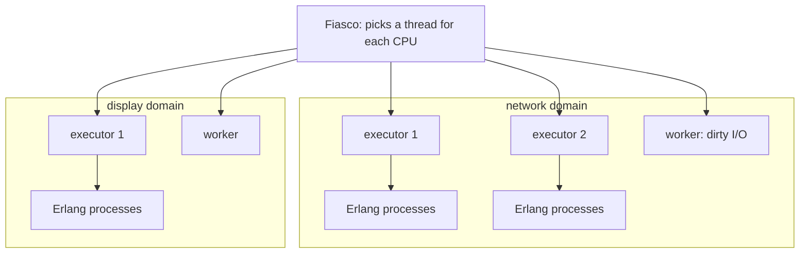
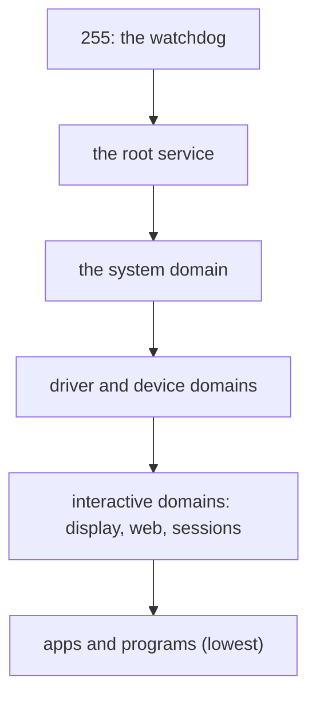
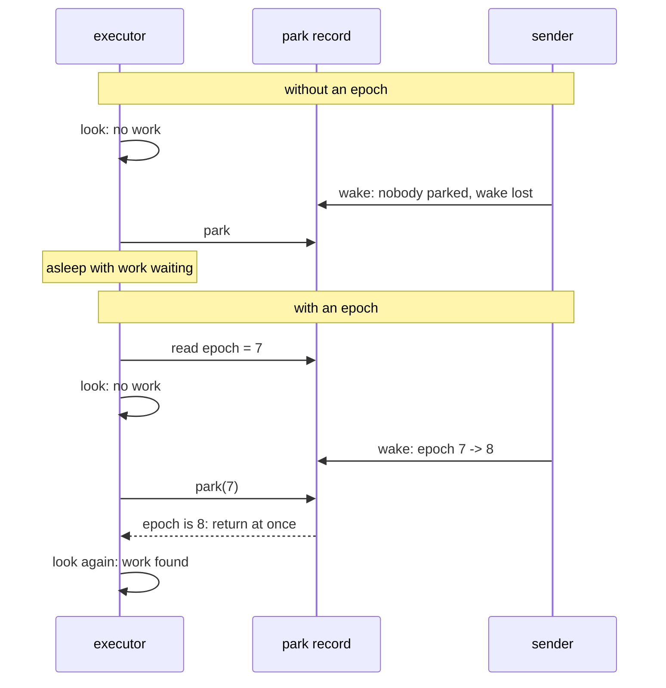
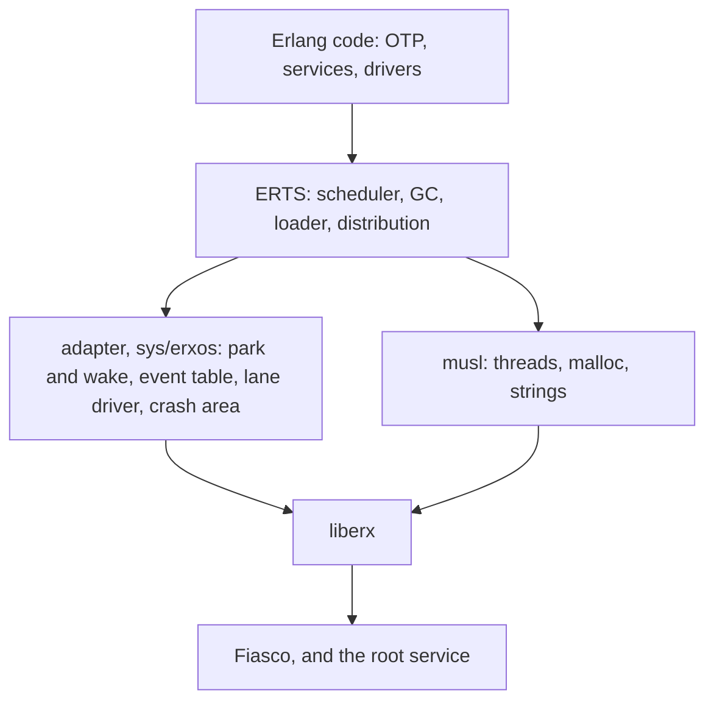

# Chapter 9. Processes, Runtimes and Two-Level Scheduling

> **Status.** **Built:** ERTS in user mode in every domain, its Erlang
> processes the system's one kind of process; Fiasco running every
> thread but the watchdog at one priority; executors and workers,
> groups, parking and the event table; the system domain on the
> interpreter, with BeamAsm available to other domains; the C library
> seam over musl, with FreeBSD's errno and signal numbers; hosted mode
> on macOS; `ps` over a session's Erlang processes; and `erx:trace`,
> which merges the runtime's scheduling with the system domain's parks
> and wakes. **Designed:** priority bands, CPU sets and thread limits
> from each domain's manifest row; refusing an executor every blocking
> wait; the system domain's refusal of code that is not installed; the
> shared-code image; native programs in `ps`; and a service's admission
> of each client by a share of reductions.

**Background needed.** [Chapter 1](01-operating-systems.md) for threads,
scheduling and the timer
([section 1.3](01-operating-systems.md#13-processes-threads-and-scheduling));
[chapter 3](03-erlang.md) for Erlang processes and the BEAM
([section 3.5.2](03-erlang.md#352-schedulers-and-reductions));
[section 4.2](04-history.md#42-thirty-years-of-two-level-scheduling)
for the history of two-level scheduling; [chapter
8](08-kernel-interface.md) for `liberx`, the root service, threads and
waits ([section 8.5](08-kernel-interface.md#85-threads-waits-gates-and-faults)).

An Erlang process in the network domain enters an endless loop. On the
same machine the display domain must draw the next frame, and the
storage domain has a write half done. Something must take the processor
from the loop, give it to the others, and give it back. When the
network domain falls idle, its threads must sleep without spending a
cycle and wake when the next packet arrives. A wakeup that comes while
a thread is deciding to sleep must not be lost; a lost one leaves a
packet unread until something else wakes the domain.

FreeBSD meets the first half of this problem with its kernel scheduler,
ULE, which picks among all the threads on the machine by priority and
by how much each has run lately. An Erlang system on FreeBSD is one
UNIX process, `beam.smp`, with one scheduler thread per processor. ULE
sees those few threads and nothing of the thousands of Erlang processes
inside them; ERTS shares each thread among its processes by its own
rules ([section 3.5.2](03-erlang.md#352-schedulers-and-reductions)).
The second half, sleeping without losing a wakeup, ERTS solves for
itself with a spin, then a futex or a `poll` on file descriptors.

erXos keeps the two levels and makes them the system's design. Fiasco
schedules threads; each domain's runtime, ERTS, schedules its Erlang
processes on a few threads called executors. An executor never blocks
except to park, and it parks against a counter that every wakeup
advances, so a wakeup that races with the park cancels it. The kernel
never calls into a runtime.

Sections 9.1 to 9.3 cover the process, Fiasco's share of the
processors and the runtime contract; 9.4 to 9.6 open ERTS; 9.7 watches
both schedulers at once; 9.8 and 9.9 cover failure and alternatives.

> **Background: how a BEAM scheduler sleeps.** Section 3.5.2 showed a
> scheduler thread running Erlang processes from its run queue, each for
> a turn of reductions. When the queue is empty, stock ERTS runs its
> *sleep step*, `scheduler_wait`. It spins for a while, checking for
> work, because waking a sleeping thread costs a kernel call. If no work
> comes, it sleeps on a thread event (a futex on Linux) or in `poll` on
> its ports' file descriptors. Whoever makes work for it, another
> scheduler or an I/O event, wakes it.

> **Background: preemption by the timer.** A thread that never calls
> the kernel would keep its processor forever, but the processor's
> timer interrupts it at a fixed interval and enters the kernel, which
> may switch to another thread
> ([section 1.2.3](01-operating-systems.md#123-the-timer-and-taking-the-processor-back)).
> The thread is stopped wherever it was, holding whatever it held.
> Erlang's reductions give the same effect one level up, without an
> interrupt.

## 9.1 The Erlang process is the system's process

Ask a FreeBSD machine what is running, and `ps` lists UNIX processes.
Ask erXos, and `ps` lists Erlang processes, because those are the
system's processes. A pid, a mailbox, links and monitors make the unit
of execution and of failure for the whole machine
([design.md, The model](../design.md#the-model)). The kernel has
address spaces and threads but no processes of its own
([section 3.9.1](03-erlang.md#391-every-erlang-process-is-an-operating-system-process)).

### 9.1.1 What a user sees

Type `ps` at the shell, rc, and it prints FreeBSD's default columns,
`PID TT STAT TIME COMMAND`, one row for each process of the session
(`erlang/apps/erx_shell/src/erx_cmd_ps.erl`). Each row is an Erlang
process, named by its registered name, or the label OTP gave it, or the
function it started in. This is **Built**. The `TIME` and `%CPU`
columns print `-`: the runtime does not measure a process's processor
time in a form `ps` reads, and erXos prints "not known" rather than a
guess. Native programs a session starts are designed to join the same
table; that is not built.

The same processes appear in the Erlang shell's `erx:i()`, under
`/proc`, and in the inspector, with their links, monitors and message
queues ([chapter 21](README.md#chapter-21-the-live-machine)). No
second, hidden kind of process lies beneath them.

### 9.1.2 What a programmer gets

An Erlang programmer writes the code they would write on FreeBSD. A
`gen_server` is spawned, linked and supervised with OTP's own calls,
and its messages, exit signals and `'DOWN'` messages behave as OTP
documents. erXos holds itself to that by comparison: `make
check-oracle` runs OTP's own test suites for ERTS, `kernel` and
`stdlib` on erXos's runtime and on stock OTP 29.1.2 on the development
host, and compares the results case by case
(`tools/lib/erx/oracle.rb`). Every difference is a bug in erXos, a
documented difference with a test, or a bug in OTP recorded as such
([design.md, Requirements](../design.md#requirements)).

### 9.1.3 Two levels in one picture

Figure 9.1 shows the two schedulers. Fiasco sees threads and picks
which one runs on each processor. Inside each domain, ERTS sees its
Erlang processes and picks which one each executor runs.



*Figure 9.1. The two levels. Fiasco schedules threads and knows nothing
of Erlang; each runtime switches among its own processes on its own
executors without entering the kernel.*

The split puts each decision where the information is. ERTS knows which
process holds a lock, which has a message waiting and which runs at
`high` priority; Fiasco knows none of that. Fiasco knows which thread
of which domain is ready on which processor; ERTS sees only its own. A
switch between two Erlang processes needs no kernel entry, and a busy
domain makes a great many of them, which is why the kernel does not.

## 9.2 How Fiasco shares the processors

What keeps one domain from taking all the processor time? On erXos the
answer is Fiasco's fixed-priority scheduler and each domain's place in
it.

### 9.2.1 One priority, round robin

Fiasco gives each thread a priority from 1 to 255 and always runs the
highest-priority ready thread on each processor. Threads of equal
priority take turns, a time slice each
([design-fiasco.md, Scheduling](../design-fiasco.md#scheduling)). In
erXos every thread but one runs at priority 1
(`SERVICE_THREAD_PRIORITY` in `liberx/backend/fiasco/service.c`). The
exception is the root service's watchdog, at 255
(`watchdog_thread.c`), which takes no lock. This is **Built**.

So a domain gets processor time as one thread among equals. If the
network domain's two executors and the display domain's one are ready
on the same processor, each gets a slice in turn. A spinning domain
cannot shut the others out, but nothing gives the display domain
precedence either. erXos's copy of Fiasco carries one change, so that
a thread that yields goes behind the others of its priority
([section 8.5.1](08-kernel-interface.md#851-threads)).

Fiasco has no load balancer. A thread stays on the processor where it
was placed until `erx_thread_set_affinity` moves it
([design-fiasco.md, Scheduling](../design-fiasco.md#scheduling)).
ERTS starts its schedulers with no processor named, so they all run on
one processor of their domain. The cost is unmeasured and is on
[the performance watch list](../todo-performance.md).

### 9.2.2 Bands

A **band** is a run of Fiasco priorities given to a domain by its row
in the system manifest; every thread of the domain starts at its band's
priority ([design-fiasco.md, Bands](../design-fiasco.md#bands)). The
design has six bands, one priority each (figure 9.3).



*Figure 9.3. The six bands, highest first. A domain that spins delays
only its own band and those below it.*

A band orders domains; it does not divide time among them. If an app
spins, its threads sit in the lowest band, so every interactive, driver
and system thread on its processor runs first whenever ready, and the
app gets what is left. If the display domain spins, it delays the apps
below it but no driver. Inside a band, threads still take turns, so two
spinning apps share their processor.

What a band does not promise matters as much. It measures no share: a
driver domain in a busy loop takes its processor from every interactive
domain there, for as long as it loops. It bounds no latency. And it
belongs to a domain, not to a request: what a domain asks of a service
runs on the service's threads, at the service's band.

Bands are **Designed** and not built.

### 9.2.3 CPU sets and thread limits

A domain's **CPU set** names the processors its threads may run on, and
its **thread limit** caps how many threads it may have across its
tasks. Both come from the same manifest row as the band
([design-fiasco.md, Threads, bands and stops](../design-fiasco.md#threads-bands-and-stops)).

The design enforces the CPU set in one place. The root creates every
thread and hands Fiasco each thread's processor mask through one call.
One function narrows the mask first: the requested mask, or every
processor if none was asked for, intersected with the domain's CPU set
and the processors online. Its result is a single-member struct that
only this function returns and that the one call takes, so a mask that
skipped the narrowing does not build. A thread past the limit gets
`ERX_ELIMIT`.

This is the shape L4Re gives its own programs: its loader, ned, hands
each program a scheduler proxy confined to a CPU set and a range of
priorities ([L4Re's ned documentation](https://l4re.org/doc/l4re_servers_ned.html),
"Control scheduling"). CPU sets and thread limits are **Designed** and
not built.

## 9.3 The runtime contract

What may a runtime ask of the kernel, and what must it promise?
[Section 4.2](04-history.md#42-thirty-years-of-two-level-scheduling)
told why two-level schedulers usually failed: the kernel had to call
into the user-level scheduler whenever a thread blocked, at whatever
point that thread had reached. erXos's contract removes the cause. Its
six rules are listed in
[section 4.2.3](04-history.md#423-why-erxos-keeps-two-levels); this
section shows how they work on Fiasco.

### 9.3.1 Executors and workers

Every thread of a runtime has one of two classes
([design-scheduler.md, The runtime contract](../design-scheduler.md#the-runtime-contract)).
An **executor** runs many Erlang processes in turn and never blocks
except to park. A **worker** may block: in a call to a server, on a
gate, in a long C call. In ERTS the normal and dirty CPU schedulers are
executors; the dirty I/O schedulers, ERTS's helper threads and the
thread that waits for fault records are workers
([design-runtime.md, Scheduling](../design-runtime.md#scheduling)).

The class is fixed at creation. `erx_thread_create` takes it, and an
executor gets a **slot**, one of at most 64 in its domain's group, the
record the park protocol works on (`liberx/backend/fiasco/thread.c`).
ERTS asks for the class through one option of its thread library that
only `erts_start_schedulers` sets
(`otp/erts/include/internal/ethread.h`).

`liberx` refuses a worker what only an executor may do: `erx_park` and
`erx_group_take_ready` answer `ERX_ETYPE` to a thread with no slot
(`liberx/backend/fiasco/park.c`). This is **Built**. The other
direction, refusing an executor every wait but a park and its own
private umtx words, with `ERX_EWOULDBLOCK`, is **Designed** and not
built. Even then it is a rule of `liberx`, not of Fiasco: a runtime
that bypassed `liberx` could block its own executors, which harms only
its own domain.

An executor may wait on a umtx word because ERTS builds its locks and
events on umtx waits, and a scheduler holds such locks for a few
instructions at a time. Forbidding them would mean rewriting ERTS's
locking. The waits are on the domain's private memory, which only its
own threads touch, so nothing outside the domain can stall an executor
that way.

### 9.3.2 The lost wakeup

Every sleeping scheme has the same race. An executor finds no work and
decides to sleep. Between the look and the sleep, a message arrives and
its sender rings the doorbell. The wakeup goes to a thread that is not
asleep, and the executor then sleeps with work waiting. The top
half of figure 9.2 shows it.

The answer is an **epoch**, a counter that every wakeup advances. The
executor reads the epoch *before* it looks for work and passes the
value to the park. Under a lock, the park compares the current epoch
with the value read. If anything advanced it in between, the park
returns at once and the executor looks again. If not, the executor
joins the parked list under the same lock, and any later wakeup finds
it there.



*Figure 9.2. Park and wake. The wakeup that falls between the look and
the park advances the epoch, so the park that would miss it returns at
once.*

There are two epochs. The group's epoch advances when a doorbell
bound to the group fires. A slot's epoch advances when another
executor wakes that slot by name with `erx_executor_wake`, as ERTS does
when it puts a process on a sleeping scheduler's run queue. The park
returns at once if either changed
([design-scheduler.md, Park and wake](../design-scheduler.md#park-and-wake)).
This is the condition variable's "check, then wait, under one lock",
with a counter in place of a condition, so the executor never tells the
kernel what it waits for, only how far it had read.

### 9.3.3 Park and wake on Fiasco

Fiasco has no park call, so `liberx` builds one from a semaphore per
thread, on which every wait in erXos ends
([section 8.5.2](08-kernel-interface.md#852-waiting-one-semaphore-per-thread)),
and a **dispatcher**, one thread in each task that receives the task's
doorbell deliveries from Fiasco
([design-fiasco.md, The park protocol](../design-fiasco.md#the-park-protocol)).
Follow a request into a parked storage domain.

1. A process in a session sends the storage service a request. The
   session's runtime copies the frame into a lane, the one-way ring
   that carries messages between two domains, and triggers the lane's
   doorbell, an IRQ object with no device behind it
   ([section 8.7.1](08-kernel-interface.md#871-one-path-for-devices-and-peers)).
2. Fiasco delivers the trigger to the storage domain's dispatcher.
3. The dispatcher takes the park lock and runs *trigger*: it puts the
   doorbell on the group's ready list unless it is listed already,
   advances the group's epoch, and takes the longest-parked executor
   off the parked list. It releases the lock and ups that executor's
   semaphore.
4. The executor returns from its wait. At its safe point it takes the
   ready list with `erx_group_take_ready`, which returns each doorbell's
   label once, however often it fired, and dispatches each label
   (section 9.4.4).

One doorbell wakes one executor, however many are parked. When none is
parked, a trigger wakes nobody: a running executor finds the doorbell
at its next safe point.

The protocol's decisions are one pure function, `park_step`
(`erx_backend_park_step` in `liberx/backend/core/park_table.c`). It
takes the park record and an event (trigger, park, timeout, wake or
release) and returns what the caller does after it unlocks: at most one
semaphore up or one down. It reads no clock and calls no kernel, so
host tests drive it (`test/fixtures/fiasco_park_driver.c`); it is the
functional core of
[section 6.3](06-construction.md#63-functional-core-effects-at-the-edge)
in miniature. Parking is **Built**.

The cost is one thread switch. A doorbell reaches the dispatcher first,
and the dispatcher wakes the executor, so a wakeup of an idle domain
takes two switches where a kernel with a park call would take one. The
protocol is the scheduler design's own, so a park call inside Fiasco
would replace only the dispatcher.

### 9.3.4 What a runtime does not get

On Fiasco a runtime gets threads, park and wake, and nothing else from
the scheduler
([design-fiasco.md, The scheduler on Fiasco](../design-fiasco.md#the-scheduler-on-fiasco)).

* **No upcall.** Fiasco's one upcall interface, its vCPU mode, is
  refused to an executor, so the kernel never enters a runtime at a
  point the runtime did not choose
  ([section 8.5.6](08-kernel-interface.md#856-signals-through-vcpu-upcalls)).
* **No urgency.** A runtime cannot change one thread's priority:
  `erx_thread_set_urgency` answers `ERX_ENOTSUP`
  (`liberx/backend/core/refused.c`).
* **No share.** Fiasco charges each thread for its own slices and keeps
  no account per domain
  ([section 5.6.5](05-overview.md#565-shared-services-and-shared-cpu)).
* **No grace period.** A slice ends where it ends, even inside a
  run-queue lock, and another executor that wants the lock waits until
  the holder runs again.

Each absence buys simplicity. A runtime that is never entered
unexpectedly needs no code to recover from it, and a kernel that reads
no advice cannot be misled by a runtime that lies.

## 9.4 ERTS as a parts bin

Why does erXos carry its own ERTS instead of running the stock one on a
compatibility layer? ERTS on UNIX does much work that only adapts it to
UNIX: a poll set over file descriptors, a spin before sleeping, a
correction for unreliable clocks, crash dumps to files. Where erXos
already has a mechanism for a job, keeping both would give a reader two
models to learn
([design-runtime.md, One mechanism per job](../design-runtime.md#one-mechanism-per-job)).
[Section 3.9.5](03-erlang.md#395-erts-as-a-parts-bin) introduced the
idea; this section shows the parts.

### 9.4.1 One mechanism per job

For each job, erXos keeps the better of ERTS's mechanism and its own,
or redesigns it. Table 9.1 shows the scheduling rows.

| Job | Stock ERTS | ERTS on erXos |
| --- | --- | --- |
| choosing which process runs | run queues, priorities, reductions, stealing | kept |
| choosing which thread runs | the host kernel | Fiasco |
| waiting for work | spin, then a thread event or `poll` | `erx_park` with epochs |
| readiness | the poll set over file descriptors | doorbells on the ready list, through the event table |
| timeouts | timer wheels per scheduler | kept; a park's deadline is the wheel's next expiry |
| long C calls | dirty schedulers | kept: dirty CPU schedulers are executors, dirty I/O ones workers |

*Table 9.1. Scheduling in ERTS, stock and on erXos
([design-runtime.md, One mechanism per job](../design-runtime.md#one-mechanism-per-job)).*

ERTS's scheduler stays whole as the second level, because it is proven
and nothing in erXos would schedule Erlang processes better. Its sleep
and readiness are redone: the poll set assumes file descriptors, which
a domain does not have, and the spin spends time that, among
equal-priority threads, another domain could have used.

### 9.4.2 The inside of ERTS on erXos

Figure 9.4 shows the layers. ERTS's scheduler, garbage collector,
loader and distribution sit on an **adapter**, the directory
`otp/erts/emulator/sys/erxos/`, which takes the place of ERTS's UNIX
layer. The adapter is the only part of ERTS that includes a `liberx`
header
([design-runtime.md, The adapter](../design-runtime.md#the-adapter)).



*Figure 9.4. ERTS on erXos. Only the adapter and musl call `liberx`,
and only `liberx` reaches Fiasco or the root service.*

Changes to ERTS's own files, outside the adapter, are named. Each
change of behavior has a number, which the code, its tests and the
design use for it
([design-runtime.md, The edits outside `sys/erxos`](../design-runtime.md#the-edits-outside-syserxos)).
The first two of some seventy are this chapter's heart:
`scheduler_wait` parks with `erx_park` instead of a thread event or the
poll set, and `wake_scheduler` wakes with `erx_executor_wake`. A
modified file opens with a comment listing the edits it carries, as
`beam/erl_process.c` does.

### 9.4.3 The scheduler's sleep, in code

`sched_park`, in `otp/erts/emulator/beam/erl_process.c`, stands where
stock ERTS called `erts_tse_twait`:

```c
/* Answers as erts_tse_twait does: 0 at a wake, which may be spurious, or ETIMEDOUT. */
static int
sched_park(ErtsParkEpochs epochs, Sint64 timeout)
{
    const uint64_t deadline = timeout < 0 ? ERX_WAIT_FOREVER : erx_deadline_after((uint64_t) timeout);

    switch (erx_park(epochs.group, epochs.slot, deadline)) {
    case ERX_OK:
        return 0;
    case ERX_ETIMEDOUT:
        return ETIMEDOUT;
    default:
        erts_exit(ERTS_ABORT_EXIT, "%s:%d: Internal error\n", __FILE__, __LINE__);
        return 0;
    }
}
```

Notice two things. The function answers as the call it replaces did,
so the rest of `scheduler_wait`, its flags and its loop, is ERTS's own.
And the epochs arrive as an argument. The caller read them before it
set the flag that says "this scheduler sleeps", and a waker clears that
flag before it calls `erx_executor_wake`, so a wakeup shows either in
the flags or in an epoch. The timeout is the next expiry of the
scheduler's timer wheel, so a parked scheduler wakes for its next
Erlang timer and no sooner. A dirty I/O scheduler, which has no slot,
keeps ERTS's thread event, a umtx wait on erXos.

### 9.4.4 The event table: readiness without file descriptors

On FreeBSD, ERTS learns that a socket has data from `kqueue` or `poll`,
which report file descriptors. A domain has none. It has doorbells:
each connection's lane, each device line and each native program's
channel has one, bound to the domain's group with a **label**, a number
the binder chose. The ready list returns labels, and the **event
table** says what each names
([design-runtime.md, The event table](../design-runtime.md#the-event-table)).
A label leads to one of three sinks:

* a **connection sink**, a lane from another domain: the lane port's
  input task is scheduled, and a normal scheduler copies the frames out;
* a **port sink**, such as a native program's channel: ERTS's own input
  task for that port is scheduled, so the port's work is serialized as
  every port's is;
* a **process sink**, such as a device's interrupt: the term registered
  with the label is sent to an Erlang process, as `{erx_irq, Device,
  Line}` reaches a driver.

A label whose sink has gone, because its port closed or its process
ended after the doorbell fired, is dropped. The table's core,
`otp/erts/emulator/sys/erxos/erx_event_table.c`, knows nothing of ERTS
and calls no kernel, so host tests drive every path; `erx_event.c`
holds its effects. ERTS on erXos runs no poll thread. The event table
is **Built**.

## 9.5 Code: the interpreter, BeamAsm and shared code

Which code a domain may run is a security decision as much as a speed
one. A runtime that compiles Erlang to machine code must be able to
write code and then run it, which is what an attacker most wants to do.

> **Background: just-in-time compilation and writable-or-executable
> memory.** A just-in-time compiler, or JIT, turns a program into
> machine code while the program runs, instead of interpreting it one
> instruction at a time. It writes the code into memory and jumps to
> it. Most systems forbid a page that is writable and executable at
> once, since an attacker who can write into a program's memory could
> then run what they wrote. A JIT therefore writes through one mapping
> and runs through another, or flips a page's permissions between the
> two.

### 9.5.1 Three runtime images

erXos builds ERTS three ways
([design-runtime.md, BeamAsm](../design-runtime.md#beamasm)):

* the **system image**: the interpreter, without BeamAsm, its C++
  runtime or OpenSSL, for the system domain;
* the **interpreter image**: the same build with OpenSSL, for command
  domains and deterministic mode;
* the **BeamAsm image**: ERTS with BeamAsm, OTP's JIT, for every other
  domain unless its specification chooses the interpreter.

Which image a domain runs follows from whether it is the system domain,
one field of its specification and the boot's mode; no domain chooses
at run time. The interpreter and BeamAsm are both **Built**, and the
development manifests in `config/manifest/` start every domain on the
interpreter ([section 5.1.3](05-overview.md#513-runtime)).

The system domain interprets because it is the trusted base. Its image
holds no generated machine code, no JIT and no C++, and its work is
bounded control, for which the interpreter suffices. OTP's own notes
put BeamAsm at "anything from no difference to up to four times as
fast" as the interpreter (OTP 29.1.2,
`erts/emulator/internal_doc/BeamAsm.md`). The system domain gives that
up for a trusted base with no code generator to attack.

In a BeamAsm domain, each block of JIT code is a memory object mapped
twice, once writable for BeamAsm and once executable for the processor.
Only a domain whose image is marked for JIT gets an address space that
allows such objects
(`otp/erts/emulator/sys/erxos/erx_jit_memory.c`). The rule's limits on
Fiasco are stated in
[section 3.9.5](03-erlang.md#395-erts-as-a-parts-bin) and
[section 6.2.6](06-construction.md#626-a-mapping-that-is-never-writable-and-executable).
Under deterministic mode, `erx.det=1`, every domain but the system
domain runs the interpreter image, because BeamAsm's output depends on
addresses and hash order.

### 9.5.2 Code by hash

A domain's code comes from its release in the boot image, which the
boot checks, or from the code service, when a developer replaces a
module on the running system. The code server fetches each module as
`{Module, Hash}`, the SHA-256 of its file, and checks the bytes before
ERTS's loader reads them. A changed byte fails the load with
`{error, hash_mismatch}`
([design-runtime.md, Code in the system domain](../design-runtime.md#code-in-the-system-domain)).
The hash is the module's version: the inspector shows it, and a
rollback chooses among the hashes a domain has loaded. The code
service and its check are **Built**
(`erlang/apps/erx_code/src/erx_code.erl`).

The system domain's runtime is designed to accept a module only if its
bytes lie in **installed storage**: the pages of its release, or an
arena only the code service writes. It refuses any other with
`{error, not_installed}`, however the binary travelled. That refusal is
**Designed** and not built.

### 9.5.3 Shared code

Every ERTS domain loads its own copy of `lists`, `gen_server` and the
rest of `kernel` and `stdlib`, charged to its own budget. Loaded code
and its literals are about 10 of the 16 MB the system domain reports at
its shell ([design-shared-code.md](../design-shared-code.md)).

The design makes one copy for the whole machine. The build runs the
interpreter image under QEMU, lets ERTS load the common modules at
fixed addresses, and writes the result into the boot image as one more
file, hashed like every other. Each interpreter domain maps that image
read-only at the same addresses, so nothing is relocated and every page
stays shared
([design-shared-code.md, The central construction](../design-shared-code.md#the-central-construction)).
The shared-code image is **Designed** and not built.

## 9.6 The C library seam and hosted mode

ERTS is a C program, and it gets memory, threads and the clock from a
C library.

> **Background: a C library, and musl.** The C library is the code
> behind `malloc`, `printf`, `pthread_create` and the other functions
> of the C standard and POSIX. On UNIX most of them end in system
> calls: `malloc` in `mmap`, `pthread_create` in a call that makes a
> thread. FreeBSD's is `libc`; Linux systems use glibc or **musl**, a
> small C library written to be read and ported. Porting a C library
> means replacing its system calls with what the new system offers.

### 9.6.1 One seam

musl 1.2.6 lives in erXos's tree as erXos's code and is the C library
of every runtime and native program. It reaches the kernel only through
`liberx`
([design-runtime.md, The C library seam](../design-runtime.md#the-c-library-seam)):

| musl needs | erXos gives |
| --- | --- |
| pages for `malloc` | `erx_vm_reserve` and `erx_vm_commit` |
| threads | `erx_thread_create`, `erx_thread_exit` |
| locks and condition variables | umtx waits on private memory |
| clocks | the time page |
| random bytes | `erx_entropy_take` |

musl's Linux system-call layer, `__syscallN` and its 341 numbers, is
deleted, so no Linux system-call number exists in erXos. A runtime
uses no file descriptor but standard output and error; native programs
get files, pipes and signals from a POSIX layer over `liberx`
([chapter 13](README.md#chapter-13-native-programs-pipes-and-posix-lite)).

The errno and signal numbers musl returns are FreeBSD's, generated from
one table in the ABI and checked against FreeBSD's own
([section 7.3.1](07-one-source.md#731-tables-that-must-match-someone-elses)),
so a program ported from FreeBSD prints the `errno` a FreeBSD user
expects. This is **Built**.

One function shows how the seam changes behavior. musl cancels a
thread on Linux by sending it a signal. The design has the canceller
stop the target and move its program counter instead, but Fiasco's
backend refuses the stop calls with `ERX_ENOTSUP`, so `pthread_cancel`
acts at the target's next cancellation point, as POSIX allows. ERTS
never calls it.

### 9.6.2 Hosted mode

A crash inside ERTS on QEMU is slow to debug: a boot takes seconds, and
the debugger sees a guest. **Hosted mode** runs the same runtime as a
macOS process, on `liberx`'s hosted backend, under AddressSanitizer,
the other sanitizers and `lldb`
([design-runtime.md, Hosted mode](../design-runtime.md#hosted-mode)).
It is **Built**. QEMU stays the authority: a test that passes only
hosted is not a pass.

A hosted runtime links macOS's libSystem, not musl. musl finds its
thread descriptor through the register that holds the current thread's
pointer, which a macOS process already uses for libSystem, so two C
libraries cannot share the process. Above the C library nothing
differs: `sys/erxos` is the same list of files on both backends, and a
source check fails on any that names `__APPLE__`, Linux or a backend.
`make check-runtime-seam` compares the two builds' configuration
headers and fails on a difference outside a short list, each entry with
its reason.

## 9.7 Two schedulers you can watch as one

When a domain is slow, which scheduler is to blame? On FreeBSD, `top`
shows the kernel's view and a program's own tools show its view, rarely
both at once. erXos merges them.

### 9.7.1 One timeline

`erx:trace(Spec)`, typed at the Erlang shell, prints one stream of
events in the order of one clock
([design-live.md, Tracing](../design-live.md#tracing)). From ERTS it
takes OTP's own trace session with the `running` flag, which reports
each time an Erlang process is scheduled in or out. From the root
service it takes the **trace ring**, 4,096 records that `liberx` writes
as it carries out parks, wakes and doorbell deliveries
([design-fiasco.md, The trace ring](../design-fiasco.md#the-trace-ring)).
Every 10 ms the trace process reads both, merges them in time order and
sends the result to the shell; if the shell falls behind, it drops and
counts entries rather than queue them
(`erlang/apps/erx/src/erx_trace.erl`). It is **Built**.

So one stream shows an executor of the system domain park, the
dispatcher deliver a doorbell, the executor wake, and the Erlang
process that ran next. The view has a limit: only the root's own
threads write the ring, so a park in another domain does not appear,
though that domain's process events do.

### 9.7.2 A worked example

A file service runs in domain A, and two sessions use it. B runs a
build that reads thousands of small files; C runs an editor whose user
has pressed save. Each session has a lane into A with a doorbell bound
to A's group, and in A a **facet** process, which receives that one
session's requests and checks them before the service sees them
([section 7.7](07-one-source.md#77-the-system-manifest-the-machines-configuration-checked)).
The example adapts
[design-scheduler.md, A worked example](../design-scheduler.md#a-worked-example)
to Fiasco.

1. B's processes send read requests as fast as they can. When B's lane
   is full, B's senders wait inside B's own runtime, as a sender to a
   busy port waits in stock ERTS. A is asked for no more than the lane
   holds.
2. A's executors run B's facet and the processes that serve B's reads.
   That time is A's, on A's threads, whatever B sends.
3. C rings its doorbell. Fiasco delivers it to A's dispatcher, which
   lists it and wakes a parked executor of A; if every executor is
   running, one finds it at its next safe point.
4. A's ERTS runs C's facet beside B's, sharing A's executors by priority
   and reductions. C's request is decoded within a few of A's
   scheduling rounds, not behind B's whole backlog, because that
   backlog waits in B's lane, not in A's run queues.
5. If all of A's threads are busy, A takes turns on its processor with
   every other ready thread there. Nothing lends A the time of B or C,
   and nothing charges them for A's.

Two parts are designed and not built. Bands would order A, B and C by
their manifest rows. And a facet is designed to admit its client's
requests within a **share** of reductions per period. B's facet would
then stop taking requests once B's share is spent, while C's are taken
at once ([design-scheduler.md, Service work](../design-scheduler.md#service-work)).
A facet admits each request whose operation its grant lists; admission
by share is not built (`erlang/apps/erx/src/erx_facet.erl`).

## 9.8 What happens when a part fails

Each level fails in its own way, and each failure stays where it
started.

**An Erlang process loops.** Its reductions run out at the end of its
turn, and ERTS runs the next process. Other domains do not see it.

**A NIF loops.** C code called from Erlang is not counted in
reductions, so its executor runs nothing else until it returns. The
domain's other executors steal its queued processes. A long C call
belongs on a dirty scheduler, as on stock ERTS
([section 3.5.4](03-erlang.md#354-bifs-nifs-and-ports)).

**A domain spins.** Its threads take turns with every other thread on
their processors, at one priority, so other domains slow down but run.
With bands, the spin would delay only its own band and those below;
that is designed and not built.

**An executor blocks.** An executor that blocks where it should not, a
NIF waiting on a server say, runs no Erlang process until the call
returns, and its peers steal its work. `liberx` does not refuse such a
call (section 9.3.1). Only the domain that made it is affected.

**An executor dies.** The park protocol's *release* event frees the
slot, advances the group's epoch and wakes the longest-parked
executor, so a wakeup meant for the dead one is not lost with it.

**A domain ends.** Its runtime writes a dump to the domain's crash area
and stops the domain. Every thread of every task ends with it, and the
processes linked to its processes get exit signals
([design-runtime.md, Crash handling](../design-runtime.md#crash-handling)).
The domain's scheduler state, its group and park record, ends with it.

**The machine stalls.** The watchdog thread runs at priority 255 and
once a second checks that the root service has reported in recently; a
missed report resets the machine. On a board with a hardware watchdog,
such as the Raspberry Pi 4, the same thread reloads it each second, so
a hang of Fiasco itself also ends in a reset
([design-fiasco.md, The watchdog](../design-fiasco.md#the-watchdog)).

## 9.9 Design choices

**Every Erlang process a kernel thread.** The kernel could schedule
each Erlang process itself, as a 1:1 thread library does, and each
would get Fiasco's preemption and priority. But every spawn would be a
request to the root and every switch a kernel entry. Erlang processes
are cheap because they never enter the kernel
([section 4.2.1](04-history.md#421-two-answers-both-tried)).

**Scheduler activations.** The kernel could tell the runtime whenever
one of its threads blocks. That needs the kernel to enter the runtime
at an arbitrary point, and every system that tried it for general C
code gave it up
([section 4.2.2](04-history.md#422-the-common-failure)). ERTS does not
need it, because an Erlang process never blocks its thread: a
`receive` with no message parks the process, and the executor runs
another.

**Shares instead of priorities.** Fiasco could charge each domain a
fraction of each processor, as FreeBSD's `rctl` can cap a jail's CPU.
<!-- check: rctl(8)'s pcpu resource caps a jail's CPU percentage. -->
That needs a scheduling class Fiasco does not have, and adding one
changes its scheduler, accounting and switch path, a large change to
inherited C++
([design-fiasco.md, The scheduler on Fiasco](../design-fiasco.md#the-scheduler-on-fiasco)).
Bands give an order between domains for one number each; the cost is
that a busy domain in a high band can starve every lower one on its
processors.

**Lending time to a service.** Some kernels let a client donate its
processor time to the server working for it. erXos does not: a service
runs on its own threads, and nothing must work out who pays. The price
is that a saturated service slows all its clients together
([section 5.6.5](05-overview.md#565-shared-services-and-shared-cpu)).

**Stock ERTS on a POSIX layer.** erXos could give ERTS a full POSIX
emulation, with file descriptors, `poll` and signals, and leave ERTS
untouched. Every wakeup would then pass through an emulated `poll`, and
erXos would carry two models of readiness. A list of numbered changes
to ERTS is cheaper to maintain than an emulation of the system ERTS was
written for.

## Summary

Every Erlang process is a process of the system: `ps` lists a session's
Erlang processes, and OTP code runs as on stock OTP, which `make
check-oracle` compares case by case. Fiasco runs every thread but the
watchdog at one priority, round robin, on the processor where it was
placed. The design adds bands, CPU sets and thread limits from each
domain's manifest row; bands order domains and measure no share, and
none of the three is built. A runtime's threads are executors, which
only park, or workers, which may block. An executor parks against two
epochs, so a wakeup that races with the park cancels it; on Fiasco a
dispatcher per task and a semaphore per thread carry this, through one
pure function. ERTS keeps its scheduler and replaces its sleep,
readiness and UNIX layer with an adapter over `liberx`, with an event
table in place of a poll set. The system domain interprets and makes no
machine code; other domains may run BeamAsm. musl sits under ERTS
through one seam with FreeBSD's numbers, and the same runtime runs
hosted on macOS. `erx:trace` shows both schedulers in one timeline.

The scheduler decides which thread runs; the next chapter turns to
where those threads live, the domain, and the wall around it.

## Where to read next

* [design-fiasco.md, The scheduler on Fiasco](../design-fiasco.md#the-scheduler-on-fiasco):
  what each mechanism of the scheduler design becomes on Fiasco, the
  bands, and the park protocol's operations.
* [design-scheduler.md](../design-scheduler.md): the full two-level
  design, its runtime contract, park and wake, and service work.
* [design-runtime.md](../design-runtime.md): ERTS on erXos, from the
  inventory of mechanisms to the adapter, the event table, BeamAsm, the
  C library seam and hosted mode.
* [design-shared-code.md](../design-shared-code.md): one copy of loaded
  code for every interpreter domain.
* [research-hierarchical-scheduling.md](../research-hierarchical-scheduling.md):
  the record of M:N threading and why it was abandoned.
* Thomas Anderson, Brian Bershad, Edward Lazowska and Henry Levy,
  "Scheduler Activations: Effective Kernel Support for the User-Level
  Management of Parallelism", SOSP 1991: the design whose failure the
  runtime contract answers.
* OTP 29.1.2, `erts/emulator/internal_doc/BeamAsm.md`: BeamAsm and its
  speed against the interpreter.
