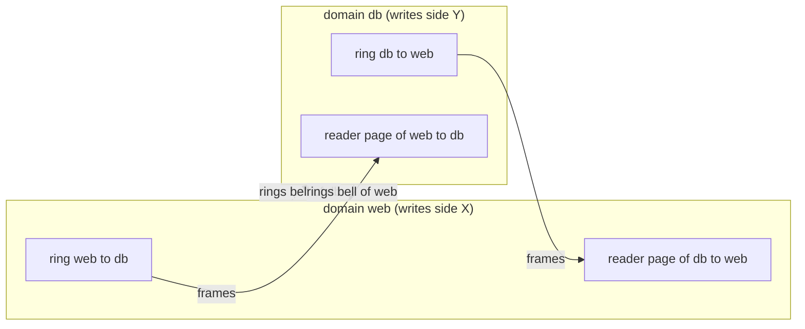
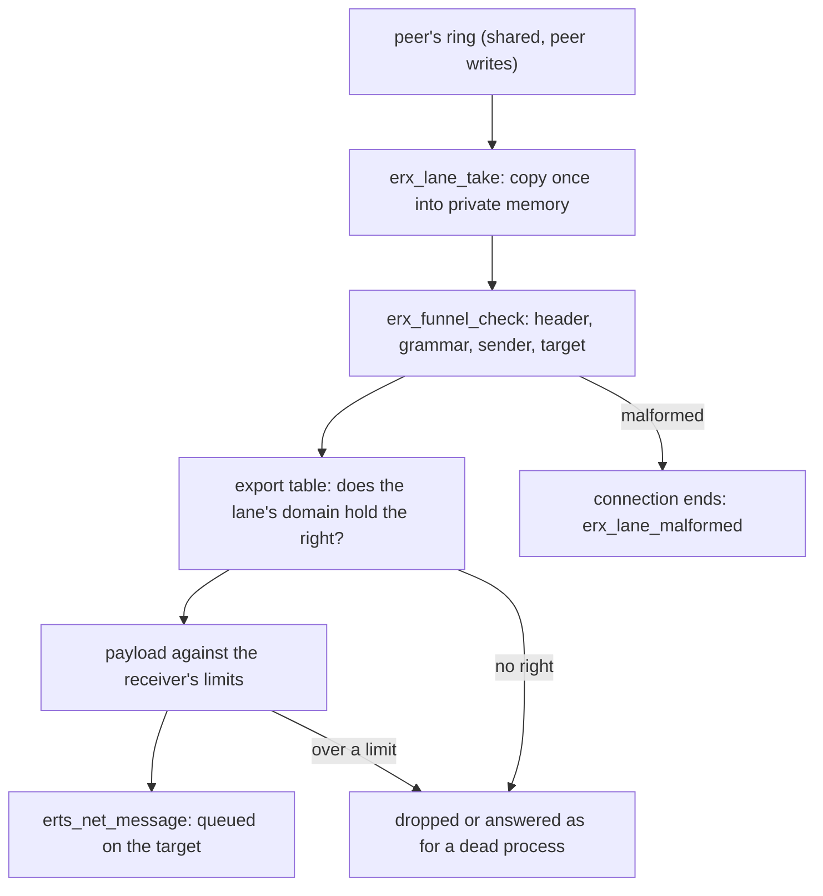
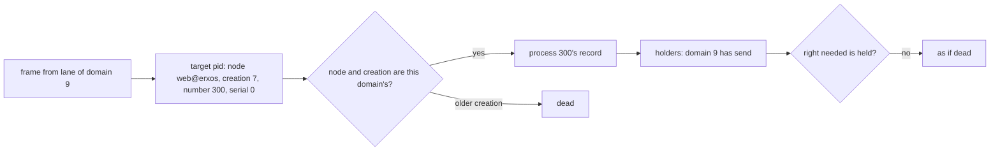
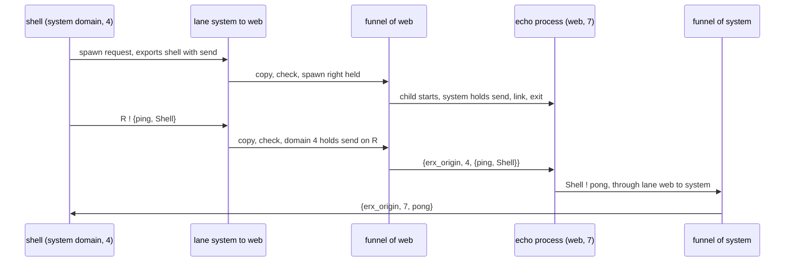
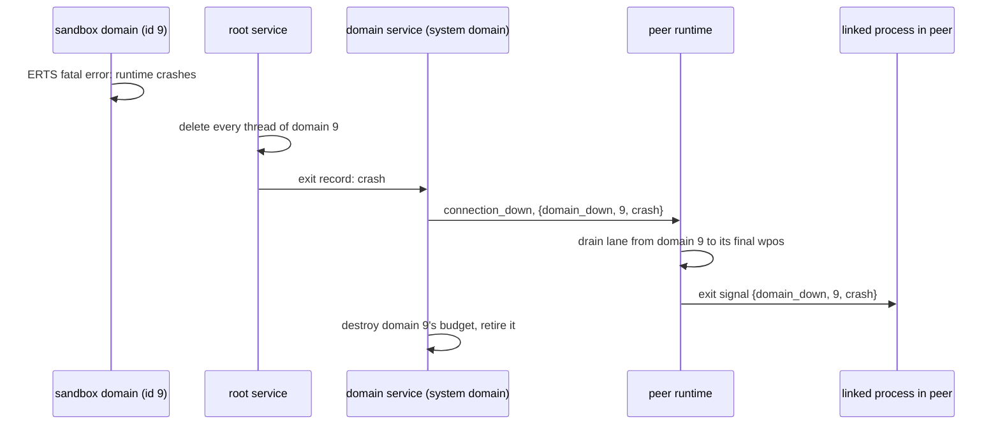

# Chapter 10. Domains: A Wall Around Some Processes

> **Status.** **Built:** domains, each with its own ERTS in its own
> address space and its own Erlang node; connections of two lanes with
> doorbells; the funnel; export tables; the `{erx_origin, D, Msg}`
> envelope; links, monitors, exits and spawns across domains;
> `{domain_down, D, Info}` at a domain's end; the domain service, the
> domain library and the root service creating and ending domains.
> **Designed:** connection memory charged to budgets that refuse more
> past their limit; a mapping right that keeps a party from writing its
> peer's side; `gen_server` and `gen_statem` servers that take calls
> from other domains directly; a quota of node names per principal.

**Background needed.** [Chapter 1](01-operating-systems.md) for
address spaces and shared memory; [chapter 2](02-microkernels.md) for
capabilities and the root task; [chapter 3](03-erlang.md) for
processes, links, nodes and the external term format;
[chapter 8](08-kernel-interface.md) for `liberx`, the root service,
handles and doorbells.
[Chapter 9](README.md#chapter-9-processes-runtimes-and-two-level-scheduling)
explains runtimes; this chapter needs only that every domain runs its own ERTS.

A web shop on FreeBSD runs as one `beam.smp` process. Its HTTP server,
its database driver and its image resizer are OTP applications in that
one process. The resizer links a NIF, C code loaded into ERTS
([section 3.5.4](03-erlang.md#354-bifs-nifs-and-ports)), and a crafted
image makes the NIF write past the end of a buffer, into the database
driver's heap. The shop does not crash; it starts returning wrong
prices. Supervisors restart a process whose code failed, but a stray C
pointer is not a process failure, so "let it crash" cannot help
([section 3.3.6](03-erlang.md#336-what-let-it-crash-does-not-fix)).

On FreeBSD the remedy is a second `beam.smp`. Put the resizer in its
own process, and the kernel's page tables keep its writes out of the
shop's memory. The two talk through Erlang distribution over TCP: the
same `!`, links and monitors. But distribution was built for trusted
clusters. A node that presents the right cookie may spawn any code on
any other node, so the wall stops stray pointers and nothing else
([section 3.6.2](03-erlang.md#362-nodes)).

erXos keeps the second process and drops the trust. A **domain** is an
address space with its own ERTS, which is an Erlang node of its own.
Processes in different domains message, link and monitor each other
with the distribution protocol, unchanged in what it promises. Beneath
it there is no socket: two domains share a pair of one-way rings that
the system domain made for them. The receiving domain reads every
arriving frame through one function, the funnel, which copies it,
checks it, and delivers it only to a process the receiver has chosen
to make reachable from that sender. Every message that passes arrives
wrapped, so no process takes it for one from its own domain.

The chapter first says what a domain is and how its identity works. It
then covers connections, the funnel, exports and the envelope, follows
one message end to end, and turns to links, exits and a domain's death.
It ends with the code that creates and ends domains, what fails, and the
alternatives.

> **Background: address spaces, recalled.** Each address space has
> its own page tables, which map its virtual addresses to physical
> pages. A program can touch only the pages its tables map, and a
> stray pointer into an unmapped address faults instead of writing
> someone else's memory
> ([section 1.4](01-operating-systems.md#14-virtual-memory)). Two
> address spaces can map the same physical page, each with its own
> protection bits: one may map a page writable while the other maps it
> read-only. On erXos, the root service writes every page table
> ([section 8.3](08-kernel-interface.md#83-the-root-service-who-holds-what)).

> **Background: rings and doorbells.** Two parties that share memory
> can pass a stream of records without a kernel call per record. A
> **ring** is a fixed area used in a circle. The producer writes records
> at its write position and then publishes the new position; the
> consumer reads up to that position and publishes its own read
> position, which returns the room. Each position has one writer, so no
> lock is needed, only the memory-ordering care of
> [section 1.7.3](01-operating-systems.md#173-memory-ordering). A
> consumer with nothing to read sleeps, and the producer needs a way to
> wake it: a **doorbell**, an object one party rings and the other
> waits on. Network cards and their drivers have worked this way for
> decades.

> **Background: nodes and frames, recalled.** A **node** is a running
> ERTS with a name such as `web@erxos`, and a pid records its node, so
> `Pid ! Msg` reaches another node unchanged. To cross, a message
> becomes a **frame**: a control term that says what the signal is and
> between which processes, then the payload, both in the **external
> term format** that `term_to_binary/1` produces
> ([section 3.6.3](03-erlang.md#363-how-a-message-crosses-between-nodes)).

## 10.1 A domain is a node

What does a domain hold, and what makes it distinct from every other
domain? It holds an Erlang node: its own runtime, atoms, code, tables
and process names. Its identity is ERTS's own node identity, a name and
a number, used as stock ERTS uses it.

### 10.1.1 What a domain holds

Each domain runs one ERTS in an address space of its own
([section 5.1.2](05-overview.md#512-domain)), with its own atom table,
loaded code, ETS tables and registered names. A domain's
`register(db, Pid)` names `db` in that domain alone. Code loads from
the domain's own release, and hot loading inside a domain is OTP's own
([design-domains.md, Atoms, code, ETS and names](../design-domains.md#atoms-code-ets-and-names)).
A domain also has a **budget**, a record of the memory set aside for it
([chapter 12](README.md#chapter-12-memory-and-budgets)); a **group**,
the threads its runtime runs on (chapter 9); and a connection to the
system domain, the one it boots with.

All of this is per domain, so a fault reaches only its own domain. A
NIF's stray pointer corrupts its own domain's heap; a domain that fills
its atom table stops, as a node would, and only it ends. Each domain
running its own ERTS is Built (README.md, "Current status").

### 10.1.2 Domain ids and pids

Every domain has a **domain id**, a 32-bit number the domain service
never reuses within a boot. The system domain is 4, and every other
domain takes the next unused id. The id is the domain's node
**creation**, the number ERTS uses to tell one run of a node from the
next. It starts at 4 because stock ERTS gives no node a creation below 4
([design-domains.md, Domain ids, pids and
references](../design-domains.md#domain-ids-pids-and-references)).

A domain's node name is its name at the machine's host name:
`system@erxos`, `storage@erxos`, `web@erxos`. The runtime starts its
node under that name and creation before it reads its first frame, so
`node()` answers the domain's own name from the start and
`erlang:system_info(creation)` its id.

A pid is ERTS's: a process number and a serial, with the node name and
creation of the domain that owns the process. So a pid names its owner
domain by construction; no table maps pids to domains, and no table
can disagree. erXos prints a pid as `<D.N.S>`, with `D` the owner's
domain id, in every domain. Stock ERTS prints 0 for its own node and a
local index for others, so the same pid prints differently on each
node. On erXos `<7.300.0>` is process 300 of domain 7 wherever it is
printed. erXos's ERTS makes the printed number the node's creation
(`internal_channel_no` and `external_channel_no` in
`otp/erts/emulator/beam/erl_node_container_utils.h`), and this is
Built.

When a domain ends and a later domain takes the same name, the later
one gets a new id. A pid of the ended domain keeps the old id as its
creation, so it names no process of the later domain. A message to it
reaches the later domain's funnel, which sees the old creation and
treats the target as dead (section 10.3.2).

References, which Erlang uses as unique tags for calls and monitors,
carry their creator's node and creation in the same way. On erXos every
reference has four 32-bit words drawn from AES-128, so one domain
cannot guess another's references
(`otp/erts/emulator/beam/erl_bif_unique.c`); this is Built. Section
10.5 shows why that matters: a reply tag that could be guessed could
be forged.

### 10.1.3 Where the picture of distribution stops

"Erlang distribution inside one machine" is the right first picture. The
code in a domain sees exactly that: `nodes()` lists the domains it is
connected to, and `spawn_link('web@erxos', M, F, A)` starts a linked
process in another domain. The picture differs from a cluster in five
places.

* **No socket, cookie or port mapper.** A connection is shared memory
  the system domain made, and it says which domain is at its other end.
* **No connection on demand.** A domain reaches only the domains the
  system domain has connected it to; a send toward any other fails as
  toward a node that cannot be reached.
* **No global names.** A registered name is one anyone can guess, so
  `{db, 'web@erxos'} ! Msg` is dropped in the sender's own runtime, and
  OTP's `global` and `pg` work within each domain only.
* **No ticks.** Distribution drops a peer that stays silent, but a
  domain starved of CPU is silent too. A peer's end arrives instead
  from the system domain (section 10.7.4).
* **Not every right comes with a pid.** What a peer may do to a process
  is what the process's own domain has granted it (section 10.4).

## 10.2 Connections, lanes and doorbells

How do two domains exchange frames without a kernel call per frame,
and without either being able to corrupt the other's memory? Through a
**connection**: two one-way **lanes** in memory both domains map, each
lane with exactly one writer per page, and a doorbell for each
direction. A connection is all two domains share
([design-domains.md, Connections](../design-domains.md#connections)).

### 10.2.1 A lane

A lane carries frames from one domain, its **producer**, to another,
its **consumer**. It has three parts:

* a **ring**: a header page and a data area, which the producer alone
  writes and the consumer maps read-only;
* a **reader page**, which the consumer alone writes and the producer
  maps read-only;
* a **bell**, a doorbell
  ([section 8.7.1](08-kernel-interface.md#871-one-path-for-devices-and-peers))
  bound to the consumer's group, which the producer rings.

The producer writes two numbers in its ring header: `wpos`, the bytes
it has published since the lane was created, and `need`, a position it
is waiting for. The consumer writes two in its reader page: `rpos`, the
bytes it has consumed, and `wake`, a position it is waiting for.
Positions count bytes and never wrap in practice, since they are 64
bits; a position's place in the data area is the position masked by
the area's size. Each record is a 16-byte header and a body padded to
16 bytes, and the body of a record on a connection is one frame.

A connection's two lanes share memory pairwise. Each domain's **side**
of a connection is one memory object holding everything that domain
writes: the ring of its outgoing lane and the reader page of its
incoming lane. Figure 10.1 shows the result.



*Figure 10.1. Two domains and their connection. Each side is one
memory object its own domain writes and the peer maps read-only, so
every page has one writer; each domain rings the other's bell.*

One writer per page is the property that matters. A domain can never
overwrite what its peer has written; it can only write nonsense into
its own side, which section 10.3 shows the reader surviving. In the
system as built, the one writer holds because each party's `liberx`
asks the root to map its peer's side read-only. A domain that sent the
root its own request could map that side writable, since handles carry
no rights ([section 8.4.4](08-kernel-interface.md#844-rights)); every
build runs trusted code only. In the design, each handle records
rights, so the root maps the peer's side read-only whatever the domain
asks. That form is designed and not built.

### 10.2.2 Publishing and waking

The producer writes a record, then publishes it by storing `wpos` with
a release store; the consumer reads it with an acquire load, so every
byte below it is visible. The same pairing on `rpos` keeps a producer
from writing over bytes the consumer is still copying
([section 1.7.3](01-operating-systems.md#173-memory-ordering)).

A record may be longer than the whole lane. The producer publishes as
much as fits and writes the rest as room returns, and the consumer
copies the body out as it arrives. So a lane of 64 KiB carries a frame
of 1 MiB, and no frame is cut into pieces that need reassembling.

Waking is where ring protocols usually go wrong. If the producer
publishes between the consumer's last look and its sleep, and does not
ring, the record waits forever. A handshake closes the gap. A consumer
with nothing to read stores `wake = rpos + 1` in its reader page,
executes a full memory fence, and reads `wpos` once more; it sleeps only
if there is still nothing. A producer stores `wpos`, executes a full
fence, reads `wake`, and rings only if its store crossed it. The two
fences guarantee that at least one side sees the other's store, so no
wake is lost. A producer that waits for room does the mirror image with
`need` and `rpos`.

The handshake has a second effect. While both domains are busy, nobody
waits, nobody rings, and frames flow with no kernel call at all. That
matters, since a ring is a request to the root service
([section 8.7.1](08-kernel-interface.md#871-one-path-for-devices-and-peers)).

Two independent tools check the protocol, and both are Built
(README.md, "Current status"). herd7 runs litmus tests of the handshake
and the positions under Arm's memory model, and each test's twin
without the fences must reach the lost wake, which shows the test can
fail. TLC explores every state of a TLA+ model of the lane
(`specs/tla/Lane.tla`): no record overwritten before it is read,
records read whole, no lost wake. The code is in `liberx/erx_lane.c`.

### 10.2.3 Who makes a connection

Only the system domain makes connections. Its **domain library**, C code
in `liberx` (section 10.8), creates both sides and both bells and binds
each bell to its consumer's group. It gives each domain three things:
its own side to write, the peer's side to read, and the peer's bell to
ring. Only an object's creator may destroy it ([section
8.4.2](08-kernel-interface.md#842-destroying-an-object)), so neither
party can pull memory out from under the other; the system domain
deletes a connection's objects once both parties have let go
([design-domains.md, Introduction and connection
down](../design-domains.md#introduction-and-connection-down)).

Joining two domains is an **introduction**. The domain service in the
system domain calls `erx_domain:introduce/2`, the library builds the
connection, and the system domain sends each domain a `connection_up`
message on its system connection. Each domain's **connection agent**,
`erx_connections`, maps the two sides and hands ERTS a lane port as an
accepted connection to the peer's node, and ERTS's own distribution
code takes it from there. Introductions are
Built for callers in the system domain
(`erlang/apps/erx_domain/src/erx_domain.erl`); another domain asks for
one through a facet, a process that stands for a right to use one
service
([chapter 11](README.md#chapter-11-authority-and-security)).

The system domain makes a connection and then carries none of its
frames. No domain holds an IPC gate of another domain, so no kernel
message and no capability passes between two domains; every signal
between domains is a frame on a connection.

Each page of a connection is charged to the domain that reads it,
which sized the lane, through a budget record made for that
connection. In the system as built the record refuses nothing; a budget that
refuses memory past its limit is designed and not built
([chapter 12](README.md#chapter-12-memory-and-budgets)).

### 10.2.4 When a lane is full

A producer whose lane is full keeps its frames in ERTS's queue for the
connection, in its own memory. Past ERTS's busy limit, 1 MiB, ERTS
suspends its senders, as for any busy distribution connection;
`erlang:send/3` with `nosuspend` returns at once instead. That is the
whole of flow control ([design-domains.md, Flow control](../design-domains.md#flow-control)).

Input never waits on output. A domain takes frames whether or not its
own outgoing lane is full, so two domains streaming at each other never
hold each other's lanes
(`otp/erts/emulator/sys/erxos/erx_lane_drv.c`). Answers it cannot yet
send, such as exits for dead processes, are bounded, and past the
bound the driver ends the connection rather than grow.

## 10.3 The funnel

How does a domain read frames from a peer that may be buggy or hostile,
without the peer crashing it or reaching a process it was not given?
Through one function. The **funnel** is the receiving runtime's one
reader of its lanes. It copies each frame out of the ring once, checks
it, decides what the sender may do, and only then hands it to ERTS
([design-domains.md, The funnel](../design-domains.md#the-funnel)).

The funnel lives with the receiver: the party that bears the cost of a
bad frame checks it, on its own CPU time, and no third party stands
between two domains (section 10.10).

### 10.3.1 Copy first

A peer can write its side of the ring while the receiver reads it. A
reader that checks a length in shared memory and then uses the length
it finds there a moment later has checked nothing, since the peer can
change it in between. This bug, **time of check to time of use**, has
broken many kernels' system calls.

The funnel removes the class by never looking at shared memory twice.
`erx_lane_take`, in `liberx/erx_lane.c`, copies the next record into
memory the receiver alone can see, and every check runs on the copy.
It reads the peer's `wpos` once and checks it: a multiple of 16, not
behind `rpos`, not further ahead than the ring is long. A peer writing
concurrently can change what is copied, but not what has been checked.

`erx_lane_take` is the only function that reads a lane's pages. A
chokepoint build check enforces it
([section 6.6](06-construction.md#66-only-x-may-do-y-chokepoints-as-build-checks)):
a lane's layouts may be named only in `erx_lane.c`, so no other file
can even spell a read of the ring. A second check requires that only
the lane driver calls `erts_net_message`, ERTS's entry for frames
arriving from another node, so no path into ERTS skips the funnel. Both
checks have seeded violations that make them fail
(`tools/lib/erx/chokepoint_rules/funnel.rb`). All of this is Built.

### 10.3.2 The checks, in order

The check itself, `erx_funnel_check` in `liberx/erx_funnel.c`, is a
pure function. It takes the copied frame, the lane's identity, the
receiver's limits and a way to ask the receiver's export table, and
returns a verdict. It reads no shared memory and touches no hardware,
so it builds for the host, where it is fuzzed. It runs these steps, in
order, and stops at the first that decides:

1. **Header.** The frame's control length and payload length must add
   up to the record's length, with arithmetic that cannot overflow, and
   the control term must be at most 4 KiB.
2. **Control term.** The control term is parsed against a grammar that
   admits only the distribution operations a domain may send, each
   with its exact arity and element types: a send, an alias send, a
   link, an unlink, a monitor, an exit, a group-leader change, a spawn
   request and a spawn reply. Everything else is outside the grammar,
   including a send to a registered name.
3. **Sender rule.** Every pid and reference of the sender's own in the
   control term must carry the lane's node name and domain id. The
   receiver knows the sender by the lane the frame arrived on; the
   frame only has to agree.
4. **Target rule.** Every target must carry the receiver's own node
   name. A target with the receiver's name but an older creation names
   a process of an ended domain, and is treated as dead.
5. **Authority.** If the operation needs a right, the receiver's export
   table must give the lane's domain that right on the target.
6. **Payload.** Only then is the payload parsed, against the receiver's
   limits on size and nesting.

Authority comes before the payload on purpose. An operation the sender
is not allowed costs the receiver no parsing, and the answer to it
never depends on its size, so it reveals nothing.

What happens next is one table, `verdict_rows` in
`liberx/erx_funnel.c` (abridged here). Each row names an operation, the
right it needs and on which name, and the action for each cause:
authorised, unauthorised, target dead, or over a limit.

```c
static const verdict_row_t verdict_rows[] = {
	/* ROW(right, target, unauthorised, dead, over a limit) */
	[ERX_FUNNEL_SEND_SENDER] = ROW(ERX_RIGHT_SEND, PID,
	    ERX_FUNNEL_DROP, ERX_FUNNEL_DROP, ERX_FUNNEL_DROP),
	[ERX_FUNNEL_LINK] = ROW(ERX_RIGHT_LINK, PID,
	    ERX_FUNNEL_DELIVER_IF_LINKED, ERX_FUNNEL_ANSWER_NOPROC,
	    UNREACHABLE),
	[ERX_FUNNEL_MONITOR_P] = ROW(ERX_RIGHT_SEND, PID,
	    ERX_FUNNEL_ANSWER_NOPROC, ERX_FUNNEL_ANSWER_NOPROC, UNREACHABLE),
	[ERX_FUNNEL_PAYLOAD_EXIT2] = ROW(ERX_RIGHT_EXIT, PID,
	    ERX_FUNNEL_DROP, ERX_FUNNEL_DROP, ERX_FUNNEL_TOO_LARGE),
	[ERX_FUNNEL_SPAWN_REQUEST] = ROW(ERX_RIGHT_SPAWN, DOMAIN,
	    ERX_FUNNEL_ANSWER_SPAWN, UNREACHABLE, ERX_FUNNEL_ANSWER_SPAWN),
	/* ... */
};
_Static_assert(sizeof(verdict_rows) / sizeof(verdict_rows[0]) ==
    ERX_FUNNEL_UNLINK_ID_ACK + 1, "a verdict row for every operation");
```

Two things are worth noticing. In every row, the unauthorised column
gives the dead column's action, or one a sender cannot tell from it. A
send without the right is dropped, as a send to a dead process is. A
monitor without the right is answered `noproc`, as one of a dead process
is. That is how "forge a pid and nothing happens, exactly as if the
process were dead" is made true: by one table, not by care at each call
site. And the static assertion fails the build if an operation is added
without a row, while a cell marked `UNREACHABLE` fails closed at run
time, as malformed.

Section 6.2.4 traced a frame to a guessed pid through these steps
([section 6.2.4](06-construction.md#624-pids-exports-and-the-envelope)).
Section 10.6 traces one that passes.

### 10.3.3 Malformed, or over a limit

The funnel tells two kinds of bad frame apart. A **malformed** frame is
one no correct runtime writes: a position out of bounds, a header that
does not add up, an unknown operation, a sender's pid of another
domain. It ends the connection: the lane port stops with the reason
`erx_lane_malformed`, and every link and monitor over it fires with
`noconnection`. A peer that wrote one does not follow the protocol, so
nothing after it is trusted.

A frame **over a limit** is one the receiver's own policy declines,
which a correct sender could not know in advance: a frame larger than
the receiver accepts, a term nested more deeply than it allows. Such a
frame is dropped and counted, as ERTS drops a distribution message it
cannot decode. Signals that must not vanish get a substitute instead.
An exit signal whose reason is too large arrives with the reason
`{erx_reason_too_large, Bytes}`, so the link still fires and nobody
waits forever on a process that has died
(`input_too_large` in `erx_lane_drv.c`).

So a receiver never tears down a connection because a correct sender
sent one message too big, and a sender cannot feed it garbage and keep
the connection.

### 10.3.4 How the funnel is checked

A parser facing a hostile writer must be right on inputs no test
author thought of. The funnel is checked three ways, each Built:

* a fuzz target, `tools/fuzz/erx_funnel_fuzz.c`, drives
  `erx_funnel_check` with generated frames on the host;
* a differential test, `test/integration/erx_funnel_oracle_test.rb`,
  compares the funnel with stock ERTS's `binary_to_term/1`, the
  decoder every Erlang node uses: every payload the funnel accepts must
  decode to the same term;
* the chokepoint checks of section 10.3.1 keep every other reader off
  the ring.

The differential test is the strongest. The funnel is erXos's own C;
stock ERTS is an independent decoder of the same format with decades
of use. Where the two disagree, one is wrong, and the test says where.

Figure 10.2 shows a frame's path through all of this.



*Figure 10.2. A frame's path through the funnel. Nothing reads the
shared ring but the copy, and nothing reaches ERTS but a frame the
check has passed whole.*

## 10.4 Exports: a pid is a name, not an authority

Who may send to a process in another domain? Only a domain that the
process's own domain has given that right. A pid names a process; it
does not let anyone act on it. Each runtime keeps an **export table**
that says, for each of its own names, which peer domains may do what
with it, and the funnel consults it on every frame
([design-domains.md, Exports](../design-domains.md#exports)).

### 10.4.1 Why a pid cannot be the authority

In stock Erlang a pid is forgeable on purpose. `list_to_pid("<0.80.0>")`
builds one, and pids appear in every log and crash report. Anyone who
knows a pid may send to it, link to it and kill it. Across a wall that
would make the wall decorative: a domain that saw a pid in a log line
could kill the process.

erXos keeps pids forgeable and moves the authority into a table the
sender cannot write. A capability of chapter 2 is unforgeable because
it indexes a table the kernel keeps
([section 2.3.3](02-microkernels.md#233-why-a-capability-cannot-be-forged));
a pid stays forgeable, and is harmless because the receiver's table,
not the pid, decides.

### 10.4.2 Three writers

A domain's runtime writes its export table in exactly three cases, and
each is an act of the domain that owns the name:

1. **Handing out a name.** When the runtime encodes one of its own
   pids into a frame bound for peer P, in the control term or anywhere
   in the payload, and P holds nothing on it yet, the runtime gives P
   `send` on it. So a process that sends `{ping, self()}` to another
   domain lets that domain answer and monitor it, and nothing more.
2. **A spawn into the domain.** When a peer spawns a process into the
   domain, the runtime gives the spawner `send`, `link` and `exit` on
   the child before the child runs. A parent keeps over a child in
   another domain what ERTS gives any parent.
3. **An explicit export.** `erx:export(Name, Rights, Peer)`, called by
   a process of the domain, sets exactly what `Peer` holds on one of the
   domain's own names. It is the only way a peer gets `link` or `exit`
   on a process it did not spawn, and the only way it gets `spawn` on
   the domain itself.

The rights are `send` (messages, alias sends and monitors), `link`,
`exit` (`exit/2`, `kill` included, and changing a group leader),
`spawn` (on the domain's own name) and `introduce` (on a domain pid,
section 10.8). Nothing a peer does widens what it holds. A pid that a
third domain passes along exports nothing: only the owner's own
encoder writes an export, so a domain that receives a pid from a
third party gains no right to use it.

The export table is not a separate structure. A name's **holders**,
the peers and their rights, live in a field of the record that owns
the name, the process itself for a pid. When the process exits, its
holders go with it, so no export outlives what it names and nothing
hunts for stale entries. The funnel reaches the holders through the
record ERTS already looks up to deliver a message: one bounded lookup
in the receiver's own memory.

The insert function has three callers, one per writer, and a
chokepoint check fails the build on a fourth
(`otp/erts/emulator/sys/erxos/erx_exports.c`). Exports and the three
writers are Built.

Figure 10.3 puts the pid and the lookup together.



*Figure 10.3. A pid's parts and the export lookup. The node name and
creation say which domain owns the process; the holders on the
process's own record say which peers may act on it.*

### 10.4.3 What a peer cannot do

A peer that was handed a pid can message and monitor that process. It
cannot link to it, kill it or set its group leader. That narrows stock
Erlang on purpose. Without it, a server that answered a client's call
would hand the client its pid, and the client could kill the server.

The cost is a documented difference from stock OTP. A process that
links to a pid of another domain it was only handed gets `noproc`, as
if the process were dead, unless the other process had linked to it
first. Code that wants to know when a client in another domain dies
monitors the client instead
([design-domains.md, Alternatives considered](../design-domains.md#alternatives-considered)).

### 10.4.4 Safe Erlang

The problem is older than erXos. Brown and Sahlin's Safe Erlang (1999)
observed that pids are "both forgeable and too powerful": anyone can
build one, and nothing limits a pid to sending messages. Their
answer made pids into capabilities: a pid carried its rights and a
keyed hash, so it could not be forged
([research-prior-art.md, Safe Erlang](../research-prior-art.md#safe-erlang)).

erXos takes the diagnosis and a different cure. OTP prints, compares,
hashes and parses pids everywhere, and an unforgeable pid would change
every one of those places. Exports leave the pid as it is and keep
authority in the receiver, as Zircon keeps rights in a handle table
rather than in an object's name. The check sits at the one place a frame
can enter a domain.

## 10.5 The origin envelope

A frame the funnel admits has passed every check, but it is still a
message from another domain. Can a process act on it by mistake? Not on
erXos. Every message from another domain arrives wrapped as
`{erx_origin, D, Msg}`, `D` the domain id of the lane it came on, so it
never has the shape of a local message ([design-domains.md, The
peer](../design-domains.md#the-peer)).

### 10.5.1 The problem the envelope solves

OTP's protocols assume a trusted sender. A `gen_server` answers
`{system, From, Request}` from `sys`, and one such request replaces the
server's state. Inside one node every sender is part of the same
program, so that is safe. Across a wall, a peer that holds `send` on a
server could send it `{system, From, {replace_state, F}}`. Guarding one
module at a time would be an open-ended list: every OTP module, library
and application would have to remember which of its messages may come
from another domain. Chapter 6 calls such a list the smell of a
missing construction
([section 6.1.1](06-construction.md#611-the-smell-open-ended-enumeration)).

### 10.5.2 One wrap, no exceptions

erXos makes the list empty. ERTS wraps every message that arrives from
another domain, whether sent to a pid or to an alias, at the one place
such messages are decoded. The edit is in
`otp/erts/emulator/beam/erl_proc_sig_queue.c`:

```c
    if (ERTS_SIG_IS_MSG(msgp)) {
        /*
         * erXos: edit 16. Every message from another domain, to a pid or to an alias,
         * arrives in its envelope, D the creation of the entry it arrived on, so no
         * message of another domain has the shape of one from this domain's processes.
         */
        erts_reserve_heap(&factory, 4);
        msg = TUPLE3(factory.hp, am_erx_origin, make_small(edep->erx_origin), msg);
        /* ... */
```

Notice where `D` comes from: `edep->erx_origin`, the creation of the
connection the frame arrived on, which the frame does not choose. No
process asks for the envelope and none can refuse it. A sender that
builds a tuple shaped like an envelope gets it wrapped again, as
`{erx_origin, 9, {erx_origin, 4, Msg}}`, so it cannot pass as the
system domain. Signals, such as exits and `'DOWN'`s, are not wrapped;
the funnel admits them under the rules of section 10.7. This is Built.

So a `receive` written for local messages never matches a message
from another domain. The `gen_server`'s `{system, From, Request}`
clause does not match `{erx_origin, 9, {system, From, Request}}`, which
reaches `handle_info` as an unknown message with its origin attached.

### 10.5.3 Who takes the envelope off

Some protocols are meant to cross domains, and their owner unwraps the
envelope in its own `receive`, for its own message shapes only. In the
system as built these owners are:

* `erts_internal`, for a spawn's argument list, which ERTS queues as
  the child's first message;
* `gen`, for the replies to `gen_server:call` and its relatives,
  matched by the call's own reference
  (`otp/lib/stdlib/src/gen.erl`);
* `io`, for the replies to I/O requests (`otp/lib/stdlib/src/io.erl`);
* the facet behaviour, `erx_facet`, for requests from the one domain
  it serves, which it admits only when the reply goes back to that
  domain (`erlang/apps/erx/src/erx_facet.erl`);
* the domain pid, for the messages its domain sends it
  (`erlang/apps/erx_domain/src/erx_domain_pid.erl`);
* each erXos service that crosses domains, such as the file client and
  the session's relays, for its own protocol.

`sys` is not on the list and does not match the envelope, so no
other domain can suspend, inspect or rewrite a process through `sys`.
A build check fails on any OTP module outside the owners that names
the envelope (`tools/lib/erx/origin_unwraps.rb`). And since references
are unguessable (section 10.1.2), a peer cannot forge a reply: `gen`
unwraps only a reply carrying the reference of a call still waiting.

In the design, a `gen_server` or `gen_statem` started with the option
`{erx_serve, any}` also takes calls and casts from other domains
directly, checking that the reply goes back to the calling domain.
That option is designed and not built; in the system as built, a
service another domain calls stands behind a facet.

## 10.6 One message, end to end

This section follows one round trip through every part of the
chapter. The system domain is `system@erxos`, id 4. A
domain named `web` runs as `web@erxos`, id 7; its release contains a
module `echo`. Both domains are running and connected, as the system
domain is connected to every domain.

The following is a sketch, not a recorded session. `echo:loop/0`, in
`web`, answers pings:

```erlang
loop() ->
    receive
        {erx_origin, _D, {ping, From}} -> From ! pong, loop()
    end.
```

At the Erlang shell of the system domain:

```erlang
R = spawn_link('web@erxos', echo, loop, []),
R ! {ping, self()},
receive {erx_origin, 7, pong} -> ok end.
```

Figure 10.4 summarizes the steps that follow.

Call the shell process's pid `Shell`.

**The spawn.** `spawn_link/4` is ERTS's distributed spawn. The system
domain's runtime encodes OTP's spawn request into a frame, and encoding
`Shell`, the parent, writes an export: `web` may `send` to it. The
frame goes into the ring toward `web`, and the system domain rings
`web`'s bell only if `web` said it was waiting. In `web`, the bell
schedules the lane port's input task. `erx_lane_take` copies the frame
out, and `erx_funnel_check` passes the header, the grammar, the sender
rule (the parent carries `system@erxos` and 4, the lane's domain) and
the authority step, since every domain gives the system domain `spawn`
before it reads its first frame. ERTS spawns the child, process 300,
gives the system domain `send`, `link` and `exit` on it before it
runs, and answers with a spawn reply. `R` is `<7.300.0>`.

**The send.** `R` carries `web@erxos`, not the system domain's own
name, so `R ! {ping, self()}` takes ERTS's remote path. The control
term is OTP's `{22, Shell, R}`, a send with its sender, and the payload
is `{ping, Shell}`.

**The funnel in `web`.** The copy is taken once. The header adds up.
The control term is a well-formed send. The sender rule holds: the
sender carries the lane's node and id. The target rule holds: `R`
carries `web@erxos` and creation 7, and process number 300 lies in
ERTS's own range. The authority step asks process 300's holders
whether domain 4 has `send`; it does, from the spawn. The payload is
parsed against `web`'s limits and passes. The lane driver hands the
frame to `erts_net_message`, which queues it on process 300 in order
behind anything else the system domain sent it.

**The envelope.** When process 300's `receive` decodes the message,
ERTS wraps it: `{erx_origin, 4, {ping, Shell}}`. `D` is 4 because the
frame came on the system domain's lane. `loop/0` matches it, ignoring
`D`, and sends `pong` to `Shell`.

**The reply.** `Shell` is a pid of the system domain. `web` may send to
it because the system domain handed it out twice, once as the spawn's
parent and once in the payload. The reply crosses `web`'s ring toward
the system domain, through the system domain's funnel, whose authority
step finds `web` among `Shell`'s holders. The shell's `receive`
matches `{erx_origin, 7, pong}`; it names 7, so a `pong` from any other
domain would not match.


**What did not happen.** No kernel call carried the frames, apart from
a ring for a consumer that was asleep. No third party saw either
message. And neither runtime trusted anything in the other's ring that
it had not copied and checked.



*Figure 10.4. One round trip between two domains. Each frame is
checked by the funnel of the domain it enters, against that domain's
own export table, and arrives in an envelope that names the lane it
came on.*

## 10.7 Links, monitors, exits and spawns across a wall

Do Erlang's failure semantics survive the wall? Yes: links, monitors,
exits and spawns keep their meaning across nodes, and a domain that
ends looks to its peers like a node that went down
([design-domains.md, Links, monitors and exits](../design-domains.md#links-monitors-and-exits)).

### 10.7.1 A process exits

Each runtime keeps its own processes' links and monitors, as ERTS does
for any distribution connection. When a process exits, its runtime
removes its exports, then sends exit signals and `'DOWN'`s on the same
lanes, after every frame the process sent, so its last messages arrive
before its death.

Exit signals and `'DOWN'`s need no right; otherwise a full export
table could leave a link never answered. That gives nothing away: the
sender rule admits a death only from the dead process's own domain, and
a runtime acts on an exit only for a link it holds. A domain can lie
only about the deaths of its own processes, which it could cause
anyway.

### 10.7.2 Killing a process in another domain

`exit(Pid, kill)` from another domain needs the `exit` right and
reaches the target's runtime as an exit signal with reason `kill`. ERTS
kills the process at once, or when a NIF it is running returns.

Nothing outside the runtime watches a kill: a hostile runtime that
pretended to comply could carry on the work under another pid, and no
outside check could tell. The kill that depends on nothing the domain
says is stopping the whole domain, which needs nothing from its
runtime (section 10.8.3).

### 10.7.3 Spawning into another domain

A spawn into another domain is ERTS's distributed spawn, which `erpc`
and `rpc` also use. The target's funnel requires `spawn` on the
domain's own name, which a domain gives the system domain and its
creator at boot, and anyone else only by `erx:export/3`. Without it
the spawn fails with `noconnection`, as one into a dead domain does.
ERTS's own code sets up the child's half of the link or monitor before
the child runs, so `spawn_link` is as atomic across a wall as across
nodes ([design-domains.md, Spawning](../design-domains.md#spawning)).
A pid among the arguments is data: it carries no right the child's
domain did not already have.

### 10.7.4 A domain dies

A domain ends when its runtime halts or crashes, when one of its
threads faults, when its connection to the system domain ends, or when
something holding the right stops it. The system domain learns of every
end through the exit record the root service posts to its fault gate
([section 8.5.3](08-kernel-interface.md#853-gates-for-faults-and-exits)).
It takes each of the dead domain's connections down with the reason
`{domain_down, D, Info}`.

Each peer, told that a connection is down, first drains the dead
domain's lane to its final position. The root service posts a domain's
exit record only after every thread of it has been deleted, so the
dead domain's `wpos` is final, and every frame it published arrives.
Only then does the peer fire its links and monitors with the dead
domain's processes, with the reason `{domain_down, D, Info}`. `Info`
is `{halt, Status}`, `crash`, `{fault, Kind}` or `stopped`.

Figure 10.5 follows a crash.



*Figure 10.5. A sandbox crash, from fault to the linked process. The
peer reads everything the dead domain published before it reports the
death, so a process sees the last messages before the exit.*

An exit signal with a reason other than `normal` kills a linked process
that does not trap exits at once, with any last messages still unread.
A process that must act on what a domain sent last traps exits, or
monitors instead of linking.

Delivering `{domain_down, D, Info}` to links and monitors is Built
(`erlang/apps/erx_domain/src/erx_domain_links.erl`). The QEMU suite
`tools/lib/erx/system_domain.rb` checks it on a link, a monitor and a
pending spawn into a domain whose runtime halts. TLC checks two
protocols around it, also Built: in `specs/tla/Connection.tla`, a
connection's end is handled after every frame it published, and in
`specs/tla/Links.tla`, an answer about a process arrives after
everything the process sent.

## 10.8 The system domain and the domain library

Who creates a domain, and who ends it? The system domain, in three
layers: Erlang policy that decides, a C library that plans and builds,
and the root service that creates each kernel object
([design-system.md, The domain library](../design-system.md#the-domain-library)).

### 10.8.1 Three layers

The **domain service**, `erx_domain_srv`, an Erlang `gen_server` in the
system domain, decides whether a domain may be created, gives it its id
and name, and records it. It holds each domain's **domain pid**, a
process in the system domain that stands for the domain. Stopping a
domain is an exit signal to its domain pid, which ends with
`{domain_down, D, Info}`.

The **domain library** is C17 code in `liberx/system/`, which the
domain service calls through a NIF. It holds every handle the system
domain creates for other domains, and it performs every creation,
connection, stop and destruction. Each operation is a plan computed by
a pure function from a copy of its arguments, checked whole, then
applied step by step with an undo for each step: chapter 6's
functional core
([section 6.3](06-construction.md#63-functional-core-effects-at-the-edge)).

The **root service**, one thread of the system domain, performs each
step as a request: create a task, create a memory object, map it, pass
a handle ([chapter 8](08-kernel-interface.md#83-the-root-service-who-holds-what)).

Each kind of decision sits where it is easiest to get right. Policy,
which changes often and needs no pointer arithmetic, is Erlang.
Building, which must never leave half a domain behind, is a plan with
undo. Writing Fiasco's tables is the root's alone.

### 10.8.2 Creating a domain

`erx_domain:create(Spec)` asks the domain service for a domain. In the
system as built the caller is a process of the system domain, and every
domain belongs to the system principal. `Spec` names the domain, its
boot script, its memory, its lane size and its runtime's limits
(`erlang/apps/erx_domain/src/erx_domain.erl`). The design adds a quota
of node names for each principal, which bounds the atoms the system
domain makes for names; that quota is designed and not built.

The service checks the spec, takes the next id and creates the domain
pid. The domain library then builds the domain as one plan: its budget,
its address space, its group, its crash area, its runtime image and
release from the boot image, and its connection to the system domain. If
any step fails, every step before it is undone, and nothing of the
domain remains. Only then does the library start the first thread.

The runtime boots, starts its node under its name and id, and, before
it reads its first frame, exports its init process with `send` and its
own name with `spawn` to the system domain and to its creator. Init
runs the boot script and reports ready to the domain pid, and
`create/1` returns `{ok, Domain}`. Creating domains from the manifest
at boot and on request is Built; the QEMU suite
`tools/lib/erx/system_domain.rb` reaches each configured domain from
the system shell with `erpc:call`.

### 10.8.3 Ending a domain

`erx_domain:stop(Domain, Reason)` is an exit signal to the domain pid,
which asks the domain service to stop the domain. The root service
deletes every thread of the domain and of the program spaces below it.
It asks the runtime for nothing, so a runtime stuck in a NIF stops the
same way.

The domain service then, in order, takes each of the domain's
connections down, ends the domain pid with `{domain_down, D, Info}`,
records the death, and destroys the domain's budget. Destroying the
budget deletes every object charged to it at once: the budget is the
list of what the domain owned
([section 5.3.5](05-overview.md#535-a-domain-crashes-and-a-link-reports-it)).
A connection's objects are deleted only once the surviving peer has
unmapped them, so memory never vanishes under a domain that still maps
it. The domain's name stays bound, and a later domain of that name is
a new run of the node, with a new id.

## 10.9 What fails, and what it reaches

Each part of this chapter fails within a fixed reach:

* **A process in a domain crashes.** Its links and monitors fire,
  across domains as within one. The domain runs on.
* **A domain's runtime crashes, or a thread faults.** The domain ends.
  Its peers drain its lanes and see `{domain_down, D, Info}` on every
  link and monitor. No other domain's memory is touched.
* **A peer writes a malformed frame.** The receiver ends that one
  connection. Its other connections and its processes run on. A
  domain whose connection to the system domain ends, for any reason,
  ends too, since that connection is its lifeline
  (`tools/lib/erx/system_domain.rb` checks it).
* **A peer floods.** Frames over the receiver's limits are dropped and
  counted. A peer can make the receiver spend CPU on its funnel, at the
  receiver's own drain rate. Nothing bounds how often a peer rings a
  bell ([section 8.8.2](08-kernel-interface.md#882-what-a-hostile-domain-could-do-and-what-fails)).
* **A peer stops reading.** The sender's frames queue in its own
  memory, and past ERTS's busy limit its senders wait. The receiver
  loses nothing.
* **The domain service or the system domain fails.** The machine ends,
  as any fault of the root task ends it
  ([section 8.5.5](08-kernel-interface.md#855-when-the-root-task-faults)).

Two limits of the system as built belong with this list: budgets that
refuse nothing do not stop a domain spending past its share, and a
domain that bypassed `liberx` could write its peer's side. Every build
runs trusted code only.

## 10.10 Design choices

**A router between domains.** One service could carry every frame:
each domain writes into an outbox, the router validates, checks
introductions, and writes into the receiver's inbox. Memory per domain
would be constant, and a parser crash would end a small router instead
of a runtime. But each frame would cost three copies and up to three
thread switches with two to four kernel calls, against one copy and at
most one call on a lane. And the router would be a trusted base for all
messaging, outside both domains, whose defect could deliver a frame to
a process its sender was never given
([design-domains.md, Alternatives considered](../design-domains.md#alternatives-considered)).

**Pids that carry authority, or every right with a pid.** Safe
Erlang's choice and stock Erlang's, sections 10.4.4 and 10.4.3.

**A table kept by the sender.** It would be a copy of the receiver's,
drifting from it at every process exit, and a hostile sender would
ignore it. The receiver's table is the one enforced, so it is the only
one.

**Revocable pid exports.** A domain could withdraw a right on a pid. A
pid would then be dead to one peer and alive to another, which no
Erlang program expects. Revocation goes instead through aliases, which
an owner deactivates, and facets, which exit.

**Synchronous calls between domains.** A call primitive could make a
request and its reply one kernel operation, as L4's IPC does. Erlang's
model is asynchronous messages with links and monitors, and the lanes
carry that model as it is. Native code that wants calls has IPC gates
inside its own domain.

## Summary

A domain is an address space with its own ERTS, an Erlang node whose
creation is the domain's id, so every pid names its owner domain. Two
domains share only a connection: two one-way lanes, each page written by
one party, and a doorbell each way, all made and deleted by the system
domain. A busy lane needs no kernel call, and an idle consumer never
misses a wake. The receiver reads every frame through the funnel, which
copies it once out of shared memory and only then checks its header,
grammar, sender, target, authority and payload. Authority comes from the
receiver's own export table, written only when the domain hands out a
name, when a peer spawns into it, or by an explicit export. A forged pid
gets what a dead process gets. Every admitted message arrives as
`{erx_origin, D, Msg}`, and only a protocol's owner unwraps it, which
keeps `sys` and every local protocol out of other domains' reach. Links,
monitors and spawns keep their meaning across the wall, and a domain's
end reaches each peer after everything it sent, as `{domain_down, D,
Info}`.

Exports and envelopes decide which messages may cross. What a domain
holds besides messages, and who may grant it, is the subject of
[chapter 11](README.md#chapter-11-authority-and-security).

## Where to read next

* [design-domains.md](../design-domains.md): the full design of
  domains, connections, frames, the funnel's steps, exports, the peer,
  flow control and the invariants with their tests.
* [design-runtime.md, Connections in ERTS](../design-runtime.md#connections-in-erts):
  how the lane driver, the connection agent and the edits to ERTS fit
  together.
* [design-system.md, The domain library](../design-system.md#the-domain-library),
  [Creating a domain](../design-system.md#creating-a-domain) and
  [Ending a domain](../design-system.md#ending-a-domain): the plans the
  library computes and applies.
* [design-fiasco.md](../design-fiasco.md): what the root service does
  for connections, doorbells and stops on Fiasco.
* Lawrie Brown and Dan Sahlin, "Extending Erlang for Safety and
  Reliability", ICICS 1999: Safe Erlang, section 2 for the problem
  with pids and section 3.1 for its capabilities.
* The Erlang distribution protocol, `erts/doc/guides/erl_dist_protocol.md`
  in OTP's source: the control tuples a frame carries.
