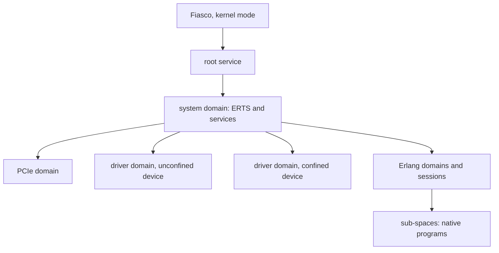
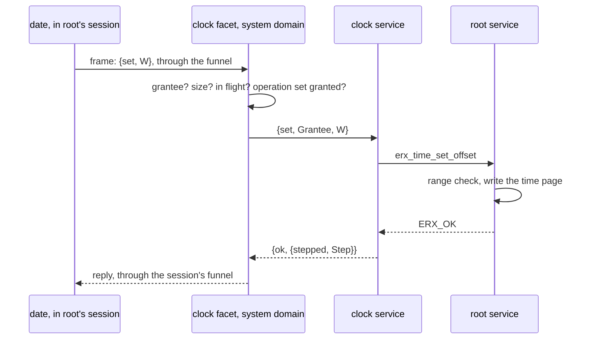
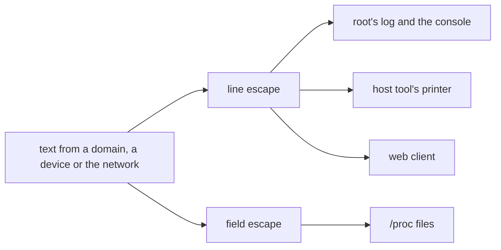

# Chapter 11. Authority and Security

> **Status.** **Built:** Fiasco and the root service as the only code
> that keeps domains apart; handles with a creator-only destroy and no
> rights; exports and the funnel; facets minted from the manifest's
> rows, checking who asks, size, requests in flight and operations;
> the declared service table; file grants of `ro`, `rw` or `rx`; the
> root's refusal of a writable and executable mapping, and JIT memory
> only for marked images; three runtime images, OpenSSL in two, and an
> Ed25519 check outside OpenSSL; the line and field escapes from one
> table; `erx_report`; and the banner
> `development build: trusted code only` on every build.
> **Designed:** rights on handles and a generation in a handle's
> value; the root's check of who may set the clock; budgets as walls;
> priority bands; DMA behind an IOMMU and the PCIe domain; a facet's
> admission by CPU share, and a generated admission path; a person's
> login; the vault and its key facets; Fiasco's own refusal of a
> writable and executable mapping; and the system-call fuzz campaign.

**Background needed.** [Chapter 2](02-microkernels.md) for
capabilities, the confused deputy and the trusted computing base;
[chapter 8](08-kernel-interface.md) for handles, the root service and
what Fiasco gives; [chapter 6](06-construction.md) for exports, the
funnel and the origin envelope. The domains of
[chapter 10](README.md#chapter-10-domains-a-wall-around-some-processes)
are glossed where they are needed.

A program you download onto a FreeBSD machine and run as yourself can
read your mail and send it to anyone on the network. It needs no bug
in the kernel. The kernel checks each `open` against your user id, the
program runs with your user id, and every check passes.

FreeBSD has three answers. The first is the user id itself: a file
belongs to a user, and a process acts for one user. The second is the
jail, which gives a group of processes its own view of the file system
and the network. The third is Capsicum, in which a process gives up
its right to open files by name and keeps only the descriptors it
holds
([chapter 2](02-microkernels.md#236-capability-systems-in-practice)).
The user id is **ambient authority**: a process holds it by being who
it is, not because someone handed it the right to one particular
thing
([chapter 1](01-operating-systems.md#165-permissions-and-the-power-of-a-user)).
Jails and Capsicum take ambient authority away after the fact.

erXos starts from the other end. A program holds no authority it was
not handed. Every right is a thing in somebody's hands: a handle to a
kernel object, an entry in another domain's export table, a facet for
one service, or a grant of a file tree. The system manifest says which
domain starts with which, and a build check proves its security
properties before the image is made. Some of the checks that would
hold an untrusted program to its rights are designed and not built,
so every build runs trusted code only and says so at boot. This
chapter says which checks those are.

Sections 11.1 and 11.2 state the threat model and where trust is
placed. Sections 11.3 to 11.7 take the four forms of authority. Section
11.8 follows one authority, the right to set the clock, from the
manifest to the clock's page and to its refusals. Principals (11.9),
machine code (11.10), keys (11.11) and untrusted text (11.12) follow,
and section 11.13 says what a hostile app could do on the system as
built.

> **Background: threat models.** A security design starts by saying
> who it defends against and what they can do. That statement is a
> **threat model**: a list of adversaries, each with what it is
> assumed able to do and what it must not be able to do, and the
> assets the design protects. A threat model also says what it leaves
> out. Without one, a reviewer cannot tell a missing defense from a
> case the design never meant to cover. "Secure" with no threat model
> means nothing; "a domain cannot read another domain's memory, unless
> Fiasco or the root service has a defect" can be checked.

## 11.1 The threat model

erXos is designed to run code it does not trust: apps a user
installs, drivers for devices that may be faulty or hostile, programs
built from someone else's source. The threat model says what each of
these may do and what it must not
([design.md, Threat model](../design.md#threat-model)).

### 11.1.1 Adversaries and assets

Five adversaries matter for most of this book.

* **Code in an Erlang domain.** It may do anything inside its own
  domain: spend its memory, run its threads, write frames into its
  lanes. It must not read or write another domain's memory, reach a
  process that was not exported to it, or act through a facet that
  was granted to someone else.
* **A native program in a sub-space.** A **sub-space** is an address
  space a domain creates for a program, holding only what the domain
  put there
  ([chapter 5](05-overview.md#525-programs-in-sub-spaces)). The
  program may use what its creator handed it and ask its creator for
  anything over its channel. It must not reach any domain, outlive its
  creator, or reach a file its creator did not give it.
* **A device, and the driver that holds it.** A device writes memory
  by DMA, and a driver can aim it. Where an IOMMU confines the device,
  the driver must not aim it outside its own domain's buffers. Where
  nothing confines it, nothing is enforced, and the domain that holds
  it is part of the trusted base (section 11.2).
* **A peer on the network or the host link.** It may send any bytes.
  It must not make the receiving domain do more than refuse or drop
  them, or reach any domain before it has authenticated.
* **Whoever holds the storage medium.** It may choose every byte a
  file system reads from the data partition. It must not change a
  read-only system image without the image's hash tree noticing, or
  make the system install an update its key did not sign.

The assets are the kernel's integrity; each domain's integrity,
availability and secrecy against every other domain; the bounds of
budgets; and the operator's terminals, which section 11.12 explains.

### 11.1.2 Untrusted input

Every input that crosses from outside the trusted base is untrusted,
wherever it arrives. The list is short enough to remember:

* everything a domain hands the kernel interface: registers,
  addresses, lengths, handles;
* every message from another domain;
* everything a device writes to shared memory;
* every byte from the host link;
* every network packet;
* every file system image and every package;
* every code artifact a user supplies.

Each kind crosses one narrow checking function: the root service's
request decoder, each runtime's funnel, the host link's deframer, a
driver's decoder of what its device wrote, the file protocol's
decoder. Each has a fuzz target, a test that feeds it random and
mutated input and watches for a crash or a wrong answer. A defect that
lets bad input through has one place to live, and one test that should
have caught it.

### 11.1.3 What the threat model leaves out

Three things are outside the model
([design.md, Residual risks](../design.md#residual-risks)).

* **Side channels inside one domain.** The domain is the boundary of
  secrecy, so two parties that must keep secrets from each other run
  in two domains.
* **Timing between domains.** A domain can learn how busy its
  neighbors are from how fast its own calls return.
* **Speculation across domains on some processors.** On a processor
  open to branch-predictor attacks, a domain may read memory it cannot
  map (section 11.13 explains the attack).

## 11.2 Trust placement

Every security design has a part that must be right for anything else
to be. erXos keeps that part small and says exactly what it is.

### 11.2.1 Two things keep domains apart

Only Fiasco runs in kernel mode. Everything else, the system domain
included, runs in user mode. Two things keep one domain's memory and
kernel objects apart from every other's, and only two
([chapter 8](08-kernel-interface.md#881-what-isolation-rests-on)):

1. **Fiasco**, with its address spaces, its capability tables and its
   check on every invocation.
2. **The root service's request decoder and placement code.** The
   root service is the one thread of the system domain that creates
   every kernel object and writes every page table, on behalf of the
   requests `liberx` sends it
   ([chapter 8](08-kernel-interface.md#83-the-root-service-who-holds-what)).
   It is the only writer of every table Fiasco checks.

A defect in either can break isolation; a defect anywhere else breaks
only its own domain. **Trust placement** is that statement made for
each property: the short list of code it rests on
([design.md, Trust placement](../design.md#trust-placement)).

| Property | Rests on |
| --- | --- |
| a domain's memory and threads against every other domain | Fiasco and the root service |
| a sub-space's memory and threads, against all but its creator | Fiasco and the root service |
| which processes may message a domain's processes | that domain's own runtime, above Fiasco |
| which domains exist, with which facets and grants | the system domain |
| a process's state inside its domain | that domain's runtime |

*Table 11.1. What each isolation property rests on.*

Notice the third row. The receiving runtime checks every frame
itself, on its own CPU time, so no third party stands between two
domains whose failure or quota could reach either (section 11.5).

### 11.2.2 The trusted base

The **trusted base**, chapter 2's trusted computing base
([chapter 2](02-microkernels.md#241-the-trusted-computing-base)),
is everything whose failure can break the guarantees above. In erXos
it is Fiasco, the root service, and the rest of the system domain:
its ERTS, its `liberx` with the domain library that plans and builds
domains, and its Erlang services. Figure 11.1 draws it.



*Figure 11.1. The trust map, as designed. An arrow points from what a
part depends on to the part. Fiasco, the root service, the system
domain, the PCIe domain and the holder of an unconfined device are the
trusted base; a domain lower down depends on those and on nothing
beside or below it.*

The system domain's share is kept small in three ways. It runs ERTS's
interpreter build, with no JIT, no C++ and no OpenSSL (sections 11.10
and 11.11). Every input reaches it through one narrow decoder: the
root's for requests, the funnel for frames. And policy, who gets what,
is Erlang, while the mechanism isolation rests on, the root's decoder
and tables, is C17, small and fuzzed.

Hardware adds to the trusted base. A device that masters DMA without
an IOMMU, a unit that confines a device's memory accesses, can write
any page, so the domain that drives it is trusted whatever its code
([chapter 15](README.md#chapter-15-devices-and-drivers)). In the
system as built no device is confined: DMA behind an IOMMU is
designed and not built, so every domain that holds a DMA-capable
device is in the trusted base. The design also adds a **PCIe domain**,
which alone reaches PCIe configuration space and so can turn on any
device's DMA; it is designed and not built.

### 11.2.3 Why the system domain may stop the machine

A fault in any other domain ends that domain. A fault in the system
domain or the root service ends the machine
([chapter 8](08-kernel-interface.md#855-when-the-root-task-faults)).
That is a choice. The system domain holds the tables that say who
owns what and which facets and grants exist. If it carried on after a
fault, its next decision would come from tables a bug may have
damaged, and a machine that stops with a reason is safer than one that
hands out authority from such records. The same reasoning makes the
root end the machine when Fiasco refuses an unmap the root expected to
succeed: its records and Fiasco's no longer agree.

### 11.2.4 Why no verifier

ERTS loads compiled Erlang code without checking it, and treats what
it loads as fully trusted
([design.md, Why no verifier](../design.md#why-no-verifier)). A
crafted module can corrupt the runtime that loads it. Java and eBPF
answer this with a verifier: code that proves a program safe before
it runs. erXos does not add one. Untrusted code runs only in its own
domain, where a malicious module can corrupt only that domain's
runtime, and Fiasco enforces the domain's boundary in hardware. A
verifier would add a large, subtle program to the trusted base, and
eBPF's history of verifier bugs shows what that costs.

## 11.3 Four forms of authority

Authority in erXos always has a holder and a checker, and the two are
never the same party. Table 11.2 lists the four forms.

| Form | Names | Held as | Checked by | Ends when |
| --- | --- | --- | --- | --- |
| handle | a kernel object | a number in the root's table for the holder's task | the root service, on every request | the holder closes it, or the creator destroys the object |
| export | a process in another domain | an entry in the target domain's export table | the target domain's funnel | the process exits, or an alias is deactivated |
| facet | the right to use one service | the pid of a process that stands for the grant | the facet itself | the facet exits |
| file grant | a tree of files | the pid of a grant process at the file's server | the grant, at the server | the grant exits |

*Table 11.2. The four forms of authority.*

In all four the checker is on the target's side, where the holder
cannot reach its state. And none of the four grants by being known: a
pid, a path or a domain's name grants nothing
([chapter 2](02-microkernels.md#233-why-a-capability-cannot-be-forged)).

## 11.4 Handles: authority over kernel objects

A domain names a kernel object, such as an address space, a thread or
a doorbell, by a **handle**, an entry of the root service's table for
the domain's task
([chapter 8](08-kernel-interface.md#841-what-a-handle-names)).

### 11.4.1 What a handle protects

Three properties hold in the system as built.

* **A handle is meaningless outside its table.** Domain A's handle 7
  and domain B's handle 7 are different entries, and B cannot use A's
  number to reach A's object. A handle the root never gave a task
  names nothing in that task's table.
* **Only the creator destroys.** `erx_object_destroy` refuses every
  task but the object's creator with `ERX_ERIGHTS`, and no pass
  conveys the right to destroy.
* **A destroyed object's handle names nothing.** Each entry records
  its object's generation, which a destroy advances, so every other
  holder's entry answers `ERX_ESTALE` until closed, and never names
  the object that takes the record next.

And handles flow only down. A handle reaches another task in one way:
its holder passes it from its own table into a space it created
([chapter 8](08-kernel-interface.md#845-why-handles-flow-only-down)).
Domains do not pass handles to each other, so no domain installs
anything in another domain's table.

### 11.4.2 What a handle does not protect

Two things a reader would expect from a capability are missing in the
system as built.

**A handle carries no rights.** Chapter 2's capability is a reference
*with rights*: read, write, destroy, and the rule that a holder can
pass on fewer rights, never more
([chapter 2](02-microkernels.md#235-delegation-shrinking-rights-and-revocation)).
An erXos handle is a reference with no rights at all. A pass takes a
rights mask and reports it back, but no entry stores it
([chapter 8](08-kernel-interface.md#844-rights)). Whoever holds a
handle may use the object in any way its kind allows.

The consequence is concrete. When the domain library connects two
domains, it passes each one its own side of the connection to write
and the other side to read. A domain whose code asks the root for a
writable mapping of the side it was passed to read gets one. The
domain's own `liberx` never asks, so trusted code never does it, but
nothing below `liberx` stops code that bypasses it. Such a mapping is kept out by the discipline of the code that holds
the handle, not by the root. That is a limit of the system.

**A closed number can be reused.** A closed handle answers
`ERX_EINVAL` until the task receives another handle, which takes the
lowest free entry, as a UNIX file descriptor does. A program that
keeps a number after closing it, and uses it later, reaches whatever
took its entry
([chapter 8](08-kernel-interface.md#843-using-a-handle-after-closing-it)).
The bug is the holder's own: no other domain can cause it, and it
reaches only objects the holder was given. In a server that keeps
handles for many clients, it can send one client's data to another.

### 11.4.3 The design that closes both

The design for the system on Fiasco closes both gaps
([design-fiasco.md, Rights](../design-fiasco.md#rights)). It is
designed and not built.

* **Rights in the entry.** Each entry records the holder's rights to
  its object. A create gives every right of the object's type. A
  duplicate or a pass intersects the source entry's rights with the
  caller's mask and drops the right to destroy, so rights only
  shrink. The root's one lookup checks the right each call needs and
  refuses a missing one with `ERX_ERIGHTS`. A domain passed a side to
  read cannot map it writable, whatever its code asks.
* **A generation in the value.** A handle's value carries its entry's
  generation, and every close advances it. A use after the holder's
  own close then answers `ERX_ESTALE`, as a use after a destroy does,
  and never reaches another object.
* **Doorbells placed at a Fiasco slot.** The design also places a
  doorbell's or interrupt's Fiasco capability at a slot matching the
  handle, so ringing and acknowledging skip the root. Only that direct
  use after a close goes unchecked, since Fiasco checks the slot
  alone.

## 11.5 Exports and the funnel: authority over processes

On one Erlang node, a process that knows a pid can send to it. erXos
keeps that inside a domain and changes it at the wall between
domains, where a pid is a name and nothing more
([chapter 6](06-construction.md#624-pids-exports-and-the-envelope)).

### 11.5.1 The export table

Each domain's runtime keeps an **export table**: its own record of
which of its processes each peer domain may reach, and with which
rights. Only the owning runtime writes it, and an entry appears in
exactly three ways
([design-domains.md, Authority](../design-domains.md#authority)):

1. the owner sends one of its own pids or aliases in a message to the
   peer, which is how stock Erlang hands out a name;
2. a peer spawns a process into the domain, which exports the new pid
   to the spawner;
3. a process calls the explicit export function on one of its own
   pids or aliases, with the rights it chooses.

No operation on the wire adds a right. A peer that passes a pid on to
a third domain gives that domain nothing: the third domain's frames
arrive on its own lane, toward which the owner never exported the
name. So delegation of a process is always its owner handing the name
out.

Every frame from another domain passes through the receiving
runtime's **funnel**, which copies it out of the shared ring, checks
its structure and its target against the export table, and only then
decodes it
([chapter 3](03-erlang.md#392-distribution-across-a-domains-wall);
[design-domains.md, The funnel](../design-domains.md#the-funnel)).
The lane says which domain sent the frame, never a field inside it,
so a domain cannot speak for another domain's processes. Exports and
the funnel are Built (`liberx/erx_funnel.c`).

### 11.5.2 A missing right is a dead process

When the funnel finds no export for a frame's target, the runtime
answers as it answers for a process that does not exist: a message is
dropped, a link or monitor reports the process dead. Otherwise an
attacker could map another domain's processes by sending to every pid
and watching which ones answer differently.

A pid's export lasts as long as its process. The revocable name is an
**alias**, an OTP reference that stands for a process and that its
owner can deactivate, as stock OTP uses it. The revocable service is a facet,
which exits (section 11.6).

### 11.5.3 The envelope

What the funnel admits arrives wrapped as `{erx_origin, D, Msg}`,
where the connection sets `D`. No `receive` written for a local
message matches that shape, and only the module that owns a protocol
unwraps its own shapes
([chapter 6](06-construction.md#624-pids-exports-and-the-envelope)).
So no list of system processes must remember to check where a message
came from: none of them sees a foreign message in a shape it would
act on.

Safe Erlang, a 1999 proposal for running mobile code (Brown and
Sahlin 1999), gave Erlang capabilities by replacing pids with
unforgeable, rights-carrying references. erXos takes the opposite road. Pids stay ordinary Erlang
terms, so every OTP library works unchanged, and the authority lives
in a table at the receiver that no sender can write.

## 11.6 Facets: authority over services

A session that may read `/proc` must not be able to read another
user's files, and a network domain that may sample the clock must not
be able to set it. Both are rights to use part of a service, and erXos
gives each such right a process of its own.

### 11.6.1 One grant, one grantee, one process

A **facet** is a process that stands for one grant of one service to
one domain, the **grantee**, and acts for that domain alone
([design-domains.md, Facets](../design-domains.md#facets)). The
grantee is introduced to the facet and never to the service behind
it. The facet admits only the operations and arguments the grant
allows, within the grant's limits, and forwards them to the service.
Most facets are processes of the system domain, standing in front of
its own services and of services other domains provide.

A grant is a row of the system manifest. Here is one from
`config/manifest/development.txt`:

```text
facet root_clock
  name "clock"
  grantee @session.system
  service @service.clock
  operations set
  max_request 256
  in_flight 1
```

It says: every session made from the system principal's template,
which is root's session, gets a facet named `clock` in front of the
clock service. The facet admits only the `set` operation, takes a
request of at most 256 encoded bytes, and holds at most one request
in flight. The manifest check refuses a facet row whose service no
file under `abi/services/` declares
([chapter 7](07-one-source.md#78-declared-services-and-inspection-paths)).

When a domain reports that it is ready, the domain service mints its
facets from the rows that name its template, each bound to that domain
and to nothing else (`grant_facets` in
`erlang/apps/erx_domain/src/erx_domain_srv.erl`). It hands the domain
the facets' pids by name. That is the only way a domain learns a
facet.

### 11.6.2 What every facet checks

Every facet, whatever its service, is an instance of one OTP
behaviour, `erx_facet` (`erlang/apps/erx/src/erx_facet.erl`), so its
checks hold for every facet by construction, not by each service
remembering them. Before a service's own code sees a request, the
behaviour checks five things.

1. **Who asks.** The request must arrive in the envelope
   `{erx_origin, D, ...}` with `D` equal to the grantee. The connection
   sets `D`, so a domain that learned the facet's pid and sends to it
   is not the grantee and is dropped. Passing a facet's pid on
   delegates nothing.
2. **Where the answer goes.** The caller's pid and reply alias must
   both be names of the grantee's, so the reply goes back to the
   grantee and never to a third domain the request named.
3. **How large.** The request's encoded size must be at most the
   grant's `max_request`.
4. **How many.** A request past the grant's `in_flight` limit is
   refused with `{error, busy}`.
5. **Which operation.** The service's callback maps the request to the
   operation it invokes, and a request for an operation the grant does
   not list is refused with `{error, eperm}` before the service's code
   sees it.

Anything else is dropped and counted. A facet ends when its grantee's
domain ends, or the service behind it does. **Revoking a grant
is the facet's exit**: nothing is admitted after it, and nothing done
before it is undone.

The behaviour and its five checks are Built. Three parts of the
design are designed and not built: admission by the grantee's
**share** of the service's CPU time per period, so one grantee cannot
crowd out another; an admission path generated from each service's
declaration in place of a hand-written callback; and a check of
`max_request` in the funnel before a frame is queued
([design-domains.md, Facets](../design-domains.md#facets)).

### 11.6.3 Why a process and not a list

The usual way to protect a service is an access-control list: the
service keeps a table of who may do what, and checks each caller
against it. erXos could have given each service such a list, keyed by
domain id.

A facet does the job with three advantages. The checks sit in one
behaviour every service shares, so no service forgets one. Revocation
is a process exit, which Erlang already handles: a monitor fires, a
pending call fails, and no service needs a "revoked" state. And a
facet carries limits per grantee, which a shared table would have to
rebuild. The cost is a
process per grant in the system domain, and a message hop between the
grantee and the service.

A facet also answers chapter 2's **confused deputy**, the server that
uses its own authority on a client's behalf for an object the client
named but had no right to
([chapter 2](02-microkernels.md#234-the-confused-deputy)). A facet
never acts on a pid only because a request names it. When a service
must act on a process, a file or a device for a client, the design
has the facet mint a handle from the scope of its own grant, never
from a name the client supplied
([design-domains.md, Authority](../design-domains.md#authority)).

### 11.6.4 Three homes for a new need

A rule that every reach between domains goes through a facet would
erode if each need got a kind of facet of its own. The design gives a
need one of three homes
([design-domains.md, Facets](../design-domains.md#facets)):

* **State the system observes** about itself, its CPUs, its domains,
  its clock, is an inspection path declared in `abi/inspection.txt`
  and shown at `/proc`
  ([chapter 21](README.md#chapter-21-the-live-machine)).
* **What an app says about itself, bytes someone keeps, or a thing
  someone commands** is a file tree that its owner serves and the
  reader mounts, with a `status` file to read and a `ctl` file to
  write, as in Plan 9
  ([chapter 14](README.md#chapter-14-files-namespaces-and-service-trees)).
* **A live conversation** is a declared protocol with a design of its
  own, such as the clock's or the network's sockets.

Each is declared in a checked-in file that names its design section,
and a build check refuses a facet name no declared service publishes.
Authority is an allow-list: a way between domains that nobody
declared does not build.

## 11.7 File grants: authority over files

In UNIX, a path is enough to try. A process names any file, and the
kernel decides by the file's owner and mode bits whether this user
may open it. In erXos a path is only a way to find a grant, and the
grant decides.

### 11.7.1 A namespace of grants

Each domain has a private **namespace**, a table from path prefixes to
the file servers that serve them
([chapter 14](README.md#chapter-14-files-namespaces-and-service-trees)).
An entry that leads to another domain's server holds the pid of a
**file grant**: a process at the server that stands for one client
domain's right to one tree, with a root and rights the server fixed
when it made the grant
([design-files.md, Who a grant is for](../design-files.md#who-a-grant-is-for)).
Root's session, for example, mounts `/data` through a grant of the
storage domain's tree, made read-write and bound to that session's
domain id by the manifest's `data_session` row.

A grant checks four things before any file system code sees a request.

* **Who asks.** As a facet does, a grant takes a request only in an
  envelope whose `D` is its client's domain id, so a third domain that
  holds the grant's pid cannot act as the client.
* **That the request is well formed.** It decodes every request of the
  file protocol, 9P2000.L, against the protocol's grammar and bounds.
* **The root.** A walk of `..` at the grant's root stays at the root,
  the grammar refuses a name holding `/`, and the server follows no
  symbolic link during a walk; a link's text goes back to the client,
  which resolves it through its own namespace. So no request reaches
  above the grant's root.
* **The rights.** A grant's rights are one of three values: `ro`, read
  only; `rw`, read and write; `rx`, read and run. A grant with `ro` or
  `rx` refuses every writing operation with `erofs` as part of decoding
  it (`erx_fs_grant.erl`).

There is no fourth value meaning "write and run". The rights type
cannot express it, so no grant carries both. Without that rule, a
program could write a file and then run it, and a bug that let an
attacker write one file would let them run their own code. A session
runs a program from a file only through an `rx` entry, which exists
only over an `rx` grant (`erx_ns.erl` refuses an `rx` mount through
any other with `eacces`). File grants are Built.

### 11.7.2 Narrowing for a program

A native program holds no grant at all. Its sub-space holds its
channel to its handler, the data area through which its reads and
writes move, and the memory its session mapped for it; nothing else.
Every path it opens goes to its **handler**, the session's Erlang
process that serves that program, which resolves the path over the
program's own table and answers on the program's behalf
([chapter 13](README.md#chapter-13-native-programs-pipes-and-posix-lite)).

In the design, a program's table is derived from its starter's: each
entry on the same server as the starter's, rooted at or below it,
with rights no wider
([design-files.md, Invariants](../design-files.md#invariants)). So
rearranging a namespace or narrowing it for a program never adds
authority. The handler is Built and answers a program's file
requests. The file server for the tree a program sees, its `/bin`,
`/dev` and `/etc`, is written and not yet started by anything.

## 11.8 A worked example: who may set the clock

The clock is a small authority with a sharp edge. A clock set a year
ahead rejects every TLS certificate; a clock set back accepts expired
ones. This section follows the right to set it.

### 11.8.1 The grants

Two rows grant the clock service. Root's session holds `set`, as
shown in section 11.6.1. On the Raspberry Pi, the `ntpd` principal's
session, which runs the network time client, holds `sample`
(`config/manifest/raspi4b-development.txt`):

```text
facet ntpd_clock
  name "clock"
  grantee @session.ntpd
  service @service.clock
  operations sample
```

A `sample` is a time server's measurement, which the clock service
checks against its step rules; a `set` moves the clock to a time the
operator names. Neither grant includes the other, and no other
session holds either ([design-time.md, Who may set it](../design-time.md#who-may-set-it)).

### 11.8.2 Following one set

Root types `date 202611201200` in its session. Figure 11.2 follows
the request.



*Figure 11.2. A facet between a domain and a service. The session
reaches only the facet; the facet decides before the clock service
sees anything, and tells the service which domain asked.*

1. `date`, an Erlang command, computes the offset `W` that makes the
   clock read the named time, and finds the session's facet named
   `clock` (`set_clock` in
   `erlang/apps/erx_shell/src/erx_cmd_date.erl`). It sends the facet a
   call, `{set, W}`.
2. The session's runtime encodes the call as a frame and writes it
   into its lane toward the system domain. The system domain's funnel
   copies the frame out, checks that the facet's pid is exported to
   the session, decodes it, and delivers it in the envelope with
   `D` set to the session's domain id.
3. The facet checks `D`, the size, the count in flight and the reply
   names (section 11.6.2). Its callback,
   `erx_clock_facet:operation/1`, names the operation: `set`, which the
   grant lists.
4. The callback's `admit/3` decodes the request once more, checking
   that `W` is an integer within the clock's range, and forwards
   `{set, Grantee, W}` to the clock service. The service learns the
   grantee from the facet, never from the request.
5. The clock service, in the system domain, calls
   `erx_time_set_offset`. The root service checks the offset's range
   and writes the time page, which every domain maps read-only.
6. The answer travels back along the same path, and `date` prints the
   new time.

The clock's facet, its decoder, `date`'s path and the setter are
Built.

### 11.8.3 Three refusals

Take the same request from parties that lack the grant.

**A session that holds `sample` asks to set.** `ntpd`'s session sends
`{set, W}` to its clock facet. The behaviour's operation check finds
`set` missing from the grant and answers `{error, eperm}` before
`admit/3` runs. The clock service never hears of it.

**A session with no clock grant at all.** A session made from an
app's template has no row naming the clock, so the domain service
minted it no facet. `date` finds no facet named `clock` and reports
the refusal as FreeBSD's `date` does for a user other than the
superuser: `date: clock_settime: ` followed by the text of `EPERM`,
with exit status 1. There is no process to send to and no name to
guess. A pid of root's clock facet, had the app learned it, would be
dropped at the facet, because the envelope's `D` names the app's
domain and not root's session.

**Code that bypasses `liberx`.** This refusal is where the system as
built falls short. The clock service sets the clock by a request to
the root service. In every task but the system domain, `liberx`'s own
`erx_time_set_offset` answers `ERX_ENOTSUP` without sending a request
(`liberx/backend/fiasco/task_refused.c`). But the root does not check
which task sent the request: it serves the setter from any task
(`liberx/backend/fiasco/service.c`). Code that builds the request
itself, bypassing its `liberx`, could set the clock. In a build that
runs trusted code only, no code does. The facet rows are therefore
held by the code that follows them, not enforced against code that
does not ([design-time.md, On Fiasco](../design-time.md#on-fiasco)).

The design closes the gap with section 11.4.3's rights. The setter
names the time page's handle, and the root checks the caller's write
right on it, answering `ERX_ERIGHTS` without one. Only the system
domain holds the time page with that right, so only the system domain
can set the clock, whatever any other domain's code does. The facet
and the check then stand one behind the other: the facet decides
which domain may ask the clock service, and the root decides that
only the clock service may write the page. That check is designed and
not built.

The example shows the chapter's pattern. The Erlang layer of facets,
exports, grants and the funnel enforces its rules against any code,
because a frame reaches another domain only through the receiver's
funnel. The root's layer below enforces who created an object and
where it is mapped, but not what each holder may do with it.

## 11.9 Principals, sessions and quotas

A UNIX user is a number. The kernel compares it with each file's
owner on every access, and root, user 0, passes every comparison. In
erXos the user is a **principal**, a record in the system domain's
Erlang policy, which Fiasco and the root service never see
([chapter 5](05-overview.md#517-principal)).

### 11.9.1 What a principal holds

A principal has a name, a budget, a CPU share and quotas
([design-domains.md, Principals, sessions and quotas](../design-domains.md#principals-sessions-and-quotas)).
Its **session template** says what a session of that principal gets:
its runtime, its Erlang release, its limits, and, through the
manifest's facet rows, the services it may use. A **session** is a
domain made from the template, in which a person's shell, commands and
programs run. There is no container runtime and no separate idea of a
user account: a principal's authority is exactly the facets and
grants its template names, and nothing about the principal is ambient.

The manifest's principals are Built: the system principal, whose
template gives root's session, and app principals such as `ntpd`. The
design also gives each principal a quota of 64 domain names per boot,
so that no principal can fill the system domain's atom table with
them. A person who
logs in with a passphrase and gets a session of their own principal is
designed and not built: every build's console opens root's session at
boot with no login, and SSH logs root in with the build's development
key.

### 11.9.2 Limits that hold, and limits that are records

A domain's limits are fixed when it is created, within its
principal's ceilings. Some hold in the system as built and some do not.

The limits a domain's own runtime applies hold, because the runtime
that bears the cost enforces them on what it receives: the largest
frame it takes from a lane, the largest decoded message, the nesting
depth the funnel accepts, and the size of its export table. The
number of connections a domain may have holds too, since the domain
service makes every connection.

Memory and CPU are another matter. A **budget** is the record that
pays for a domain's memory
([chapter 12](README.md#chapter-12-memory-and-budgets)). In the system
as built, a budget record stores a guarantee and a cap and refuses
nothing: every Fiasco object comes from the root's one factory, and
the root's page pool keeps one count for the whole machine. A domain
can commit pages past its budget's limit, and when the pool runs dry
every domain's next allocation fails with `ERX_ENOMEM`. In the design,
each domain's budgets are walls: a Fiasco factory with a quota per
domain for kernel memory, and a count of the user pages charged to
each budget, refused past the wall, so a domain over its budget hurts
only itself. Walls are designed and not built.

CPU time is shared the same way. Every thread but the watchdog runs at
one Fiasco priority, so a domain that spins every thread it may create
takes its round-robin share of each CPU it runs on, and no domain is
guaranteed any share. The design gives each domain a **band**, a
priority level, a CPU set and a thread limit; bands are designed and
not built.

## 11.10 Machine code

A bug that lets an attacker write into a program's memory is bad. A
bug that also lets them run what they wrote is worse, and the second
step needs memory that is both writable and executable. erXos makes
that state hard to reach and keeps the right to make code out of the
trusted base.

### 11.10.1 No writable and executable mapping

No mapping is writable and executable at once
([chapter 1](01-operating-systems.md#144-protection-bits)). In the
system as built, the root service enforces the rule: its range table
accepts only three protections, read, read and write, or read and
execute, so a request for both is refused
(`liberx/backend/core/vm_table.h`). Because the root is the only
writer of every page table, no domain can get such a mapping by any
other path. A patch to Fiasco's own map that refuses such a mapping in
the kernel is designed and not built
([chapter 6](06-construction.md#626-a-mapping-that-is-never-writable-and-executable)).

The rule covers one mapping, not one page. A page can be writable
through one mapping and executable through another, and BeamAsm, the
JIT compiler in ERTS, relies on that: it writes code through a
writable view of a memory object and runs it through a second,
executable view of the same object. Both views stay inside the domain
whose code it is, so they give that domain nothing it did not have
([design.md, Machine code](../design.md#machine-code)).

### 11.10.2 The right to make code follows from the image

A domain may create memory for a JIT only if its address space allows
it, and that follows from the runtime image it runs, never from a
request. The packer marks the BeamAsm image as one that makes code.
When the domain library builds a domain from a marked image, it
creates the space with the JIT flag; otherwise without
(`liberx/system/dom_core.c`). The root service refuses JIT memory in
a space without the flag, and refuses a space with the flag to a
creator that lacks it (`liberx/backend/fiasco/service_task.c`). So a
sub-space can make code only if its creator could.

The system domain runs the interpreter image, which is not marked, so
the trusted base makes no machine code at run time and links neither
asmjit nor any C++. All of this is Built. At the level of files the
same idea appears again: no file grant carries write and run together
(section 11.7.1).

## 11.11 Keys, the vault and cryptography

Cryptography in erXos has one design rule and one design goal. The
rule: OpenSSL never runs in the trusted base. The goal: a private key
never enters the domain that uses it.

> **Background: hashes, signatures and a key vault.** A cryptographic
> **hash** maps any input to a short fixed value, such that nobody can
> find a second input with the same value; a hash of a file is a
> fingerprint that a single changed byte alters. A **public-key
> signature** uses a pair of keys: the private key makes a signature
> over some bytes, and anyone with the public key can check it. A
> signed update proves who made it, as long as the private key stayed
> secret. A **key vault** is a program that holds private keys and
> signs on request, so the programs that need signatures never hold
> the keys themselves. A bug in such a program can misuse the vault
> while it runs, but cannot carry the key away.

### 11.11.1 Three runtime images, and OpenSSL in two

ERTS is linked into three runtime images
([design-crypto.md, Three runtime images](../design-crypto.md#three-runtime-images-and-openssl-in-two-of-them)):

| Image | Build | OpenSSL | Run by |
| --- | --- | --- | --- |
| system image | interpreter | no | the system domain alone |
| interpreter image | interpreter | yes | command domains, and domains that choose it |
| BeamAsm image | BeamAsm JIT | yes | every other Erlang domain |

*Table 11.3. The three runtime images.*

The construction holds by absence. OpenSSL is not in the one file the
system domain maps, so no list of modules to avoid is needed: a
`crypto` module loaded there by mistake fails at its `on_load`,
because the image has no NIF of that name. Every other
domain finds `crypto` in whichever image it runs, so TLS, SSH and
HTTPS work in sessions and service domains. OpenSSL seeds its
generator only through `getrandom`, which `liberx` answers from the
system's entropy or fails, never with a short or substitute answer
([design-crypto.md, Seeding](../design-crypto.md#seeding)). The three
images are Built.

Signatures can still be checked without OpenSSL: ERTS has a small
Ed25519 check built from Monocypher, a compact C library
(`erx_bytes:ed25519_verify/3`, in
`otp/erts/emulator/nifs/erxos/erx_ed25519.c`). It refuses the
non-canonical encodings Monocypher alone would accept, so a signature
verifies only with the exact bytes it was made with, and a fuzz target
runs it on the host. Built.

Every key in the system as built is a development key. Root logs in
over SSH with the clone's development key, and the app packer signs each
package header with a development key it makes on the host and never
ships. The trust store for TLS holds five root certificates.

### 11.11.2 The vault

The vault, `erx_vault`, holds every principal's private keys, after
Plan 9's factotum
([design-system.md, The vault](../design-system.md#the-vault)). A
domain that must authenticate holds a **key facet**: a facet for one
purpose, granted by its principal's session, that asks the vault to
sign input of that purpose's protocol and returns the signature,
never the key. A key facet's grantee can have its principal's key
sign any input of the right shape while the grant lives, as a daemon
holding the key could. It cannot obtain the key, have the facet sign
input of another purpose, or delegate the facet to another domain.

The vault runs in a service domain of its own, so OpenSSL stays out
of the system domain, and its files lie on a partition only the
vault's storage domain reaches. Keys are sealed with a secret derived
at boot. The vault, key facets
and login with a passphrase are designed and not built.

## 11.12 Text from untrusted sources

A log line looks harmless. But if a domain's name, a peer's banner or
a file name reaches the operator's terminal unchanged, it can drive
that terminal.

> **Background: terminal escape sequences.** A terminal does not only
> print characters. Some byte sequences are commands: move the cursor,
> clear the screen, set the window's title, and in many terminal
> programs, report that title back as if the user had typed it, or
> make a link out of text. These start with control characters such as
> ESC (0x1B). A sequence that reaches the terminal inside text an
> attacker chose runs with the operator's terminal as its instrument:
> it can hide earlier lines, forge a prompt, or on some terminals
> inject input. Unicode adds quieter tricks: a right-to-left override
> makes text display in a different order from the bytes, and
> invisible characters make two different names look alike.

### 11.12.1 One escape, generated from one table

Every place that shows text under the name of its source, a log
record, a domain's name, an inspected value, writes it through one
function, the **line escape**
([design-live.md, Escape rules](../design-live.md#escape-rules)). It
renders every character of an unsafe class as a visible token,
`<U+202E>` for a right-to-left override, and every byte that does not
start or continue a valid, shortest UTF-8 sequence as `<0x..>`. The
unsafe classes are the control characters, tab and newline among
them, the format characters, the line and paragraph separators, and
the unassigned and invisible code points. Everything else passes
unchanged.

The classes are written once, in `abi/terminal.txt`. A Ruby generator
reads it with the Unicode tables that OTP carries and emits the
tables of each escaper: the Erlang module `erx_text`, the host tool's
`Erx::LineEscape`, the web client's table and the ASCII-only class of
the root service's log. A shared file of test vectors,
`test/fixtures/line_escape_vectors.json`, holds what each must answer.
Every display escapes by the same rules because each has the same
tables, not because each was written to agree. Figure 11.3 shows the
sinks.



*Figure 11.3. The escape at each text sink. Each sink has one escaping
function, and all of them read tables generated from one file; no
path takes attributed text to a terminal around them.*

`/proc` needs a second escape. Its files are read by programs, and a
read must return the exact bytes a reporter chose, so the **field
escape** writes tab, newline and backslash as `\t`, `\n` and `\\` and
each unsafe byte as `\xNN`, and it can be reversed exactly. A
field-escaped text holds nothing the line escape changes. In the root
service's log, only the log core's escaper writes record text
(`kernel/core/log.c`), so a record cannot hold a byte the escape did
not pass. The escapes and their tables are Built.

### 11.12.2 What is not escaped

A program's own output is not attributed text. As on UNIX, `write`
and stdio deliver a program's bytes to its terminal unchanged, and
the terminal's line discipline does only what `termios` asks. The rule separates a shell or editor that draws its screen, which
needs raw bytes, from a log that shows a stranger's text, which must
never pass them.

Crash reports carry a quieter risk: they leak. In every domain but the
system domain, `erx_report` filters OTP's crash and logger reports, so
a report names the process, the error's class, the reason's leading
atom and the stack's functions, and carries no process state, message
or call argument (Built). A key in a crashed process's state does not
end up in someone else's log.

## 11.13 Trusted code only, and what a hostile app can do

Every erXos build prints one line before anything else:

```text
development build: trusted code only
```

The line is a promise about how the build may be used.

### 11.13.1 What a hostile app could do

Suppose an app's code were hostile, on the system as built
([chapter 8](08-kernel-interface.md#882-what-a-hostile-domain-could-do-and-what-fails);
[design-fiasco.md, What a hostile app can do](../design-fiasco.md#what-a-hostile-app-can-do)).
Through the Erlang layer it could do little: its frames meet funnels,
facets and grants that check who asks. Through the root service it
could do more than its grants say:

* map writable a side of a connection it was passed to read, since
  handles carry no rights (section 11.4.2);
* commit pages past its budget until the machine's pool runs dry,
  since budgets refuse nothing (section 11.9.2);
* set the wall clock by sending the root the setter's request itself
  (section 11.8.3);
* spin every thread it can create, and send requests and take faults
  as fast as its threads can, delaying every other domain's setup on
  the root's one thread;
* ring a peer's doorbell as often as it likes, costing the peer a
  wake each time.

It could not reach another domain's memory or kernel objects without
a defect in Fiasco or in the root's decoder and placement code. It
could not change any page table or capability table, get a mapping
that is writable and executable, hold a device the manifest did not
give it, or forge a frame from another domain.

> **Background: branch-predictor attacks.** A processor guesses which
> way a branch goes before it knows, and runs ahead on the guess. If
> the guess was wrong, it throws the results away, but the memory it
> touched stays in its caches, and the time to read that memory
> later reveals which addresses were touched. On a processor whose
> predictor one program can train, an attacker trains it so that
> another program, or the kernel, guesses wrong into code that reads a
> secret. The secret leaks through timing, although the attacker never
> mapped it. Defenses live at kernel entry and in the processor's
> firmware.

On a processor open to branch-predictor attacks, a domain may also
read memory it cannot map, through the attack in the box. That is a
limit of the system on such processors.

### 11.13.2 What closes the gaps

Each gap has a design. Rights on handles close the writable mapping
and the clock (sections 11.4.3 and 11.8.3); budget walls close the
memory gap; bands bound what a spinning domain takes from a higher
band. A system-call fuzz campaign, which invokes every slot of a
task's Fiasco capability table with random arguments, checks the one
part of the trusted base erXos did not write. All of these are
designed and not built, and until they are, the system is for trusted
code, as its first line at boot says.

## 11.14 When a guard fails

Each check in this chapter fails in a way that the reader can see, and
reaches only what it guards.

* **A facet or a file grant faults.** The grantee's pending calls
  fail with an error; the service and its other clients run on.
* **The funnel refuses a frame.** The frame is dropped, as a message
  to a dead process is, and the sender learns nothing it could use to
  probe.
* **A domain's runtime is corrupted by its own code.** The domain
  ends; its links and monitors report it dead to every peer.
* **The system domain or the root service faults.** The machine ends,
  with a reason, rather than hand out authority from records a bug may
  have damaged (section 11.2.3).
* **Fiasco faults.** Every program depends on the kernel, so the
  machine is lost. That is why Fiasco is the only code in kernel mode.

## 11.15 Design choices

**User ids against held authority.** erXos could have given each
domain a user id and checked it at each service, as UNIX does at each
`open`. That is familiar and cheap. It also makes every program run
with all of its user's authority, which is the mail-reading program
of this chapter's first paragraph. Held authority costs a manifest row
per grant and a facet process per grantee, and in return a program
reaches exactly what someone handed it.

**Checks at the receiver against a broker in between.** A single
broker could check every message between domains. It would be one
place to audit, and it would also be one party whose failure, queue
or quota reaches every pair of domains. erXos puts each check with the
party that bears its cost: the funnel in the receiving runtime, the
facet in the service's domain, the grant at the file server.

**Escaping at the sink against cleaning at the source.** Text could be
cleaned once, where it enters the system. But "clean" depends on the
sink: a `/proc` file must keep exact bytes that a terminal must not
see. So each sink escapes with its own function, and all the
functions read one generated table.

**What the choices cost.** Rules at the receiver hold against any
code. The root service's rules hold only as far as its records reach,
and until its records carry rights, the system says plainly that it is
for trusted code.

## Summary

erXos defends a stated threat model: untrusted Erlang code, native
programs, devices, peers and storage media, each with what it may and
must not do, and with side channels inside a domain left out. Two
things keep domains apart, Fiasco and the root service's decoder and
placement code; the system domain completes the trusted base, runs no
JIT and no OpenSSL, and stops the machine rather than run on damaged
records. Authority takes four forms, handles, exports, facets and file
grants, each held by one party and checked by another on the target's
side, and none granted by knowing a name. Facets and file grants check
who asks by the lane, so passing their pids delegates nothing. Handles
carry no rights, so a domain can map writable an object it was passed
to read, and the root sets the clock for any task that asks; rights on
handles, which close both, are designed and not built. Budgets refuse
nothing and every thread runs at one priority; walls and bands are
designed. No mapping is
writable and executable, and only images marked for a JIT make code.
Every sink that shows a stranger's text escapes it with tables
generated from one file. Every build says at boot that it runs trusted
code only.

The next chapter takes up the memory those budgets pay for.

## Where to read next

* [design.md, Security](../design.md#security): the full threat
  model table, trust placement, authority and residual risks.
* [design-fiasco.md, Security on Fiasco](../design-fiasco.md#security-on-fiasco)
  and [Rights](../design-fiasco.md#rights): what the system on Fiasco
  gives against a hostile app, and the design of rights on handles.
* [design-domains.md, Authority](../design-domains.md#authority) and
  [Facets](../design-domains.md#facets): exports, facets, what a facet
  costs and how it admits.
* [design-files.md, Who a grant is for](../design-files.md#who-a-grant-is-for)
  and [Invariants](../design-files.md#invariants): file grants, roots
  and rights.
* [design-time.md, Who may set it](../design-time.md#who-may-set-it):
  the clock's grants, this chapter's worked example.
* [design-system.md, The vault](../design-system.md#the-vault): keys,
  key facets and sealing.
* [design-live.md, Escape rules](../design-live.md#escape-rules) and
  [Attributed text](../design-live.md#attributed-text): the line and
  field escapes.
* Jerome Saltzer and Michael Schroeder, "The Protection of
  Information in Computer Systems", 1975: the principles, least
  privilege and complete mediation among them, that this chapter's
  mechanisms apply.
* Norm Hardy, "The Confused Deputy", 1988: the problem facets and
  minted handles answer.
* Russ Cox, Eric Grosse, Rob Pike, Dave Presotto and Sean Quinlan,
  "Security in Plan 9", USENIX Security 2002: factotum, the model for
  the vault.
* Brown and Sahlin, Safe Erlang, 1999: the capability design for
  Erlang that erXos's exports take a different road from (chapter 4
  cites it).
