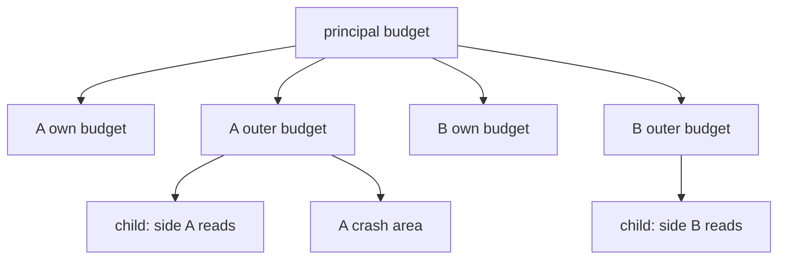

# Chapter 12. Memory and Budgets

> **Status.** **Built:** the page pool and the range table, with
> commit, map, protect and revoke over Fiasco, shared objects and the
> JIT alias; budgets that end everything charged to them, each
> domain's own and outer budgets, and admission arithmetic; sub-spaces
> that end with their creator; eager copies; one machine-wide figure
> reported as partial. **Designed:** budgets as walls over kernel
> memory, pages and the root's tables; rights recorded per handle;
> per-budget reports; a refused map that fails only the domain's call;
> the mapper for shared file mappings.

**Background needed.** [Chapter 1](01-operating-systems.md) for
virtual memory (section 1.4) and [chapter 8](08-kernel-interface.md)
for the root service, handles, memory objects and the range table's
reserve, commit and map. [Chapter 5](05-overview.md#515-budget)
introduced budgets.

An Erlang domain that leaks, say through a cache that never drops an
entry, asks for more heap every few seconds, each request reasonable
on its own, until it holds every free page. Then the display domain,
which did nothing wrong, cannot get the page it needs to draw the next
frame. Something has to decide, before the machine runs dry, which
domain is refused.

A kernel could hand out more memory than it has, betting that
programs never touch all of it
([section 1.4.7](01-operating-systems.md#147-who-pays-for-memory)).
Its limits would then cap a process's address space, not what the
kernel spends on the process's behalf, and when the bet failed, the
kernel would have to end some process.

erXos answers with budgets. The root service holds every free page of
RAM in one list, its **pool**, and hands pages out from it. A
**budget** is an account of memory, carved from its parent's, to
which the root charges every object and page it makes. Destroying a
budget ends everything charged to it. In the design, each domain's
budgets are also **walls**: memory set aside when the domain is
created, which no other domain can take, so a domain that spends its
own fails alone. The accounts and their ends are built; the walls are
designed and not built.

Sections 12.1 to 12.4 cover budgets, the pool and walls; 12.5 and
12.6 the range table and one page's way from request to mapping; the
rest sub-spaces, deleted memory, reports and running out.

> **Background: page tables and faults, recalled.** A program's
> addresses are virtual. The processor translates each through **page
> tables**, a tree the kernel keeps per address space with one entry
> per 4 KiB page, and caches recent translations in the **TLB**. An
> access with no entry, or with the wrong rights, is a **page fault**:
> the processor stops the program and runs the kernel, which may fill
> the entry and resume, or end the program
> ([sections 1.4.2 to 1.4.5](01-operating-systems.md#142-page-tables)).

Fiasco calls an address space a **task**. This chapter says task for
the Fiasco object behind an erXos space.

## 12.1 Budgets as space banks

Ending a domain takes one call, however many objects it made.

### 12.1.1 A budget is an account

Budgets form a tree, after the space banks of EROS
([section 4.3.4](04-history.md#434-eros-safe-erlang-and-zircon-authority-and-payment)),
so no object outlives the account that paid for it. Each budget is a record in the root
service's object table, holding its parent, its kind, its
**guarantee** and its **cap**, both in pages
(`liberx/backend/fiasco/budget.c`). The guarantee is what the budget
is promised; the cap is the most it may spend. Every other record
names the budget it was charged to: a space, a group, an IRQ object, a
memory object, and every budget carved below.

A budget whose cap equals its guarantee is a wall. One whose cap is
higher is **elastic**: past its guarantee it may spend what its
ancestors have promised to no one. Take a parent of 100 pages with
two children. A has guarantee 30 and cap 30, a wall: it always has its
30 pages and never more. B has guarantee 30 and cap 60, elastic: it
always has 30, and may use up to 30 more of the 40 pages nobody was
promised, but only while they stay unpromised.

Who carves which shape:

* The domain library carves each domain's budgets as walls
  (`make_step` in `liberx/system/dom_apply.c`).
* A **principal** is the user or app on whose behalf domains run
  ([section 5.1.7](05-overview.md#517-principal)). The domain library
  carves each principal's budget at boot (`liberx/system/dom_boot.c`).
  A principal the system manifest names gets one from the root, with a
  guarantee equal to its cap. Every app's principal hangs below one
  **apps budget**, whose guarantee equals its cap too; an app's
  principal has no guarantee, and its memory as its cap.
* A session carves each program's budget elastic (`erx_program_drv.c`
  in `otp/erts/emulator/sys/erxos/`), so a user's programs share the
  session's memory.

### 12.1.2 Ending a budget

Ending is the part every caller relies on, and it is built.
Destroying a budget, or closing its last handle, runs one service
body, `erx_fiasco_budget_end`. It sweeps the object table flat and
never recurses:

1. it stops every space below the budget, so no thread runs on while
   what it uses goes;
2. it ends every other object below the budget: groups, IRQ objects,
   gates and memory;
3. it frees the carved budgets nothing is charged to any more, sweep
   after sweep, until a sweep frees none.

Step 3 needs several sweeps because a budget can be freed only once
nothing hangs below it: if A holds B and B holds C, the first sweep
frees C, the next B, the last A. The table's size bounds the depth,
and so the number of sweeps. No caller
lists what to free, so no caller can forget an item
([section 6.2.3](06-construction.md#623-budgets)).

## 12.2 Own and outer budgets

A domain that crashes must not pull memory out from under a peer that
still reads the ring they shared. So each domain has two budgets,
carved side by side from its principal's.

* The **own budget** pays for everything only the domain uses: its
  space and private memory, its threads and group, its boot
  information page, its devices' objects, and every budget it carves
  for its sub-spaces or programs.
* The **outer budget** pays for what another party may still use after
  the domain is gone. A connection between two domains is a pair of
  shared rings, one each way, and a doorbell each party waits on
  ([chapter 8](08-kernel-interface.md)). For each connection to
  another domain, the domain library carves a **child budget** from
  the outer budget, which pays for the ring the domain reads and its
  doorbell. The connection to the system domain has one child budget
  that holds both sides and both doorbells. The crash area is charged
  to the outer budget directly, so the record of a crash outlives the
  crash
  ([section 8.3.4](08-kernel-interface.md#834-one-request-end-to-end-a-domains-crash-area)).

Figure 12.1 shows two connected domains.



*Figure 12.1. Own and outer budgets of connected domains A and B.
Ending A destroys only A's own budget, so the ring B reads, and A's
crash area, stay.*

The plan that builds a domain, in `liberx/system/dom_core.c`, makes
this split, and it is built.

Ending a domain is one destroy, of its own budget, when its exit
record arrives. Nothing another party maps is charged there, so the
end waits for no one. The crash area goes once the domain service has
read it, each connection's child budget once both parties have let go
of the connection, and the outer budget when no child is left. A peer
that never closes the connection keeps the dead domain's ring, and
its outer budget, alive; the connection goes on counting against the
peer's own quota of connections, so the peer that holds on is the one
held back
([design-system.md, Ending a domain](../design-system.md#ending-a-domain)).

The domain holds no handle to its outer budget or its children, so it
cannot destroy them. Where each object is charged keeps a peer's
memory alive; no list of exceptions does.

## 12.3 The pool

Every page any task uses, other than device memory and the boot
image's own pages, comes from one place: the root's pool.

At boot the root asks Sigma0, Fiasco's first pager, for all the RAM it
holds, and maps it into its own space in the **window**: a range of
the root's addresses in which all RAM appears, one address per page
([section 8.6.1](08-kernel-interface.md#861-one-page-one-address)).
The window is never unmapped. **A page's identity is its window
address**: every mapping of it in any task is made from that address,
as a child of the root's mapping in Fiasco's mapping database.

Free pages wait on a list threaded through the pages themselves
(`liberx/backend/fiasco/page_pool.c`). Taking a page zeroes it, so no
task sees what a page held before. An empty pool is `ERX_ENOMEM`. The
root's own tables are pool memory too: a table that fills takes one
more page, and never moves.

Device memory never returns to the pool, so no way of ending an object
can free a page a device may still write. A device that reads memory
by itself (DMA) needs physically contiguous pages at addresses it can
reach. Before anything else the root takes one run of RAM for that,
the **contiguous pool**, outside the window, and makes each device's
memory from it once. Only pages inside the window ever go back on the
free list
([design-fiasco.md, The pool](../design-fiasco.md#the-pool)).

## 12.4 Walls: what is built, what is designed

### 12.4.1 Accounts without walls

A wall makes admission a local question: does the principal starting
the domain have the memory left? The domain library answers before it
makes anything. `dom_check_room` in `liberx/system/dom_core.c` adds
the new domain's own and outer budgets to what the principal's domains
have already carved. If the sum passes the principal's memory, the
domain is refused with `ERX_ENOMEM`. A principal with 1 GiB whose
domains have carved 600 MiB cannot start a domain that asks for 500
MiB. An app's domain must also fit the apps budget beside what every
other app's domains have carved. This arithmetic is built.

Holding a running domain to its wall is not. As built:

1. **A budget record refuses nothing.** It stores the guarantee and
   cap it was given (`budget.c`); a resize overwrites them unchecked,
   and no page is counted against a budget.
2. **Everything Fiasco makes for the root and the domains comes
   through the root's one factory.** A **factory** is the Fiasco object
   that creates other kernel objects and pays for them from a limit of
   kernel memory. Each `l4_factory_create` call in
   `liberx/backend/fiasco/` names `L4_BASE_FACTORY_CAP`, the factory
   Fiasco handed the root at boot. Fiasco keeps no quota of kernel
   memory per domain.
3. **The pool keeps one count.** It knows how many pages it has handed
   out and how many are free, for the whole machine, not whose they
   are.

So an admitted domain can spend past its guarantee, and take pool
pages, or Fiasco's kernel memory, that others need.

### 12.4.2 The three parts of a wall

A domain's cost lands in three places, and a wall must bound each. A
domain held to its pages, but free to make the kernel allocate without
limit, could still starve the display domain of the opening example.
The design bounds all three, and none is built:

* **Kernel memory.** Each domain budget has its own Fiasco factory,
  whose whole limit Fiasco charges to the parent factory, so the
  limits partition kernel memory hard. A task's page tables are
  charged to the factory that made it; once a domain's factory is
  spent, the root's next creation or map for it answers `ERX_ENOMEM`.
* **User pages.** Every page a domain uses comes from the root's pool,
  because only the root maps memory. Each budget record counts the
  pool pages charged to it, and a charge past the wall is refused with
  `ERX_ENOMEM` before any page moves (section 12.6, step 5). Shared
  memory is charged once, to the object's budget, never per mapping.
* **What the root holds for the domain.** Each of the domain's objects
  also costs a record and a capability in the root's own tables. The
  domain's thread, object and mapping limits bound these.

A budget carved below a domain's gets kernel memory in proportion to
its guarantee, which carving reserves from the parent
([design-fiasco.md, Memory and budgets](../design-fiasco.md#memory-and-budgets)).

## 12.5 The range table

The pool says which pages are free; the range table says where every
other page is, and with which rights.

### 12.5.1 Three facts

The range table is one pure core, `liberx/backend/core/vm_table.c`,
built for the host and shared by both backends. It holds three kinds
of fact:

* **runs**, each task's reserved addresses, sorted and disjoint, with
  adjacent runs merged;
* **mapping records**, each task's mappings of memory objects: an
  address range inside one run, the object, the offset and the rights
  it was mapped with;
* the **page index**, one hash table for the machine, from a committed
  page's address and its table's label to its window address and its
  protection.

A **label** names one table: a task's, or a memory object's, since an
object's pages form a table of their own over offsets. A page absent
from the index is uncommitted. The index is sized once at boot so
that committing can never fail for want of a slot: it has two slots
for every page it can hold, those of the window, the contiguous pool
and the device window, and each entry owns a distinct page.

Figure 12.2 shows how a private page and a mapping differ.

```text
task T's table                               window (root)
  run [0x40000000, 0x40200000)
    private page 0x40000000
      index lookup (0x40000000, label T)  gives  page W1, RW
    mapping [0x40100000, +64 KiB)
      object O, offset 0, rights R  -------------+
                                                 |
object O's table (label O)                       v
    offset 0
      index lookup (0, label O)  gives  page W2 ... (16 pages)
```

*Figure 12.2. A private page and a mapping in task T's range table.
The private page has an index entry under T's label. The mapping is
one record with the rights it was made with; its pages belong to
object O, under O's label, and are never in the index under T.*

### 12.5.2 Plans, then effects

Every range call is computed whole before anything changes, the
[functional core](06-construction.md#63-functional-core-effects-at-the-edge)
of chapter 6. `erx_backend_vm_plan` takes the table and the request
and returns a **plan**: the range, the state each reserved page in it
becomes, and how many pages the change needs. It changes nothing.
`erx_backend_vm_call` then checks the plan against the world (an
excerpt, with one step that makes room in the table left out):

```c
	error = erx_backend_vm_plan(table, request, &plan);
	if (error != 0)
		return (error);
	if (plan.pages_needed > effects->free_pages())
		return (ERX_ENOMEM);
	apply_plan(table, effects, &plan);
```

Notice the order: every refusal comes before `apply_plan`, so a
refused call changes nothing. The apply reaches the world only through
`effects`, six functions: take a page, give one back, map, unmap,
count free pages, and report a mapping gone. Each backend supplies its
own, so one core serves both.

### 12.5.3 One table of steps

What a page needs done depends only on its state and the target.
`vm_steps` in `vm_table.c` is that table. A page is uncommitted,
committed with no access, read, read and write, or read and execute.

| From | To | Steps, in this order |
| --- | --- | --- |
| uncommitted | R, RW or RX | take a page, zero it, map it |
| uncommitted | no access | nothing |
| no access, or R | R, RW or RX | map the same window page with the target |
| RW or RX | R | unmap the write or execute right |
| RW | RX | unmap write, then map RX |
| RX | RW | unmap execute, then map RW |
| committed | no access | unmap all rights; the page stays committed |
| committed | uncommitted | unmap, give the page back to the pool |

A change in both directions drops a right before it adds one, because
Fiasco's map only ever adds rights to an existing mapping, so no page
is writable and executable even for an instant. The table has no
state for both, so no step can ask for it
([design-fiasco.md, Protection](../design-fiasco.md#protection)).

### 12.5.4 A mapping keeps the rights it was made with

No call changes a mapping's rights: `erx_space_protect` over a
mapping is refused with `ERX_ENOTSUP`. A program that wants other
rights maps again, and the new map is checked as the first was.

What a map allows depends on the object's kind. One function,
`erx_fiasco_vm_map_rule` in `liberx/backend/fiasco/vm_rules.c`, holds
every kind's rule
([section 8.6.3](08-kernel-interface.md#863-kinds-of-memory-object)):
no write over an object whose bytes are fixed (a sealed object, a
code object or a slice of the boot image), and no execute over device
memory. That is built. In the design a map is also held beneath the
rights the caller's handle carries, which the root records per handle
and narrows on every pass. As built the entries record rights but no
map checks them, so that part is designed and not built.

### 12.5.5 Trimming never meets sharing

A range of private pages and a mapping never overlap. A commit or
decommit whose range meets a mapping is refused with `ERX_EINVAL`, and
so is a release that would cut a mapping in two
([section 8.6.2](08-kernel-interface.md#862-reserve-commit-and-map)).

The rule exists for one failure. If a program could decommit part of
a shared object, the root would return to the pool pages another task
still maps, and their next owner would read or overwrite that task's
data. A private page is mapped exactly once, under its own task's
label, so freeing it frees no page another mapping uses. Shared pages
go back only when their object goes (section 12.8).

## 12.6 One commit, end to end

What happens between ERTS, the Erlang runtime, asking for memory and
its first write to it? ERTS's allocators reserve addresses first and
commit pages as they need them (`os_mmap_virtual` and
`os_reserve_physical` in `otp/erts/emulator/sys/common/erl_mmap.c`).
Follow one page of one commit through every layer. Every step is
built except step 5.

1. **The call.** ERTS calls `erx_vm_commit(ERX_CAP_SELF, addr, size)`
   on a range it reserved earlier.
2. **The request.** The stub, `stub_range` in
   `liberx/backend/fiasco/service_stubs.c`, packs the thread's index,
   the space, the address and the size into message registers and
   makes one IPC call on the task's request gate.
3. **The decoder.** The root receives the message with the gate's
   label, which names the calling task, and checks its shape
   ([section 8.3.3](08-kernel-interface.md#833-the-decoder-the-trust-boundary)).
   `service_vm` in `service.c` resolves the space: the caller's own, or
   one it created.
4. **The plan.** `erx_fiasco_vm_body` in `vm.c` hands the request to
   the range table. `erx_backend_vm_plan` refuses a range that meets a
   mapping, passes over addresses that are not reserved, and counts one
   page to take for each uncommitted reserved page.
5. **The budget check (designed, not built).** The plan finds the
   budget the task's space is charged to, and refuses the commit with
   `ERX_ENOMEM` if its pages would carry that budget past its wall.
   Nothing has changed yet, so the refusal leaves nothing behind.
6. **The pool check.** `erx_backend_vm_call` refuses with `ERX_ENOMEM`
   if the pool has fewer free pages than the plan needs. As built, this
   is the only limit on a commit.
7. **The page.** `page_move` takes a page from the pool through the
   `take` effect, which zeroes it.
8. **The map.** The `map` effect, `vm_map` in `vm.c`, calls
   `l4_task_map` to map the window page into the task at the address,
   readable and writable. Fiasco adds a page-table entry and a
   mapping-database node, a child of the root's window mapping, both
   from its kernel memory.
9. **The record.** The table writes the page's index entry: the
   address and the task's label as the key, the window page and the
   state RW.
10. **The reply.** The service replies `ERX_OK` and waits for the next
    request in the same Fiasco call. ERTS writes to the page and never
    takes a fault on it.

Step 8 spends kernel memory from the root's factory. As built, a map
Fiasco refuses is a defect of the root, which ends the machine with a
line on the console. In the design the memory comes from the domain's
own factory, which the domain can spend at will, so a refused map
undoes the call's maps and answers `ERX_ENOMEM`
([design-fiasco.md, The range table](../design-fiasco.md#the-range-table)).
That undo is designed and not built.

## 12.7 Sub-spaces and shared objects

A session runs each native program in a **sub-space**, an address
space the domain creates for code it runs, holding only the handles
its creator gave it
([section 5.2.5](05-overview.md#525-programs-in-sub-spaces)).

### 12.7.1 A sub-space spends its creator's memory

A sub-space is charged to a budget its creator holds, usually one
carved for that program, so the program spends its creator's memory.
The root records each space's parent at creation
(`liberx/backend/fiasco/service_task.c`), and a space's end ends
every space below it first, so no program outlives its session
and no sub-space the domain that made it
([design-fiasco.md, Spaces, parents and exit records](../design-fiasco.md#spaces-parents-and-exit-records)).
Both are built.

> **Background: copy-on-write, recalled.** UNIX's `fork` gives a child
> a copy of its parent's memory. A kernel makes that cheap with
> **copy-on-write**: it maps the parent's pages into both, read-only,
> and copies a page only when one of them writes to it
> ([section 1.4.6](01-operating-systems.md#146-what-faults-make-possible)).

Copy-on-write needs a kernel path that resolves a write fault by
copying a page. The system on Fiasco never resolves a fault: every
committed page is already mapped, so a fault is always a bug. So
copies are eager. `erx_mem_child`, which the program loader uses for
an executable's writable segments, makes a new memory object and
fills it with the parent's bytes. Each program pays for its writable
segments in full when it starts. No call copies a whole space, so
there is no copy-on-write `fork` ([chapter 13](13-native-programs.md#1372-why-posix_spawn-not-fork)).

### 12.7.2 Shared objects

A memory object is a table of its own, under its own label, over
offsets. Its pages are all committed when it is created, and the
object owns them. `erx_vm_map` maps each page into a task at the
rights asked for, and the task's table gains one mapping record; the
page index gains nothing. So an object mapped by ten tasks holds its
pages once and is charged once, to its own budget
([design-fiasco.md, Shared objects and the JIT alias](../design-fiasco.md#shared-objects-and-the-jit-alias)).

A connection's rings work this way: each party maps its own side
writable and its peer's read-only, both tasks' page tables point at
one physical page, and messages cross with no request to the root.
That the root refuses a writable mapping of the peer's side rests on
rights recorded per handle, which are designed and not built
([design-fiasco.md, Sharing memory between tasks](../design-fiasco.md#sharing-memory-between-tasks)).

The **JIT alias** is the same mechanism inside one domain. BeamAsm,
ERTS's just-in-time compiler, writes machine code and then runs it,
and no mapping may be writable and executable at once. So a space made
with the JIT flag maps one JIT object twice: read and write for the
compiler, read and execute for the code. The domain can still run
code it wrote ([chapter 11](11-security.md#11101-no-writable-and-executable-mapping)). Shared objects and the JIT alias are built.

## 12.8 Deleted memory

What does a task see when memory it maps is destroyed?

### 12.8.1 What a destroy does to a mapping

An object goes at the first of four events: its creator destroys it,
its budget ends, its creator's task ends, or its last handle and last
mapping are both gone
([section 8.4.2](08-kernel-interface.md#842-destroying-an-object)).
In the first three it may still be mapped, so the root revokes it:
`erx_fiasco_vm_object_revoke` removes every mapping made from each of
its window pages, in every task, the root's own aliases included, and
keeps only the window's own. Fiasco's mapping database finds them, so
nobody has to find the mappers. Each task's table drops its records of
the object, and the pages return to the pool.

A task that touches the revoked range afterwards faults. The fault
goes to the space's fault gate, the gate Fiasco sends its faults to,
whose handler stops the space
([section 8.5.4](08-kernel-interface.md#854-how-a-fault-reaches-the-right-handler)).
The access fails where it happens and never reads another owner's
data. This is built.

### 12.8.2 No server maps what a client can delete

Used carelessly, the same mechanism is a way to crash a server.
Suppose a file server mapped a buffer its client could destroy, and
the client destroys it mid-request: the server's next read faults and
stops the server, with every other client's requests in it.

So the system's rule is that **no server maps memory a client can
delete or end**. Memory crosses domains only through objects the
system domain made and charged to a budget that outlives every party
that maps them: a connection's child budget (section 12.2). Neither
party can destroy anything of a connection, so neither can make the
other fault. A server that must read a client's memory otherwise
copies it with `erx_mem_copy`, which returns an error if the memory is
gone instead of faulting
([design.md, Invariants](../design.md#invariants);
[design-domains.md, Connections](../design-domains.md#connections)).

The rule shapes shared file mappings. A program that maps a file with
`MAP_SHARED` does not map the file server's memory. Its session holds
one memory object per file, the file's **shared object**, and one
Erlang process, the file's **mapper**, which fills the object with
ordinary reads and writes it back with ordinary writes, so no fault
waits on another domain
([design-files.md, Shared mappings](../design-files.md#shared-mappings)).
The mapper is designed and not built.

## 12.9 Reporting a budget, and what is not charged

How much memory is a domain using, and can the number be trusted? The
inspector marks each figure it shows exact, partial or unsupported,
and names who reported it
([design-fiasco.md, Reporting a budget](../design-fiasco.md#reporting-a-budget)).

### 12.9.1 What is reported

As built, only the root may ask about a budget. Asked about its own,
it answers with the pool's count of pages held; about any other, it
answers `ERX_ENOTSUP` (`service.c`). The figure is **partial**,
labeled "root pool": it counts pool pages handed out across the whole
machine, not the kernel's or Sigma0's memory. The machine's
`memory_total` and `memory_free` are the pool's size and free pages,
partial in the same way, and `top` prints them under `Mem (root
pool)` so nobody mistakes them for all of RAM. All of this is built.

In the design, each budget record counts its own pages and reports
them as `used`, still partial because kernel memory is not in it. The
guarantee, the cap and `carved`, the sum of the children's
guarantees, are exact. Per-budget reports are designed and not built.

### 12.9.2 What nothing charges

Some memory is in no budget:

* **Fiasco's own memory.** Fiasco's objects, page tables and mapping
  records come from its allocator, sized at boot. What it makes for
  the root and the domains comes through the root's one factory; what
  it makes at boot, such as Sigma0 and the root task, does not. No
  figure reports any of it.
* **Sigma0's and the firmware's memory**, outside what Sigma0 handed
  the root.
* **The boot image's own pages.** Code and read-only data are the
  archive's pages, shared by every task that runs them. Only writable
  segments use pool pages.
* **The root's tables**, pool pages charged to the root. In the
  design, each domain's limits bound its share (section 12.4.2).

## 12.10 When memory runs out

What happens depends on which memory ran out.

| What ran out | What happens | |
| --- | --- | --- |
| The pool | The call is refused with `ERX_ENOMEM` before anything changes; ERTS's `os_reserve_physical` returns false. The domain refused is whichever asks next, not the one that used most. | Built |
| A domain's wall | That domain gets `ERX_ENOMEM`, and no other notices. | Designed |
| Fiasco's kernel memory, on a creation | The root's call fails. | Built |
| Fiasco's kernel memory, on a map | The root ends the machine with a line naming the refusal. | Built |
| | The call is undone and answers `ERX_ENOMEM`. | Designed |
| Deleted memory, touched | The access faults, and the fault stops the space that made it. | Built |

A revoke or unmap that Fiasco refuses means the root's records and
Fiasco's tables disagree, and the root ends the machine with the
reason.

## 12.11 Design choices

Each choice in this chapter buys one property at a stated cost.

**Commit at once, or fill on demand.** A demand-paged kernel fills a
page at its first touch, so a program pays only for what it touches. erXos maps
every committed page at once. The cost is memory: a program that
commits a range and touches a tenth of it holds all of it. The gain is
that the root never answers a fault, so a fault is always a bug, and
a commit gets its pages or is refused, so overcommit's failure at the
worst moment cannot happen. Runtimes reserve freely and commit in
pieces, as ERTS's allocators do.

**One mapper, or a pager per domain.** Each program could have its
own pager, a server that answers its faults and maps its memory.
erXos gives the root alone that job, so one party holds every page's
record and revoking, ending or reporting needs no conversation. The
cost is that every domain's setup queues on one thread of the root,
though steady-state traffic makes no request
([section 8.3.1](08-kernel-interface.md#831-one-thread-for-every-table)).

**Walls, or elastic quotas everywhere.** Domains get walls, at the
cost of idle memory: a wall's unused pages help no one. Programs in a
session are one user's, so they get elastic budgets.

**Eager copies.** An eager copy needs no write-fault path and no
record of shared pages, and charges the whole copy at creation, when a
refusal is still a clean `ERX_ENOMEM`. The cost is memory and
start-up time for programs with large writable segments.

The next chapter puts native programs into the sub-spaces this
chapter gave memory to, and shows how a session hands them files and
pipes.

## Summary

Every object and page the root makes is charged to a budget, after
EROS's space banks, and destroying a budget ends everything charged
to it. A domain's own budget ends with it; its outer budget pays for
what peers still map. The root alone maps memory, from one pool of
zeroed pages, and plans each call whole before any page moves. Only
private memory is freed by range, and a deleted object is revoked
from every task at once. As built, budgets refuse nothing; in the
design each domain's budget is a wall.

## Where to read next

* [design-fiasco.md, Memory and budgets](../design-fiasco.md#memory-and-budgets):
  the three parts of a wall and the Fiasco code each rests on.
* [design-fiasco.md, The pool](../design-fiasco.md#the-pool) and the
  sections after it: the range table, protection, shared objects,
  reporting and table sizes, in detail.
* [design-system.md, Ending a domain](../design-system.md#ending-a-domain):
  own and outer budgets, and the order in which a domain's memory goes.
* `liberx/backend/core/vm_table.c` and `liberx/backend/fiasco/budget.c`:
  the range table's core and the budget sweeps, each short enough to
  read whole.
* Jonathan S. Shapiro, Jonathan M. Smith and David J. Farber, "EROS: a
  fast capability system", SOSP 1999, section 5.1: space banks.
