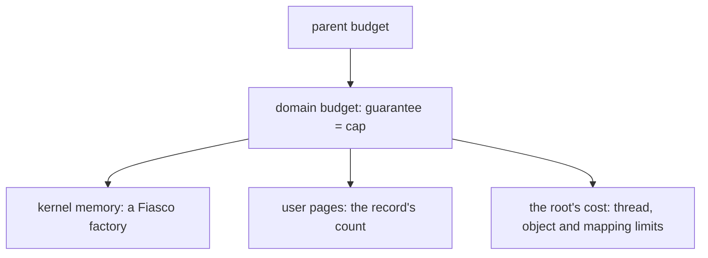
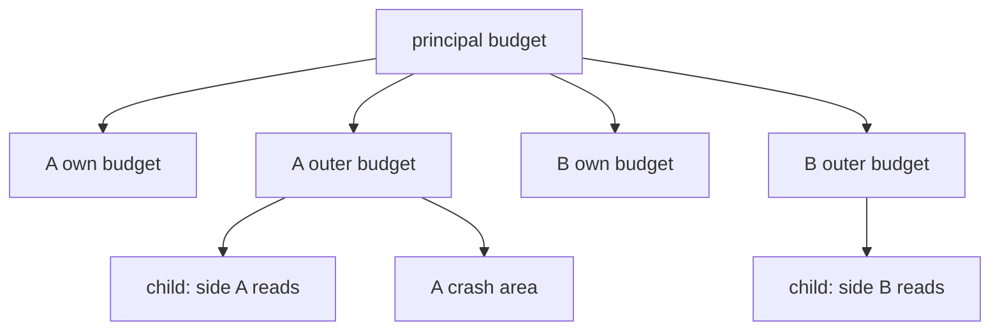
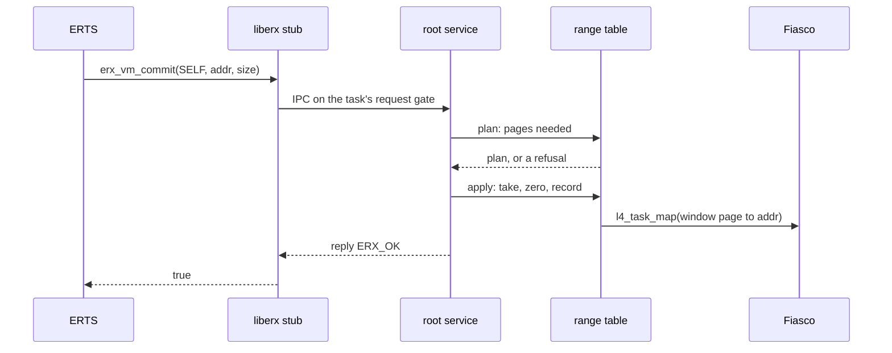

# Chapter 12. Memory and Budgets

> **Status.** **Built:** the root service's page pool, with one count
> of pages handed out; the range table, which records every reserved
> range, committed page and mapping of every space; commit, decommit,
> protect, release, map and revoke over Fiasco; budgets as records that
> store a guarantee and a cap and end everything charged to them; each
> domain's own and outer budgets, and the domain library's admission
> arithmetic; sub-spaces that end with their creator; eager copies for
> `erx_mem_child`; a budget report that gives the pool's count as
> partial. **Designed:** budgets as walls, with a Fiasco factory per
> domain for kernel memory and a page count per budget that refuses a
> charge past the wall; limits on the root's own cost per domain;
> per-budget reports; a refused map undone as `ERX_ENOMEM` instead of
> ending the machine; the session's mapper for shared file mappings.

**Background needed.** [Chapter 1](01-operating-systems.md) for
virtual memory (section 1.4) and [chapter 8](08-kernel-interface.md)
for the root service, handles, memory objects and the range table's
reserve, commit and map. [Chapter 5](05-overview.md#515-budget)
introduced budgets.

An Erlang domain that leaks, say through a cache that never drops an
entry, asks for more heap every few seconds. Each request is
reasonable on its own. Left alone, the domain takes every free page of
the machine. Then the display domain, which did nothing wrong, cannot
get the page it needs to draw the next frame. Something has to decide,
before the machine runs dry, which domain is refused.

FreeBSD meets this with overcommit and limits. Its kernel hands out
more memory than it has, betting that programs never touch all of it
([section 1.4.7](01-operating-systems.md#147-who-pays-for-memory)).
The `vm.overcommit` sysctl can make an allocation fail instead, once
the swap the system could need exceeds the swap it has. `rctl(8)` can
deny a process, user or jail more than a set amount of address space
(`vmemoryuse`). These limits cover what processes map, not what the
kernel spends on their behalf. When the bet fails, the kernel must end
some process to free memory.

erXos answers with budgets. A **budget** is an account of memory,
carved from its parent's, to which the root service charges every
object and page it makes. Destroying a budget ends everything charged
to it. In the design, each domain's budgets are also **walls**: memory
set aside when the domain is created, which no other domain can take.
A domain that spends its own then fails alone. The records and their
ends are built; the walls are designed and not built.

Sections 12.1 and 12.2 explain budgets and the two every domain has;
12.3 and 12.4 the pool and the range table; 12.5 follows one page
from request to mapping. Sections 12.6 to 12.10 cover sub-spaces,
deleted memory, reports, running out, and the design's choices.

> **Background: page tables and faults, recalled.** A program's
> addresses are virtual. The processor translates each through **page
> tables**, a tree the kernel keeps per address space with one entry
> per 4 KiB page, and caches recent translations in the **TLB**. An
> access with no entry, or with the wrong rights, is a **page fault**:
> the processor stops the program and runs the kernel, which may fill
> the entry and resume, or end the program
> ([sections 1.4.2 to 1.4.5](01-operating-systems.md#142-page-tables)).

## 12.1 Budgets as space banks

Ending a domain takes one call, however many objects it made.

### 12.1.1 A budget is an account

> **Background: space banks.** EROS, a capability system of the
> 1990s, allocated every object a program created from a **space
> bank**. Banks formed a tree, each drawing on its parent's. Destroying
> a bank destroyed everything allocated from it and from the banks
> below it, so no object outlived the account that paid for it
> (Shapiro, Smith and Farber 1999;
> [section 4.3.4](04-history.md#434-eros-safe-erlang-and-zircon-authority-and-payment)).

erXos's budgets follow that model. Each budget is a record in the root
service's object table, holding its parent, its kind, its
**guarantee** and its **cap**, both in pages
(`liberx/backend/fiasco/budget.c`). The guarantee is what the budget
is promised; the cap is the most it may spend. Every other record
names the budget it was charged to: a space, a group, an IRQ object, a
memory object, and every budget carved below.

A budget whose cap equals its guarantee is a wall. One whose cap is
higher is **elastic**: past its guarantee it may spend what its
ancestors have promised to no one. The domain library carves each
domain's budgets as walls (`make_step` in
`liberx/system/dom_apply.c`), and each principal's budget as an
elastic one (`liberx/system/dom_boot.c`). A session carves each
program's budget as elastic too (`erx_program_drv.c` in
`otp/erts/emulator/sys/erxos/`), so its programs share the session's
memory as a QNX process shares the system's
([design.md, Resource limits](../design.md#resource-limits)).

Ending is the part every caller relies on, and it is built.
Destroying a budget, or closing its last handle, runs one service
body, `erx_fiasco_budget_end`. It sweeps the object table flat and
never recurses:

1. it stops every space below the budget, so no thread runs on while
   what it uses goes;
2. it ends every other object below the budget: groups, IRQ objects,
   gates and memory;
3. it frees the carved budgets nothing is charged to any more, leaves
   first, sweep after sweep, until a sweep frees none.

A record is below the budget when the chain of parents from its own
budget reaches it. The number of sweeps is the depth of the budget
tree, which the table's size bounds. No caller lists what to free, so
no caller can forget an item: the
[by-construction](06-construction.md#623-budgets) property of
chapter 6.

### 12.1.2 Admission at a domain's own budget

A wall makes admission a local question: does the principal starting
the domain have the memory left? What other domains use does not
matter, because none can spend what this one was promised.

The domain library answers in its plan, before it makes anything.
`dom_check_room` in `liberx/system/dom_core.c` adds the new domain's
own and outer budgets to what the principal's domains have already
carved. If the sum passes the principal's memory, it refuses the
domain with `ERX_ENOMEM`. An app's domain must also fit the apps'
budget beside every other app's sessions. This arithmetic is built.

The other half is not: holding a running domain to its wall. As built,
an admitted domain can spend past its guarantee, because nothing at
run time counts its pages.

### 12.1.3 The three parts of a wall

A domain's cost lands in three places, and a wall must bound each. A
domain that cannot exceed its pages, but can make the kernel allocate
without limit, is not walled at all. Figure 12.1 shows the design.



*Figure 12.1. A domain's budget as a wall, as designed. Fiasco holds
the kernel memory; the root holds the page count and the limits. Each
part is fixed when the budget is carved, so no other domain's spending
moves it.*

* **Kernel memory.** A **factory** is the Fiasco object that creates
  other kernel objects and pays for them from a limit of kernel memory.
  In the design, each domain budget has its own factory, carved from
  its parent's with the kernel-memory figure of the domain's manifest
  row. Fiasco charges a child factory's whole limit to its parent when
  it is made, so the limits partition kernel memory hard. It charges
  every task's page tables, capability table and kernel-user pages to
  the factory the task was made from. When a domain's factory is spent,
  the root's next creation or map for that domain answers
  `ERX_ENOMEM`.
* **User pages.** Every page a domain uses comes from the root's pool,
  because only the root maps memory. In the design, each budget record
  counts the pool pages charged to it. A commit or an object's creation
  charges the budget that owns the memory, inside the call's whole-plan
  check, so a charge past the wall is `ERX_ENOMEM` before any page
  moves. Shared memory is charged once, to the object's budget, never
  per mapping.
* **What the root holds for the domain.** Some of a domain's cost is
  the root's: a capability in the root's own table for each of the
  domain's objects, a record in the root's tables, a reply slot for
  each held fault. The design bounds these by the domain's thread,
  object and mapping limits, past which a call answers `ERX_ELIMIT`.
  The domain service admits a domain only when the root has that much
  left.

A budget carved below a domain's, such as a connection's child budget
or a program's, has no manifest row. In the design its factory takes
the share of its parent's kernel memory that its guarantee is of its
parent's guarantee. Carving reserves the guarantee from the parent,
refused past the parent's wall. A resize may not go below what the
budget holds plus what is carved from it
([design-fiasco.md, Memory and budgets](../design-fiasco.md#memory-and-budgets)).
All three parts are designed and not built.

### 12.1.4 What is built

The system as built has the accounts but not the walls.

1. **A budget record refuses nothing.** It stores the guarantee and
   cap it was given (`budget_row_t` in `budget.c`).
   `erx_fiasco_budget_resize_body` overwrites them without checking
   anything, and no page is counted against a budget.
2. **Every Fiasco object comes from the root's one factory.** Each
   `l4_factory_create` call in `liberx/backend/fiasco/` names
   `L4_BASE_FACTORY_CAP`, the factory Fiasco handed the root at boot.
   Fiasco keeps no quota of kernel memory per domain.
3. **The pool keeps one count.** It knows how many pages it has handed
   out and how many are free, for the whole machine (`page_pool.c`),
   not whose they are.

So one domain can take pool pages, or Fiasco's kernel memory, that
others need.

## 12.2 Own and outer budgets

A domain that crashes must not pull memory out from under a peer that
still reads the ring they shared. So each domain has two budgets,
carved side by side from its principal's.

* The **own budget** pays for everything only the domain uses: its
  space and private memory, its threads and group, its boot
  information page, its devices' objects, and every budget it carves
  for its sub-spaces or programs.
* The **outer budget** pays for what another party may still use after
  the domain is gone. For each connection, the domain library carves a
  **child budget** from it. The child pays for the side of the
  connection the domain reads and the doorbell it waits on. The
  crash area is charged to the outer budget directly, so the record of
  a crash outlives the crash
  ([section 8.3.4](08-kernel-interface.md#834-one-request-end-to-end-a-domains-crash-area)).

Figure 12.2 shows two connected domains.



*Figure 12.2. Own and outer budgets of connected domains A and B. The
side each domain reads is charged to a child of that domain's outer
budget. Ending A destroys only A's own budget, so the ring B reads,
and A's crash area, stay.*

The plan that builds a domain, in `liberx/system/dom_core.c`, carves
both budgets from the principal's. It charges the space, groups and
boot page to the own budget and the crash area to the outer budget.
It carves the system connection's child budget from the outer budget.
The split is built.

Ending a domain is one destroy, of its own budget, when its exit
record arrives. Nothing another party maps is charged there, so the
end waits for no one. The rest goes later. The crash area goes once the
domain service has read it, and each connection's child budget once
both parties have let go of the connection. The outer budget goes
when no child is left. A peer that never lets go keeps that one child budget
alive, and the connection counts against the peer's own quota
([design-system.md, Ending a domain](../design-system.md#ending-a-domain)).

The domain holds no handle to its outer budget or its children, so it
cannot destroy them. The domain library maps one domain's memory into
another only when it makes a connection, so an outer budget holds
exactly its connections' child budgets and its crash area. Where each
object is charged, not a list of exceptions, keeps a peer's memory
alive.

## 12.3 The pool

Every page any space uses, other than device memory and the boot
image's own pages, comes from one place: the root's pool.

At boot the root asks Sigma0, Fiasco's first pager, for all the RAM it
holds, and maps it into its own space in the **window**
([section 8.6.1](08-kernel-interface.md#861-one-page-one-address)).
The window is never unmapped. **A page's identity is its window
address**: every mapping of it in any task is made from that address,
as a child of the root's mapping in Fiasco's mapping database.

Free pages wait on a list threaded through the pages themselves.
Three functions in `liberx/backend/fiasco/page_pool.c` are the pool:

* `erx_fiasco_pool_add` puts a page on the list at boot and counts it
  in the pool's size;
* `erx_fiasco_pool_take` takes the first page, counts it as held and
  zeroes it, so no space sees what a page held before;
* `erx_fiasco_pool_put` returns a page and counts one fewer held.

An empty pool is `ERX_ENOMEM`. The root's own tables are pool memory
too: a table that fills takes one more page, and never moves.

Before anything else, the root takes one run for devices, the
**contiguous pool**. A device that reads memory by itself (DMA) needs
physically contiguous pages at addresses it can reach. The run is the
smallest power of two that holds the DMA memory the manifest's devices
declare, between 2 MiB and 16 MiB. It is the lowest free RAM Sigma0
has, so it lies inside every supported board's DMA window. A device's
memory is made from it once and never given back. The contiguous pool
and the window of device registers both lie below the main window.
`vm_give` in `vm.c` returns a page to the free list only if it lies
in the main window. So no way of ending an object can free a page
a device may still write
([design-fiasco.md, The pool](../design-fiasco.md#the-pool)).

## 12.4 The range table

The pool says which pages are free; the range table says where every
other page is, and with which rights.

### 12.4.1 Three facts

The range table is one pure core, `liberx/backend/core/vm_table.c`,
built for the host and shared by both backends. It holds three kinds
of fact:

* **runs**, each task's reserved addresses, sorted and disjoint, with
  adjacent runs merged;
* **mapping records**, each task's mappings of memory objects: an
  address range inside one run, the object, the offset and the rights
  it was mapped with;
* the **page index**, one hash table for the machine, from a committed
  page's address and its table's label to its window address and its
  protection.

A **label** names one table: a task's, or a memory object's, since an
object's pages form a table of their own over offsets. A page absent
from the index is uncommitted. The index has two slots for every page
the window holds (`erx_backend_vm_layout`), and each entry owns a
distinct window page. So committing never finds the index full, and
the index, sized once at boot, never needs a page afterwards.

Figure 12.3 shows how a private page and a mapping differ.

```text
task T's table                                  window (root)
  run [0x40000000, 0x40200000)
    private page 0x40000000  --index-->  label T  -->  page W1, RW
    mapping [0x40100000, +64 KiB)
      object O, offset 0, rights R  ----------------------+
                                                          |
object O's table (label O)                                v
    offset 0  --index-->  label O  -->  page W2 ... (16 pages)
```

*Figure 12.3. A private page and a mapping in task T's range table.
The private page has an index entry under T's label. The mapping is
one record with the rights it was made with; its pages belong to
object O, under O's label, and are never in the index under T.*

### 12.4.2 Plans, then effects

Every range call is computed whole before anything changes, the
[functional core](06-construction.md#63-functional-core-effects-at-the-edge)
of chapter 6. `erx_backend_vm_plan` takes the table and the request
and returns a plan: the range, the state each reserved page in it
becomes, and how many pages the change needs. It changes nothing.
`erx_backend_vm_call` then checks the plan against the world:

```c
	error = erx_backend_vm_plan(table, request, &plan);
	if (error != 0)
		return (error);
	/* Room for a run first: only calls that take no page add one, so the pool check still holds after. */
	error = erx_backend_grow_table_room(&table->runs, plan.runs_room);
	if (error != 0)
		return (error);
	if (plan.pages_needed > effects->free_pages())
		return (ERX_ENOMEM);
	apply_plan(table, effects, &plan);
```

Notice the order: every refusal comes before `apply_plan`, so a
refused call changes nothing. The apply reaches the world only through
`effects`, five functions that take a page, give one back, map, unmap
and count free pages. The Fiasco backend's effects call Fiasco and the
hosted backend's touch host memory, so one core serves both.

### 12.4.3 One table of steps

What a page needs done depends only on its state and the target.
`vm_steps` in `vm_table.c` is that table. A page is uncommitted,
committed with no access, read, read and write, or read and execute.

| From | To | Steps, in this order |
| --- | --- | --- |
| uncommitted | R, RW or RX | take a page, zero it, map it |
| no access, or R | R, RW or RX | map the same window page with the target |
| RW or RX | R | unmap the write or execute right |
| RW | RX | unmap write, then map RX |
| RX | RW | unmap execute, then map RW |
| any | no access | unmap all rights; the page stays committed |
| committed | uncommitted | unmap, give the page back to the pool |

A change in both directions drops a right before it adds one, because
Fiasco's map adds rights to an existing mapping and never removes
them. So no page is writable and executable even for an instant on
its way between the two. The table has no state for write and execute
together, so no step can ask for it
([design-fiasco.md, Protection](../design-fiasco.md#protection)).

### 12.4.4 A mapping keeps the rights it was made with

A mapping record holds the rights it was mapped with, and no call
changes them: `erx_space_protect` over a mapping is refused with
`ERX_ENOTSUP`. A program that wants other rights releases the mapping
and maps again, and the new map is checked as the first was. So a
mapping's protection never rises above what its map allowed.

What a map allows depends on the object's kind. One function,
`erx_fiasco_vm_map_rule` in `liberx/backend/fiasco/vm_rules.c`, holds
every kind's rule
([section 8.6.3](08-kernel-interface.md#863-kinds-of-memory-object)):
no write over a sealed object, a code object or a boot image slice,
and no execute over device memory. That is built. In the design a map
is also held beneath the rights the caller's handle carries, which the
root records per handle and narrows on every pass. Handles carry no
rights as built, so that part is designed and not built.

### 12.4.5 Trimming never meets sharing

A range of private pages and a mapping never overlap. A commit or
decommit whose range meets a mapping is refused with `ERX_EINVAL`, and
so is a release that would cut a mapping in two
([section 8.6.2](08-kernel-interface.md#862-reserve-commit-and-map)).

The rule exists for one failure. If a program could decommit part of
a shared object, the root would return to the pool pages that another
space still maps. The next owner of those pages would read, or
overwrite, that space's data. Instead only private memory is ever
freed by range. A private page has no handle and is mapped exactly
once, under its own task's label, so freeing it never frees a page
another mapping uses. Shared pages go back only when their object goes
(section 12.7).

## 12.5 One commit, end to end

Follow ERTS, the Erlang runtime, as it asks for memory for process
heaps. Its allocators reserve addresses first and commit pages as they
need them (`os_mmap_virtual` and `os_reserve_physical` in
`otp/erts/emulator/sys/common/erl_mmap.c`). The trace follows one page
of one commit through every layer, as figure 12.4 shows.



*Figure 12.4. One commit. The plan and its checks come before any page
moves; Fiasco is asked to map only after the plan has passed.*

1. **The call.** ERTS calls `erx_vm_commit(ERX_CAP_SELF, addr, size)`
   on a range it reserved earlier. Built.
2. **The request.** The stub, `stub_range` in
   `liberx/backend/fiasco/service_stubs.c`, packs four words (the
   calling thread's index, the space, the address and the size) into
   the thread's message registers and makes one IPC call on the task's
   request gate. The thread blocks until the reply. Built.
3. **The decoder.** The root service receives the message with the
   gate's label, which names the calling task, and checks its shape
   ([section 8.3.3](08-kernel-interface.md#833-the-decoder-the-trust-boundary)).
   `service_vm` in `service.c` resolves the space: the caller's own, or
   one it created. Built.
4. **The plan.** `erx_fiasco_vm_body` in `vm.c` hands the request to
   the range table. `erx_backend_vm_plan` refuses a range that meets a
   mapping, passes over addresses that are not reserved, and counts one
   page to take for each uncommitted reserved page. Built.
5. **The budget check.** In the design, the plan also finds the budget
   the task's space is charged to. It refuses the commit with
   `ERX_ENOMEM` if its pages would carry that budget past its wall.
   Nothing has changed yet, so the refusal leaves nothing behind. This
   step is designed and not built.
6. **The pool check.** `erx_backend_vm_call` refuses with `ERX_ENOMEM`
   if the pool has fewer free pages than the plan needs. As built, this
   is the only limit on a commit. Built.
7. **The page.** `page_move` takes a page from the pool through the
   `take` effect, which zeroes it. Built.
8. **The map.** The `map` effect, `vm_map` in `vm.c`, calls
   `l4_task_map` to map the window page into the task at the address,
   readable and writable. Fiasco adds a page-table entry and a
   mapping-database node, a child of the root's window mapping, both
   from its kernel memory. Built.
9. **The record.** The table writes the page's index entry: the
   address and the task's label as the key, the window page and the
   state RW. Built.
10. **The reply.** The service replies `ERX_OK` and waits for the next
    request in the same Fiasco call. ERTS writes to the page and never
    takes a fault on it. Built.

Step 8 spends kernel memory, and there the built system and the design
differ most. As built, that memory is the root's factory's. If Fiasco refuses the map, `vm_map` treats the refusal as a defect of
the root and ends the machine with a line on the console
(`vm_refused`). In the design, the page-table page and the mapping
node come from the domain's own factory. A domain can then reach that
refusal at will, by spending its factory, so the refusal must not be
fatal. The design therefore applies every fresh map of a plan first,
in ascending address order, before the steps that cannot fail. A map
Fiasco refuses undoes the maps before it, returns the plan's pages to
the pool, and answers `ERX_ENOMEM`, and only the domain's call fails
([design-fiasco.md, The range table](../design-fiasco.md#the-range-table)).
That ordering and undo are designed and not built.

## 12.6 Sub-spaces and shared objects

A session runs each native program in a **sub-space**, an address
space the domain creates for code it runs, holding only the handles
its creator gave it
([section 5.2.5](05-overview.md#525-programs-in-sub-spaces)).

### 12.6.1 A sub-space spends its creator's memory

A sub-space is charged to a budget its creator holds, usually one
carved from the creator's own for that program. What the program
spends comes out of the creator's account. The root records each
space's parent when it is created (`task_fill_space` in
`liberx/backend/fiasco/service_task.c`), and a space's end ends every
space below it first. So no program outlives its session, and no
sub-space outlives the domain that made it
([design-fiasco.md, Spaces, parents and exit records](../design-fiasco.md#spaces-parents-and-exit-records)).
Both are built.

> **Background: copy-on-write, recalled.** UNIX's `fork` gives a child
> a copy of its parent's memory. A kernel makes that cheap with
> **copy-on-write**: it maps the parent's pages into both, read-only,
> and copies a page only when one of them writes to it
> ([section 1.4.6](01-operating-systems.md#146-what-faults-make-possible)).

Copy-on-write needs a kernel path that resolves a write fault by
copying a page. The system on Fiasco never resolves a fault: every
committed page is already mapped, so a fault is always a bug. So
copies are eager. `erx_mem_child`, which the program loader uses for
an executable's writable segments, makes a new memory object of the
range's size and fills it with the parent's bytes, 64 pages a request.
Each program then pays for its writable segments in full when it
starts, and two programs of one executable share none of those pages.
The kernel interface on Fiasco has no call that copies a whole space,
so there is no copy-on-write `fork`
([chapter 13](README.md#chapter-13-native-programs-pipes-and-posix-lite)).

### 12.6.2 Shared objects

A memory object is a table of its own, under its own label, over
offsets. Its pages are all committed when it is created, and the
object owns them. `erx_vm_map` maps each page into a task at the
rights asked for, and the task's table gains one mapping record; the
page index gains nothing. So an object mapped by ten tasks holds its
pages once and is charged once, to its own budget
([design-fiasco.md, Shared objects and the JIT alias](../design-fiasco.md#shared-objects-and-the-jit-alias)).

A connection's rings work this way. The domain library makes the
sides under the connection's child budget, and each party maps its own
side writable and its peer's side read-only. That the root refuses a
writable mapping of the peer's side rests on rights recorded per
handle, which are designed and not built. Both tasks' page tables
point at one physical page, and messages cross with no request to the
root
([design-fiasco.md, Sharing memory between tasks](../design-fiasco.md#sharing-memory-between-tasks)).

The **JIT alias** is the same mechanism inside one domain. BeamAsm,
ERTS's just-in-time compiler, writes machine code and then runs it,
and no mapping may be writable and executable at once. So a space made
with the JIT flag maps one JIT object twice: read and write, where the
compiler writes, and read and execute, where the code runs. No single
mapping breaks the rule, though the domain can still run code it
wrote, a property of the system that
[chapter 11](README.md#chapter-11-authority-and-security) discusses.
Shared objects and the JIT alias are built.

## 12.7 Deleted memory

A memory object can go while tasks still map it, and what they see
then shapes how the system shares memory.

### 12.7.1 What a destroy does to a mapping

An object goes at the first of four events: its creator destroys it,
its budget ends, its creator's task ends, or its last handle and last
mapping are both gone
([section 8.4.2](08-kernel-interface.md#842-destroying-an-object)).
In the first three it may still be mapped, so the root revokes it.
`erx_fiasco_vm_object_revoke` unmaps each of its window pages from
every space but the root's, and Fiasco's mapping database removes
every mapping made from that page, in every task, at once. Each task's
table then drops its records of the object, and the pages return to
the pool. Nobody had to find the mappers.

A task that touches the revoked range afterwards faults. The root
never answers a fault, so the fault goes to the space's fault gate,
which stops the space
([section 8.5.4](08-kernel-interface.md#854-how-a-fault-reaches-the-right-handler)).
The access fails where it happens and never reads another owner's
data through a stale mapping. This is built.

### 12.7.2 No server maps what a client can delete

The same mechanism is a weapon in the wrong hands. Suppose a file
server mapped a buffer its client made and could destroy. The client
destroys it in the middle of a request. The server's next read faults,
and the fault stops the server's space, with every other client's
requests in it. Deleting memory would become a way to crash a server.

So the system's rule is that **no server maps memory a client can
delete or end**. Memory crosses domains only through objects the
system domain made and charged to a budget that outlives every party
that maps them: a connection's child budget (section 12.2). Neither
party can destroy anything of a connection, so neither can make the
other fault. A server that must read a client's memory otherwise
copies it with `erx_mem_copy`, which returns an error if the memory is
gone instead of faulting
([design.md, Resource limits](../design.md#resource-limits);
[design-domains.md, Connections](../design-domains.md#connections)).

The rule shapes shared file mappings. A program that maps a file with
`MAP_SHARED` does not map the file server's memory. Its session holds
one memory object per file, the file's **shared object**, and one
Erlang process, the file's **mapper**. The mapper fills the object
with ordinary reads and writes it back with ordinary writes. The file
server sees only reads and writes, and no fault waits on another
domain
([design-files.md, Shared mappings](../design-files.md#shared-mappings)).
The mapper is designed and not built.

## 12.8 Reporting a budget, and what is not charged

The inspector marks each figure of a budget's report exact, partial
or unsupported, and names who reported it
([design-fiasco.md, Reporting a budget](../design-fiasco.md#reporting-a-budget)).

### 12.8.1 What is reported

As built, the root reports one budget figure. Asked about the
caller's own budget (`ERX_CAP_SELF`), it answers with the pool's count
of pages held (`erx_fiasco_vm_used_pages`); asked about any other, it
answers `ERX_ENOTSUP` (`service.c`). The figure is **partial**, under
the reporter `liberx_pool`, labeled "root pool", that
`abi/inspection.txt` declares. Its scope says what it counts: pages of
the root's pool handed out, carved budgets' included, and not the
kernel's or Sigma0's memory, page tables or mapping records. It is the
whole machine's figure, which is why it is partial.

The machine topic's `memory_total` and `memory_free` are the pool's
size and free pages, partial under the same reporter. `top` prints them under the
label `Mem (root pool)`
(`erlang/apps/erx_shell/src/erx_cmd_top.erl`), so nobody mistakes them
for the machine's whole RAM. All of this is built.

In the design, each budget record counts its own pages, and the budget
topic on any budget reports that count as `used`. It stays partial,
because it holds pool pages and not kernel memory. The guarantee, the
cap and `carved`, the sum of the children's guarantees, are reported
exactly, because the record holds each exactly. Per-budget reports are
designed and not built.

### 12.8.2 What nothing charges

Some memory is in no budget:

* **Fiasco's own memory.** Fiasco's objects, page tables and mapping
  records come from its allocator, sized at boot. As built all of it
  comes through the root's factory, and no figure reports it.
* **Sigma0's and the firmware's memory.** What Sigma0 holds back, and
  RAM outside what it handed the root, is outside the pool.
* **The boot image's own pages.** An image entry's code and read-only
  data are the archive's pages, shared by every space that runs it and
  counted nowhere. Of a domain's image, only its writable segments use
  pool pages.
* **The root's tables.** The records, handle tables and runs the root
  keeps for every domain are pool pages charged to the root. In the
  design, each domain's limits bound its share (section 12.1.3).

## 12.9 When memory runs out

What the reader sees depends on which memory ran out.

* **The pool.** A commit, creation or table growth that needs more
  pages than the pool has free is refused with `ERX_ENOMEM` before
  anything changes; ERTS's `os_reserve_physical` returns false. The
  domain that meets the empty pool is whichever asks next, not the one
  that used most, since nothing counts pages per domain. Built.
* **A budget's wall.** The domain that reaches its own wall gets
  `ERX_ENOMEM`, and no other domain notices. Designed.
* **Fiasco's kernel memory, on a creation.** A refused Fiasco create
  fails the root's call. Built.
* **Fiasco's kernel memory, on a map.** The root ends the machine with
  a line naming the refusal. Built. In the design the refusal undoes
  the call and answers `ERX_ENOMEM`. Designed.
* **A touch of deleted memory.** The access faults, and the fault
  stops the space that made it. Built.

A revoke or unmap that Fiasco refuses means the root's records and
Fiasco's tables disagree, and the root ends the machine with the
reason.

## 12.10 Design choices

**Commit at once, or fill on demand.** FreeBSD fills a page at its
first touch, so a program pays only for what it touches. erXos maps
every committed page at once. The cost is memory: a program that
commits a range and touches a tenth of it holds all of it. The gain is
that the root never answers a fault. A fault is always a bug, the
fault path stays one path, and no thread waits on the root in the
middle of an instruction. A budget also means what it says: a commit
gets its pages or is refused. No page is promised that may be missing
when touched, so overcommit's failure at the worst moment cannot
happen. Runtimes reserve address space freely and commit in
pieces, as ERTS's allocators do.

**One mapper, or a pager per domain.** L4Re lets each program have its
own pager, a server that answers its faults and maps its memory, in a
hierarchy rooted at Sigma0. erXos gives the root alone that job. One
party then holds every page's record, so revoking an object, ending a
domain or reporting the pool needs no conversation. No domain holds a
capability that can write a page table. The cost is that every
domain's setup queues on one thread of the root, though steady-state
traffic makes no request
([section 8.3.1](08-kernel-interface.md#831-one-thread-for-every-table)).

**Walls, or elastic quotas everywhere.** A system could let every
budget borrow what others leave unused. Domains get walls instead, so
a domain is admitted or refused at its own budget and nothing another
domain does takes what it was promised. The cost is idle memory: a
wall's unused pages help no one. Programs within a session get elastic
budgets, because they are one user's, and one of them crowding out
another is that user's affair.

**Eager copies.** Copy-on-write saves memory when a child changes
little of its parent. It needs a path that resolves write faults, a
record of shared pages, and an answer to who pays for the copy a write
makes. An eager copy needs none of these. It charges the whole copy to
the child's budget at creation, when a refusal is still a clean
`ERX_ENOMEM`. The cost is memory and start-up time for programs with
large writable segments.

## Summary

Every object and page the root service makes is charged to a budget,
after EROS's space banks, and destroying a budget ends everything
charged to it. Each domain's own budget ends with it; its outer budget
pays for what peers still map. The root alone maps memory, from one
pool of zeroed pages, and its range table plans each call whole before
any page moves. A mapping keeps the rights it was made with, and
private memory, the only memory freed by range, never shares a page
with a mapping. A deleted object is revoked from every space at once,
so no server maps what a client can delete. In the design each
domain's budget is a wall over kernel memory and pages. As built,
budgets refuse nothing, every object comes from the root's one
factory, and the pool's one count is reported as partial.

The next chapter puts native programs into the sub-spaces this
chapter gave memory to, and shows how a session hands them files and
pipes.

## Where to read next

* [design-fiasco.md, Memory and budgets](../design-fiasco.md#memory-and-budgets):
  the three parts of a wall and the Fiasco code each rests on.
* [design-fiasco.md, The pool](../design-fiasco.md#the-pool) and the
  sections after it: the range table, protection, shared objects,
  reporting and table sizes, in detail.
* [design-system.md, Ending a domain](../design-system.md#ending-a-domain):
  own and outer budgets, and the order in which a domain's memory goes.
* [design.md, Resource limits](../design.md#resource-limits): the
  system-wide rules for memory, CPU and messages.
* `liberx/backend/core/vm_table.c` and `liberx/backend/fiasco/budget.c`:
  the range table's core and the budget sweeps, each short enough to
  read whole.
* Jonathan S. Shapiro, Jonathan M. Smith and David J. Farber, "EROS: a
  fast capability system", SOSP 1999, section 5.1: space banks.
* FreeBSD 14.3 manual pages `rctl(8)` and `tuning(7)` (on
  `vm.overcommit`): the familiar baseline.
