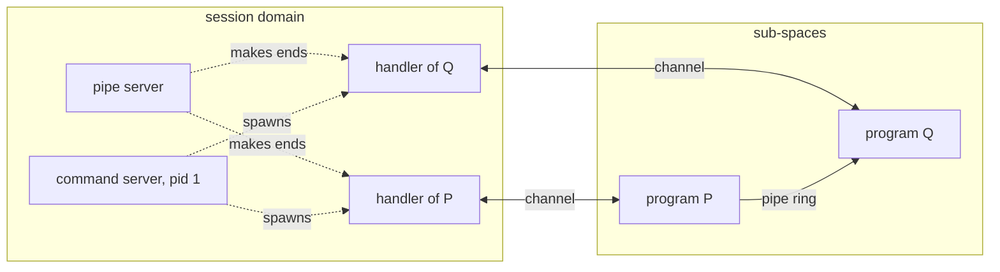
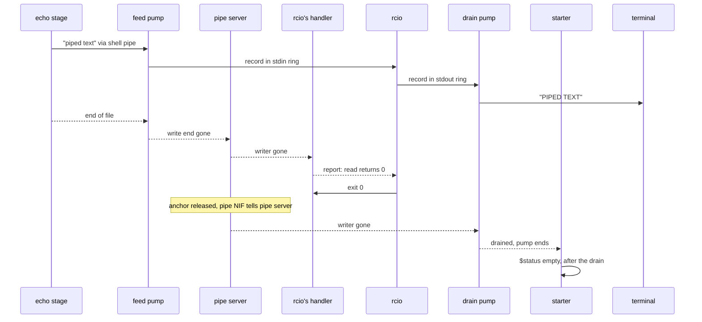

# Chapter 13. Native Programs, Pipes and POSIX-lite

> **Status.** **Built:** a C program from the session's release runs
> in a sub-space of its session and talks to one Erlang process, its
> handler. Pipes live in user space, made by the session's pipe server,
> and programs join command-shell pipelines beside Erlang commands. A
> program uses files, `poll`, `dup` and `pipe`. Its `kill` reaches only
> itself, and only `SIGKILL` acts. It can leave a signal at its default
> action or ignore it. Signal and errno numbers are FreeBSD's.
> **Designed:** programs starting programs (`posix_spawn`, `wait`),
> executable files as images, catchable signals, job control that
> pauses a program, terminal input and sockets for programs, toybox,
> the second tier (`fork`, `exec`, shared libraries), and the
> POSIX-lite personality as a whole.

**Background needed.** [Chapter 1](01-operating-systems.md) for
exit status and signals (section 1.3.6), file descriptors (section
1.6.3), pipes and lanes (section 1.7.4) and memory ordering (section
1.7.3); [chapter 3](03-erlang.md) for processes, monitors and ports
(section 3.5.4); [chapter 5](05-overview.md) for sessions and
sub-spaces (section 5.2.5); [chapter 8](08-kernel-interface.md) for
fault gates and doorbells.

A user who has ported a C program to erXos types its name at the
command shell, and the program runs. It reads standard input, writes
standard output and exits with a status, as on FreeBSD.

What may this program touch? A bug in it, or a hostile line in a
library it links, must not reach the user's files beyond what it was
handed, the session's Erlang processes or any other domain.

FreeBSD answers with the process. Each program gets an address space,
a descriptor table and the user's identity. It can open any file its
user can open, signal any process its user owns, and start any program
with `fork` and `exec`, unless a jail or Capsicum narrows it.

erXos answers differently. A native program runs in a sub-space of its
session, an address space the session made and ends. It holds no
authority of its own: it reaches everything by asking one Erlang
process, its handler, which checks each request against a table built
from what the program's **starter** handed it. The starter is the
Erlang process that asked for the program to run; for a typed command,
the shell's process for that stage of the line. Pipes between programs
are rings in memory that the session makes and hands out, so end of
stream follows from the session's records, not a kernel's.

Sections 13.1 to 13.3 cover what a program is, its channel and
handler, and how it starts. Sections 13.4 and 13.5 explain pipes and
follow one pipeline from the shell's line to `$status`. Section 13.6
covers signals, sections 13.7 and 13.8 the POSIX-lite personality and
its second tier, and the chapter ends with failure and the choices
behind the design.

## 13.1 A program is a port

A native program is a C program in address spaces its session made.
It has no domain id, no node name and no connection to any other
domain; to the session's Erlang code it looks like a port.

> **Background: executable files.** A compiler turns C source into an
> **executable file**, which on FreeBSD, Linux and erXos is in ELF, the
> Executable and Linkable Format. Its **segments** say which bytes of
> the file go at which address, and with which permissions: code
> readable and executable, data readable and writable. A **loader**
> maps each segment into a fresh address space and jumps to the entry
> point. A **statically linked** program carries every library
> function it calls in its own file; a **dynamically linked** one names
> shared libraries that the loader maps beside it.

### 13.1.1 What a program consists of

A FreeBSD process has an address space, threads, a descriptor table, a
process id and a parent. A program on erXos has the same parts, kept
in different places, and the program itself holds almost none of them
(Table 13.1;
[design-programs.md, A program is a port](../design-programs.md#a-program-is-a-port)).

| Part | What it is | Who holds it |
| --- | --- | --- |
| the **anchor** | an empty space, the root of the program's tree of spaces | the session |
| the **image** | the space below the anchor where the program's threads run | the session, which can end it; the program runs in it |
| its budget and group | what its memory is charged to, and what its threads run in | the session; the program spends from the budget |
| its channel | two lanes and two doorbells to its handler (section 13.2) | the session and the program, one lane each |
| its **table** | what it may reach: its namespace, open files and pipe ends | its handler, in Erlang |
| its data area | a memory object of 64 KiB slots that file bytes move through | mapped by both |
| its process id | a number from 2 up, never reused in the session | the command server |

*Table 13.1. The parts of a program, and who holds each.*

The **anchor** is a space with no thread and no mapping, there to be a
parent. Every space has a parent, and when a space ends, every space
below it ends first
([design-fiasco.md, Spaces, parents and exit records](../design-fiasco.md#spaces-parents-and-exit-records)).
So stopping a program's anchor stops its image and everything below
it, and a program never outlives its session. The programs a program
starts hang from its anchor, so when the designed `exec` replaces the
image (section 13.8), they stay. There is no `init` to adopt orphans,
because no child is ever left without a parent.

All of these are Built. The session's port driver, `erx_program`
(`otp/erts/emulator/sys/erxos/erx_program_drv.c`), makes them from one
plan.

### 13.1.2 Why a port

ERTS already has a shape for something outside the runtime that a
process talks to: the port ([section
3.5.4](03-erlang.md#354-bifs-nifs-and-ports)). A port has an owner, is
linked to it, closes when the owner exits, and sends its owner
messages. A program's owner is its handler. When the program ends, by
exit or fault, the handler receives `{exit_status, N}`; when the
handler dies, the session stops the program. Supervising a C program
needs no new concept.

Figure 13.1 shows a session running two programs joined by a pipe,
each program drawn as one box.



*Figure 13.1. A session with two programs. Each program talks only to
its own handler; bytes between the programs move through the pipe's
ring, which the pipe server made, without passing through the
session.*

A program trusts its session wholly, as any sub-space trusts its
creator, and its session trusts it not at all.

## 13.2 The channel and the handler

Every request a program makes, from opening a file to signaling
itself, is one message on its channel to one Erlang process.

### 13.2.1 The channel

A program's channel is a pair of lanes, the one-way rings that carry
messages between domains ([section
1.7.4](01-operating-systems.md#174-talking-without-sharing)), with a
doorbell for each direction ([section
8.7.1](08-kernel-interface.md#871-one-path-for-devices-and-peers)).
The session writes the inbound lane: the startup message, replies and
reports. The program writes the outbound lane: requests and notices.
Each party writes exactly one memory object and maps the other's
read-only, so neither can corrupt what the other publishes
([design-programs.md, The channel](../design-programs.md#the-channel)).
The session creates every object of the channel from its own budget
and alone can destroy them, so a program cannot pull its channel's
memory away while the session reads it.

Each record on a lane is one Erlang term in the external term format,
which `liberx`, the library under every program's C library, encodes.
A program's `kill(pid, SIGTERM)` becomes the term
`{kill, Pid, sigterm}`, the signal named, not numbered
(`liberx/program/signal.c`). The handler is ordinary Erlang that
matches tuples.

The session does not trust these terms. The port driver decodes each
record with the **funnel**, the one decoder of untrusted terms
([chapter 3](03-erlang.md#392-distribution-across-a-domains-wall)), in
a mode that admits no fun, pid or reference and creates no atom. It
holds the program to its **credit**: at most 16 requests waiting for a
reply. The handler then checks each frame against the **program
protocol**, a grammar declared once in `abi/protocols/prog.txt` and
generated for both sides ([chapter 7](07-one-source.md#72-the-abi-file)).
A frame that fails any check ends the program with `SIGSYS`, "bad
system call". All of this is Built.

File bytes do not travel on the channel. They move through the
program's data area, 64 KiB slots that both sides map; the channel
carries only the request naming the slot.

### 13.2.2 The handler

The **handler** is the Erlang process of the session that owns a
program's port and serves its requests. It is the program's process
table, namespace and file server in one, and it checks every request
against the program's own table, never the session's
([design-programs.md, The handler](../design-programs.md#the-handler)).
Three rules make it safe to put between a hostile program and the rest
of the session.

* **It alone sends to the program.** Everything else with news for a
  program sends it to the handler, which queues it, so the order the
  program receives is the order the handler chose.
* **It never waits on the program.** A write into the inbound lane
  never blocks. A frame that finds no room is **owed**: the handler
  keeps it and writes it when the program frees room. A program that
  stops reading its channel delays only its own news.
* **It never waits on a request's work.** A file read that a server
  is slow to answer is relayed, and the handler goes on taking the
  program's other frames, a `kill` included.

The handler's decisions are one pure state machine, the functional
core of [section 6.3](06-construction.md#631-the-shape), tested on the
host. The Built requests are the file calls, making a pipe, and
`kill`. A path is
resolved over the program's narrowed namespace alone, so a file the
starter could not reach is not found
([chapter 14](README.md#chapter-14-files-namespaces-and-service-trees)).

### 13.2.3 The command server

Process ids need one owner, or two handlers could give out the same
number. Each session runs a **command server**, `erx_command_srv`,
process 1 of the session's table of running commands. It assigns every
program's id and records the program in its starter's **job**: the
commands of one shell line, which the shell starts, stops and waits
for together. It spawns the program's handler, and finds the handler a
`kill` or a job names. It answers from its table alone and waits on
nothing. Its supervisor never restarts it: a new server could not know
which ids the old one gave, so its end ends the session. The command
server is Built.

### 13.2.4 What a program can start

There is one `/bin`. In the design it is a directory the session
serves, with one entry for every command a program may start: each
program of the release's `bin/` directory and each Erlang command of
the shell. As built, only the shell uses it: it runs a command name,
or `/bin/NAME`, as the program `bin/NAME` of the session's release.

In the design, starting a program is a right, which the shell gives by
handing the program `/bin`. A program without it that asks is refused
with `EPERM`, and a child can do only what its starter handed it
([design-programs.md, What a program can start](../design-programs.md#what-a-program-can-start)).
Capabilities carry authority, never the kind of program, so `xargs
kill` works exactly when the program holds the right to signal.

A program starting programs is designed and not built: the handler
serves no start request. A program's image is always `bin/NAME` of the
session's release, in the boot image, which no program can write. So a
program never runs a file it could rewrite, because there is no other
source of code.

In the design a program may also run an executable file, reached
through a **file grant**, an authority over part of a file tree handed
to a program. It runs only through a grant with the `rx` (read and
execute) right, and no grant carries both `rw` (read and write) and
`rx`. Executable files as images are designed and not built.

## 13.3 Starting a program

A program starts stopped, receives everything it inherits in one
message, and only then runs its first instruction.

### 13.3.1 From the shell's line to `main`

The command shell (an rc-language shell written in Erlang; [chapter
20](README.md#chapter-20-the-command-shell-and-the-unix-surface))
runs a name that is not an Erlang command from `/bin`, as section
13.2.4 describes. These steps are Built.

1. The starter makes a pipe for each standard stream it has open and
   calls `erx_prog_handler:start/1` with the image, arguments,
   environment, working directory and those pipe ends.
2. The command server assigns the program's id and spawns its handler.
3. The handler asks the pipe server for a matching end for the program
   in place of each of the starter's, which the starter then closes,
   as a UNIX parent closes its copies after `fork`.
4. The port driver builds the sub-space from one plan: budget, group,
   anchor, image, channel, code mapped read-only from the boot image
   (so programs running the same file share its pages), capabilities,
   and the first thread, stopped. A step that fails undoes the earlier
   ones.
5. The handler writes the **startup message** into the inbound lane:
   arguments, environment, working directory, signal state and
   descriptors, at most 192 KiB. Then it starts the thread, so `main`
   never runs on a half-built descriptor table.

The design counts ten kernel objects for a start and budgets it at
1 ms under HVF, Apple's hypervisor framework, with which QEMU runs
guest code at the host's own speed
([design-programs.md, The cost of a program](../design-programs.md#the-cost-of-a-program)).
No measurement is recorded.

## 13.4 Pipes in user space

The kernel has no pipe object: a pipe is memory and doorbells that the
session arranges, and `liberx` reads and writes it directly.

### 13.4.1 Why not in the kernel

FreeBSD keeps a pipe in the kernel: a buffer and a count of the ends
open on each side. `write` copies into the buffer, `read` copies out,
and when no write end remains, `read` returns 0. Every byte crosses
the kernel twice.

Fiasco offers no pipe, and erXos does not want one. A pipe is lanes
with a little more, so the data path makes no kernel call while the
other side is awake, and who holds which end stays in Erlang
([design-pipes.md](../design-pipes.md)). End of stream, which a kernel
pipe gives for free, follows from one fact: the session handed out
every end, so it knows every holder.

### 13.4.2 One ring per writer

Each write end of a pipe writes a lane of its own. Its readers map the
ring read-only, so writers never share memory and no reader can change
what a writer published
([design-pipes.md, The ring](../design-pipes.md#the-ring)).

A write copies its bytes into the ring as one **record**, at most
`PIPE_BUF` (4,096) bytes, and publishes it with one store of the write
position. So a write of up to `PIPE_BUF` bytes reaches the reader
whole, never interleaved with another writer's bytes, as POSIX
requires.

In what order does a reader see several writers' records? Each record
carries a **stamp**, the monotonic clock's reading when it was
written, and the reader merges the lanes by it. Two programs that
write one pipe in turn, as `{date; uname} | cat` does on UNIX, are
read in that order. Two records with the same stamp would have no
order, so before returning, a writer waits until the clock has moved
past its last stamp.

Several readers can share a pipe's read side, as POSIX processes can.
They share a **lock page** that holds the reader lock and the record a
reader was partway through, so the next reader continues from that
byte ([design-pipes.md, The lock page](../design-pipes.md#the-lock-page)).

### 13.4.3 Shared memory a stranger can write

A writer can write any bytes into its ring, including a header that
lies: a write position past the end, a record longer than the ring.
So every party copies each field it reads from another party's page
into private memory once, and checks the copy before use: the read
position may not pass the write position, the gap may not exceed the
ring, and a record's length must fit what was published.

A reader that finds a lie marks the lane **broken**, logs one line,
and from then on treats the lane as a writer that has gone and been
read to the end. A writer that finds a nonsense read position waits
as for a full ring. A hostile party can stop its own stream, never
make another crash, loop or read out of bounds.

The reader's and writer's steps are one pure state machine,
`liberx/erx_pipe_core.c`, which runs in a program and in the session's
**pipe NIF**, the native code that gives Erlang processes pipe ends
over the same rings.

### 13.4.4 Ends and their holders

The session's **pipe server**, `erx_pipe_srv`, makes every lane, lock
page and doorbell of every pipe, installs each end into its one
holder, and tells each holder about the others
([design-pipes.md, Ends and their holders](../design-pipes.md#ends-and-their-holders)).
A program never installs an end, and no end can be copied or passed
on. When a starter hands an end to a child, the pipe server makes the
child a new end of the same kind, with its own lane for a write end.

End of stream follows from records, never from a field of shared
memory. When a program closes a write end, its `liberx` tells the
handler. When the program itself ends, the pipe NIF tells the pipe
server, but only once the program's anchor is released, so no image of
it still runs. Either way the pipe server tells every reader that the
writer is gone. A reader returns 0 only when no writer it knows of is
open and every gone writer's lane is drained. The other direction is
the same: when the last reader goes, every writer is told, and its
next write fails with `EPIPE`. A program can still keep a pipe open by
holding an end it never uses, as on UNIX; what changes is who keeps
the count.

The pipe server's decisions are a pure function that takes no field of
shared memory as input. The pipe server, the pipe NIF and the pipe
core are Built.

### 13.4.5 Doorbells and lost wakeups

A reader that finds no record must sleep, and a writer must wake it.
The classic bug is the lost wakeup: the reader checks, the writer
publishes and rings before the reader sleeps, and the reader then
sleeps forever. A waiter therefore publishes what it waits for, its
bit in the lane's `sleepers` word, and checks again before it sleeps.
Between the two it issues a **fence**, an instruction that makes the
processor finish its earlier stores before its later loads. A writer publishes, fences,
and rings each sleeper whose bit it finds. Each end has its own
doorbell, so only readers that wait are woken.

Arm cores may reorder memory accesses ([section
1.7.3](01-operating-systems.md#173-memory-ordering)), so `make
check-litmus` tests the pipe's reader lock with herd7, a tool that
lists every outcome Arm's memory model allows. The lock released with
a **store-release** (a store the processor may not make visible
before the stores ahead of it) must never let a reader miss the record
the last holder claimed. A twin that uses a plain store must let it,
or the test proves nothing: the seeded fault of [section
6.5](06-construction.md#65-what-construction-cannot-say). The pipe
core is also run on the host through every interleaving of a small
model of one pipe (`test/host/pipe_core_test.rb`). Both checks are
Built.

## 13.5 A pipeline, end to end

The QEMU programs suite types a line beginning with this one at root's
command shell and checks that `PIPED TEXT` comes back:

```sh
echo piped text | rcio upcase
```

`echo` is an Erlang command. `rcio` is a native test program in the
suite's release (`test/guest/programs/rcio.c`). With `upcase` it
copies standard input to standard output in upper case:

```c
	while ((got = read(0, buffer, sizeof(buffer))) > 0) {
		for (ssize_t i = 0; i < got; i++)
			if (buffer[i] >= 'a' && buffer[i] <= 'z')
				buffer[i] = (char)(buffer[i] - 'a' + 'A');
		if (put(buffer, (size_t)got) != 0)
			return (1);
	}
	return (got == 0 ? 0 : 1);
```

Nothing in it is erXos-specific.

Between Erlang stages the shell uses a **shell pipe**, one Erlang
process holding up to 64 KiB of bytes in order. A native program uses
rings instead, so its starter runs **pumps**: Erlang processes linked
to the starter, each holding one pipe end through the pipe NIF. A
**feed pump** copies bytes from the shell into the program's standard
input pipe; a **drain pump** copies the program's output out of its
pipe. Every step below is Built and runs in that suite; Figure 13.2
shows them.



*Figure 13.2. The life of `echo piped text | rcio upcase`. The bytes
cross two rings and two pumps; the handler sees none of them, only
the reports about ends and the program's exit. The starter sets
`$status` only after the drain pump has ended.*

1. **The program starts.** The shell joins the stages with a shell
   pipe. `rcio`'s starter makes one pipe per standard stream and starts
   the program (section 13.3), which gets the stdin pipe's read end and
   the output pipes' write ends. Then a feed pump takes the stdin
   pipe's write end and a drain pump each output pipe's read end.
2. **`echo` writes.** The feed pump takes the bytes from the shell
   pipe and writes them into the stdin ring as one record, ringing
   `rcio`'s doorbell if `rcio` sleeps.
3. **`rcio` reads.** The pipe core copies the record out without a
   kernel call, and `read` returns the line. `rcio`'s write publishes a
   record in the stdout ring; the drain pump reads it and passes
   `PIPED TEXT` to the terminal unchanged.
4. **`echo` ends.** The feed pump gets end of file and ends. The pipe
   server tells `rcio`'s handler that the writer is gone, and the
   handler forwards the report. `rcio`'s next `read` finds every lane
   drained and no writer open, and returns 0.
5. **`rcio` exits 0.** Its exit record reaches the session's fault
   gate, the port driver gives the handler `{exit_status, 0}`, and the
   handler ends with that status, which the starter reads from its
   monitor.
6. **`$status` is set.** Once the program's anchor is released, the
   pipe NIF tells the pipe server that `rcio`'s stdout writer is gone,
   and the drain pump sees end of stream after writing everything.
   Only when every drain pump has ended does the starter give rc its
   status, empty for exit 0.

Step 6's order is why the shell's prompt never cuts into a program's
last line.

Two limits show here. A program does not read the terminal: a standard
input that is the terminal reaches it as a pipe already at its end.
And a redirection reaches a program as a pipe that a pump feeds from
the file, not as the file (README.md, "Current status").

## 13.6 Signals, job control and FreeBSD's numbers

A program can be ended by a signal and can ignore one, but it cannot
catch one.

> **Background: signals and job control.** A UNIX signal interrupts a
> process to tell it something: `SIGINT` when the user types `Ctrl-C`,
> `SIGPIPE` when it writes to a pipe nobody reads, `SIGSEGV` when it
> touches a bad address. Each signal has a **disposition**: the
> default action (usually to end the process, sometimes to stop it),
> ignore, or a **handler** function that runs on the interrupted
> thread. **Job control** lets the user stop the foreground job with
> `Ctrl-Z` (`SIGTSTP`), continue it with `fg` or `bg` (`SIGCONT`), and
> keep a background job off the terminal.

### 13.6.1 What a program can do with a signal

`liberx` keeps a program's dispositions and accepts only `SIG_DFL`
(the default action) and `SIG_IGN` (ignore); a `sigaction` with a
handler fails with `EINVAL`, because a handler needs the vCPU upcalls
of section 13.6.4.

A signal whose default action is to terminate ends the program:
`liberx` stops its own space with status 256 plus the signal's number,
which the Erlang side reads as `{signaled, Signal}`. `SIGPIPE` runs
this path. A write to a pipe with no reader raises it inside `liberx`;
with the default action the program ends with status 269, 256 plus 13,
and with `SIGPIPE` ignored the write fails with `EPIPE`. The programs
suite checks both (`test/guest/programs/pipeio.c`).

A fault becomes a signal the same way. Fiasco stops the faulting
thread, and the fault record reaches the session's fault gate
([section 8.5.3](08-kernel-interface.md#853-gates-for-faults-and-exits)).
The port driver ends the program with the signal the ABI's fault table
gives the fault, `SIGSEGV` for a memory fault. No handler runs for a
fault, whatever `sigaction` recorded.

### 13.6.2 `kill` reaches only the program itself

A program's `kill` is a request to its handler, and the handler
decides whom it reaches. In the design the targets are the program's
children, itself, and the processes of a **`signal` right**, an
authority to signal a set of processes that a starter may hand on. A
program holds no such right and has no children, so it reaches itself
alone. Every other target answers `ESRCH`, whether or not it exists,
so a `kill` tells a program nothing about processes beyond its reach.
`liberx` answers two targets without asking: a `pid` of 0 or less,
which names a process group, fails with `ENOSYS`, and process 1 with
`ESRCH`.

Aimed at itself, `kill` does less than on UNIX. Only `SIGKILL` acts:
it stops the program and answers 0. A stop or continue signal belongs
to the session's job control and fails with `EPERM`. Every other
signal fails with `ENOSYS`: the protocol has no report that carries a
signal into a program, and a `kill` that answered 0 must have
signaled. `kill(pid, 0)`, which asks whether a `kill` would reach,
answers 0 for the program itself. All of this is Built
(`erx_prog_handler_core.erl`).

On FreeBSD a process id is enough to signal any process of the same
user. On erXos a pid grants nothing, as an Erlang pid grants nothing
([section 6.2.4](06-construction.md#624-pids-exports-and-the-envelope)):
the handler holds the table, and the table says no.

### 13.6.3 `Ctrl-C` and the session's job control

The user's `Ctrl-C` reaches the shell, not the program. The shell's
job control interrupts the job's Erlang processes, the program's
starter among them. When the starter ends, the handler kills the
program's tree of spaces, reports it as killed by `SIGKILL`, and waits
for the program's end as for any other. The line's `$status` is then
`sigint` (README.md, "Current status"). The program sees no `SIGINT`
and runs no cleanup.

Stopping a program is designed and not built. In the design the
session pauses the program's image, every thread waiting at its next
return to user mode. Each pause has a **cause** the session keeps,
`job` for `Ctrl-Z`, `fg` and `bg`, and `signal` for the stop signals
of the second tier, and a program runs only when no cause remains
([design-programs.md, Job control](../design-programs.md#job-control)).
On Fiasco this needs the root service to pause a whole space.

### 13.6.4 Signals through vCPU upcalls

Catchable signals are designed to arrive through Fiasco's vCPU upcall
([section 8.5.6](08-kernel-interface.md#856-signals-through-vcpu-upcalls)):
the kernel interrupts a thread and makes it jump to a function its
library registered. A sender first bumps the thread's **wake word**,
the counter every wait in `liberx` sleeps on, so the thread cannot
sleep through the signal. It then triggers the thread's **signal IRQ
object**, an interrupt object aimed at that one thread. `liberx` runs
the program's handler only when the thread is outside `liberx`'s own
code, never while it holds a lock
([design-programs.md, Signals in liberx](../design-programs.md#signals-in-liberx)).
Fiasco looks for a queued upcall only at a vCPU resume and after a
fault, so a signal sent during a kernel call arrives at the program's
next return to its own code
([design-fiasco.md, vCPU upcalls on Fiasco](../design-fiasco.md#vcpu-upcalls-on-fiasco)).
Signal delivery through vCPU upcalls is designed and not built.

### 13.6.5 One numbering, FreeBSD's

`SIGSTOP` is 17 on FreeBSD and 19 on Linux. erXos numbers its signals
and errno values as FreeBSD 15.1 does, everywhere: in musl's headers,
in `liberx`, in the program protocol, in the shell's `kill` and in
the Erlang reading of a status
([design-programs.md, Signal numbers](../design-programs.md#signal-numbers)).
One table, `abi/signals.txt`, holds the signals:

```text
signal int 2 terminate "Interrupt"
signal kill 9 terminate "Killed"
signal segv 11 terminate "Segmentation fault"
signal pipe 13 terminate "Broken pipe"
```

Each line gives the name, the number, the default action and
`strsignal`'s text, and every consumer is generated from it;
`abi/errno.txt` does the same for errors. A test compares both tables
with FreeBSD's own headers, fetched at a pinned version ([section
7.3.1](07-one-source.md#731-tables-that-must-match-someone-elses)).
This is Built.

## 13.7 The POSIX-lite personality

erXos aims to run ordinary UNIX programs recompiled from source, not
every POSIX program and not Linux binaries.

> **Background: POSIX.** POSIX is the IEEE and Open Group standard
> for the interface a UNIX-like system offers programs: the C
> functions (`open`, `read`, `fork`, `kill`, and `posix_spawn`, which
> starts a new program in one call), their errors, the shell and the
> utilities. A program written to it can be recompiled for any system
> that implements it.

### 13.7.1 What a recompiled program gets

The **POSIX-lite personality** is musl's POSIX functions over
`liberx`: enough to recompile and statically link an ordinary UNIX
program without porting it
([design-programs.md, The POSIX-lite personality](../design-programs.md#the-posix-lite-personality)).
It is source compatibility, not binary: there is no Linux system call.
A descriptor the program's table does not hold is `EBADF`, never the
console, so a program writes only where its session gave it
descriptors. Table 13.2 says which parts run.

| Area | Built | Designed |
| --- | --- | --- |
| descriptors | pipes and files, `dup`, `poll`, 64-bit offsets (`pread`, `pwrite`, `lseek`, `fstat`) | record locks, sockets |
| processes | `exit` and its status; `kill` of itself with `SIGKILL`, and `kill(pid, 0)` of itself | `posix_spawn`, `wait`, `system` and `popen` through `rc` |
| signals | `SIG_DFL`, `SIG_IGN`, `SIGPIPE`, faults as signals | handlers, masks, `sigwait` |
| terminal | none: standard input from the terminal is at its end | `/dev/tty` with `termios` |

*Table 13.2. The POSIX-lite personality. The personality as a whole is
designed and not built (README.md, "Current status").*

Some designed rows exist in part: `liberx` holds the spawn planner, a
pure function from what `posix_spawn` was asked for to the request it
would send (`liberx/program/spawn_plan.c`), but no handler serves the
request.

### 13.7.2 Why `posix_spawn`, not `fork`

The first tier starts programs with `posix_spawn` and has no `fork`.
`fork` copies a whole process so that the copy can change a few things
and call `exec`; where a process is two spaces, a budget and a
channel, that copy is mostly wasted work. POSIX added `posix_spawn`
for systems where `fork` is hard: its rationale says `fork` "is difficult or
impossible to implement without swapping or dynamic address
translation" (IEEE Std 1003.1-2024, `posix_spawn`). A spawn on erXos
is one request to the handler, which plans the child from the
starter's table and the request alone, so the child holds exactly
what the request named, out of what the starter held.

### 13.7.3 toybox, and the file utilities

The familiar command-line tools are designed to come from toybox, a
BSD-licensed multicall program of UNIX utilities built over the
personality, with its process helpers rewritten over `posix_spawn`
([design-programs.md, toybox](../design-programs.md#toybox)). Its
applets that read Linux's `/proc`, such as `ps`, are left out. toybox
is designed and not built.

The file utilities are a choice, not a gap. `cat`, `ls`, `cp`, `mv`,
`rm`, `mkdir`, `echo` and `pwd` are Erlang commands of the shell, and
stay so; so are `wc`, `sort` and `grep`. They run in the session,
follow FreeBSD's output, and read live Erlang state where a UNIX tool
would read a kernel's.

## 13.8 The second tier

Programs that cannot be changed expect `fork`, `exec`, shared
libraries and terminals. The second tier is designed to give them
those without giving up the first tier's rules
([design-programs.md, The second tier](../design-programs.md#the-second-tier)),
and is designed and not built.

* **`fork`** copies the calling program into a new sub-space at once,
  every page of its private memory into a fresh page, rather than
  sharing pages copy-on-write. It needs the same whole-space pause as
  job control.
* **`exec`** replaces a program's image under the same anchor, so its
  children survive, and gives the new image a channel of its own.
  Signals the old image had not taken pass to the new one.
* **Shared libraries and mapped files** are mapped from code no
  mapping can write, reached only through a file grant with `rx`.
* **Terminals** give full-screen programs such as `less` a
  pseudo-terminal and process groups of their own.

Much of the program design's care goes to this tier, which is why the
first tier leaves it out.

## 13.9 When a part fails

Every failure of a program ends in one exit status, given to its
starter (Table 13.3).

| Failure | What ends | What the starter learns |
| --- | --- | --- |
| the program faults | the program's tree of spaces, nothing outside it | a signal's status, such as `{signaled, sigsegv}` |
| the program sends a frame that fails a check | the program | `SIGSYS` |
| the program stops reading its channel | nothing: the handler owes it frames | nothing yet |
| a pipe's writer dies mid-stream | the writer; its published bytes stay readable | readers see end of stream after the last byte |
| a pipe's reader dies | the reader | writers get `SIGPIPE` or `EPIPE` |
| a writer corrupts its ring | that lane, marked broken | readers treat it as ended |
| the handler dies | the program, as its port closes | `no status` |
| the starter dies, or the user types `Ctrl-C` | the program | `SIGKILL`'s status |
| the session or its command server ends | every program of the session | no one remains to learn |

*Table 13.3. Failures and what they end. The programs suite runs a
faulting program (`test/guest/programs/fault.c`).*

A status is never invented: a port that closes with none gives
`no status` in the shell.

## 13.10 Design choices

**A program as a domain.** Each program could be a domain, with a
connection to its session and a facet for each service, and every
mechanism of [chapter 10](10-domains.md) would apply unchanged. But a
domain is made by the system domain and has a runtime, a node name and
a budget of its own, and a pipeline of three programs would make
three. A sub-space costs ten kernel objects and a few Erlang terms,
and involves no domain but the session.

**Linux binary compatibility.** Running Linux binaries unchanged
brings much software at once, as FreeBSD's Linux layer does, but means
imitating Linux's system calls, signal numbers and `/proc`, which the
principle "UNIX look and feel, honestly" rules out.

**A handler per program.** One Erlang process could serve every
program of a session, and put every program behind the slowest one's
file request. A handler per program keeps each program's table and
queue apart, at the cost of one Erlang process of a few KiB.

Sections 13.4.1 and 13.7.2 give the other two choices: pipes outside
the kernel, and `posix_spawn` before `fork`.

## Summary

A native program is a port of its session, run in a sub-space under
one anchor, and its one way out is a channel to its handler, which
checks every request against the program's own table. Pipes are rings
in user space, one per writer; the session's pipe server records every
end, so end of stream follows from its records. A program cannot catch
a signal, and its `kill` reaches only itself.

## Where to read next

* [design-programs.md](../design-programs.md): the whole program model,
  with the startup message's grammar, the invariants and the second
  tier in full.
* [design-pipes.md](../design-pipes.md): the pipe's layouts, reading
  and merging, hand-offs and the pipe server's model.
* [design-fiasco.md, vCPU upcalls on Fiasco](../design-fiasco.md#vcpu-upcalls-on-fiasco):
  what Fiasco's vCPU interface gives signals, read from its source.
* [design-shell.md](../design-shell.md): how the command shell finds,
  starts and waits for programs, and its pipelines.
* The Open Group, *The Open Group Base Specifications Issue 8* (IEEE
  Std 1003.1-2024), `posix_spawn`, Rationale: why POSIX added a spawn
  call beside `fork`.
  <https://pubs.opengroup.org/onlinepubs/9799919799/functions/posix_spawn.html>
* Andrew Baumann, Jonathan Appavoo, Orran Krieger and Timothy Roscoe,
  "A fork() in the road", HotOS 2019: the case against `fork` as an
  operating system's primitive.
  <https://www.microsoft.com/en-us/research/publication/a-fork-in-the-road/>
