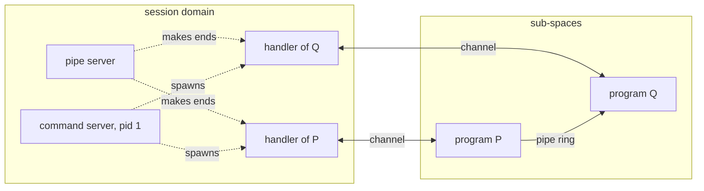
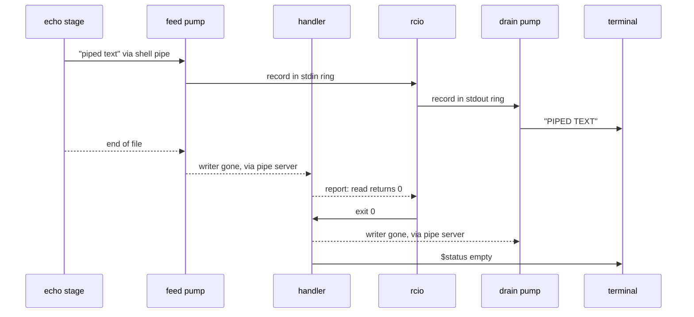

# Chapter 13. Native Programs, Pipes and POSIX-lite

> **Status.** **Built:** native programs from the session's release,
> each in a sub-space of its session with one channel to an Erlang
> handler; the command server that numbers them; pipes in user space,
> with the session's pipe server, the pipe NIF and a pipe core that
> merges many writers in write order; programs in command-shell
> pipelines with Erlang commands; files with 64-bit offsets, `poll`,
> `dup` and `pipe` in a program; `kill` and `kill(pid, 0)` answered by
> the handler, reaching only the program itself; `SIG_DFL` and
> `SIG_IGN`, with `SIGPIPE` and faults ending a program with a
> signal's status; errno and signal numbers that are FreeBSD's,
> generated from the ABI's tables. **Designed:** a program starting
> programs (`posix_spawn`, `wait`), executable files as images,
> catchable signals through vCPU upcalls, job control that pauses a
> program, terminal input and sockets for programs, toybox, the second
> tier (`fork`, `exec`, shared libraries), and the POSIX-lite
> personality as a whole.

**Background needed.** [Chapter 1](01-operating-systems.md) for
exit status and signals (section 1.3.6), file descriptors (section
1.6.3), pipes and lanes (section 1.7.4) and memory ordering (section
1.7.3); [chapter 3](03-erlang.md) for processes, monitors and ports
(section 3.5.4); [chapter 5](05-overview.md) for sessions and
sub-spaces (section 5.2.5); [chapter 8](08-kernel-interface.md) for
fault gates and doorbells. Chapters 9, 10 and 12 help but are not
required.

A user who has ported a C program to erXos types its name at the
command shell, and the program runs. It reads standard input, writes
standard output and exits with a status, as on FreeBSD. Behind that
picture sits a question every system that runs foreign code must
answer: what may this program touch? On erXos a program is code of
unknown origin relative to the session that runs it. A bug in it, or
a hostile line in a library it links, must not reach the user's files
beyond what it was handed, the session's Erlang processes or any
other domain.

FreeBSD answers with the process. Each program gets an address space,
a descriptor table and the user's identity. It can open any file its
user can open, signal any process its user owns, and start any program
with `fork` and `exec`, unless a jail or Capsicum narrows it.

erXos answers differently. A native program runs in a sub-space of its
session, an address space the session made and ends. To the session's
Erlang code it is a port. It holds no authority of its own: it reaches
everything by asking one Erlang process, its handler, which checks
each request against a table built from what the program's starter
handed it. Pipes between programs are rings in memory that the session
makes and hands out, so end of stream follows from the session's
records, not a kernel's.

Sections 13.1 to 13.3 cover what a program is, its channel and
handler, and how it starts. Sections 13.4 and 13.5 explain pipes and
follow one pipeline from the shell's line to `$status`. Section 13.6
covers signals, sections 13.7 and 13.8 the POSIX-lite personality and
its second tier, and the chapter ends with failure and the choices
behind the design.

## 13.1 A program is a port

A native program has no domain id, no node name and no connection to
any other domain; to the session's Erlang code it looks like a port.

> **Background: executable files and loaders.** A compiler turns C
> source into an **executable file**, which on FreeBSD, Linux and
> erXos is in ELF, the Executable and Linkable Format. An ELF file
> holds machine code, initialized data and a table of **segments**,
> each saying which bytes of the file go at which address and with
> which permissions: code readable and executable, data readable and
> writable. A **loader** maps each segment into a fresh address space
> and jumps to the entry point. A **statically linked** program
> carries every library function it calls in its own file; a
> **dynamically linked** one names shared libraries that the loader
> maps beside it at start.
> <!-- check: general ELF background, no source read in this task -->

### 13.1.1 What a program consists of

A FreeBSD process has an address space, threads, a descriptor table, a
process id and a parent. A program on erXos has the same parts, kept
in different places, and the program itself holds almost none of them
(Table 13.1;
[design-programs.md, A program is a port](../design-programs.md#a-program-is-a-port)).

| Part | What it is | Who holds it |
| --- | --- | --- |
| the **anchor** | a space with no thread and no mapping, the root of the program's tree | the session |
| the **image** | the space the program's threads run in, its code mapped from the boot image | the session; the program as "itself" |
| its budget and group | what pays for its memory, and what its threads run in | the session; the program can allocate |
| its channel | two lanes and two doorbells to its handler (section 13.2) | both |
| its **table** | what it may reach: its namespace, its open files, its pipe ends | its handler, in Erlang |
| its data area | a memory object of 64 KiB slots that file bytes move through | both |
| its process id | a number from 2 up, never reused in the session | the command server |

*Table 13.1. The parts of a program, and who holds each.*

Two spaces per program may look like one too many. The anchor lets a
program's tree outlive a change of image: the programs it starts hang
from its anchor, not its image, so when the designed `exec` replaces
the image (section 13.8), its children stay. On Fiasco each space is a
Fiasco task with a space record in the root service, naming its
parent, and when a space ends, every space below it ends first
([design-fiasco.md, Spaces, parents and exit records](../design-fiasco.md#spaces-parents-and-exit-records)).
So a program never outlives the session that started it. There is no
`init` to adopt orphans, because no child is ever left without a
parent; a long-running service is started under a supervisor, never by
detaching.

Both spaces, the channel and the data area are Built. The session's
port driver, `erx_program` in
`otp/erts/emulator/sys/erxos/erx_program_drv.c`, makes them from one
plan, which its pure core, `erx_program_core.c`, decides.

### 13.1.2 Why a port

ERTS already has a shape for something outside the runtime that a
process talks to: the port ([section
3.5.4](03-erlang.md#354-bifs-nifs-and-ports)). A port has an owner, is
linked to it, is closed when the owner exits, and sends its owner
messages. A program fits it exactly. Its owner is its handler. When
the program's image ends, by exit or fault, the handler receives
`{exit_status, N}`. When the handler dies, the port closes and the
session stops the program. Supervising a C program needs no new
concept.

Figure 13.1 shows a session running two programs joined by a pipe.



*Figure 13.1. A session with two programs. Each program talks only to
its own handler, over its channel; bytes between the programs move
through the pipe's ring, which the pipe server made, without passing
through the session.*

A program is not a node: no Erlang process can message it, and it can
message only its handler. It trusts its session wholly, as any
sub-space trusts its creator, and its session trusts it not at all.

## 13.2 The channel and the handler

Every request a program makes, from opening a file to signaling
itself, is one message on its channel to one Erlang process.

### 13.2.1 The channel

A program's channel is a pair of lanes, the one-way rings that carry
messages between domains ([section
1.7.4](01-operating-systems.md#174-talking-without-sharing)), with a
doorbell for each direction ([section
8.7.1](08-kernel-interface.md#871-one-path-for-devices-and-peers)).
The session writes the inbound lane: the startup message, replies and
reports. The program writes the outbound lane: requests and notices.
Each party writes exactly one memory object and maps the other's
read-only, so neither can corrupt what the other publishes
([design-programs.md, The channel](../design-programs.md#the-channel)).
The session creates every object of the channel from its own budget
and keeps the only right to destroy them, so a program cannot make its
own channel fault under it.

Each record on a lane is one Erlang term in the external term format.
`liberx`, the library under every program's C library, encodes them.
This is how a program's `kill` asks its handler to signal a process,
from `erx_prog_kill` in `liberx/program/signal.c`:

```c
	erx_etf_writer_init(&writer, value, sizeof(value));
	/* ... signal 0 builds {probe, Pid} instead ... */
	erx_etf_put_tuple(&writer, 3);
	erx_etf_put_atom(&writer, "kill", strlen("kill"));
	erx_etf_put_integer(&writer, pid);
	erx_etf_put_atom(&writer, name, strlen(name));
	/* ... */
	if (erx_prog_channel_request(request, value, len, reply_copy, &reply) != ERX_OK)
		return (-EIO);
```

The request is the term `{kill, Pid, sigterm}`, the signal named, not
numbered. The C side speaks the handler's language, so the handler is
ordinary Erlang that matches tuples.

The session does not trust these terms. The port driver checks every
record three ways before the handler sees it. The **funnel**'s channel
mode (the one decoder of untrusted terms; see
[chapter 3](03-erlang.md#392-distribution-across-a-domains-wall))
admits no fun, pid or reference. ERTS's safe decode creates no atom.
The program's credit allows 16 requests in flight. The handler then
checks the frame against the **program protocol**, a grammar declared
once in `abi/protocols/prog.txt` and generated for both sides, as
[chapter 7](07-one-source.md#72-the-abi-file) describes for the ABI
file. A frame that fails any check ends the program with `SIGSYS`,
bad system call. All of this is Built (`erx_program_drv.c`,
`erx_prog_handler_core.erl`).

File bytes do not travel on the channel. They move through the
program's data area, 64 KiB slots that both sides map; the channel
carries only the request naming the slot.

### 13.2.2 The handler

The **handler** is the Erlang process of the session that owns a
program's port and serves its requests. It is the program's process
table, namespace and file server in one process, and it checks every
request against the program's own table, never the session's
([design-programs.md, The handler](../design-programs.md#the-handler)).
Three rules make it safe to put between a hostile program and the rest
of the session.

* **It alone sends to the program.** The pipe server, the shell and
  everything else with news for a program sends it to the handler,
  which queues it, so the order the program receives is the order the
  handler chose.
* **It never waits on the program.** A write into the inbound lane
  never blocks. A frame that finds no room is **owed**: the handler
  keeps it and writes it when the program frees room. A program that
  stops reading its channel delays only its own news.
* **It never waits on a request's work.** A file read that a server
  is slow to answer is relayed, and the handler goes on taking the
  program's other frames, a `kill` included.

The handler's decisions are one pure state machine,
`erx_prog_handler_core:step/2`, from an event to the next state and a
list of actions that `erx_prog_handler` performs in order: the
functional core of [section 6.3](06-construction.md#631-the-shape),
tested on the host. Built requests are the file calls (`lopen`,
`lcreate`, `read`, `write`, `pread`, `pwrite`, `seek`, `getattr`,
`clunk`), making a pipe, and `kill` with its probe. A path is resolved
over the program's narrowed namespace alone, so a file the starter
could not reach is not found
([chapter 14](README.md#chapter-14-files-namespaces-and-service-trees)).

### 13.2.3 The command server

Process ids need one owner, or two handlers could give out the same
number. Each session runs a **command server**, `erx_command_srv`,
process 1 of the session's process table. It assigns every program's
id, records it in the caller's job, spawns the program's handler, and
finds the handler a `kill` or a job names. It answers from its table
alone and waits on nothing. Its supervisor never restarts it: a new
server could not know which ids the old one gave, so its end ends the
session. The command server is Built.

### 13.2.4 What a program can start

In the design, starting a program is a right, and the child can do
only what its starter handed it. The startup message carries
`spawn => true` only when the starter held the right. The shell gives
it with `/bin`, a directory with one entry per command a program may
start, and the handler refuses a spawn from a program without it with
`EPERM`
([design-programs.md, What a program can start](../design-programs.md#what-a-program-can-start)).
Capabilities carry authority, never the kind of program, so `xargs
kill` works exactly when the program holds the right to signal.

A program starting programs is designed and not built: every program
starts with `spawn => false`, and the handler serves no spawn request.
A program's image is always `bin/NAME` of the session's release, in
the boot image, which no program can write. So a program never runs a
file it could rewrite, because there is no other source of code.
Executable files as images are designed and not built. They are
reached through a **file grant** (an authority over part of a file
tree, handed to a program) carrying the `rx` right, and no grant
carries both `rw` and `rx`.

## 13.3 Starting a program

A program starts stopped, receives everything it inherits in one
message, and only then runs its first instruction.

### 13.3.1 From the shell's line to `main`

The command shell (an rc-language shell written in Erlang; [chapter
20](README.md#chapter-20-the-command-shell-and-the-unix-surface))
looks up a name that is not an Erlang command in `/bin`, the release's
`bin/` directory (`erx_shell_program:find/1`). These steps are Built.

1. The shell's stage, the **starter**, makes a pipe for each standard
   stream it has open, through the pipe server.
2. It calls `erx_prog_handler:start/1` with the image, arguments,
   environment, working directory and descriptors, each descriptor
   naming a pipe end the starter holds.
3. The command server assigns the program's id and spawns its handler.
4. For each descriptor, the handler asks the pipe server for an end of
   the same kind for the program. The starter closes its own end once
   `start/1` returns, as a UNIX parent closes its copies after `fork`.
5. The port driver builds the sub-space from one plan: budget, group,
   anchor and image, channel, the image's code mapped from the boot
   image, the capabilities installed, and the first thread created but
   stopped. A step that fails undoes the earlier ones.
6. The handler writes the **startup message** into the inbound lane:
   arguments, environment, working directory, signal state and
   descriptors, at most 192 KiB. Then it starts the thread.
7. The program's `liberx` reads the message, builds its descriptor and
   signal tables, and calls `main`.

Starting the thread last means `main` never runs on a half-built
descriptor table.

### 13.3.2 What a start costs

The design counts ten kernel objects for one program: a budget, a
group, two spaces, two memory objects and two IRQ objects for the
channel, a memory object for the data area, and a thread. Each
inherited write end adds three more and each read end one. It counts
about 23 kernel calls and budgets the start at 1 ms under HVF
([design-programs.md, The cost of a program](../design-programs.md#the-cost-of-a-program)).
That is a target; this chapter has no recorded measurement to give.
Code is mapped from the boot image read-only, so programs running the
same file share its pages, and no domain is made.

## 13.4 Pipes in user space

The kernel has no pipe object: a pipe is memory and doorbells that the
session arranges, and `liberx` reads and writes it directly.

### 13.4.1 Why not in the kernel

FreeBSD keeps a pipe in the kernel: a buffer, two file objects and a
count of the descriptors open on each side. `write` copies into the
buffer, `read` copies out, and when no write-side descriptor remains,
`read` returns 0. Every byte crosses the kernel twice.

Fiasco offers no pipe, and erXos does not want one. A pipe is lanes
with a little more, so the data path makes no kernel call while the
other side is awake, and who holds which end stays in Erlang
([design-pipes.md](../design-pipes.md)). End of stream, which a kernel
pipe gives for free, follows from one fact: the session handed out
every end, so it knows every holder.

### 13.4.2 One ring per writer

Each write end of a pipe writes a lane of its own. Its readers map the
ring read-only, so writers never share memory and no reader can change
what a writer published
([design-pipes.md, The ring](../design-pipes.md#the-ring)). A pipe's
first lane has a data area of 64 KiB, Linux's default capacity; each
later write end gets 16 KiB, FreeBSD's `PIPE_SIZE`, since a later
writer usually carries a child's share of an inherited stream.

A write copies its bytes into the ring as one **record**, at most
4,096 bytes, POSIX's `PIPE_BUF`, and publishes it with one store of
the write position. So a write of up to `PIPE_BUF` bytes reaches the
reader whole, never interleaved with another writer's bytes, as POSIX
requires.

Several writers raise a question that one kernel buffer never has: in
what order does a reader see their records? Each record carries a
**stamp**, the monotonic clock's reading when it was written, and the
reader merges the lanes by it. Two programs that write one pipe in
turn, as `{date; uname} | cat` does on UNIX, are read in that order.
Before returning, a writer waits until the clock has moved past its
last stamp, so a later write can never stamp the same reading. The
merge is built in the pipe core and checked by its exploration
(section 13.4.5).

Up to 64 readers share a pipe's read side, as POSIX processes share
one, through a **lock page** that holds the reader lock and the record
a reader was partway through. A reader interrupted inside a record
leaves its place there, and the next reader continues from that byte
([design-pipes.md, The lock page](../design-pipes.md#the-lock-page)).

### 13.4.3 Shared memory a stranger can write

A writer can write any bytes into its ring, including a header that
lies. Every party therefore copies each field it reads from a page
another party writes once, into private memory, and checks the copy
before use. The check is one pure function, `erx_ring_check`: the
read position may not pass the write position, the gap may not exceed
the ring, and a record's length must fit what was published. A reader
that finds a violation marks the lane **broken**, treats it as a
writer gone and drained, and logs one line. A writer that finds a
nonsense read position waits as for a full ring. A hostile party can
stop its own stream, never make another crash, loop or read out of
bounds.

The reader's and writer's steps live in `liberx/erx_pipe_core.c`, a
state machine of the shape in [section
6.3](06-construction.md#631-the-shape): each step takes what the last
action copied and returns the next action. The same core runs in a
program (`liberx/program/pipe.c`) and in the session's **pipe NIF**
(`otp/erts/emulator/nifs/erxos/erx_pipe_nif.c`), which gives Erlang
processes pipe ends over the same rings.

### 13.4.4 Ends and their holders

The session's **pipe server**, `erx_pipe_srv`, makes every lane, lock
page and doorbell of every pipe, installs each end into its one
holder, and tells each holder about the others
([design-pipes.md, Ends and their holders](../design-pipes.md#ends-and-their-holders)).
A program never installs an end, and no copy the pipe server installs
can be copied or passed on. When a starter hands an end to a child,
the pipe server makes the child a new end of the same kind, with its
own lane for a write end.

End of stream follows from records, never from a field of shared
memory. When a write end closes, its `liberx` tells the handler; when
its holder ends, the pipe NIF tells the pipe server once the program's
anchor is released, so no image of it still runs. The pipe server
tells every reader `{pipe_writer_gone, ...}`. A reader returns 0 only
when no writer it knows of is open and every gone writer's lane is
drained. The other direction is the same: when the last reader goes,
every writer is told, and its next write fails with `EPIPE`.

A program can still hold an end it never uses and keep a pipe open,
as on UNIX; what changes is who keeps the count. The decisions are a pure function, `erx_pipe:step/2`, which
takes no field of shared memory as input. The pipe server, the pipe
NIF and the pipe core are Built.

### 13.4.5 Doorbells and lost wakeups

A reader that finds no record must sleep, and a writer must wake it.
The classic bug is the lost wakeup: the reader checks, the writer
publishes and rings before the reader sleeps, and the reader then
sleeps forever. The pipe follows the lane's handshake. A waiter
publishes what it waits for (its bit in the lane's `sleepers` word),
fences, and checks again before it sleeps. A writer publishes, fences,
and rings each sleeper whose bit it finds. Each end has its own
doorbell, an IRQ object bound to its holder's group, so only readers
that wait are woken.

Whether a fence is enough is a question about the processor. Arm cores
may reorder memory accesses ([section
1.7.3](01-operating-systems.md#173-memory-ordering)), so `make
check-litmus` runs litmus tests of the pipe's lock under Arm's memory
model with herd7, a tool that lists every outcome the model allows.
Each test comes in two forms. `test/litmus/pipe-lock-cur-release.litmus`
releases the lock with a store-release and must never reach the bad
outcome. Its twin, `pipe-lock-cur-relaxed.litmus`, uses a plain store:

```text
 P0           | P1 ;
 MOV W0,#5    | LDAR W0,[X1] ;
 STR W0,[X3]  | LDR W2,[X3] ;
 MOV W2,#0    | ;
 STR W2,[X1]  | ;
exists (1:X0=0 /\ 1:X2=0)
```

P0 claims the current record (`b = 5`) and frees the lock (`a = 0`);
P1 takes the free lock and reads the claim. The `exists` line is the
bad outcome: P1 sees the lock free but misses the claim. With the
plain store herd7 must find it reachable, or the test would pass
whatever the fences did. This is the seeded fault of [section
6.5](06-construction.md#65-what-construction-cannot-say) applied to
memory order. The pipe core also runs through every interleaving of a
model of one pipe on the host (`test/fixtures/pipe_explore.c`). Both
are Built (README.md, "Current status").

## 13.5 A pipeline, end to end

The QEMU programs suite types this line at root's command shell and
checks that `PIPED TEXT` comes back:

```sh
echo piped text | rcio upcase
```

`echo` is an Erlang command. `rcio` is a native test program in the
suite's `/bin` (`test/guest/programs/rcio.c`). With `upcase` it copies
standard input to standard output in upper case:

```c
	while ((got = read(0, buffer, sizeof(buffer))) > 0) {
		for (ssize_t i = 0; i < got; i++)
			if (buffer[i] >= 'a' && buffer[i] <= 'z')
				buffer[i] = (char)(buffer[i] - 'a' + 'A');
		if (put(buffer, (size_t)got) != 0)
			return (1);
	}
	return (got == 0 ? 0 : 1);
```

Nothing in it is erXos-specific. Every step below is Built and runs in
that suite; Figure 13.2 shows them.



*Figure 13.2. The life of `echo piped text | rcio upcase`. The bytes
cross two rings and two Erlang pumps; the handler sees none of them,
only the reports about ends and the program's exit.*

1. **The line is parsed.** The shell's runner makes a shell pipe
   between the stages, one Erlang process holding up to 64 KiB of
   bytes in order (`erx_shell_pipe`), and gives `echo` its write side.
2. **The starter plumbs the program's streams.** `rcio`'s stage asks
   the pipe server for one pipe per open standard stream. For
   descriptor 0 the program gets the read end, and a **feed pump**, an
   Erlang process linked to the starter, takes the write end. For
   descriptors 1 and 2 the program gets write ends, and **drain
   pumps** take the read ends. Each pump holds its end through the
   pipe NIF (`erx_shell_program`, `pipes/3` and `pump/2`).
3. **The program starts**, as in section 13.3, its three descriptors
   in the startup message.
4. **`echo` writes.** Its bytes enter the shell pipe. The feed pump
   takes them and writes them into the stdin pipe's ring as one
   record, ringing `rcio`'s doorbell if `rcio` sleeps.
5. **`rcio` reads.** The pipe core copies the record out of the ring
   without a kernel call, and `read` returns 11 bytes. `rcio`'s write
   publishes a record in the stdout ring; the drain pump wakes, reads
   it and writes `PIPED TEXT` to the terminal unchanged.
6. **`echo` ends.** The feed pump gets end of file from the shell pipe
   and ends. The pipe server learns that the write end is gone and
   tells `rcio`'s handler, which forwards the report on the channel.
   `rcio`'s next `read` finds every lane drained and no writer open,
   and returns 0.
7. **`rcio` exits 0.** The image ends, its exit record reaches the
   session's fault gate, and the port driver gives the handler
   `{exit_status, 0}`. The handler ends with that status, which the
   starter reads from its monitor.
8. **`$status` is set.** Once the program's anchor is released, the
   pipe server reports its stdout writer gone, and the drain pump sees
   end of stream after writing everything. Only then does the starter
   give rc's status, empty for exit 0.

Step 8's order is why the shell's prompt never cuts into a program's
last line: the status waits for the drain pumps, and they wait for the
session's record that no writer remains.

Two limits show here. A program does not read the terminal: a standard
input that is the terminal reaches it as a pipe already at its end.
And a redirection reaches a program as a pipe that a pump feeds from
the file, not as the file (README.md, "Current status").

## 13.6 Signals, job control and FreeBSD's numbers

A program can be ended by a signal and can ignore one, but in the
system as built it cannot catch one.

> **Background: signals and job control.** A UNIX signal interrupts a
> process to tell it something: `SIGINT` when the user types `Ctrl-C`,
> `SIGPIPE` when it writes to a pipe nobody reads, `SIGSEGV` when it
> touches a bad address. Each signal has a **disposition**: the
> default action (usually to end the process, sometimes to stop it),
> ignore, or a **handler** function that runs on the interrupted
> thread. A shell groups the processes of one pipeline into a
> **process group**, its **job**. **Job control** lets the user stop
> the foreground job with `Ctrl-Z` (`SIGTSTP`), continue it with `fg`
> or `bg` (`SIGCONT`), and keep a background job off the terminal.

### 13.6.1 What a program can do with a signal

`liberx` keeps a program's dispositions and accepts only `SIG_DFL` and
`SIG_IGN`; a `sigaction` with a handler fails with `EINVAL`. The
comment in `erx_prog_sig_check` gives the reason: "a handler needs the
upcalls the Fiasco backend does not carry" (section 13.6.4).

A signal under its default action ends the program: `liberx` stops its
own space with status 256 plus the signal's number, which
`erx_prog:status/1` reads as `{signaled, Signal}`. `SIGPIPE` runs this
path. A write to a pipe with no reader raises it inside `liberx`; with
the default action the program ends with status 269, 256 plus 13, and
with `SIGPIPE` ignored the write fails with `EPIPE`. The programs suite
checks both (`test/guest/programs/pipeio.c`).

A fault becomes a signal the same way. Fiasco stops the faulting
thread, and the fault record reaches the session's fault gate
([section 8.5.3](08-kernel-interface.md#853-gates-for-faults-and-exits)).
The port driver ends the program with the signal the ABI's fault table
gives the fault, `SIGSEGV` for a memory fault. No handler runs for a
fault, whatever `sigaction` recorded.

### 13.6.2 `kill` reaches only the program itself

A program's `kill` is a request to its handler (section 13.2.1), and
the handler decides whom it reaches. In the design the targets are the
program's children, itself, and the processes of a **`signal` right**,
an authority to signal a set of processes that a starter may hand on.
A program holds no such right and has no children, so it reaches
itself alone. Every other target answers `ESRCH`, whether or not it
exists, so a `kill` tells a program nothing about processes beyond its
reach; `kill(pid, 0)` asks the same question and signals nothing. This
is Built (README.md, "Current status"; `erx_prog_handler_core`).

On FreeBSD a process id is enough to signal any process of the same
user. On erXos a pid grants nothing, as an Erlang pid grants nothing
([section 6.2.4](06-construction.md#624-pids-exports-and-the-envelope)):
the handler holds the table, and the table says no.

### 13.6.3 `Ctrl-C` and the session's job control

The user's `Ctrl-C` reaches the shell, not the program. The shell's
job control interrupts the job's Erlang processes, the program's
starter among them. When the starter ends, the handler stops the
program's anchor with `SIGKILL`'s status, a stop by its session, and
waits for the program's end as for any other. The line's `$status` is
then `sigint` (README.md, "Current status"). The program sees no
`SIGINT` and runs no cleanup.

Stopping a program is designed and not built. In the design the
session stops a program by pausing its image, every thread waiting at
its next return to user mode. Each pause has a **cause** the session
keeps, `job` for `Ctrl-Z`, `fg` and `bg`, and `signal` for the stop
signals of the second tier, and a program runs only when no cause
remains
([design-programs.md, Job control](../design-programs.md#job-control)).
On Fiasco this needs a whole-space pause by the root service, which is
not built.

### 13.6.4 Signals through vCPU upcalls

Catchable signals are designed to arrive through Fiasco's vCPU upcall
([section 8.5.6](08-kernel-interface.md#856-signals-through-vcpu-upcalls)).
Each thread of a program has its own **signal IRQ object**. A raiser
bumps the thread's wake word and triggers the object; Fiasco saves the
thread's registers and jumps to `liberx`'s entry, which runs the
handler. `liberx` raises a depth counter at every entry to its program
layer and runs handlers only at depth zero, so a handler never runs
while `liberx` holds a lock or a half-updated structure
([design-programs.md, Signals in liberx](../design-programs.md#signals-in-liberx)).
Fiasco looks for a queued delivery only at a resume, not at each
return from a kernel call. So a program enables events only while it
runs its own code, and takes a pending delivery at each return to it
([design-fiasco.md, vCPU upcalls on Fiasco](../design-fiasco.md#vcpu-upcalls-on-fiasco)).
A signal can therefore arrive late around a wait. Signal
delivery through vCPU upcalls is designed and not built.

### 13.6.5 One numbering, FreeBSD's

`SIGSTOP` is 17 on FreeBSD and 19 on Linux, so a system that mixed
them would have `kill -17` mean two things. erXos numbers its signals and its errno values as FreeBSD
15.1 does, everywhere: in musl's headers, in `liberx`, in the program
protocol's grammar, in the shell's `kill` and in `erx_prog`'s reading
of a status
([design-programs.md, Signal numbers](../design-programs.md#signal-numbers)).
One table, `abi/signals.txt`, holds the signals:

```text
signal int 2 terminate "Interrupt"
signal kill 9 terminate "Killed"
signal segv 11 terminate "Segmentation fault"
signal pipe 13 terminate "Broken pipe"
```

Each line gives the name, the number, the default action and
`strsignal`'s text, and every consumer is generated from it;
`abi/errno.txt` does the same for errors (`errno epipe 32`). The
numbers are values someone else defines, so the generator's test
compares them, the names and the texts with FreeBSD's
`sys/sys/signal.h` and `lib/libc/gen/siglist.c`, fetched at a pinned
version ([section
7.3.1](07-one-source.md#731-tables-that-must-match-someone-elses)).
This is Built (README.md, "Current status"). Programs are ported at
the source level, so no binary carries Linux's numbers.

## 13.7 The POSIX-lite personality

erXos aims to run ordinary UNIX programs recompiled from source, not
every POSIX program and not Linux binaries.

> **Background: POSIX.** POSIX is the IEEE and Open Group standard
> for the interface a UNIX-like system offers programs: the C
> functions (`open`, `read`, `fork`, `posix_spawn`, `kill`), their
> errors, the shell and the utilities. The current edition is IEEE Std
> 1003.1-2024. A program written to it can be recompiled for any
> system that implements it. The standard marks many interfaces as
> options, and some systems offer a POSIX layer over a different
> native model, as QNX does.

### 13.7.1 What a recompiled program gets

The **POSIX-lite personality** is musl's POSIX functions over
`liberx`: enough to recompile and link an ordinary UNIX program
without porting it, statically in the first tier
([design-programs.md, The POSIX-lite personality](../design-programs.md#the-posix-lite-personality)).
It is source compatibility, not binary: there is no Linux system call.
musl reaches the program's descriptor table through one seam of the C
library, which only a program's build fills; ERTS and the root service
link an empty one. In a program a descriptor the table does not hold
is `EBADF`, never the console, so a program writes only where its
session gave it descriptors. Table 13.2 says which parts run.

| Area | Built | Designed |
| --- | --- | --- |
| descriptors | pipes and files, `dup`, `poll`, 64-bit offsets (`pread`, `pwrite`, `lseek`, `fstat`) | record locks, sockets |
| processes | `exit` and its status; `kill` and `kill(pid, 0)` of itself | `posix_spawn`, `wait`, `system` and `popen` through `rc` |
| signals | `SIG_DFL`, `SIG_IGN`, `SIGPIPE`, faults as signals | handlers, masks, `sigwait` |
| terminal | none: standard input from the terminal is at its end | `/dev/tty` with `termios` |

*Table 13.2. The POSIX-lite personality. The personality as a whole is
designed and not built (README.md, "Current status").*

Some designed rows exist in part. `liberx` holds the spawn planner, a
pure function from what `posix_spawn` was asked for to the request it
would send (`liberx/program/spawn_plan.c`), but no handler serves the
request.

### 13.7.2 Why `posix_spawn`, not `fork`

The first tier starts programs with `posix_spawn` and has no `fork`,
whose absence fails at link time. `fork` copies a whole process so
that the copy can change a few things and call `exec`. Where a process
is two spaces, a budget and a channel, that copy is most of the work,
and almost all of it is wasted. POSIX added `posix_spawn` for systems
where `fork` is hard: its rationale says `fork` "is difficult or
impossible to implement without swapping or dynamic address
translation" (IEEE Std 1003.1-2024, `posix_spawn`). A spawn on erXos
is one request to the handler, which plans the child from the
starter's table and the request alone. That also keeps the
confinement argument short: the child holds exactly what the request
named, out of what the starter held.

### 13.7.3 toybox, and the file utilities

The familiar command-line tools are designed to come from toybox, a
BSD-licensed multicall program of UNIX utilities built over the
personality
([design-programs.md, toybox](../design-programs.md#toybox)). Its
process helpers are rewritten over `posix_spawn`, so `xargs` and
`find -exec` start programs. Its applets that read Linux's `/proc`,
such as `ps`, are left out, and those names stay Erlang commands. toybox is
designed and not built, and its source is not in the tree.

The file utilities are a choice, not a gap. `cat`, `ls`, `cp`, `mv`,
`rm`, `mkdir`, `echo` and `pwd` are Erlang commands of the shell, and
stay so; so are `wc`, `sort` and `grep`
(`erlang/apps/erx_shell/src/erx_cmd_*.erl`). They run in the session,
follow FreeBSD's output, and read live Erlang state where a UNIX tool
would read a kernel's. A native program appears in a pipeline only
where one is wanted.

## 13.8 The second tier

Programs that cannot be changed expect `fork`, `exec`, shared
libraries and terminals. The second tier is designed to give them
those without giving up the first tier's rules
([design-programs.md, The second tier](../design-programs.md#the-second-tier)),
and is designed and not built.

* **`fork`** copies the calling program into a new sub-space eagerly,
  every committed page of private memory into fresh pages, so each
  private page stays mapped exactly once; copy-on-write is an
  optimization the design does without. The child keeps musl's state,
  the allocator and the signal dispositions, and rebuilds the rest of
  `liberx`'s state from a fork message, under locks held across the
  copy so it never meets a half-built table. On Fiasco it needs the
  whole-space pause that job control needs.
* **`exec`** replaces a program's image under the same anchor, so its
  children survive, and gives the new image a channel of its own.
  Every signal report the old image had not fully taken moves to the
  new one, so none is lost or taken twice.
* **Shared libraries and mappings of files** come from sealed code
  objects, which no mapping can write and which reach a program only
  through a file grant carrying `rx`. Within a session a file mapped
  shared has one copy, kept by one mapper process, so two programs
  that map it see each other's stores at once.
* **Terminals** give full-screen programs such as `less` a
  pseudo-terminal, process groups and POSIX sessions within the
  program's own tree.

The tier's cost sits in `liberx`: half of the fourteen invariants
design-programs.md states for programs concern signals, `exec` and
shared mappings. That is why the first tier leaves it out.

## 13.9 When a part fails

Every failure of a program ends in one exit status, given to its
starter.

* **The program faults.** Fiasco stops the thread; the record reaches
  the session's fault gate; the port driver stops the anchor, ending
  every space below it; the starter reads a signal's status, such as
  `{signaled, sigsegv}`. Nothing outside the sub-space is touched. The
  programs suite runs a faulting program (`test/guest/programs/fault.c`).
* **The program sends garbage.** A frame that fails the funnel, the
  decode, the credit or the grammar ends the program with `SIGSYS`.
* **The program stops reading its channel.** Its handler owes the
  frames; the pipe server, the shell and its siblings stay responsive.
* **A pipe's writer dies mid-stream.** Its published bytes stay
  readable, since the pipe server frees no lane before every reader
  has drained it; readers see end of stream after the last byte.
* **A pipe's reader dies.** Writers are told, and the next write
  raises `SIGPIPE` or fails with `EPIPE`.
* **A writer corrupts its ring.** Readers mark the lane broken and
  treat it as ended.
* **The handler dies.** The port closes with its owner, and the
  session stops the program.
* **The starter dies, or the user types `Ctrl-C`.** The handler stops
  the program with `SIGKILL`'s status.
* **The session ends.** Its task's end ends every space below it, so
  every program goes with it.
* **The command server dies.** It is not restarted; the session ends,
  and its programs with it.

The session holds every program's record, so every end has a reader.
A port that closes with no status gives `no status` in the shell,
never an invented one.

## 13.10 Design choices

**A program as a domain.** Each program could be a domain, with a
connection to its session and a facet for each service, and every
mechanism of [chapter
10](README.md#chapter-10-domains-a-wall-around-some-processes) would
apply unchanged. But a domain is made by the system domain and has a
runtime, a node name and a budget of its own, and a pipeline of three
programs would make three. A sub-space costs ten kernel objects and a
few Erlang terms, and involves no domain but the session.

**Pipes in the kernel.** A kernel pipe gives end of stream and
`PIPE_BUF` atomicity for free, but every byte crosses the kernel
twice, and Fiasco has no pipe to offer. Rings only the writer writes
give the same guarantees with no kernel call on the data path.

**Linux binary compatibility.** Running Linux binaries unchanged
brings a large body of software at once, as FreeBSD's Linux layer
does. It also means emulating Linux's system calls, signal numbers and
`/proc`, the imitation that the principle "UNIX look and feel,
honestly" rules out. Source compatibility keeps one numbering and lets
each program be built against what erXos is.

**`fork` first.** Most UNIX code expects `fork` and `exec`. erXos
starts with `posix_spawn` (section 13.7.2) and leaves `fork`, with its
copies and its locks held across a copy, to the second tier.

**A handler per program.** One Erlang process could serve every
program of a session, and put every program behind the slowest one's
file request. A handler per program keeps each program's table and
queue apart, at the cost of one Erlang process of a few KiB.

## Summary

A native program runs in a sub-space of its session, two spaces under
one anchor, and to the session's Erlang code it is a port owned by its
handler. It has no domain id and no connection; its one way out is its
channel, a pair of lanes on which every request is an Erlang term
checked by the funnel and by the program protocol's generated grammar.
The handler serves the program against its own table and never waits
on it. Pipes are rings in user space,
one per writer, merged by stamp, and the session's pipe server makes
and records every end, so end of stream and `EPIPE` follow from its
records. A program can be ended by a signal and can ignore one but
cannot catch one, and its `kill` reaches only itself. Signal and errno
numbers are FreeBSD's, generated from one table checked against
FreeBSD's sources. Programs that start programs, catchable signals,
job control of programs, toybox, terminals for programs and the second
tier are designed and not built.

## Where to read next

* [design-programs.md](../design-programs.md): the whole program model,
  with the startup message's grammar, the event executor, the
  invariants and the second tier in full.
* [design-pipes.md](../design-pipes.md): the pipe's layouts, reading
  and merging, hand-offs and the pipe server's model.
* [design-fiasco.md, vCPU upcalls on Fiasco](../design-fiasco.md#vcpu-upcalls-on-fiasco):
  what Fiasco's vCPU interface gives signals, read from its source.
* [design-shell.md](../design-shell.md): how the command shell finds,
  starts and waits for programs, and its pipelines.
* The Open Group, *The Open Group Base Specifications Issue 8* (IEEE
  Std 1003.1-2024), `posix_spawn`, Rationale: why POSIX added a spawn
  call beside `fork`.
  <https://pubs.opengroup.org/onlinepubs/9799919799/functions/posix_spawn.html>
* Andrew Baumann, Jonathan Appavoo, Orran Krieger and Timothy Roscoe,
  "A fork() in the road", HotOS 2019: the case against `fork` as an
  operating system's primitive.
  <!-- check: citation from memory, not read in this task -->
