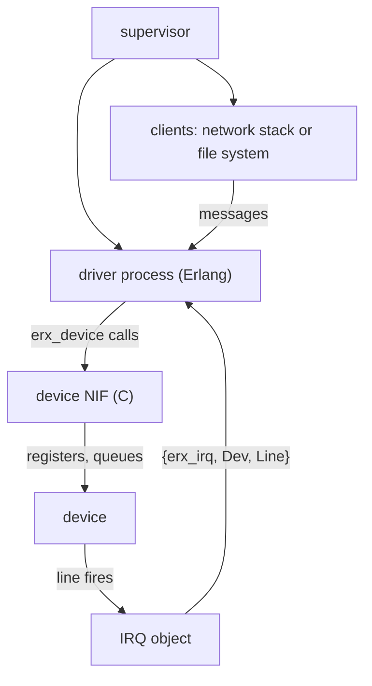
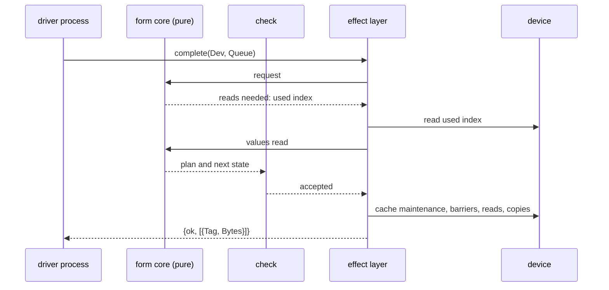
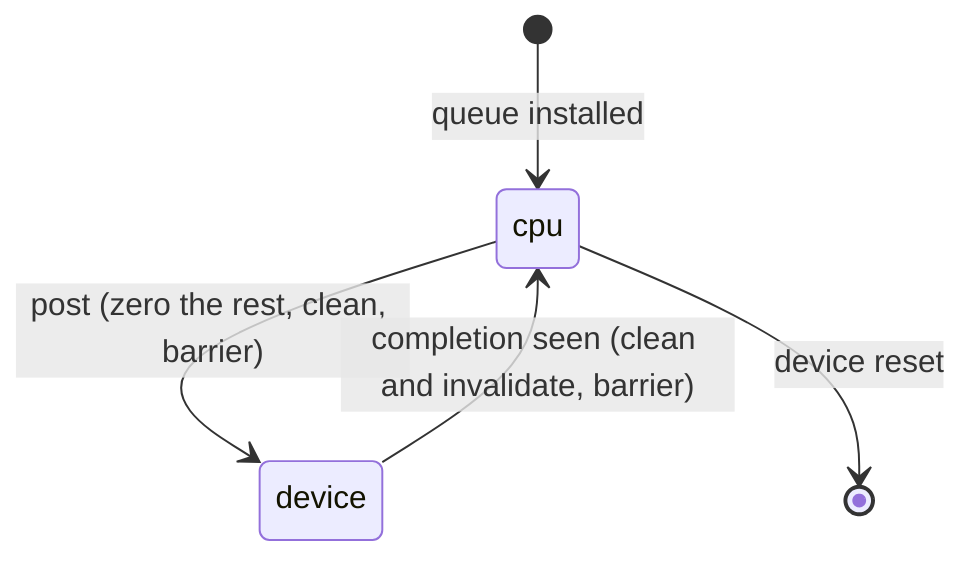
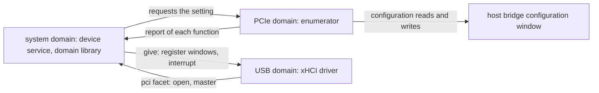

# Chapter 15. Devices and Drivers

> **Status.** Built: drivers as supervised Erlang processes (virtio
> block, network, GPU and input on QEMU `virt`; the SD card, GENET
> Ethernet and the firmware framebuffer on the Raspberry Pi 4). Built:
> the device NIF, with register accessors, interrupt messages, queues,
> the virtio and GENET descriptor forms, the independent check of every
> DMA plan and the one effect loop. Built: the device tree reader's DMA
> facts, the unit rule, the driver-control facet, the network driver's
> restart and the storage domain's restart after its block driver ends.
> Built as pure code with host tests, driving no device: the PCIe
> enumerator's walk, placement and plan, the BCM2711 bridge core, the
> domain library's give of a PCIe function, USB's cores and decoders,
> the TRB descriptor form, and the check of the Pi 4's header map.
> Designed: the running PCIe and USB domains, MSIs, virtio over PCIe, the
> SD controller's ADMA2 form, drivers for the Pi 4's header (GPIO, I2C,
> SPI, PWM) and firmware readings at `/proc/sensors`.

**Background needed.** [Chapter 1](01-operating-systems.md), section
1.5: registers, interrupts, DMA, caches and the device tree.
[Chapter 3](03-erlang.md): processes, supervisors, NIFs and BIFs.
[Chapter 6](06-construction.md), section 6.4: one DMA post, traced.
[Chapter 8](08-kernel-interface.md), section 8.7: IRQ objects and the
objects a device is given. [Chapter 10](10-domains.md): domains.

A driver bug that writes one wrong address into a network card can
make the card overwrite any page of memory, and on most machines
nothing in the processor notices. Drivers are also the largest and
least tested part of most kernels, and they run with the full power
of the machine.

FreeBSD runs its drivers in the kernel. A driver is a set of C
functions registered with the kernel's device framework, `newbus`,
which probes each device and attaches the driver that claims it. The
driver's interrupt handler runs in kernel mode. It programs descriptor
rings with addresses it computes, places each cache flush and barrier
through the `bus_dma` interface by hand, and parses whatever the
device wrote. A wrong pointer anywhere in this is a kernel panic, or
silent corruption.

erXos runs each driver as a supervised Erlang process, in a domain
that holds its device. Under the process sits one small piece of C,
the device NIF, which reaches registers, interrupts and DMA memory for
the driver and parses nothing the device wrote. Where a device must be
told an address, a pure function computes a plan, and an independent
check verifies it whole before anything reaches the hardware.

Section 15.1 restarts a driver under a live connection and says what
stays in C. Sections 15.2 to 15.5 follow a device from the manifest to
its driver: how it is given, the device NIF, DMA and its check, and
devices that share. Sections 15.6 to 15.8 cover PCIe, USB and the
Pi 4's small devices; 15.9 and 15.10 cover failure and the choices.

## 15.1 A driver is a process

On erXos a TCP connection survives its network driver being stopped
and started again. The QEMU suite for driver domains
(`tools/lib/erx/qemu_suites/driver_domains.rb`) opens a connection
from root's Erlang shell to an echo server outside the guest. Then it
types one line in the system domain's shell:

```erlang
erx_driver_ctl:restart(erx:cap(network_ctl), net).
```

The line goes through the network domain's **driver-control facet**,
the facet (an authority over a service, as
[chapter 11](11-security.md#116-facets-authority-over-services)
defines it) through which the system domain stops, starts or restarts
a domain's drivers. The driver process ends. A new one starts, resets
the virtio network device and installs fresh buffers, and the
interface and its DHCP client start again over it. Back in root's
shell, the suite sends `survives` over the old connection and reads it
back. The connection lives in the network stack's processes, which
never stopped, so TCP retransmits what the restart dropped. That run
is **Built**.

### 15.1.1 What a driver's end reaches

A driver's supervisors, not the driver, decide what its end reaches.
In the network domain each interface has a **link supervisor** whose
first child is the driver (`erlang/apps/erx_net/src/erx_net_sup.erl`).
The driver is the link's *significant* child: in OTP's terms, its end
shuts the link supervisor down. The supervisor above, one link per
interface, starts the link again whole. The driver comes first and
resets the device; then the interface and the DHCP client, which lose
only soft state. A crash and a restart through the facet take the same
path. A driver lives at least a second, so a dead cable restarts its
link once a second rather than in a tight loop.

The storage domain is arranged the other way, on purpose. Its block
driver's supervisor (`erlang/apps/erx_blk/src/erx_blk_sup.erl`)
restarts nothing: every child is permanent, under a restart intensity
of zero. So the block driver's end ends the `erx_blk` application and
the storage domain, and the domain service starts the domain again
with its device. The reason is littlefs above the driver. A file
system that ran on across a driver restart would have to reason about
half-done writes; a fresh domain mounts the volume as of its last
`sync`. A QEMU test kills the block driver mid-transfer and finds each
kept file cut at a sync, never corrupt. Both arrangements are
**Built**.

On FreeBSD either driver is kernel code, and its crash is a panic.

### 15.1.2 Why drivers are Erlang

erXos writes as much of the system in Erlang as is practical, and
drivers are where that pays most. A driver is mostly protocol: reset the
device, negotiate features, queue requests, match completions to
callers, recover from a stall. Erlang processes and `gen_server` were
built for that. The rest is parsing what the device wrote, which Erlang
does with binary pattern matching. A field that does not match crashes
the one process that read it, and its supervisor starts it again; in C
the same mistake reads past a buffer.

What stays in C is small and named. The **device shim** is the device
NIF's C, in `otp/erts/emulator/nifs/erxos/`: register access, interrupt
binding, queues, and the DMA plan with its check. The per-byte
primitives, such as checksums and bulk copies, are C because a per-byte
loop costs too much in Erlang. Any other native driver code would be a
**native shim**. It may run only as a row of the **driver table**
([design-system.md, The driver
table](../design-system.md#the-driver-table)), which names the device
and the measurement that showed an Erlang driver too slow for it. The
table has no rows. Every driver erXos runs is Erlang.

Figure 15.1 shows the parts of one driver domain.



*Figure 15.1. A driver domain. The driver is one Erlang process among
others; only the device NIF touches the device, and an interrupt
reaches the driver as a message.*

## 15.2 How a device reaches its driver

No driver in erXos discovers its device. A device belongs to the domain
the **system manifest** gives it to, the checked file that lists the
machine's domains and what each holds ([chapter
7](07-one-source.md#77-the-system-manifest-the-machines-configuration-checked)).
It reaches the driver as a record.

### 15.2.1 Units and holders

The manifest gives devices out by **unit**: a set of devices that
share a register page or an interrupt line, given whole to one domain.
The Raspberry Pi 4's manifest (`config/manifest/raspi4b-development.txt`)
gives the SD unit to the storage domain in three lines:

```text
unit block
  placement "sd"
  holder @domain.storage
```

The placement `sd` names an entry of the board's platform record. It
holds the EMMC2 controller, which drives the SD card, and the board's
older SD controller, which shares EMMC2's interrupt line (section
15.5). The unit is named `block` on QEMU `virt` too, so the system
shell's `erx_driver_ctl:restart(erx:cap(storage_ctl), block)` means
the same on both machines.

At boot the system domain's domain library makes a unit's kernel
objects in the holder's budget, an act called a **give**. It makes a
physical memory object over each run of register pages, a contiguous
memory object for DMA, and an IRQ object for each line, as
[chapter 8](08-kernel-interface.md#872-devices) describes; only the
root service creates these kinds of object. The device service, in
the system domain, then sends the holder each device's record: the
handles of its objects, its peripheral's name in the CMSIS-SVD
sources, its device-tree path, whether it is cache-coherent, and its
descriptor form
([design-runtime.md, The device NIF](../design-runtime.md#the-device-nif)).
A driver passes the record to `erx_device:open/1`. All of this is
**Built**.

### 15.2.2 Facts the firmware owns

Two facts decide whether a device's DMA is safe, and neither is known
when the image is built: whether the device sees the processor's
caches, and which addresses it uses for which memory. On the Pi 4,
some devices see memory at addresses offset from the processor's.
<!-- check: which BCM2711 devices have an offset dma-ranges (legacy bus vs scb) -->

erXos takes both from the device tree the firmware hands over, read once
by the root at boot, before any device object is made
([design-device-tree.md](../design-device-tree.md#the-construction-facts-the-firmware-owns-are-read-where-it-left-them)).
The **coherent** flag comes from the node's `dma-coherent` property:
QEMU `virt` marks each virtio node, and the BCM2711's tree marks none.
The **DMA range** comes from the `dma-ranges` properties above the node:
the device sees processor address `dma_cpu + x` at bus address `dma_bus
+ x`. The reader, `kernel/core/dt.c`, answers each fact with a value or
with an absence and its reason.

The rule that makes this safe is the one about absence. A device whose
facts are missing or malformed, such as a coherence mark on a bus node,
gets no DMA memory at all. The reader never fills in a default, and no
table written at build time holds a range that could disagree with the
board that boots. The reader is **Built** (`test/host/dt_test.rb`). It
cannot check that the hardware does what the tree says: the firmware is
trusted as part of the machine.

## 15.3 The device NIF

A driver reaches its device through one Erlang module, `erx_device`,
and nothing else. A build check, `device-callers` in
`tools/lib/erx/chokepoint_rules/device.rb`, fails the build if a
module outside the driver applications names it.

> **Background: virtio.** An emulator such as QEMU offers devices
> designed for emulation rather than copies of vendors' hardware.
> **Virtio** is the standard that defines them: a network card, a
> disk, a GPU, a keyboard. Each has a few registers and one way of
> moving data, the **split ring**: three arrays in memory. A
> descriptor table gives each buffer's address and length; an
> available ring lists the descriptors the driver hands over; a used
> ring lists those the device has finished. On QEMU `virt` each virtio
> device sits at a fixed address, a transport called virtio-mmio,
> listed in the device tree.

### 15.3.1 A driver, start to finish

The virtio block driver shows the whole interface in a few lines.
`start_device/1`, in `erlang/apps/erx_blk/src/erx_blk_virtio.erl`,
brings the device up:

```erlang
start_device(Spec) ->
    maybe
        {ok, Dev} ?= step(open, erx_device:open(Spec)),
        ok ?= erx_virtio:identify(fun(Register) -> erx_device:read(Dev, Register) end,
                                  ?ERX_VIRTIO_ID_BLOCK),
        {ok, Queue} ?= step(queue_create, erx_device:queue_create(Dev, ?QUEUE, ?QUEUE_SIZE,
                                                                  erx_blk_request:buffer_size())),
        {ok, Features} ?= step(negotiate, negotiate(Dev)),
        {ok, Irq} ?= step(attach, erx_irq_line:attach(Dev, ?IRQ_LINE)),
        {ok, Capacity} ?= capacity(Dev, ?GENERATION_TRIES),
        {ok, #state{dev = Dev, irq = Irq, queue = Queue, capacity = Capacity, features = Features}}
    end.
```

Notice two things. Registers are named, not addressed: `read` takes
an atom such as `config_generation`. And the driver writes no ring
address; it asks for a queue of a size, and `negotiate` installs it.

### 15.3.2 Registers by name

Each register name resolves through a table generated from the
device's CMSIS-SVD file, the XML description of its registers
([chapter 7](07-one-source.md#74-the-hardware-has-one-source-too)).
The table gives each register's offset, width, access and fields, so a
driver cannot write a read-only register or a bit outside a field. The
reads and writes are BIFs inside ERTS, not NIF calls, because a driver
makes them one at a time and a BIF costs less to call.

Some registers can aim the device: a ring's base address, a DMA length,
the bit that marks a descriptor valid. A write to one could make the
device reach memory the domain does not own. The SVD source marks each
such register or field `ownedByNif`, and the NIF refuses, with `badarg`,
a driver's write that would change one ([design-device-dma.md, Register
ownership](../design-device-dma.md#register-ownership)). The NIF writes
those itself, from its own queues. This is **Built**; the virtio-mmio,
GENET and SD controller descriptions carry the marks.

The Pi 4's SD driver shows the rule at its sharpest. An SD card is
driven by commands written to the controller's command register, and
some commands start a DMA transfer. The NIF owns that register.
`erx_device:command/2` is the one way to write it, and it refuses any
command word that would start DMA, because the NIF arms no DMA queue
for the SD controller (`erx_device.h`). So the SD driver moves every
byte through the data register, by programmed I/O. Only the block
driver's write path, `erx_blk_write`, may call `command/2`, which the
build check `device-commands` enforces.

### 15.3.3 Interrupts are messages

A driver binds its device's line through `erx_irq_line`, and each
interrupt then arrives as an ordinary Erlang message. The virtio block
driver's handler:

```erlang
handle_info({erx_irq, Dev, ?IRQ_LINE}, State = #state{dev = Dev}) ->
    Status = erx_device:read(Dev, interrupt_status),
    ok = erx_device:write(Dev, interrupt_ack, Status band 3),
    ok = erx_irq_line:ack(State#state.irq),
    drain(State);
```

The line stays masked from its delivery until `erx_irq_line:ack`
([chapter 8](08-kernel-interface.md#871-one-path-for-devices-and-peers)),
so a device that holds its line raised cannot flood the domain. The
driver acknowledges before it drains the completions, so one that
lands during the drain fires the line again instead of being missed.

No thread blocks waiting for the interrupt: the domain's dispatcher
thread waits in Fiasco for all its IRQ objects. Every delivery is a
hint to look, so a late, repeated or spurious interrupt costs one
status read and a drain that finds nothing.

### 15.3.4 Queues outlive the driver

A queue, and the pool of buffers behind it, belongs to the device's
record in the NIF, never to the driver process. When a driver crashes,
the buffers it posted stay posted, because the device may still write
them. A restarted driver that asks for the same queue at the same size
gets the same queue back (`erx_device_queue_create` in `erx_device.h`).
Its `negotiate` resets the device first, and only after the device
reports idle does the NIF take back the old buffers and install the
queue again. So nothing a device may still hold an address for is
given out again. This is **Built**.

## 15.4 DMA: the plan and its check

A driver that moves data by DMA must get three things right on every
transfer. Every address it gives the device lies in memory its domain
owns. The processor and the device never write the same memory at once.
And every cache clean, invalidate and barrier is in place for a device
that does not see the caches ([section
1.5.5](01-operating-systems.md#155-caches-and-devices-that-do-not-see-them)).
[Chapter 6](06-construction.md#64-a-worked-example-the-device-dma-plan)
followed a post through the mechanism; this section gives its structure
and follows a completion.

### 15.4.1 Forms, plans and one check

The device NIF holds a **descriptor form** for each kind of device's
descriptors, the code that knows its ring layout. A form's core is pure:
it reads no hardware and no memory the device can see. A queue call,
such as a post or a completion, runs in rounds ([design-device-dma.md,
Calls, observations and
plans](../design-device-dma.md#calls-observations-and-plans)). In each
round the core takes the request and the values last read. It answers
with the reads it needs next, or with a **plan** and the queue's next
state, or with the call's end.

One independent check, `erx_device_dma_check` in
`otp/erts/emulator/nifs/erxos/erx_device_dma.c`, stands between every
plan and the hardware. It verifies that every device address and
length the plan writes stays inside the queue's DMA memory, as the
device sees it. It verifies that no **region**, a span of that memory
such as a ring or a buffer, has two writers. It refuses whatever it
cannot prove safe. The effect layer, `erx_device.c`, applies only a
plan the check accepted; a refused plan is a bug in the form, and the
call fails with nothing applied. Figure 15.2 shows one call.



*Figure 15.2. A call through the device NIF. The form decides and the
effect layer acts; the check sees each plan whole between them, and
the cache maintenance comes from neither the form nor the driver.*

Two forms are **Built** and drive devices: the virtio split ring, for
every virtio driver on QEMU `virt`, and GENET's register ring on the
Pi 4. GENET's descriptors are device registers, and the NIF writes
their addresses once, when the queue is installed. A third form, the
TRB ring of a USB host controller, is built as pure code with host
tests (`erx_device_trb.c`) and drives no device. The SD controller's
ADMA2 form is designed and not built, which is why the SD driver uses
programmed I/O.

### 15.4.2 Writers, and the maintenance that follows

A form has no way to say "clean this line" or "issue a barrier".
Instead each region's writer, the processor or the device, is a
function of the queue's state. A buffer's writer is the device from
its post until its completion, and the processor otherwise. Figure
15.3 shows a buffer's life.



*Figure 15.3. A buffer's writer passing between the processor and the
device. Every cache operation sits on a change of writer, and no plan
names one.*

Code outside every form compares the states before and after a plan,
finds the regions whose writer changed, and derives the maintenance from
that alone ([design-device-dma.md, The construction: handoffs of
granules](../design-device-dma.md#the-construction-handoffs-of-granules)):

1. **Zeroing.** When a buffer passes to the device, every byte the
   request does not fill is set to zero.
2. **Handing over.** Before the device uses a region, the processor
   cleans every line of it, so no dirty line can later overwrite the
   device's data.
3. **Taking back.** After the device reports a region done, the
   processor cleans and invalidates every line of it before reading.
   That discards any line fetched by speculation while the device held
   the region.

Regions start and end on whole **granules**, the unit a cache writes
back at once, so maintaining one region never touches another's
bytes. For a coherent device, such as every virtio device on QEMU
`virt`, the maintenance is empty and only the barriers stay. GENET is
not coherent, so for it every rule acts. The build check
`device-dma-maintenance` allows cache maintenance and barrier
instructions only in the effect layer.

### 15.4.3 A completion, traced

Suppose the virtio block driver has posted a read of one sector, and
the device has finished it and raised its line. The driver's
`handle_info` acknowledges and calls `erx_device:complete(Dev, Queue)`:

1. The form's core asks to read the used ring's index.
2. The effect layer reads it, with the barrier that keeps later reads
   behind it.
3. Given the index, the core asks for the used entries it covers. Each
   names a descriptor chain and the bytes the device wrote.
4. The core returns a plan, and a next state in which the buffer's
   writer is the processor again.
5. The check confirms that a completion may make this change and that
   the plan stays inside the queue's memory.
6. From the change of writer, the buffer is cleaned and invalidated
   where the device needs it. The effect layer copies the bytes, up to
   the length the device reported, into a fresh Erlang binary.
7. The buffer returns to the pool, and the call answers
   `{ok, [{Tag, Bytes}]}`.

The driver replies to the caller waiting on `Tag`. Two properties follow
with no code in the driver. The binary is a copy, so no Erlang term
aliases memory the device can write. And the buffer was zeroed at its
post, so a device that reports more bytes than it wrote returns zeros,
never an earlier request's bytes, which might belong to another file.

### 15.4.4 What the check does not protect

An **IOMMU**, the translation unit between devices and memory that
[chapter 8](08-kernel-interface.md#872-devices) introduced, could
confine each device to its own buffers. Neither machine erXos runs on
confines the devices it drives: QEMU's IOMMU serves only PCIe devices,
and the Pi 4 has none. There the check is what stops a bug in a form
from aiming a device at the kernel's memory. It does not stop a driver
domain that has been taken over, which can program its device through
registers in ways no check foresaw. So every domain that holds a DMA
device is in the trusted base
([chapter 11](11-security.md#112-trust-placement)), a limitation of
the system on these machines.

## 15.5 Devices that share a page or a line

Devices do not always have registers and an interrupt of their own. On
QEMU `virt` each virtio device has a 512-byte register window, eight to
a 4 KiB page. On the Pi 4 the mini UART, the console, shares a register
page with two SPI controllers, and EMMC2 shares its interrupt line with
the older SD controller. Fiasco maps memory in whole pages and binds one
IRQ object to a line, so neither a page nor a line can be split between
two domains.

### 15.5.1 The unit rule

erXos makes this a fact of configuration rather than a case to handle
([design-shared-devices.md, The unit rule](../design-shared-devices.md#the-unit-rule)).
The devices, with the relations "shares a page" and "shares a line",
form a graph. A unit is closed under both: devices that share either
are in one unit, given whole to one domain. The manifest check refuses
a manifest that splits a unit. The domain library's give makes one
register window per run of pages and one IRQ object per line, so the
kernel never meets a page or a line claimed twice. The rule is
**Built**: in the manifest checker (`tools/lib/erx/manifest.rb`), the
domain library (`liberx/system/dom_core.c`) and the QEMU harness, which
places the virtio devices by unit.

### 15.5.2 Sharing inside one domain

Inside a domain, sharing is the domain's business. Records whose
windows share a page share the NIF's one mapping of it. Each still
reaches only its own registers, since every name resolves to an offset
inside that device's window.

A shared line needs one more rule, because one line delivers one
message. The line has an **owner**, a process that binds it once, and
the drivers of the devices that name it join the owner instead of
binding. The storage domain on the Pi 4 starts the owner of EMMC2's
line before the block driver (`erx_blk_sup.erl`). No driver runs the
older SD controller: the domain holds it as part of the unit and opens
nothing of it. Only `erx_irq_line` binds or acknowledges a line, which
the build check `device-line-calls` enforces. All of this is
**Built**. The console works the same way: the mini UART's driver, in
the system domain, opens its record in the page's one mapping and
joins the owner of the line it shares
([design-shared-devices.md, The console](../design-shared-devices.md#the-console)).

## 15.6 PCIe

> **Background: PCIe in a page.** PCI Express joins a processor to
> devices that can be plugged in, and on the Pi 4 to its USB
> controller. A **host bridge** joins the processor to the bus, and
> each device behind it offers one or more **functions**. A function's
> **configuration space**
> ([chapter 1](01-operating-systems.md#156-finding-the-devices)) names
> its vendor and model. Its **BARs** (base address registers) say how
> much memory its registers need and, once written, where they appear.
> Switches turn on its memory decoding and its right to master DMA.
> Software walks the bus, sizes each BAR, assigns addresses and turns
> each function on.

> **Background: message-signalled interrupts.** A PCIe function
> usually has no interrupt wire. It interrupts by writing a value to
> an address of the interrupt controller, its **MSI** frame, which
> turns the write into an interrupt. MSI-X is the variant with a table
> of such address and value pairs, one per interrupt, in one of the
> function's BARs.

Whoever writes configuration space decides where each function's
registers appear and whether it may master DMA. erXos gives that power
to one place alone.

### 15.6.1 The PCIe domain

In the design, the **PCIe domain** holds each host bridge's
configuration window and no other device. Its one process, the
**enumerator** (`erlang/apps/erx_pcie/`), walks the bus, sizes and
places each function's BARs inside the bridge's windows, and reports
each function to the device service
([design-pcie.md, The PCIe domain](../design-pcie.md#the-pcie-domain)).
The domain is in the trusted base whole, which is why it holds nothing
more. A function then goes to its manifest holder like any device. The
domain library's give carves the function's register windows from its
placed BARs and writes its interrupt route. Figure 15.4 shows the
parts.



*Figure 15.4. The PCIe domain and a domain it gives a function to.
Only the PCIe domain touches configuration space; the holder asks for
what it needs through the device service.*

### 15.6.2 A plan before any write

The enumerator does not write configuration space step by step as it
discovers things. Each function has a **target**, kept in the domain
library: its layout, fixed by the boot's first walk of its bridge, and
its setting, a mode (`off`, `decoding` or `mastering`) with an
interrupt route
([design-pcie.md, The construction](../design-pcie.md#the-construction)).
A pure function, `erx_pcie_plan:plan/2`, takes the function's
configuration as read and its target. It returns at most three stages,
each a list of writes and the state they lead to. The first lowers the
switches as far as needed, the second writes the data (BAR addresses,
the MSI address), and the third raises the switches to the target. So
a BAR never moves while the function decodes it, and bus mastering is
raised last and lowered first. Host tests check those properties over
every input.

The mode is the holder's to choose, through the device service's `pci`
facet. A driver opens its function, which turns decoding on and bus
mastering off; resets the controller through its own registers; and
only then asks for `master`. The plan refuses mastering for a function
that does not read as its holder left it. So a function the loader
left running cannot master DMA before its driver has reset it.

### 15.6.3 What is built

No image erXos boots runs the PCIe domain or enumerates PCIe; that is
designed and not built. Its parts are **Built** as pure code with host
tests (`test/erlang/erx_pcie_*`): the configuration-space decoder, the
walk as a state machine, sizing, placement, the plan, and the BCM2711
host bridge's bring-up core. In C, the domain library's intake of a PCIe
report and its give of a function are built, and so is the device tree
reader's handling of a host bridge. Message-signalled interrupts, virtio
over PCIe behind QEMU's IOMMU, and every PCIe driver are designed and
not built.

## 15.7 USB

> **Background: USB in a page.** USB joins a computer to devices that
> come and go: keyboards, disks, hubs. A **host controller**, here an
> xHCI controller, runs the bus. Devices hang off its root ports or the
> ports of **hubs**, which are USB devices too, several tiers deep.
> When a device is plugged in, software resets its port, gives it an
> address and reads its **descriptors**: records of its
> configurations, its **interfaces** (a keyboard function, a storage
> function) and their endpoints. Data moves in **transfers** on
> endpoints: a keyboard reports keys on an interrupt endpoint, a disk
> takes commands on bulk endpoints.

USB breaks the manifest's assumption that devices are fixed: a user
plugs in a keyboard, unplugs it, and plugs a disk into the same port.

### 15.7.1 Hotplug ends at the controller's domain

The design's answer is that no USB device enters the manifest or
crosses a domain
([design-usb.md, The construction](../design-usb.md#the-construction)).
A USB device is reached only through transfers its controller runs, so
it is part of the controller's unit, held by the controller's domain.
Other domains see **places**, fixed when the domains are configured.
Input numbers `hid0` to `hid7` are files of input records in the
controller domain's input tree, which the display domain reads. Drives
`da0` to `da3` let a file server ask for a partition of whatever
medium a drive holds. A keyboard takes the lowest free input number
when it appears and frees it when it goes. No grant, facet or message
is added when a device arrives.

### 15.7.2 A name dies at once, hardware later

Inside the domain two lifetimes are kept apart. A function process
never names its device by its xHCI slot number or hub port, which the
controller reuses. The bus process gives each attached device a fresh
Erlang reference, and every transfer names a **pipe**: that reference
and an endpoint. Detach removes the reference at once, so a transfer
on a stale pipe answers `{error, gone}`, whatever device later takes
the slot. It is chapter 8's rule for handles, that a stale name never
names a new object, applied to USB.

The hardware cannot be freed at once, because the controller may
still be using a detached device's rings and buffers. They return to
the pool only when the controller reports that it holds nothing of
them, after each endpoint is stopped and the slot disabled. Until then
the slot number cannot go to a new device.

### 15.7.3 One kind of port

The bus core knows one kind of port, a hub's, with one set of
operations: read status, reset, clear a change, power on and off. The
controller process answers them for its root ports by translating
them into registers, as FreeBSD's xHCI driver emulates a root hub for
`uhub`. A device on a root port and one three hubs down run the same
states. Three kinds of process own all the state, each deciding by a
pure step: the controller process (`erx_xhci_core`), the bus process
(`erx_usb_bus_core`), and a function process per claimed interface
(`erx_hid_core`, `erx_usb_hub_core`, and `erx_usb_bot_core` for
storage).

Both machines' controllers sit on PCIe: `qemu-xhci` on QEMU `virt`,
the VL805 chip behind the BCM2711's bridge on the Pi 4. So USB needs
the PCIe domain of section 15.6. The cores, the descriptor and HID
report decoders and the input tree are **Built** as pure code, with
host tests and fuzz targets, in `erlang/apps/erx_usb/`. No USB driver
runs on a booted machine; that is designed and not built.

## 15.8 The Raspberry Pi 4's small devices

The Pi 4's 40-pin header carries pins that can be GPIO, I2C, SPI,
UART or PWM signals, and its firmware reports the chip's temperature
and clocks. Both follow the rules of every other device.

### 15.8.1 One map of the header

Which pin does what is one table, the header map in the platform record
(`config/platforms/raspi4b.json`) ([design-header-io.md, The
construction](../design-header-io.md#the-construction-one-map-of-the-header)).
For each of GPIO 0 to 27 it gives a use: plain `gpio`, a device's signal
with its function and pull, the JTAG debug port, or `reserved`. The map
is checked against a table of the chip's pins written from the BCM2711
datasheet, `hw/pins/bcm2711.txt`, so a manifest cannot give the
console's pins to SPI. That check is **Built**
(`tools/lib/erx/pins.rb`). In the design, drivers serve the file trees
`/dev/gpio`, `/dev/i2c1`, `/dev/spi0` and `/dev/pwm0`, each from the
domain that holds its controller. The drivers are designed and not
built.

### 15.8.2 Readings from the firmware

The Pi 4's firmware answers requests through a mailbox, and some answers
are sensor readings. The design adds no second route to the firmware
([design-board-sensors.md](../design-board-sensors.md#the-construction-the-firmwares-requests-are-rows-of-the-platform-record)).
A reading is one more row of the platform record. The device service's
one firmware worker sends it through the kernel call that already sends
the firmware its notifications, and a sensor driver shows the readings
at `/proc/sensors`. `/proc/sensors` is designed and not built.

## 15.9 What fails, and what it reaches

| What fails | What happens | What the user sees |
| --- | --- | --- |
| a network driver crashes or is restarted | its link supervisor restarts driver, interface and DHCP client; the device is reset | TCP connections carry on after retransmits |
| the block driver crashes | the storage domain ends and the domain service starts it again | `/data` returns, each file as of its last `sync` |
| a device writes nonsense into a buffer | the driver's pattern match fails and the process crashes | as for that driver's crash |
| a form returns an unsafe plan | the check refuses it; nothing is applied | the driver's call fails |
| a device stops answering, so a register access aborts | the fault ends the domain, as any NIF fault does | as for the domain's restart |
| a device's DMA facts are absent | the device gets no DMA memory | its driver's `queue_create` is refused, and the driver does not start |
| a driver domain is taken over | on these machines its device can write any memory | nothing stops it; the domain is in the trusted base |

Two limits deserve plain words. A fault in the device NIF, native code
in the runtime, ends its whole domain rather than one process. And a
device the loader left running can write memory before its driver's
first reset, a residual the platform design records
([design-platforms.md](../design-platforms.md#dma)).

## 15.10 Design choices

**Drivers in Erlang, not in C.** sDDF, the seL4 Device Driver
Framework, splits a driver from the policy beside it, and erXos
follows that split. It writes the driver in Erlang because drivers are
protocol and parsing, which Erlang does safely, and because a
supervised process brings recovery with it. The cost is an
interrupt's path through a dispatcher thread and the runtime's
scheduler. erXos admits a native driver only as a measured row of the
driver table, and has admitted none.

**A plan and a check, not careful code.** FreeBSD's `bus_dma` gives a
driver the cache operations, but the driver still places each one.
erXos takes the placement out of the driver: forms cannot express
maintenance, and the handoffs are derived. The check is a second,
independent statement of the rules, so a bug must pass two pieces of
code written to different specifications.

**Configuration, not discovery.** FreeBSD's `newbus` probes and
attaches drivers at run time. erXos gives each device to a domain in
the manifest, which a build check proves, so which domain may touch a
device is settled before the machine boots.

**One domain for configuration space.** Running the enumerator in the
system domain would save a domain. It would also put a parser of
device-written data in the code whose fault resets the machine. A
domain of its own keeps that parser out and makes what it may touch
explicit.

## Summary

A driver in erXos is an Erlang process in a domain that holds its
device. Its supervisors decide what its end reaches: a network driver
restarts under a live TCP connection, while the block driver's end
restarts the storage domain whole. The only C beneath a driver is the
device NIF. It reaches registers by generated name, refuses writes
that could aim the device, turns interrupts into messages, and keeps
queues in the device's record, so a crash frees nothing the device may
still use. Where a device must be told an address, a pure form returns
a plan and one independent check verifies it. Cache maintenance
follows from a region's change of writer, not from code anyone placed.
Devices reach domains by unit, through the manifest, with DMA facts
from the device tree or none at all. In the design of PCIe and USB, one
domain alone touches configuration space, and USB hotplug never leaves
its controller's domain; their cores are built.

## Where to read next

* [design-system.md, Drivers](../design-system.md#drivers): the
  driver's contract with the device NIF, resets and native shims.
* [design-runtime.md, The device NIF](../design-runtime.md#the-device-nif):
  what the NIF keeps, windows smaller than a page, and each call.
* [design-device-dma.md](../design-device-dma.md): the forms, the
  check and the cache rules, with their verification.
* [design-device-tree.md](../design-device-tree.md): the reader, and
  how each fact becomes a record.
* [design-shared-devices.md](../design-shared-devices.md): units,
  line owners and the console.
* [design-pcie.md](../design-pcie.md) and
  [design-usb.md](../design-usb.md): the enumerator's plan, and USB's
  places and lifetimes.
* [design-header-io.md](../design-header-io.md) and
  [design-board-sensors.md](../design-board-sensors.md): the Pi 4's
  header and firmware readings.
* Marshall Kirk McKusick, George V. Neville-Neil and Robert N. M.
  Watson, *The Design and Implementation of the FreeBSD Operating
  System*, second edition, 2014: its chapter on devices covers
  `newbus` and `bus_dma`, the baseline this chapter departs from.
* OASIS, *Virtual I/O Device (VIRTIO) Version 1.2*, 2022, section 2.7:
  the split ring.
