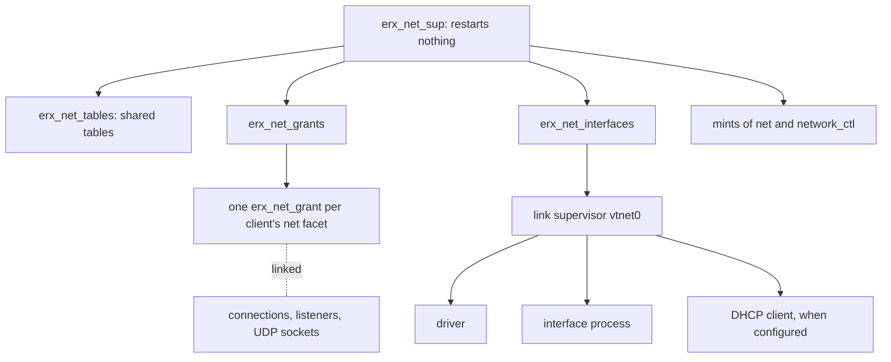
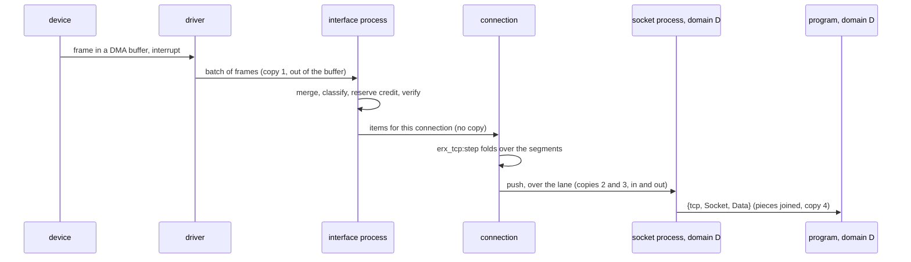

# Chapter 17. The Network Stack

> **Status.** **Built:** `erx_net`, the TCP/IP stack, runs in the
> network domain on QEMU and the Raspberry Pi 4: Ethernet, IPv4 and
> IPv6, ICMP, UDP, TCP and DHCP. `ifconfig`, `ping` and `host` work in
> root's session, and Erlang's `gen_tcp` and `gen_udp` work in any
> domain that holds the network service's facet. The bounded queues,
> per-domain limits, merging of received segments, an exhaustive test
> of the TCP core and fuzz tests of the packet decoders are built.
> `ntpd` sets the clock on the Raspberry Pi 4 image, and a boot starts
> at the build's date or, on QEMU, the real-time clock's.
> **Designed:** two speed-ups that work today only in host tests
> (checksums computed in the copy, and sending many segments as one
> unit); a leaner per-segment step; a faster host test transport;
> sockets for native programs; running FreeBSD's TCP test scripts
> against the stack; generated admission code; enabling `ntpd` from
> `/etc/start.conf`; WiFi as a network interface.

**Background needed.** [Chapter 1](01-operating-systems.md) (drivers,
DMA), [chapter 3](03-erlang.md) (processes, supervisors, binaries,
NIFs), [chapter 6](06-construction.md) (the functional core),
[chapter 10](10-domains.md) (lanes, the funnel, exports, the
envelope), [chapter 11](11-security.md) (facets) and
[chapter 15](15-devices.md) (drivers and the device NIF).

A TCP connection meets every kind of trouble a network can send.
Segments arrive out of order, twice, or not at all. A stranger sprays
forged resets in the hope that one lands inside the window. A flood
of SYNs asks the machine to remember a million half-open connections.
Each case has an answer that took FreeBSD's developers years to get
right, and the answer is in the code, not in the RFCs.

FreeBSD runs its stack, `netinet`, in the kernel. A received frame is
an **mbuf** chain, the kernel's linked list of packet buffers, and
climbs to a socket buffer under locks with a lock order. Each
connection's state, `struct tcpcb`, is reached through reference
counts, and its timers must be stopped and drained before it is
freed. A bug anywhere in that path is a kernel bug.

erXos keeps FreeBSD's decisions and discards its structure. The stack
is Erlang, in a domain of its own. Every piece of state has one owner
process, every decision is a pure function, every queue between
processes is bounded by a credit, and every connection is a process
that the inspector shows. What the stack sends on the wire is meant
to be what FreeBSD sends, and the tests compare the two. The chapter
follows the rules of construction, a packet's path, the TCP core and
the fast path, then who may use the network, network time and
failure.

> **Background: the layers of the Internet.** Networking software is
> built in layers so that each solves one problem. **Ethernet** moves
> a frame between two machines on one link, by 48-bit hardware
> addresses. **IP** (version 4 or 6) moves a datagram between any two
> machines across many links. The largest frame a link carries is its
> **MTU** (maximum transmission unit), 1,500 bytes on Ethernet.
> **ARP** (IPv4) and **neighbour discovery** (IPv6) answer "which
> hardware address has this IP address on my link?". **ICMP** carries
> errors and probes such as `ping`'s echo request. **UDP** adds port
> numbers to IP, so a datagram reaches one program; it promises
> nothing about loss or order. **TCP** builds a reliable, ordered byte
> stream on top of IP. **DNS** maps names to addresses over UDP, and
> **DHCP** hands a machine its address, router and name servers when
> it joins a network.

> **Background: how TCP works.** TCP numbers every byte it sends with
> a 32-bit **sequence number**; the receiver acknowledges the next
> byte it expects. The receiver also advertises a **window**, how many
> bytes past the acknowledgement it can buffer, and the sender keeps
> within it. A segment that is not acknowledged in time is sent again
> (**retransmission**); the timeout follows the measured round-trip
> time. With **SACK** (selective acknowledgement) the receiver also
> reports the ranges it holds beyond a gap, so the sender resends only
> what is missing. A connection opens with SYN, SYN-ACK and ACK,
> closes with FIN in each direction, and a RST aborts it. A connection
> is named by its **four-tuple**: the local and remote address and
> port.

## 17.1 Why FreeBSD's stack

A TCP stack written from the RFCs alone fails in the field, so erXos
takes its protocol behaviour from one implementation that has thirty
years of interoperation in its code, and checks against it.

### 17.1.1 What the stack matches

Three things fix the stack's behaviour
([design-network-stack.md, What the stack matches](../design-network-stack.md#what-the-stack-matches)):

* **The wire, as FreeBSD's default stack behaves** at one pinned
  commit of FreeBSD 16.0-CURRENT, the kernel of the FreeBSD x86-64
  test host. The decisions are read from FreeBSD 15.1's source, and
  visible changes and real bug fixes between the two are carried
  over. Every difference a test finds is a bug, a departure the
  design document states with its reason and a test, or a FreeBSD bug
  recorded as such.
* **The Erlang API, as stock OTP 29.1.2 behaves,** so existing
  `gen_tcp` and `gen_udp` code runs unchanged.
* **erXos's architecture.** Every connection is a process of the
  network domain, per-packet work is Erlang and per-byte work is C,
  and the facet a client domain holds bounds what it can make the
  network domain spend (section 17.6.2).

FreeBSD's code is BSD-licensed and tested by its own TCP test suite,
and FreeBSD is the UNIX erXos follows ([chapter 4](04-history.md#455-unix-look-and-feel-honestly)).

### 17.1.2 Why the default stack

FreeBSD 15.1 builds three TCP stacks. The default, named "freebsd",
is the one FreeBSD runs and its test suite checks; RACK and BBR are
loadable modules that a GENERIC kernel does not load, each replacing
the whole input and output path, and together about twice the
default's size
([design-network-stack.md, Why FreeBSD's default stack](../design-network-stack.md#why-freebsds-default-stack)).
Most of the default stack's volume is locking, mbuf handling, sysctls
and logging, which the Erlang stack does not need; what is translated
is its decisions.

### 17.1.3 What a naive Erlang stack gets wrong

An Erlang stack that starts from the RFC's state diagram, such as the
open-source aloha, shows what goes wrong
([design-network-stack.md, What a naive Erlang stack gets wrong](../design-network-stack.md#what-a-naive-erlang-stack-gets-wrong)).
One fault needs background. A **SYN flood** sends opening SYNs from
forged addresses, each asking the receiver to remember a half-open
connection. FreeBSD answers with a **syncache**, a small bounded table
of half-open connections, and, when it is full, **SYN cookies**: the
connection's state is encoded in the SYN-ACK's sequence number, so
the receiver remembers nothing until the peer's ACK returns it.

| Fault | erXos's answer |
| --- | --- |
| one malformed frame crashes the unsupervised interface process | decoders that never raise; a failing step drops the frame and keeps the state |
| initial sequence number 0 | RFC 6528's keyed hash, from FreeBSD's `tcp_new_isn` |
| any RST inside the window resets the connection | RFC 5961's checks, from `tcp_input.c` |
| a process per SYN, never expired | a bounded syncache in the interface process, with SYN cookies |
| window arithmetic that breaks at the 2^32 wrap | sequence numbers as unbounded integers (section 17.2.4) |
| no congestion control, dropped out-of-order data | FreeBSD's loss detection, CUBIC and reassembly queue |
| a payload copied four times on transmit, checksum in Erlang | one copy each way, which is designed to compute the checksum too (section 17.3.4) |

Behind the table lie three habits: a timer per connection, mailboxes
that grow without bound, and bytes parsed again at every layer.
Section 17.2 removes each.

### 17.1.4 Decisions, not structure

erXos ports by redesign: matching behaviour is the test, and the
structure is new. Every Erlang function that takes a decision from
FreeBSD names the FreeBSD function it comes from, so a reviewer can
put the two side by side, and the translating modules carry FreeBSD's
copyright notices (`erlang/apps/erx_net/NOTICE-freebsd`). Where
FreeBSD offers a knob, the stack does what its default does.

The stack is also an ordinary OTP application. Four seams (the
driver's transport, the clock and entropy, the per-byte C primitives,
and the runtime's calls for facets) each have an erXos implementation
(`erlang/apps/erx_net/erxos/`) and a portable one
(`erlang/apps/erx_net/portable/`). So the whole stack runs on stock
OTP on a development host, against real peers through a tap device,
where most of its tests run
([design-network-stack.md, Two places, four seams](../design-network-stack.md#two-places-four-seams)).
This is **Built**.

## 17.2 The construction

FreeBSD's TCP code spends much of its length on locks, timers that
must be stopped safely, buffers that can grow, and sequence-number
comparisons that survive wrapping. Four rules make each disappear
([design-network-stack.md, The construction](../design-network-stack.md#the-construction)).

### 17.2.1 One owner, one step

Every piece of protocol state belongs to exactly one process:

| Owner | Process | State it owns |
| --- | --- | --- |
| an interface | `erx_net_if` | addresses, neighbour cache, routes, IP reassembly, its share of the syncache, rate limiters |
| a TCP connection | `erx_tcp_conn` | the control block, send and receive buffers, reassembly queue |
| a listening socket | `erx_tcp_listen` | the connections queued for `accept` |
| a UDP socket | `erx_udp_sock` | its receive queue and options |
| a client domain's `net` facet (section 17.6.2) | `erx_net_grant` | the domain's limits and account |

Each owner is a loop around one pure function of its kind, the shape
of [chapter 6, section 6.3](06-construction.md#63-functional-core-effects-at-the-edge).
In sketch, with names that vary by owner:

```erlang
step(Event, State, Context) -> {State, [Action]}
```

`Context` carries what the decision needs from outside: the monotonic
time, the credit the transmit path offers, the path's MTU. The step
reads no clock, no shared table and no other process, and returns
the next state and actions from a closed set: transmit these frames,
deliver these bytes, reply to this caller, end. The loop performs the
actions and arms its one timer. Because the step never sends, an
exception inside it leaves the state as it was before the event.

Because no state has two writers, the stack has no locks, no
reference counts and no epochs. A connection ends by its process
exiting. Other processes read only what an owner publishes in an
**ETS table**, an in-memory table that one Erlang process owns and
others may read, and every row has one writer.

Random values follow the same rule: each owner keeps a generator, a
pure value of `erx_net_rand` built on SipHash, in its state, so a
test that fixes the key gets the same stream, while an observer
cannot predict it as it could OTP's `rand`.

### 17.2.2 Deadlines, not timers

A TCP connection has five timers: resending unacknowledged data
(retransmission), probing a peer that advertised a zero window
(persist), testing an idle connection (keepalive), delaying an ACK so
it can ride with data, and the wait after close (2MSL). A naive Erlang
stack starts an Erlang timer for each and cancels it when it is no
longer wanted. Every cancel then races with a timer message already in
the mailbox, and each handler must recognise a stale one.

FreeBSD 15 keeps an array of deadlines in each control block and one
callout set at the earliest, and the stack keeps that shape. A
connection's state holds its deadlines, `erx_tcp:next_deadline/1`
returns the earliest, and after every step the process makes sure one
**hint** is armed no later than that deadline. When a hint arrives,
the step runs every deadline that is due. A timer message carries no
meaning of its own, so there is nothing to cancel: restarting the
retransmission timer on an ACK is a field update, and a hint that
arrives early finds nothing due.

FreeBSD's rule that the retransmission and persist timers are never
both armed becomes a type, so it cannot be broken. The field in
`erlang/apps/erx_net/include/erx_tcp.hrl`, whose integers are
deadlines:

```erlang
send_timer = none :: none | {rexmt, integer()} | {persist, integer()},
```


### 17.2.3 Credited queues

ERTS bounds no mailbox, and a stack under attack is a set of mailboxes
that someone else fills. So no stack process hands packets to another
except against a **credit**: a counter the receiver creates and
publishes, which every sender must reserve from before it sends.
`erx_net_credit:reserve/2`, in
`erlang/apps/erx_net/src/erx_net_credit.erl`, is the whole sender's
side:

```erlang
reserve({Ref, Limit}, Units) when is_integer(Units), Units > 0 ->
    case atomics:add_get(Ref, 1, Units) of
        InFlight when InFlight =< Limit ->
            ok;
        _ ->
            atomics:sub(Ref, 1, Units),
            full
    end.
```

The counter is an OTP `atomics` array, which any process of the node
can add to without a message. A sender adds the units it is about to
send; past the limit it takes them back and drops the packet,
counting the drop. The receiver subtracts the units of each message
it takes. Every queue between the driver, the interface process and
the sockets is therefore bounded. A connection that falls behind
fills its credit, the interface drops further segments for it, and
the peer's congestion control sees loss and slows down. Across a lane
([chapter 10](10-domains.md#1021-a-lane)) the socket process gives
the connection a credit in bytes by message, so what a program does
not read waits in the network domain's receive buffer, never in a
mailbox.

### 17.2.4 Packets become checked records once; sequence numbers are integers

A frame is decoded once, in the interface process, by a chain of
**total decoders**: functions that return `{ok, Record, Rest}` or
`{error, Reason}` for every input and never raise. Each checks its
lengths against the layer that contains it, and its checksum first,
so no step sees an unchecked length or a segment whose checksum was
not checked. The only atoms a decoder returns are its own error
reasons, a closed set, so no packet can grow the atom table.

Inside a connection, sequence and acknowledgement numbers, SACK edges
and timestamps are **unwrapped**: unbounded integers that count from
the initial sequence number and never wrap. A connection would have
to move 2^59 bytes before they outgrew ERTS's small integers, the
ones that fit in one machine word. The conversion lives in one
module, `erlang/apps/erx_net/src/erx_tcp_seq.erl`, in two functions
(shown without their comments):

```erlang
lift(Wire, Reference) when is_integer(Wire), Wire >= 0, Wire < ?MODULUS,
                           is_integer(Reference) ->
    Offset = (Wire - Reference + ?HALF) band (?MODULUS - 1),
    Reference - ?HALF + Offset.

wire(Integer) when is_integer(Integer) ->
    Integer band (?MODULUS - 1).
```

`lift` returns the integer congruent to the 32-bit wire value that
lies nearest a reference (`rcv_nxt` for a received sequence number,
`snd_una` for an acknowledgement), and `wire` returns the low 32 bits
for encoding. After lifting, the protocol code uses ordinary `<` and
`+`, and FreeBSD's `SEQ_LT` macros have nothing left to do.

The lifted segment is a different record from the decoded one, so a
step cannot confuse the two. Lifting differs from modular comparison
only for a number exactly 2^31 away, which modular comparison calls
both greater and smaller; both stacks drop such a segment, by
different code paths.

Together the four rules remove per-connection locks and their order,
reference counts and epochs, the races of stopping a callout, and
mbuf chain surgery, which binaries and sub-binaries replace
([design-network-stack.md, What disappears](../design-network-stack.md#what-disappears)).

## 17.3 The packet path

A received TCP segment crosses two local messages and one lane on its
way from the device to the program that reads it. Its bytes are
copied once inside the network domain, four times end to end. This
section follows it.

### 17.3.1 The process tree

Figure 17.1 shows the network domain's processes
(`erlang/apps/erx_net/src/erx_net_sup.erl`).



*Figure 17.1. The network domain's process tree. The mints make a
facet process each time the system domain introduces a client.
Sockets are linked to their facet, not supervised: a restarted TCP
connection would be a different connection.*

Every child of the top supervisor, `erx_net_sup`, is permanent, and
the supervisor restarts none of them: the end of any ends the stack,
and with it the network domain, which the domain service restarts
with its device. Restarting the whole domain is simpler than a
restart at the top: every client gets a fresh facet, and no code has
to work out which facets a partial restart broke.

Ordinary failures stay lower down. Each interface, named as FreeBSD
names it (`vtnet0` on QEMU, `genet0` on the Pi 4), has a link
supervisor; the driver's end ends the link, which the interfaces
supervisor starts again, losing only soft state such as neighbour
entries
([chapter 15, section 15.1.1](15-devices.md#1511-what-a-drivers-end-reaches)).
The facet process traps exits, so a socket's crash ends that socket
alone.

### 17.3.2 A received segment, end to end

Figure 17.2 follows one TCP segment for an established connection
whose program runs in client domain D
([design-network-stack.md, Receiving](../design-network-stack.md#receiving)).



*Figure 17.2. A received segment from driver to socket. Inside the
network domain the payload is copied once; the lane copies it in and
out, and the socket process joins its pieces into the one binary
`gen_tcp` hands over.*

On the interrupt message, the device NIF copies completed frames out
of their DMA buffers into fresh binaries, and the driver strips the
device's header and sends the batch to the interface process in one
message, against the interface's credit. The interface merges
consecutive in-order segments of one flow (section 17.5), then
classifies, reserves credit for and verifies each frame (section
17.3.3). It groups the batch by destination, so each connection gets
one message holding its segments in order, as sub-binaries of the
frames. The connection takes every message waiting in its mailbox,
folds `erx_tcp:step/3` over the segments, sends the acknowledgements
to the driver in one message, and pushes the in-order data its socket
process has credit for. The push, `{erx_net, Conn, {data, Pieces}}`,
is a frame on the lane to D, which D's funnel delivers in the origin
envelope ([chapter 10, section 10.5](10-domains.md#105-the-origin-envelope)).
The socket process checks it and presents it as the socket's options
say: in active mode, as one local `{tcp, Socket, Data}` message.

A **sub-binary** is a reference into part of a larger binary, made
without copying, and it keeps the whole frame alive. So a held payload
smaller than a quarter of its frame is copied out, and a peer cannot
pin many frames with one-byte segments.

### 17.3.3 Classify, reserve, then verify

The interface process works for every client of the domain, so each
frame it drops must cost it little. `classify/2`, a pure function of
`erx_net_input`, decodes the Ethernet and IP headers and finds the
destination: a socket, the interface itself, or nowhere. The frame
then takes one unit of its destination's credit (for ARP or a ping,
a token of the interface's ingress bucket). Only a frame that holds
its unit reaches `verify/1`, which runs the TCP, UDP or ICMP decoder,
checksum first; a frame that fails gives its unit back and is
dropped. So a frame dropped for want of room costs a header decode
and one lookup. FreeBSD checks the checksum first; the reversed order
changes nothing on the wire, since a bad frame is dropped either way
([design-network-stack.md, Receiving](../design-network-stack.md#receiving)).

### 17.3.4 Transmitting, and checksums in the copy

The send path mirrors the receive path. `gen_tcp:send/2` calls the
socket process, which sends the data over the lane in pieces of at
most 64 KiB, one at a time, each after the connection's reply to the
one before; the caller is answered after the last reply
(`erlang/apps/erx_net_client/src/erx_gen_tcp_core.erl`). The
connection appends each piece to its send buffer and runs output. All
frames of one step go to the driver in one message, each as a header
binary and payload sub-binaries, and the device NIF lays each in a
DMA buffer: the one per-byte copy of the transmit path.

The Internet checksum is a sum of 16-bit words, and a copy reads every
word, so the copy can sum what it copies. On receive each layer
derives its checksum from the frame's sum by subtracting the headers
it reads anyway. On transmit the TCP code leaves only the
pseudo-header's sum in the checksum field, as FreeBSD's `tcp_output`
does for a capable network card, and the copy finishes it. The copy hands over a sum, never a verdict,
because it parses nothing
([design-network-stack.md, Checksums in the copy](../design-network-stack.md#checksums-in-the-copy)).
The host's tap transport does both, **Built**
(`erlang/apps/erx_net/portable/erx_tap.erl`). In erXos's device NIF
the summing copy is designed and not built, and the decoders compute
each sum with the runtime's C checksum primitive.

## 17.4 The TCP core

The whole of TCP, from the handshake to TIME-WAIT, is one pure
function over one record, with the connection process a thin loop
around it, so the core can be explored state by state on a host.

### 17.4.1 The control block

The control block is one Erlang record, `#tcb{}`, translated from
FreeBSD's `struct tcpcb`. Where FreeBSD keeps a word of flags whose
combinations are not all legal, the record keeps a variant that can
hold only the legal ones, the approach of
[chapter 6, section 6.3.4](06-construction.md#634-variants-not-flags):

| FreeBSD | `#tcb{}` |
| --- | --- |
| `TF_SENTFIN`, `TF_NEEDFIN` | `fin`: `none`, `queued` or `{sent, Seq}` |
| `TF_SACK_PERMIT` | `sack`: `off`, `requested` or `on` |
| `t_timers[]` | `send_timer` and a record of deadlines |
| `snd_una`, `snd_nxt`, `rcv_nxt` and the rest | the same names, as unwrapped integers |

A connection cannot be "FIN sent" without the FIN's sequence number,
because the record has no way to say so.

### 17.4.2 Events, the step and actions

`erx_tcp:step/3`, in `erlang/apps/erx_net/src/erx_tcp.erl`, is the
core's one entry for events. Its input type lists everything that can
happen to a connection:

```erlang
-type event() :: {segments, [segment()]}
               | {user, request()}
               | {expired, Hint :: integer()}
               | {icmp, erx_tcp_icmp:report()}
               | {buffer, snd | rcv, Bytes :: non_neg_integer() | refused}.

-spec step(event(), #tcb{}, #tcp_ctx{}) -> {#tcb{}, [action()]}.
```

Nothing else enters. The step hands the event to the module that translates the FreeBSD code
for it (`erx_tcp_input`, `erx_tcp_user`, `erx_tcp_timer`) and then
runs output, as FreeBSD's `tcp_do_segment` ends by calling
`tcp_output`. Its actions are a closed set: transmit, deliver, notify,
reply, reserve a buffer, reset, and a few more. Only the connection
process around the step touches the world; the step is a function a
test can call.

The step also departs from FreeBSD where FreeBSD leaks. A RST that
answers a segment is sent only within the interface's RST rate limit,
and a challenge ACK to a SYN or an ACK is charged against that limit,
as in FreeBSD. A challenge ACK to a RST charges nothing. FreeBSD's
charge there lets a blind attacker learn that its forged RST landed
inside a window, the same class of side channel as Linux's
CVE-2016-5696, a shared challenge-ACK limit. The design closes it
([design-network-stack.md, Events and the step](../design-network-stack.md#events-and-the-step)).

### 17.4.3 Output, the send log and reassembly

The sender's record of what it has sent is one structure,
`erx_tcp_sendlog`: an ordered tree, keyed by the integer sequence
numbers, from each sent range to its segment size, last transmission
time, transmission count, and whether it is SACKed, lost or
retransmitted. FreeBSD keeps two structures for this job, one in each
of its stacks; here the loss modules read and mark the one log, and
output takes the next range to send from it. A SACK block marks only
whole segments the sender cut, so a peer cannot split the log finer
than what was sent or grow it.

On the receiving side, `erx_tcp_reass` translates FreeBSD's
`tcp_reass`, with its overlap trimming and its cap of 100 queued
segments, and `erx_tcp_sack` builds the SACK blocks from it.

### 17.4.4 Loss detection and congestion control

> **Background: congestion control.** A sender that fills the
> receiver's window can still overrun the routers between them, and
> when every sender does it the network collapses. **Congestion
> control** keeps a second limit, the **congestion window**, that the
> sender raises while data gets through and cuts when a loss suggests
> a queue overflowed somewhere. A new connection doubles the window
> each round trip (slow start). Past that, NewReno raises it by one
> segment per round trip; **CUBIC**, FreeBSD's default, grows it along
> a cubic curve of the time since the last cut, which fills fast, long
> paths sooner.

Two Erlang **behaviours**, OTP's form of an interface that a module
implements by exporting named callbacks, carry FreeBSD's seams.
`erx_tcp_loss` is the loss-detection part of FreeBSD's interface for
pluggable TCP stacks: its callbacks handle an acknowledgement, a
rewind when the retransmission timer expires, and the module's own
deadline. `erx_tcp_cc` mirrors FreeBSD's `struct cc_algo`; its
modules are `erx_tcp_cc_cubic`, the default, and
`erx_tcp_cc_newreno`, and a socket names one by a string looked up in
a closed table, so the name never becomes an atom. A loss module
never calls the congestion module: it returns events, and the
connection makes the calls in FreeBSD's order, so either side can be
replaced alone. All of this is **Built**.

### 17.4.5 How the core is checked

A pure core can be explored rather than sampled.
`test/erlang/erx_tcp_explore.erl` drives a connection with small
buffers and windows, and a model of its peer, over an abstract
alphabet: segments with every combination of SYN, ACK, FIN and RST,
with or without data, at each class of sequence position (below the
window, at `rcv_nxt`, inside, at the edge, beyond), user requests and
timer expiries. It applies every event in every state, breadth first,
merging states that agree on an abstraction of the control block,
until no new state appears or a depth limit, 8 in the full run. A
second pass starts just below 2^32, so every class is also crossed
at the wrap. On every transition it checks properties such as these
([design-network-stack.md, The TCP core: exhaustive exploration](../design-network-stack.md#the-tcp-core-exhaustive-exploration)):

* `snd_una =< snd_nxt =< snd_max`, and `rcv_nxt` never decreases;
* no byte is delivered twice, out of order, or beyond what the peer
  sent;
* no segment is sent beyond the peer's window, except a one-byte
  window probe;
* every state change is one RFC 9293's state diagram allows;
* where header prediction, FreeBSD's shortcut for the common cases,
  accepts a segment, the general path gives the same result.

The explorer is **Built**, and runs in the host tests. The codecs are
checked by fuzz targets against an independent decoder, the pkt
library, behind `test/erlang/erx_net_pkt_oracle.erl`, whose comments
list where that judge itself falls short.

The second check compares behaviour with FreeBSD itself. FreeBSD's
TCP test suite is a set of packetdrill scripts, small programs that
inject segments and expect replies. The FreeBSD x86-64 test host
records each script's verdict on FreeBSD; an Erlang runner,
`erx_net_script`, drives the stack through the same scripts under a
virtual clock, and every verdict must equal FreeBSD's
([design-network-stack.md, Packet scripts against FreeBSD](../design-network-stack.md#packet-scripts-against-freebsd)).
That runner is designed and not built.

## 17.5 The fast path

A stack that decides every segment in a pure step pays for that step
on every segment. The design measured how much, found the cost spread
too thin to optimise away, and changed the unit of work instead
([design-network-stack.md, The fast path](../design-network-stack.md#the-fast-path)).

### 17.5.1 What was measured

The measurement ran on the FreeBSD x86-64 test host on 2026-11-09:
FreeBSD 16.0-CURRENT on an AMD Ryzen Threadripper PRO 5995WX, native;
stock OTP 29.1.1 with the JIT; `erx_net` at commit f3c91786 with its
C primitives as a NIF, over `/dev/tap1` to a jail running FreeBSD's
own stack. Each transfer moved 512 MiB in 64 KiB sends, median of
three. The baseline was lwIP 2.2.1, a C stack, one thread, `-O2`,
over the same tap. The raw data are in the separate history
repository at commit `d5bcd46`: `erx_net`'s runs in
`~/erxos-history/net-perf-freebsd-2026-11-09/` and lwIP's in
`~/erxos-history/net-bench-freebsd-lwip-2026-11-09/`.

| | `erx_net` | lwIP |
| --- | --- | --- |
| send | 890 Mbit/s | 6,537 Mbit/s |
| receive | 1,143 Mbit/s | 6,809 Mbit/s |
| cost of one 1,448-byte segment | 12.3 us sending, 10.1 us receiving, of the connection's wall time | 1.5 to 1.6 us of CPU for the whole path |

The connection process is the serial stage and its cost is per
segment: a busy wait of 3 us added to each segment cut sending to
711 Mbit/s (the mean of two runs), where one serial stage predicts
715. The cost has no hot spot, about 330 calls per segment and no
function above 4 percent, and nothing was batched.

### 17.5.2 Why the cost is architectural

Removing every measured share from the per-segment step would bring
it down perhaps twofold, not the sixfold the gap needs. C stacks pay
those costs once per batch or never: FreeBSD hands a capable network
card one large segment to cut and takes merged segments from large
receive offload (LRO). So a step takes and emits many segments at
once, and the work left for one segment is made lean. Its
bulk target is two thirds of lwIP's throughput each way.

### 17.5.3 Runs and merges

A **run** is one TCP header, a contiguous range of payload, and the
segment size it is cut at: consecutive segments of one connection that
differ only in sequence number, lengths and checksums. Output emits
runs, and the copy the medium forces anyway cuts a run into frames,
byte for byte what per-segment output would have built. Everything
above the copy pays once per run.

On receive the interface **merges** each batch before it classifies:
consecutive in-order segments of one flow become one merged segment,
by the rule of FreeBSD's LRO (`tcp_lro.c`), which takes one
classification and one step but still one credit unit per segment.
Every TCP decision stays in Erlang: the C of the cut and the merge
(`erlang/apps/erx_net/c_src/`) copies, sums, writes the header values
Erlang chose and groups frames by a fixed rule.

### 17.5.4 What is built

The merge is **Built** on every transport: the QEMU suite checks that
`vtnet0` merged bursts at least once (`tools/lib/erx/net_device.rb`).
Output's run rule and the C that cuts a run (`c_src/erx_tcp_cut.c`)
are **Built**, and the host's tap transport cuts runs in its copy;
cutting runs in erXos's device NIF is designed and not built, so on
erXos output sends one frame per segment. Designed and not built too
are the lean step, which splits the control block into a small record
that changes per segment and a cold one, and a faster host test
transport over netmap, FreeBSD's framework for moving packets without
a system call per packet. The development manifests run the network
domain on the interpreter rather than the JIT, so the figures above
say nothing about QEMU or the Pi 4.

## 17.6 Sockets act for one domain

On FreeBSD any process can call `socket(2)`, and the kernel decides
what it may do from its user id and jail. In erXos a domain without
the network service's facet cannot open a socket, and every socket
acts for one domain alone
([design-network-stack.md, Authority and admission](../design-network-stack.md#authority-and-admission)).

### 17.6.1 Who holds the network device

Only the network domain holds a network device, by the system
manifest and its build check
([chapter 7](07-one-source.md#77-the-system-manifest-the-machines-configuration-checked)),
and no client domain reaches a driver, an interface process or a
shared table. In the
design, a WiFi domain drives the Raspberry Pi 4's WiFi chip and lends
that medium to the network domain as an interface; that is designed
and not built ([chapter 18](18-wifi.md)).

The system domain, the trusted base, holds no `net` facet, so no
socket's traffic ever enters it and the trusted base parses no packet
([chapter 11, section 11.2.2](11-security.md#1122-the-trusted-base)).
The QEMU suite checks it: the system domain's command shell holds no
`net` facet, and its `ifconfig`, `ping` and `host` are refused.

### 17.6.2 The `net` facet

A domain's use of the network is one facet of the network service
([chapter 11, section 11.6](11-security.md#116-facets-authority-over-services)),
which the client's runtime installs under the name `net`. Unlike most
facets, its process lives in the network domain, and the stack's code
calls it `erx_net_grant`. It starts the domain's sockets and charges
their work to its account, within the manifest's facet row and the
bounds of `abi/services/net.txt`: at most 4,096 sockets, 128 KiB to
64 MiB of buffers across them, and ports below 1024 only when the
row lists them, as FreeBSD reserves those ports. The facet process
monitors the network domain's connection to its client before it
exports itself, so the connection's end ends the facet and every
socket it started.

Every message from another domain passes one admission module first:
`erx_net_admit` in the network domain and `erx_sock_admit` in the
client's socket process alone take messages out of their origin
envelope, which a build check enforces
(`tools/lib/erx/net_checks.rb`). Both are **Built** by hand;
generating them from `abi/services/net.txt` is designed and not
built.

### 17.6.3 A socket is two processes

Root, on a machine connected to the Internet, types this in its
Erlang shell:

```erlang
{ok, S} = gen_tcp:connect("example.org", 80, [binary, {active, true}]).
```

Stock OTP's `gen_tcp` dispatches every call on a socket of the form
`{'$inet', Module, Handle}` to `Module`, and on erXos the default
backend is `erx_gen_tcp` (`erlang/apps/erx_net_client/src/erx_gen_tcp.erl`).
It starts a **socket process** in root's session domain, a
`gen_statem` that presents the stream as `gen_tcp` does. The socket
process calls the session's `net` facet, which starts a connection
process in the network domain, linked to it. The socket process
alone talks to the connection and sends the program the socket's
messages, so stock `receive {tcp, S, Data} -> ...` code works.

The connection's pid is exported only to the client's domain, with
`send` alone ([chapter 10, section 10.4](10-domains.md#104-exports-a-pid-is-a-name-not-an-authority)),
and every request must come from the socket's own socket process.
Any process of that domain may use the socket through it: the domain
is the unit of authority. The QEMU suite runs this path both ways,
connecting out to an echo server on the host and accepting a
connection from the harness.

### 17.6.4 Ports and the demultiplexing table

The demultiplexing table maps a key to the one socket that receives
for it: a connection's four-tuple, a listener's local address and
port, a connected or bound UDP socket. Lookup goes from the most
specific key to the wildcard, as FreeBSD's `in_pcblookup_hash` does.
Every insertion goes through `erx_net_bind` with ETS's `insert_new`,
which inserts only when the key is absent, so a key is held by one
socket and ERTS decides a race between two binders.

### 17.6.5 Name resolution

Each domain resolves names itself, with `inet_res`, OTP's DNS
resolver, over its own `gen_udp`. The facet's `resolver` operation
returns the name servers and search list the network domain learnt,
and `erx_inet` checks them and loads them into the domain's
`inet_db`, in place of a `resolv.conf`. Query IDs
come from the kernel's random bytes rather than `inet_db`'s counter,
so an off-path attacker must guess both the ID and the source port.
The QEMU suite checks that `host` resolves a name, answers NXDOMAIN
(DNS's "no such name") for a missing one and maps an address back.

### 17.6.6 Native programs

A native program's socket descriptor names an open-file description,
a process of the program's session
([chapter 13](13-native-programs.md#132-the-channel-and-the-handler)),
which is the socket's client at the network service. A blocking
`read` becomes a `watch` for readability followed by a nonblocking
read, so no request waits inside the network domain
([design-network-stack.md, The interface towards POSIX programs](../design-network-stack.md#the-interface-towards-posix-programs)).
Sockets for native programs are designed and not built.

## 17.7 Time from the network

A Raspberry Pi 4 has no battery-backed clock, so every boot starts
near 1970 and every TLS certificate looks not yet valid. Measuring
the time needs the network; writing the clock is the system domain's,
which parses no packet, so the design splits the job
([design-time.md](../design-time.md)).

> **Background: NTP.** The Network Time Protocol sets a clock from a
> server's. The client sends a request stamped with its own time; the
> server stamps the arrival and the reply; the client stamps the
> reply's arrival. From the four stamps it computes the server's
> offset from its own clock, taking half the round trip as the one-way
> delay. **SNTP** is the simple subset that RFC 4330 described and
> RFC 5905 now covers.

### 17.7.1 Who measures and who sets

The SNTP client, `ntpd`, is an app with a session of its own. That
session holds a `net` facet and a `clock` facet of the system domain's
**clock service** with the operation `sample` and not `set`. `ntpd`
measures the server's clock against the kernel's monotonic clock and
reduces each exchange to one integer: the server's time minus
monotonic time, in nanoseconds. That is the number the kernel's time
page stores, so a sample does not depend on what the wall clock
reads, and the system domain decides on an integer and parses
nothing from the network. Root's own right to set the clock with `date`, and what
checks it, is [chapter 11, section 11.8](11-security.md#118-a-worked-example-who-may-set-the-clock).

### 17.7.2 Before the network: the build date and the real-time clock

The build's date is the commit time of the image's source. A clock
service that starts on an earlier clock sets it to that date, shown
in `/proc` as approximate until a sample or `date` sets it. So HTTPS
works from boot, at the cost of accepting a certificate that expired
between the build and the real date. A machine with a real-time clock
reads it at boot instead: on QEMU `virt` the driver `erx_rtc_pl031`
reads the PL031 through a hardware description that names only the
data register, so it cannot change the clock.

### 17.7.3 The step rules

`erx_clock_core:decide/4` takes the first row of this table whose
condition holds, with `D` the sample's distance from the clock
([design-time.md, Steps](../design-time.md#steps)):

| Condition | Action |
| --- | --- |
| the sample is before the build's date | refuse |
| the clock is as the boot or the approximate start left it | step to the sample |
| `abs(D) =< 128 ms` | hold |
| `128 ms < abs(D) < 1000 s`, and the last sample erred the same way | step |
| `128 ms < abs(D) < 1000 s`, otherwise | hold, and remember the sign |
| `abs(D) >= 1000 s` | refuse |

Whether the boot has changed the clock is read from the time page,
which nothing resets during a boot, so no restart of `ntpd` or the
clock service can renew the one unrestricted step. There is no slew:
the clock moves only by steps.

The rules filter one bad measurement and bound nothing over time:
without authentication, the server, or anyone on the path to it,
decides the wall clock
([design-time.md, Security](../design-time.md#security)). `ntpd`
runs where the machine's manifest starts it: the Raspberry Pi 4 image
starts it against `pool.ntp.org`, named in the session's environment
(`config/manifest/raspi4b-development.txt`). Enabling it from
`/etc/start.conf`, as FreeBSD's `rc.conf` does, is designed and not
built. The QEMU suite runs `ntpd` against the harness and checks the
step, `ntpctl step` and `date`. The rest of section 17.7 is
**Built**.

## 17.8 What fails, and what it reaches

Each failure ends the smallest thing that holds the failed state
([design-network-stack.md, What fails and what survives](../design-network-stack.md#what-fails-and-what-survives)).

| What fails | What ends | What the reader sees |
| --- | --- | --- |
| a malformed frame | nothing: the decoder refuses it, the frame is dropped and counted | nothing |
| an interface process's step raises | nothing: the step left the state as it was, the frame is dropped | nothing |
| a connection's step raises | that connection, with a RST | `{tcp_error, S, econnaborted}` on that socket alone |
| the network driver crashes or is restarted | the link: driver, interface and DHCP client restart in order | connections carry on; a QEMU suite shows an open connection surviving ([chapter 15](15-devices.md#151-a-driver-is-a-process)) |
| a client domain ends | its `net` facet, and every socket the facet started, each connection with a RST | the peers see resets |
| any top-level process of the stack | the network domain, which the domain service restarts | every connection ends; clients get new facets |

The stack has known limits. Nothing sums the facets' buffer limits
against the network domain's memory, so many facets at their maximum
could exhaust it. And the interface process decodes every frame the
link delivers, so a flood at link rate costs it its full time
([design-network-stack.md, Residuals](../design-network-stack.md#residuals)).

## 17.9 Design choices

**A stack in C, such as lwIP, in the network domain.** lwIP moved
six to seven times the bulk throughput in section 17.5. But it is a
second TCP with its own decisions, its memory errors would be the
network domain's, and the inspector could not see its connections.
erXos keeps every TCP decision in Erlang and moves into C only work
on bytes: the copy, the checksum, the cut and the merge.

**A process per layer.** An Erlang design might give Ethernet, IP and
TCP each a process, as the layers suggest. Every packet would then
cross three mailboxes with no bound between them, and each layer
would decode the bytes again. The stack has one process per owner of
state, decodes once, and hands checked records on.

## Summary

erXos's TCP/IP stack is Erlang, in the network domain, and takes every
protocol decision from FreeBSD's default stack while sharing none of
its structure. Each piece of state has one owner process that decides
by a pure step, every queue is bounded by a credit, and the TCP core,
one pure function over one record, is explored exhaustively on a
host. Merging makes one step serve many segments. A domain uses the
network only through its `net` facet, the trusted base parses no
packet, and network time reaches the clock as one integer.

## Where to read next

* [design-network-stack.md](../design-network-stack.md): the stack's
  whole design, with every FreeBSD function each module translates,
  the departures and their reasons, the fast path and the
  verification plan.
* [design-time.md](../design-time.md): network time, the clock
  service, the approximate start and the step rules.
* [Chapter 18](18-wifi.md) and [chapter 19](19-bluetooth.md): the
  wireless media.
* Marshall Kirk McKusick, George V. Neville-Neil and Robert N. M.
  Watson, *The Design and Implementation of the FreeBSD Operating
  System*, 2nd ed., 2014, its networking chapters: FreeBSD's network
  stack as the C code erXos translates from.
* W. Richard Stevens, *TCP/IP Illustrated, Volume 1*: the protocols,
  one packet trace at a time.
* RFC 9293, "Transmission Control Protocol", 2022; RFC 6675, SACK-based
  loss recovery; RFC 5961, defences against blind in-window attacks;
  RFC 6528, initial sequence numbers: the RFCs the design cites most.
* FreeBSD's TCP test suite,
  <https://github.com/freebsd-net/tcp-testsuite>: the packetdrill
  scripts the designed runner reads.
