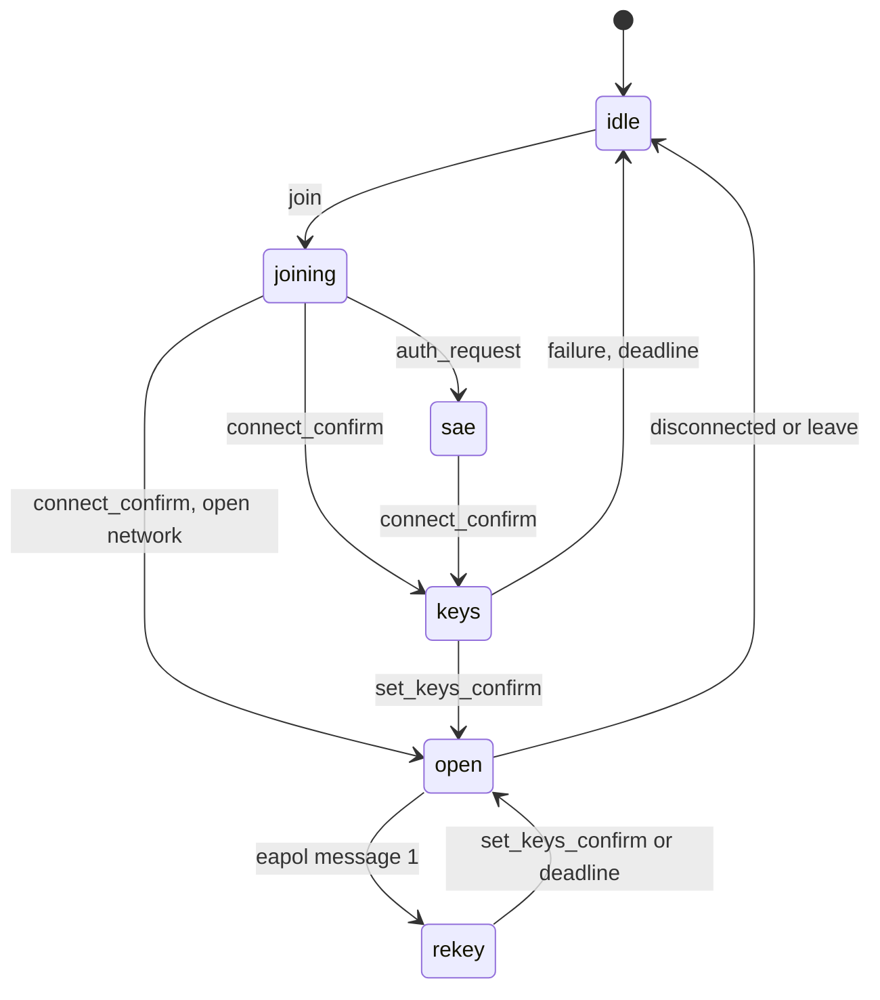
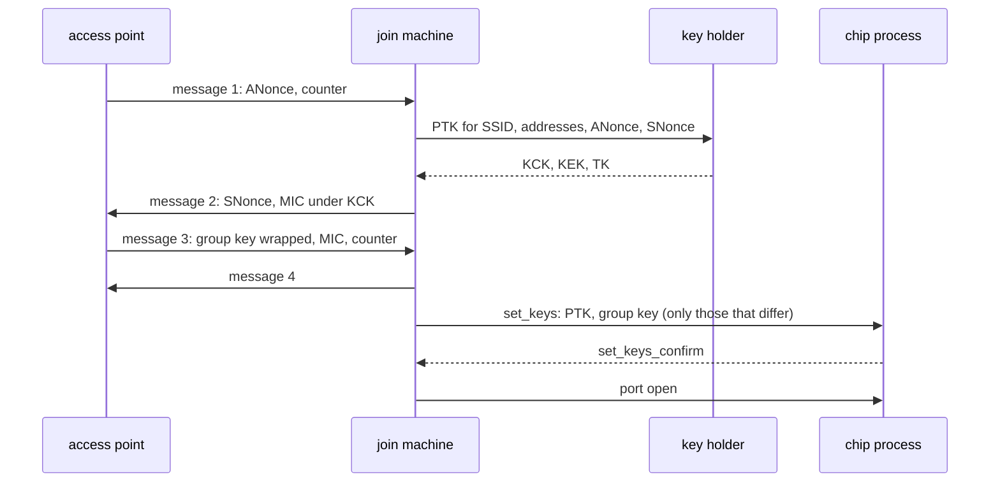

# Chapter 18. WiFi

> **Status.** Built as pure Erlang cores with host tests, driving no
> radio: the station's choice of a network, its join machine, its
> failure memory, the request module `erx_wifi_keys`, the public half
> of the WPA3 SAE exchange, the EAPOL-Key codec and the WPA key
> arithmetic. Designed: the SDIO host in the storage domain, the chip
> process and its firmware, the station's process, the key holder,
> SAE's three functions in OTP's `crypto`, the Transition Disable
> report, the `/proc` display of verdicts, the `wlan0` medium,
> `wpa_supplicant.conf`, `wlankey` and `ifconfig wlan0`. No WiFi
> driver runs on a board.

**Background needed.** [Chapter 3](03-erlang.md): processes, NIFs and
supervisors. [Chapter 6](06-construction.md), section 6.3: state
machines as pure cores. [Chapter 11](11-security.md), sections 11.6
and 11.11: facets and the vault. [Chapter 15](15-devices.md): drivers,
units and line owners. [Chapter 17](17-network.md#1721-one-owner-one-step): the network stack
and its interfaces.

A WiFi station, the device that joins a wireless network, takes bytes
from anyone within radio range. The access point it joins may be an
impostor with the right network name, and a message of the handshake
that agrees on keys may be a replay recorded an hour ago. In 2017
Vanhoef and Piessens showed that nearly every WPA2 implementation
could be made to install a key it had already installed, resetting
the counters that keep encryption safe. The bug was not in the
cryptography. It was in the order of events a supplicant, the program
that runs a station's handshakes, accepted.

A user sees FreeBSD's surface: `ifconfig wlan0 scan`, networks listed
in `wpa_supplicant.conf`, and DHCP on `wlan0`. Behind it, WiFi is one
domain of Erlang, the WiFi domain, which turns the Raspberry Pi 4's WiFi chip
into an Ethernet **medium**, the network stack's word for a link it
sends frames through ([chapter 17](17-network.md#1731-the-process-tree)). Its station is
three pure functions, one of them a state machine whose every legal
edge is one table, so the order of events it accepts is a value a
test can enumerate. The network's password never enters the domain
that parses the air. Sections 18.1 to 18.6 cover the chip, the
station, the keys, testing, failure and the design's choices.

> **Background: how WiFi works.** WiFi lets a computer join a network
> without a cable. An **access point** is the radio a network offers;
> a **station** is a device that joins one. Each access point has a
> hardware address, its **BSSID**, and announces a network name, its
> **SSID**, which many access points of one network share. A station
> finds them by **scanning** for their beacons, the frames an access
> point broadcasts to announce itself. It then **authenticates** and
> **associates**, two exchanges of management frames after which the
> access point accepts its frames. On a protected network a **key
> handshake** follows before any traffic passes: an exchange of
> messages by which station and access point agree on keys.

## 18.1 WiFi on the CYW43455

Almost everything that makes the Pi 4's WiFi chip a radio happens
inside the chip.

### 18.1.1 What the chip does, and what is left to the host

The CYW43455 is a **FullMAC** chip: its own processor runs firmware
that does the 802.11 work, from scanning, authentication and
association to encryption with installed keys and power saving
([design-wifi.md, What a FullMAC chip leaves to the
host](../design-wifi.md#what-a-fullmac-chip-leaves-to-the-host)). The
host loads the firmware and the per-country radio tables, runs the
key handshakes and moves Ethernet frames. Its control protocol sets
named variables in the chip, such as `wsec_key` for a key. It never parses an 802.11 frame or encrypts one.

The chip hangs off the SoC's older SD controller as an SDIO card.
SDIO is the SD card bus used for devices other than storage: the
host reads and writes the card's registers and data ports with SD
commands. The design follows OpenBSD's ISC-licensed `bwfm(4)` driver,
which does the whole host side.

### 18.1.2 Where the firmware is trusted, and where it is not

> **Background: firmware blobs.** Most radio chips run code their
> vendor ships only as a binary, a **firmware blob**, which nobody
> else can read or rebuild. A host that loads it trusts it to obey the
> radio rules and to report honestly what it receives. On many buses
> the chip can also write host memory, so a faulty blob can corrupt
> the host.

erXos splits that trust in two. The firmware holds the radio: what
the chip transmits, on which channel and at what power. The chip's
power enable is a line of the Pi's firmware-controlled GPIO expander,
which no domain reaches ([research-wifi-pi4.md](../research-wifi-pi4.md),
fact 1). Nothing else is trusted. An SDIO card cannot write host
memory, so every byte the chip sends is read through the controller's
data port and parsed as hostile input in one place, the WiFi domain.
A flood of events costs dropped frames, not memory: the **chip
process**, the one process that speaks the chip's protocol, passes
the station at most a fixed number of events at a time, of kinds the
chip sends again, and drops the rest
([design-wifi.md, The seam to the
station](../design-wifi.md#the-seam-to-the-station)).

The station above it asks for standard 802.11 operations, `scan`,
`connect`, `set_keys`, and names no firmware variable. The firmware's
own supplicant is turned off, so every check
of section 18.3 runs in Erlang, where it can be read and tested.

### 18.1.3 Three domains, one medium

WiFi touches three domains
([design-wifi.md, WiFi is a domain that makes a
medium](../design-wifi.md#wifi-is-a-domain-that-makes-a-medium)):

| Domain | Holds | Gives |
| --- | --- | --- |
| storage domain | the SD controllers and their shared line | the `sdio` facet: runs lists of SDIO transactions |
| WiFi domain, `wifi` | the chip process, the station, the firmware files | an Ethernet medium, `wlan0`, through the network domain's `ether` facet |
| network domain | the network stack | IP, DHCP and sockets over `wlan0` |

*Table 18.1. Where WiFi lives. The WiFi domain holds no device, no
register and no interrupt line, only facets and its files.*

The storage domain is there because of the unit rule
([chapter 15](15-devices.md#1551-the-unit-rule)). The older SD
controller shares interrupt line 126 with EMMC2, the controller of the
Pi's SD card, so both belong to one unit, given whole to the storage
domain. So the design puts a small **SDIO host** there, which brings
the card up and runs lists of transactions for one client without
understanding the chip. It polls instead of enabling the controller's
interrupt, so line 126 stays EMMC2's alone, and refuses writes to the
card registers its own state depends on, such as the bus width.

The network stack sees an ordinary medium: frames, a hardware address,
an MTU, the largest frame the link carries
([chapter 17](17-network.md#1721-one-owner-one-step)), and a link state. The link state is
the **port**, in the sense of IEEE 802.1X, the standard for access
control on a network link, and not an Erlang port. It lets data frames through only once the keys are in, so the
stack never carries traffic on an unauthenticated network. DHCP, the
protocol that hands a machine its address
([chapter 17](17-network.md#1731-the-process-tree)), starts when the link comes `up`. The
network domain parses no firmware format, holds no key and never
calls `crypto`.

All of section 18.1 is designed and not built.

## 18.2 The station: three pure parts

The station is three pure modules
([design-wifi.md, The station](../design-wifi.md#the-station)):

| Part | Module | Decides | Keeps |
| --- | --- | --- | --- |
| the choice | `erx_wifi_choose` | which access point to join, and why not each of the others | nothing |
| the join machine | `erx_wifi_join` | one join, from the request to an open port, and how it ended | the association's state |
| the failure memory | `erx_wifi_memory` | which access point and which password failed lately, and until when each waits | a bounded map |

*Table 18.2. The station's three parts. None calls another; the
station's process passes values between them.*

A thin process, `erx_wifi_station`, performs their actions, owns the
timers and hands each step the time and 32 fresh random bytes, so no
core reads a clock or a random source. The split follows the WLAN
stack of Fuchsia, Google's operating system. The three modules are
built, with host tests; the process is designed and not built.

### 18.2.1 The choice

The choice is a function of one value, the **view**: the configured
networks, those the key holder (section 18.3.1) has a password for,
the last scan, the failure memory, what the user asked for, what the
chip can do, and the time. It returns a **verdict** for every access
point scanned and at most one pick.

Take a scan that sees `home` at one address with WPA3, `home` at a
second with only WPA2, and an open `cafe`. The configuration has a
block for `home`, and the key holder has its password. The first
gets `{candidate, sae, required}`: SAE, with protection of the
management frames, which otherwise anyone can forge, required. The
second gets `{candidate, psk, capable}`: that protection offered but
not required. `cafe` gets `unknown`: nobody configured it and no
password is held, so a front end may offer to join it. The pick is
the candidate with the highest configured priority, then the
strongest signal, then the lowest address. The verdicts are designed
to be what `/proc` shows, so that a front end displays the value the
station acts on.

Three rules make the choice hard to fool:

* **Open is a statement, never an absence.** An open network is
  admitted only for a configured block that says `key_mgmt=NONE`, or
  when the administrator asks for that SSID's open network by name,
  never for a forgotten password or a key holder that does not
  answer. An impostor that advertises a saved SSID without protection
  is refused `not_open`.
* **Admission ignores failure.** The function that decides whether an
  access point is admitted, and with which key method, takes no
  failure memory as input, so a failed SAE exchange cannot make the
  station retry with WPA2; the memory can only postpone a candidate.
* **Every refusal has a name** from a closed list, such as
  `no_secret`, `no_sae_ext` or `not_open`.

### 18.2.2 The join machine

The **join machine** takes one candidate to an open port and keeps it
open until the link ends
([design-wifi.md, Joining](../design-wifi.md#joining)). Its states:
`idle`; `joining`, while the chip connects; `sae`, during WPA3's
password exchange; `keys`, during WPA2's four-way handshake; `open`;
and `rekey`, with the port still open while a new handshake replaces
the pairwise key (Figure 18.1).



*Figure 18.1. The WiFi join machine. Every state but `idle` also
returns to `idle` on `leave`, `disconnected` or a failed check; only
`rekey` returns to `open` on its deadline, since a forged message may
start a rekey and must not end the association.*

The edges are one Erlang term, not code scattered through the
handlers. Here is part of `table/0`, in
`erlang/apps/erx_wifi/src/erx_wifi_join.erl`:

```erlang
table() ->
    Ends = #{joining => [idle], sae => [idle], keys => [idle], open => [idle], rekey => [idle]},
    #{join => {fun join/4, #{idle => [joining]}},
      leave => {fun leave/4, Ends},
      connect_confirm => {fun connect_confirm/4, #{joining => [keys, open, idle], sae => [keys, idle]}},
      %% ... auth_request, auth_frame, auth_tx, key
      eapol => {fun eapol/4, #{keys => [keys, idle], open => [open, rekey, idle], rekey => [rekey, idle]}},
      %% ... set_keys_confirm, disconnected
      deadline => {fun due/4, #{joining => [idle], sae => [sae, idle], keys => [idle], rekey => [open]}}}.
```

For each kind of event the table names a handler and, per state, the
only states the handler may leave the machine in. `step/3` drops an
event with a stale join reference, then looks up the cell. An empty
cell, such as an EAPOL frame in `joining`, drops the event and counts
it. A handler that returns a state outside its cell is a bug that
ends the station. The same term drives the dispatch and the
exhaustive test of section 18.4. Every waiting state has a deadline
cell: 10 s for the connect, 5 s for the SAE exchange, 10 s for the
handshake's first message and 5 s for each later one, values to be
tuned on a board.

A join that ends closes the port, deletes every installed key and
returns to `idle` with one report, `{ended, Class, Reason}`, whose
class the failure memory learns. It is `secret` when the station sent
something a password guess can be tested against offline and the
peer never proved it knows the password: for WPA2, message 2 sent and
no valid message 3; for SAE, the station's confirm sent and no valid
confirm back. It is `bss` for other failures before the port opened,
or a port that closed within 10 s, and `none` for a deliberate
`leave` or a long-lived link that ended.

### 18.2.3 The failure memory

The **failure memory** maps an access point or an SSID to a count and
a time
([design-wifi.md, Failure memory](../design-wifi.md#failure-memory)).
A join that ends `bss` or `secret` holds that access point for 10 s,
doubling with each consecutive failure up to 300 s, so a broken
access point does not block the rest of its network. Three
consecutive `secret` endings hold the SSID's password for 300 s,
doubling up to an hour, with the verdict `{held, secret_failed,
Until}`: "the password may be wrong". A new password ends the hold.

The hold always ends by itself (section 18.6 says why), compared with
the time at each choice, so the memory has no timer. It keeps at most
32 access points, and a restart of the domain empties it. The memory
is built, in `erx_wifi_memory.erl`.

## 18.3 Keys

The station's keys come from a password, but the WiFi domain never
holds the password or a value equivalent to it.

> **Background: WPA2 and WPA3.** WiFi protection exists so that
> someone in radio range cannot read or inject a network's traffic.
> Under **WPA2-PSK**, the station and access point turn a shared
> passphrase into a 32-byte **PMK** (pairwise master key) with PBKDF2,
> salted with the SSID, 4,096 rounds. The **four-way handshake**, whose
> messages travel in **EAPOL-Key** frames, exchanges two **nonces**,
> random numbers used once, and derives a **PTK** (pairwise transient
> key) from the PMK, both nonces and both addresses. The PTK splits
> into a key for the **MIC**, a keyed checksum that proves a message
> came from a holder of the keys, one that wraps the group key, and
> one that encrypts traffic. Each message carries a counter the access
> point increases, so an old message can be told from a new one. The
> handshake proves each side knows the PMK without sending it, but a
> recorded handshake lets an eavesdropper test password guesses
> offline, at its own speed. **WPA3-SAE** replaces the PMK from a
> passphrase with a password exchange by Dan Harkins, a variant of what
> he later published as the Dragonfly key exchange. It yields a fresh
> PMK each time and lets each exchange test only one guess.

### 18.3.1 The key holder

Every network's long-term secrets live with the **key holder**, a
purpose of the vault ([chapter 11](11-security.md#11112-the-vault)),
which here keeps network secrets as well as signing keys. Like Plan
9's factotum, it answers the secret steps of each join and never
gives out a secret
([design-wifi.md, Credentials](../design-wifi.md#credentials)). The
administrator's `wlankey` command reads a network's passphrase at its
terminal and computes there the PMK for WPA2 and two hashed values.
From those the holder makes **PT**, the value derived from the
password that SAE starts from, as WPA2 starts from the PMK. The
passphrase itself is kept nowhere.

The station reaches the holder through its own facet, `wpa_key`, by
one module, `erx_wifi_keys`. It asks for each PTK by naming the SSID,
the key method, the two addresses and the two nonces, and gets back
the three keys. Only the administrator's facet can add, replace or
forget a network. Nor does `wpa_supplicant.conf` hold a password: the
station refuses a file with `psk` or `sae_password` in it. The
request module is built; the holder, `wlankey`, the facets and the
configuration reader are designed and not built.

### 18.3.2 The four-way handshake, and each key installed once

Figure 18.2 traces a WPA2 join after association, as the join machine
runs it in its `keys` state.



*Figure 18.2. The key exchange between station and access point. The
machine derives no key itself, and opens the port only once the chip
has confirmed every key.*

Message 1 carries no MIC, so the machine only draws a fresh nonce and
asks the holder for the pending PTK. Message 3 passes checks in a
fixed order
([design-wifi.md, The 4-way
handshake](../design-wifi.md#the-4-way-handshake)): a counter above
the last one accepted, the same ANonce as message 1, a valid MIC
under the pending PTK, key data that unwraps, and an RSN element, the
access point's statement of its security options, equal byte for
byte to the one the scan reported. A mismatch there means the scan
saw a forgery, and the station drops the association.

The reinstallation attack of 2017 replays message 3: a supplicant that
installs the same key again resets its packet counter, and the
cipher's safety depends on never reusing one. The join machine keeps
three things per association: the **replay watermark**, the counter of
the last message accepted under a valid MIC; the pending PTK; and the
**key slots**, for each slot of the chip the key it was last asked to
hold, the install that asked, and whether the chip confirmed it. Then
one rule: a `set_keys` request carries only the keys that differ from
their slot's. A retransmitted message 3 yields the PTK already in the
slot and installs nothing; a replayed one is refused by the watermark
before any key is read. A genuine rekey still installs, because a new
message 1 brings a new nonce and so a different PTK. The one rule
covers the pairwise key and every group key alike. A confirmation
confirms only the slots its own install filled, so a late one never
confirms a newer key.

The handshake, the slots and the watermark are built, in
`erx_wifi_join.erl`, with the EAPOL-Key frame codec in
`erx_wpa_key.erl` and the MIC, key derivations and AES key unwrap in
`erx_wpa_kdf.erl`. What differs between WPA2-PSK, its SHA-256 variant
and SAE is one row per key method in each of three tables in
`abi/formats/ieee80211.txt`, generated into Erlang
([chapter 7](07-one-source.md)).

### 18.3.3 SAE: a public half and a secret half

SAE runs on the host through the firmware's external authentication:
the firmware asks the host to authenticate and passes SAE's frames
([design-wifi.md, SAE and protected management
frames](../design-wifi.md#sae-and-protected-management-frames)). Each
side sends a **commit**, two numbers built from PT and fresh random
values, from which the password cannot be read; then a **confirm**, a
MAC over both commits under a key derived from the shared secret. The
design draws the line between the WiFi domain and the key holder
through the middle:

| Step | In the WiFi domain, `erx_sae` | In the key holder |
| --- | --- | --- |
| the station's commit | asks; builds the frame | draws the random values, computes scalar and point, keeps them |
| the peer's commit | parses and checks it: the group, ranges, not a reflection of the station's own | |
| the keys | asks with the peer's scalar and point | computes the shared secret, the confirm key (KCK) and the PMK; returns only the KCK |
| the confirms | builds and checks them under the KCK | |
| each PTK | asks | derives it from the PMK it kept |

*Table 18.3. Who computes what in SAE. A commit's two numbers are a
scalar and a point on an elliptic curve. Of what lets a password
guess be tested, only the commit, which goes on the air anyway, and
one exchange's KCK leave the holder.*

`erx_sae`, the public half, uses the method in which PT is computed
once from the password rather than per exchange. Its states are
`nothing`, `committed`, `confirmed` and `accepted`, with two more
while the holder works. While the holder
computes the keys of one peer commit, any other commit is dropped, so
the station confirms only over the commit whose key it asked for.
`erx_sae` is built, and runs in its tests against a test-only holder
and access point (`test/erlang/erx_sae_peer.erl`) that do the
arithmetic on integers.

The secret half cannot: elliptic-curve arithmetic on Erlang integers
runs in time that depends on the secret, and OTP's `crypto` has no
such operation. The design adds three functions to it, `sae_pt/3`,
`sae_commit/5` and `sae_key/5`, each one whole step of SAE taking and
returning binaries, so no secret ever becomes an Erlang integer
([design-wifi.md, OTP's `crypto`: SAE's
arithmetic](../design-wifi.md#otps-crypto-saes-arithmetic)). They are
designed and not built.

Two rules close downgrades. A block that allows both WPA2 and WPA3
lets an impostor advertising WPA2 alone collect a handshake to guess
against; a block of `key_mgmt=SAE` alone refuses WPA2, and that rule
is built. A WPA3 access point's message 3 may also carry the
Transition Disable indication, under a MIC only SAE's PMK could make,
saying its network no longer serves WPA2. The station is designed to
mark the SSID SAE-only for good on that signal; that report is
designed and not built, though the choice already refuses WPA2 for a
marked SSID.

## 18.4 Testing a radio without a lab

No WiFi driver runs on a board, yet the cores that decide everything
a radio attacker can influence run in every `make check`. Being pure,
they need no chip, no air and no timer.

The largest test (`test/erlang/erx_wifi_join_tests.erl`) takes every
sequence of events up to five steps deep, replays and forgeries
among them. It runs against three fakes: an access point that
computes real MICs and wraps real key data, a key holder that derives
each PTK, and a chip that records what each key slot holds and has
held. After
every step it checks that the port opens only with every key
confirmed, no key is installed again, a forged or stale frame
installs nothing, and a genuine handshake can still complete. It
covers WPA2-PSK, its SHA-256 variant, SAE and open networks, visits
more than 1,000 distinct states, and requires the edges it took to
be exactly those of `table/0`.

The arithmetic is checked against published test vectors, inputs
with known right answers: key derivations against IEEE 802.11 Annex
J, AES key unwrap against RFC 3394, and SAE's PT against Annex J.10.
`erx_sae` runs full exchanges against the test access point,
including an off-curve peer point. The EAPOL-Key codec and the SAE
frame parser have fuzz targets (`tools/fuzz/erx_wpa_key.rb`,
`tools/fuzz/erx_sae.rb`). The Ruby runner
`test/host/erx_wifi_station_test.rb` proves the tests can fail: it
rebuilds a core with one planted fault, such as an admission that
drops SAE for an access point the memory holds, and requires the test
named for that fault to fail.

No host test can tell how the chip and board behave. The design
lists such facts
([design-wifi.md, Facts this design does not
have](../design-wifi.md#facts-this-design-does-not-have)), such as
whether the firmware offers external SAE at all. What is known of the
board is gathered in a clean-room facts record
([research-wifi-pi4.md](../research-wifi-pi4.md)).

## 18.5 What fails, and what it reaches

A crash of the WiFi domain is designed to end only its medium and its
SDIO attachment: `wlan0` goes down, and the storage domain's files and
the network domain's other interfaces carry on. Its restart reloads
the firmware, which starts with no keys, so the slots and the chip
agree again. A card that does not answer at bring-up is reported, and
the WiFi domain stops.

A break of the WiFi domain's parsers gives an attacker the medium,
which a radio attacker already has, the keys of the association in
progress, and use of `wpa_key` while the break lasts
([design-wifi.md, Security](../design-wifi.md#security)), but no PMK
and no PT. The PTKs let it guess a WPA2 passphrase offline, as a
recorded handshake does; under SAE each exchange tests one guess. It
cannot add, replace or forget a network, so nothing of its choosing
outlives a restart.

## 18.6 Design choices

**WiFi in the network domain.** The 802.11 layer could sit beside the
IP stack. That would put a firmware parser, keys and `crypto` into
the domain every socket depends on; a separate domain costs one
facet.

**The firmware's supplicant, or its own SAE.** The firmware can run
WPA2's handshake, which would hide the checks of section 18.3.2 inside
a blob, and SAE from a password, which would hand the password to the
chip. erXos turns the first off and refuses the second; a firmware
without external SAE means WPA3 is reported unsupported.

**One score, or separate parts.** The station could rank access points
with one score that adds a bonus for never having failed to bonuses
for RSN and privacy, so a forged failure can move a station to a
weaker method. erXos keeps admission apart from the memory (section
18.2.1).

**A hold a person must lift.** The station could disable a network
after a wrong password until the user acts. An impostor in range can
make any join fail, so such a hold turns minutes of interference into
an outage of an unattended board. A hold that doubles to an hour and
then lifts bounds an attacker who keeps every join failing to about
one exchange an hour.

## Summary

The Pi 4's CYW43455 runs 802.11 in its own firmware. erXos's WiFi
domain holds no device: it reaches the chip through the storage
domain's SDIO host, parses every byte the chip sends as hostile
input, and lends the network stack one Ethernet medium whose link
state is the 802.1X port. The station's choice admits an open network
only on an explicit statement and never weakens on failure. Its join
machine's edges are one table, read by the dispatch and the
exhaustive test alike. Each key is installed once, because a request
carries only keys that differ from their slot's. Passwords stay with a key holder that
answers SAE's secret steps. The cores are built and tested on the
host; the driver, the holder and the medium are designed.

## Where to read next

* [design-wifi.md](../design-wifi.md): the full design, with every
  check of the handshakes, the SDIO host and the chip's protocol.
* [research-wifi-iwd.md](../research-wifi-iwd.md): a clean-room facts
  record of the station of iwd, Intel's WiFi daemon for Linux, which
  the choice and memory draw on.
* [research-wifi-pi4.md](../research-wifi-pi4.md): the clean-room
  facts record of the Pi 4's WiFi slot.
* Mathy Vanhoef and Frank Piessens, "Key Reinstallation Attacks:
  Forcing Nonce Reuse in WPA2", ACM CCS 2017: the attack section
  18.3.2 is built against.
* Dan Harkins, "Simultaneous Authentication of Equals: A Secure,
  Password-Based Key Exchange for Mesh Networks", SENSORCOMM 2008: the
  origin of SAE.
