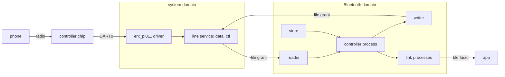
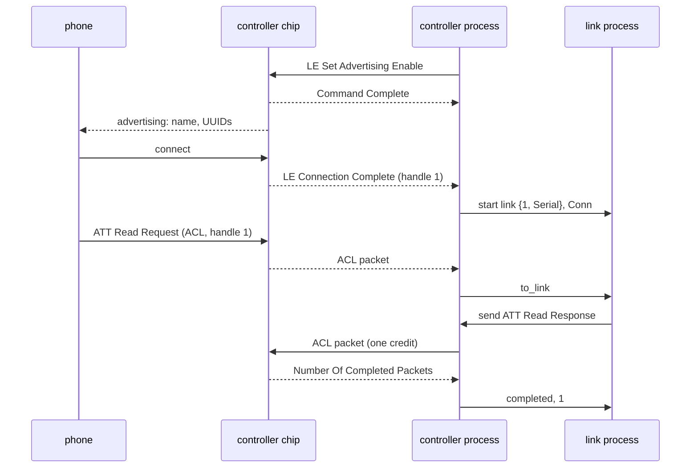

# Chapter 19. Bluetooth

> **Status.** Built, with host tests, running on no board: the H4
> framing and the HCI codec; the controller process, its pure core,
> its reader, writer, link processes and supervision; the patch
> reader; the advertising data; the identity address; and the system
> domain's line service. Designed: a manifest that runs the Bluetooth
> domain on the Raspberry Pi 4; the controller's power cycle; the
> GATT server, its access gate and the `ble` facet; the serial
> service; pairing and bonding; Wi-Fi provisioning and HID over GATT;
> and the tests against a Bumble peer.

**Background needed.** [Chapter 3](03-erlang.md), sections 3.3 and
3.4: links, supervisors and restart strategies.
[Chapter 6](06-construction.md), section 6.3: a pure core with its
effects at the edge. [Chapter 14](14-files.md), sections 14.2 and
14.5: file trees, stream files and keepers, `ctl` files.
[Chapter 15](15-devices.md), sections 15.1 and 15.5: drivers and the
unit rule.

Anyone within radio range of a Raspberry Pi 4 can send bytes to its
Bluetooth chip. The chip's firmware is closed: it parses what comes
over the air, then hands the host what it decided to pass on. A host
stack that trusts those bytes trusts both the firmware and every
stranger in the room.

FreeBSD implements its Bluetooth stack in the kernel, as nodes of the
`netgraph(4)` framework: a driver such as `ng_ubt` for USB dongles,
one HCI node for each device and an L2CAP node above it (FreeBSD
Handbook, "Bluetooth"). A parser defect in any of those nodes is a
defect in kernel mode.

erXos parses every byte that comes from the controller in a domain of
its own, the **Bluetooth domain**, written in Erlang. That domain
holds no device. The system domain holds the UART the chip sits on
and serves it as a file tree with two files, `data` and `ctl`,
parsing none of the bytes it moves. Above the line, one controller
process, built around a pure core, drives the chip, and a link
process per connection carries each phone's traffic.

Section 19.1 says what erXos offers a phone. Section 19.2 places the
parts; 19.3 decodes what the controller sends; 19.4 follows the
controller process through a bring-up and a connection; 19.5 covers
failure; 19.6 the design above the controller; 19.7 testing; 19.8 the
choices.

## 19.1 Bluetooth Low Energy, peripheral first

What does a phone see when it meets an erXos machine? In the design,
a device that advertises its name and services, accepts a connection,
and answers the phone's reads and writes. erXos takes the
**peripheral** role, the side that advertises and waits, before the
central role that scans and connects.

> **Background: how Bluetooth Low Energy works.** Bluetooth Low
> Energy (BLE) lets a small device and a phone find each other and
> exchange a few bytes at a time without much power. A peripheral
> **advertises**: it sends short packets, at most 31 bytes of data
> each, on three advertising channels at a fixed interval. The
> packets carry its name or the identifiers of its services, each a
> **UUID** (a 16-bit or 128-bit number). A **central**, such as a
> phone, scans for these packets, may ask for a second packet, the
> **scan response**, and then connects. Once connected, the two
> exchange data packets over the connection until either side
> disconnects.

> **Background: the attribute protocol.** Once a phone is connected,
> it reads and writes the peripheral's data through the **attribute
> protocol** (ATT). The peripheral is the ATT server. It holds a
> table of **attributes**, each a value with a type and a small
> number, its attribute handle, by which the phone names it. The
> phone reads or writes an attribute by that number; the server may also **notify**
> the phone when a value changes, or **indicate** it, which is a
> notification the phone confirms. The Generic Attribute Profile
> (GATT) groups attributes into **services**, each made of
> **characteristics**: a heart-rate service holds a measurement
> characteristic, for example. A packet carries at most 23 bytes of
> ATT by default, unless both sides agree on more.

The design offers a phone four things, each specified in
[design-bluetooth.md](../design-bluetooth.md#requirements):

1. Its name and the UUIDs of its advertised services, in a phone's
   scanner.
2. The characteristics that apps on the machine declare, to read,
   write and subscribe to.
3. A byte stream between a phone and an app, shaped like Nordic's UART
   service so that existing phone terminal apps open it.
4. Pairing and bonding by LE Secure Connections, so that a
   characteristic can require an encrypted or an authenticated link.

Of these, only the advertising data of the first is built; the rest
is designed and not built.

The machine does not scan for devices or connect to them: the central
role belongs to the design of HID over GATT, for keyboards and mice,
which is designed and not built. It offers no classic Bluetooth, the
older BR/EDR radio of headsets, and none is designed. It pairs only by
LE Secure Connections, the form of pairing built on elliptic-curve key
agreement, never by the older legacy pairing.

## 19.2 Where the parts run

Which domain holds the chip, and which reads what it says? The system
domain holds the chip's UART; the Bluetooth domain reads its bytes.

> **Background: the host controller interface.** A Bluetooth chip
> runs the radio and the protocol's timing on its own processor; the
> main computer, the **host**, runs everything above. The two talk
> over the **host controller interface** (HCI), defined in the
> Bluetooth Core Specification. The host sends **commands** ("reset",
> "start advertising"), and the controller answers with **events**
> ("command complete", "a connection completed"). Both send **ACL
> data packets**, which carry a connection's traffic. Each is tagged
> with a **connection handle**, a small number the controller assigns
> to a connection and reuses after it ends. On a serial line, the H4 transport
> puts one byte before each packet to say which kind follows.

On the Raspberry Pi 4 the Bluetooth controller is a Cypress CYW43455,
wired to UART0, the first of the board's five PL011 UARTs
([design-bluetooth.md, The hardware](../design-bluetooth.md#the-hardware)).
The five PL011s share one register page and one interrupt line. Under
the unit rule of [chapter 15](15-devices.md#1551-the-unit-rule) they
are therefore one unit, which one domain holds whole: the system
domain, which needs UART3 for the host link. The Bluetooth domain
cannot hold UART0 without holding the host link too.

So the system domain serves the controller's line as erXos serves
anything a holder shares: as a file tree with a `ctl` file
([chapter 14](14-files.md#145-state-is-a-file-to-read-control-is-a-file-to-write)).
The **line service**, `erx_line`, serves one **line tree** for each
grant of the `line` interface, which `abi/services/line.txt` declares:

| File | Read | Write |
| --- | --- | --- |
| `data` | the bytes the controller sent, waiting while there are none | bytes to send, in order |
| `ctl` | refused | `reset`, and nothing else |

"Line" here means a serial line, not the interrupt line of chapter
15's line owner. The line service moves bytes between the file and
its UART driver, `erx_pl011`, and parses none of them. Its one input
grammar is `ctl`'s single word, which has a fuzz target. A read of
`data` that must wait is held by the line's process, its keeper
([chapter 14](14-files.md#1425-stream-files-and-keepers)), so a read
waiting for the controller holds up no write. If the controller sends
more than the 64 KiB receive buffer holds, the line is marked
**broken**: its buffer is dropped and every read answers `eio` until
the next `reset`.

A `reset` puts the line in one known state, whatever the last run
left ([design-bluetooth.md, A reset](../design-bluetooth.md#a-reset)).
It stops the UART driver, turns the controller off, starts the driver
again with the UART programmed from nothing, turns the controller on,
and discards whatever the controller sent while it powered up. The
fresh programming of the PL011 and the reset's steps without power
are **Built** in `erlang/apps/erx_uart/src/erx_line.erl` and
`erx_pl011.erl`, with host tests over a model driver. The power steps
are designed and not built: the controller's enable line is a pin of
the firmware's GPIO expander, `BT_ON` in the board's device tree
([research-wifi-pi4.md](../research-wifi-pi4.md#f3-host-wake-out-of-band-interrupt)),
and a board probe settles its pin and polarity.

The Bluetooth domain mounts its grant of the line at `/line` and
opens `/line/data` and `/line/ctl` as ordinary files. In the design
its manifest row holds that grant and, for pairing, a store and a
login facet. The manifest check refuses anything more, because a
stranger in radio range reaches whatever the domain holds through a
parser defect. Figure 19.1 shows the whole path.



*Figure 19.1. The Bluetooth controller process and its line to the
chip. The system domain moves bytes and parses none; every byte from
the chip is decoded in the Bluetooth domain, which holds no device.*

The line service and the Bluetooth stack, `erx_bt`, are built, and
the build makes a release for a domain named `bt`. No manifest erXos
ships names that domain or grants a line, so no boot runs the stack
over a UART. The `ble` facet in the figure is designed and not built.

## 19.3 The HCI codec

How does a stream of bytes from a hostile chip become something an
Erlang process can act on? The H4 framing cuts the stream into
packets, the HCI codec decodes each packet into a checked term, and
nothing after the codec sees raw bytes. Both are pure functions.

The framing is `erx_h4:split/1`
([design-bluetooth.md, H4 framing](../design-bluetooth.md#h4-framing)).
It takes the bytes read so far and returns every whole packet and the
remainder, an incomplete packet that waits for the next read. Erlang's
binary matching does the work:

```erlang
split(<<?ERX_H4_INDICATOR_EVENT, Code, Length, Parameters:Length/binary,
        Rest/binary>>, Packets) ->
    split(Rest, [{event, Code, Parameters} | Packets]);
split(<<?ERX_H4_INDICATOR_ACL, _:16, Length:16/little, _/binary>>, _Packets)
  when Length > ?ERX_BT_ACL_RX_MAX ->
    {error, {acl_too_long, Length}};
split(<<?ERX_H4_INDICATOR_ACL, Word:16/little, Length:16/little,
        Data:Length/binary, Rest/binary>>, Packets) ->
    split(Rest, [acl_packet(Word, Data) | Packets]);
split(<<Indicator, _/binary>> = Rest, Packets)
  when Indicator =:= ?ERX_H4_INDICATOR_EVENT;
       Indicator =:= ?ERX_H4_INDICATOR_ACL ->
    {lists:reverse(Packets), Rest};
split(<<Indicator, _/binary>>, _Packets) ->
    {error, {bad_indicator, Indicator}};
split(<<>>, Packets) ->
    {lists:reverse(Packets), <<>>}.
```

The first clause matches only when the event's whole length is
present, so nothing reads past the input. An ACL packet longer than
251 bytes, the host's own bound, is an error before its data is
read, and so is an indicator the host never enabled. The
specification calls either case a loss of synchronization, after
which a reset is needed (Core Specification 6.3, Vol 4 Part A).
erXos answers it the same way: the controller process stops, and its
restart resets the line and the controller. The bound is a constant,
not a value the controller reported, so a controller cannot raise it.

The codec, `erx_hci`, decodes each event against the layout its
section of the specification gives. A length that does not match the
layout gives `malformed`, never a partial read. An event the host
does not use gives `{unknown, Code}`, which the controller process
counts and drops. No atom is made from input, so a chip cannot fill
the atom table
([chapter 3](03-erlang.md#355-the-atom-table)).

Every code the codec uses, the packet indicators, the opcodes, the
event codes and the bounds, comes from one file,
`abi/formats/bluetooth.txt`, from which the build generates the
Erlang macros such as `?ERX_H4_INDICATOR_EVENT`. That is the rule of
[chapter 7](07-one-source.md#71-parallel-copies-and-the-rule-that-replaces-them)
applied to a radio protocol; the file cites the specification's
section for each value.

The framing and the codec are **Built**, with a fuzz target that
mutates inputs written from the specification's layouts and must
catch each of its seeded faults, such as the ACL bound removed
(`tools/fuzz/erx_bt_hci.rb`).

## 19.4 The controller process

One process owns everything about the controller: the bring-up, the
command in flight, the controller's data buffers, the map from
connection handles to connections and whether it is advertising. It is
`erx_bt_hci`, and its pure core, `erx_bt_hci_core`, takes every
decision, in the shape of
[chapter 6](06-construction.md#63-functional-core-effects-at-the-edge):
`step(Input, Now, Core)` returns the next state and a list of
actions. The process turns each message into an input: a decoded
event, the writer's answer, a timer or a link's request. It reads the
clock, steps the core and performs the actions in order: reset the
line, write bytes, start, end or tell a link, or stop with a reason.
All of this is **Built**.

### 19.4.1 The bring-up, a line of steps

A freshly powered controller knows nothing of the host. The bring-up
is a fixed list of steps that the core builds when it is created
([design-bluetooth.md, The bring-up](../design-bluetooth.md#the-bring-up)):

1. Reset the line: write `reset` to `ctl`.
2. `HCI_Reset`.
3. Identify the controller: its version, its supported commands and
   features, its address.
4. Load the patch, where the manifest names one, then reset and
   identify again.
5. Ask the controller's buffer sizes, and tell it the longest packet
   the host accepts.
6. Configure: the events the host wants, the machine's address, and
   the advertising parameters and data.
7. Ready: enable advertising.

Each command step waits for its Command Complete with status success.
Any other answer, or none before the deadline, stops the process with
the step and the status as its reason, so a bring-up reaches `ready`
or ends with a stated cause. The steps after the patch are distinct
from the first ones, so the list has no loop.

The core keeps at most one deadline, in a field called the **slot**,
which also says what the deadline guards: a line reset, a wait, a
command due, or a command sent. A second timer, or cancelling one
never armed, cannot be written, because a deadline exists only inside
the slot state it guards. Time is an input: a wake-up before the
deadline changes nothing, so an early or repeated timer costs one
look.

### 19.4.2 The patch

Hosts that drive this chip load a patch into its RAM first: a vendor
file of HCI commands, `BCM4345C0.hcd` for the Pi 4, which the
bring-up replays one record at a time. `erx_bt_patch` reads the file
whole before the first record is sent. It accepts the file only when
it consists entirely of complete Write RAM and Launch RAM records, and
otherwise refuses it whole: a damaged file sends nothing, rather than
half a patch. The manifest also names the manufacturer the patch is
for. A controller that reports another stops the bring-up, so no
vendor command reaches a chip it was not written for. The reader and
these checks are **Built**, with host tests; whether the Pi 4's chip
needs the patch at all is a question for a board probe.

### 19.4.3 Commands and data credits

The controller says how many commands it accepts at once and how many
data packets its buffers hold. The process keeps one command in
flight, enough for a host whose commands are few and never urgent, so
every answer is the answer to the last command. An
answer that names any other command stops the process, as a loss of
synchronization does.

Data packets are counted differently. Each live handle counts its
packets in flight, and the free buffers are the controller's total
less the sum. When the controller reports packets completed, a report
for a handle that is not live, or for more packets than that handle
has outstanding, stops the process. A forged report therefore cannot
grow the free count, and the count cannot fall below zero. Free
buffers are derived, never stored, so a disconnection returns a
handle's buffers by removing the handle.

### 19.4.4 A connection, end to end

Figure 19.2 follows one phone from the machine's advertising to one
attribute read.



*Figure 19.2. Advertising, connecting and one attribute read. The
controller process owns the handle and the credits; the link process
owns the conversation. The attribute read itself, ATT in the link, is
designed and not built: the link processes that are built drop every
ACL packet and count it.*

When the controller reports a connection, it has already stopped
advertising. The core starts a link process and names it `{Handle,
Serial}`, where the serial counts the core's connections. Every
request a link makes carries that name, and the core first checks
that the name is still its handle's current link. Suppose a phone
disconnects and the controller gives handle 1 to the next phone: a
request the old link sent late changes nothing, and its packet never
reaches the new phone. The link also gets a fresh Erlang reference,
its `Conn`, which is the name apps use in the design. It is the rule
of [chapter 15](15-devices.md#1572-a-name-dies-at-once-hardware-later):
a name dies at once, and the hardware's resource, here the handle's
buffers, returns only when the controller reports Disconnection
Complete. Advertising stays on exactly while connections are below
the manifest's limit, one by default.

### 19.4.5 Advertising and the machine's address

The advertising data, with the service UUIDs, and the scan response,
with the name and the appearance (a number that tells a phone what
kind of device to show), are a pure function, `erx_bt_adv:data/1`.
Each is at most 31 bytes; a name that does not fit is shortened at a
character boundary.

The machine's address on the air is a **static random address**, made
from the kernel's random number generator, which names neither the
board nor its chip
([design-bluetooth.md, The identity address](../design-bluetooth.md#the-identity-address)).
As with its IPv6 addresses, a phone learns nothing about the
hardware. The store, `erx_bt_store`, owns the
address and makes it at its start; the controller process asks for it
at each of its own starts, so a restart of the controller keeps the
machine's identity. Both are **Built**.

## 19.5 Supervision and failure

What happens when the controller sends garbage, or a link misbehaves?
In almost every case the answer is the same: the part that saw it
stops, and its restart resets the line and the controller, so the next
bring-up starts from one state.

The supervision tree in `erlang/apps/erx_bt` is **Built**:

* **`erx_bt_sup`**, the top, is `rest_for_one` with the store first
  and the controller group second. A restart of the store restarts the
  group after it; a restart of the group leaves the store and its
  address alone.
* **The controller group**, `erx_bt_host_sup`, is `one_for_all`, at
  most five restarts in 60 seconds, of the link supervisor, the
  line's reader and writer, and the controller process, started in
  that order. Any child's end ends all four, so they always belong to
  one run of the core.
* **The link supervisor** starts each link as a temporary child, never
  restarted. A link that ends is a disconnection, and the phone
  reconnects.

| What fails | What ends | What the next state is |
| --- | --- | --- |
| a malformed packet, an unknown indicator, an over-long ACL packet | the controller process, so the group | the line reset, the controller reset, a fresh bring-up |
| a command unanswered by its deadline, or answered with a failure | the group | the same |
| a read or write of the line fails, or `reset` answers `eio` | the reader or writer, so the group | the same |
| a link process crashes | that link | the core disconnects its handle with reason Remote User Terminated Connection; the phone may reconnect |
| a late request from a link that has gone | nothing | the core ignores it |
| more than five group restarts in 60 seconds | the group, so `erx_bt_sup` restarts it | `erx_bt_sup` sets no restart intensity of its own, so OTP's default applies |

A restart costs one bring-up, during which the machine does not
advertise, and every connection, since no link outlives the core
that named it; a connected phone sees a disconnection and
reconnects. The trade is deliberate: the alternative is a case for
each half-finished state a controller can be left in, and the reset
removes all of them.

## 19.6 The design above the controller

What does an app write to offer a phone a characteristic, and who
decides whether the phone may read it? The design answers with
configuration and one function. Everything in this section is
designed and not built.

An app declares its services as data, one checked-in file per service
under `abi/gatt/`
([design-bluetooth.md, Declarations](../design-bluetooth.md#declarations-abigatt)).
In the design, the serial service's file reads:

```text
service nus 6e400001-b5a3-f393-e0a9-e50e24dcca9e advertise
characteristic rx 6e400002-b5a3-f393-e0a9-e50e24dcca9e 244 write open write_without_response open
characteristic tx 6e400003-b5a3-f393-e0a9-e50e24dcca9e 244 notify open
```

Each characteristic names its accesses and the level each requires:
`open`, `encrypted` or `authenticated`. The manifest selects which
services a machine serves. The Bluetooth domain builds its attribute
table once at its start, and nothing adds or moves an attribute while
the domain lives, so no handle moves under a connected phone.

Every access then passes one pure function, the **gate**
([design-bluetooth.md, One table, one gate](../design-bluetooth.md#one-table-one-gate)).
It takes the access, the level the declaration requires and the link's
security, and answers allowed or the ATT error the specification
gives. The link's security is not a field a phone can send: it is set
only by the controller's report that encryption started, with the one
key the link holds in its life. So no app checks security, and none
can forget to: an app's handler sees a write only after the gate
allowed it.

Pairing happens only in a window that someone opened by opening the
control tree's `pair` file, and the window ends with its first
pairing. After a failure the next attempt waits, from 2 up to 64
seconds, and the wait outlives every window. A pairing never replaces
a bond; only an explicit `forget` ends one
([design-bluetooth.md, The pairing window](../design-bluetooth.md#the-pairing-window)).

## 19.7 Testing a radio without a lab

QEMU emulates no Bluetooth controller, and the Pi 4 is tested by hand.
How, then, is the stack tested? Mostly on the host, where the cores
need no radio.

The controller's core is explored exhaustively
(`test/erlang/erx_bt_hci_tests.erl`). The test starts from `start`
and walks, breadth first, every state reachable by the inputs it
models, until no new state is left. By the test's own count that is
about 160,000 states for each configuration, with up to three
connections, so that a handle is reused while another is live. In
every state it checks that the free buffers never go below zero,
connections never pass the limit, a request from a gone link changes
nothing, and the process stops only for a listed reason. Seeded
faults ([chapter 6](06-construction.md#651-seeded-faults)), such as a
handle kept live after its Disconnection Complete, must make it fail.

The controller group runs over a model of the line
(`test/erlang/erx_bt_group_tests.erl`): it reaches `ready` again
after the controller process is killed, keeps its address, and turns
a killed link into one disconnect command. The patch reader, the line
service and the PL011 programming have host tests of their own. All
of these tests are **Built**.

For the protocol above HCI, the design uses Bumble, a Bluetooth stack
written in Python (Google, Bumble README). Its virtual controllers
speak H4 over a TCP socket
([design-bluetooth.md, Hosted mode against Bumble](../design-bluetooth.md#hosted-mode-against-bumble)).
erXos runs in [hosted mode](09-processes.md#962-hosted-mode) with one
virtual controller as its line, while a Bumble peer on another scans,
connects, reads and pairs; Python runs only the peer's scripts. Each
test has a seeded fault, such as advertising data built with the
wrong list type, which must make the UUIDs vanish from the peer's
scan. This harness is designed and not built.

Some questions only a board answers, and the design lists them as
board probes
([design-bluetooth.md, Board probes](../design-bluetooth.md#board-probes)).
Does the firmware leave the UART's pins and the controller's power as
the design expects? Which pin turns the controller on? Is the patch
needed, and how long must its waits be? A manual checklist with a
phone follows the probes. The tree records no probe as run, and the
stack runs against no real controller.

## 19.8 Design choices

**A domain of its own, not part of the devices domain.** Folding the
Bluetooth stack into the domain that runs the slow devices would save
one runtime, but a parser defect reachable from anyone in radio range
would then reach every driver in that domain.

**Declarations rather than services registered at run time.** Every
stack the design surveyed has an application register its attribute
table in code, which brings handles allocated while phones are
connected, announcements that the table changed, and conflicts
between apps at run time. Configuration removes them; a newly
installed app's table takes effect at the domain's next start.

**A power cycle and a fresh UART at every reset.** Without them, each
bring-up would need a case for every state the last one could leave:
a controller at another rate, patched or half-patched, a UART holding
the last controller's bytes.

**The patch named by the manifest, not chosen by the controller.**
NetBSD chooses the patch file by the name the controller reports.
That name is text the controller writes, so in erXos it chooses
nothing.

**115200 baud rather than 3 Mbaud.** A faster rate needs vendor
commands that differ between hosts and a switch timed to a response.
BLE's traffic fits 115200; the faster rate is an optimization to
measure.

## Summary

Every byte a Bluetooth controller sends is hostile: the controller's
closed firmware parses the air, and anyone in range reaches what comes
after it. erXos decodes those bytes in a Bluetooth domain that holds
no device. The system domain holds the UART unit and moves the bytes
through a line tree of two files, parsing none. The H4 framing and the
HCI codec are pure functions that refuse malformed input whole and
make no atoms, from codes defined once in `abi/formats/bluetooth.txt`.
One controller process, around a pure core, drives the bring-up as a
fixed line of steps, keeps one command in flight and derives its free
buffers from the live handles, so a forged report cannot grow them.
Connections are named by handle and serial, so a late request never
reaches the next phone on a reused handle. Almost every failure ends
the controller group, whose restart resets the line and the
controller. These parts are built and tested on the host, the core
exhaustively; no board runs them. The GATT table built from
declarations, its one access gate, pairing in a window and the tests
against Bumble are designed.

## Where to read next

* [design-bluetooth.md](../design-bluetooth.md): the whole design,
  from the controller's line to pairing and bonding, with every
  requirement's consumer and the sources it was checked against.
* [design-shared-devices.md, The unit rule](../design-shared-devices.md#the-unit-rule):
  why the system domain holds the controller's UART.
* [research-wifi-pi4.md](../research-wifi-pi4.md): facts about the
  Pi 4's wireless chip from the board's device tree, including the
  Bluetooth enable line.
* Bluetooth SIG, *Bluetooth Core Specification*, version 6.3, 2025:
  Vol 4 Part A for the H4 transport, Vol 4 Part E for HCI, Vol 3
  Parts F and G for ATT and GATT, Vol 3 Part H for pairing.
  <!-- check: year of Core Specification 6.3 -->
* The FreeBSD Project, *FreeBSD Handbook*, "Bluetooth" in the chapter
  on advanced networking: the `netgraph` stack this chapter departs
  from.
* Google, *Bumble* (github.com/google/bumble): the Python stack the
  design tests against.
